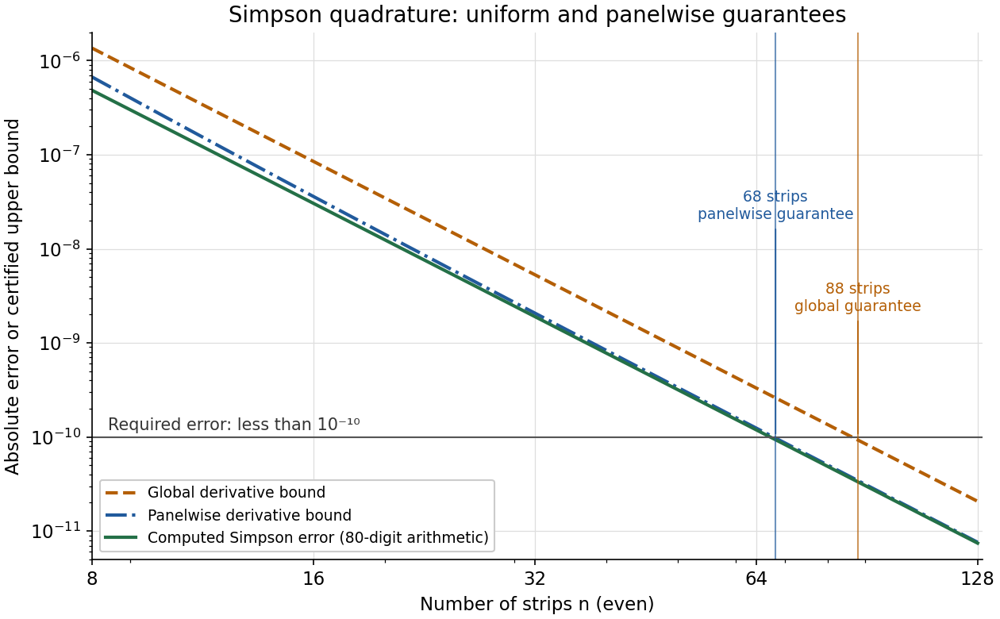

<h1 id="4/d/solution">Solution</h1>

↑ **Parent:** [D](../d.md)

The global bound requires

$$
\frac1{180n^4}<10^{-10}
\quad\Longleftrightarrow\quad
n>\left(\frac{10^{10}}{180}\right)^{1/4}\approx86.3340.
$$

Since the strip count must be even, **the smallest count certified by this bound is $n=88$**.

For the tighter bound, use the [bisection method](../../../../../bisection-method.md) on the continuous extension $B(x)-10^{-10}$ for $x\ge2$. The initial [root bracket](../../../../../root-bracket.md) $[2,88]$ is valid: $B(2)=1/2880>10^{-10}$, while $B(88)$ is below the global bound and hence below $10^{-10}$. To identify the smallest admissible even count, the monotonicity of $B$ can also be justified.

Put $h=2/x$ and

$$
C(h)=(e-1)\frac h{e^h-1}-\frac e2+\frac{eh}{2},
\qquad B(x)=\frac{h^4C(h)}{2880}.
$$

For $h>0$, differentiation shows

$$
\left(\frac h{e^h-1}\right)'+\frac12
=\frac{e^{2h}-1-2he^h}{2(e^h-1)^2}\ge0.
$$

The numerator is nonnegative because $e^h-e^{-h}\ge2h$: its difference from $2h$ starts at zero and has nonnegative [derivative](../../../../../derivative.md) $e^h+e^{-h}-2$, by the [arithmetic-geometric mean inequality](../../../../../arithmetic-geometric-mean-inequality.md). Thus $C'(h)\ge1/2$, and $C(0^+)=e/2-1>0$. Therefore $h^4C(h)$ increases with $h$, so $B(x)$ is strictly decreasing with $x$. [Bisection](../../../../../bisection-method.md) locates its unique threshold crossing; then check the neighboring even integers, retaining the strict error inequality.

For example, $B(66)\approx1.09626\times10^{-10}$ and $B(68)\approx9.71694\times10^{-11}$, so **the tighter bound certifies $68$ strips**. These are evaluations of the bound, not an assumption that it equals the actual [quadrature error](../../../../../quadrature-error.md).

**[Figure 1](#4/d/image-computed-simpson-errors-and-the-two-certified-bounds-with-the-required-error-level). Computed Simpson errors and the two certified bounds, with the required error level**.

## ↑ Ancestors (12)

1. [D](../d.md)
2. [4](../../4.md)
3. [Discrete mathematics, continuous mathematics, and probability](../../../discrete-mathematics-continuous-mathematics-and-probability-split.md)
4. [2019](../../../split.md)
5. [Past exam of the year 1 of the computer science course of the University of Oxford](../../../../split.md)
6. [Year 1 of the computer science course of the University of Oxford](../../../../../year-1-of-the-computer-science-course-of-the-university-of-oxford.md)
7. [Computer science course of the University of Oxford](../../../../../computer-science-course-of-the-university-of-oxford.md)
8. [Undergraduate course of the University of Oxford](../../../../../undergraduate-course-of-the-university-of-oxford.md)
9. [Course of the University of Oxford](../../../../../course-of-the-university-of-oxford.md)
10. [University of Oxford](../../../../../university-of-oxford-split.md)
11. [List of universities](../../../../../list-of-universities.md)
12. [Codex Wiki](../../../../../split.md)
