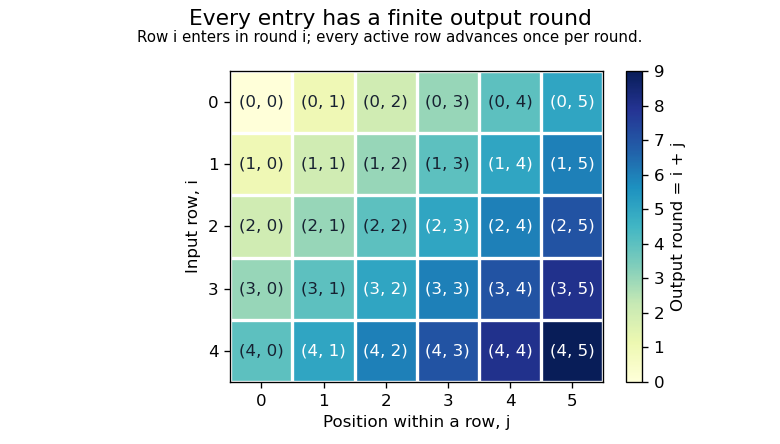

# Functional programming, design and analysis of algorithms

↑ **Parent:** [2019](../2019.md)

Source release: [Oxford examination archive](https://www.whatdotheyknow.com/request/ba_computer_science_past_papers/response/2577745/attach/2/202402%20183%20CS%20Papers.zip?cookie_passthrough=1), member `2018/T/a10097w1.pdf`. The cover dates this paper to 18 June 2019; the archive member's directory is misleading. The solutions cover every option. In the code, different definitions offered in different parts are alternatives, and the [Haskell](../../programming-language.md#haskell) [Prelude](../../programming-language.md#standard-prelude) operations have their usual meanings unless redefined locally.

**Table of contents**

- [1](#1)
  - [a](#1/a)
    - [Solution](#1/a/solution)
  - [b](#1/b)
    - [Solution](#1/b/solution)
  - [c](#1/c)
    - [Solution](#1/c/solution)
  - [d](#1/d)
    - [Solution](#1/d/solution)
  - [e](#1/e)
    - [Solution](#1/e/solution)
  - [f](#1/f)
    - [Solution](#1/f/solution)
  - [g](#1/g)
    - [Solution](#1/g/solution)
- [2](#2)
  - [a](#2/a)
    - [Solution](#2/a/solution)
  - [b](#2/b)
    - [Solution](#2/b/solution)
  - [c](#2/c)
    - [Solution](#2/c/solution)
  - [d](#2/d)
    - [Solution](#2/d/solution)
  - [e](#2/e)
    - [Solution](#2/e/solution)
  - [f](#2/f)
    - [Solution](#2/f/solution)
  - [g](#2/g)
    - [Solution](#2/g/solution)
- [3](#3)
  - [a](#3/a)
    - [Solution](#3/a/solution)
  - [b](#3/b)
    - [Solution](#3/b/solution)
  - [c](#3/c)
    - [Solution](#3/c/solution)
  - [d](#3/d)
    - [Solution](#3/d/solution)
  - [e](#3/e)
    - [Solution](#3/e/solution)
  - [f](#3/f)
    - [Solution](#3/f/solution)
- [4](#4)
  - [a](#4/a)
    - [Solution](#4/a/solution)
  - [b](#4/b)
    - [Solution](#4/b/solution)
  - [c](#4/c)
    - [Solution](#4/c/solution)
  - [d](#4/d)
    - [Solution](#4/d/solution)
  - [e](#4/e)
    - [Solution](#4/e/solution)
  - [f](#4/f)
    - [Solution](#4/f/solution)
  - [g](#4/g)
    - [Solution](#4/g/solution)
- [5](#5)
  - [a](#5/a)
    - [Solution](#5/a/solution)
  - [b](#5/b)
    - [Solution](#5/b/solution)
  - [c](#5/c)
    - [Solution](#5/c/solution)
  - [d](#5/d)
    - [i](#5/d/i)
      - [Solution](#5/d/i/solution)
    - [ii](#5/d/ii)
      - [Solution](#5/d/ii/solution)
    - [iii](#5/d/iii)
      - [Solution](#5/d/iii/solution)
- [6](#6)
  - [a](#6/a)
    - [i](#6/a/i)
      - [Solution](#6/a/i/solution)
    - [ii](#6/a/ii)
      - [Solution](#6/a/ii/solution)
    - [iii](#6/a/iii)
      - [Solution](#6/a/iii/solution)
  - [b](#6/b)
    - [Solution](#6/b/solution)
  - [c](#6/c)
    - [Solution](#6/c/solution)
  - [d](#6/d)
    - [i](#6/d/i)
      - [Solution](#6/d/i/solution)
    - [ii](#6/d/ii)
      - [Solution](#6/d/ii/solution)
- [7](#7)
  - [a](#7/a)
    - [Solution](#7/a/solution)
  - [b](#7/b)
    - [i](#7/b/i)
      - [Solution](#7/b/i/solution)
    - [ii](#7/b/ii)
      - [Solution](#7/b/ii/solution)
    - [iii](#7/b/iii)
      - [Solution](#7/b/iii/solution)
  - [c](#7/c)
    - [i](#7/c/i)
      - [Solution](#7/c/i/solution)
    - [ii](#7/c/ii)
      - [Solution](#7/c/ii/solution)
- [8](#8)
  - [a](#8/a)
    - [Solution](#8/a/solution)
  - [b](#8/b)
    - [Solution](#8/b/solution)
  - [c](#8/c)
    - [i](#8/c/i)
      - [Solution](#8/c/i/solution)
    - [ii](#8/c/ii)
      - [Solution](#8/c/ii/solution)
  - [d](#8/d)
    - [i](#8/d/i)
      - [Solution](#8/d/i/solution)
    - [ii](#8/d/ii)
      - [Solution](#8/d/ii/solution)

## 1

↑ **Parent:** [Functional programming, design and analysis of algorithms](functional-programming-design-and-analysis-of-algorithms.md)

<h3 id="1/a">a</h3>

↑ **Parent:** [1](#1)

<h4 id="1/a/solution">Solution</h4>

↑ **Parent:** [A](#1/a)

The [right fold](../../programming-language.md#list-fold) replaces the two [list](../../data-structure.md#list-abstract-data-type) constructors by its two arguments; the [left fold](../../programming-language.md#left-fold) instead updates an accumulator while traversing the [list](../../data-structure.md#list-abstract-data-type).

```
foldr :: (a -> b -> b) -> b -> [a] -> b
foldr c z []     = z
foldr c z (x:xs) = c x (foldr c z xs)

foldl :: (b -> a -> b) -> b -> [a] -> b
foldl s a []     = a
foldl s a (x:xs) = foldl s (s a x) xs
```

Thus **`foldr` is the natural [list fold](../../programming-language.md#list-fold)**: it preserves the constructor arrangement while replacing `[]` by `z` and `(:)` by `c`. In particular, `foldr (:) [] = id`. More generally, the [fold factorisation criterion](../../programming-language.md#fold-factorisation-criterion) says that the defining equations characterize the corresponding [structural recursion](../../programming-language.md#structural-recursion). Association and [lazy evaluation](../../programming-language.md#lazy-evaluation) are separate: the accumulator in this definition of [left fold](../../programming-language.md#left-fold) is not automatically evaluated at each step.[Chapter 9, PreludeList: foldr and foldl](../../computer-science-bibliography.md#haskell-2010-language-report)

<h3 id="1/b">b</h3>

↑ **Parent:** [1](#1)

<h4 id="1/b/solution">Solution</h4>

↑ **Parent:** [B](#1/b)

For every accumulator $a$, [pattern matching](../../programming-language.md#pattern-matching) makes `foldl s a undefined` the [bottom value](../../programming-language.md#bottom-value). Now use [structural induction](../../foundations-of-mathematics.md#structural-induction) on a finite [list prefix](../../data-structure.md#prefix-of-a-list) ending in the [bottom value](../../programming-language.md#bottom-value). The induction step is `foldl s a (x:ps) = foldl s (s a x) ps`; the induction hypothesis applies to _every_ accumulator, including `s a x`. Consequently every such finite approximation has result $\bot$.

An infinite [lazy list](../../data-structure.md#lazy-list) is the limit of its finite prefixes, each interpreted as a [finite approximation of a lazy list](../../data-structure.md#finite-approximation-of-a-lazy-list). Definable [Haskell](../../programming-language.md#haskell) operations are [Scott continuous maps](../../set.md#scott-continuity), so the result on the infinite [lazy list](../../data-structure.md#lazy-list) is the supremum of the results on these approximations. Every result is $\bot$, hence **`foldl s a xs = undefined` on every infinite input spine**, irrespective of whether `s` would inspect the accumulator.

For a concrete separation, choose `s = (&&)`, `a = True`, and `xs = False : repeat True`. The [left fold](../../programming-language.md#left-fold) is $\bot$, whereas the [right fold](../../programming-language.md#list-fold) returns **`False`** after observing the first element: `False && r` does not demand `r`. It is reaching the end of the input spine, rather than strictness of the combining operation, that prevents this [left fold](../../programming-language.md#left-fold) from returning.

<h3 id="1/c">c</h3>

↑ **Parent:** [1](#1)

<h4 id="1/c/solution">Solution</h4>

↑ **Parent:** [C](#1/c)

Over [integers](../../integer.md), choose **`s = c = (+)` and `a = b = 0`**. The [left fold](../../programming-language.md#left-fold) and [right fold](../../programming-language.md#list-fold) both compute the [sum](../../arithmetic.md#sum) of a finite [list](../../data-structure.md#list-abstract-data-type).

<h3 id="1/d">d</h3>

↑ **Parent:** [1](#1)

<h4 id="1/d/solution">Solution</h4>

↑ **Parent:** [D](#1/d)

Over [integers](../../integer.md), choose **`s = (-)`, `c = flip (-)`, and `a = b = 0`**. The [left fold](../../programming-language.md#left-fold) and [right fold](../../programming-language.md#list-fold) both compute the negative of the [sum](../../arithmetic.md#sum) of a finite [list](../../data-structure.md#list-abstract-data-type). The combining [functions](../../function.md) differ: `s 1 2 = -1`, whereas `c 1 2 = 1`.

<h3 id="1/e">e</h3>

↑ **Parent:** [1](#1)

<h4 id="1/e/solution">Solution</h4>

↑ **Parent:** [E](#1/e)

Let $F=\mathrm{foldl}\ (\ominus)\ 0$, using the specified operation $u\ominus v=v-u$. Direct evaluation gives $F([])=0$, $F([0])=0$, $F([1])=1$, and $F([1,0])=-1$.

Suppose $F=\mathrm{foldr}\ c\ b$ with the same [integer](../../integer.md) result type. The empty [list](../../data-structure.md#list-abstract-data-type) forces $b=0$. The two singleton calculations force $c\ 0\ 0=0$ and $c\ 1\ 0=1$. But then

$$
F([1,0])=c\ 1\ (c\ 0\ 0)=c\ 1\ 0=1,
$$

contrary to $F([1,0])=-1$. **No such `c,b` exist.** This is the information restriction in the [fold factorisation criterion](../../programming-language.md#fold-factorisation-criterion): equal folded tails must remain indistinguishable after the same head is attached. A larger, [function](../../function.md)-valued result type can retain the missing information, as the [continuation representation of a left fold](../../programming-language.md#continuation-representation-of-a-left-fold) does below.

<h3 id="1/f">f</h3>

↑ **Parent:** [1](#1)

<h4 id="1/f/solution">Solution</h4>

↑ **Parent:** [F](#1/f)

Assign $y:u$ and $x:v$. The application `s y x` forces $s:u\to v\to w$ for a fresh type $w$; applying `f` to that result forces $f:w\to r$. No further equations identify these four type variables. The [principal type](../../programming-language.md#principal-type) is therefore

```
k :: (u -> v -> w) -> v -> (w -> r) -> u -> r
k s x f y = f (s y x)
```

Every compatible typing is an instance of this one, because [type inference](../../programming-language.md#type-inference) imposed precisely the two application constraints and no class constraints.

<h3 id="1/g">g</h3>

↑ **Parent:** [1](#1)

<h4 id="1/g/solution">Solution</h4>

↑ **Parent:** [G](#1/g)

Fix `s` and put $R(xs,a)=\mathrm{foldr}\ (k\ s)\ \mathrm{id}\ xs\ a$. The [right fold](../../programming-language.md#list-fold) equations give

$$
R([],a)=a,\qquad R(x:xs,a)=R(xs,s\ a\ x).
$$

These are exactly the [left fold](../../programming-language.md#left-fold) equations. [Structural induction](../../foundations-of-mathematics.md#structural-induction), with the induction hypothesis quantified over _all_ accumulators, proves equality on finite terminating [lists](../../data-structure.md#list-abstract-data-type).

To include the other input spines, first observe that both applied expressions give $\bot$ on an undefined spine. The same induction proves equality on every finite prefix ending in $\bot$: the step `k s x f a` demands the continuation `f` when its result is demanded. Finally use that the two applied operations are [Scott continuous maps](../../set.md#scott-continuity), taking the limit over prefixes interpreted as a [finite approximation of a lazy list](../../data-structure.md#finite-approximation-of-a-lazy-list). This covers infinite spines, on which both applied expressions are $\bot$, and proves the identity for all [lists](../../data-structure.md#list-abstract-data-type) under the stated [Haskell](../../programming-language.md#haskell) semantics. The intermediate [right fold](../../programming-language.md#list-fold) builds an accumulator-transforming [function](../../function.md); it does not provide a terminating [left fold](../../programming-language.md#left-fold) of an infinite [list](../../data-structure.md#list-abstract-data-type).

## 2

↑ **Parent:** [Functional programming, design and analysis of algorithms](functional-programming-design-and-analysis-of-algorithms.md)

<h3 id="2/a">a</h3>

↑ **Parent:** [2](#2)

<h4 id="2/a/solution">Solution</h4>

↑ **Parent:** [A](#2/a)

Include nonpositive counts and exhausted input explicitly:

```
take :: Int -> [a] -> [a]
take n _      | n <= 0 = []
take _ []             = []
take n (x:xs)         = x : take (n-1) xs

drop :: Int -> [a] -> [a]
drop n xs     | n <= 0 = xs
drop _ []             = []
drop n (_:xs)         = drop (n-1) xs
```

The tests on the count precede inspection of the input [list](../../data-structure.md#list-abstract-data-type). Thus `take 0 undefined = []`, while `drop 0 undefined = undefined`, exactly as these [list prefix](../../data-structure.md#prefix-of-a-list) and [list suffix](../../data-structure.md#suffix-of-a-list) operations require. No element value is inspected merely to traverse the spine.[Chapter 9, PreludeList: take and drop](../../computer-science-bibliography.md#haskell-2010-language-report)

<h3 id="2/b">b</h3>

↑ **Parent:** [2](#2)

<h4 id="2/b/solution">Solution</h4>

↑ **Parent:** [B](#2/b)

A shared [recursion](../../algorithm.md#recursion-computer-science) computes both components:

```
split :: Int -> [a] -> ([a],[a])
split n xs | n <= 0 = ([],xs)
split _ []         = ([],[])
split n (x:xs)     = (x:ys,zs)
  where (ys,zs) = split (n-1) xs
```

For a defined count and a spine with $m$ available constructors before termination, each of `take` and `drop` makes $\min(\max(n,0),m)$ recursive calls, whereas `split` makes that many once. **The number of recursive calls is halved.** The [irrefutable pattern](../../programming-language.md#irrefutable-pattern) in the local pair binding also avoids evaluating the recursive pair merely to expose the first output element.

On [proper lazy lists](../../data-structure.md#proper-lazy-list) this has the intended two component values. There is a small [bottom value](../../programming-language.md#bottom-value) distinction outside that domain: the displayed single-pass definition must inspect a positive-count input spine before returning its outer pair, whereas the literal expression `(take n xs, drop n xs)` exposes the pair constructor even if `xs` is undefined. The algorithmic answer concerns the two components and the stated call count; it need not silently claim equality under a test that observes this outer constructor alone.

<h3 id="2/c">c</h3>

↑ **Parent:** [2](#2)

<h4 id="2/c/solution">Solution</h4>

↑ **Parent:** [C](#2/c)

For the paper's [leaf-labelled binary tree](../../data-structure.md#leaf-labelled-binary-tree), the combining operation receives the results of the two subtrees, and the other argument handles a leaf:

```
foldTree :: (a -> b) -> (b -> b -> b) -> Tree a -> b
foldTree f g (One x)   = f x
foldTree f g (Two l r) = g (foldTree f g l) (foldTree f g r)
```

Its constructor equation is **`foldTree One Two = id`**. More generally, a [function](../../function.md) `h` satisfying `h (One x) = f x` and `h (Two l r) = g (h l) (h r)` equals `foldTree f g` on finite [trees](../../tree-graph-theory.md), by [structural induction](../../foundations-of-mathematics.md#structural-induction). This is the [tree fold](../../programming-language.md#tree-fold) specialized to a datatype with labels only at leaves, rather than at internal nodes.

<h3 id="2/d">d</h3>

↑ **Parent:** [2](#2)

<h4 id="2/d/solution">Solution</h4>

↑ **Parent:** [D](#2/d)

Both versions preserve left-to-right leaf order:

```
flatten :: Tree a -> [a]
flatten (One x)   = [x]
flatten (Two l r) = flatten l ++ flatten r

flattenFold :: Tree a -> [a]
flattenFold = foldTree (\x -> [x]) (++)
```

The [tree fold](../../programming-language.md#tree-fold) replaces each leaf by a singleton [list](../../data-structure.md#list-abstract-data-type) and each internal node by [list concatenation](../../data-structure.md#list-concatenation). The defining equations of `flattenFold` are consequently those of `flatten`, proving their equality by [structural induction](../../foundations-of-mathematics.md#structural-induction).

<h3 id="2/e">e</h3>

↑ **Parent:** [2](#2)

<h4 id="2/e/solution">Solution</h4>

↑ **Parent:** [E](#2/e)

Let $n$ be the number of leaves; the total number of nodes is $2n-1$. [List concatenation](../../data-structure.md#list-concatenation) copies its left operand. For a [tree](../../tree-graph-theory.md) whose left subtree contains $n-1$ leaves at each successive internal node, these copied lengths are $1,2,\ldots,n-1$. Their [sum](../../arithmetic.md#sum) is $n(n-1)/2$, so the worst-case [running time](../../algorithm.md#running-time) is **$\Theta(n^2)$**.

A [difference list](../../data-structure.md#difference-list) representation avoids copying prefixes:

```
flattenFast :: Tree a -> [a]
flattenFast t = go t []
  where
    go (One x)   acc = x:acc
    go (Two l r) acc = go l (go r acc)
```

The [recursion invariant](../../algorithm.md#recursion-invariant) is `go t acc = flatten t ++ acc`. The leaf case is immediate; the internal-node case uses [associativity](../../algebraic-operation.md#associative-property) of [list concatenation](../../data-structure.md#list-concatenation). Each node is visited once and each leaf contributes one output constructor, giving **$\Theta(n)$ [running time](../../algorithm.md#running-time)** when the result is fully consumed. This is [linear flattening of a binary tree](../../data-structure.md#linear-flattening-of-a-binary-tree) and does not assume balance.

<h3 id="2/f">f</h3>

↑ **Parent:** [2](#2)

<h4 id="2/f/solution">Solution</h4>

↑ **Parent:** [F](#2/f)

The necessary domain is a finite, nonempty [list](../../data-structure.md#list-abstract-data-type): the datatype has no representation of an empty leaf sequence, and the supplied size-based balance condition does not specify an infinite-size construction.

```
build :: [a] -> Tree a
build []  = error "build: empty input"
build [x] = One x
build xs  = Two (build ys) (build zs)
  where
    (ys,zs) = split (length xs `div` 2) xs
```

For length $n\ge2$, the two nonempty pieces have $\lfloor n/2\rfloor$ and $\lceil n/2\rceil$ elements. Their sizes differ by at most one, and both are shorter than the input. [Induction](../../foundations-of-mathematics.md#mathematical-induction) therefore proves termination and the required [leaf-balanced binary tree](../../data-structure.md#leaf-balanced-binary-tree) property at every node. The same [induction](../../foundations-of-mathematics.md#mathematical-induction), using `ys ++ zs = xs`, proves `flatten (build xs) = xs`. This straightforward implementation takes $O(n\log n)$ [running time](../../algorithm.md#running-time); computing the length repeatedly is acceptable here because no faster construction was requested.

<h3 id="2/g">g</h3>

↑ **Parent:** [2](#2)

<h4 id="2/g/solution">Solution</h4>

↑ **Parent:** [G](#2/g)

Use the input [list](../../data-structure.md#list-abstract-data-type) as the seed of the [tree unfold](../../programming-language.md#tree-unfold):

```
buildUnfold :: [a] -> Tree a
buildUnfold = unfold step
  where
    step []  = error "build: empty input"
    step [x] = Left x
    step xs  = Right (split (length xs `div` 2) xs)
```

On a singleton seed, `unfold` produces the same leaf as `build`; on a longer finite seed, it recursively builds the same two pieces. [Induction](../../foundations-of-mathematics.md#mathematical-induction) on input length proves **`buildUnfold = build` on finite nonempty inputs**. The empty-input qualification remains essential: a [tree unfold](../../programming-language.md#tree-unfold) cannot supply a missing empty-tree constructor.

## 3

↑ **Parent:** [Functional programming, design and analysis of algorithms](functional-programming-design-and-analysis-of-algorithms.md)

<h3 id="3/a">a</h3>

↑ **Parent:** [3](#3)

<h4 id="3/a/solution">Solution</h4>

↑ **Parent:** [A](#3/a)

Use coordinates with row and column in $\{0,1,2\}$:

```
type Place  = (Int,Int)
type Places = [Place]
type Board  = (Places,Places,Places)
data Player = O | X deriving (Eq,Ord,Show)
```

The components of `Board` record the positions occupied by `O`, occupied by `X`, and still empty, respectively. On a nonterminal legal board, **equal occupied counts mean `O` moves next; one extra `O` means `X` moves next**.

The [type synonym](../../programming-language.md#type-synonym) does not enforce the [representation invariant](../../computer-science.md#representation-invariant): coordinates are in range; each component has no duplicates; the three represented [sets](../../set.md) form a [set partition](../../combinatorics.md#set-partition) of the nine positions; and the occupied counts differ as just described. Both players cannot have won. A winning `O` board has one extra `O`, and a winning `X` board has equal counts. More fundamentally, a legal [tic-tac-toe](../../game-theory.md#tic-tac-toe) state has a legal alternating history that stops at the first win: satisfying a type alone never licenses continuing an already completed game.

<h3 id="3/b">b</h3>

↑ **Parent:** [3](#3)

<h4 id="3/b/solution">Solution</h4>

↑ **Parent:** [B](#3/b)

The empty occupancy [sets](../../set.md) leave all nine coordinates available:

```
empty :: Board
empty = ([],[],[(r,c) | r <- [0..2], c <- [0..2]])
```

This board satisfies the [representation invariant](../../computer-science.md#representation-invariant) and gives `O` the next move.

<h3 id="3/c">c</h3>

↑ **Parent:** [3](#3)

<h4 id="3/c/solution">Solution</h4>

↑ **Parent:** [C](#3/c)

Assume the board satisfies the [representation invariant](../../computer-science.md#representation-invariant). Reject completed boards and occupied or out-of-range coordinates; testing membership in the empty component covers both coordinate failures.

```
finished :: Board -> Bool
finished (os,xs,es) = won os || won xs || null es

play :: Board -> Place -> Board
play b@(os,xs,es) q
  | finished b     = error "play: completed game"
  | q `notElem` es = error "play: unavailable place"
  | length os == length xs = (q:os,xs,rest)
  | otherwise             = (os,q:xs,rest)
  where rest = filter (/=q) es
```

Here `won` is defined in part d. Moving one available coordinate into the appropriate occupied component preserves the [set partition](../../combinatorics.md#set-partition) and the alternating-count rule. Checking completion first preserves the no-moves-after-a-win invariant.

<h3 id="3/d">d</h3>

↑ **Parent:** [3](#3)

<h4 id="3/d/solution">Solution</h4>

↑ **Parent:** [D](#3/d)

Construct each possible winning line, then test whether one is contained in the player's occupancy [set](../../set.md):

```
winningLines :: [Places]
winningLines =
  [[(r,c) | c <- [0..2]] | r <- [0..2]] ++
  [[(r,c) | r <- [0..2]] | c <- [0..2]] ++
  [[(i,i) | i <- [0..2]], [(i,2-i) | i <- [0..2]]]

won :: Places -> Bool
won ps = any (\line -> all (`elem` ps) line) winningLines
```

The [list comprehension](../../programming-language.md#list-comprehension) generates three rows, three columns and two diagonals. Each has exactly three coordinates; therefore `all` holds precisely when every coordinate of that line is occupied by this player. Taking `any` over the eight lines proves the win test correct.

<h3 id="3/e">e</h3>

↑ **Parent:** [3](#3)

<h4 id="3/e/solution">Solution</h4>

↑ **Parent:** [E](#3/e)

Record the outcome at the first completed board and otherwise branch over every available move:

```
data Outcome = Winner Player | Draw deriving (Eq,Ord,Show)

finals :: Board -> [(Board,Outcome)]
finals b@(os,xs,es)
  | won os    = [(b,Winner O)]
  | won xs    = [(b,Winner X)]
  | null es   = [(b,Draw)]
  | otherwise = concatMap (\q -> finals (play b q)) es
```

The [recursion](../../algorithm.md#recursion-computer-science) terminates because each recursive call decreases the number of empty positions by one. For correctness, induct on that number. A completed board contributes exactly its own outcome. Otherwise every legal continuation has a unique first available move, and the induction hypothesis covers exactly all completions after that move. [List concatenation](../../data-structure.md#list-concatenation) collects these branches without extending completed games. Repeated final positions are allowed here because the computation deliberately explores every legal move sequence.

<h3 id="3/f">f</h3>

↑ **Parent:** [3](#3)

<h4 id="3/f/solution">Solution</h4>

↑ **Parent:** [F](#3/f)

Different move orders can lead to the same position, and the two occupancy [lists](../../data-structure.md#list-abstract-data-type) also retain irrelevant insertion order. Thus this [search tree](../../theoretical-computer-science.md#search-tree) repeatedly solves the same remaining game. For example, swapping the order of two `O` moves while leaving the intervening `X` moves legal can reach the same occupied [sets](../../set.md).

Canonicalize each state by sorted occupancy [sets](../../set.md), or by two [bitboards](../../programming-language.md#bitboard), and apply [memoization](../../algorithm.md#memoization) or a visited-state [set](../../set.md). Expand each canonical position once, stopping at terminal states, and collect terminal positions in a [set](../../set.md). There are at most $3^9$ cell assignments, many of which are illegal; this is much smaller than a [tree](../../tree-graph-theory.md) of move permutations. **Store positions, not histories, when the requested output is distinct final positions.** Board rotations and reflections can reduce work further if handled as an additional equivalence: if the output must retain every oriented board, reconstruct those distinct orientations rather than silently returning one representative per symmetry class.

## 4

↑ **Parent:** [Functional programming, design and analysis of algorithms](functional-programming-design-and-analysis-of-algorithms.md)

<h3 id="4/a">a</h3>

↑ **Parent:** [4](#4)

<h4 id="4/a/solution">Solution</h4>

↑ **Parent:** [A](#4/a)

For [proper lazy lists](../../data-structure.md#proper-lazy-list), the generic condition is **a finite first [list](../../data-structure.md#list-abstract-data-type), or an empty second [list](../../data-structure.md#list-abstract-data-type)**. A finite first [list](../../data-structure.md#list-abstract-data-type) reaches its terminating constructor, after which [list concatenation](../../data-structure.md#list-concatenation) exposes the second one. An infinite first [list](../../data-structure.md#list-abstract-data-type) never yields control to the second; it therefore cannot deliver occurrences originating there unless there are none. This concerns input occurrences, rather than an accidental overlap of the two inputs' value [sets](../../set.md).

A first spine ending in the [bottom value](../../programming-language.md#bottom-value) also prevents access to the second [list](../../data-structure.md#list-abstract-data-type). Such inputs require the partial-input qualification in part c; a visible prefix is different from a terminating finite [list](../../data-structure.md#list-abstract-data-type).

<h3 id="4/b">b</h3>

↑ **Parent:** [4](#4)

<h4 id="4/b/solution">Solution</h4>

↑ **Parent:** [B](#4/b)

Swap roles after emitting one element:

```
interleave :: [a] -> [a] -> [a]
interleave []     ys = ys
interleave (x:xs) ys = x : interleave ys xs
```

While both [lists](../../data-structure.md#list-abstract-data-type) are nonempty, the [function](../../function.md) alternates between them. Their $j$-th input occurrences appear after at most $2j+2$ output steps, counting positions from zero; once either [list](../../data-structure.md#list-abstract-data-type) ends, the other is returned directly. Every output constructor comes from one input constructor, and every input occurrence is eventually selected. This proves [fair enumeration](../../algorithm.md#fair-enumeration) and [productivity](../../data-structure.md#stream-productivity) on the two [proper lazy lists](../../data-structure.md#proper-lazy-list), including two infinite ones.

<h3 id="4/c">c</h3>

↑ **Parent:** [4](#4)

<h4 id="4/c/solution">Solution</h4>

↑ **Parent:** [C](#4/c)

**No universally correct sequential [Haskell](../../programming-language.md#haskell) implementation has that guarantee for [partial lists](../../data-structure.md#partial-list).** Compare `undefined` paired with `[v]`, and `[v]` paired with `undefined`, where the element type is arbitrary. A generic program cannot fabricate `v`; it must eventually inspect an input spine to obtain it. Whichever input it first demands can be chosen to be the undefined one, blocking access to the available element in the other input.

In particular, the implementation in part b can emit a defined prefix and then block when alternation reaches an undefined tail. [Lazy evaluation](../../programming-language.md#lazy-evaluation) postpones demands; it cannot recognize that a demanded computation will never finish. The result is the [partial-list interleaving obstruction](../../data-structure.md#partial-list-interleaving-obstruction), not an objection to fairness under the proper-input hypothesis. Additional concurrent primitives would change the computational model.[§3.1, errors and nontermination; §3.17, demands made by pattern matching](../../computer-science-bibliography.md#haskell-2010-language-report)

<h3 id="4/d">d</h3>

↑ **Parent:** [4](#4)

<h4 id="4/d/solution">Solution</h4>

↑ **Parent:** [D](#4/d)

Use [diagonal merging of lazy lists](../../algorithm.md#diagonal-merging-of-lazy-lists): introduce one new row each round, and advance every active row once. Each round contains finitely many active rows, even when the outer [list](../../data-structure.md#list-abstract-data-type) is infinite.

```
fairConcat :: [[a]] -> [a]
fairConcat = concat . levels []
  where
    levels [] [] = []
    levels active pending =
      let (new,rest) = case pending of
            []     -> ([],[])
            r:rs   -> ([r],rs)
          live = [r | r@(_:_) <- active ++ new]
      in map head live : levels (map tail live) rest
```

Number rows and positions within each row from zero. An occurrence at $(i,j)$ is emitted in round **$i+j$**: its row enters in round $i$ and advances once per subsequent round. All earlier rounds and each round's output are finite, so every required occurrence appears after finite work. `live` discards only empty rows, and `head` emits only existing entries; no new value is invented.

<a id="4/d/image-diagonal-merging-of-lazy-lists-visits-every-finite-row-position-pair-after-finitely-many-rounds"></a>


**[Figure 1](#4/d/image-diagonal-merging-of-lazy-lists-visits-every-finite-row-position-pair-after-finitely-many-rounds). Diagonal merging of lazy lists visits every finite row-position pair after finitely many rounds**.

Simply nesting `interleave` is unsafe here: `foldr interleave [] ([1,2] : repeat [])` emits `1` and then demands an undefined merge of the infinitely many empty rows before it can emit `2`. The finite-round construction avoids that starvation. There is still an unavoidable termination qualification: after the last actual output, infinitely many empty pending rows cannot be certified empty in finite work. The result can then have an undefined tail instead of a terminating `[]`. Every required occurrence has nevertheless appeared; no generic [algorithm](../../algorithm.md) can promise a proper completed output in that exceptional situation, by the [absence-detection obstruction for infinite lists](../../data-structure.md#absence-detection-obstruction-for-infinite-lists).

<h3 id="4/e">e</h3>

↑ **Parent:** [4](#4)

<h4 id="4/e/solution">Solution</h4>

↑ **Parent:** [E](#4/e)

The ordinary [list comprehension](../../programming-language.md#list-comprehension) exhausts the inner [list](../../data-structure.md#list-abstract-data-type) before advancing the outer one. Therefore it enumerates every argument pair when **`ys` is finite**, or when **`xs` has at most one element**. If `ys` is infinite and `xs` has two or more elements, it stays with the first outer element forever and misses every pair with a later outer occurrence. Applying a constant `f` might hide missing pairs as duplicate values; it does not make the enumeration fair.

An empty-result caveat remains when `ys = []` and `xs` is infinite: the literal comprehension traverses infinitely many empty rows and does not return a terminating empty [list](../../data-structure.md#list-abstract-data-type). Its occurrence requirement is vacuous, but its [productivity](../../data-structure.md#stream-productivity) as an empty-result computation fails. An explicit empty-input test avoids that particular failure.

<h3 id="4/f">f</h3>

↑ **Parent:** [4](#4)

<h4 id="4/f/solution">Solution</h4>

↑ **Parent:** [F](#4/f)

Merge the rows with `fairConcat`, retaining explicit empty-input cases:

```
fairPair :: (a -> b -> c) -> [a] -> [b] -> [c]
fairPair _ [] _  = []
fairPair _ _  [] = []
fairPair f xs ys = fairConcat [[f x y | y <- ys] | x <- xs]
```

For nonempty [proper lazy lists](../../data-structure.md#proper-lazy-list), the occurrence `f (xs!!i) (ys!!j)` belongs to row $i$, position $j$, so the proof in part d puts it in round $i+j$. This supplies **every pair after finite work**, even when both input [lists](../../data-structure.md#list-abstract-data-type) are infinite. The guards also return `[]` for either empty factor without traversing infinitely many empty rows.

<h3 id="4/g">g</h3>

↑ **Parent:** [4](#4)

<h4 id="4/g/solution">Solution</h4>

↑ **Parent:** [G](#4/g)

For a **finite outer [list](../../data-structure.md#list-abstract-data-type)** of [proper lazy lists](../../data-structure.md#proper-lazy-list), use the fair binary product from part f:

```
cp :: [[a]] -> [[a]]
cp []       = [[]]
cp (xs:xss) = fairPair (:) xs (cp xss)
```

The empty family has one selection, the empty selection. For a nonempty finite family, each selection consists uniquely of one first-factor occurrence followed by a selection from the remaining factors. [Induction](../../foundations-of-mathematics.md#mathematical-induction) on the number of factors, together with the fairness of `fairPair`, proves that every such selection is produced and no invalid selection is introduced. Infinite factors are allowed: in particular, the three-factor example is enumerated fairly. If any factor is empty, the finite-family computation returns the empty product.

The printed hypothesis also permits an _infinite outer_ [proper lazy list](../../data-structure.md#proper-lazy-list). **No [function](../../function.md) can satisfy the full enumeration requirement for all such inputs.** Take `repeat [0,1]`. Its mathematical [Cartesian product](../../set-theory.md#cartesian-product) contains every infinite binary sequence and is [uncountable](../../cardinal-number.md#uncountable-set). If a result [list](../../data-structure.md#list-abstract-data-type) enumerated these sequences as $z_0,z_1,\ldots$, the binary sequence $b$ with $b_i=1-z_i(i)$ would differ from the $i$-th listed sequence at position $i$, contradicting completeness. This is an [uncountability obstruction to enumerating infinite Cartesian products](../../set-theory.md#uncountability-obstruction-to-enumerating-infinite-cartesian-products). The finite-outer qualification is a necessary repair to the specification, not a restriction imposed for convenience by the code.

## 5

↑ **Parent:** [Functional programming, design and analysis of algorithms](functional-programming-design-and-analysis-of-algorithms.md)

<h3 id="5/a">a</h3>

↑ **Parent:** [5](#5)

<h4 id="5/a/solution">Solution</h4>

↑ **Parent:** [A](#5/a)

A [divide-and-conquer algorithm](../../algorithm.md#divide-and-conquer-algorithm) handles a small input directly; otherwise it divides the input into smaller instances, recursively solves them, and combines their answers. With $a$ equally sized subproblems of size approximately $n/b$ and nonrecursive work $f(n)$, its [recurrence relation](../../sequence-and-series.md#recurrence-relation) has the form $T(n)=aT(n/b)+f(n)$, with constant-size base cases, $a\ge1$ and $b>1$.

Write $p=\log_b a$. The basic [master theorem](../../sequence-and-series.md#master-theorem) gives the following cases, with a fixed $\varepsilon>0$:

- If $f(n)=O(n^{p-\varepsilon})$, then **$T(n)=\Theta(n^p)$**.
- If $f(n)=\Theta(n^p)$, then **$T(n)=\Theta(n^p\log n)$**.
- If $f(n)=\Omega(n^{p+\varepsilon})$ and the regularity condition $af(n/b)\le cf(n)$ holds eventually for some $c<1$, then **$T(n)=\Theta(f(n))$**.

For the common extended middle case, $f(n)=\Theta(n^p\log^k n)$ with fixed $k\ge0$ gives $T(n)=\Theta(n^p\log^{k+1}n)$. A [recursion tree](../../algorithm.md#recursion-tree) explains the three cases: work is dominated by its leaves, spread across comparable levels, or dominated by its top levels. The regularity condition in the last case is part of the theorem, not an optional simplification.

<h3 id="5/b">b</h3>

↑ **Parent:** [5](#5)

<h4 id="5/b/solution">Solution</h4>

↑ **Parent:** [B](#5/b)

For an ascending [sorted array](../../data-structure.md#sorted-array), maintain a candidate interval $[\ell,r]$ initially containing every index. Compare the target with the middle entry at $m=\lfloor(\ell+r)/2\rfloor$. Equality returns $m$; if the target is smaller, replace $r$ by $m-1$; if larger, replace $\ell$ by $m+1$. An empty interval reports absence.

The [loop invariant](../../algorithm.md#loop-invariant) is that any target occurrence still possible lies inside the candidate interval. [Sortedness](../../algorithm.md#sortedness) justifies discarding the appropriate half after each unequal comparison. The interval length decreases to at most half its previous length, establishing termination and correctness. After $t$ unsuccessful comparisons there are at most $n/2^t$ candidates, so at most $\lfloor\log_2n\rfloor+1$ comparisons suffice for $n\ge1$. Each iteration uses constant work on a random-access [array](../../data-structure.md#array-data-structure). Thus **[binary search](../../algorithm.md#binary-search) takes $O(\log(n+1))$ [running time](../../algorithm.md#running-time)**, conventionally written $O(\log n)$ for nontrivial input sizes. Empty input is handled in constant time.

<h3 id="5/c">c</h3>

↑ **Parent:** [5](#5)

<h4 id="5/c/solution">Solution</h4>

↑ **Parent:** [C](#5/c)

Assume ascending [sorted arrays](../../data-structure.md#sorted-array); descending storage can be accessed in reverse index order without copying. Among $2n$ entries, the requested rank is **$k=n+1$ in ascending order**, not $n$. Repeated values occupy repeated ranks.

Choose $i$ entries from the first [array](../../data-structure.md#array-data-structure) and $j=k-i$ from the second, using their prefixes. The feasible range is $\max(0,k-n)\le i\le\min(n,k)$. Write $A_L=A[i]$, $A_R=A[i+1]$, and similarly $B_L,B_R$ at $j$, with missing left endpoints replaced by $-\infty$ and missing right endpoints by $+\infty$. These are conceptual sentinels, not extra stored entries.

Use [binary search](../../algorithm.md#binary-search) over the feasible values of $i$:

- If $A_L>B_R$, there are too many entries from $A$ on the left; decrease the upper bound to $i-1$.
- If $B_L>A_R$, there are too few entries from $A$ on the left; increase the lower bound to $i+1$.
- Otherwise return **$\max(A_L,B_L)$**.

For correctness, in the last case every left entry is no greater than every right entry, and exactly $k$ entries lie on the left. Their [maximum](../../set.md#maximum-of-a-subset-of-a-total-order) is therefore the $k$-th smallest entry. The failed inequalities are monotone in the searched index: increasing $i$ raises the $A$ boundary and decreases the $B$ boundary, so it cannot repair $A_L>B_R$; the other case is symmetric. A partition of the first $k$ entries of a merged ordering supplies an admissible solution, including ties. Each step halves an interval with at most $n+1$ choices, giving **$O(\log(n+1))$ [running time](../../algorithm.md#running-time) and $O(1)$ [auxiliary space](../../algorithm.md#auxiliary-space)**. This is a [two-sorted-array order statistic](../../algorithm.md#two-sorted-array-order-statistic) without constructing the merged [array](../../data-structure.md#array-data-structure).

<h3 id="5/d">d</h3>

↑ **Parent:** [5](#5)

<h4 id="5/d/i">i</h4>

↑ **Parent:** [D](#5/d)

<h5 id="5/d/i/solution">Solution</h5>

↑ **Parent:** [I](#5/d/i)

If coordinate $j$ is not an [essential variable of a function](../../function.md#essential-variable-of-a-function), changing that coordinate alone never changes the output, for _any_ values of the other coordinates. Take two inputs with the same $i$-th coordinate. Change their other coordinates one at a time to transform the first input into the second. Every such change is inessential, so all intermediate outputs are equal.

Define $f_i(t)=f(1,\ldots,1,t,1,\ldots,1)$, with $t$ in position $i$. The preceding argument gives **$f(x_1,\ldots,x_n)=f_i(x_i)$**. Since $i$ is essential, $f_i$ is nonconstant. The conclusion depends on the full “for every context” negation of essentiality, not merely on testing a coordinate at one selected input.

<h4 id="5/d/ii">ii</h4>

↑ **Parent:** [D](#5/d)

<h5 id="5/d/ii/solution">Solution</h5>

↑ **Parent:** [Ii](#5/d/ii)

If $n=1$, return its sole index without a query. Otherwise first evaluate $f(t,t,\ldots,t)$ for $t=1,\ldots,d$ until two different outputs are found. Part i says these outputs are precisely $f_i(t)$, so two values $a,b$ with $f_i(a)\ne f_i(b)$ must exist. This uses at most $d$ calls to the [function-evaluation oracle](../../theoretical-computer-science.md#function-oracle).

Maintain a candidate index [set](../../set.md) $S$, initially all indices. Split $S$ into two nearly equal pieces and choose one, $H$. Query the input that is $b$ on $H$ and $a$ everywhere else. Its output equals $f_i(b)$ exactly when $i\in H$, and otherwise equals $f_i(a)$. Retain the indicated half and repeat until one index remains.

The [loop invariant](../../algorithm.md#loop-invariant) is $i\in S$, and the witness outputs keep each test unambiguous. There are at most $\lceil\log_2 n\rceil$ splitting queries. The total is **at most $d+\lceil\log_2n\rceil$ evaluations**, which is $O(d\log n)$ for $n\ge2$, and in fact a stronger additive bound. Only oracle calls are being counted; explicitly constructing each query vector can require $O(n)$ ordinary work. This is [identification of a unique essential variable](../../theoretical-computer-science.md#identification-of-a-unique-essential-variable).

<h4 id="5/d/iii">iii</h4>

↑ **Parent:** [D](#5/d)

<h5 id="5/d/iii/solution">Solution</h5>

↑ **Parent:** [Iii](#5/d/iii)

Restrict the unknown [function](../../function.md) to the $n$ possibilities $f^{(i)}(x)=1$ if $x_i=1$, and $2$ otherwise. Each has exactly one [essential variable](../../function.md#essential-variable-of-a-function), even if the allowed alphabet has more than two values. Every oracle answer in this restricted family is one [bit](../../information-theory.md#bit).

A correct adaptive deterministic [algorithm](../../algorithm.md) must distinguish all $n$ possibilities. A binary [decision tree](../../theoretical-computer-science.md#decision-tree) of depth $q$ has at most $2^q$ leaves, so $2^q\ge n$. Therefore **$q\ge\lceil\log_2n\rceil=\Omega(\log n)$**. Restricting the answer family is essential to the argument: unrestricted integer-valued answers need not have binary branching. Combined with part ii, this gives optimal logarithmic [query complexity](../../theoretical-computer-science.md#query-complexity) for fixed $d$.

## 6

↑ **Parent:** [Functional programming, design and analysis of algorithms](functional-programming-design-and-analysis-of-algorithms.md)

<h3 id="6/a">a</h3>

↑ **Parent:** [6](#6)

<h4 id="6/a/i">i</h4>

↑ **Parent:** [A](#6/a)

<h5 id="6/a/i/solution">Solution</h5>

↑ **Parent:** [I](#6/a/i)

Store a [complete binary tree](../../data-structure.md#complete-binary-tree) in a one-indexed [array](../../data-structure.md#array-data-structure) $A[1..n]$, level by level. Index $i$ has [parent in a rooted tree](../../tree-graph-theory.md#parent-in-a-rooted-tree) $\lfloor i/2\rfloor$ for $i>1$ and possible [children in a rooted tree](../../tree-graph-theory.md#child-in-a-rooted-tree) $2i$ and $2i+1$, present only when their indices are at most $n$. The [max-heap](../../data-structure.md#max-heap) condition is $A[\lfloor i/2\rfloor]\ge A[i]$ for every $i>1$.

Following these inequalities from the [root of a tree](../../tree-graph-theory.md#root-of-a-tree) to any entry proves that **$A[1]$ is a [maximum](../../set.md#maximum-of-a-subset-of-a-total-order)**. The [heap order](../../data-structure.md#heap-order) does not sort siblings or unrelated branches. The [complete binary tree](../../data-structure.md#complete-binary-tree) has height $\lfloor\log_2 n\rfloor$, which bounds how far any single repair can travel. Store the current heap size separately from the [array](../../data-structure.md#array-data-structure)'s capacity.

<h4 id="6/a/ii">ii</h4>

↑ **Parent:** [A](#6/a)

<h5 id="6/a/ii/solution">Solution</h5>

↑ **Parent:** [Ii](#6/a/ii)

Assume the subtrees rooted at the [children in a rooted tree](../../tree-graph-theory.md#child-in-a-rooted-tree) of $i$ already obey the [max-heap](../../data-structure.md#max-heap) condition. Compare $A[i]$ with each present child and choose an index of the largest of these at most three keys. If that index is $i$, stop. Otherwise exchange the two keys, continue at the chosen child, and repeat. This is [sift down](../../data-structure.md#sift-down), with the inequality reversed from a minimum-oriented [binary heap](../../data-structure.md#binary-heap).

The exchange repairs the old root position because its new key dominates both child roots; only the subtree receiving the displaced key can still be defective. This [recursion invariant](../../algorithm.md#recursion-invariant) proves correctness. Each exchange descends one level and costs constant work, so **the worst-case [running time](../../algorithm.md#running-time) is $O(h)$ for subtree height $h$, hence $O(\log n)$**. A small key at the root of a suitably ordered heap must descend to a leaf, so the logarithmic worst-case bound is attained.

<h4 id="6/a/iii">iii</h4>

↑ **Parent:** [A](#6/a)

<h5 id="6/a/iii/solution">Solution</h5>

↑ **Parent:** [Iii](#6/a/iii)

Leaves already obey the [heap order](../../data-structure.md#heap-order). Process indices $\lfloor n/2\rfloor,\lfloor n/2\rfloor-1,\ldots,1$, calling the preceding repair at each. When an index is processed, its descendants have already been processed, so the repair's precondition holds. The resulting [array](../../data-structure.md#array-data-structure) is a [max-heap](../../data-structure.md#max-heap).

The bound obtained by charging $O(\log n)$ to every call is unnecessarily large. The number of nodes with height at least $h$ is at most $\lfloor n/2^h\rfloor$. Therefore

$$
\sum_v(1+\operatorname{height}(v))
\le n+\sum_{h\ge1}\lfloor n/2^h\rfloor<2n.
$$

The total repair work is thus **$O(n)$**, and the loop itself has a linear number of iterations, giving **$\Theta(n)$** for this [bottom-up heap construction](../../data-structure.md#bottom-up-heap-construction). Most nodes are near the leaves and require little repair.

<h3 id="6/b">b</h3>

↑ **Parent:** [6](#6)

<h4 id="6/b/solution">Solution</h4>

↑ **Parent:** [B](#6/b)

A [maximum priority queue](../../data-structure.md#maximum-priority-queue) stores keyed entries and supports insertion, inspection and removal of an entry with greatest key, and key increases. A [max-heap](../../data-structure.md#max-heap) gives the following [running times](../../algorithm.md#running-time), with the size/capacity cost of the backing [array](../../data-structure.md#array-data-structure) accounted for separately:

- `maximum`: return the root key in **$O(1)$** time.
- `insert`: append at the next available leaf, then use [sift up](../../data-structure.md#sift-up) until the [heap order](../../data-structure.md#heap-order) holds, in **$O(\log n)$** time.
- `extractMaximum`: save the root, replace it by the last entry, reduce the size, and use [sift down](../../data-structure.md#sift-down), in **$O(\log n)$** time.
- `increaseKey(i,k)`: reject $k<A[i]$; otherwise set the new key and use [sift up](../../data-structure.md#sift-up), in **$O(\log n)$** time.
- `isEmpty` and `size`: inspect the stored size in **$O(1)$** time; construct a queue from $n$ keys by [bottom-up heap construction](../../data-structure.md#bottom-up-heap-construction) in **$\Theta(n)$** time.

Empty-queue inspections and removals need an explicit failure result. The index argument to `increaseKey` must identify the entry's _current_ location: if callers use item handles, update their location records during swaps.

<h3 id="6/c">c</h3>

↑ **Parent:** [6](#6)

<h4 id="6/c/solution">Solution</h4>

↑ **Parent:** [C](#6/c)

Given the target's current heap index $i$, remove it as follows. If $i=n$, discard the last entry. Otherwise replace $A[i]$ by $A[n]$ and reduce $n$ by one. If the replacement is larger than its [parent in a rooted tree](../../tree-graph-theory.md#parent-in-a-rooted-tree), use [sift up](../../data-structure.md#sift-up); otherwise use the maximum-oriented [sift down](../../data-structure.md#sift-down) from $i$.

Only comparisons incident to the replacement can initially violate the [heap order](../../data-structure.md#heap-order). If it exceeds its parent, it also dominates the old children because the old key dominated those children and was no larger than the parent; an upward repair suffices. Otherwise the upward comparison is valid and only a downward repair can be needed. Thus **removal takes $O(\log n)$ worst-case time** after the location is known. Searching an unindexed heap for an arbitrary specified key can instead require $\Theta(n)$ time; the logarithmic bound does not include such a search.

<h3 id="6/d">d</h3>

↑ **Parent:** [6](#6)

<h4 id="6/d/i">i</h4>

↑ **Parent:** [D](#6/d)

<h5 id="6/d/i/solution">Solution</h5>

↑ **Parent:** [I](#6/d/i)

Only arrange switches towards `A`. For every [vertex](../../graph.md#vertex-graph-theory) $u$, compute its degree $\deg(u)$ and the current number $c(u)$ of neighbours preferring `A`. Put the `B` [vertices](../../graph.md#vertex-graph-theory) in a [max-heap](../../data-structure.md#max-heap) with key $q(u)=2c(u)-\deg(u)$. Maintain each [vertex](../../graph.md#vertex-graph-theory)'s current heap [array](../../data-structure.md#array-data-structure) index during exchanges.

While the queue is nonempty and its [maximum](../../set.md#maximum-of-a-subset-of-a-total-order) key is positive, extract that [vertex](../../graph.md#vertex-graph-theory) $u$, show it its neighbours' preferences, append $u$ to the answer sequence, and set its preference to `A`. For every neighbour $v$ still preferring `B`, increase $c(v)$ by one and use `increaseKey` to increase its heap key by two. Stop when every remaining key is nonpositive.

A positive key means precisely a strict majority of `A` neighbours, so every listed move is legal. Degrees never change; `A` neighbours never revert in this chosen sequence. An isolated `B` [vertex](../../graph.md#vertex-graph-theory) has key zero and cannot be converted. Initialization costs $O(|V|+|E|)$, there are at most $|V|$ extractions, and each [edge](../../graph-theory.md#edge-of-a-graph) causes at most two neighbour inspections and at most a constant number of key updates. The required bound is therefore **$O((|V|+|E|)\log(|V|+1))$**. A simple work queue of newly eligible [vertices](../../graph.md#vertex-graph-theory) can even implement the same [monotone threshold activation](../../graph.md#monotone-threshold-activation) in $O(|V|+|E|)$ time, since a [vertex](../../graph.md#vertex-graph-theory) needs to be enqueued only once.

<h4 id="6/d/ii">ii</h4>

↑ **Parent:** [D](#6/d)

<h5 id="6/d/ii/solution">Solution</h5>

↑ **Parent:** [Ii](#6/d/ii)

Let $C$ be the final `A` [set](../../set.md) produced by the [algorithm](../../algorithm.md). It contains the initial `A` set, and every [vertex](../../graph.md#vertex-graph-theory) outside $C$ has at most half its neighbours in $C$: otherwise its final key would still be positive. Thus $C$ is closed under the activation rule.

Now consider _any_ legal sequence, including sequences which change some `A` preferences back to `B`. We prove by [induction](../../foundations-of-mathematics.md#mathematical-induction) that its current `A` set is always a [subset](../../set.md#subset) of $C$. This is true initially. A switch to `B` preserves the inclusion. If a [vertex](../../graph.md#vertex-graph-theory) outside $C$ were to switch to `A`, its `A` neighbours would all lie in $C$, so their number could not exceed half its degree. Such a switch is forbidden. A switch inside $C$ also preserves the inclusion.

Consequently every attainable final `A` set has size at most $|C|$. The [algorithm](../../algorithm.md) supplies a legal sequence attaining $C$ itself, so **its sequence is optimal**. This [closure dominance for asynchronous threshold switching](../../graph.md#closure-dominance-for-asynchronous-threshold-switching) proves more than a local-greedy claim: temporary losses of `A` [vertices](../../graph.md#vertex-graph-theory) cannot unlock an additional [vertex](../../graph.md#vertex-graph-theory) outside the activation closure.

## 7

↑ **Parent:** [Functional programming, design and analysis of algorithms](functional-programming-design-and-analysis-of-algorithms.md)

<h3 id="7/a">a</h3>

↑ **Parent:** [7](#7)

<h4 id="7/a/solution">Solution</h4>

↑ **Parent:** [A](#7/a)

Use unit-cost insertion, deletion and substitution of one symbol. Their minimum total cost is the [edit distance](../../mathematical-optimization.md#edit-distance). Let $D[i,j]$ be the [edit distance](../../mathematical-optimization.md#edit-distance) between the first $i$ symbols of the first sequence and the first $j$ of the second. Initialize $D[i,0]=i$ and $D[0,j]=j$. For $i,j>0$ compute

$$
D[i,j]=\min\left\{D[i-1,j]+1,\ D[i,j-1]+1,\ D[i-1,j-1]+[x_i\ne y_j]\right\}.
$$

The cases delete the final source symbol, insert the final target symbol, or align the two final symbols, paying one for substitution and zero for a match. Every optimal alignment ends in one of these cases, and each case extends a valid shorter alignment. [Induction](../../foundations-of-mathematics.md#mathematical-induction) on $i+j$ proves the [dynamic programming](../../mathematical-optimization.md#dynamic-programming) recurrence correct.

Fill rows or columns in increasing order so every dependency is already available. There are $(m+1)(n+1)$ entries with constant work per interior entry: **$O(mn)$ [running time](../../algorithm.md#running-time)** for nonempty sequences, or $O((m+1)(n+1))$ including the boundary cases. The full table has [space complexity](../../theoretical-computer-science.md#space-complexity) $O(mn)$; two rows give $O(n)$ [auxiliary space](../../algorithm.md#auxiliary-space) when only the distance is wanted. Predecessor choices in the full table recover an optimal edit sequence.

<h3 id="7/b">b</h3>

↑ **Parent:** [7](#7)

<h4 id="7/b/i">i</h4>

↑ **Parent:** [B](#7/b)

<h5 id="7/b/i/solution">Solution</h5>

↑ **Parent:** [I](#7/b/i)

For nonnegative [integer](../../integer.md) amount $v$, let $M[t]$ be the minimum number of coins making amount $t$. Set $M[0]=0$ and compute, in increasing order of $t$,

$$
M[t]=1+\min_{i:x_i\le t} M[t-x_i],\qquad 1\le t\le v.
$$

An empty candidate [set](../../set.md) has [minimum](../../set.md#minimum-of-a-subset-of-a-total-order) $\infty$. Here denomination $1$ ensures that every nonnegative amount is attainable. Removing one coin from an optimal nonempty solution gives a smaller amount, and adding any allowed last coin gives a feasible solution; these two directions prove the recurrence by [induction](../../foundations-of-mathematics.md#mathematical-induction) on $t$.

Return **whether $M[v]\le k$**. This solves the at-most-$k$ decision without needing a separate dimension for $k$. The table for the [minimum coin change recurrence](../../mathematical-optimization.md#minimum-coin-change-recurrence) takes **$O(nv)$ [running time](../../algorithm.md#running-time) and $O(v)$ [space complexity](../../theoretical-computer-science.md#space-complexity)**. The bound is [pseudopolynomial time](../../theoretical-computer-science.md#pseudopolynomial-time): the amount, rather than its binary encoding length, appears in it. Amount zero needs zero coins.

<h4 id="7/b/ii">ii</h4>

↑ **Parent:** [B](#7/b)

<h5 id="7/b/ii/solution">Solution</h5>

↑ **Parent:** [Ii](#7/b/ii)

During the computation in part i, record an index $\operatorname{last}[t]$ attaining the minimum at every positive amount. Starting with $t=v$, print $x_{\operatorname{last}[t]}$ and replace $t$ by $t-x_{\operatorname{last}[t]}$, continuing until $t=0$.

Every step decreases the amount and reduces the table entry by exactly one. The printed denominations therefore sum to $v$ and their number is exactly $M[v]$, proving optimality. **The total [running time](../../algorithm.md#running-time) is $O(nv+M[v])$**, including the output; $M[v]\le v$ because denomination $1$ is available. The predecessor [array](../../data-structure.md#array-data-structure) adds $O(v)$ to the [space complexity](../../theoretical-computer-science.md#space-complexity). This is reconstruction from the [dynamic programming](../../mathematical-optimization.md#dynamic-programming) certificate, not the largest-denomination [greedy algorithm](../../algorithm.md#greedy-algorithm), which need not be optimal for arbitrary denominations.

<h4 id="7/b/iii">iii</h4>

↑ **Parent:** [B](#7/b)

<h5 id="7/b/iii/solution">Solution</h5>

↑ **Parent:** [Iii](#7/b/iii)

Let $M_i[t]$ use only the first $i$ available coins. Initialize $M_0[0]=0$, $M_0[t]=\infty$ for $t>0$, and use

$$
M_i[t]=\min\{M_{i-1}[t],\ 1+M_{i-1}[t-x_i]\},
$$

omitting the second term when $t<x_i$. The alternatives exclude the current coin or use it once; both refer to the previous row, so it cannot be used twice. [Induction](../../foundations-of-mathematics.md#mathematical-induction) on $i$ proves correctness, and **$M_n[v]$** is the required answer, including $\infty$ when no selection works.

The [running time](../../algorithm.md#running-time) is **$O(nv)$**. A single amount [array](../../data-structure.md#array-data-structure) reduces [auxiliary space](../../algorithm.md#auxiliary-space) to **$O(v)$** if each coin updates amounts in _descending_ order, $t=v,v-1,\ldots,x_i$. Then $M[t-x_i]$ still describes the previous row. Ascending updates would reuse the same coin and solve a different, unlimited-supply problem.

<h3 id="7/c">c</h3>

↑ **Parent:** [7](#7)

<h4 id="7/c/i">i</h4>

↑ **Parent:** [C](#7/c)

<h5 id="7/c/i/solution">Solution</h5>

↑ **Parent:** [I](#7/c/i)

The printed formula for the [edge](../../graph-theory.md#edge-of-a-graph) label has mismatched variable names. The type-correct reading is $x_i=\sigma(v_{i-1},v_i)$. Interpret the requested route as a [directed walk](../../graph-theory.md#directed-walk) of consecutive labelled [edges](../../graph-theory.md#edge-of-a-graph), allowing repeated [vertices](../../graph.md#vertex-graph-theory); the distinction from a vertex-simple [directed path](../../graph-theory.md#directed-path) is discussed below.

Let $R_t$ be the [set](../../set.md) of [vertices](../../graph.md#vertex-graph-theory) reachable from the specified start after reading exactly the first $t$ labels. Initialize $R_0=\{v_0\}$ and update

$$
R_t=\{v:\text{there is }(u,v)\in E\text{ with }u\in R_{t-1}\text{ and }\sigma(u,v)=x_t\}.
$$

After $k$ stages, answer **yes exactly when $R_k\ne\varnothing$**. A [directed walk](../../graph-theory.md#directed-walk) realizing a prefix decomposes into a walk realizing the shorter prefix and one correctly labelled final [edge](../../graph-theory.md#edge-of-a-graph); conversely every such extension is valid. This proves the [dynamic programming](../../mathematical-optimization.md#dynamic-programming) invariant by [induction](../../foundations-of-mathematics.md#mathematical-induction) on $t$. Store reachable [vertices](../../graph.md#vertex-graph-theory) in Boolean [arrays](../../data-structure.md#array-data-structure) and scan the [edges](../../graph-theory.md#edge-of-a-graph) per stage. The [running time](../../algorithm.md#running-time) is $O(k(|V|+|E|))$ with $O(|V|)$ rolling-table [space complexity](../../theoretical-computer-science.md#space-complexity), in addition to [graph](../../graph.md) storage. The empty label sequence is realized by staying at $v_0$.

If “path” is instead required to mean vertex-simple, augment the state to $(S,v)$, where $S$ is the [set](../../set.md) of visited [vertices](../../graph.md#vertex-graph-theory). Start with $R_0(\{v_0\},v_0)$ and extend a matching [edge](../../graph-theory.md#edge-of-a-graph) to $w$ only when $w\notin S$, replacing $S$ by $S\cup\{w\}$. This gives an exact [dynamic programming](../../mathematical-optimization.md#dynamic-programming) [algorithm](../../algorithm.md) for that interpretation too; reject immediately when $k\ge|V|$. A straightforward bound is $O(k2^{|V|}(|V|+|E|))$ [running time](../../algorithm.md#running-time) with $O(2^{|V|}|V|)$ rolling-table storage. The exponential distinction is substantive: all labels equal and $k=|V|-1$ include the [Hamiltonian path](../../graph-theory.md#hamiltonian-path) problem from a fixed start. The efficient layered recurrence answers the consecutive-edge interpretation without pretending to enforce distinct [vertices](../../graph.md#vertex-graph-theory).

<h4 id="7/c/ii">ii</h4>

↑ **Parent:** [C](#7/c)

<h5 id="7/c/ii/solution">Solution</h5>

↑ **Parent:** [Ii](#7/c/ii)

Use the multiplicative score exactly as defined in the paper. Let $P_t(v)$ be the largest score of a matching length-$t$ route ending at $v$. Initialize $P_0(v_0)=1$ and mark all other entries unreachable. For each stage, clear the new layer and inspect matching [edges](../../graph-theory.md#edge-of-a-graph) from reachable entries:

$$
P_t(v)=\max_{\substack{(u,v)\in E,\ \sigma(u,v)=x_t\\u\text{ reachable at stage }t-1}} P_{t-1}(u)\,p(u,v).
$$

An empty candidate [set](../../set.md) is marked unreachable, rather than given score zero: a genuine route may have score zero. A Boolean reachability table or a sentinel $-1$ with a guard before multiplication distinguishes the cases. Store the maximizing predecessor [edge](../../graph-theory.md#edge-of-a-graph) at each reachable layer entry, retaining one on a tie.

Multiplication by a nonnegative [edge](../../graph-theory.md#edge-of-a-graph) factor preserves order, so replacing a prefix by a larger-scoring matching prefix cannot worsen its extension. [Induction](../../foundations-of-mathematics.md#mathematical-induction) proves this [maximum-product edge-labelled walk](../../mathematical-optimization.md#maximum-product-edge-labelled-walk) recurrence correct. Choose a reachable final entry of greatest score and follow its layer-indexed predecessors backwards to reconstruct the answer. If no final entry is reachable, report that no matching route exists, even though all numeric scores might otherwise look like zero.

The [running time](../../algorithm.md#running-time) is $O(k(|V|+|E|))$, and rolling scores have [space complexity](../../theoretical-computer-science.md#space-complexity) $O(|V|)$, while retaining all reconstruction pointers gives [space complexity](../../theoretical-computer-science.md#space-complexity) $O(k|V|)$. For the vertex-simple interpretation, retain the visited [set](../../set.md) in each state as in part i, prohibit revisits and maximize the same products over those states. This exact exponential-state variant preserves both the zero-score distinction and predecessor reconstruction. If the starting [vertex](../../graph.md#vertex-graph-theory) is unrestricted rather than inherited from part i, initialize $P_0(v)=1$ for every [vertex](../../graph.md#vertex-graph-theory). The calculation needs no independence assumption beyond the paper's definition of a product score; repeated physical edge-activation events would require a separate probabilistic model.

## 8

↑ **Parent:** [Functional programming, design and analysis of algorithms](functional-programming-design-and-analysis-of-algorithms.md)

<h3 id="8/a">a</h3>

↑ **Parent:** [8](#8)

<h4 id="8/a/solution">Solution</h4>

↑ **Parent:** [A](#8/a)

Initialize $d[s]=0$ and $d[v]=\infty$ elsewhere. Perform $|V|-1$ full passes over the directed [edges](../../graph-theory.md#edge-of-a-graph), applying [edge relaxation](../../shortest-path-problem.md#edge-relaxation) $d[v]\gets\min\{d[v],d[u]+w(u,v)\}$ whenever $d[u]$ is finite. For an [undirected graph](../../graph-theory.md#undirected-graph), process each [edge](../../graph-theory.md#edge-of-a-graph) in both directions. Stop early if a pass makes no change.

Each finite label records the cost of a discovered [directed walk](../../graph-theory.md#directed-walk), so it never understates the true infimum. After $t$ passes, relaxation has propagated along every route of at most $t$ [edges](../../graph-theory.md#edge-of-a-graph), so the label is no greater than the cost of any such route. If no reachable negative-cost closed walk exists, an optimal route can be chosen without repeated [vertices](../../graph.md#vertex-graph-theory) and has at most $|V|-1$ [edges](../../graph-theory.md#edge-of-a-graph). These inequalities prove that the final labels are the desired [shortest path](../../shortest-path-problem.md#shortest-path) lengths.

An additional pass checks for an improving [edge](../../graph-theory.md#edge-of-a-graph) from a reachable [vertex](../../graph.md#vertex-graph-theory). If one exists, report a reachable negative-cost cycle: finite shortest distances cannot be assigned to [vertices](../../graph.md#vertex-graph-theory) reachable from that cycle. Mark those [vertices](../../graph.md#vertex-graph-theory) by forward reachability if individual $-\infty$ answers are wanted. In particular, a reachable negative undirected [edge](../../graph-theory.md#edge-of-a-graph) becomes a negative two-arc closed walk under the bidirected interpretation; generic signed weights do not guarantee finite answers.

Each pass costs $O(|E|)$, giving **$O(|V||E|)$** for the usual [Bellman-Ford algorithm](../../shortest-path-problem.md#bellman-ford-algorithm) bound. Including initialization gives $O(|V|+|V||E|)$, which also handles an edgeless [graph](../../graph.md) honestly; these coincide in order when $|E|\ge1$.

<h3 id="8/b">b</h3>

↑ **Parent:** [8](#8)

<h4 id="8/b/solution">Solution</h4>

↑ **Parent:** [B](#8/b)

All [edge](../../graph-theory.md#edge-of-a-graph) lengths are positive, so run the [Dijkstra algorithm](../../shortest-path-problem.md#dijkstra-algorithm) from every source $s$, retaining distances $d_s$ and a [shortest-path tree](../../shortest-path-problem.md#shortest-path-tree) of its reachable component. Each run takes $O((|V|+|E|)\log(|V|+1))$ with a [binary heap](../../data-structure.md#binary-heap). The following scans after each run use only $O(|E|)$ additional work.

For a [directed graph](../../graph-theory.md#directed-graph), inspect every closing [edge](../../graph-theory.md#edge-of-a-graph) $(u,s)$ and consider $d_s(u)+w(u,s)$ when $u$ is reachable. The [tree](../../tree-graph-theory.md) route from $s$ to $u$ followed by this [edge](../../graph-theory.md#edge-of-a-graph) is a closed walk. Every directed cycle supplies one such upper bound by choosing any of its [vertices](../../graph.md#vertex-graph-theory) as $s$; the shortest route to its predecessor is no longer than the corresponding cycle segment. Positivity lets any repeated portion be removed, so the smallest candidate is **the shortest directed-cycle length**.

For an [undirected graph](../../graph-theory.md#undirected-graph), do _not_ combine an [edge](../../graph-theory.md#edge-of-a-graph) with the distance between its endpoints indiscriminately: that can count traversal of one bridge out and back as a false cycle. Instead inspect only [edges](../../graph-theory.md#edge-of-a-graph) $\{u,v\}$ absent from the current [shortest-path tree](../../shortest-path-problem.md#shortest-path-tree), with both endpoints reachable, and consider

$$
d_s(u)+w(u,v)+d_s(v).
$$

The two [tree](../../tree-graph-theory.md) routes and this non-tree [edge](../../graph-theory.md#edge-of-a-graph) contain a genuine cycle. If they share a prefix, its cost is counted twice, so that cycle is no longer than the candidate. Every candidate is consequently at least the global shortest-cycle length.

To prove equality is attained, take a shortest cycle $C$ and a source $s$ on it. If either cycle [edge](../../graph-theory.md#edge-of-a-graph) incident to $s$ is absent from the [tree](../../tree-graph-theory.md), its candidate uses a shortest route no longer than the rest of $C$, so it is at most the length of $C$. Otherwise both incident [edges](../../graph-theory.md#edge-of-a-graph) are in the [tree](../../tree-graph-theory.md), and their other endpoints lie in different branches below $s$. Along the remaining segment of $C$, some [edge](../../graph-theory.md#edge-of-a-graph) crosses between different branches. Such an [edge](../../graph-theory.md#edge-of-a-graph) is not a [tree](../../tree-graph-theory.md) [edge](../../graph-theory.md#edge-of-a-graph). The two distances to its endpoints are bounded by the two corresponding, disjoint segments of $C$ from $s$; their sum plus the crossing [edge](../../graph-theory.md#edge-of-a-graph) is at most the length of $C$. Thus some candidate is no greater than the optimum, completing the proof.

Return the smallest finite candidate, or report acyclicity if none exists. The total [running time](../../algorithm.md#running-time) is **$O((|V|^2+|V||E|)\log(|V|+1))$**, as required. The ordinary convention is a simple [graph](../../graph.md); if parallel [edges](../../graph-theory.md#edge-of-a-graph) are allowed, track actual [edge](../../graph-theory.md#edge-of-a-graph) identities when excluding [tree](../../tree-graph-theory.md) [edges](../../graph-theory.md#edge-of-a-graph), and treat a self-loop as its own cycle rather than discarding it. This is [shortest cycle by repeated shortest-path trees](../../shortest-path-problem.md#shortest-cycle-by-repeated-shortest-path-trees).

<h3 id="8/c">c</h3>

↑ **Parent:** [8](#8)

<h4 id="8/c/i">i</h4>

↑ **Parent:** [C](#8/c)

<h5 id="8/c/i/solution">Solution</h5>

↑ **Parent:** [I](#8/c/i)

Find a [topological sorting](../../combinatorics.md#topological-sorting) of the [Directed acyclic graph](../../combinatorics.md#directed-acyclic-graph). Initialize $L[s]=0$ and $L[v]=-\infty$ for $v\ne s$. Process [vertices](../../graph.md#vertex-graph-theory) in that order. At a reachable [vertex](../../graph.md#vertex-graph-theory) $u$, update each outgoing [edge](../../graph-theory.md#edge-of-a-graph) by $L[v]\gets\max\{L[v],L[u]+w(u,v)\}$, and retain a predecessor whenever an improvement is made.

Every path to a [vertex](../../graph.md#vertex-graph-theory) ends at an earlier [vertex](../../graph.md#vertex-graph-theory) in the [topological sorting](../../combinatorics.md#topological-sorting). Thus, when $v$ is processed, all possible final-edge candidates for $v$ have already been considered. [Induction](../../foundations-of-mathematics.md#mathematical-induction) along the order proves that **$L[v]$ is the [longest path](../../graph-theory.md#longest-path) length from $s$**, with $-\infty$ exactly for unreachable [vertices](../../graph.md#vertex-graph-theory). Signed weights cause no problem because the [graph](../../graph.md) has no directed cycle. The [running time](../../algorithm.md#running-time) is **$O(|V|+|E|)$**, and predecessor pointers recover a maximizing path.

<h4 id="8/c/ii">ii</h4>

↑ **Parent:** [C](#8/c)

<h5 id="8/c/ii/solution">Solution</h5>

↑ **Parent:** [Ii](#8/c/ii)

Permit every [vertex](../../graph.md#vertex-graph-theory) to start a path: initialize $L[v]=0$ for all $v$, then perform the same maximum-relaxation pass in [topological sorting](../../combinatorics.md#topological-sorting) order. Equivalently, the recurrence is

$$
L[v]=\max\left(0,\ \max_{(u,v)\in E}\{L[u]+w(u,v)\}\right).
$$

The zero option starts a fresh, zero-edge path; the other options extend an optimal path ending at a predecessor. The largest final entry is therefore **the longest path length in the [graph](../../graph.md)**, allowing a zero-edge path. This takes $O(|V|+|E|)$, which is **$O(|V|^2)$** for the ordinary simple-graph representation.

If at least one [edge](../../graph-theory.md#edge-of-a-graph) is required, keep the same prefix values but return $\max_{(u,v)\in E}(L[u]+w(u,v))$ instead of $\max_vL[v]$. That variant correctly returns a negative optimum when all nonempty paths have negative weight, and reports no nonempty path if the [edge](../../graph-theory.md#edge-of-a-graph) set is empty. No all-pairs repetition is needed.

<h3 id="8/d">d</h3>

↑ **Parent:** [8](#8)

<h4 id="8/d/i">i</h4>

↑ **Parent:** [D](#8/d)

<h5 id="8/d/i/solution">Solution</h5>

↑ **Parent:** [I](#8/d/i)

Sort the two dimension vectors separately into ascending order, $a_1\le\cdots\le a_d$ and $b_1\le\cdots\le b_d$. Then return **true exactly when $a_i<b_i$ for every $i$**. Sorting costs $O(d\log d)$ and the coordinate comparisons cost $O(d)$.

Sufficiency follows by matching corresponding ranks and translating that rank matching back to the original axes. For necessity, suppose $a_k\ge b_k$ for some $k$. The $d-k+1$ dimensions $a_k,\ldots,a_d$ must all be assigned to strictly larger target dimensions. None of the first $k$ sorted target dimensions is large enough, leaving at most $d-k$ eligible slots. The [pigeonhole principle](../../combinatorics.md#pigeonhole-principle) gives a contradiction. This proves the [sorted-coordinate criterion for box containment](../../mathematical-optimization.md#sorted-coordinate-criterion-for-box-containment), including ties: equality fails the required strict fit.

<h4 id="8/d/ii">ii</h4>

↑ **Parent:** [D](#8/d)

<h5 id="8/d/ii/solution">Solution</h5>

↑ **Parent:** [Ii](#8/d/ii)

Read “subsequence” in its usual sense: selected indices increase in the given input order. First sort each box's dimension vector, in $O(nd\log d)$ total time. Let $F[j]$ be the maximum number of boxes in a fitting [subsequence](../../sequence-and-series.md#subsequence) ending at index $j$. Process $j=1,\ldots,n$ and compute

$$
F[j]=1+\max\bigl(\{F[i]:i<j,\ a_{i,r}<a_{j,r}\text{ for every }1\le r\le d\}\cup\{0\}\bigr).
$$

The last selected box before $j$, if any, supplies exactly one of these candidates; conversely an optimal candidate subsequence can be extended by $j$. [Induction](../../foundations-of-mathematics.md#mathematical-induction) on $j$ proves the [box nesting](../../mathematical-optimization.md#box-nesting) recurrence. Store a maximizing predecessor index and reconstruct from an index maximizing $F[j]$. For $n=0$, return the empty subsequence.

There are $O(n^2)$ candidate pairs, each requiring $O(d)$ coordinate comparisons. Hence **$O(nd\log d+n^2d)$ [running time](../../algorithm.md#running-time) and $O(nd+n)$ storage** suffice, including sorted vectors, table entries and reconstruction pointers. It is unnecessary to store every fitting pair.

If “subsequence” was intended to allow arbitrary reordering, build the containment [Directed acyclic graph](../../combinatorics.md#directed-acyclic-graph) instead: include every fitting ordered pair, then find its longest chain. Strict increase of the smallest sorted dimension gives a [topological sorting](../../combinatorics.md#topological-sorting) by that dimension. The same pair-testing bound applies, but the index restriction must then be removed. These two interpretations differ: input boxes $(3,3),(2,2)$ have a longest order-preserving subsequence of one box, but an unrestricted nesting chain of two.

## ↑ Ancestors (9)

1. [2019](../2019.md)
2. [Past exam of the year 1 of the computer science course of the University of Oxford](../../past-exam-of-the-year-1-of-the-computer-science-course-of-the-university-of-oxford.md)
3. [Year 1 of the computer science course of the University of Oxford](../../university-of-oxford.md#year-1-of-the-computer-science-course-of-the-university-of-oxford)
4. [Computer science course of the University of Oxford](../../university-of-oxford.md#computer-science-course-of-the-university-of-oxford)
5. [Undergraduate course of the University of Oxford](../../university-of-oxford.md#undergraduate-course-of-the-university-of-oxford)
6. [Course of the University of Oxford](../../university-of-oxford.md#course-of-the-university-of-oxford)
7. [University of Oxford](../../university-of-oxford.md)
8. [List of universities](../../README.md#list-of-universities)
9. [Codex Wiki](../../README.md)
