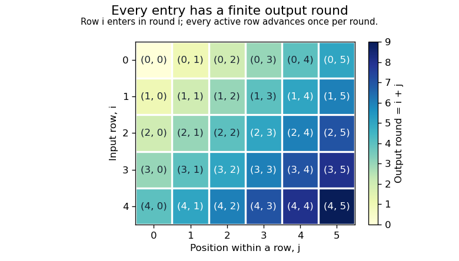

<h1 id="4/d/solution">Solution</h1>

↑ **Parent:** [D](../d.md)

Use [diagonal merging of lazy lists](../../../../../diagonal-merging-of-lazy-lists.md): introduce one new row each round, and advance every active row once. Each round contains finitely many active rows, even when the outer [list](../../../../../list-abstract-data-type.md) is infinite.

```
fairConcat :: [[a]] -> [a]
fairConcat = concat . levels []
  where
    levels [] [] = []
    levels active pending =
      let (new,rest) = case pending of
            []     -> ([],[])
            r:rs   -> ([r],rs)
          live = [r | r@(_:_) <- active ++ new]
      in map head live : levels (map tail live) rest
```

Number rows and positions within each row from zero. An occurrence at $(i,j)$ is emitted in round **$i+j$**: its row enters in round $i$ and advances once per subsequent round. All earlier rounds and each round's output are finite, so every required occurrence appears after finite work. `live` discards only empty rows, and `head` emits only existing entries; no new value is invented.

<a id="4/d/image-diagonal-merging-of-lazy-lists-visits-every-finite-row-position-pair-after-finitely-many-rounds"></a>


**[Figure 1](#4/d/image-diagonal-merging-of-lazy-lists-visits-every-finite-row-position-pair-after-finitely-many-rounds). Diagonal merging of lazy lists visits every finite row-position pair after finitely many rounds**.

Simply nesting `interleave` is unsafe here: `foldr interleave [] ([1,2] : repeat [])` emits `1` and then demands an undefined merge of the infinitely many empty rows before it can emit `2`. The finite-round construction avoids that starvation. There is still an unavoidable termination qualification: after the last actual output, infinitely many empty pending rows cannot be certified empty in finite work. The result can then have an undefined tail instead of a terminating `[]`. Every required occurrence has nevertheless appeared; no generic [algorithm](../../../../../algorithm-split.md) can promise a proper completed output in that exceptional situation, by the [absence-detection obstruction for infinite lists](../../../../../absence-detection-obstruction-for-infinite-lists.md).

## ↑ Ancestors (12)

1. [D](../d.md)
2. [4](../../4.md)
3. [Functional programming, design and analysis of algorithms](../../../functional-programming-design-and-analysis-of-algorithms-split.md)
4. [2019](../../../split.md)
5. [Past exam of the year 1 of the computer science course of the University of Oxford](../../../../split.md)
6. [Year 1 of the computer science course of the University of Oxford](../../../../../year-1-of-the-computer-science-course-of-the-university-of-oxford.md)
7. [Computer science course of the University of Oxford](../../../../../computer-science-course-of-the-university-of-oxford.md)
8. [Undergraduate course of the University of Oxford](../../../../../undergraduate-course-of-the-university-of-oxford.md)
9. [Course of the University of Oxford](../../../../../course-of-the-university-of-oxford.md)
10. [University of Oxford](../../../../../university-of-oxford-split.md)
11. [List of universities](../../../../../list-of-universities.md)
12. [Codex Wiki](../../../../../split.md)
