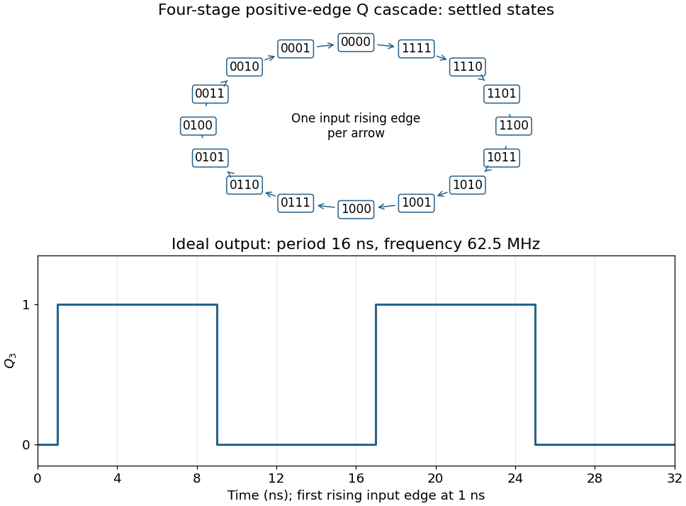
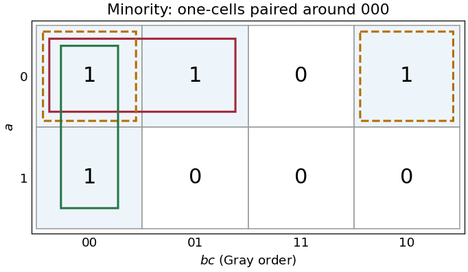
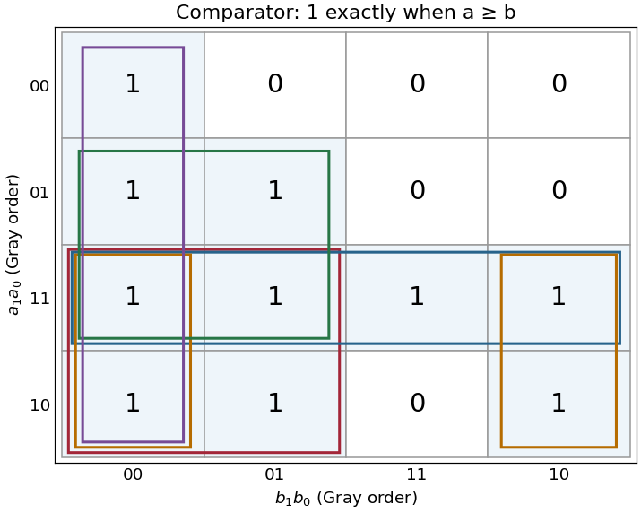

# Digital systems, linear algebra, introduction to formal proof

↑ **Parent:** [2021](../2021.md)

Source paper: [released examination archive](https://www.whatdotheyknow.com/request/ba_computer_science_past_papers/response/2577745/attach/2/202402%20183%20CS%20Papers.zip?cookie_passthrough=1). The dated cover identifies the 17 June 2021 preliminary examination, A10101W1. All printed alternatives are treated below.

**Table of contents**

- [1](#1)
  - [a](#1/a)
    - [Solution](#1/a/solution)
  - [b](#1/b)
    - [Solution](#1/b/solution)
  - [c](#1/c)
    - [Solution](#1/c/solution)
  - [d](#1/d)
    - [Solution](#1/d/solution)
  - [e](#1/e)
    - [Solution](#1/e/solution)
  - [f](#1/f)
    - [Solution](#1/f/solution)
- [2](#2)
  - [a](#2/a)
    - [Solution](#2/a/solution)
  - [b](#2/b)
    - [Solution](#2/b/solution)
  - [c](#2/c)
    - [Solution](#2/c/solution)
  - [d](#2/d)
    - [Solution](#2/d/solution)
  - [e](#2/e)
    - [Solution](#2/e/solution)
- [3](#3)
  - [a](#3/a)
    - [Solution](#3/a/solution)
  - [b](#3/b)
    - [Solution](#3/b/solution)
  - [c](#3/c)
    - [Solution](#3/c/solution)
  - [d](#3/d)
    - [Solution](#3/d/solution)
  - [e](#3/e)
    - [Solution](#3/e/solution)
- [4](#4)
  - [a](#4/a)
    - [i](#4/a/i)
      - [Solution](#4/a/i/solution)
    - [ii](#4/a/ii)
      - [Solution](#4/a/ii/solution)
    - [iii](#4/a/iii)
      - [Solution](#4/a/iii/solution)
  - [b](#4/b)
    - [Solution](#4/b/solution)
  - [c](#4/c)
    - [Solution](#4/c/solution)
  - [d](#4/d)
    - [Solution](#4/d/solution)
- [5](#5)
  - [a](#5/a)
    - [i](#5/a/i)
      - [Solution](#5/a/i/solution)
    - [ii](#5/a/ii)
      - [Solution](#5/a/ii/solution)
    - [iii](#5/a/iii)
      - [Solution](#5/a/iii/solution)
  - [b](#5/b)
    - [i](#5/b/i)
      - [Solution](#5/b/i/solution)
    - [ii](#5/b/ii)
      - [Solution](#5/b/ii/solution)
    - [iii](#5/b/iii)
      - [Solution](#5/b/iii/solution)
    - [iv](#5/b/iv)
      - [Solution](#5/b/iv/solution)
    - [v](#5/b/v)
      - [Solution](#5/b/v/solution)
  - [c](#5/c)
    - [Solution](#5/c/solution)
- [6](#6)
  - [a](#6/a)
    - [Solution](#6/a/solution)
  - [b](#6/b)
    - [Solution](#6/b/solution)
  - [c](#6/c)
    - [i](#6/c/i)
      - [Solution](#6/c/i/solution)
    - [ii](#6/c/ii)
      - [Solution](#6/c/ii/solution)
    - [iii](#6/c/iii)
      - [Solution](#6/c/iii/solution)
- [7](#7)
  - [a](#7/a)
    - [i](#7/a/i)
      - [Solution](#7/a/i/solution)
    - [ii](#7/a/ii)
      - [Solution](#7/a/ii/solution)
    - [iii](#7/a/iii)
      - [Solution](#7/a/iii/solution)
    - [iv](#7/a/iv)
      - [Solution](#7/a/iv/solution)
  - [b](#7/b)
    - [i](#7/b/i)
      - [Solution](#7/b/i/solution)
    - [ii](#7/b/ii)
      - [Solution](#7/b/ii/solution)
- [8](#8)
  - [a](#8/a)
    - [i](#8/a/i)
      - [Solution](#8/a/i/solution)
    - [ii](#8/a/ii)
      - [Solution](#8/a/ii/solution)
  - [b](#8/b)
    - [i](#8/b/i)
      - [Solution](#8/b/i/solution)
    - [ii](#8/b/ii)
      - [Solution](#8/b/ii/solution)

## 1

↑ **Parent:** [Digital systems, linear algebra, introduction to formal proof](digital-systems-linear-algebra-introduction-to-formal-proof.md)

<h3 id="1/a">a</h3>

↑ **Parent:** [1](#1)

<h4 id="1/a/solution">Solution</h4>

↑ **Parent:** [A](#1/a)

After asserting and releasing the active-low Start pulse, a valid sequence is **$X_0\uparrow$, then $X_1\uparrow$, then $X_2\uparrow$**, with each input held high through the relevant sampling interval. The first [JK flip-flop](../../electrical-engineering.md#jk-flip-flop) has $J=X_0,K=0$ and is clocked by $X_1$, so the rising [clock edge](../../computer-science.md#clock-edge) of $X_1$ samples $X_0=1$ and sets $Y_0=1$. Once that output has settled, a rising [clock edge](../../computer-science.md#clock-edge) of $X_2$ clocks the second [JK flip-flop](../../electrical-engineering.md#jk-flip-flop) with $J=Y_0=1,K=0$, setting $Y_1=1$.

The essential conditions concern sampled levels: $X_0$ must be high at a rising [clock edge](../../computer-science.md#clock-edge) of $X_1$, and $Y_0$ must then be high at a rising [clock edge](../../computer-science.md#clock-edge) of $X_2$. Separate edges with adequate [setup and hold time](../../electrical-engineering.md#setup-and-hold-time) avoid an ambiguous simultaneous transition.

<h3 id="1/b">b</h3>

↑ **Parent:** [1](#1)

<h4 id="1/b/solution">Solution</h4>

↑ **Parent:** [B](#1/b)

The initial input levels do not initialize the stored [bits](../../information-theory.md#bit). **The negative Start pulse asynchronously clears both outputs to zero**, making the experiment start from a known state even without any [clock edge](../../computer-science.md#clock-edge). Once Start is released, the circuit can recognize a fresh sequence. It also clears the history retained by the [JK flip-flops](../../electrical-engineering.md#jk-flip-flop) between trials; merely lowering the data inputs would not do so.

<h3 id="1/c">c</h3>

↑ **Parent:** [1](#1)

<h4 id="1/c/solution">Solution</h4>

↑ **Parent:** [C](#1/c)

With $K=0$, a [JK flip-flop](../../electrical-engineering.md#jk-flip-flop) obeys $Q^+=J\lor Q$ at its positive [clock edge](../../computer-science.md#clock-edge): $J=0$ holds its old state and $J=1$ sets it. Thus each original stage is a sticky record of a previously sampled high input until Start clears it. A [D flip-flop](../../electrical-engineering.md#d-flip-flop) instead obeys $Q^+=D$, so a later sample of zero can clear the output.

Connect each replacement D input where the corresponding J input was connected, preserving the clocks and [asynchronous clear](../../electrical-engineering.md#asynchronous-clear). The first valid sequence after Start still sets both outputs. Afterwards, let $X_0$ fall and apply another rising [clock edge](../../computer-science.md#clock-edge) to $X_1$. **The D version clears $Y_0$; the JK version retains $Y_0=1$.** A subsequent rising [clock edge](../../computer-science.md#clock-edge) of $X_2$ can therefore clear $Y_1$ only in the D version. Neither circuit continuously tracks its data input between [clock edges](../../computer-science.md#clock-edge).

<h3 id="1/d">d</h3>

↑ **Parent:** [1](#1)

<h4 id="1/d/solution">Solution</h4>

↑ **Parent:** [D](#1/d)

Each stage has $J=K=1$ and therefore toggles. The printed clock symbols have no inversion bubble, so they are positive-edge triggered; each later clock is driven by the previous uncomplemented $Q$ output. Consequently the circuit is a [ripple counter](../../electrical-engineering.md#ripple-counter) that **counts down modulo eight**. A zero [least significant bit](../../integer.md#least-significant-bit) rises to one and propagates the transition; a one falls to zero and stops it. For example, the settled transition from $001$ is $000$, whereas $000$ is followed by $111$.

After $N$ input pulses the settled value is $(1-N)\bmod 8$, giving

$$
\begin{array}{c|c|ccc}
N&Q_2Q_1Q_0&Q_0&Q_1&Q_2\\\hline
20&101&1&0&1\\
101&100&0&0&1\\
257&000&0&0&0
\end{array}
$$

**The answers are $101$, $100$, and $000$**, respectively, in most-significant-first order. Treating these as falling-edge stages would reverse the counting direction and would not follow the drawn clock symbols.

<h3 id="1/e">e</h3>

↑ **Parent:** [1](#1)

<h4 id="1/e/solution">Solution</h4>

↑ **Parent:** [E](#1/e)

The inclusive range contains $2147483648=2^{31}$ distinct states. An $n$-[bit](../../information-theory.md#bit) [binary counter](../../electrical-engineering.md#binary-counter) has $2^n$ states, so **31 [JK flip-flops](../../electrical-engineering.md#jk-flip-flop) in total** are necessary and sufficient for the required capacity: add 28 to the three shown.

This is a capacity calculation. The printed positive-edge, uncomplemented-output cascade visits these codes in descending order. To obtain increasing numerical order one must change the cascade clock polarity, for example clocking each positive-edge stage from the preceding complemented output.

<h3 id="1/f">f</h3>

↑ **Parent:** [1](#1)

<h4 id="1/f/solution">Solution</h4>

↑ **Parent:** [F](#1/f)

Connect the fourth [JK flip-flop](../../electrical-engineering.md#jk-flip-flop) with $J_3=K_3=1$ and clock it from $Q_2$, retaining the source's positive-edge convention. Read the four-[bit](../../information-theory.md#bit) state as $Q_3Q_2Q_1Q_0$. Its [state-transition diagram](../../electrical-engineering.md#state-transition-diagram) is a single cycle

$$
0000\to1111\to1110\to\cdots\to0010\to0001\to0000,
$$

with one input rising [clock edge](../../computer-science.md#clock-edge) per arrow; the figure displays every state explicitly.

Each stage halves the preceding triggering [frequency](../../wave.md#frequency). **$Q_3$ is an ideal [square wave](../../fourier-series.md#square-wave) with a 50-percent [duty cycle](../../electrical-circuit.md#duty-cycle) at $1\,\mathrm{GHz}/16=62.5\,\mathrm{MHz}$**, with [wave period](../../wave.md#wave-period) $16\,\mathrm{ns}$ and high and low intervals of $8\,\mathrm{ns}$. Its initial phase depends on the starting state. The figure chooses initial state $0000$ and a first input rising [clock edge](../../computer-science.md#clock-edge) at $1\,\mathrm{ns}$. Actual ripple propagation shifts edge times and creates intermediate transient codes; no device delays were supplied, so the waveform describes settled ideal logic.

<a id="1/f/image-complete-descending-four-bit-counter-cycle-and-ideal-fourth-stage-waveform"></a>


**[Figure 1](#1/f/image-complete-descending-four-bit-counter-cycle-and-ideal-fourth-stage-waveform). Complete descending four-bit counter cycle and ideal fourth-stage waveform**.

## 2

↑ **Parent:** [Digital systems, linear algebra, introduction to formal proof](digital-systems-linear-algebra-introduction-to-formal-proof.md)

<h3 id="2/a">a</h3>

↑ **Parent:** [2](#2)

<h4 id="2/a/solution">Solution</h4>

↑ **Parent:** [A](#2/a)

The shifts multiply the original [array](../../data-structure.md#array-data-structure) indices by four, and the following additions form [byte](../../computer-memory.md#byte) [memory addresses](../../computer-memory.md#memory-address). The load into `$s0` changes the variable $x$ itself, but the address of the next element of A has already been saved. The complete effect is

```
i = x
x = A[i]
B[y] = x + A[i + 1]
```

Here `i` is a fresh temporary. **Both the assignment to $x$ and the assignment to $B[y]$ matter.** Writing only $B[y]=A[x]+A[x+1]$ would omit the observable change to $x$. The interpretation assumes four-[byte](../../computer-memory.md#byte) [array](../../data-structure.md#array-data-structure) elements, valid aligned addresses, and arithmetic within range; the source uses trapping signed additions. The address of $B[y]$ is computed before $x$ changes.

<h3 id="2/b">b</h3>

↑ **Parent:** [2](#2)

<h4 id="2/b/solution">Solution</h4>

↑ **Parent:** [B](#2/b)

Use the conventional [integer](../../integer.md) [calling convention](../../programming-language.md#calling-convention): `$a0` holds the argument and `$v0` holds the result. The function is recursive, so every call must preserve its own [return address](../../programming-language.md#return-address) and original argument. The first recursive result must also survive the second call; a [caller-saved register](../../programming-language.md#caller-saved-register) alone would not protect it.

This implementation reserves a 32-[byte](../../computer-memory.md#byte) [stack frame](../../data-structure.md#stack-frame), keeping the [stack pointer](../../computer-science.md#stack-pointer) eight-[byte](../../computer-memory.md#byte) aligned. Offsets 0–15 are available as the outgoing argument area, 16 stores the original argument, 20 stores the first result, 24 is padding, and 28 stores the [return address](../../programming-language.md#return-address). It changes no [callee-saved register](../../programming-language.md#callee-saved-register). Assemble in classic MIPS delayed-branch mode with instruction reordering disabled, such as `.set noreorder`.

```
foo:
addiu $sp,$sp,-32  # allocate 32-byte aligned frame
sw $ra,28($sp)  # save caller return address
sw $a0,16($sp)  # save original n
beq $a0,$zero,foo_base
sll $zero,$zero,0
addiu $t0,$zero,1
beq $a0,$t0,foo_base
sll $zero,$zero,0
addiu $t0,$zero,2
beq $a0,$t0,foo_base
sll $zero,$zero,0
addiu $a0,$a0,-1
jal foo
sll $zero,$zero,0
sw $v0,20($sp)  # preserve foo(n-1) across next call
lw $a0,16($sp)  # recover original n
sll $zero,$zero,0
addiu $a0,$a0,-3
jal foo
sll $zero,$zero,0
lw $t0,20($sp)
sll $zero,$zero,0
addu $v0,$v0,$t0  # combine the two recursive results
beq $zero,$zero,foo_return
sll $zero,$zero,0
foo_base:
addu $v0,$a0,$zero  # base case result is n
foo_return:
lw $ra,28($sp)
sll $zero,$zero,0
addiu $sp,$sp,32  # release the frame
jr $ra
sll $zero,$zero,0
```

All displayed operation mnemonics denote single [machine instructions](../../computer-science.md#machine-instruction). In particular, `sll $zero,$zero,0` is the actual harmless shift encoding often abbreviated by the [pseudoinstruction](../../programming-language.md#pseudoinstruction) `nop`; `addu $v0,$a0,$zero` performs a copy without the `move` [pseudoinstruction](../../programming-language.md#pseudoinstruction). Each branch or jump has an explicit harmless [branch delay slot](../../computer-science.md#branch-delay-slot), and harmless shifts also separate loads from their subsequent uses. The base cases return the original argument; other calls return the sum of the two recursive values. Every return restores the saved [return address](../../programming-language.md#return-address) and exactly undoes the stack allocation.[Revision 2.00, ADDIU and ADDU, pp. 37–38; JAL and JR, pp. 139 and 144](../../computer-science-bibliography.md#mips32-architecture-for-programmers-volume-ii-by-mips-technologies)

The stated domain is [nonnegative integer](../../arithmetic.md#natural-number) $n$, with sufficient stack space and a result representable in the intended [integer](../../integer.md) type. The non-trapping additions implement that mathematical result within range; beyond it, machine wraparound would require a separately specified [integer](../../integer.md) semantics.

<h3 id="2/c">c</h3>

↑ **Parent:** [2](#2)

<h4 id="2/c/solution">Solution</h4>

↑ **Parent:** [C](#2/c)

A [register file](../../computer-science.md#register-file) with 256 entries needs $\log_2 256=8$ [bits](../../information-theory.md#bit) per register index. Under the intended assumption that eight times as many instructions are obtained by expanding the primary [opcode](../../computer-science.md#opcode) field, its width grows from six to $6+\log_2 8=9$ [bits](../../information-theory.md#bit). Thus **[opcode](../../computer-science.md#opcode): 9 [bits](../../information-theory.md#bit); rs, rt and rd: 8 [bits](../../information-theory.md#bit) each**.

These four fields alone require $9+3(8)=33$ [bits](../../information-theory.md#bit), already exceeding a 32-[bit](../../information-theory.md#bit) [instruction encoding](../../computer-science.md#instruction-encoding). Retaining the five-[bit](../../information-theory.md#bit) shift amount and six-[bit](../../information-theory.md#bit) function field of a [MIPS R-type instruction](../../computer-science.md#mips-r-type-instruction) gives **44 [bits](../../information-theory.md#bit)**. The processor's data word need not become wider merely because it has more registers.

The [opcode](../../computer-science.md#opcode) conclusion is conditional: MIPS also uses secondary function fields, so an eightfold increase in the number of semantic operations does not by itself force a nine-[bit](../../information-theory.md#bit) primary [opcode](../../computer-science.md#opcode). That is the straightforward field-expansion interpretation of this exercise.

<h3 id="2/d">d</h3>

↑ **Parent:** [2](#2)

<h4 id="2/d/solution">Solution</h4>

↑ **Parent:** [D](#2/d)

On the same primary-[opcode](../../computer-science.md#opcode) expansion interpretation, **[opcode](../../computer-science.md#opcode): 9 [bits](../../information-theory.md#bit); each register field: 8 [bits](../../information-theory.md#bit)**. The printed `rd` is a naming slip: a conventional [MIPS I-type instruction](../../computer-science.md#mips-i-type-instruction) has fields `rs` and `rt`, with the latter sometimes serving as the destination. There is no separate `rd` field.

Keeping the original 16-[bit](../../information-theory.md#bit) immediate requires $9+8+8+16=\mathbf{41}$ [bits](../../information-theory.md#bit) per instruction. If the [instruction encoding](../../computer-science.md#instruction-encoding) were held at 32 [bits](../../information-theory.md#bit), only seven [bits](../../information-theory.md#bit) would remain for the immediate, reducing immediate arithmetic and addressing ranges. A uniform encoding for both enlarged formats would have to accommodate the longer R-type case too; any padding or revised format policy must be specified separately. Register count and instruction width do not determine data-word width.

<h3 id="2/e">e</h3>

↑ **Parent:** [2](#2)

<h4 id="2/e/solution">Solution</h4>

↑ **Parent:** [E](#2/e)

More [processor registers](../../computer-science.md#processor-register) can reduce [register spills](../../computer-science.md#spilling-a-register) and the associated loads and stores. A richer instruction set may also replace several old [machine instructions](../../computer-science.md#machine-instruction) by one new operation. Both effects can **decrease the number of instructions** in a compiled program, although a particular program might obtain no benefit.

Wider [instruction encodings](../../computer-science.md#instruction-encoding) increase the [bytes](../../computer-memory.md#byte) per instruction. Consequently **the total machine-code size can increase or decrease**: approximately, it is instruction count times average encoded instruction width, with alignment and padding also relevant. There is no universal net direction without the program and revised encoding. The length of [assembly language](../../programming-language.md#assembly-language) source text is a separate matter and is not determined by instruction [bit](../../information-theory.md#bit) widths.

## 3

↑ **Parent:** [Digital systems, linear algebra, introduction to formal proof](digital-systems-linear-algebra-introduction-to-formal-proof.md)

<h3 id="3/a">a</h3>

↑ **Parent:** [3](#3)

<h4 id="3/a/solution">Solution</h4>

↑ **Parent:** [A](#3/a)

Compute the two complements with the two [NOT gates](../../theoretical-computer-science.md#not-gate), then form $t_1=a\land\neg b$ and $t_2=\neg a\land b$ with the two [AND gates](../../mathematical-logic.md#and-gate). Feed those outputs to the [OR gate](../../mathematical-logic.md#or-gate):

$$
\boxed{a\oplus b=(a\land\neg b)\lor(\neg a\land b).}
$$

Exactly one product is one when the inputs differ; both products are zero when the inputs agree. This uses precisely the allowed two [inverters](../../theoretical-computer-science.md#not-gate), two two-input [AND gates](../../mathematical-logic.md#and-gate) and one two-input [OR gate](../../mathematical-logic.md#or-gate).

<h3 id="3/b">b</h3>

↑ **Parent:** [3](#3)

<h4 id="3/b/solution">Solution</h4>

↑ **Parent:** [B](#3/b)

Every [AND gate](../../mathematical-logic.md#and-gate) and [OR gate](../../mathematical-logic.md#or-gate) is a [monotone Boolean function](../../analysis-of-boolean-functions.md#monotone-boolean-function): changing an input from zero to one while leaving all other inputs unchanged cannot change the output from one to zero. By [structural induction](../../foundations-of-mathematics.md#structural-induction) over a [Boolean circuit](../../theoretical-computer-science.md#boolean-circuit), a composition of these gates is also a [monotone Boolean function](../../analysis-of-boolean-functions.md#monotone-boolean-function). Constant inputs do not alter that conclusion.

**[Logical negation](../../theoretical-computer-science.md#negation) cannot be implemented**, since it sends $0$ to $1$ and $1$ to $0$, violating the defining order property. Hence these two gate types alone cannot implement every [Boolean function](../../analysis-of-boolean-functions.md#boolean-function).

<h3 id="3/c">c</h3>

↑ **Parent:** [3](#3)

<h4 id="3/c/solution">Solution</h4>

↑ **Parent:** [C](#3/c)

The [minority Boolean function](../../analysis-of-boolean-functions.md#minority-boolean-function) is one at input assignments $000,001,010,100$. Put $a$ on the rows and $bc$ in [Gray code](../../graph.md#gray-code) order $00,01,11,10$ on the columns. The [Karnaugh map](../../analysis-of-boolean-functions.md#karnaugh-map) has rows $1101$ and $1000$. Pair the cell $000$ with each of its three one-cell neighbours; the horizontal pair across the two map edges is valid because those columns are adjacent.

<a id="3/c/image-three-essential-pairs-in-the-three-input-minority-karnaugh-map"></a>


**[Figure 2](#3/c/image-three-essential-pairs-in-the-three-input-minority-karnaugh-map). Three essential pairs in the three-input minority Karnaugh map**.

The pairs give

$$
\boxed{m=\neg a\neg b\lor\neg a\neg c\lor\neg b\neg c.}
$$

Generate $A=\neg a,B=\neg b,C=\neg c$ with three [NOT gates](../../theoretical-computer-science.md#not-gate). Then use

$$
n_1=\operatorname{NAND}(A,B),\quad n_2=\operatorname{NAND}(A,C),\quad n_3=\operatorname{NAND}(B,C),\quad m=\operatorname{NAND}(n_1,n_2,n_3).
$$

[De Morgan laws](../../theoretical-computer-science.md#de-morgan-s-laws) show that the final [NAND gate](../../theoretical-computer-science.md#nand-gate) computes the required disjunction of the three products. This uses three two-input [NAND gates](../../theoretical-computer-science.md#nand-gate) and one three-input [NAND gate](../../theoretical-computer-science.md#nand-gate), besides the input [inverters](../../theoretical-computer-science.md#not-gate). If only two-input [NAND gates](../../theoretical-computer-science.md#nand-gate) are available, replace the final three-input gate by $t=\operatorname{NAND}(n_1,n_2)$, $u=\operatorname{NAND}(t,t)$, $m=\operatorname{NAND}(u,n_3)$.

The three pairs are essential: the one-input assignments $001,010,100$ each have only $000$ as an adjacent one-cell, so no pair can be omitted from this [disjunctive normal form](../../theoretical-computer-science.md#disjunctive-normal-form).

<h3 id="3/d">d</h3>

↑ **Parent:** [3](#3)

<h4 id="3/d/solution">Solution</h4>

↑ **Parent:** [D](#3/d)

Write the inputs as $a=2a_1+a_0$ and $b=2b_1+b_0$. Each row compares the represented value of $a$ with all four values of $b$. In [Gray code](../../graph.md#gray-code) order $00,01,11,10$ along both axes, the [Karnaugh map](../../analysis-of-boolean-functions.md#karnaugh-map) is

$$
\begin{array}{c|cccc}
a_1a_0\backslash b_1b_0&00&01&11&10\\\hline
00&1&0&0&0\\
01&1&1&0&0\\
11&1&1&1&1\\
10&1&1&0&1
\end{array}
$$

The equality cases lie on the diagonal and are all one. A complete row of ones at $a=3$ and a complete column at $b=0$ provide useful checks. The outlined groups are used in the next part.

<a id="3/d/image-two-bit-comparator-karnaugh-map-with-all-five-essential-four-cell-groups"></a>


**[Figure 3](#3/d/image-two-bit-comparator-karnaugh-map-with-all-five-essential-four-cell-groups). Two-bit comparator Karnaugh map with all five essential four-cell groups**.

<h3 id="3/e">e</h3>

↑ **Parent:** [3](#3)

<h4 id="3/e/solution">Solution</h4>

↑ **Parent:** [E](#3/e)

The five maximal four-cell groups give the [disjunctive normal form](../../theoretical-computer-science.md#disjunctive-normal-form)

$$
\boxed{z=a_1\neg b_1\lor a_1a_0\lor a_1\neg b_0\lor a_0\neg b_1\lor\neg b_1\neg b_0.}
$$

For example, the group $a_1\neg b_0$ wraps between columns $00$ and $10$ in the bottom two rows. No group of eight cells is entirely one. The five terms are precisely the [prime implicants](../../analysis-of-boolean-functions.md#prime-implicant), and each is essential: respectively, the cells $(a,b)=(2,1),(3,3),(2,2),(1,1),(0,0)$ are covered by no other [prime implicant](../../analysis-of-boolean-functions.md#prime-implicant). Any [disjunctive normal form](../../theoretical-computer-science.md#disjunctive-normal-form) can have its terms enlarged to [prime implicants](../../analysis-of-boolean-functions.md#prime-implicant) without increasing its size. Therefore all five displayed terms are necessary, proving minimality in number of products; each needs two [literals](../../theoretical-computer-science.md#boolean-literal), also giving ten [literals](../../theoretical-computer-science.md#boolean-literal) in a minimal cover.

For an implementation with [AND gates](../../mathematical-logic.md#and-gate) and [NOT gates](../../theoretical-computer-science.md#not-gate), call these five products $T_1,\ldots,T_5$. Form the shared complements $\neg b_1,\neg b_0$, calculate each $T_i$ with an [AND gate](../../mathematical-logic.md#and-gate), invert every $T_i$, and use

$$
z=\neg\bigl(\neg T_1\land\neg T_2\land\neg T_3\land\neg T_4\land\neg T_5\bigr).
$$

A five-input conjunction can be replaced by four two-input [AND gates](../../mathematical-logic.md#and-gate). This direct implementation uses nine two-input [AND gates](../../mathematical-logic.md#and-gate) and eight [NOT gates](../../theoretical-computer-science.md#not-gate). That is a valid realization of the minimal [disjunctive normal form](../../theoretical-computer-science.md#disjunctive-normal-form), rather than a claim that this particular gate count is globally optimal among all factored circuits.

## 4

↑ **Parent:** [Digital systems, linear algebra, introduction to formal proof](digital-systems-linear-algebra-introduction-to-formal-proof.md)

<h3 id="4/a">a</h3>

↑ **Parent:** [4](#4)

<h4 id="4/a/i">i</h4>

↑ **Parent:** [A](#4/a)

<h5 id="4/a/i/solution">Solution</h5>

↑ **Parent:** [I](#4/a/i)

By [matrix multiplication](../../vector-space.md#matrix-multiplication), $D_{ij}=\sum_{k=1}^N B_{ik}C_{kj}$. A potentially nonzero term requires $k=i$ because $B$ is a [diagonal matrix](../../linear-algebra.md#diagonal-matrix), and $k=j$ because $C$ is a [diagonal matrix](../../linear-algebra.md#diagonal-matrix). For $i\ne j$ these requirements cannot both hold. Thus every summand is zero and **$D_{ij}=0$ whenever $i\ne j$**.

<h4 id="4/a/ii">ii</h4>

↑ **Parent:** [A](#4/a)

<h5 id="4/a/ii/solution">Solution</h5>

↑ **Parent:** [Ii](#4/a/ii)

The [diagonal matrix entry](../../vector-space.md#diagonal-matrix-entry) is $D_{ii}=\sum_{k=1}^N B_{ik}C_{ki}$. Only $k=i$ can contribute, so **$D_{ii}=B_{ii}C_{ii}$**. This also shows that the product is a [diagonal matrix](../../linear-algebra.md#diagonal-matrix), with its diagonal obtained by entrywise multiplication of the two diagonals.

<h4 id="4/a/iii">iii</h4>

↑ **Parent:** [A](#4/a)

<h5 id="4/a/iii/solution">Solution</h5>

↑ **Parent:** [Iii](#4/a/iii)

Repeatedly applying the previous product rule gives

$$
\boxed{(B^p)_{ij}=\begin{cases}(B_{ii})^p&i=j,\\0&i\ne j.\end{cases}}
$$

Formally, the result holds for $p=1$; multiplication by $B$ preserves the zero [off-diagonal matrix entries](../../vector-space.md#off-diagonal-matrix-entry) and multiplies each [diagonal matrix entry](../../vector-space.md#diagonal-matrix-entry) by $B_{ii}$, proving the induction step.

<h3 id="4/b">b</h3>

↑ **Parent:** [4](#4)

<h4 id="4/b/solution">Solution</h4>

↑ **Parent:** [B](#4/b)

The [characteristic polynomial](../../linear-operator-theory.md#characteristic-polynomial) is $\det(\lambda I-A)=\lambda^2-\lambda-1$. Its distinct [eigenvalues](../../linear-operator-theory.md#eigenvalue) are $\alpha=(1+\sqrt5)/2$ and $\beta=(1-\sqrt5)/2$. For either [eigenvalue](../../linear-operator-theory.md#eigenvalue) $\lambda$, the [vector](../../vector-space.md#vector) $(\lambda,1)^\top$ is an [eigenvector](../../linear-operator-theory.md#eigenvector), since $A(\lambda,1)^\top=(\lambda+1,\lambda)^\top=\lambda(\lambda,1)^\top$.

Choose

$$
\boxed{S=\begin{pmatrix}\alpha&\beta\\1&1\end{pmatrix},\qquad D=\begin{pmatrix}\alpha&0\\0&\beta\end{pmatrix}.}
$$

The [determinant](../../multilinear-algebra.md#determinant) of $S$ is $\alpha-\beta=\sqrt5\ne0$, so

$$
S^{-1}=\frac1{\sqrt5}\begin{pmatrix}1&-\beta\\-1&\alpha\end{pmatrix}.
$$

Its columns being [eigenvectors](../../linear-operator-theory.md#eigenvector) gives $AS=SD$, and left multiplication by $S^{-1}$ proves $S^{-1}AS=D$.

<h3 id="4/c">c</h3>

↑ **Parent:** [4](#4)

<h4 id="4/c/solution">Solution</h4>

↑ **Parent:** [C](#4/c)

The initial [vector](../../vector-space.md#vector) records both initial [Fibonacci numbers](../../sequence-and-series.md#fibonacci-number): $V_1=(U_2,U_1)^\top=(1,1)^\top$. For $n\ge2$,

$$
AV_{n-1}=\begin{pmatrix}1&1\\1&0\end{pmatrix}\begin{pmatrix}U_n\\U_{n-1}\end{pmatrix}=\begin{pmatrix}U_n+U_{n-1}\\U_n\end{pmatrix}=V_n.
$$

Conversely this [vector](../../vector-space.md#vector) recurrence forces the second component to be the preceding first component and forces their sum to be the next first component, recovering the [scalar](../../vector-space.md#scalar) recurrence and its initial conditions. Iterating, or using [mathematical induction](../../foundations-of-mathematics.md#mathematical-induction), yields **$V_n=A^{n-1}(1,1)^\top$** for every $n\ge1$.

<h3 id="4/d">d</h3>

↑ **Parent:** [4](#4)

<h4 id="4/d/solution">Solution</h4>

↑ **Parent:** [D](#4/d)

The [diagonalization](../../linear-operator-theory.md#diagonalization-of-a-matrix) gives $A=SDS^{-1}$ and hence $A^{n-1}=SD^{n-1}S^{-1}$: the intervening factors $S^{-1}S$ cancel. The [diagonal matrix](../../linear-algebra.md#diagonal-matrix) power has entries $\alpha^{n-1},\beta^{n-1}$. Since $1-\beta=\alpha$ and $\alpha-1=-\beta$,

$$
S^{-1}\begin{pmatrix}1\\1\end{pmatrix}=\frac1{\sqrt5}\begin{pmatrix}\alpha\\-\beta\end{pmatrix},\qquad
V_n=\frac1{\sqrt5}\begin{pmatrix}\alpha^{n+1}-\beta^{n+1}\\\alpha^n-\beta^n\end{pmatrix}.
$$

Reading the second component gives the [Binet formula](../../sequence-and-series.md#binet-formula)

$$
\boxed{U_n=\frac{\left((1+\sqrt5)/2\right)^n-\left((1-\sqrt5)/2\right)^n}{\sqrt5}.}
$$

The derivation includes $n=1$, and the expression gives $U_1=U_2=1$, consistent with the specified indexing.

## 5

↑ **Parent:** [Digital systems, linear algebra, introduction to formal proof](digital-systems-linear-algebra-introduction-to-formal-proof.md)

<h3 id="5/a">a</h3>

↑ **Parent:** [5](#5)

<h4 id="5/a/i">i</h4>

↑ **Parent:** [A](#5/a)

<h5 id="5/a/i/solution">Solution</h5>

↑ **Parent:** [I](#5/a/i)

Left multiplication by an [elementary matrix](../../numerical-linear-algebra.md#elementary-matrix) adds a multiple of row one to its designated target row. The first-column entries below the [pivot](../../probability-and-statistics.md#pivotal-quantity) are $1,2,-1$, so **$a=-1$, $b=-2$, $c=1$**. The corresponding [row operations](../../numerical-linear-algebra.md#elementary-row-operation) are $R_2\leftarrow R_2-R_1$, $R_3\leftarrow R_3-2R_1$, and $R_4\leftarrow R_4+R_1$. Since none changes row one, their sequential application gives the required three eliminated first-column entries and the displayed remaining entries.

<h4 id="5/a/ii">ii</h4>

↑ **Parent:** [A](#5/a)

<h5 id="5/a/ii/solution">Solution</h5>

↑ **Parent:** [Ii](#5/a/ii)

The second [pivot](../../probability-and-statistics.md#pivotal-quantity) is two. Row three has second entry two, so subtract row two; row four has second entry minus two, so add row two. Therefore **$d=-1$, $e=1$**. Their trailing row pairs become $(0,4)$ and $(3,5)$, respectively; the zero in the third [pivot](../../probability-and-statistics.md#pivotal-quantity) position is why a later [row interchange](../../numerical-linear-algebra.md#row-interchange) is needed.

<h4 id="5/a/iii">iii</h4>

↑ **Parent:** [A](#5/a)

<h5 id="5/a/iii/solution">Solution</h5>

↑ **Parent:** [Iii](#5/a/iii)

Let $e_{ij}$ denote the [matrix unit](../../vector-space.md#matrix-unit) with one at position $(i,j)$ and zero elsewhere. The five inverses are

$$
\boxed{E_1^{-1}=I+e_{21},\quad E_2^{-1}=I+2e_{31},\quad E_3^{-1}=I-e_{41},\quad E_4^{-1}=I+e_{32},\quad E_5^{-1}=I-e_{42}.}
$$

Thus each is the [identity matrix](../../vector-space.md#identity-matrix) with only the indicated [off-diagonal matrix entry](../../vector-space.md#off-diagonal-matrix-entry) altered. These inverses reverse the corresponding row additions; no row scaling or permutation is involved.

<h3 id="5/b">b</h3>

↑ **Parent:** [5](#5)

<h4 id="5/b/i">i</h4>

↑ **Parent:** [B](#5/b)

<h5 id="5/b/i/solution">Solution</h5>

↑ **Parent:** [I](#5/b/i)

The [permutation matrix](../../vector-space.md#permutation-matrix) is

$$
\boxed{E=\begin{pmatrix}1&0&0&0\\0&1&0&0\\0&0&0&1\\0&0&1&0\end{pmatrix}.}
$$

Rows three and four of the [identity matrix](../../vector-space.md#identity-matrix) have been interchanged, so left multiplication interchanges those rows of any [matrix](../../vector-space.md#matrix).

<h4 id="5/b/ii">ii</h4>

↑ **Parent:** [B](#5/b)

<h5 id="5/b/ii/solution">Solution</h5>

↑ **Parent:** [Ii](#5/b/ii)

Left multiplication by $E$ interchanges rows three and four; applying it twice restores every row. Equivalently, it sends the [standard basis](../../vector-space.md#standard-basis) [vectors](../../vector-space.md#vector) $e_3,e_4$ to each other and fixes $e_1,e_2$, so its square fixes a [basis](../../vector-space.md#basis). **$E^2=I$.**

<h4 id="5/b/iii">iii</h4>

↑ **Parent:** [B](#5/b)

<h5 id="5/b/iii/solution">Solution</h5>

↑ **Parent:** [Iii](#5/b/iii)

Since $E^2=I$, the same [matrix](../../vector-space.md#matrix) is both a left and a right inverse. **$E^{-1}=E$.**

<h4 id="5/b/iv">iv</h4>

↑ **Parent:** [B](#5/b)

<h5 id="5/b/iv/solution">Solution</h5>

↑ **Parent:** [Iv](#5/b/iv)

The $j$th column of $AE$ is $A(Ee_j)$. The [permutation matrix](../../vector-space.md#permutation-matrix) fixes $e_1,e_2$ and interchanges $e_3,e_4$, so these columns are $Ae_1,Ae_2,Ae_4,Ae_3$. They are exactly the first, second, fourth and third columns of $A$. Thus **right multiplication by $E$ interchanges columns three and four**, leaving the others unchanged.

<h4 id="5/b/v">v</h4>

↑ **Parent:** [B](#5/b)

<h5 id="5/b/v/solution">Solution</h5>

↑ **Parent:** [V](#5/b/v)

The first left multiplication swaps rows three and four. The final right multiplication swaps columns three and four, restoring the two diagonal ones to their diagonal positions while exchanging the earlier entries of the two rows. Therefore

$$
ENE=\begin{pmatrix}1&0&0&0\\N_{21}&1&0&0\\N_{41}&N_{42}&1&0\\N_{31}&N_{32}&0&1\end{pmatrix}.
$$

The two specified zeros at positions $(3,4)$ and $(4,3)$ are important. Conjugation by this [permutation matrix](../../vector-space.md#permutation-matrix) preserves this restricted lower triangular pattern; it would not preserve lower triangularity for an arbitrary [matrix](../../vector-space.md#matrix) with a nonzero $(4,3)$ entry.

<h3 id="5/c">c</h3>

↑ **Parent:** [5](#5)

<h4 id="5/c/solution">Solution</h4>

↑ **Parent:** [C](#5/c)

Write $U=EE_5E_4E_3E_2E_1M$ and put $F_i=EE_iE$. Inserting $E^2=I$ between adjacent elimination [matrices](../../vector-space.md#matrix) gives

$$
U=F_5F_4F_3F_2F_1(EM),\qquad EM=F_1^{-1}F_2^{-1}F_3^{-1}F_4^{-1}F_5^{-1}U.
$$

Each $E_i^{-1}$ has the restricted lower triangular pattern in part (b)(v). Also $F_i^{-1}=EE_i^{-1}E$, as direct multiplication verifies. Hence every $F_i^{-1}$ is lower triangular. Their product is lower triangular by the allowed closure property, proving the required [Pivoted LU decomposition](../../numerical-linear-algebra.md#pivoted-lu-decomposition) with $L=F_1^{-1}\cdots F_5^{-1}$.

Explicitly,

$$
\boxed{L=\begin{pmatrix}1&0&0&0\\1&1&0&0\\-1&-1&1&0\\2&1&0&1\end{pmatrix},\qquad U=\begin{pmatrix}1&1&1&1\\0&2&-1&1\\0&0&3&5\\0&0&0&4\end{pmatrix},\qquad EM=LU.}
$$

The multipliers in rows three and four of $L$ are permuted along with the rows of $M$; simply keeping the unpermuted elimination multipliers would give the wrong product. This is the mechanism in [conjugating elimination matrices across a row permutation](../../numerical-linear-algebra.md#conjugating-elimination-matrices-across-a-row-permutation).

## 6

↑ **Parent:** [Digital systems, linear algebra, introduction to formal proof](digital-systems-linear-algebra-introduction-to-formal-proof.md)

<h3 id="6/a">a</h3>

↑ **Parent:** [6](#6)

<h4 id="6/a/solution">Solution</h4>

↑ **Parent:** [A](#6/a)

Replacing row one by $R_1-R_2-R_3-R_4$ does not change the [determinant](../../multilinear-algebra.md#determinant): adding a multiple of another row preserves a [determinant](../../multilinear-algebra.md#determinant). It produces first row $(-2,0,0,0)$, whose [cofactor](../../linear-algebra.md#cofactor) minor is the three-dimensional [identity matrix](../../vector-space.md#identity-matrix). Thus **the [determinant](../../multilinear-algebra.md#determinant) is $-2$**.

The columns are homogeneous coordinate [vectors](../../vector-space.md#vector) $(1,v_i)^\top$ of the four vertices. Subtracting the first column from each other column preserves the [determinant](../../multilinear-algebra.md#determinant) and reduces its magnitude to the absolute [determinant](../../multilinear-algebra.md#determinant) of the three edge [vectors](../../vector-space.md#vector) based at $v_1$. That absolute [determinant](../../multilinear-algebra.md#determinant) is the [parallelepiped](../../euclidean-geometry.md#parallelepiped) [volume](../../geometry-and-topology.md#volume). A [tetrahedron](../../euclidean-geometry.md#tetrahedron) occupies one sixth of that [parallelepiped](../../euclidean-geometry.md#parallelepiped), so **$V=|-2|/3!=1/3$** in cubic coordinate units.

<h3 id="6/b">b</h3>

↑ **Parent:** [6](#6)

<h4 id="6/b/solution">Solution</h4>

↑ **Parent:** [B](#6/b)

A [unit vector](../../vector-space.md#unit-vector) along the line is $d=(3,4)^\top/5$. Reflection preserves the [orthogonal projection](../../hilbert-space.md#orthogonal-projection) $dd^\top u$ onto that line and negates its perpendicular component. Therefore $Au=dd^\top u-(u-dd^\top u)$ and

$$
\boxed{A=2dd^\top-I=\frac1{25}\begin{pmatrix}-7&24\\24&7\end{pmatrix}.}
$$

As checks, $A(3,4)^\top=(3,4)^\top$, $A(-4,3)^\top=-(-4,3)^\top$, and $A^2=I$. Its [determinant](../../multilinear-algebra.md#determinant) is minus one, as expected for a planar [reflection matrix](../../linear-algebra.md#reflection-matrix).

<h3 id="6/c">c</h3>

↑ **Parent:** [6](#6)

<h4 id="6/c/i">i</h4>

↑ **Parent:** [C](#6/c)

<h5 id="6/c/i/solution">Solution</h5>

↑ **Parent:** [I](#6/c/i)

[Gaussian elimination](../../numerical-linear-algebra.md#gaussian-elimination) gives the [row operations](../../numerical-linear-algebra.md#elementary-row-operation) $R_2\leftarrow R_2-3R_1$, $R_3\leftarrow R_3-R_1$, $R_4\leftarrow R_4-2R_1$, producing the lower three rows $(0,1,4,1)$, $(0,1,4,1)$, $(0,-3,2,-1)$. Subtract the new row two from row three and add three times row two to row four; the remaining nonzero row is $(0,0,14,2)$. Move it above the zero row and finish elimination to obtain

$$
\operatorname{rref}(A)=\begin{pmatrix}1&0&0&-2/21\\0&1&0&3/7\\0&0&1&1/7\\0&0&0&0\end{pmatrix}.
$$

The [pivot](../../probability-and-statistics.md#pivotal-quantity) columns are one, two and three. [Row operations](../../numerical-linear-algebra.md#elementary-row-operation) preserve the [linear dependence](../../vector-space.md#linear-dependence) relations among columns, so the corresponding columns of the original [matrix](../../vector-space.md#matrix) form a [basis](../../vector-space.md#basis) for the [column space](../../vector-space.md#column-space), which is the image of the [linear map](../../vector-space.md#linear-map):

$$
\boxed{\left\{\begin{pmatrix}3\\9\\3\\6\end{pmatrix},\begin{pmatrix}1\\4\\2\\-1\end{pmatrix},\begin{pmatrix}-1\\1\\3\\0\end{pmatrix}\right\}.}
$$

In particular, the [matrix rank](../../vector-space.md#matrix-rank) is three. Columns of the reduced [matrix](../../vector-space.md#matrix) itself would generally give a different subspace, so the original columns must be used.

<h4 id="6/c/ii">ii</h4>

↑ **Parent:** [C](#6/c)

<h5 id="6/c/ii/solution">Solution</h5>

↑ **Parent:** [Ii](#6/c/ii)

The reduced row echelon form gives $u_1=2u_4/21$, $u_2=-3u_4/7$, and $u_3=-u_4/7$. Taking $u_4=21t$ gives every [vector](../../vector-space.md#vector) in the [null space](../../kernel-of-a-linear-map.md) as $t(2,-9,-3,21)^\top$. Thus a [basis](../../vector-space.md#basis) for the kernel of the [linear map](../../vector-space.md#linear-map) is

$$
\boxed{\left\{\begin{pmatrix}2\\-9\\-3\\21\end{pmatrix}\right\}.}
$$

Direct multiplication gives $A(2,-9,-3,21)^\top=0$. The [rank-nullity theorem](../../kernel-of-a-linear-map.md#rank-nullity-theorem) also checks the count: [matrix rank](../../vector-space.md#matrix-rank) three plus [nullity](../../kernel-of-a-linear-map.md#nullity-of-a-linear-map) one equals the domain [dimension](../../vector-space.md#dimension-vector-space) four.

<h4 id="6/c/iii">iii</h4>

↑ **Parent:** [C](#6/c)

<h5 id="6/c/iii/solution">Solution</h5>

↑ **Parent:** [Iii](#6/c/iii)

**No.** The nonzero [vector](../../vector-space.md#vector) $v=(2,-9,-3,21)^\top$ is in the kernel of the [linear map](../../vector-space.md#linear-map), so $T(v)=T(0)=0$ although $v\ne0$. A [linear map](../../vector-space.md#linear-map) is [injective](../../algebra.md#injective-function) exactly when its kernel consists only of zero.

## 7

↑ **Parent:** [Digital systems, linear algebra, introduction to formal proof](digital-systems-linear-algebra-introduction-to-formal-proof.md)

<h3 id="7/a">a</h3>

↑ **Parent:** [7](#7)

<h4 id="7/a/i">i</h4>

↑ **Parent:** [A](#7/a)

<h5 id="7/a/i/solution">Solution</h5>

↑ **Parent:** [I](#7/a/i)

Use [natural deduction](../../mathematical-logic.md#natural-deduction) with labelled temporary assumptions. Assume $\neg P\to\neg Q$ under label $a$, then $\neg P\to Q$ under label $b$, then $\neg P$ under label $c$. Two applications of the [modus ponens rule](../../mathematical-logic.md#implication-elimination-rule) give $\neg Q$ and $Q$. The [negation elimination rule](../../mathematical-logic.md#negation-elimination-rule) gives $\bot$, and the supplied [reductio ad absurdum](../../foundations-of-mathematics.md#reductio-ad-absurdum) rule discharges $c$ to conclude $P$.

Discharge $b$ using the [implication introduction rule](../../mathematical-logic.md#implication-introduction-rule), obtaining $(\neg P\to Q)\to P$ under $a$. Discharge $a$ with the [implication introduction rule](../../mathematical-logic.md#implication-introduction-rule), obtaining

$$
(\neg P\to\neg Q)\to((\neg P\to Q)\to P).
$$

All three temporary assumptions have now been discharged; no premise remains.

<h4 id="7/a/ii">ii</h4>

↑ **Parent:** [A](#7/a)

<h5 id="7/a/ii/solution">Solution</h5>

↑ **Parent:** [Ii](#7/a/ii)

Keep the four given premises in context and assume $P$ under label $a$. The [modus ponens rule](../../mathematical-logic.md#implication-elimination-rule) applied to the first two premises gives $Q\lor R$ and $\neg S$. Apply the [disjunction elimination rule](../../mathematical-logic.md#disjunction-elimination-rule) to $Q\lor R$ as follows.

Under a case assumption $Q$, the premise $Q\to S$ gives $S$ by the [modus ponens rule](../../mathematical-logic.md#implication-elimination-rule). Together with $\neg S$, the [negation elimination rule](../../mathematical-logic.md#negation-elimination-rule) gives $\bot$, and the supplied [logical falsity elimination rule](../../mathematical-logic.md#logical-falsity-elimination-rule) gives $R$. Under the other case assumption $R$, the required conclusion $R$ is already available. Discharge both case assumptions with the [disjunction elimination rule](../../mathematical-logic.md#disjunction-elimination-rule) to conclude $R$.

Finally discharge $a$ with the [implication introduction rule](../../mathematical-logic.md#implication-introduction-rule), giving **$P\to R$**. The premise $S\to Q$ is not needed: a derivation is permitted to leave a premise unused.

<h4 id="7/a/iii">iii</h4>

↑ **Parent:** [A](#7/a)

<h5 id="7/a/iii/solution">Solution</h5>

↑ **Parent:** [Iii](#7/a/iii)

Use the [disjunction elimination rule](../../mathematical-logic.md#disjunction-elimination-rule) on the outer disjunction. In its left branch, assume $P\lor Q$ and apply the [disjunction elimination rule](../../mathematical-logic.md#disjunction-elimination-rule) again: from a case assumption $P$, the [disjunction introduction rule](../../mathematical-logic.md#disjunction-introduction-rule) gives $P\lor R$; from a case assumption $Q$, the premise $Q\to R$ and the [modus ponens rule](../../mathematical-logic.md#implication-elimination-rule) give $R$, then the [disjunction introduction rule](../../mathematical-logic.md#disjunction-introduction-rule) gives $P\lor R$. Discharging those two inner case assumptions yields $P\lor R$ under the left outer branch.

In the right outer branch, assume $R\lor S$. A case assumption $R$ gives $P\lor R$ by the [disjunction introduction rule](../../mathematical-logic.md#disjunction-introduction-rule). A case assumption $S$, together with the premise $\neg S$, gives $\bot$ by the [negation elimination rule](../../mathematical-logic.md#negation-elimination-rule), and then $P\lor R$ by [logical falsity elimination rule](../../mathematical-logic.md#logical-falsity-elimination-rule). Discharge these inner case assumptions with the [disjunction elimination rule](../../mathematical-logic.md#disjunction-elimination-rule).

Both outer branches now have the same conclusion. Discharge the two outer case assumptions with the [disjunction elimination rule](../../mathematical-logic.md#disjunction-elimination-rule) to obtain **$P\lor R$** under exactly the stated premises.

<h4 id="7/a/iv">iv</h4>

↑ **Parent:** [A](#7/a)

<h5 id="7/a/iv/solution">Solution</h5>

↑ **Parent:** [Iv](#7/a/iv)

Assume $E\to G$ under label $a$, $F\to G$ under label $b$, and $E\lor F$ under label $c$. A temporary case assumption $E$ gives $G$ by the [modus ponens rule](../../mathematical-logic.md#implication-elimination-rule) using $a$. A temporary case assumption $F$ gives $G$ by the [modus ponens rule](../../mathematical-logic.md#implication-elimination-rule) using $b$. The [disjunction elimination rule](../../mathematical-logic.md#disjunction-elimination-rule) discharges these case assumptions and concludes $G$ under $a,b,c$.

Apply the [implication introduction rule](../../mathematical-logic.md#implication-introduction-rule) three times, discharging $c$, then $b$, then $a$. The resulting theorem is

$$
(E\to G)\to((F\to G)\to((E\lor F)\to G)).
$$

The displayed parentheses make explicit the right association of the source formula.

<h3 id="7/b">b</h3>

↑ **Parent:** [7](#7)

<h4 id="7/b/i">i</h4>

↑ **Parent:** [B](#7/b)

<h5 id="7/b/i/solution">Solution</h5>

↑ **Parent:** [I](#7/b/i)

Let $N(\phi,\psi)$ abbreviate $\neg\phi\land\neg\psi$. Suitable rules are

$$
\frac{\neg\phi\qquad\neg\psi}{N(\phi,\psi)}\;N\mathrm I,\qquad
\frac{N(\phi,\psi)}{\neg\phi}\;N\mathrm E_L,\qquad
\frac{N(\phi,\psi)}{\neg\psi}\;N\mathrm E_R.
$$

Their derivations require no new axiom. For introduction, apply the [conjunction introduction rule](../../mathematical-logic.md#conjunction-introduction-rule) to the two premises, obtaining $\neg\phi\land\neg\psi$, which is exactly the abbreviation. For left and right elimination, unfold the abbreviation and apply the corresponding [conjunction elimination rule](../../mathematical-logic.md#conjunction-elimination-rule). These are therefore derived rules for the NOR connective.

An equivalent subproof presentation of introduction permits one subproof from assumption $\phi$ to $\bot$ and another from assumption $\psi$ to $\bot$: use the [negation introduction rule](../../mathematical-logic.md#negation-introduction-rule) to discharge each assumption, then apply the [conjunction introduction rule](../../mathematical-logic.md#conjunction-introduction-rule). If elimination is desired in [contradiction](../../mathematical-logic.md#contradiction) form, combine the left projection with $\phi$, or the right projection with $\psi$, using the [negation elimination rule](../../mathematical-logic.md#negation-elimination-rule). All these presentations reduce directly to the permitted rules.

<h4 id="7/b/ii">ii</h4>

↑ **Parent:** [B](#7/b)

<h5 id="7/b/ii/solution">Solution</h5>

↑ **Parent:** [Ii](#7/b/ii)

Write $D(\phi,\psi)=\neg(\neg\phi\land\neg\psi)$. We derive the two [disjunction introduction rules](../../mathematical-logic.md#disjunction-introduction-rule) and the [disjunction elimination rule](../../mathematical-logic.md#disjunction-elimination-rule) without using any disjunction rule inside the derivations.

For left introduction, start with $\phi$ and temporarily assume $\neg\phi\land\neg\psi$. The [conjunction elimination rule](../../mathematical-logic.md#conjunction-elimination-rule) gives $\neg\phi$, and the [negation elimination rule](../../mathematical-logic.md#negation-elimination-rule) gives $\bot$. Discharge the temporary conjunction by the [negation introduction rule](../../mathematical-logic.md#negation-introduction-rule), concluding $D(\phi,\psi)$. For right introduction, start with $\psi$ and use the right [conjunction elimination rule](../../mathematical-logic.md#conjunction-elimination-rule) to obtain $\neg\psi$ instead. Thus either input derives the required encoded disjunction.

For elimination, suppose $D(\phi,\psi)$ is available, together with a derivation of $\kappa$ from an additional assumption $\phi$ and a derivation of $\kappa$ from an additional assumption $\psi$. Keep their common external context fixed. Temporarily assume $\neg\kappa$ under label $a$. Temporarily assume $\phi$ under label $b$ and insert the supplied first branch derivation to obtain $\kappa$. [Negation elimination rule](../../mathematical-logic.md#negation-elimination-rule) gives $\bot$, so [negation introduction rule](../../mathematical-logic.md#negation-introduction-rule) discharges $b$ and gives $\neg\phi$. Repeat with a temporary assumption $\psi$ under label $c$ and the supplied second branch derivation, discharging $c$ to obtain $\neg\psi$.

[Conjunction introduction rule](../../mathematical-logic.md#conjunction-introduction-rule) now gives $\neg\phi\land\neg\psi$. Its negation $D(\phi,\psi)$ gives $\bot$ by [negation elimination rule](../../mathematical-logic.md#negation-elimination-rule). The supplied [reductio ad absurdum](../../foundations-of-mathematics.md#reductio-ad-absurdum) rule discharges $a$ and yields **$\kappa$**. This discharges the two branch assumptions as required and proves the encoded elimination rule. Its last step uses [classical propositional logic](../../mathematical-logic.md#classical-propositional-logic); the same encoded elimination principle is not generally available in [Intuitionistic propositional logic](../../mathematical-logic.md#intuitionistic-propositional-logic).

## 8

↑ **Parent:** [Digital systems, linear algebra, introduction to formal proof](digital-systems-linear-algebra-introduction-to-formal-proof.md)

<h3 id="8/a">a</h3>

↑ **Parent:** [8](#8)

<h4 id="8/a/i">i</h4>

↑ **Parent:** [A](#8/a)

<h5 id="8/a/i/solution">Solution</h5>

↑ **Parent:** [I](#8/a/i)

Apply the [universal quantifier elimination rule](../../mathematical-logic.md#universal-quantifier-elimination-rule) to the universal premise with term $c$, obtaining $P(c)\leftrightarrow Q(c)$. The left [biconditional elimination rule](../../mathematical-logic.md#biconditional-elimination-rule) gives $P(c)\to Q(c)$. Use the premise $P(c)$ and the [modus ponens rule](../../mathematical-logic.md#implication-elimination-rule) to derive $Q(c)$. The [existential quantifier introduction rule](../../mathematical-logic.md#existential-quantifier-introduction-rule) with witness $c$ yields **$\exists x\,Q(x)$**. Substitution of a constant is capture-free here, so both quantifier side conditions hold.

<h4 id="8/a/ii">ii</h4>

↑ **Parent:** [A](#8/a)

<h5 id="8/a/ii/solution">Solution</h5>

↑ **Parent:** [Ii](#8/a/ii)

Temporarily assume $Q(c)$ under label $a$. The implication premise and the [modus ponens rule](../../mathematical-logic.md#implication-elimination-rule) yield $\forall x\,(P(x)\leftrightarrow P(c))$. Instantiate it at $c'$ using the [universal quantifier elimination rule](../../mathematical-logic.md#universal-quantifier-elimination-rule), obtaining $P(c')\leftrightarrow P(c)$. Its right [biconditional elimination rule](../../mathematical-logic.md#biconditional-elimination-rule) gives $P(c)\to P(c')$.

Apply the [modus ponens rule](../../mathematical-logic.md#implication-elimination-rule) with the premise $P(c)$ to obtain $P(c')$. Together with $\neg P(c')$, [negation elimination rule](../../mathematical-logic.md#negation-elimination-rule) gives $\bot$. Discharge $a$ using the [negation introduction rule](../../mathematical-logic.md#negation-introduction-rule) to conclude **$\neg Q(c)$**. Nothing assumes that the two constant symbols denote different objects; if they denoted the same object, the stated premises would themselves already be inconsistent.

<h3 id="8/b">b</h3>

↑ **Parent:** [8](#8)

<h4 id="8/b/i">i</h4>

↑ **Parent:** [B](#8/b)

<h5 id="8/b/i/solution">Solution</h5>

↑ **Parent:** [I](#8/b/i)

Choose arbitrary fresh variables $y,x,z$ and assume $H=((x=y\lor y=z)\land P(y))$ under label $a$. The [conjunction elimination rule](../../mathematical-logic.md#conjunction-elimination-rule) gives $x=y\lor y=z$ and $P(y)$. Apply the [disjunction elimination rule](../../mathematical-logic.md#disjunction-elimination-rule) to the equality disjunction.

In the case $x=y$, the supplied symmetry rule gives $y=x$, and the [equality elimination rule](../../mathematical-logic.md#equality-elimination-rule) applied to $P(y)$ gives $P(x)$. [Disjunction introduction rule](../../mathematical-logic.md#disjunction-introduction-rule) gives $P(x)\lor P(z)$. In the case $y=z$, [equality elimination rule](../../mathematical-logic.md#equality-elimination-rule) applied directly to $P(y)$ gives $P(z)$; the other [disjunction introduction rule](../../mathematical-logic.md#disjunction-introduction-rule) gives the same conclusion $P(x)\lor P(z)$. Discharge the two equality case assumptions by [disjunction elimination rule](../../mathematical-logic.md#disjunction-elimination-rule).

Discharge $a$ with the [implication introduction rule](../../mathematical-logic.md#implication-introduction-rule). There are now no undischarged assumptions. Use the [universal quantifier introduction rule](../../mathematical-logic.md#universal-quantifier-introduction-rule) successively for $z$, then $x$, then $y$, yielding

$$
\forall y\,\forall x\,\forall z\,\bigl(((x=y\lor y=z)\land P(y))\to(P(x)\lor P(z))\bigr).
$$

Freshness holds at every generalization because the sole temporary assumption has already been discharged; the arbitrary variables are not tied to any premise.

<h4 id="8/b/ii">ii</h4>

↑ **Parent:** [B](#8/b)

<h5 id="8/b/ii/solution">Solution</h5>

↑ **Parent:** [Ii](#8/b/ii)

Let $u$ be fresh, not free in any of the three universal premises. [Universal quantifier elimination rule](../../mathematical-logic.md#universal-quantifier-elimination-rule) gives $\neg P(u)\lor R(c,u)$, $Q(u)\to R(c,u)$ and $P(u)\lor Q(u)$. Apply [disjunction elimination rule](../../mathematical-logic.md#disjunction-elimination-rule) to the last formula.

In the $P(u)$ branch, apply [disjunction elimination rule](../../mathematical-logic.md#disjunction-elimination-rule) to $\neg P(u)\lor R(c,u)$. Its $\neg P(u)$ case contradicts $P(u)$ by [negation elimination rule](../../mathematical-logic.md#negation-elimination-rule), and [logical falsity elimination rule](../../mathematical-logic.md#logical-falsity-elimination-rule) then gives $R(c,u)$. Its $R(c,u)$ case already gives that conclusion. Discharge those two inner case assumptions to obtain $R(c,u)$ under the outer $P(u)$ assumption. In the outer $Q(u)$ branch, the [modus ponens rule](../../mathematical-logic.md#implication-elimination-rule) applied to $Q(u)\to R(c,u)$ gives $R(c,u)$ directly.

Discharge the two outer case assumptions by [disjunction elimination rule](../../mathematical-logic.md#disjunction-elimination-rule). The conclusion $R(c,u)$ now depends only on the universal premises, in which $u$ is not free. [Universal quantifier introduction rule](../../mathematical-logic.md#universal-quantifier-introduction-rule) therefore gives **$\forall x\,R(c,x)$**. All case assumptions have been discharged, and the argument requires no classical [reductio ad absurdum](../../foundations-of-mathematics.md#reductio-ad-absurdum).

## ↑ Ancestors (9)

1. [2021](../2021.md)
2. [Past exam of the year 1 of the computer science course of the University of Oxford](../../past-exam-of-the-year-1-of-the-computer-science-course-of-the-university-of-oxford.md)
3. [Year 1 of the computer science course of the University of Oxford](../../university-of-oxford.md#year-1-of-the-computer-science-course-of-the-university-of-oxford)
4. [Computer science course of the University of Oxford](../../university-of-oxford.md#computer-science-course-of-the-university-of-oxford)
5. [Undergraduate course of the University of Oxford](../../university-of-oxford.md#undergraduate-course-of-the-university-of-oxford)
6. [Course of the University of Oxford](../../university-of-oxford.md#course-of-the-university-of-oxford)
7. [University of Oxford](../../university-of-oxford.md)
8. [List of universities](../../README.md#list-of-universities)
9. [Codex Wiki](../../README.md)
