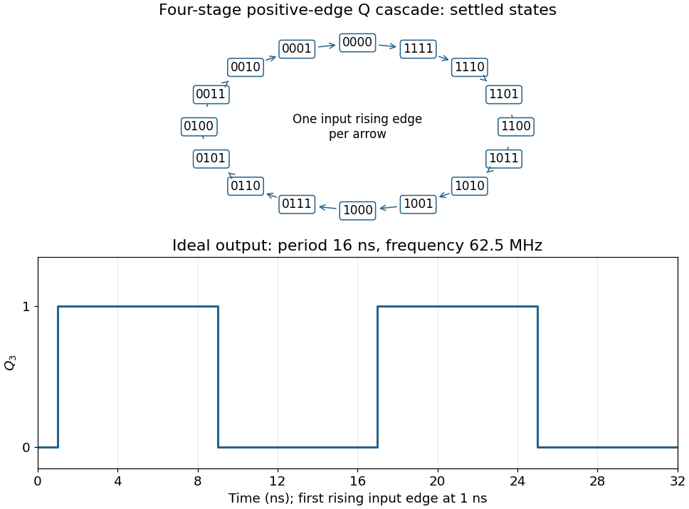

<h1 id="1/f/solution">Solution</h1>

↑ **Parent:** [F](../f.md)

Connect the fourth [JK flip-flop](../../../../../jk-flip-flop.md) with $J_3=K_3=1$ and clock it from $Q_2$, retaining the source's positive-edge convention. Read the four-[bit](../../../../../bit.md) state as $Q_3Q_2Q_1Q_0$. Its [state-transition diagram](../../../../../state-transition-diagram.md) is a single cycle

$$
0000\to1111\to1110\to\cdots\to0010\to0001\to0000,
$$

with one input rising [clock edge](../../../../../clock-edge.md) per arrow; the figure displays every state explicitly.

Each stage halves the preceding triggering [frequency](../../../../../frequency.md). **$Q_3$ is an ideal [square wave](../../../../../square-wave.md) with a 50-percent [duty cycle](../../../../../duty-cycle.md) at $1\,\mathrm{GHz}/16=62.5\,\mathrm{MHz}$**, with [wave period](../../../../../wave-period.md) $16\,\mathrm{ns}$ and high and low intervals of $8\,\mathrm{ns}$. Its initial phase depends on the starting state. The figure chooses initial state $0000$ and a first input rising [clock edge](../../../../../clock-edge.md) at $1\,\mathrm{ns}$. Actual ripple propagation shifts edge times and creates intermediate transient codes; no device delays were supplied, so the waveform describes settled ideal logic.

**[Figure 1](#1/f/image-complete-descending-four-bit-counter-cycle-and-ideal-fourth-stage-waveform). Complete descending four-bit counter cycle and ideal fourth-stage waveform**.

## ↑ Ancestors (12)

1. [F](../f.md)
2. [1](../../1.md)
3. [Digital systems, linear algebra, introduction to formal proof](../../../digital-systems-linear-algebra-introduction-to-formal-proof-split.md)
4. [2021](../../../split.md)
5. [Past exam of the year 1 of the computer science course of the University of Oxford](../../../../split.md)
6. [Year 1 of the computer science course of the University of Oxford](../../../../../year-1-of-the-computer-science-course-of-the-university-of-oxford.md)
7. [Computer science course of the University of Oxford](../../../../../computer-science-course-of-the-university-of-oxford.md)
8. [Undergraduate course of the University of Oxford](../../../../../undergraduate-course-of-the-university-of-oxford.md)
9. [Course of the University of Oxford](../../../../../course-of-the-university-of-oxford.md)
10. [University of Oxford](../../../../../university-of-oxford-split.md)
11. [List of universities](../../../../../list-of-universities.md)
12. [Codex Wiki](../../../../../split.md)
