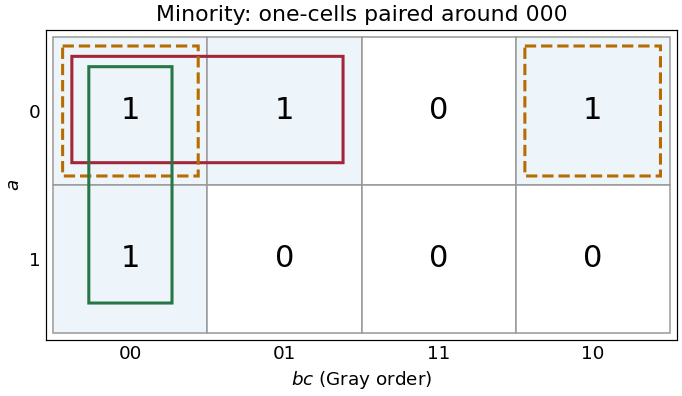

<h1 id="3/c/solution">Solution</h1>

↑ **Parent:** [C](../c.md)

The [minority Boolean function](../../../../../minority-boolean-function.md) is one at input assignments $000,001,010,100$. Put $a$ on the rows and $bc$ in [Gray code](../../../../../gray-code.md) order $00,01,11,10$ on the columns. The [Karnaugh map](../../../../../karnaugh-map.md) has rows $1101$ and $1000$. Pair the cell $000$ with each of its three one-cell neighbours; the horizontal pair across the two map edges is valid because those columns are adjacent.

**[Figure 2](#3/c/image-three-essential-pairs-in-the-three-input-minority-karnaugh-map). Three essential pairs in the three-input minority Karnaugh map**.

The pairs give

$$
\boxed{m=\neg a\neg b\lor\neg a\neg c\lor\neg b\neg c.}
$$

Generate $A=\neg a,B=\neg b,C=\neg c$ with three [NOT gates](../../../../../not-gate.md). Then use

$$
n_1=\operatorname{NAND}(A,B),\quad n_2=\operatorname{NAND}(A,C),\quad n_3=\operatorname{NAND}(B,C),\quad m=\operatorname{NAND}(n_1,n_2,n_3).
$$

[De Morgan laws](../../../../../de-morgan-s-laws.md) show that the final [NAND gate](../../../../../nand-gate.md) computes the required disjunction of the three products. This uses three two-input [NAND gates](../../../../../nand-gate.md) and one three-input [NAND gate](../../../../../nand-gate.md), besides the input [inverters](../../../../../not-gate.md). If only two-input [NAND gates](../../../../../nand-gate.md) are available, replace the final three-input gate by $t=\operatorname{NAND}(n_1,n_2)$, $u=\operatorname{NAND}(t,t)$, $m=\operatorname{NAND}(u,n_3)$.

The three pairs are essential: the one-input assignments $001,010,100$ each have only $000$ as an adjacent one-cell, so no pair can be omitted from this [disjunctive normal form](../../../../../disjunctive-normal-form.md).

## ↑ Ancestors (12)

1. [C](../c.md)
2. [3](../../3.md)
3. [Digital systems, linear algebra, introduction to formal proof](../../../digital-systems-linear-algebra-introduction-to-formal-proof-split.md)
4. [2021](../../../split.md)
5. [Past exam of the year 1 of the computer science course of the University of Oxford](../../../../split.md)
6. [Year 1 of the computer science course of the University of Oxford](../../../../../year-1-of-the-computer-science-course-of-the-university-of-oxford.md)
7. [Computer science course of the University of Oxford](../../../../../computer-science-course-of-the-university-of-oxford.md)
8. [Undergraduate course of the University of Oxford](../../../../../undergraduate-course-of-the-university-of-oxford.md)
9. [Course of the University of Oxford](../../../../../course-of-the-university-of-oxford.md)
10. [University of Oxford](../../../../../university-of-oxford-split.md)
11. [List of universities](../../../../../list-of-universities.md)
12. [Codex Wiki](../../../../../split.md)
