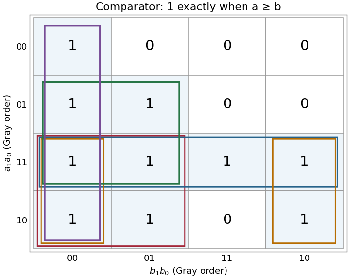

<h1 id="3/d/solution">Solution</h1>

↑ **Parent:** [D](../d.md)

Write the inputs as $a=2a_1+a_0$ and $b=2b_1+b_0$. Each row compares the represented value of $a$ with all four values of $b$. In [Gray code](../../../../../gray-code.md) order $00,01,11,10$ along both axes, the [Karnaugh map](../../../../../karnaugh-map.md) is

$$
\begin{array}{c|cccc}
a_1a_0\backslash b_1b_0&00&01&11&10\\\hline
00&1&0&0&0\\
01&1&1&0&0\\
11&1&1&1&1\\
10&1&1&0&1
\end{array}
$$

The equality cases lie on the diagonal and are all one. A complete row of ones at $a=3$ and a complete column at $b=0$ provide useful checks. The outlined groups are used in the next part.

**[Figure 3](#3/d/image-two-bit-comparator-karnaugh-map-with-all-five-essential-four-cell-groups). Two-bit comparator Karnaugh map with all five essential four-cell groups**.

## ↑ Ancestors (12)

1. [D](../d.md)
2. [3](../../3.md)
3. [Digital systems, linear algebra, introduction to formal proof](../../../digital-systems-linear-algebra-introduction-to-formal-proof-split.md)
4. [2021](../../../split.md)
5. [Past exam of the year 1 of the computer science course of the University of Oxford](../../../../split.md)
6. [Year 1 of the computer science course of the University of Oxford](../../../../../year-1-of-the-computer-science-course-of-the-university-of-oxford.md)
7. [Computer science course of the University of Oxford](../../../../../computer-science-course-of-the-university-of-oxford.md)
8. [Undergraduate course of the University of Oxford](../../../../../undergraduate-course-of-the-university-of-oxford.md)
9. [Course of the University of Oxford](../../../../../course-of-the-university-of-oxford.md)
10. [University of Oxford](../../../../../university-of-oxford-split.md)
11. [List of universities](../../../../../list-of-universities.md)
12. [Codex Wiki](../../../../../split.md)
