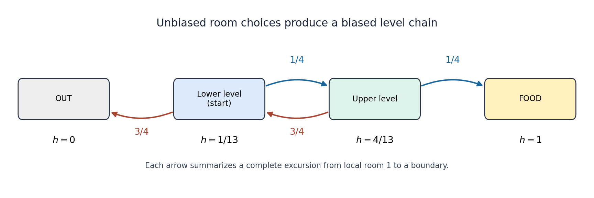

# Discrete mathematics, continuous mathematics, and probability

↑ **Parent:** [2021](../2021.md)

Source paper: [released examination archive](https://www.whatdotheyknow.com/request/ba_computer_science_past_papers/response/2577745/attach/2/202402%20183%20CS%20Papers.zip?cookie_passthrough=1).

**Table of contents**

- [1](#1)
  - [a](#1/a)
    - [Solution](#1/a/solution)
  - [b](#1/b)
    - [i](#1/b/i)
      - [Solution](#1/b/i/solution)
    - [ii](#1/b/ii)
      - [Solution](#1/b/ii/solution)
  - [c](#1/c)
    - [i](#1/c/i)
      - [Solution](#1/c/i/solution)
    - [ii](#1/c/ii)
      - [Solution](#1/c/ii/solution)
    - [iii](#1/c/iii)
      - [Solution](#1/c/iii/solution)
- [2](#2)
  - [a](#2/a)
    - [i](#2/a/i)
      - [Solution](#2/a/i/solution)
    - [ii](#2/a/ii)
      - [Solution](#2/a/ii/solution)
  - [b](#2/b)
    - [i](#2/b/i)
      - [Solution](#2/b/i/solution)
    - [ii](#2/b/ii)
      - [Solution](#2/b/ii/solution)
  - [c](#2/c)
    - [i](#2/c/i)
      - [Solution](#2/c/i/solution)
    - [ii](#2/c/ii)
      - [Solution](#2/c/ii/solution)
- [3](#3)
  - [a](#3/a)
    - [Solution](#3/a/solution)
  - [b](#3/b)
    - [Solution](#3/b/solution)
  - [c](#3/c)
    - [Solution](#3/c/solution)
  - [d](#3/d)
    - [Solution](#3/d/solution)
  - [e](#3/e)
    - [Solution](#3/e/solution)
- [4](#4)
  - [a](#4/a)
    - [Solution](#4/a/solution)
  - [b](#4/b)
    - [Solution](#4/b/solution)
  - [c](#4/c)
    - [Solution](#4/c/solution)
  - [d](#4/d)
    - [Solution](#4/d/solution)
  - [e](#4/e)
    - [Solution](#4/e/solution)
- [5](#5)
  - [a](#5/a)
    - [Solution](#5/a/solution)
  - [b](#5/b)
    - [Solution](#5/b/solution)
  - [c](#5/c)
    - [Solution](#5/c/solution)
  - [d](#5/d)
    - [Solution](#5/d/solution)
- [6](#6)
  - [a](#6/a)
    - [i](#6/a/i)
      - [Solution](#6/a/i/solution)
    - [ii](#6/a/ii)
      - [Solution](#6/a/ii/solution)
  - [b](#6/b)
    - [i](#6/b/i)
      - [Solution](#6/b/i/solution)
    - [ii](#6/b/ii)
      - [Solution](#6/b/ii/solution)
    - [iii](#6/b/iii)
      - [Solution](#6/b/iii/solution)
    - [iv](#6/b/iv)
      - [Solution](#6/b/iv/solution)
- [7](#7)
  - [a](#7/a)
    - [Solution](#7/a/solution)
  - [b](#7/b)
    - [i](#7/b/i)
      - [Solution](#7/b/i/solution)
    - [ii](#7/b/ii)
      - [Solution](#7/b/ii/solution)
    - [iii](#7/b/iii)
      - [Solution](#7/b/iii/solution)
    - [iv](#7/b/iv)
      - [Solution](#7/b/iv/solution)
  - [c](#7/c)
    - [i](#7/c/i)
      - [Solution](#7/c/i/solution)
    - [ii](#7/c/ii)
      - [Solution](#7/c/ii/solution)
- [8](#8)
  - [a](#8/a)
    - [i](#8/a/i)
      - [Solution](#8/a/i/solution)
    - [ii](#8/a/ii)
      - [Solution](#8/a/ii/solution)
    - [iii](#8/a/iii)
      - [Solution](#8/a/iii/solution)
    - [iv](#8/a/iv)
      - [Solution](#8/a/iv/solution)
    - [v](#8/a/v)
      - [Solution](#8/a/v/solution)
  - [b](#8/b)
    - [i](#8/b/i)
      - [Solution](#8/b/i/solution)
    - [ii](#8/b/ii)
      - [Solution](#8/b/ii/solution)
    - [iii](#8/b/iii)
      - [Solution](#8/b/iii/solution)
- [9](#9)
  - [a](#9/a)
    - [Solution](#9/a/solution)
  - [b](#9/b)
    - [i](#9/b/i)
      - [Solution](#9/b/i/solution)
    - [ii](#9/b/ii)
      - [Solution](#9/b/ii/solution)
    - [iii](#9/b/iii)
      - [Solution](#9/b/iii/solution)
    - [iv](#9/b/iv)
      - [Solution](#9/b/iv/solution)
  - [c](#9/c)
    - [Solution](#9/c/solution)

## 1

↑ **Parent:** [Discrete mathematics, continuous mathematics, and probability](discrete-mathematics-continuous-mathematics-and-probability.md)

<h3 id="1/a">a</h3>

↑ **Parent:** [1](#1)

<h4 id="1/a/solution">Solution</h4>

↑ **Parent:** [A](#1/a)

Reduction of both coefficients in [modular arithmetic](../../modular-arithmetic.md) gives

$$
754=8\cdot91+26,\qquad -507=-6\cdot91+39.
$$

More explicitly,

$$
754x+507=91(8x+6)+(26x-39).
$$

The first expression is divisible by $91$ exactly when the last parenthesis is. By the definition of a [integer congruence](../../modular-arithmetic.md#integer-congruence), **the two congruences are equivalent**.

<h3 id="1/b">b</h3>

↑ **Parent:** [1](#1)

<h4 id="1/b/i">i</h4>

↑ **Parent:** [B](#1/b)

<h5 id="1/b/i/solution">Solution</h5>

↑ **Parent:** [I](#1/b/i)

The [Euclidean algorithm](../../number-theory.md#euclidean-algorithm) gives

$$
91=3\cdot26+13,\qquad26=2\cdot13,
$$

so $\gcd(754,91)=\gcd(26,91)=13$. Since $13\mid39$, the criterion for a [linear congruence](../../modular-arithmetic.md#linear-congruence) guarantees a solution. One can also exhibit it directly: $26\cdot5+91(-1)=39$, or in the original coefficients,

$$
754\cdot5+91(-47)=-507.
$$

Thus **$x=5$ is a solution**, with an explicit [Bézout coefficient](../../algebra.md#bezout-coefficient) certificate.

<h4 id="1/b/ii">ii</h4>

↑ **Parent:** [B](#1/b)

<h5 id="1/b/ii/solution">Solution</h5>

↑ **Parent:** [Ii](#1/b/ii)

Divide the [divisibility](../../divisibility.md) relation $91\mid26x-39$ by $13$ to obtain $7\mid2x-3$. Since $2\cdot4\equiv1\pmod7$, multiplication by the [modular multiplicative inverse](../../number-theory.md#modular-multiplicative-inverse) gives $x\equiv12\equiv5\pmod7$. Therefore all [integer](../../integer.md) solutions are $x=5+7q$, $q\in\mathbb Z$.

Modulo $91=13\cdot7$, the choices $q=0,\ldots,12$ give

$$
\boxed{x\equiv5,12,19,26,33,40,47,54,61,68,75,82,89\pmod{91}.}
$$

They are distinct [residue classes](../../modular-arithmetic.md#residue-class): equality of two such classes would imply $91\mid7(q-q')$, hence $13\mid q-q'$. Every [integer](../../integer.md) $q$ is congruent to one of those thirteen choices, so the list is exhaustive.

<h3 id="1/c">c</h3>

↑ **Parent:** [1](#1)

<h4 id="1/c/i">i</h4>

↑ **Parent:** [C](#1/c)

<h5 id="1/c/i/solution">Solution</h5>

↑ **Parent:** [I](#1/c/i)

Let $d=\gcd(c,n)$, and write $c=dc'$, $n=dn'$ with positive [integers](../../integer.md) $c',n'$. If an [integer](../../integer.md) $e>1$ divided both $c'$ and $n'$, then $de$ would divide both $c$ and $n$, contradicting the maximality of their [greatest common divisor](../../divisibility.md#greatest-common-divisor) $d$. Thus **$\gcd(c',n')=1$**. Equivalently, [Bézout's identity](../../algebra.md#bezout-s-identity) for $c,n$ can be divided by $d$ to express $1$ as an [integer](../../integer.md) combination of $c',n'$.

<h4 id="1/c/ii">ii</h4>

↑ **Parent:** [C](#1/c)

<h5 id="1/c/ii/solution">Solution</h5>

↑ **Parent:** [Ii](#1/c/ii)

Let $d=\gcd(c,n)$, $c=dc'$, and $n=dn'$. The preceding part gives $\gcd(c',n')=1$. The [integer congruence](../../modular-arithmetic.md#integer-congruence) on the left is equivalent to

$$
n\mid c(a-b)
\quad\Longleftrightarrow\quad
n'\mid c'(a-b).
$$

By [Euclid's lemma](../../number-theory.md#euclid-s-lemma), coprimality of $c'$ and $n'$ makes this equivalent to $n'\mid a-b$. The reverse implication is also immediate by multiplying a [divisibility](../../divisibility.md) relation by $dc'$. Therefore

$$
\boxed{ac\equiv bc\pmod n
\quad\Longleftrightarrow\quad
 a\equiv b\pmod{n/\gcd(c,n)}.}
$$

This is [cancellation of a common factor in a congruence](../../modular-arithmetic.md#cancellation-of-a-common-factor-in-a-congruence). The printed equality sign in the right-hand expression is interpreted as equality of [residue classes](../../modular-arithmetic.md#residue-class), hence the displayed [integer congruence](../../modular-arithmetic.md#integer-congruence). Ordinary equality of the [integers](../../integer.md) $a,b$ would be false: the following example has $a\ne b$.

<h4 id="1/c/iii">iii</h4>

↑ **Parent:** [C](#1/c)

<h5 id="1/c/iii/solution">Solution</h5>

↑ **Parent:** [Iii](#1/c/iii)

Take **$(a,b,c,n)=(1,4,2,6)$**. These are four distinct positive [integers](../../integer.md) and $n\geq3$. Their products are $ac=2$ and $bc=8$, whose difference is $6$, so $ac\equiv bc\pmod6$. Here the correct reduced modulus is $6/\gcd(2,6)=3$, and indeed $1\equiv4\pmod3$. The example illustrates why cancelling a noninvertible factor may change the modulus in [modular arithmetic](../../modular-arithmetic.md).

## 2

↑ **Parent:** [Discrete mathematics, continuous mathematics, and probability](discrete-mathematics-continuous-mathematics-and-probability.md)

<h3 id="2/a">a</h3>

↑ **Parent:** [2](#2)

<h4 id="2/a/i">i</h4>

↑ **Parent:** [A](#2/a)

<h5 id="2/a/i/solution">Solution</h5>

↑ **Parent:** [I](#2/a/i)

For the base case $n=2$, the product is $1-1/4=3/4=(2+1)/(2\cdot2)$. Assume the identity holds for some $n\geq2$. Multiplying by the next factor gives

$$
\begin{aligned}
\prod_{i=2}^{n+1}\left(1-\frac1{i^2}\right)
&=\frac{n+1}{2n}\left(1-\frac1{(n+1)^2}\right)\\
&=\frac{n+1}{2n}\frac{n(n+2)}{(n+1)^2}
=\frac{n+2}{2(n+1)}.
\end{aligned}
$$

This is the desired expression with $n$ replaced by $n+1$, so [mathematical induction](../../foundations-of-mathematics.md#mathematical-induction) proves the identity for every $n\geq2$. The factorization $1-i^{-2}=(i-1)(i+1)/i^2$ also explains the cancellation as a [telescoping product](../../sequence-and-series.md#telescoping-product).

<h4 id="2/a/ii">ii</h4>

↑ **Parent:** [A](#2/a)

<h5 id="2/a/ii/solution">Solution</h5>

↑ **Parent:** [Ii](#2/a/ii)

For $n=1$, both sides are $1/3$. Assuming the formula through $n$, adding the next term gives

$$
\begin{aligned}
\sum_{i=1}^{n+1}\frac1{(2i-1)(2i+1)}
&=\frac{n}{2n+1}+\frac1{(2n+1)(2n+3)}\\
&=\frac{2n^2+3n+1}{(2n+1)(2n+3)}
=\frac{n+1}{2n+3}.
\end{aligned}
$$

The last expression is the required formula at $n+1$, completing [mathematical induction](../../foundations-of-mathematics.md#mathematical-induction). The [partial fraction decomposition](../../isolated-singularity.md#partial-fraction-decomposition)

$$
\frac1{(2i-1)(2i+1)}=\frac12\left(\frac1{2i-1}-\frac1{2i+1}\right)
$$

provides a second explanation: this is a [telescoping sum](../../arithmetic.md#telescoping-sum).

<h3 id="2/b">b</h3>

↑ **Parent:** [2](#2)

<h4 id="2/b/i">i</h4>

↑ **Parent:** [B](#2/b)

<h5 id="2/b/i/solution">Solution</h5>

↑ **Parent:** [I](#2/b/i)

Suppose, for a [proof by contradiction](../../foundations-of-mathematics.md#reductio-ad-absurdum), that an [integer](../../integer.md) $n$ is both an [even number](../../integer.md#even-number) and an [odd number](../../integer.md#odd-number). Then $n=2u$ and $n=2v+1$ for some [integers](../../integer.md) $u,v$. Subtracting yields $u-v=1/2$. The left side is an [integer](../../integer.md), while $1/2$ is not. This contradiction proves that **no [integer](../../integer.md) is both even and odd**.

<h4 id="2/b/ii">ii</h4>

↑ **Parent:** [B](#2/b)

<h5 id="2/b/ii/solution">Solution</h5>

↑ **Parent:** [Ii](#2/b/ii)

The [contrapositive](../../mathematical-logic.md#contrapositive) is that an [integer](../../integer.md) [perfect square](../../integer.md#square-number) has residue $0$ or $1$ modulo $4$. Let $n=t^2$ for an [integer](../../integer.md) $t$. If $t=2u$ is an [even number](../../integer.md#even-number), then $t^2=4u^2\equiv0\pmod4$. If $t=2u+1$ is an [odd number](../../integer.md#odd-number), then $t^2=4u(u+1)+1\equiv1\pmod4$. These exhaust the possible parities of an [integer](../../integer.md). Thus a residue of $2$ or $3$ excludes being a [perfect square](../../integer.md#square-number), as required by the [contrapositive](../../mathematical-logic.md#contrapositive).

<h3 id="2/c">c</h3>

↑ **Parent:** [2](#2)

<h4 id="2/c/i">i</h4>

↑ **Parent:** [C](#2/c)

<h5 id="2/c/i/solution">Solution</h5>

↑ **Parent:** [I](#2/c/i)

Take $u=(1,1)$ and $v=(1,2)$. Their first coordinates are equal, so both $uRv$ and $vRu$ hold, although $u\ne v$. Thus $R$ is not an [antisymmetric relation](../../set-theory.md#antisymmetric-relation), and hence **it is not a partial order**. The failure arises because its comparisons ignore the second coordinate entirely.

<h4 id="2/c/ii">ii</h4>

↑ **Parent:** [C](#2/c)

<h5 id="2/c/ii/solution">Solution</h5>

↑ **Parent:** [Ii](#2/c/ii)

Check each [partial order](../../set.md#partially-ordered-set) axiom. For every $(a,b)$, $a\leq a$ and $b\geq b$, so $S$ is a [reflexive relation](../../set-theory.md#reflexive-relation). If both $(a,b)S(c,d)$ and $(c,d)S(a,b)$, the first coordinates satisfy $a\leq c\leq a$ and the second coordinates satisfy $b\geq d\geq b$. Therefore $a=c$ and $b=d$, which proves $S$ is an [antisymmetric relation](../../set-theory.md#antisymmetric-relation).

Finally, if $(a,b)S(c,d)$ and $(c,d)S(e,f)$, then $a\leq c\leq e$ and $b\geq d\geq f$. Hence $(a,b)S(e,f)$, making $S$ a [transitive relation](../../set-theory.md#transitive-relation). All three axioms hold, so **$S$ is a partial order**. It is a [product order](../../set.md#product-order), with the usual order on the first coordinate and the reversed order on the second.

## 3

↑ **Parent:** [Discrete mathematics, continuous mathematics, and probability](discrete-mathematics-continuous-mathematics-and-probability.md)

<h3 id="3/a">a</h3>

↑ **Parent:** [3](#3)

<h4 id="3/a/solution">Solution</h4>

↑ **Parent:** [A](#3/a)

A [subset](../../set.md#subset) is determined uniquely by deciding, for each of the $n$ elements, whether to include it. Each decision has two possibilities. By the [rule of product](../../combinatorics.md#rule-of-product), there are $2\cdot2\cdots2=2^n$ decision strings. The correspondence between such binary strings and [subsets](../../set.md#subset) is a [bijection](../../function.md#bijection), so **$|\mathcal P(\mathcal U)|=2^n$**. The all-zero string corresponds to the empty [subset](../../set.md#subset).

<h3 id="3/b">b</h3>

↑ **Parent:** [3](#3)

<h4 id="3/b/solution">Solution</h4>

↑ **Parent:** [B](#3/b)

For $q\geq1$, choose an ordered list of $q$ distinct elements: there are $n(n-1)\cdots(n-q+1)$ such lists. Every $q$-element [subset](../../set.md#subset) occurs in exactly $q!$ orders, the number of [permutations](../../combinatorics.md#permutation) of its elements. Thus the count is the [binomial coefficient](../../binomial-coefficient.md)

$$
\boxed{\binom nq=\frac{n(n-1)\cdots(n-q+1)}{q!}.}
$$

For fixed $q$ and $n\geq2q$, every numerator factor lies between $n/2$ and $n$. Consequently

$$
\frac{n^q}{2^q q!}\leq\binom nq\leq\frac{n^q}{q!}.
$$

The constants depend on the fixed $q$, not on $n$. These inequalities prove $\binom nq=\Theta(n^q)$ in [big theta notation](../../real-analysis.md#big-theta-notation). More precisely, dividing the product by $n^q$ gives the [fixed-cardinality binomial coefficient asymptotic](../../binomial-coefficient.md#fixed-cardinality-binomial-coefficient-asymptotic) $\binom nq\sim n^q/q!$. For $q=0$, there is exactly one empty [subset](../../set.md#subset), and the assertion is $1=\Theta(1)$.

<h3 id="3/c">c</h3>

↑ **Parent:** [3](#3)

<h4 id="3/c/solution">Solution</h4>

↑ **Parent:** [C](#3/c)

For $q=1,\ldots,5$, choose the first $q$ elements of $\{1,2,4,8,16\}$. Every [sum of a subset](../../additive-combinatorics.md#sum-of-a-subset) has a unique [binary representation](../../arithmetic.md#binary-number), so distinct [subsets](../../set.md#subset) cannot have the same sum. To see this directly, take the largest power of two belonging to exactly one of two proposed [subsets](../../set.md#subset). It exceeds the sum of all smaller powers, and therefore cannot be cancelled by their difference. Thus these chosen sets are [dissociated sets](../../additive-combinatorics.md#dissociated-set) and do not have the two-sum property.

If cardinality zero is included, the empty [set](../../set.md) has only one [subset](../../set.md#subset), so it cannot supply two distinct ones either. **There is a [counterexample](../../foundations-of-mathematics.md#counterexample) at every cardinality from $0$ through $5$.**

<h3 id="3/d">d</h3>

↑ **Parent:** [3](#3)

<h4 id="3/d/solution">Solution</h4>

↑ **Parent:** [D](#3/d)

Fix any seven-element [subset](../../set.md#subset) $S$. Its [power set](../../set.md#power-set) supplies $2^7=128$ pigeons. Map each [subset](../../set.md#subset) to its [integer](../../integer.md) sum. Since the elements are positive, all such sums lie between $0$ and $\sum_{s\in S}s$. The latter is at most the sum of the seven largest available elements,

$$
10+11+\cdots+16=91.
$$

There are therefore at most $92$ possible sums, fewer than the $128$ [subsets](../../set.md#subset). The [pigeonhole principle](../../combinatorics.md#pigeonhole-principle) forces two distinct [subsets](../../set.md#subset) to have the same sum. **Every seven-element subset has the two-sum property.** This is the [subset-sum pigeonhole bound](../../additive-combinatorics.md#subset-sum-pigeonhole-bound). The weaker estimate $\sum_{s\in S}s\leq7\cdot16=112$ would also suffice, since $128>113$.

<h3 id="3/e">e</h3>

↑ **Parent:** [3](#3)

<h4 id="3/e/solution">Solution</h4>

↑ **Parent:** [E](#3/e)

The number is

$$
\boxed{\binom{16}{6}=8008.}
$$

A direct search over every $q$-element [subset](../../set.md#subset) must inspect $\binom nq$ candidates. Testing one candidate by generating its [subset sums](../../theoretical-computer-science.md#subset-sum-problem) creates $2^q$ values; storing previously seen sums detects a collision. Generating them incrementally needs $O(2^q)$ arithmetic operations, or $O(q2^q)$ for the straightforward independent calculation of each sum. Thus the simple overall search has cost on the scale of $\binom nq2^q$, apart from [integer](../../integer.md)-arithmetic and data-structure costs.

The important [time complexity](../../theoretical-computer-science.md#time-complexity) distinction is that **fixed $q$ gives polynomial growth in $n$, of degree $q$**, but this can still become impractically large. If $q$ increases with $n$, both the candidate count and the internal [power set](../../set.md#power-set) can grow exponentially. For example, near $q=n/2$ the [binomial coefficient](../../binomial-coefficient.md) is already exponentially large. An exhaustive implementation can therefore encounter a [combinatorial explosion](../../theoretical-computer-science.md#combinatorial-explosion); the fixed-$q$ estimate $\Theta(n^q)$ must not be described as exponential in $n$.

## 4

↑ **Parent:** [Discrete mathematics, continuous mathematics, and probability](discrete-mathematics-continuous-mathematics-and-probability.md)

<h3 id="4/a">a</h3>

↑ **Parent:** [4](#4)

<h4 id="4/a/solution">Solution</h4>

↑ **Parent:** [A](#4/a)

Use the standard spacing convention for [machine epsilon](../../floating-point-arithmetic.md#machine-epsilon): the next representable [floating-point number](../../floating-point-arithmetic.md#floating-point-number) above $1$ is $1+2^{-40}$. In a normalized binary representation this corresponds to $41$ significant binary digits, including the leading digit. The spacing throughout $[1,2)$ is therefore $2^{-40}$.

With [rounding](../../numerical-analysis.md#rounding) to nearest, the associated [unit roundoff](../../floating-point-arithmetic.md#unit-roundoff) is half that spacing, $u=2^{-41}$; for a normal result the relative [round-off error](../../numerical-analysis.md#round-off-error) is bounded by $u$. Some texts instead call $u$ machine epsilon. **Here $2^{-40}$ denotes the spacing scale**, and the iteration counts below use that convention. It describes representation precision, not a guarantee that an arbitrarily evaluated [function](../../function.md) has a relative error this small.

<h3 id="4/b">b</h3>

↑ **Parent:** [4](#4)

<h4 id="4/b/solution">Solution</h4>

↑ **Parent:** [B](#4/b)

The second-order remainder form of [Taylor's theorem](../../calculus.md#taylor-s-theorem) gives, for a point $\xi_x$ between $0$ and $x$,

$$
f(x)=-5+3x+\tfrac12f''(\xi_x)x^2.
$$

For $x\ne0$, the given curvature bounds imply

$$
-5+3x+x^2\leq f(x)<-5+3x+\tfrac32x^2.
$$

In particular $f(1)<-1/2<0$ and $f(2)\geq5>0$. Differentiability implies [continuity](../../calculus.md#continuous-function), so the [intermediate value theorem](../../calculus.md#intermediate-value-theorem) gives a root in $(1,2)$.

The [mean value theorem](../../calculus.md#mean-value-theorem) applied to $f'$ gives $f'(x)=3+xf''(\eta_x)\geq3+2x>0$ for $x\in(1,2)$. Thus $f$ is strictly increasing there, and it cannot have two roots. **There is exactly one root in $(1,2)$.**

<h3 id="4/c">c</h3>

↑ **Parent:** [4](#4)

<h4 id="4/c/solution">Solution</h4>

↑ **Parent:** [C](#4/c)

At a root of size between $1$ and $2$, the spacing of [floating-point numbers](../../floating-point-arithmetic.md#floating-point-number) is $\epsilon=2^{-40}$. With ordinary stable [function](../../function.md) evaluations, a sensible generic absolute position tolerance has scale **$2^{-40}\approx9.09\times10^{-13}$**; sub-spacing progress cannot generally be represented. This is a resolution estimate, not a lower bound excluding an accidentally exactly representable root.

Define one [bisection method](../../numerical-analysis.md#bisection-method) step as replacing the current bracket by the half retaining the sign change. Starting from $[1,2]$, the width after $N$ such updates is $2^{-N}$. Therefore

$$
\boxed{N=40\quad\text{for bracket width at most }2^{-40}.}
$$

The midpoint of a bracket has an exact-arithmetic error bound of half its width. If tolerance is defined instead as that midpoint error bound, $39$ updates suffice to make it at most $2^{-40}$. Stating the convention avoids an off-by-one difference; once the endpoints are adjacent [floating-point numbers](../../floating-point-arithmetic.md#floating-point-number), their exact midpoint need not itself be representable.

<h3 id="4/d">d</h3>

↑ **Parent:** [4](#4)

<h4 id="4/d/solution">Solution</h4>

↑ **Parent:** [D](#4/d)

Apply the [mean value theorem](../../calculus.md#mean-value-theorem), the first-order case of [Taylor's theorem](../../calculus.md#taylor-s-theorem), to $f'$ between $0$ and $x>1$. It yields

$$
f'(x)=3+xf''(\xi)\geq3+2x>5.
$$

Also $f(3/2)\geq-5+9/2+9/4=7/4>0$, so the initial point is to the right of the root $x^*$. For an increasing [strictly convex function](../../real-analysis.md#strictly-convex-function), its tangent at a point to the right of a root meets the axis between that root and the point. Hence the exact [Newton root-finding iteration](../../numerical-analysis.md#newton-root-finding-iteration) remains in $[x^*,3/2]$ and decreases towards $x^*$.

On every relevant [interval](../../real-analysis.md#interval-mathematics), $|f''|<3$ and $f'>5$, so the stated [quadratic convergence](../../numerical-analysis.md#quadratic-convergence) bound gives, with $e_n=|x_n-x^*|$,

$$
e_{n+1}\leq\tfrac3{10}e_n^2,\qquad e_0<\tfrac12.
$$

Iterating the bound gives

$$
e_1<0.075,\quad e_2<0.0016875,\quad
 e_3<8.543\times10^{-7},\quad e_4<2.190\times10^{-13}<2^{-40}.
$$

Thus **four Newton corrections suffice to reduce the exact-iteration error bound below the floating-point spacing scale**. The [quadratic convergence](../../numerical-analysis.md#quadratic-convergence) doubles the approximate number of correct digits at each late step. Beyond this point further corrections cannot reliably improve a generic floating-point answer. This is a bound on useful accuracy under the usual stable-evaluation model, not a claim that the data specify the exact iteration at which every implementation must stagnate.

<h3 id="4/e">e</h3>

↑ **Parent:** [4](#4)

<h4 id="4/e/solution">Solution</h4>

↑ **Parent:** [E](#4/e)

For negative $x$, the [mean value theorem](../../calculus.md#mean-value-theorem) gives $f'(x)=3+xf''(\xi_x)$. In particular,

$$
f'(-2)\leq-1<0,\qquad f'(-1)>0.
$$

Since $f'$ is [continuous](../../calculus.md#continuous-function) and strictly increasing, it vanishes at exactly one point $x_m\in(-2,-1)$. The positive [second derivative](../../calculus.md#second-derivative) makes $f$ a [strictly convex function](../../real-analysis.md#strictly-convex-function) on the entire real line. Its [derivative](../../calculus.md#derivative) changes from negative to positive at $x_m$, so **$x_m$ is the unique [global minimum](../../analysis.md#global-minimum)**. One may also use $f(x)\geq x^2+3x-5\to\infty$ to verify [coercivity](../../real-analysis.md#coercive-function).

In the endpoint-bracketing form of [golden-section search](../../numerical-analysis.md#golden-section-search), begin with **$[-2,-1]$**, a width-one [interval](../../real-analysis.md#interval-mathematics) known to contain this unique minimum, and place the two standard interior probes. The attainable position accuracy is different from that for a simple root. Around $x_m$, [Taylor's theorem](../../calculus.md#taylor-s-theorem) gives

$$
f(x_m+h)-f(x_m)=\tfrac12f''(\xi)h^2.
$$

Here the minimum value is nonzero and of order one: the lower quadratic bound gives $f(x_m)\geq-29/4$, while $f(x_m)\leq f(-1)<-13/2$. Ordinary relative [round-off error](../../numerical-analysis.md#round-off-error) in these [function](../../function.md) values therefore hides changes of order $\epsilon$, once $h^2$ has that size. The [function-value resolution near a nondegenerate minimum](../../numerical-analysis.md#function-value-resolution-near-a-nondegenerate-minimum) is consequently of order

$$
\boxed{|h|\sim\sqrt\epsilon=2^{-20}\approx9.54\times10^{-7}.}
$$

Each [golden-section search](../../numerical-analysis.md#golden-section-search) contraction multiplies the bracket width by $\rho=(\sqrt5-1)/2$. Using $2^{-20}$ as the nominal target width gives

$$
N\geq\frac{20\log2}{-\log\rho}=28.81\ldots,
\qquad\boxed{N=29\text{ contractions}.}
$$

Unknown evaluation-error constants can change the actual stopping point; $29$ is the standard scale-based count. Requiring $2^{-40}$ position accuracy from these [function](../../function.md)-value comparisons would disregard the quadratic flatness of the minimum. The same precision effect is documented for one-dimensional numerical minimization.[Caveats: Taylor expansion near the minimizer and the square-root precision limit; Minimization Algorithms: golden-section contraction](../../mathematics-bibliography.md#one-dimensional-minimization-in-the-gnu-scientific-library-manual)

## 5

↑ **Parent:** [Discrete mathematics, continuous mathematics, and probability](discrete-mathematics-continuous-mathematics-and-probability.md)

<h3 id="5/a">a</h3>

↑ **Parent:** [5](#5)

<h4 id="5/a/solution">Solution</h4>

↑ **Parent:** [A](#5/a)

Separate inactive and active [optimization constraints](../../numerical-analysis.md#optimization-constraint). At an interior feasible point with $h>0$, a differentiable [local minimum](../../analysis.md#local-minimum) must satisfy $\nabla f=0$. Retain only solutions lying in the interior.

On the boundary $h=0$, if $\nabla h\ne0$, apply the [Lagrange multiplier](../../mathematical-optimization.md#lagrange-multiplier) condition. Using the [optimization Lagrangian](../../mathematical-optimization.md#optimization-lagrangian) $L=f-\lambda h$, the [Karush-Kuhn-Tucker conditions](../../mathematical-optimization.md#karush-kuhn-tucker-conditions) are

$$
\nabla f=\lambda\nabla h,\qquad h\geq0,\qquad
\lambda\geq0,\qquad\lambda h=0.
$$

The sign follows from feasible motion into $h>0$: the directional [derivative](../../calculus.md#derivative) along $\nabla h$ at a minimum cannot be negative. Thus a boundary candidate has $h=0$ and a nonnegative [Lagrange multiplier](../../mathematical-optimization.md#lagrange-multiplier). Boundary points with $\nabla h=0$ must be examined separately, because the usual constraint qualification fails there.

Solve the interior and boundary systems, check membership in the [feasible set](../../mathematical-optimization.md#feasible-region), and establish which candidates are minima using second-order tests or a direct global comparison. The [Karush-Kuhn-Tucker conditions](../../mathematical-optimization.md#karush-kuhn-tucker-conditions) alone are not sufficient for general nonconvex [functions](../../function.md) or [feasible sets](../../mathematical-optimization.md#feasible-region). On an unbounded [feasible set](../../mathematical-optimization.md#feasible-region), also check whether an infimum is attained and whether escaping [sequences](../../sequence-and-series.md#sequence) can improve the objective.

<h3 id="5/b">b</h3>

↑ **Parent:** [5](#5)

<h4 id="5/b/solution">Solution</h4>

↑ **Parent:** [B](#5/b)

Complete the square to write the objective as

$$
x^2-2x+y^2-4y=\|(x,y)-(1,2)\|^2-5.
$$

Let $z=(x,y)$ and $a=(1,2)$, so $\|a\|=\sqrt5$ while feasibility requires $\|z\|\geq\sqrt{20}=2\sqrt5$. The [reverse triangle inequality](../../topological-analysis.md#reverse-triangle-inequality) gives

$$
\|z-a\|\geq\|z\|-\|a\|\geq\sqrt5.
$$

The objective is therefore at least zero. Equality is attained by $z=2a=(2,4)$, which lies on the boundary. Equality requires the [vectors](../../vector-space.md#vector) to have the same direction and $\|z\|=2\sqrt5$, so this minimizer is unique. Hence

$$
\boxed{(x_*,y_*)=(2,4),\qquad f_*=0.}
$$

It also satisfies the [Karush-Kuhn-Tucker conditions](../../mathematical-optimization.md#karush-kuhn-tucker-conditions) with $\lambda=1/2$. The direct distance argument proves global optimality even though the exterior of a disk is not a [convex set](../../convex-set.md); this is [nearest-point minimization outside a Euclidean ball](../../numerical-analysis.md#nearest-point-minimization-outside-a-euclidean-ball).

<h3 id="5/c">c</h3>

↑ **Parent:** [5](#5)

<h4 id="5/c/solution">Solution</h4>

↑ **Parent:** [C](#5/c)

The objective is [continuous](../../calculus.md#continuous-function) on the compact disk, so a [global maximum](../../function.md#global-maximum) exists. Its [gradient](../../multivariable-calculus.md#gradient) is $(e^x,2e^{2y})$, which is never zero, so a maximum cannot lie in the interior. It must have $x^2+y^2=1$.

Both coordinates of a maximizing point are positive. Reflecting a negative coordinate to its positive counterpart strictly increases the objective without changing the constraint; at an endpoint with one coordinate zero, a small move along the circle into the positive quadrant also increases the objective to first order. Thus it suffices to consider $x>0,y>0$.

The boundary [Lagrange multiplier](../../mathematical-optimization.md#lagrange-multiplier) equations are $e^x=2\lambda x$ and $2e^{2y}=2\lambda y$. Eliminate $\lambda$ to obtain the two-dimensional nonlinear [system of equations](../../algebra.md#system-of-equations)

$$
\boxed{F(x,y)=
\begin{pmatrix}x^2+y^2-1\\ y e^x-2x e^{2y}\end{pmatrix}=0,
\qquad x>0,\ y>0.}
$$

Keeping this quadrant restriction excludes the boundary minimum that an unconstrained elimination could also produce. Under the stated uniqueness assumption for the admissible solution, the [global maximum](../../function.md#global-maximum) must be that solution. Approximate it with [multivariable Newton iteration](../../numerical-analysis.md#multivariable-newton-iteration), solving $J_F(z_n)\Delta_n=-F(z_n)$ and setting $z_{n+1}=z_n+\Delta_n$, with a suitable safeguard if needed. For example its explicit [Jacobian matrix](../../multivariable-calculus.md#jacobian-matrix) is

$$
J_F(x,y)=\begin{pmatrix}
2x&2y\\
y e^x-2e^{2y}&e^x-4x e^{2y}
\end{pmatrix}.
$$

No numerical solution of the system is required.

<h3 id="5/d">d</h3>

↑ **Parent:** [5](#5)

<h4 id="5/d/solution">Solution</h4>

↑ **Parent:** [D](#5/d)

Use the [optimization Lagrangian](../../mathematical-optimization.md#optimization-lagrangian)

$$
L=x^TAx+y^TBy-\lambda(\mathbf1^Tx+\mathbf1^Ty-1).
$$

Symmetry gives the [gradient](../../multivariable-calculus.md#gradient) equations $2Ax=\lambda\mathbf1$ and $2By=\lambda\mathbf1$. The [positive-definite matrices](../../quadratic-form.md#positive-definite-matrix) are invertible, so define

$$
D=\mathbf1^TA^{-1}\mathbf1+\mathbf1^TB^{-1}\mathbf1>0.
$$

The affine constraint gives $\lambda=2/D$, hence

$$
\boxed{x_* =\frac{A^{-1}\mathbf1}{D},\qquad
 y_* =\frac{B^{-1}\mathbf1}{D},\qquad f_* =\frac1D.}
$$

For a global certificate, write any other feasible point as $(x_*+u,y_*+v)$. Feasibility implies $\mathbf1^Tu+\mathbf1^Tv=0$. Expansion cancels the cross terms and leaves

$$
f(x_*+u,y_*+v)-f(x_*,y_*)=u^TAu+v^TBv.
$$

By positive definiteness this is positive unless $u=v=0$. Thus the solution is the **unique [global minimum](../../analysis.md#global-minimum)**, not merely a [stationary point](../../calculus-of-variations.md#stationary-point). This is a two-block instance of [positive quadratic minimization under one affine constraint](../../mathematical-optimization.md#positive-quadratic-minimization-under-one-affine-constraint).

## 6

↑ **Parent:** [Discrete mathematics, continuous mathematics, and probability](discrete-mathematics-continuous-mathematics-and-probability.md)

<h3 id="6/a">a</h3>

↑ **Parent:** [6](#6)

<h4 id="6/a/i">i</h4>

↑ **Parent:** [A](#6/a)

<h5 id="6/a/i/solution">Solution</h5>

↑ **Parent:** [I](#6/a/i)

Write $r=x-a$. The squared [Euclidean norm](../../normed-vector-space.md#euclidean-norm) is $r^Tr$, whose [gradient](../../multivariable-calculus.md#gradient) is $2r$. The [chain rule](../../calculus.md#chain-rule) for the [exponential function](../../calculus.md#exponential-function) therefore gives the column [gradient](../../multivariable-calculus.md#gradient)

$$
\boxed{\nabla f(x)=2e^{\|x-a\|^2}(x-a).}
$$

The row [derivative](../../calculus.md#derivative), if that convention is used for $df/dx$, is its transpose.

<h4 id="6/a/ii">ii</h4>

↑ **Parent:** [A](#6/a)

<h5 id="6/a/ii/solution">Solution</h5>

↑ **Parent:** [Ii](#6/a/ii)

Differentiate the column [gradient](../../multivariable-calculus.md#gradient) $2e^{r^Tr}r$. The [Jacobian matrix](../../multivariable-calculus.md#jacobian-matrix) product rule gives one term from differentiating the scalar [exponential function](../../calculus.md#exponential-function) and one from differentiating $r$, whose [Jacobian matrix](../../multivariable-calculus.md#jacobian-matrix) is the [identity matrix](../../vector-space.md#identity-matrix):

$$
\boxed{H_f(x)=e^{\|r\|^2}(4rr^T+2I).}
$$

In particular, for any nonzero [vector](../../vector-space.md#vector) $v$,

$$
v^TH_f(x)v=e^{\|r\|^2}\bigl(4(r^Tv)^2+2\|v\|^2\bigr)>0.
$$

Thus the [Hessian matrix](../../multivariable-calculus.md#hessian-matrix) is positive definite everywhere. This calculation proves strict [convexity](../../real-analysis.md#convex-function) and supplies the [derivatives](../../calculus.md#derivative) needed for sums of these terms.

<h3 id="6/b">b</h3>

↑ **Parent:** [6](#6)

<h4 id="6/b/i">i</h4>

↑ **Parent:** [B](#6/b)

<h5 id="6/b/i/solution">Solution</h5>

↑ **Parent:** [I](#6/b/i)

A practical choice is a [BFGS method](../../mathematical-optimization.md#bfgs-method), using exact [gradients](../../multivariable-calculus.md#gradient) and a [line search](../../mathematical-optimization.md#line-search). At dimension $d=100$, its $d$-by-$d$ inverse-[Hessian matrix](../../multivariable-calculus.md#hessian-matrix) approximation is small, whereas forming a million rank-one contributions to the exact [Hessian matrix](../../multivariable-calculus.md#hessian-matrix) is expensive. If $F(x)=\sum_i e^{\|x-a_i\|^2}$, the explicit [derivatives](../../calculus.md#derivative) are

$$
\nabla F=2\sum_i e^{\|x-a_i\|^2}(x-a_i),\qquad
H_F=\sum_i e^{\|x-a_i\|^2}\bigl(4(x-a_i)(x-a_i)^T+2I\bigr).
$$

The positive-definite [Hessian matrix](../../multivariable-calculus.md#hessian-matrix) and [coercivity](../../real-analysis.md#coercive-function) show that the objective has one global minimizer.

For numerical stability one can minimize $\Phi=\log F$ instead, which has exactly the same minimizer. Put $r_i=\|x-a_i\|^2$, $w_i=e^{r_i}/\sum_j e^{r_j}$, and $\bar a=\sum_iw_i a_i$. Then the [logarithmic gradient of an exponential squared-distance sum](../../convex-optimization.md#logarithmic-gradient-of-an-exponential-squared-distance-sum) gives

$$
g(x):=\nabla\Phi(x)=2(x-\bar a),\qquad
\nabla^2\Phi=2I+4\sum_iw_i(a_i-\bar a)(a_i-\bar a)^T\succeq2I.
$$

Evaluate the weights as $e^{r_i-r_{\max}}/\sum_j e^{r_j-r_{\max}}$ to avoid [floating-point overflow](../../floating-point-arithmetic.md#floating-point-overflow). A [quasi-Newton method](../../mathematical-optimization.md#quasi-newton-method) step is

$$
x_{n+1}=x_n-\alpha_nH_n g(x_n),
$$

where $H_n$ is the positive-definite inverse-[Hessian matrix](../../multivariable-calculus.md#hessian-matrix) approximation updated by [BFGS](../../mathematical-optimization.md#bfgs-method), and $\alpha_n$ is chosen by a [line search](../../mathematical-optimization.md#line-search), for example one satisfying the [Wolfe conditions](../../mathematical-optimization.md#wolfe-conditions). Under the standard smoothness and nondegeneracy assumptions at this strongly convex minimizer, full-memory [BFGS](../../mathematical-optimization.md#bfgs-method) has **local [superlinear convergence](../../numerical-analysis.md#superlinear-convergence)**. An exact [Newton's method in optimization](../../mathematical-optimization.md#newton-s-method-in-optimization) would have local [quadratic convergence](../../numerical-analysis.md#quadratic-convergence), but pays for those much more expensive exact second [derivatives](../../calculus.md#derivative).[Opening construction and BFGS update: approximate Hessians from [gradients](../../multivariable-calculus.md#gradient); dense update cost of order d squared](../../mathematics-bibliography.md#quasi-newton-methods-by-neos-guide)

<h4 id="6/b/ii">ii</h4>

↑ **Parent:** [B](#6/b)

<h5 id="6/b/ii/solution">Solution</h5>

↑ **Parent:** [Ii](#6/b/ii)

Here a dense $100000$-by-$100000$ [matrix](../../vector-space.md#matrix) has $10^{10}$ entries, about $80$ GB even with eight-byte storage per entry. Use [limited-memory BFGS](../../mathematical-optimization.md#limited-memory-bfgs) on the negative of the objective, or equivalently its positive-definite approximate-metric form of [gradient ascent](../../gradient-descent.md#gradient-ascent). It stores only a fixed small number $\ell$ of [vector](../../vector-space.md#vector) pairs, costing $O(\ell d)$ memory rather than $O(d^2)$.

Let $G(x)=\sum_{i=1}^{100}e^{e^{-\|x-a_i\|^2}}$ and put $c_i(x)=e^{e^{-\|x-a_i\|^2}}e^{-\|x-a_i\|^2}$. Direct use of the [chain rule](../../calculus.md#chain-rule) gives

$$
\nabla G(x)=-2\sum_{i=1}^{100}c_i(x)(x-a_i).
$$

If $H_n$ denotes the positive-definite inverse-[Hessian matrix](../../multivariable-calculus.md#hessian-matrix) approximation for $-G$, the iteration is

$$
x_{n+1}=x_n+\alpha_nH_n\nabla G(x_n),
$$

with a [line search](../../mathematical-optimization.md#line-search) increasing $G$ and the usual safeguarded limited-memory updates. No exact [Hessian matrix](../../multivariable-calculus.md#hessian-matrix) is required. With fixed memory and the usual bounded-metric and [line search](../../mathematical-optimization.md#line-search) hypotheses, expect **local [linear convergence](../../numerical-analysis.md#linear-convergence) near a nondegenerate strict maximum**; fixed-memory [limited-memory BFGS](../../mathematical-optimization.md#limited-memory-bfgs) does not generally inherit the superlinear theorem for full-memory [BFGS](../../mathematical-optimization.md#bfgs-method).

Unlike the preceding objective, $G$ is not generally a [concave function](../../real-analysis.md#concave-function). Thus this is a method for finding a [local maximum](../../analysis.md#local-maximum); comparison of different converged candidates or a global search is needed to certify a [global maximum](../../function.md#global-maximum) for arbitrary centres. The symbolic problem supplies no assumption that would justify an unconditional global-convergence claim.[Final paragraphs: storing only recent secant [vectors](../../vector-space.md#vector), linear-in-dimension memory, and the L-BFGS implementation](../../mathematics-bibliography.md#quasi-newton-methods-by-neos-guide)

<h4 id="6/b/iii">iii</h4>

↑ **Parent:** [B](#6/b)

<h5 id="6/b/iii/solution">Solution</h5>

↑ **Parent:** [Iii](#6/b/iii)

Let $T(x)$ be the weighted average on the right, and define $F$ and $\Phi=\log F$ as in part (i). Their explicit [gradient](../../multivariable-calculus.md#gradient) identity is

$$
\nabla\Phi(x)=2(x-T(x)).
$$

Therefore the displayed equation is exactly the [stationary point](../../calculus-of-variations.md#stationary-point) equation for the strongly convex $\Phi$. It has one solution, which is the unique minimizer from part (i). **Reuse the BFGS iteration**, with

$$
x_{n+1}=x_n-2\alpha_nH_n(x_n-T(x_n)).
$$

The [gradient](../../multivariable-calculus.md#gradient) is explicit, the weights can again be scaled by their largest exponent, and the usual full-memory [BFGS](../../mathematical-optimization.md#bfgs-method) assumptions give **local [superlinear convergence](../../numerical-analysis.md#superlinear-convergence)**.

Simply setting $x_{n+1}=T(x_n)$ is not automatically a convergent [fixed-point iteration](../../numerical-analysis.md#fixed-point-iteration). Differentiating the normalized weights gives

$$
J_T(x)=-2\sum_iw_i(a_i-T(x))(a_i-T(x))^T,
$$

whose [operator norm](../../continuous-dual-space.md#operator-norm) need not be below $1$. For example, in one dimension with centres $-1,1$, $T(x)=-\tanh(2x)$ and $T'(0)=-2$: the desired fixed point is locally repelling for that naive iteration. If exact second [derivatives](../../calculus.md#derivative) are affordable, [multivariable Newton iteration](../../numerical-analysis.md#multivariable-newton-iteration) on $x-T(x)=0$ is another valid choice, with [Jacobian matrix](../../multivariable-calculus.md#jacobian-matrix) $I-J_T$ as given above and local [quadratic convergence](../../numerical-analysis.md#quadratic-convergence).

<h4 id="6/b/iv">iv</h4>

↑ **Parent:** [B](#6/b)

<h5 id="6/b/iv/solution">Solution</h5>

↑ **Parent:** [Iv](#6/b/iv)

A general-purpose high-dimensional choice is [Monte Carlo integration](../../monte-carlo-method.md#monte-carlo-integration). Draw [independent](../../random-variable.md#independent-random-variables) [vectors](../../vector-space.md#vector) $W_r$ uniformly from the unit cube and evaluate $H(W_r)=\sum_{i=1}^{100}e^{\|W_r-a_i\|^2}$. The cube has volume $1$, so its [integral](../../integral.md) is the [expected value](../../expected-value.md) of $H(W_1)$. The iterative estimator is

$$
y_N=\frac1N\sum_{r=1}^NH(W_r),\qquad
y_{N+1}=y_N+\frac{H(W_{N+1})-y_N}{N+1}.
$$

The integrand is [continuous](../../calculus.md#continuous-function) on a compact [set](../../set.md), hence bounded with finite [variance](../../variance.md). The [strong law of large numbers](../../convergence-of-random-variables.md#strong-law-of-large-numbers) gives almost sure convergence, and the square root of the [mean squared error](../../statistical-modelling.md#mean-squared-error) is exactly $\sigma/\sqrt N$, where $\sigma^2=\operatorname{Var}(H(W_1))$. Thus the standard stochastic accuracy rate is **$O(N^{-1/2})$**; the dimension affects the [variance](../../variance.md) and evaluation cost, not this exponent.

There is also an important structure-specific improvement here: $e^{\|x-a_i\|^2}=\prod_{j=1}^{100}e^{(x_j-a_{ij})^2}$ is a [separable integrand](../../numerical-integration.md#separable-integrand). The [Fubini theorem](../../measure-theory.md#fubini-s-theorem) reduces the requested value exactly to

$$
y=\sum_{i=1}^{100}\prod_{j=1}^{100}\int_0^1e^{(t-a_{ij})^2}\,dt.
$$

One can therefore replace high-dimensional sampling by $10000$ one-dimensional [composite Simpson's rule](../../numerical-integration.md#composite-simpson-s-rule) calculations. For each factor use even $n$, $h=1/n$, and

$$
Q_n(g)=\frac h3\left[g(0)+g(1)+4\sum_{r=1,\ r\text{ odd}}^{n-1}g(rh)+2\sum_{r=2,\ r\text{ even}}^{n-2}g(rh)\right],
$$

then iterate $n\leftarrow2n$ and form the sum of the products. These smooth factors give **$O(n^{-4})$ deterministic discretization error** for fixed centres. Thus [Monte Carlo integration](../../monte-carlo-method.md#monte-carlo-integration) is a valid generic answer, while exploiting separability is the more efficient specialized alternative; a large dimension alone does not force a tensor-product grid.

## 7

↑ **Parent:** [Discrete mathematics, continuous mathematics, and probability](discrete-mathematics-continuous-mathematics-and-probability.md)

<h3 id="7/a">a</h3>

↑ **Parent:** [7](#7)

<h4 id="7/a/solution">Solution</h4>

↑ **Parent:** [A](#7/a)

Let $A_i$ be the [event](../../probability-space.md#event) that candidate $i$ succeeds. The [countable additivity](../../measure.md#countable-additivity) axiom adds [probabilities](../../probability-theory.md#probability) only for mutually disjoint [events](../../probability-space.md#event). Successes of different candidates are not mutually exclusive, so replacing the [probability](../../probability-theory.md#probability) of their [union](../../set.md#set-union) by $\sum_i\mathbb P(A_i)=1$ misuses that axiom. Without disjointness one obtains only the [union bound](../../probability-inequality.md#boole-s-inequality), not certainty. The same sum is the [expected value](../../expected-value.md) of the number of successes, which also need not imply at least one.

If the ten outcomes are mutually [independent events](../../probability-theory.md#independent-events), with each success [probability](../../probability-theory.md#probability) $0.1$, all fail with [probability](../../probability-theory.md#probability) $0.9^{10}$. Hence

$$
\boxed{\mathbb P(\text{at least one success})=1-0.9^{10}
=0.6513215599\ldots.}
$$

The [independence](../../random-variable.md#independent-random-variables) assumption is essential. The marginal [probabilities](../../probability-theory.md#probability) alone allow any [union](../../set.md#set-union) [probability](../../probability-theory.md#probability) from $0.1$ up to $1$; perfectly overlapping success [events](../../probability-space.md#event) give the lower endpoint and disjoint successes give the upper endpoint.

<h3 id="7/b">b</h3>

↑ **Parent:** [7](#7)

<h4 id="7/b/i">i</h4>

↑ **Parent:** [B](#7/b)

<h5 id="7/b/i/solution">Solution</h5>

↑ **Parent:** [I](#7/b/i)

The [independent random variables](../../random-variable.md#independent-random-variables) have a product [joint probability mass function](../../random-variable.md#joint-probability-mass-function). For [integers](../../integer.md) $r,t\geq0$,

$$
\boxed{\mathbb P(X=r,Y=t)=e^{-(\lambda+\mu)}\frac{\lambda^r\mu^t}{r!\,t!}.}
$$

It is zero for all other pairs. The factors are the respective [Poisson distribution](../../discrete-probability-distribution.md#poisson-distribution) masses, with the product justified by [independence](../../random-variable.md#independent-random-variables).

<h4 id="7/b/ii">ii</h4>

↑ **Parent:** [B](#7/b)

<h5 id="7/b/ii/solution">Solution</h5>

↑ **Parent:** [Ii](#7/b/ii)

By the definition of a [probability generating function](../../probability-distribution.md#probability-generating-function) and the power series for the [exponential function](../../calculus.md#exponential-function),

$$
G_X(s)=\mathbb E[s^X]
=e^{-\lambda}\sum_{r=0}^{\infty}\frac{(\lambda s)^r}{r!}
=\boxed{e^{\lambda(s-1)}}.
$$

The [series](../../sequence-and-series.md#series-mathematics) is absolutely convergent for every finite real $s$; in particular the expression is finite for all $s>1$, as needed for the later tail estimate.

<h4 id="7/b/iii">iii</h4>

↑ **Parent:** [B](#7/b)

<h5 id="7/b/iii/solution">Solution</h5>

↑ **Parent:** [Iii](#7/b/iii)

For $Z=2(X+Y)+1$, [independence](../../random-variable.md#independent-random-variables) gives

$$
G_Z(s)=\mathbb E[s^{2(X+Y)+1}]
=sG_X(s^2)G_Y(s^2)
=\boxed{s\exp\bigl((\lambda+\mu)(s^2-1)\bigr)}.
$$

The initial factor $s$ accounts for the shift by one; substituting $s^2$ accounts for doubling the [random variable](../../random-variable.md). Its support consists of positive odd [integers](../../integer.md).

<h4 id="7/b/iv">iv</h4>

↑ **Parent:** [B](#7/b)

<h5 id="7/b/iv/solution">Solution</h5>

↑ **Parent:** [Iv](#7/b/iv)

Conditioning on $Z=z$ has positive [probability](../../probability-theory.md#probability) exactly when $z=2r+1$ for an [integer](../../integer.md) $r\geq0$. This is the same [event](../../probability-space.md#event) as $X+Y=r$. The [addition of independent Poisson random variables](../../discrete-probability-distribution.md#addition-of-independent-poisson-random-variables) gives a [Poisson distribution](../../discrete-probability-distribution.md#poisson-distribution) with parameter $\lambda+\mu$ for the sum. Therefore, for $0\leq t\leq r$,

$$
\begin{aligned}
\mathbb P(X=t\mid Z=2r+1)
&=\frac{e^{-(\lambda+\mu)}\lambda^t\mu^{r-t}/[t!(r-t)!]}
{e^{-(\lambda+\mu)}(\lambda+\mu)^r/r!}\\
&=\binom rt\left(\frac{\lambda}{\lambda+\mu}\right)^t
\left(\frac{\mu}{\lambda+\mu}\right)^{r-t}.
\end{aligned}
$$

Thus **$X\mid\{Z=2r+1\}\sim\operatorname{Binomial}(r,\lambda/(\lambda+\mu))$**. The case $r=0$ is a constant zero [random variable](../../random-variable.md). For even, nonpositive, or noninteger $z$, the conditioning [event](../../probability-space.md#event) has zero [probability](../../probability-theory.md#probability), so an event-conditional [probability distribution](../../probability-distribution.md) is not specified by the quotient formula. This is a two-component case of [Poisson-multinomial conditioning](../../discrete-probability-distribution.md#poisson-multinomial-conditioning).

<h3 id="7/c">c</h3>

↑ **Parent:** [7](#7)

<h4 id="7/c/i">i</h4>

↑ **Parent:** [C](#7/c)

<h5 id="7/c/i/solution">Solution</h5>

↑ **Parent:** [I](#7/c/i)

Because $s>1$, the [function](../../function.md) $t\mapsto s^t$ is increasing and nonnegative. Thus $\{X\geq x\}=\{s^X\geq s^x\}$. Applying [Markov's inequality](../../probability-inequality.md#markov-s-inequality) to the nonnegative [random variable](../../random-variable.md) $s^X$, whose [expected value](../../expected-value.md) is finite by assumption, yields

$$
\boxed{\mathbb P(X\geq x)\leq\frac{\mathbb E[s^X]}{s^x}=s^{-x}G_X(s).}
$$

Under the usual [probability generating function](../../probability-distribution.md#probability-generating-function) convention $X$ takes nonnegative [integer](../../integer.md) values. The argument itself works for any real [random variable](../../random-variable.md) if $G_X(s)$ is understood as the finite [expected value](../../expected-value.md) $\mathbb E[s^X]$.

<h4 id="7/c/ii">ii</h4>

↑ **Parent:** [C](#7/c)

<h5 id="7/c/ii/solution">Solution</h5>

↑ **Parent:** [Ii](#7/c/ii)

Insert the [Poisson distribution](../../discrete-probability-distribution.md#poisson-distribution) [probability generating function](../../probability-distribution.md#probability-generating-function) into the preceding bound:

$$
\mathbb P(X\geq x)\leq\exp\bigl(\lambda(s-1)-x\log s\bigr),\qquad s>1.
$$

For fixed $x>\lambda$, differentiate the exponent with respect to $s$. Its [derivative](../../calculus.md#derivative) is $\lambda-x/s$, and its [second derivative](../../calculus.md#second-derivative) is $x/s^2>0$, so its unique minimum occurs at $s=x/\lambda>1$. At that value,

$$
\lambda(s-1)-x\log s=x-\lambda-x\log(x/\lambda).
$$

Consequently

$$
\boxed{\mathbb P(X\geq x)\leq e^{-\lambda}\left(\frac{e\lambda}{x}\right)^x.}
$$

This [Chernoff bound](../../probability-inequality.md#chernoff-bound) remains valid for noninteger positive thresholds $x>\lambda$; the [event](../../probability-space.md#event) is then the same as exceeding or equalling its [integer](../../integer.md) ceiling.

## 8

↑ **Parent:** [Discrete mathematics, continuous mathematics, and probability](discrete-mathematics-continuous-mathematics-and-probability.md)

<h3 id="8/a">a</h3>

↑ **Parent:** [8](#8)

<h4 id="8/a/i">i</h4>

↑ **Parent:** [A](#8/a)

<h5 id="8/a/i/solution">Solution</h5>

↑ **Parent:** [I](#8/a/i)

Let $N=m+n$. In a uniformly shuffled deck, each labelled card is equally likely to occupy the first position, and exactly $m$ cards are red. Therefore **$\mathbb P(\text{first red})=m/(m+n)$**. Equivalently, the red positions are a uniformly chosen $m$-element [subset](../../set.md#subset) of the $N$ positions.

<h4 id="8/a/ii">ii</h4>

↑ **Parent:** [A](#8/a)

<h5 id="8/a/ii/solution">Solution</h5>

↑ **Parent:** [Ii](#8/a/ii)

Every position in the random [permutation](../../combinatorics.md#permutation) has the same marginal colour [probability](../../probability-theory.md#probability), so **$\mathbb P(\text{second red})=m/(m+n)$**. One can verify this with the [law of total probability](../../probability-space.md#law-of-total-probability), conditioning on the first card:

$$
\frac mN\frac{m-1}{N-1}+\frac nN\frac m{N-1}
=\frac{m(m-1+n)}{N(N-1)}=\frac mN.
$$

Here $N\geq2$ because both colour counts are positive.

<h4 id="8/a/iii">iii</h4>

↑ **Parent:** [A](#8/a)

<h5 id="8/a/iii/solution">Solution</h5>

↑ **Parent:** [Iii](#8/a/iii)

Let $R_1,R_2$ be the two red-card [events](../../probability-space.md#event). Sampling without replacement gives

$$
\mathbb P(R_1\cap R_2)=\frac mN\frac{m-1}{N-1}.
$$

This differs from the product $m^2/N^2$, since

$$
\mathbb P(R_1\cap R_2)-\mathbb P(R_1)\mathbb P(R_2)
=-\frac{mn}{N^2(N-1)}<0.
$$

Thus **the events are not independent**, for every positive $m,n$. A first red card reduces the remaining red fraction, a basic instance of how [sampling without replacement need not be independent](../../random-variable.md#sampling-without-replacement-need-not-be-independent).

<h4 id="8/a/iv">iv</h4>

↑ **Parent:** [A](#8/a)

<h5 id="8/a/iv/solution">Solution</h5>

↑ **Parent:** [Iv](#8/a/iv)

The $m$ red positions form a uniformly chosen [subset](../../set.md#subset) of size $m$, so there are $\binom{m+n}{m}$ equally likely colour patterns. A contiguous red block can start at positions $1,2,\ldots,n+1$, giving exactly $n+1$ favourable patterns. Therefore

$$
\boxed{\mathbb P(\text{all reds together})=\frac{n+1}{\binom{m+n}{m}}.}
$$

If the cards are regarded as individually labelled, each colour pattern corresponds to $m!n!$ [permutations](../../combinatorics.md#permutation), so the same counting argument still applies. In the edge case $m=1$, the formula correctly gives [probability](../../probability-theory.md#probability) one.

<h4 id="8/a/v">v</h4>

↑ **Parent:** [A](#8/a)

<h5 id="8/a/v/solution">Solution</h5>

↑ **Parent:** [V](#8/a/v)

Conditional on a contiguous red block, its $n+1$ possible starting positions remain equally likely because their original colour patterns had equal [probabilities](../../probability-theory.md#probability). The first card is red exactly when that block starts at position $1$. Hence

$$
\boxed{\mathbb P(\text{first red}\mid\text{all reds together})=\frac1{n+1}.}
$$

This also follows by dividing the [probability](../../probability-theory.md#probability) of the single favourable block position, $1/\binom{m+n}{m}$, by the [probability](../../probability-theory.md#probability) of all $n+1$ block positions.

<h3 id="8/b">b</h3>

↑ **Parent:** [8](#8)

<h4 id="8/b/i">i</h4>

↑ **Parent:** [B](#8/b)

<h5 id="8/b/i/solution">Solution</h5>

↑ **Parent:** [I](#8/b/i)

Using the rate parameter convention for the [exponential distribution](../../continuous-probability-distribution.md#exponential-distribution), [independence](../../random-variable.md#independent-random-variables) gives the [joint probability density function](../../continuous-probability-distribution.md#joint-probability-density)

$$
\boxed{f_{U,V}(u,v)=2e^{-u-2v}\mathbf1_{\{u\geq0,\ v\geq0\}}.}
$$

For $z\geq0$, the survival [probability](../../probability-theory.md#probability) of the minimum is

$$
\mathbb P(Z>z)=\mathbb P(U>z,V>z)=e^{-z}e^{-2z}=e^{-3z}.
$$

Thus **$Z$ has exponential distribution with rate $3$**, and

$$
f_Z(z)=3e^{-3z}\mathbf1_{\{z\geq0\}}.
$$

Values of a [probability density function](../../continuous-probability-distribution.md#probability-density-function) at the single endpoint $0$ do not affect the [probability distribution](../../probability-distribution.md).

<h4 id="8/b/ii">ii</h4>

↑ **Parent:** [B](#8/b)

<h5 id="8/b/ii/solution">Solution</h5>

↑ **Parent:** [Ii](#8/b/ii)

Compute all three [probabilities](../../probability-theory.md#probability). From the preceding part, $\mathbb P(A)=e^{-6}$. Integrating the [joint probability density function](../../continuous-probability-distribution.md#joint-probability-density) over $u>v$ gives

$$
\mathbb P(B)=\int_0^\infty\int_v^\infty2e^{-u-2v}\,du\,dv
=\int_0^\infty2e^{-3v}\,dv=\frac23.
$$

On $A\cap B$ one has $v>2$ and $u>v$, so

$$
\mathbb P(A\cap B)=\int_2^\infty\int_v^\infty2e^{-u-2v}\,du\,dv
=\frac23e^{-6}=\mathbb P(A)\mathbb P(B).
$$

Therefore **$A$ and $B$ are independent events**. The minimum waiting time and the identity of the first clock are independent for [competing exponential clocks](../../continuous-probability-distribution.md#competing-exponential-clocks); unequal rates change the winner [probabilities](../../probability-theory.md#probability) but do not destroy that [independence](../../random-variable.md#independent-random-variables).

<h4 id="8/b/iii">iii</h4>

↑ **Parent:** [B](#8/b)

<h5 id="8/b/iii/solution">Solution</h5>

↑ **Parent:** [Iii](#8/b/iii)

Choose **$g(t)=e^t$**. If $W$ has an [exponential distribution](../../continuous-probability-distribution.md#exponential-distribution) with rate $r$, then for $c<r$,

$$
\mathbb E[e^{cW}]=\int_0^\infty r e^{-(r-c)t}\,dt=\frac r{r-c},
$$

while the [integral](../../integral.md) diverges to $+\infty$ when $c\geq r$. Since $Z$ has rate $3$,

$$
\mathbb E[g(Z)]=\frac32,\qquad
\mathbb E[g(Z)^2]=3,\qquad
\boxed{\operatorname{Var}(g(Z))=\frac34.}
$$

For the other two rates, $\mathbb E[g(V)]=2/(2-1)=2$, whereas $\mathbb E[g(U)]=\int_0^\infty1\,dt=+\infty$. These computations establish exactly the required finite [variance](../../variance.md), finite [expected value](../../expected-value.md), and infinite [expected value](../../expected-value.md).

## 9

↑ **Parent:** [Discrete mathematics, continuous mathematics, and probability](discrete-mathematics-continuous-mathematics-and-probability.md)

<h3 id="9/a">a</h3>

↑ **Parent:** [9](#9)

<h4 id="9/a/solution">Solution</h4>

↑ **Parent:** [A](#9/a)

Condition on the fair coin choosing the initial chamber. The [law of total probability](../../probability-space.md#law-of-total-probability) gives $\mathbb P(\text{reach }k)=(p_1+p_2)/2$. With $r=(1-p)/p$, substituting the [biased gambler's ruin probability](../../markov-chain.md#biased-gambler-s-ruin-probability) gives

$$
\boxed{\mathbb P(\text{reach }k)=
\begin{cases}
\displaystyle\frac{2-r-r^2}{2(1-r^k)},&p\ne\tfrac12,\\[5pt]
\displaystyle\frac3{2k},&p=\tfrac12.
\end{cases}}
$$

Both numerator and denominator in the first case have the same sign. Its limit as $r\to1$ is the fair-walk value, since the ratio of their first [derivatives](../../calculus.md#derivative) is $3/(2k)$. The averaging is over initial locations, not over the transition [probabilities](../../probability-theory.md#probability).

<h3 id="9/b">b</h3>

↑ **Parent:** [9](#9)

<h4 id="9/b/i">i</h4>

↑ **Parent:** [B](#9/b)

<h5 id="9/b/i/solution">Solution</h5>

↑ **Parent:** [I](#9/b/i)

The [expected value](../../expected-value.md) of an [indicator random variable](../../expected-value.md#indicator-random-variable) is the [probability](../../probability-theory.md#probability) of its [event](../../probability-space.md#event). For a [simple symmetric random walk](../../random-walk.md#simple-symmetric-random-walk) absorbed at $0,k$, the [gambler's ruin](../../markov-chain.md#gambler-s-ruin) success [probability](../../probability-theory.md#probability) from $i$ is $i/k$. Hence

$$
\boxed{\mathbb E_i[J]=\frac ik.}
$$

The boundary values are $0$ at the left exit and $1$ at chamber $k$.

<h4 id="9/b/ii">ii</h4>

↑ **Parent:** [B](#9/b)

<h5 id="9/b/ii/solution">Solution</h5>

↑ **Parent:** [Ii](#9/b/ii)

Let $t_i=\mathbb E_i[X]$. Time is accumulated in each transient chamber before the next move; arrival at either terminal state ends the trial immediately. Thus $t_0=t_k=0$. A block of $k$ identical rightward choices forces absorption, so the [geometric tail bound from a uniform escape probability](../../martingale.md#geometric-tail-bound-from-a-uniform-escape-probability) gives finite [expected value](../../expected-value.md) of $X$.

[First-step analysis](../../analysis.md#first-step-analysis) now gives

$$
t_i=1+\tfrac12t_{i-1}+\tfrac12t_{i+1},\qquad1\leq i\leq k-1.
$$

The quadratic $t_i=i(k-i)$ has the correct boundary values and second difference $t_{i+1}-2t_i+t_{i-1}=-2$, so it solves this system. The difference of two solutions would be linear in $i$ with zero values at both endpoints, hence zero. Therefore

$$
\boxed{\mathbb E_i[X]=i(k-i)\text{ minutes}.}
$$

This is the [expected duration of symmetric gambler's ruin](../../markov-chain.md#expected-duration-of-symmetric-gambler-s-ruin). It includes the first minute in the starting transient chamber and does not add a minute after absorption.

<h4 id="9/b/iii">iii</h4>

↑ **Parent:** [B](#9/b)

<h5 id="9/b/iii/solution">Solution</h5>

↑ **Parent:** [Iii](#9/b/iii)

Write $h_i=\mathbb E_i[J]=i/k$ and $v_i=\mathbb E_i[JX]$. Since $0\leq JX\leq X$, the latter [expected value](../../expected-value.md) is finite. Conditional on the first move to $i-1$ or $i+1$, total time is one plus the remaining time, while the terminal success [indicator random variable](../../expected-value.md#indicator-random-variable) is unchanged. The [Markov property](../../markov-chain.md#markov-property) and [linearity of expectation](../../expected-value.md#linearity-of-expectation) give

$$
v_i=\tfrac12(v_{i-1}+h_{i-1})+\tfrac12(v_{i+1}+h_{i+1})
=\tfrac12v_{i-1}+\tfrac12v_{i+1}+\frac ik.
$$

At either absorbing boundary the remaining time is zero, so $v_0=v_k=0$.

Let $w_i=i(k^2-i^2)/(3k)$. The linear term has zero second difference and $i^3$ has second difference $6i$. Consequently

$$
w_{i+1}-2w_i+w_{i-1}=-\frac{2i}{k},
$$

which is exactly the required recurrence, and $w_0=w_k=0$. Uniqueness follows as before: the difference of two solutions has zero second difference and zero endpoint values. Hence

$$
\boxed{\mathbb E_i[Y]=v_i=\frac{i(k^2-i^2)}{3k}.}
$$

This is the success-weighted duration underlying the [duration of gambler's ruin conditioned on a chosen boundary](../../markov-chain.md#duration-of-gambler-s-ruin-conditioned-on-a-chosen-boundary).

<h4 id="9/b/iv">iv</h4>

↑ **Parent:** [B](#9/b)

<h5 id="9/b/iv/solution">Solution</h5>

↑ **Parent:** [Iv](#9/b/iv)

For $1\leq i\leq k$, the success [probability](../../probability-theory.md#probability) is $i/k>0$, and the definition of [conditional expectation](../../measure-theory.md#conditional-expectation) on an [event](../../probability-space.md#event) gives

$$
\mathbb E_i[X\mid J=1]
=\frac{\mathbb E_i[X\mathbf1_{\{J=1\}}]}{\mathbb P_i(J=1)}
=\frac{i(k^2-i^2)/(3k)}{i/k}.
$$

Therefore

$$
\boxed{\mathbb E_i[X\mid\text{reach }k]=\frac{k^2-i^2}{3}\text{ minutes}.}
$$

At $i=k$ the value is zero because the trial has already ended. At the left absorbing state $i=0$, conditioning on success would be undefined because it has zero [probability](../../probability-theory.md#probability). The formula concerns the successful trajectories, so it need not equal the unconditional mean $i(k-i)$.

<h3 id="9/c">c</h3>

↑ **Parent:** [9](#9)

<h4 id="9/c/solution">Solution</h4>

↑ **Parent:** [C](#9/c)

Treat one visit to a level as a whole [gambler's ruin](../../markov-chain.md#gambler-s-ruin) excursion, starting at its chamber $1$ and ending at local chamber $0$ or $4$. The room choices are fair, so the chance of reaching $4$ before $0$ is $1/4$, and the chance of reaching $0$ first is $3/4$. The one-way hatches reset the next excursion to chamber $1$ of the adjacent level. Thus the [embedded Markov chain at level exits](../../markov-chain.md#embedded-markov-chain-at-level-exits) moves upward with [probability](../../probability-theory.md#probability) $1/4$ and downward with [probability](../../probability-theory.md#probability) $3/4$, even though individual room choices are unbiased.

Let $u$ be the food [probability](../../probability-theory.md#probability) from the lower starting chamber, and $v$ that from the upper chamber $1$. The lower level either exits unsuccessfully or reaches the upper level, while the upper level either finds food or returns to the lower start. [First-step analysis](../../analysis.md#first-step-analysis) at these level exits gives

$$
u=\tfrac14v,\qquad v=\tfrac14+\tfrac34u.
$$

Substituting yields $u=1/16+3u/16$, so

$$
\boxed{u=\frac1{13}.}
$$

This also follows from [biased gambler's ruin probability](../../markov-chain.md#biased-gambler-s-ruin-probability) on levels $0,1,2,3$, starting at $1$, with ratio $(1-p)/p=3$: $(1-3)/(1-3^3)=1/13$. Absorption occurs [almost surely](../../convergence-of-random-variables.md#almost-sure-convergence), since from each active level a fixed positive chance of terminal absorption occurs within two excursions; the original chamber excursions are also [almost surely](../../convergence-of-random-variables.md#almost-sure-convergence) finite.

**[Figure 1](#9/c/image-the-maze-reduced-to-level-exits-has-upward-probability-one-quarter-and-downward-probability-three-quarters). The maze reduced to level exits has upward probability one quarter and downward probability three quarters**.

## ↑ Ancestors (9)

1. [2021](../2021.md)
2. [Past exam of the year 1 of the computer science course of the University of Oxford](../../past-exam-of-the-year-1-of-the-computer-science-course-of-the-university-of-oxford.md)
3. [Year 1 of the computer science course of the University of Oxford](../../university-of-oxford.md#year-1-of-the-computer-science-course-of-the-university-of-oxford)
4. [Computer science course of the University of Oxford](../../university-of-oxford.md#computer-science-course-of-the-university-of-oxford)
5. [Undergraduate course of the University of Oxford](../../university-of-oxford.md#undergraduate-course-of-the-university-of-oxford)
6. [Course of the University of Oxford](../../university-of-oxford.md#course-of-the-university-of-oxford)
7. [University of Oxford](../../university-of-oxford.md)
8. [List of universities](../../README.md#list-of-universities)
9. [Codex Wiki](../../README.md)
