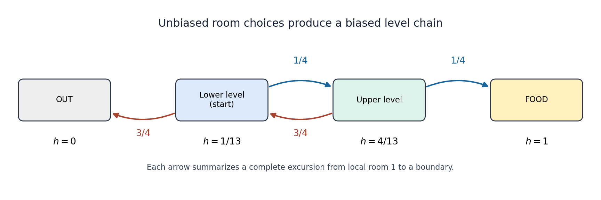

<h1 id="9/c/solution">Solution</h1>

↑ **Parent:** [C](../c.md)

Treat one visit to a level as a whole [gambler's ruin](../../../../../gambler-s-ruin.md) excursion, starting at its chamber $1$ and ending at local chamber $0$ or $4$. The room choices are fair, so the chance of reaching $4$ before $0$ is $1/4$, and the chance of reaching $0$ first is $3/4$. The one-way hatches reset the next excursion to chamber $1$ of the adjacent level. Thus the [embedded Markov chain at level exits](../../../../../embedded-markov-chain-at-level-exits.md) moves upward with [probability](../../../../../probability.md) $1/4$ and downward with [probability](../../../../../probability.md) $3/4$, even though individual room choices are unbiased.

Let $u$ be the food [probability](../../../../../probability.md) from the lower starting chamber, and $v$ that from the upper chamber $1$. The lower level either exits unsuccessfully or reaches the upper level, while the upper level either finds food or returns to the lower start. [First-step analysis](../../../../../first-step-analysis.md) at these level exits gives

$$
u=\tfrac14v,\qquad v=\tfrac14+\tfrac34u.
$$

Substituting yields $u=1/16+3u/16$, so

$$
\boxed{u=\frac1{13}.}
$$

This also follows from [biased gambler's ruin probability](../../../../../biased-gambler-s-ruin-probability.md) on levels $0,1,2,3$, starting at $1$, with ratio $(1-p)/p=3$: $(1-3)/(1-3^3)=1/13$. Absorption occurs [almost surely](../../../../../almost-sure-convergence.md), since from each active level a fixed positive chance of terminal absorption occurs within two excursions; the original chamber excursions are also [almost surely](../../../../../almost-sure-convergence.md) finite.

**[Figure 1](#9/c/image-the-maze-reduced-to-level-exits-has-upward-probability-one-quarter-and-downward-probability-three-quarters). The maze reduced to level exits has upward probability one quarter and downward probability three quarters**.

## ↑ Ancestors (12)

1. [C](../c.md)
2. [9](../../9.md)
3. [Discrete mathematics, continuous mathematics, and probability](../../../discrete-mathematics-continuous-mathematics-and-probability-split.md)
4. [2021](../../../split.md)
5. [Past exam of the year 1 of the computer science course of the University of Oxford](../../../../split.md)
6. [Year 1 of the computer science course of the University of Oxford](../../../../../year-1-of-the-computer-science-course-of-the-university-of-oxford.md)
7. [Computer science course of the University of Oxford](../../../../../computer-science-course-of-the-university-of-oxford.md)
8. [Undergraduate course of the University of Oxford](../../../../../undergraduate-course-of-the-university-of-oxford.md)
9. [Course of the University of Oxford](../../../../../course-of-the-university-of-oxford.md)
10. [University of Oxford](../../../../../university-of-oxford-split.md)
11. [List of universities](../../../../../list-of-universities.md)
12. [Codex Wiki](../../../../../split.md)
