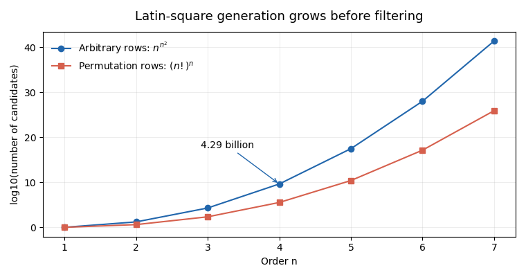
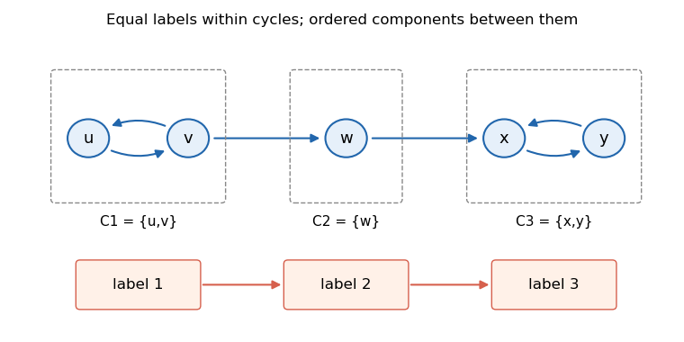

# Functional programming, design and analysis of algorithms (resit)

↑ **Parent:** [2021](../2021.md)

Source paper: [released examination archive, member 2020/L/a10097w1.pdf](https://www.whatdotheyknow.com/request/ba_computer_science_past_papers/response/2577745/attach/2/202402%20183%20CS%20Papers.zip?cookie_passthrough=1).

The held cover identifies the Long Vacation sitting of 8 September 2021. All eight questions and all 37 printed letter leaves are answered here, including the unnumbered cases within 5(a) and 5(b). Code is written for [Haskell](../../programming-language.md#haskell) 2010 unless marked as pseudocode. Sorting assumes a lawful terminating ordering on finite inputs; the partial-value qualifications in Question 1 are stated where they matter. No native [Haskell](../../programming-language.md#haskell) compiler is installed in the checking environment, so executable checks use independent Python models and are not claimed as native compilation.

**Table of contents**

- [1](#1)
  - [a](#1/a)
    - [Solution](#1/a/solution)
  - [b](#1/b)
    - [Solution](#1/b/solution)
  - [c](#1/c)
    - [Solution](#1/c/solution)
  - [d](#1/d)
    - [Solution](#1/d/solution)
  - [e](#1/e)
    - [Solution](#1/e/solution)
  - [f](#1/f)
    - [Solution](#1/f/solution)
- [2](#2)
  - [a](#2/a)
    - [Solution](#2/a/solution)
  - [b](#2/b)
    - [Solution](#2/b/solution)
  - [c](#2/c)
    - [Solution](#2/c/solution)
  - [d](#2/d)
    - [Solution](#2/d/solution)
  - [e](#2/e)
    - [Solution](#2/e/solution)
  - [f](#2/f)
    - [Solution](#2/f/solution)
- [3](#3)
  - [a](#3/a)
    - [Solution](#3/a/solution)
  - [b](#3/b)
    - [Solution](#3/b/solution)
  - [c](#3/c)
    - [Solution](#3/c/solution)
  - [d](#3/d)
    - [Solution](#3/d/solution)
  - [e](#3/e)
    - [Solution](#3/e/solution)
  - [f](#3/f)
    - [Solution](#3/f/solution)
- [4](#4)
  - [a](#4/a)
    - [Solution](#4/a/solution)
  - [b](#4/b)
    - [Solution](#4/b/solution)
  - [c](#4/c)
    - [Solution](#4/c/solution)
  - [d](#4/d)
    - [Solution](#4/d/solution)
  - [e](#4/e)
    - [Solution](#4/e/solution)
  - [f](#4/f)
    - [Solution](#4/f/solution)
  - [g](#4/g)
    - [Solution](#4/g/solution)
- [5](#5)
  - [a](#5/a)
    - [Solution](#5/a/solution)
  - [b](#5/b)
    - [Solution](#5/b/solution)
  - [c](#5/c)
    - [Solution](#5/c/solution)
- [6](#6)
  - [a](#6/a)
    - [Solution](#6/a/solution)
  - [b](#6/b)
    - [Solution](#6/b/solution)
- [7](#7)
  - [a](#7/a)
    - [Solution](#7/a/solution)
  - [b](#7/b)
    - [Solution](#7/b/solution)
  - [c](#7/c)
    - [Solution](#7/c/solution)
  - [d](#7/d)
    - [Solution](#7/d/solution)
- [8](#8)
  - [a](#8/a)
    - [Solution](#8/a/solution)
  - [b](#8/b)
    - [Solution](#8/b/solution)
  - [c](#8/c)
    - [Solution](#8/c/solution)

## 1

↑ **Parent:** [Functional programming, design and analysis of algorithms (resit)](functional-programming-design-and-analysis-of-algorithms-resit.md)

<h3 id="1/a">a</h3>

↑ **Parent:** [1](#1)

<h4 id="1/a/solution">Solution</h4>

↑ **Parent:** [A](#1/a)

The empty-[list](../../data-structure.md#list-abstract-data-type) case uses $f(a)=b$. At a cons, assuming the equality for the tail, the calculation is

$$
f(\operatorname{foldr}\ g\ a\ (x:xs))=f(g\ x\ (\operatorname{foldr}\ g\ a\ xs))=h\ x\ (f(\operatorname{foldr}\ g\ a\ xs))=h\ x\ (\operatorname{foldr}\ h\ b\ xs).
$$

The middle equality is the supplied compatibility condition, instantiated with the folded tail; the last expression is the [right fold](../../programming-language.md#list-fold) on the whole [list](../../data-structure.md#list-abstract-data-type). [Structural induction](../../foundations-of-mathematics.md#structural-induction) therefore proves fusion for finite total spines.

The strictness condition accounts for a bottom-valued input spine: the inner [list fold](../../programming-language.md#list-fold) returns bottom, and $f(\bot)=\bot$ makes the two sides agree. The same [induction](../../foundations-of-mathematics.md#mathematical-induction) covers finite [partial lists](../../data-structure.md#partial-list). For pure definable continuous [functions](../../function.md), an infinite [list](../../data-structure.md#list-abstract-data-type) is the limit of its finite partial approximations, so equality extends to it. These are the three distinct obligations in the [right-fold fusion law](../../programming-language.md#right-fold-fusion-law); strictness is not needed if the domain is restricted to finite terminating spines.

<h3 id="1/b">b</h3>

↑ **Parent:** [1](#1)

<h4 id="1/b/solution">Solution</h4>

↑ **Parent:** [B](#1/b)

**Yes.** Define the combining [function](../../function.md) as follows:
```
takeP :: (a -> Bool) -> [a] -> [a]
takeP p = foldr step []
  where
    step x rest = if p x then x : rest else []
```
For the fusion derivation use the identity reconstruction `foldr (:) []`, take $f=\operatorname{takeWhile}\ p$, and choose the displayed `step` as $h$. The [function](../../function.md) $f$ is strict in the input [list](../../data-structure.md#list-abstract-data-type), $f([])=[]$, and its cons equation is exactly $f(x:xs)=h\ x\ (f(xs))$. Fusion gives the implementation. On a false test, `step` does not demand the folded tail, so the implementation can terminate after a finite [list prefix](../../data-structure.md#prefix-of-a-list) even when the remaining [list](../../data-structure.md#list-abstract-data-type) is infinite or undefined. An undefined [predicate](../../analysis-of-boolean-functions.md#predicate) result at a tested element makes both definitions undefined.

<h3 id="1/c">c</h3>

↑ **Parent:** [1](#1)

<h4 id="1/c/solution">Solution</h4>

↑ **Parent:** [C](#1/c)

**In general, no direct [list fold](../../programming-language.md#list-fold) with result type `[a]` can implement `dropWhile p`.** Choose total values $u,v$ for which $p(u)=\mathrm{True}$ and $p(v)=\mathrm{False}$. The results on `[]` and `[u]` are both `[]`. A hypothetical implementation `foldr h z` would therefore receive identical folded-tail values when extending either input by the same head $v$. Yet the required outputs are `[v]` and `[v,u]`, respectively. This contradicts the [fold factorisation criterion](../../programming-language.md#fold-factorisation-criterion): the combining [function](../../function.md) cannot distinguish information already discarded by its tail summary.

The claim concerns a direct same-result-type [list fold](../../programming-language.md#list-fold). A [list fold](../../programming-language.md#list-fold) returning extra information, followed by a projection, is possible: a pair can retain both the original tail and the dropped [list suffix](../../data-structure.md#suffix-of-a-list). Also, special [predicates](../../analysis-of-boolean-functions.md#predicate) can have direct [list folds](../../programming-language.md#list-fold): a constantly false [predicate](../../analysis-of-boolean-functions.md#predicate) gives the identity; a constantly true [predicate](../../analysis-of-boolean-functions.md#predicate) can use `foldr (\_ r -> r) []`, which correctly diverges when it must traverse an infinite spine. Those special cases do not supply an implementation for an arbitrary [predicate](../../analysis-of-boolean-functions.md#predicate).

<h3 id="1/d">d</h3>

↑ **Parent:** [1](#1)

<h4 id="1/d/solution">Solution</h4>

↑ **Parent:** [D](#1/d)

The necessary definedness condition is local: **every [predicate](../../analysis-of-boolean-functions.md#predicate) application actually reached before the first false result must produce a Boolean value**. No condition is needed on [predicate](../../analysis-of-boolean-functions.md#predicate) applications after that first false result, because the [list suffix](../../data-structure.md#suffix-of-a-list) is then returned without further testing. If a reached test is bottom at a known cons cell, the reconstructed [list](../../data-structure.md#list-abstract-data-type) is bottom at that position, while the original [list](../../data-structure.md#list-abstract-data-type) still exposes a cons there; equality fails.

To prove sufficiency on finite [lists](../../data-structure.md#list-abstract-data-type), induct on the spine. The empty case gives `[] ++ [] = []`. At a true test the left [list prefix](../../data-structure.md#prefix-of-a-list) contributes the head, and the [induction](../../foundations-of-mathematics.md#mathematical-induction) hypothesis reconstructs the tail. At a false test the [list prefix](../../data-structure.md#prefix-of-a-list) is empty and the [list suffix](../../data-structure.md#suffix-of-a-list) is the whole current [list](../../data-structure.md#list-abstract-data-type). For an infinite true-tested [list prefix](../../data-structure.md#prefix-of-a-list), every finite output [list prefix](../../data-structure.md#prefix-of-a-list) is copied correctly; the infinite [list prefix](../../data-structure.md#prefix-of-a-list) hides the possibly divergent [list suffix](../../data-structure.md#suffix-of-a-list) computation. A partial spine ending in bottom is reconstructed up to exactly the same bottom. Thus finiteness is sufficient for an elementary [induction](../../foundations-of-mathematics.md#mathematical-induction) proof but is not itself necessary for the identity.

For the uniform [list fold](../../programming-language.md#list-fold) calculation in part (f), use the convenient stronger assumption that **the input is a finite total [list](../../data-structure.md#list-abstract-data-type) and the [predicate](../../analysis-of-boolean-functions.md#predicate) terminates on every element of that [list](../../data-structure.md#list-abstract-data-type)**. This makes the reconstruction identity available on every [list suffix](../../data-structure.md#suffix-of-a-list), not only on the [list suffixes](../../data-structure.md#suffix-of-a-list) visited by the original [list prefix](../../data-structure.md#prefix-of-a-list) scan. A total [predicate](../../analysis-of-boolean-functions.md#predicate) on the element type ensures this uniformly over all finite total inputs.

<h3 id="1/e">e</h3>

↑ **Parent:** [1](#1)

<h4 id="1/e/solution">Solution</h4>

↑ **Parent:** [E](#1/e)

For the finite total inputs just specified, a recursive implementation is
```
spanP :: (a -> Bool) -> [a] -> ([a], [a])
spanP p [] = ([], [])
spanP p whole@(x:xs)
  | p x       = let (ys,zs) = spanP p xs in (x:ys,zs)
  | otherwise = ([],whole)
```
At a true test, the head belongs to the [list prefix](../../data-structure.md#prefix-of-a-list) and splitting continues on the tail; at a false test, the complete remaining [list](../../data-structure.md#list-abstract-data-type) is the [list suffix](../../data-structure.md#suffix-of-a-list). [Induction](../../foundations-of-mathematics.md#mathematical-induction) proves that the first projection is the longest accepted [list prefix](../../data-structure.md#prefix-of-a-list) and the second projection is the remaining [list suffix](../../data-structure.md#suffix-of-a-list).

There is a small partial-value distinction behind the paper's displayed pair identity. The conventional recursive `span` is strict in an entirely undefined [list](../../data-structure.md#list-abstract-data-type), whereas the literal expression `(takeWhile p undefined, dropWhile p undefined)` exposes an outer pair with two undefined components. The equality as a pair therefore needs the stated defined-input convention, or an interpretation that compares the two projections. This does not affect the finite total answers here.[§3.17, pattern matching; Chapter 9, definitions of span and the prefix operations](../../computer-science-bibliography.md#haskell-2010-language-report)

<h3 id="1/f">f</h3>

↑ **Parent:** [1](#1)

<h4 id="1/f/solution">Solution</h4>

↑ **Parent:** [F](#1/f)

**Yes, under the finite total assumption in part (d).** The pair result retains enough information to reconstruct the tail; the `~` pattern keeps its two components lazy:
```
spanFold :: (a -> Bool) -> [a] -> ([a], [a])
spanFold p = foldr step ([], [])
  where
    step x ~(ys,zs)
      | p x       = (x:ys,zs)
      | otherwise = ([],x:(ys ++ zs))
```
Take $f=\operatorname{spanP}\ p$, $g=(:)$ and $a=[]$. The base image is $([],[])$. If $p(x)$ is true, the recursive equation gives the first branch. If it is false, part (d), applied to the tail, gives $ys\mathbin{++}zs=xs$, so the second branch becomes $([],x:xs)$. These are precisely the fusion compatibility equations. Finite [structural induction](../../foundations-of-mathematics.md#structural-induction) establishes the desired equality; it does not require extending the restricted-domain hypothesis to undefined [predicate](../../analysis-of-boolean-functions.md#predicate) applications.

The qualification matters. If $p(v)$ is false but $p(u)$ is undefined, ordinary `spanP p [v,u]` can return the untouched [list suffix](../../data-structure.md#suffix-of-a-list) immediately, whereas the reconstruction through `spanFold p [u]` cannot recover that [list suffix](../../data-structure.md#suffix-of-a-list). The weaker condition needed only for the single reconstruction identity in (d) is therefore insufficient for this particular [list fold](../../programming-language.md#list-fold) on all [list suffixes](../../data-structure.md#suffix-of-a-list). The stronger totality condition stated there supplies exactly the missing premise.

## 2

↑ **Parent:** [Functional programming, design and analysis of algorithms (resit)](functional-programming-design-and-analysis-of-algorithms-resit.md)

<h3 id="2/a">a</h3>

↑ **Parent:** [2](#2)

<h4 id="2/a/solution">Solution</h4>

↑ **Parent:** [A](#2/a)

A [three-way quicksort](../../algorithm.md#three-way-quicksort) can use a common partition helper so that the tree factorisation below makes the same key comparisons. The `compare` operation is assumed to be a terminating lawful total ordering on the supplied keys.
```
partition3 :: Ord a => a -> [a] -> ([a],[a],[a])
partition3 pivot = foldr step ([],[],[])
  where
    step x rest =
      let (lo,eq,hi) = rest
      in case compare x pivot of
           LT -> (x:lo,eq,hi)
           EQ -> (lo,x:eq,hi)
           GT -> (lo,eq,x:hi)

sort :: Ord a => [a] -> [a]
sort [] = []
sort (pivot:xs) =
  let (lo,eq,hi) = partition3 pivot xs
  in sort lo ++ (pivot:eq) ++ sort hi
```
Every non-pivot entry appears in exactly one partition, and the equal bucket contains the original pivot exactly once. The recursive sublists have length at most one less than the current finite input, so [recursion](../../algorithm.md#recursion-computer-science) terminates. [Induction](../../foundations-of-mathematics.md#mathematical-induction) gives sorted recursive results with the original multiplicities; placing the equal bucket between them gives a sorted [permutation](../../combinatorics.md#permutation) of the input. There is no [recursive call](../../algorithm.md#recursive-call) on the equal bucket, which avoids needless descent on repeated keys.

<h3 id="2/b">b</h3>

↑ **Parent:** [2](#2)

<h4 id="2/b/solution">Solution</h4>

↑ **Parent:** [B](#2/b)

The ordering operations used to decide the partitions require an **`Ord a` constraint**. A [function](../../function.md) with [parametric polymorphism](../../programming-language.md#parametric-polymorphism) and type `[a] -> [a]` cannot inspect arbitrary element values to decide which one is smaller; for example, [functions](../../function.md) themselves need not admit the comparison operations required by this [sorting algorithm](../../algorithm.md#sorting-algorithm). A [Haskell Ord class](../../programming-language.md#haskell-ord-class) instance supplies the comparison method, with its ordering laws a separate semantic assumption.[Chapter 9, the Ord class and compare method](../../computer-science-bibliography.md#haskell-2010-language-report)

<h3 id="2/c">c</h3>

↑ **Parent:** [2](#2)

<h4 id="2/c/solution">Solution</h4>

↑ **Parent:** [C](#2/c)

Store the equal bucket at each internal node:
```
data Tree a = Empty | Node (Tree a) [a] (Tree a)

toTree :: Ord a => [a] -> Tree a
toTree [] = Empty
toTree (pivot:xs) =
  let (lo,eq,hi) = partition3 pivot xs
  in Node (toTree lo) (pivot:eq) (toTree hi)

fromTree :: Tree a -> [a]
fromTree Empty = []
fromTree (Node left equal right) =
  fromTree left ++ equal ++ fromTree right
```
The representation [invariant](../../mathematics.md#invariant-mathematics) for a tree produced by `toTree` is that its bucket is nonempty and contains equal keys, every left-subtree key is smaller, and every right-subtree key is larger. Its multiplicities are preserved. Substituting the two equations for `toTree` into `fromTree` gives exactly the two defining equations for `sort`; [induction](../../foundations-of-mathematics.md#mathematical-induction) proves **`sort = fromTree . toTree`** on finite inputs.

Both versions call the same partition helper on the same pivot and sublists. The flattening stage makes no key comparisons. Thus fully producing the answer makes the same comparison decisions as the direct [algorithm](../../algorithm.md); no additional comparison against stored tree keys is introduced.

<h3 id="2/d">d</h3>

↑ **Parent:** [2](#2)

<h4 id="2/d/solution">Solution</h4>

↑ **Parent:** [D](#2/d)

**`toTree` needs `Ord a`; `fromTree` does not.** Construction compares each key against a pivot. Flattening merely traverses and concatenates the buckets, so its more general type is `Tree a -> [a]`. A manually constructed tree need not satisfy the search-tree [invariant](../../mathematics.md#invariant-mathematics); `fromTree` still flattens it, although its output need not be sorted.

<h3 id="2/e">e</h3>

↑ **Parent:** [2](#2)

<h4 id="2/e/solution">Solution</h4>

↑ **Parent:** [E](#2/e)

A [tree fold](../../programming-language.md#tree-fold) replaces each constructor by its interpretation:
```
foldTree :: (b -> [a] -> b -> b) -> b -> Tree a -> b
foldTree combine zero Empty = zero
foldTree combine zero (Node left equal right) =
  combine (foldTree combine zero left)
          equal
          (foldTree combine zero right)

fromTreeFold :: Tree a -> [a]
fromTreeFold = foldTree (\left equal right -> left ++ equal ++ right) []
```
[Induction](../../foundations-of-mathematics.md#mathematical-induction) on the finite tree shows equality with `fromTree`: the empty tree produces the empty output, and the combining [function](../../function.md) concatenates the two correctly flattened children around the node's bucket. The result type $b$ is independent of the key type; other choices can compute a size or another summary using the same [structural recursion](../../programming-language.md#structural-recursion).

<h3 id="2/f">f</h3>

↑ **Parent:** [2](#2)

<h4 id="2/f/solution">Solution</h4>

↑ **Parent:** [F](#2/f)

An unfold expands a seed into either no node or a bucket and two new seeds:
```
unfoldTree :: (s -> Maybe (s,[a],s)) -> s -> Tree a
unfoldTree split seed =
  case split seed of
    Nothing -> Empty
    Just (left,equal,right) ->
      Node (unfoldTree split left) equal (unfoldTree split right)

toTreeUnfold :: Ord a => [a] -> Tree a
toTreeUnfold = unfoldTree split
  where
    split [] = Nothing
    split (pivot:xs) =
      let (lo,eq,hi) = partition3 pivot xs
      in Just (lo,pivot:eq,hi)
```
The seed is the remaining [list](../../data-structure.md#list-abstract-data-type). Expanding a nonempty seed partitions it exactly as `toTree` does, and both child seeds are shorter. [Induction](../../foundations-of-mathematics.md#mathematical-induction) establishes **`toTreeUnfold = toTree`** and [algorithm termination](../../algorithm.md#algorithm-termination) on finite inputs. The unfold separates the local decomposition rule from the recursive construction of the tree.

## 3

↑ **Parent:** [Functional programming, design and analysis of algorithms (resit)](functional-programming-design-and-analysis-of-algorithms-resit.md)

<h3 id="3/a">a</h3>

↑ **Parent:** [3](#3)

<h4 id="3/a/solution">Solution</h4>

↑ **Parent:** [A](#3/a)

The empty family has one choice, the empty selection:
```
cp :: [[a]] -> [[a]]
cp = foldr extend [[]]
  where
    extend choices suffixes = [x:ys | x <- choices, ys <- suffixes]
```
A selection from the whole family consists uniquely of a choice from its first member and a selection from the remaining family. This bijection proves the combining equation and completeness by [induction](../../foundations-of-mathematics.md#mathematical-induction). If a member family is empty, there are no selections. The base is `[[]]`, not `[]`: otherwise every [Cartesian product](../../set-theory.md#cartesian-product) would incorrectly be empty.

<h3 id="3/b">b</h3>

↑ **Parent:** [3](#3)

<h4 id="3/b/solution">Solution</h4>

↑ **Parent:** [B](#3/b)

For a nonnegative order, first enumerate every possible row and then every possible ordered selection of rows:
```
squares :: Int -> [[[Int]]]
squares n
  | n < 0     = error "negative order"
  | otherwise = cp (replicate n (cp (replicate n [1..n])))
```
Every one of the $n^2$ positions chooses one of $n$ symbols independently. Consequently the enumeration contains **$n^{n^2}$** candidate squares for $n\geq1$, each exactly once. The conventional order-zero extension produces one empty square. This is generation only; repeated symbols have not yet been rejected.

<h3 id="3/c">c</h3>

↑ **Parent:** [3](#3)

<h4 id="3/c/solution">Solution</h4>

↑ **Parent:** [C](#3/c)

The following [predicate](../../analysis-of-boolean-functions.md#predicate) also checks the square's shape; `sort` is the three-way sorting [function](../../function.md) from Question 2:
```
valid :: [[Int]] -> Bool
valid rows =
  let n = length rows
      symbols = [1..n]
      goodRows = all (\r -> sort r == symbols) rows
      goodColumns = all (\j -> sort [r !! j | r <- rows] == symbols)
                        [0..n-1]
  in goodRows && goodColumns

latin :: Int -> [[[Int]]]
latin = filter valid . squares
```
The row tests guarantee that each row has length $n$ and contains each allowed symbol once. Because `&&` tests this condition first, the later column indexing is safe for a finite total input. The column tests establish the remaining Latin-square condition. Filtering therefore retains precisely the valid squares; it does not remove any different ordering of rows, columns or symbols as an alleged symmetry duplicate.

<h3 id="3/d">d</h3>

↑ **Parent:** [3](#3)

<h4 id="3/d/solution">Solution</h4>

↑ **Parent:** [D](#3/d)

The generation count, before any validity test, is **$n^{n^2}$**. It is $19\,683$ at order three, $4\,294\,967\,296$ at order four, and approximately $2.98\times10^{17}$ at order five. Even an illustrative rate of one million complete candidates per second would require about 72 minutes at order four and about 9,444 years at order five, before accounting for the actual validity-checking cost. Thus **order four is already expensive and order five is plainly impractical** for this strategy; the exact threshold depends on the implementation and hardware, not just the mathematical count.

<a id="3/d/image-candidate-growth-before-filtering-in-two-latin-square-generation-strategies"></a>


**[Figure 1](#3/d/image-candidate-growth-before-filtering-in-two-latin-square-generation-strategies). Candidate growth before filtering in two Latin-square generation strategies**. Original exact candidate counts, plotted on a base-ten logarithmic vertical axis. These are mathematical counts, not measured running times; pruning can avoid many invalid partial extensions as well.

<h3 id="3/e">e</h3>

↑ **Parent:** [3](#3)

<h4 id="3/e/solution">Solution</h4>

↑ **Parent:** [E](#3/e)

Choose each row from the [permutations](../../combinatorics.md#permutation) of the symbols:
```
squaresRows :: Int -> [[[Int]]]
squaresRows n
  | n < 0     = error "negative order"
  | otherwise = cp (replicate n (perms [1..n]))

latinRows :: Int -> [[[Int]]]
latinRows = filter valid . squaresRows
```
Every [Latin square](../../design-of-experiments.md#latin-square) remains a candidate, because each of its rows is one of those [permutations](../../combinatorics.md#permutation). Conversely every candidate has valid rows, so only its columns still need checking. There are **$(n!)^n$** candidates instead of $n^{n^2}$: at order four, $331\,776$ rather than more than four billion. The improvement is substantial but does not make exhaustive generation practical at arbitrary orders. One can replace `valid` by a column-only test here, since row validity is guaranteed by construction.

<h3 id="3/f">f</h3>

↑ **Parent:** [3](#3)

<h4 id="3/f/solution">Solution</h4>

↑ **Parent:** [F](#3/f)

Generate a row while respecting the forbidden symbols in each column. Selection returns an element together with the still-available elements:
```
select :: [a] -> [(a,[a])]
select [] = []
select (x:xs) = (x,xs) : [(y,x:ys) | (y,ys) <- select xs]

row :: [Int] -> [[Int]] -> [[Int]]
row [] [] = [[]]
row remaining (used:otherColumns) =
  [x:rest | (x,available) <- select remaining,
            x `notElem` used,
            rest <- row available otherColumns]
row _ _ = []

latinPruned :: Int -> [[[Int]]]
latinPruned n
  | n < 0     = error "negative order"
  | otherwise = build n (replicate n [])
  where
    build 0 usedColumns = [[]]
    build remainingRows usedColumns =
      [r:rest | r <- row [1..n] usedColumns,
                rest <- build (remainingRows-1)
                              (zipWith (:) r usedColumns)]
```
The [invariant](../../mathematics.md#invariant-mathematics) of `row` is that `remaining` contains exactly the unused symbols of this row, while each member of the column [list](../../data-structure.md#list-abstract-data-type) records symbols used by earlier rows. Selecting removes a symbol, so it cannot repeat in the current row; the membership test prevents a column repetition. A complete row uses every symbol once. Updating the column histories preserves the [invariant](../../mathematics.md#invariant-mathematics) for the next [recursive call](../../algorithm.md#recursive-call).

Every complete generated square is therefore valid without a final filter. Conversely, take any valid target square: its next row passes every selection and column test, so [induction](../../foundations-of-mathematics.md#mathematical-induction) keeps a branch constructing that target. Distinct choices from the initially distinct symbols cannot generate the same square twice. Dead-end partial squares may still be explored; the method promises to avoid constructing complete invalid squares, not to foresee every future dead end. Independent enumeration gives 1, 2, 12 and 576 squares at orders one through four.

## 4

↑ **Parent:** [Functional programming, design and analysis of algorithms (resit)](functional-programming-design-and-analysis-of-algorithms-resit.md)

<h3 id="4/a">a</h3>

↑ **Parent:** [4](#4)

<h4 id="4/a/solution">Solution</h4>

↑ **Parent:** [A](#4/a)

A [function](../../function.md) returning an [optional value](../../data-structure.md#optional-value) supplies the representation:
```
newtype List a = List (Int -> Maybe a)
```
For a finite represented [list](../../data-structure.md#list-abstract-data-type), require a length $m\geq0$ such that every index $0\leq i<m$ returns `Just` its element and every other index returns `Nothing`. Thus there are no holes: absence at a nonnegative index implies absence at every later index. The type alone does not enforce this [invariant](../../mathematics.md#invariant-mathematics), or [algorithm termination](../../algorithm.md#algorithm-termination) of a query. An infinite represented [sequence](../../sequence-and-series.md#sequence) may instead have a present value at every nonnegative index; operations requiring its length will not terminate.

The implementations below return `Nothing` at negative indices. Finite lengths, requested counts and intermediate indices are assumed to fit `Int`; explicit guards on index shifts also prevent arithmetic wraparound from exposing an invalid element.

<h3 id="4/b">b</h3>

↑ **Parent:** [4](#4)

<h4 id="4/b/solution">Solution</h4>

↑ **Parent:** [B](#4/b)

The empty representation is nowhere present; prepending shifts all old positions by one:
```
nil' :: List a
nil' = List (\_ -> Nothing)

cons' :: a -> List a -> List a
cons' x (List f) = List query
  where
    query i
      | i < 0     = Nothing
      | i == 0    = Just x
      | otherwise = f (i-1)
```
For a represented length $m$, `cons'` represents length $m+1$, provided that length is representable. Index zero is the new head and each later valid index asks for the preceding old position. The no-holes [invariant](../../mathematics.md#invariant-mathematics) is preserved. No conventional [list](../../data-structure.md#list-abstract-data-type) is built by either constructor.

<h3 id="4/c">c</h3>

↑ **Parent:** [4](#4)

<h4 id="4/c/solution">Solution</h4>

↑ **Parent:** [C](#4/c)

The embedding is a [right fold](../../programming-language.md#list-fold) interpreting each source constructor by its new counterpart:
```
list' :: [a] -> List a
list' = foldr cons' nil'
```
[Induction](../../foundations-of-mathematics.md#mathematical-induction) on the finite source [list](../../data-structure.md#list-abstract-data-type) proves that querying index $i$ returns its $i$th element exactly when $i$ lies in range. The empty case is `nil'`; the cons case shifts every tail index as established in part (b). This is the only part of Question 4 whose implementation uses the conventional [list](../../data-structure.md#list-abstract-data-type) type.

<h3 id="4/d">d</h3>

↑ **Parent:** [4](#4)

<h4 id="4/d/solution">Solution</h4>

↑ **Parent:** [D](#4/d)

Inspect index zero for emptiness and the head; removing the head shifts the query in the other direction:
```
null' :: List a -> Bool
null' (List f) = case f 0 of
                  Nothing -> True
                  Just _  -> False

head' :: List a -> a
head' (List f) = case f 0 of
                  Nothing -> error "head of empty representation"
                  Just x  -> x

tail' :: List a -> List a
tail' input@(List f)
  | null' input = error "tail of empty representation"
  | otherwise   = List query
  where
    query i
      | i < 0 || i == maxBound = Nothing
      | otherwise             = f (i+1)
```
The no-holes [invariant](../../mathematics.md#invariant-mathematics) makes the zero-index test sufficient for emptiness. Both `head'` and `tail'` have the [precondition](../../algorithm.md#precondition) that the representation is nonempty and signal an error when it is violated. On a nonempty representation, `tail'` removes exactly one position. The overflow guard is consistent with finite lengths at most `maxBound`.

<h3 id="4/e">e</h3>

↑ **Parent:** [4](#4)

<h4 id="4/e/solution">Solution</h4>

↑ **Parent:** [E](#4/e)

Preserve absence and transform only a present value:
```
map' :: (a -> b) -> List a -> List b
map' g (List f) = List (\i -> case f i of
                              Nothing -> Nothing
                              Just x  -> Just (g x))
```
Every query keeps its presence status, so the represented length and the no-holes [invariant](../../mathematics.md#invariant-mathematics) are unchanged. The transformed element is computed only when demanded.

<h3 id="4/f">f</h3>

↑ **Parent:** [4](#4)

<h4 id="4/f/solution">Solution</h4>

↑ **Parent:** [F](#4/f)

Clamp a nonpositive count to zero. Taking restricts the domain of present indices; dropping translates that domain:
```
take' :: Int -> List a -> List a
take' count (List f) = List query
  where
    k = max 0 count
    query i
      | i < 0 || i >= k = Nothing
      | otherwise      = f i

drop' :: Int -> List a -> List a
drop' count (List f) = List query
  where
    k = max 0 count
    query i
      | i < 0 || i > maxBound - k = Nothing
      | otherwise                = f (i+k)

length' :: List a -> Int
length' (List f) = countFrom 0
  where
    countFrom i = case f i of
                    Nothing -> i
                    Just _  -> countFrom (i+1)
```
For finite length $m$, the first two operations give lengths $\min(k,m)$ and $\max(m-k,0)$, respectively. The length loop reaches the first absent index, namely $m$, so it terminates for a total finite representation. It does not terminate on an infinite represented [sequence](../../sequence-and-series.md#sequence). There is no assumption that an arbitrary stored query [function](../../function.md) takes constant time.

<h3 id="4/g">g</h3>

↑ **Parent:** [4](#4)

<h4 id="4/g/solution">Solution</h4>

↑ **Parent:** [G](#4/g)

Merge by comparing the present heads and consuming just the chosen one. The implementation uses only the functional representation:
```
merge' :: Ord a => List a -> List a -> List a
merge' left right
  | null' left  = right
  | null' right = left
  | head' left <= head' right =
      cons' (head' left) (merge' (tail' left) right)
  | otherwise =
      cons' (head' right) (merge' left (tail' right))

mergeSort' :: Ord a => List a -> List a
mergeSort' input =
  let n = length' input
      middle = n `div` 2
  in if n <= 1 then input
     else merge' (mergeSort' (take' middle input))
                 (mergeSort' (drop' middle input))
```
The two recursive inputs are the disjoint initial and final portions of the represented [sequence](../../sequence-and-series.md#sequence); they preserve every occurrence and have smaller lengths when $n\geq2$. In `merge'`, the smaller current head can precede every remaining value in both sorted inputs. Selecting the left head on equality preserves stability. Each merge step reduces the total number of remaining elements, and [induction](../../foundations-of-mathematics.md#mathematical-induction) proves a sorted [permutation](../../combinatorics.md#permutation) of the original [sequence](../../sequence-and-series.md#sequence).

This establishes [algorithm termination](../../algorithm.md#algorithm-termination) and correctness on total finite representations, not an unconditional $O(n\log n)$ implementation bound. Nested index [functions](../../function.md) can make queries costly, and repeatedly finding lengths or heads may revisit them. The familiar merge-sort bound assumes suitable constant-time access or consumption primitives; the source's [function](../../function.md)-only representation supplies no such cost guarantee.

## 5

↑ **Parent:** [Functional programming, design and analysis of algorithms (resit)](functional-programming-design-and-analysis-of-algorithms-resit.md)

<h3 id="5/a">a</h3>

↑ **Parent:** [5](#5)

<h4 id="5/a/solution">Solution</h4>

↑ **Parent:** [A](#5/a)

There are three unnumbered cases inside this leaf.

For the nine-child recurrence, a [recursion](../../algorithm.md#recursion-computer-science) tree has $9^j$ subproblems of size about $n/3^j$. There are $\Theta(n^2)$ constant-size leaves, and the total unit work over earlier levels is a geometric sum of the same order. Hence **$T(n)=\Theta(n^2)$**. This is also the first case of the [master theorem](../../sequence-and-series.md#master-theorem), since $\log_3 9=2$ and the additive work is constant.

For the decrementing recurrence, summing from the supplied base at three gives

$$
T(n)=1+\sum_{j=4}^{n}j=\frac{n(n+1)}2-5\quad(n\geq3),
$$

so **$T(n)=\Theta(n^2)$** here as well. Values at the smaller base indices remain one as specified.

For the recurrence that squares its recursive result, [set](../../set.md) $S(n)=\log_2 T(n)$. Then $S(n)=1+2S(\lfloor n/2\rfloor)$ above the base range. Let

$$
d(n)=\min\{j\geq0:\lfloor n/2^j\rfloor\leq3\}=\max(0,\lfloor\log_2 n\rfloor-1)\quad(n\geq1).
$$

After $d$ expansions, $S(n)=1+2+\cdots+2^{d-1}=2^d-1$, giving the exact answer

$$
\boxed{T(n)=2^{\,2^{d(n)}-1}.}
$$

For powers of two $n\geq4$ this is $2^{n/2-1}$. For arbitrary [positive integer](../../integer.md#positive-integer) $n$, the exact values form plateaux: $T(4)=\cdots=T(7)=2$, while $T(8)=\cdots=T(15)=8$. In general **$T(n)=2^{\Theta(n)}$**. It is not $\Theta(2^{n/2})$ uniformly over [integer](../../integer.md) $n$: near the top of a plateau the exponent is closer to $n/4$. Keeping the [integer](../../integer.md) halving is essential; the ordinary linear [master theorem](../../sequence-and-series.md#master-theorem) does not apply to squaring $T$.

<h3 id="5/b">b</h3>

↑ **Parent:** [5](#5)

<h4 id="5/b/solution">Solution</h4>

↑ **Parent:** [B](#5/b)

Sequential accumulation writes merged outputs of lengths $2n,3n,\ldots,kn$. Its total work is

$$
\Theta\!\left(n\sum_{j=2}^{k}j\right)=\boxed{\Theta(nk^2)}\quad(k\geq2).
$$

The growing [list prefix](../../data-structure.md#prefix-of-a-list) is repeatedly copied, even though its internal order is already known.

Instead, divide the family of [arrays](../../data-structure.md#array-data-structure) into two nearly equal halves, recursively merge each half, and merge the two resulting [sorted arrays](../../data-structure.md#sorted-array). A balanced merge tree has $\lceil\log_2 k\rceil$ levels; at each level at most $kn$ entries are read or written in merges. Thus the bound is **$\Theta(kn\log k)$ for $k\geq2$**, including the output work. Equivalently the recurrence in the number of [arrays](../../data-structure.md#array-data-structure) is $M(k)=M(\lfloor k/2\rfloor)+M(\lceil k/2\rceil)+\Theta(kn)$. The one-[array](../../data-structure.md#array-data-structure) case simply returns it, or costs $\Theta(n)$ if a fresh output [array](../../data-structure.md#array-data-structure) is required.

<h3 id="5/c">c</h3>

↑ **Parent:** [5](#5)

<h4 id="5/c/solution">Solution</h4>

↑ **Parent:** [C](#5/c)

A strict [majority element](../../data-structure.md#majority-element) in the whole [array](../../data-structure.md#array-data-structure) must be a strict [majority element](../../data-structure.md#majority-element) in at least one half: otherwise summing the two non-[majority element](../../data-structure.md#majority-element) frequency bounds would give at most half of all entries. This observation supplies at most two candidates, but they must still be verified in the whole subarray.
```
majority(A, left, right):
    if left == right: return NoMajority
    if right - left == 1: return Candidate(A[left])
    middle = floor((left + right)/2)
    first = majority(A, left, middle)
    second = majority(A, middle, right)
    for candidate in the two returned tagged results:
        if candidate is Candidate(x):
            count = 0
            for i from left to right-1:
                if A[i] == x: count = count + 1
            if 2*count > right-left: return Candidate(x)
    return NoMajority
```
`NoMajority` is a separate result tag, not a possible input element. The two-candidate loop does not require ordering, hashing or conversion of arbitrary elements to a [set](../../set.md). It may count the same candidate twice without changing correctness or the bound.

[Induction](../../foundations-of-mathematics.md#mathematical-induction) proves the recursive candidates correct. If the whole subarray has a [majority element](../../data-structure.md#majority-element), the observation ensures it reaches the verification step; if a candidate passes the strict frequency test, it really is a [majority element](../../data-structure.md#majority-element). The worst-case recurrence has two balanced [recursive calls](../../algorithm.md#recursive-call) and linear combination work, so the running time is **$\Theta(n\log n)$**, with $O(\log n)$ auxiliary [recursion](../../algorithm.md#recursion-computer-science) depth when the [array](../../data-structure.md#array-data-structure) is passed by index ranges. A different cancellation-based method can achieve linear time, but is not needed for this divide-and-conquer construction.

## 6

↑ **Parent:** [Functional programming, design and analysis of algorithms (resit)](functional-programming-design-and-analysis-of-algorithms-resit.md)

<h3 id="6/a">a</h3>

↑ **Parent:** [6](#6)

<h4 id="6/a/solution">Solution</h4>

↑ **Parent:** [A](#6/a)

Treat [array](../../data-structure.md#array-data-structure) entries as indexed occurrences, so equal numerical values may be selected independently. Put $S=\sum_{j=1}^{n}a_j\leq nk$. Reject $s<0$ or $s>S$. Define $D_i(t)$ to mean that some [subset](../../set.md#subset) of the first $i$ indices sums to $t$. The base is $D_0(0)=\mathrm{True}$ and all other base entries are false. Considering whether index $i$ is selected gives

$$
D_i(t)=D_{i-1}(t)\lor\bigl(t\geq a_i\ \land\ D_{i-1}(t-a_i)\bigr).
$$

Only $0\leq t\leq s$ is needed, because all entries are positive. A one-dimensional implementation is
```
subsetSum(A, s):
    S = sum of A
    if s < 0 or s > S: return false
    D[0..s] = false
    D[0] = true
    for each indexed entry a in A:
        for t from s down to a:
            D[t] = D[t] or D[t-a]
    return D[s]
```
Descending updates make both right-hand-side values belong to the previous [list prefix](../../data-structure.md#prefix-of-a-list): when updating $t$, the smaller location $t-a$ has not yet been updated for this entry. This prevents using the same occurrence repeatedly. [Induction](../../foundations-of-mathematics.md#mathematical-induction) on the [list prefix](../../data-structure.md#prefix-of-a-list) proves the recurrence and the returned answer.

The time is $O(n(s+1))\subseteq O(n^2k)$ for nonempty input with $k\geq1$, and space is $O(s+1)\subseteq O(nk)$. More generally one may fill through $S$ and answer every target from the same table. For a two-way equal partition, reject odd $S$; otherwise ask for target $S/2$. A selected [subset](../../set.md#subset) with that sum leaves its complement with the same sum. These are bounds [polynomial](../../polynomial.md) in the numerical bound $k$; without that bound the method is pseudopolynomial in a binary-encoded unrestricted target.[Chapter 3, §3.8, Subset Sum: include/exclude states and memoization](../../computer-science-bibliography.md#dynamic-programming-by-jeff-erickson)

<h3 id="6/b">b</h3>

↑ **Parent:** [6](#6)

<h4 id="6/b/solution">Solution</h4>

↑ **Parent:** [B](#6/b)

Let $S$ again be the total. Reject unless $S$ is divisible by three, and put $h=S/3$. Define $D_i(x,y)$ to mean that the first $i$ occurrences can be assigned to three groups so that the first two groups have sums $x$ and $y$. Their third sum is already determined by the processed [list prefix](../../data-structure.md#prefix-of-a-list) sum minus $x+y$, so it need not be stored as another coordinate.

Initialize $D_0(0,0)$ true and all other states false. For each reachable state, assign the next occurrence to exactly one group:
```
threeEqualParts(A):
    S = sum of A
    if S mod 3 != 0: return false
    h = S/3
    D[0..h,0..h] = false
    D[0,0] = true
    for each indexed entry a in A:
        Next[0..h,0..h] = false
        for x from 0 to h:
            for y from 0 to h:
                if D[x,y]:
                    Next[x,y] = true
                    if x+a <= h: Next[x+a,y] = true
                    if y+a <= h: Next[x,y+a] = true
        D = Next
    return D[h,h]
```
The three transitions put the occurrence in the third, first or second group, respectively. Using a fresh layer prevents reusing it. Conversely, deleting the last occurrence from any valid [list prefix](../../data-structure.md#prefix-of-a-list) assignment leaves exactly one predecessor state, so [induction](../../foundations-of-mathematics.md#mathematical-induction) proves completeness as well as soundness. At the final state $(h,h)$, the third sum is $S-2h=h$, giving precisely the required disjoint partition.

There are $(h+1)^2$ states per layer and a constant number of transitions per state. Thus the time is **$O(n(h+1)^2)\subseteq O(n^3k^2)$**, and rolling layers use **$O((h+1)^2)\subseteq O(n^2k^2)$** space for nonempty inputs. The source mentions an additional [integer](../../integer.md) $s$ in this part, but it does not occur in the stated equal-partition condition; the required target is determined by $S$. Empty groups are allowed by the stated [subset](../../set.md#subset) formulation.

## 7

↑ **Parent:** [Functional programming, design and analysis of algorithms (resit)](functional-programming-design-and-analysis-of-algorithms-resit.md)

<h3 id="7/a">a</h3>

↑ **Parent:** [7](#7)

<h4 id="7/a/solution">Solution</h4>

↑ **Parent:** [A](#7/a)

Use a global clock starting at zero, incrementing once on discovery and once on finish. Scan starting [vertices](../../graph.md#vertex-graph-theory) and each [adjacency list](../../data-structure.md#adjacency-list) in increasing numerical order. The first search descends through $1,2,5,7,4$, returns from $4$, and then visits $6$ from $7$. After that search finishes, the unvisited [vertex](../../graph.md#vertex-graph-theory) $3$ starts a second tree.

$$
\begin{array}{c|rrrrrrr}
v&1&2&3&4&5&6&7\\\hline
\pi(v)&-&1&-&7&2&7&5\\
d(v)&1&2&13&5&3&7&4\\
f(v)&12&11&14&6&10&8&9
\end{array}
$$

A dash denotes a root with no predecessor. **$2\to6$ is a forward [edge](../../graph-theory.md#edge-of-a-graph)**: [vertex](../../graph.md#vertex-graph-theory) $6$ is a proper descendant of $2$, but its predecessor is $7$. Its interval satisfies $d(2)<d(6)<f(6)<f(2)$. **$4\to1$ is a back [edge](../../graph-theory.md#edge-of-a-graph)**, because $1$ is still an active ancestor when it is examined. The other non-tree [edge](../../graph-theory.md#edge-of-a-graph) $4\to5$ is also a back [edge](../../graph-theory.md#edge-of-a-graph), while $3\to6$ reaches an already finished [vertex](../../graph.md#vertex-graph-theory) in a different search tree.[§6.1, discovery/finish intervals and edge classification](../../computer-science-bibliography.md#depth-first-search-by-jeff-erickson)

<h3 id="7/b">b</h3>

↑ **Parent:** [7](#7)

<h4 id="7/b/solution">Solution</h4>

↑ **Parent:** [B](#7/b)

Use the [two-pass strongly connected component algorithm](../../graph-theory.md#two-pass-strongly-connected-component-algorithm): first run [depth-first search](../../algorithm.md#depth-first-search) on the original [directed graph](../../graph-theory.md#directed-graph), then search its [graph transpose](../../graph-theory.md#graph-transpose) in decreasing order of the first pass's finishing times. The first-pass order from part (a) is

$$
3,1,2,5,7,6,4.
$$

Reversing the [edges](../../graph-theory.md#edge-of-a-graph) gives outgoing [adjacency lists](../../data-structure.md#adjacency-list)

$$
1:(4),\quad2:(1),\quad3:(),\quad4:(7),\quad5:(2,4),\quad6:(2,3,7),\quad7:(5).
$$

The second pass first visits only $3$. Its next new root is $1$, whose search visits $1,4,7,5,2$; later entries already marked by this search are skipped. The next new root is $6$, whose [graph transpose](../../graph-theory.md#graph-transpose) neighbours have already been assigned. Therefore the components are

$$
\boxed{\{3\},\qquad\{1,2,4,5,7\},\qquad\{6\}.}
$$

Within the middle component the [directed cycle](../../graph-theory.md#directed-cycle) $1\to2\to5\to7\to4\to1$ demonstrates mutual reachability. The source [edge](../../graph-theory.md#edge-of-a-graph) structure does not provide return paths from $6$ or to $3$. More generally, decreasing finish order chooses a remaining component whose [graph transpose](../../graph-theory.md#graph-transpose) search cannot escape to another still-unassigned component, so each second-pass tree is exactly one component. This explains the partition rather than merely listing it. The [algorithm](../../algorithm.md) takes $O(|V|+|E|)$ with [adjacency lists](../../data-structure.md#adjacency-list).[§§6.5–6.6, strong components, condensation and the two-search construction](../../computer-science-bibliography.md#depth-first-search-by-jeff-erickson)

<h3 id="7/c">c</h3>

↑ **Parent:** [7](#7)

<h4 id="7/c/solution">Solution</h4>

↑ **Parent:** [C](#7/c)

Run [depth-first search](../../algorithm.md#depth-first-search) on [Graph](../../graph.md) B with the same lexical convention and put each [vertex](../../graph.md#vertex-graph-theory) on the front of the output when its search finishes. The finish order is

$$
4,6,7,5,2,1,3,
$$

so the returned [topological order](../../combinatorics.md#topological-order) is

$$
\boxed{3,1,2,5,7,6,4.}
$$

For example, both [edges](../../graph-theory.md#edge-of-a-graph) from $1$ point to later entries, the [edges](../../graph-theory.md#edge-of-a-graph) from $5$ point to $4$ and $7$ later in the order, and $3$ precedes $6$. The construction is valid because in a [Directed acyclic graph](../../combinatorics.md#directed-acyclic-graph) every [edge](../../graph-theory.md#edge-of-a-graph) $u\to v$ has $f(u)>f(v)$: a newly found descendant finishes before its caller, and an already finished neighbour also has a smaller finish time; an active ancestor would instead witness a [directed cycle](../../graph-theory.md#directed-cycle). Thus reversing the finish order puts every prerequisite before its successor. The time is $O(|V|+|E|)$.

<h3 id="7/d">d</h3>

↑ **Parent:** [7](#7)

<h4 id="7/d/solution">Solution</h4>

↑ **Parent:** [D](#7/d)

Take reachability to include a path of length zero. If two [vertices](../../graph.md#vertex-graph-theory) can reach each other, the two path inequalities force them to have equal labels. Conversely, equal labels force mutual reachability: a missing path in either direction would require a strict inequality. Thus the equal-label classes must be exactly the [strongly connected components](../../graph-theory.md#strongly-connected-component).

Two different components must also be comparable by reachability. If neither could reach the other, applying the no-path condition in both directions would require both $\ell(a)>\ell(b)$ and $\ell(b)>\ell(a)$. This proves that the promised [condensation graph](../../graph-theory.md#condensation-graph) is totally ordered by reachability, a substantially stronger property than merely being acyclic.

Compute the components, form the [condensation graph](../../graph-theory.md#condensation-graph), and find a [topological order](../../combinatorics.md#topological-order) $C_1,\ldots,C_r$. Assign

$$
\boxed{\ell(v)=i\quad\text{for }v\in C_i.}
$$

A path goes within one component or forward in this order, so its labels are [nondecreasing](../../calculus.md#nondecreasing-function). Under the comparability promise, an earlier component must reach every later component: the reverse possibility would contradict the [topological order](../../combinatorics.md#topological-order). Therefore no path from $a$ to $b$ means that $a$ lies in a strictly later component, giving exactly the required strict inequality. This proves both parts of the specification.

For a new example, use [vertices](../../graph.md#vertex-graph-theory) $u,v,w,x,y$, [edges](../../graph-theory.md#edge-of-a-graph) $u\to v,v\to u,v\to w,w\to x,x\to y,y\to x$. Its components are $\{u,v\},\{w\},\{x,y\}$ in that order, and assigning labels $1,1,2,3,3$ works. Every earlier component reaches each later one through the displayed chain.

<a id="7/d/image-an-original-example-whose-strongly-connected-components-are-ordered-by-reachability"></a>


**[Figure 2](#7/d/image-an-original-example-whose-strongly-connected-components-are-ordered-by-reachability). An original example whose strongly connected components are ordered by reachability**. This five-vertex example is separate from the examination's two source graphs. Internal cycles receive equal labels; the component chain forces strictly increasing labels between components.

Component computation, scanning original [edges](../../graph-theory.md#edge-of-a-graph) to build the [condensation graph](../../graph-theory.md#condensation-graph), [topological sorting](../../combinatorics.md#topological-sorting), and expanding component labels all take **$O(|V|+|E|)$**. Parallel [edges](../../graph-theory.md#edge-of-a-graph) may simply be retained and counted consistently by the topological-sort routine; deduplication is unnecessary for that bound. An empty [graph](../../graph.md) returns the empty mapping.

## 8

↑ **Parent:** [Functional programming, design and analysis of algorithms (resit)](functional-programming-design-and-analysis-of-algorithms-resit.md)

<h3 id="8/a">a</h3>

↑ **Parent:** [8](#8)

<h4 id="8/a/solution">Solution</h4>

↑ **Parent:** [A](#8/a)

For denominations **$1,3,4$** and target **$6$**, greedy selects $4+1+1$, using three coins. The representation $3+3$ uses two coins and is optimal because there is no denomination six. Hence choosing the largest affordable coin is not generally optimal.

<h3 id="8/b">b</h3>

↑ **Parent:** [8](#8)

<h4 id="8/b/solution">Solution</h4>

↑ **Parent:** [B](#8/b)

Write $c_j=2^j+1$ for $0\leq j\leq k$, with a separate unit denomination. Choose, among all [minimum](../../set.md#minimum-of-a-subset-of-a-total-order)-coin representations of the target, one whose vector of counts is lexicographically largest when larger denominations come first. Such a choice exists because a fixed positive target has only finitely many representations.

There cannot be two unit coins: replacing them by one $c_0=2$ decreases the count. For $j<k$, two copies of $c_j$ can be exchanged using

$$
2c_j=c_{j+1}+1.
$$

This keeps the coin count unchanged but increases the first differing larger-denomination count, contradicting the chosen lexicographic [maximum](../../set.md#maximum-of-a-subset-of-a-total-order). Thus **there exists an optimal representation using at most one of each denomination below the largest**. The largest denomination may repeat.

It remains to show why that normalization implies greedy optimality; uniqueness alone is not enough for an arbitrary coin system. Fix a denomination $c_j$. Let $L$ be the total value of all coins smaller than $c_j$ in the chosen optimal representation, and let $r$ be their number. These smaller coins are distinct. If $I\subseteq\{0,\ldots,j-1\}$ records the selected non-unit denominations, then

$$
L=\sum_{i\in I}2^i+r,\qquad \sum_{i\in I}2^i\leq2^j-1.
$$

If $L\geq c_j$, replace all $r$ smaller coins by one $c_j$ and $L-c_j$ unit coins. The new number of coins is

$$
1+L-c_j=L-2^j\leq r-1,
$$

contradicting optimality. Therefore **the total value below every denomination $c_j$ is strictly less than $c_j$**.

At the largest denomination, this forces its count to be $\lfloor n/c_k\rfloor$: its residual value is nonnegative and smaller than $c_k$. Remove those coins. The same smaller-denomination property then forces the next quotient, and so on down to the unit coin. These are exactly greedy's choices, proving **greedy is optimal for every positive target**. The argument also covers $k=0$, where the denominations are two and one. Independent comparison with coin-change [dynamic programming](../../mathematical-optimization.md#dynamic-programming) confirmed the formula for all $0\leq k\leq8$ and targets from one to 2,000; that finite check supplements the proof.

<h3 id="8/c">c</h3>

↑ **Parent:** [8](#8)

<h4 id="8/c/solution">Solution</h4>

↑ **Parent:** [C](#8/c)

Serve customers in **[nondecreasing](../../calculus.md#nondecreasing-function) service time**, with ties broken arbitrarily. The objective in the source includes each customer's own service time, so these are completion times, not only delays before service begins. If the order is $\sigma$, then

$$
T=\sum_{j=1}^{n}(n-j+1)t_{\sigma(j)}.
$$

To prove optimality, consider adjacent service times $a>b$ after an elapsed time $P$. Their contributions before an exchange are $(P+a)+(P+a+b)$; after the exchange they are $(P+b)+(P+b+a)$. The total decreases by $a-b>0$. Earlier customers are unaffected, and later customers begin after the same combined duration $a+b$ as before, so their completion times are unchanged.

Repeatedly exchanging adjacent inversions reaches a [nondecreasing](../../calculus.md#nondecreasing-function) order without increasing the objective. Hence that order is optimal. Sorting takes **$O(n\log n)$** time in a [comparison model](../../theoretical-computer-science.md#comparison-model), followed by a linear traversal to produce the order or compute the total. Equal service times give zero exchange difference and do not affect optimality. If waiting time were instead defined before service, subtracting the order-independent total service time would give the same optimal order.

## ↑ Ancestors (9)

1. [2021](../2021.md)
2. [Past exam of the year 1 of the computer science course of the University of Oxford](../../past-exam-of-the-year-1-of-the-computer-science-course-of-the-university-of-oxford.md)
3. [Year 1 of the computer science course of the University of Oxford](../../university-of-oxford.md#year-1-of-the-computer-science-course-of-the-university-of-oxford)
4. [Computer science course of the University of Oxford](../../university-of-oxford.md#computer-science-course-of-the-university-of-oxford)
5. [Undergraduate course of the University of Oxford](../../university-of-oxford.md#undergraduate-course-of-the-university-of-oxford)
6. [Course of the University of Oxford](../../university-of-oxford.md#course-of-the-university-of-oxford)
7. [University of Oxford](../../university-of-oxford.md)
8. [List of universities](../../README.md#list-of-universities)
9. [Codex Wiki](../../README.md)
