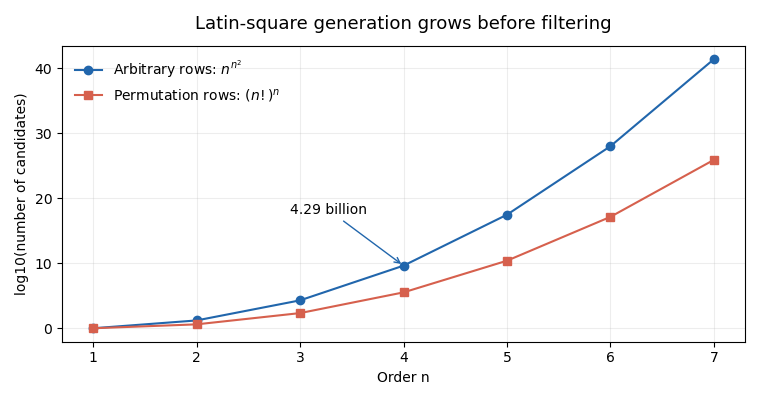

<h1 id="3/d/solution">Solution</h1>

↑ **Parent:** [D](../d.md)

The generation count, before any validity test, is **$n^{n^2}$**. It is $19\,683$ at order three, $4\,294\,967\,296$ at order four, and approximately $2.98\times10^{17}$ at order five. Even an illustrative rate of one million complete candidates per second would require about 72 minutes at order four and about 9,444 years at order five, before accounting for the actual validity-checking cost. Thus **order four is already expensive and order five is plainly impractical** for this strategy; the exact threshold depends on the implementation and hardware, not just the mathematical count.

**[Figure 1](#3/d/image-candidate-growth-before-filtering-in-two-latin-square-generation-strategies). Candidate growth before filtering in two Latin-square generation strategies**. Original exact candidate counts, plotted on a base-ten logarithmic vertical axis. These are mathematical counts, not measured running times; pruning can avoid many invalid partial extensions as well.

## ↑ Ancestors (12)

1. [D](../d.md)
2. [3](../../3.md)
3. [Functional programming, design and analysis of algorithms (resit)](../../../functional-programming-design-and-analysis-of-algorithms-resit-split.md)
4. [2021](../../../split.md)
5. [Past exam of the year 1 of the computer science course of the University of Oxford](../../../../split.md)
6. [Year 1 of the computer science course of the University of Oxford](../../../../../year-1-of-the-computer-science-course-of-the-university-of-oxford.md)
7. [Computer science course of the University of Oxford](../../../../../computer-science-course-of-the-university-of-oxford.md)
8. [Undergraduate course of the University of Oxford](../../../../../undergraduate-course-of-the-university-of-oxford.md)
9. [Course of the University of Oxford](../../../../../course-of-the-university-of-oxford.md)
10. [University of Oxford](../../../../../university-of-oxford-split.md)
11. [List of universities](../../../../../list-of-universities.md)
12. [Codex Wiki](../../../../../split.md)
