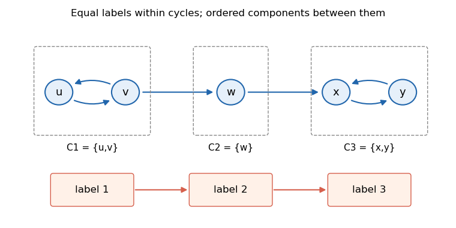

<h1 id="7/d/solution">Solution</h1>

↑ **Parent:** [D](../d.md)

Take reachability to include a path of length zero. If two [vertices](../../../../../vertex-graph-theory.md) can reach each other, the two path inequalities force them to have equal labels. Conversely, equal labels force mutual reachability: a missing path in either direction would require a strict inequality. Thus the equal-label classes must be exactly the [strongly connected components](../../../../../strongly-connected-component.md).

Two different components must also be comparable by reachability. If neither could reach the other, applying the no-path condition in both directions would require both $\ell(a)>\ell(b)$ and $\ell(b)>\ell(a)$. This proves that the promised [condensation graph](../../../../../condensation-graph.md) is totally ordered by reachability, a substantially stronger property than merely being acyclic.

Compute the components, form the [condensation graph](../../../../../condensation-graph.md), and find a [topological order](../../../../../topological-order.md) $C_1,\ldots,C_r$. Assign

$$
\boxed{\ell(v)=i\quad\text{for }v\in C_i.}
$$

A path goes within one component or forward in this order, so its labels are [nondecreasing](../../../../../nondecreasing-function.md). Under the comparability promise, an earlier component must reach every later component: the reverse possibility would contradict the [topological order](../../../../../topological-order.md). Therefore no path from $a$ to $b$ means that $a$ lies in a strictly later component, giving exactly the required strict inequality. This proves both parts of the specification.

For a new example, use [vertices](../../../../../vertex-graph-theory.md) $u,v,w,x,y$, [edges](../../../../../edge-of-a-graph.md) $u\to v,v\to u,v\to w,w\to x,x\to y,y\to x$. Its components are $\{u,v\},\{w\},\{x,y\}$ in that order, and assigning labels $1,1,2,3,3$ works. Every earlier component reaches each later one through the displayed chain.

**[Figure 2](#7/d/image-an-original-example-whose-strongly-connected-components-are-ordered-by-reachability). An original example whose strongly connected components are ordered by reachability**. This five-vertex example is separate from the examination's two source graphs. Internal cycles receive equal labels; the component chain forces strictly increasing labels between components.

Component computation, scanning original [edges](../../../../../edge-of-a-graph.md) to build the [condensation graph](../../../../../condensation-graph.md), [topological sorting](../../../../../topological-sorting.md), and expanding component labels all take **$O(|V|+|E|)$**. Parallel [edges](../../../../../edge-of-a-graph.md) may simply be retained and counted consistently by the topological-sort routine; deduplication is unnecessary for that bound. An empty [graph](../../../../../graph-split.md) returns the empty mapping.

## ↑ Ancestors (12)

1. [D](../d.md)
2. [7](../../7.md)
3. [Functional programming, design and analysis of algorithms (resit)](../../../functional-programming-design-and-analysis-of-algorithms-resit-split.md)
4. [2021](../../../split.md)
5. [Past exam of the year 1 of the computer science course of the University of Oxford](../../../../split.md)
6. [Year 1 of the computer science course of the University of Oxford](../../../../../year-1-of-the-computer-science-course-of-the-university-of-oxford.md)
7. [Computer science course of the University of Oxford](../../../../../computer-science-course-of-the-university-of-oxford.md)
8. [Undergraduate course of the University of Oxford](../../../../../undergraduate-course-of-the-university-of-oxford.md)
9. [Course of the University of Oxford](../../../../../course-of-the-university-of-oxford.md)
10. [University of Oxford](../../../../../university-of-oxford-split.md)
11. [List of universities](../../../../../list-of-universities.md)
12. [Codex Wiki](../../../../../split.md)
