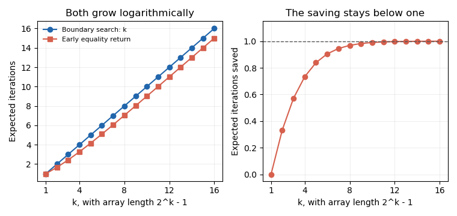
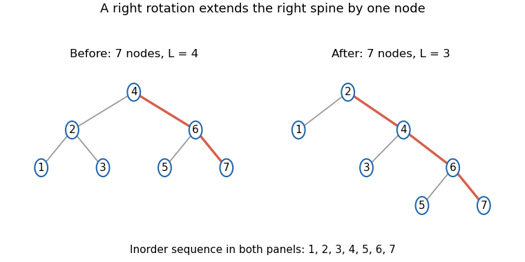

# Imperative programming (resit)

↑ **Parent:** [2021](../2021.md)

Source paper: [released examination archive, member 2020/L/a10098w1.pdf](https://www.whatdotheyknow.com/request/ba_computer_science_past_papers/response/2577745/attach/2/202402%20183%20CS%20Papers.zip?cookie_passthrough=1).

The held cover identifies the Long Vacation sitting of 9 September 2021, distinct from the June paper carrying the same formal code. All eight questions and all 39 terminal leaves are answered. [Scala](../../programming-language.md#scala) snippets use [Scala](../../programming-language.md#scala) 2.13 style and the supplied interfaces. No [Scala](../../programming-language.md#scala) compiler is installed in the checking environment: independent models, exact calculations and [Java](../../programming-language.md#java-programming-language) numeric-helper checks are distinguished from native [Scala](../../programming-language.md#scala) or GUI execution.

**Table of contents**

- [1](#1)
  - [a](#1/a)
    - [Solution](#1/a/solution)
  - [b](#1/b)
    - [Solution](#1/b/solution)
  - [c](#1/c)
    - [Solution](#1/c/solution)
  - [d](#1/d)
    - [Solution](#1/d/solution)
  - [e](#1/e)
    - [Solution](#1/e/solution)
  - [f](#1/f)
    - [Solution](#1/f/solution)
- [2](#2)
  - [a](#2/a)
    - [Solution](#2/a/solution)
  - [b](#2/b)
    - [Solution](#2/b/solution)
  - [c](#2/c)
    - [Solution](#2/c/solution)
  - [d](#2/d)
    - [Solution](#2/d/solution)
  - [e](#2/e)
    - [Solution](#2/e/solution)
- [3](#3)
  - [a](#3/a)
    - [Solution](#3/a/solution)
  - [b](#3/b)
    - [Solution](#3/b/solution)
  - [c](#3/c)
    - [Solution](#3/c/solution)
  - [d](#3/d)
    - [Solution](#3/d/solution)
- [4](#4)
  - [a](#4/a)
    - [Solution](#4/a/solution)
  - [b](#4/b)
    - [Solution](#4/b/solution)
  - [c](#4/c)
    - [Solution](#4/c/solution)
  - [d](#4/d)
    - [i](#4/d/i)
      - [Solution](#4/d/i/solution)
    - [ii](#4/d/ii)
      - [Solution](#4/d/ii/solution)
- [5](#5)
  - [a](#5/a)
    - [Solution](#5/a/solution)
  - [b](#5/b)
    - [Solution](#5/b/solution)
  - [c](#5/c)
    - [Solution](#5/c/solution)
  - [d](#5/d)
    - [Solution](#5/d/solution)
- [6](#6)
  - [a](#6/a)
    - [Solution](#6/a/solution)
  - [b](#6/b)
    - [Solution](#6/b/solution)
  - [c](#6/c)
    - [Solution](#6/c/solution)
  - [d](#6/d)
    - [Solution](#6/d/solution)
  - [e](#6/e)
    - [Solution](#6/e/solution)
  - [f](#6/f)
    - [Solution](#6/f/solution)
- [7](#7)
  - [a](#7/a)
    - [Solution](#7/a/solution)
  - [b](#7/b)
    - [i](#7/b/i)
      - [Solution](#7/b/i/solution)
    - [ii](#7/b/ii)
      - [Solution](#7/b/ii/solution)
    - [iii](#7/b/iii)
      - [Solution](#7/b/iii/solution)
  - [c](#7/c)
    - [Solution](#7/c/solution)
- [8](#8)
  - [a](#8/a)
    - [Solution](#8/a/solution)
  - [b](#8/b)
    - [Solution](#8/b/solution)
  - [c](#8/c)
    - [Solution](#8/c/solution)
  - [d](#8/d)
    - [Solution](#8/d/solution)

## 1

↑ **Parent:** [Imperative programming (resit)](imperative-programming-resit.md)

<h3 id="1/a">a</h3>

↑ **Parent:** [1](#1)

<h4 id="1/a/solution">Solution</h4>

↑ **Parent:** [A](#1/a)

Test each positive candidate [divisor](../../divisibility.md#divisor) and count the successful remainder tests:
```
def divisors(n: Int): Int = {
  require(n >= 1)
  var candidate = 1L
  var count = 0
  while (candidate <= n.toLong) {
    if (n.toLong % candidate == 0L) count += 1
    candidate += 1L
  }
  count
}
```
The [loop invariant](../../algorithm.md#loop-invariant) is $1\leq d\leq n+1$ and $count=|\{j:1\leq j<d,\ j\mid n\}|$, where $d$ denotes `candidate`. A successful test adds exactly the new [divisor](../../divisibility.md#divisor); an unsuccessful test leaves the count unchanged. The [loop variant](../../algorithm.md#loop-variant) is $n+1-d$, which decreases by one. At termination $d=n+1$, so **the returned value is $\tau(n)$**. A `Long` loop counter prevents the increment after the last positive `Int` candidate from wrapping around.

<h3 id="1/b">b</h3>

↑ **Parent:** [1](#1)

<h4 id="1/b/solution">Solution</h4>

↑ **Parent:** [B](#1/b)

Use a strict record test; tying the previous record is not enough:
```
def emitHighlyComposite(): Unit = {
  var candidate = 1
  var best = 0
  while (true) {
    val count = divisors(candidate)
    if (count > best) {
      emit(candidate)
      best = count
    }
    candidate += 1
  }
}
```
At the start of an iteration, `best` is the [maximum](../../set.md#maximum-of-a-subset-of-a-total-order) [divisor](../../divisibility.md#divisor) count among the [positive integers](../../integer.md#positive-integer) below `candidate`, taking the [maximum](../../set.md#maximum-of-a-subset-of-a-total-order) of the empty family as zero. The already emitted values are exactly the [highly composite numbers](../../arithmetic-function.md#highly-composite-number) in that range, in increasing order. The next count exceeds `best` precisely when this candidate is a new strict record. Updating the record and advancing the candidate preserves both assertions. The program deliberately has no termination requirement; **[integer overflow](../../programming-language.md#integer-overflow) in this unbounded enumeration is ignored as directed by the source**.

<h3 id="1/c">c</h3>

↑ **Parent:** [1](#1)

<h4 id="1/c/solution">Solution</h4>

↑ **Parent:** [C](#1/c)

By the time the candidate $n$ is emitted, every [positive integer](../../integer.md#positive-integer) $m\leq n$ has been examined. The straightforward [divisor](../../divisibility.md#divisor) routine makes exactly $m$ remainder tests on $m$. Consequently the total number is

$$
\sum_{m=1}^{n}m=\frac{n(n+1)}2,
$$

and the time is **$\Theta(n^2)$** when remainder tests and the other fixed-width operations have constant cost and printing is cheap. Emitting only record candidates does not avoid computing the [divisor](../../divisibility.md#divisor) count of the intervening candidates.

<h3 id="1/d">d</h3>

↑ **Parent:** [1](#1)

<h4 id="1/d/solution">Solution</h4>

↑ **Parent:** [D](#1/d)

Every positive [divisor](../../divisibility.md#divisor) has a unique [prime factorization](../../prime-number.md#fundamental-theorem-of-arithmetic) $p_1^{e_1}\cdots p_k^{e_k}$ with $0\leq e_j\leq i_j$. Conversely every such exponent choice gives a [divisor](../../divisibility.md#divisor). The exponent choices are independent, so the [product rule](../../calculus.md#product-rule) gives

$$
\boxed{\tau(n)=\prod_{j=1}^{k}(i_j+1).}
$$

For $n=1$ the factorization is empty, and the [empty product](../../arithmetic.md#empty-product) is one, corresponding to the [divisor](../../divisibility.md#divisor) one.

<h3 id="1/e">e</h3>

↑ **Parent:** [1](#1)

<h4 id="1/e/solution">Solution</h4>

↑ **Parent:** [E](#1/e)

Remove each [prime power](../../prime-number.md#prime-power) as soon as it is found, and stop trial division once the remaining value has no possible smaller factor:
```
def divisors(n: Int): Int = {
  require(n >= 1)
  var remaining = n
  var factor = 2
  var result = 1
  while (factor.toLong * factor.toLong <= remaining.toLong) {
    var exponent = 0
    while (remaining % factor == 0) {
      remaining /= factor
      exponent += 1
    }
    result *= exponent + 1
    factor += 1
  }
  if (remaining > 1) result *= 2
  result
}
```
At an outer-loop boundary, write $n=q\,remaining$, where $q$ is the product of the [prime powers](../../prime-number.md#prime-power) already removed. The [invariant](../../mathematics.md#invariant-mathematics) states that `result` is $\tau(q)$, every prime [divisor](../../divisibility.md#divisor) of $q$ is smaller than `factor`, and `remaining` has no prime [divisor](../../divisibility.md#divisor) smaller than `factor`. Thus if `factor` divides `remaining`, it is prime; a composite factor would have a smaller prime [divisor](../../divisibility.md#divisor), contrary to the [invariant](../../mathematics.md#invariant-mathematics).

During the inner loop, with $q$ fixed, $n=q\,factor^{exponent}\,remaining$. Each division removes one copy, so the positive remainder strictly decreases and supplies an inner-[loop variant](../../algorithm.md#loop-variant). On leaving the inner loop the complete power has been removed; multiplying the result by `exponent + 1` uses part (d) and reestablishes the outer [invariant](../../mathematics.md#invariant-mathematics) after advancing `factor`. The outer factor increases and can never exceed the original $n$ while its guard holds, proving termination.

At exit, a remainder greater than one must be prime: a composite remainder would have a prime factor no larger than its square root, which would still be smaller than `factor`. It therefore contributes one final factor of two. A remainder of one contributes nothing. **The [algorithm](../../algorithm.md) returns $\tau(n)$ using constant [auxiliary space](../../algorithm.md#auxiliary-space) and no [array](../../data-structure.md#array-data-structure).** The widened multiplication in the loop guard prevents an `Int` overflow in the square test.

<h3 id="1/f">f</h3>

↑ **Parent:** [1](#1)

<h4 id="1/f/solution">Solution</h4>

↑ **Parent:** [F](#1/f)

**The factorization-based version should produce the later outputs faster in this cost model.** For an input $m$, it performs at most $O(\sqrt m)$ trial-factor tests and $O(\log m)$ successful divisions, because each successful division removes a factor at least two. The square test uses multiplication, so it does not introduce an extra division on every loop test.

Across all candidates through $n$, the number of costly division or remainder operations is therefore at most

$$
O\!\left(\sum_{m=1}^{n}(\sqrt m+\log m)\right)=O(n^{3/2}+n\log n),
$$

compared with $\Theta(n^2)$ remainder operations for the straightforward routine. Small cases can still be affected by constant overhead; the conclusion concerns the growing enumeration workload, not a promise that every single call is faster.

## 2

↑ **Parent:** [Imperative programming (resit)](imperative-programming-resit.md)

<h3 id="2/a">a</h3>

↑ **Parent:** [2](#2)

<h4 id="2/a/solution">Solution</h4>

↑ **Parent:** [A](#2/a)

Maintain the required boundary between entries strictly above the target and entries at most the target:
```
def search(u: Array[Int], z: Int): Boolean = {
  var a = 0
  var b = u.length
  while (a < b) {
    val middle = a + (b - a) / 2
    if (u(middle) > z) a = middle + 1
    else b = middle
  }
  a < u.length && u(a) == z
}
```
The full [invariant](../../mathematics.md#invariant-mathematics) is $0\leq a\leq b\leq n$, every entry before $a$ is greater than $z$, and every entry at or after $b$ is at most $z$. The [array](../../data-structure.md#array-data-structure) remains unchanged. Descending order justifies each update: if the middle value is greater, all earlier values are greater too; otherwise all values from the middle onward are at most the target.

The nonnegative [loop variant](../../algorithm.md#loop-variant) $b-a$ strictly decreases, with each update retaining at most half the old candidate length. On termination $a=b$, which is the first index whose value could be at most $z$. Equality at that index is therefore necessary and sufficient for presence. [Short-circuit evaluation](../../programming-language.md#short-circuit-evaluation) makes the final test safe when $a=n$, including the empty-[array](../../data-structure.md#array-data-structure) case. The time is **$O(\log(n+1))$**, using constant [auxiliary space](../../algorithm.md#auxiliary-space).

<h3 id="2/b">b</h3>

↑ **Parent:** [2](#2)

<h4 id="2/b/solution">Solution</h4>

↑ **Parent:** [B](#2/b)

Return immediately on equality and omit the final [array](../../data-structure.md#array-data-structure) inspection:
```
def searchEarly(u: Array[Int], z: Int): Boolean = {
  var a = 0
  var b = u.length
  while (a < b) {
    val middle = a + (b - a) / 2
    val value = u(middle)
    if (value == z) return true
    if (value > z) a = middle + 1
    else b = middle
  }
  false
}
```
An equality returns a genuine matching entry. After a nonequal comparison, descending order excludes the inspected middle entry and one whole side. In the half-open range, setting `b = middle` already excludes the middle index; subtracting one would incorrectly exclude another possible entry. The candidate interval decreases as before, so absence is reported exactly when no possible entry remains.

<h3 id="2/c">c</h3>

↑ **Parent:** [2](#2)

<h4 id="2/c/solution">Solution</h4>

↑ **Parent:** [C](#2/c)

For an [array](../../data-structure.md#array-data-structure) of size $2n+1$, the first probe finds the uniformly selected target with [probability](../../probability-theory.md#probability) $1/(2n+1)$. Otherwise it leaves a half of size $n$; conditional on entering that half, its target is uniform there. Counting the first iteration in every case gives

$$
e_{2n+1}=1+\frac{2n}{2n+1}e_n.
$$

For $n=2^k-1$, the successful-search decision tree has $2^d$ targets at depth $d$, requiring $d+1$ iterations. Thus

$$
e_n=\frac{\sum_{d=0}^{k-1}(d+1)2^d}{2^k-1}.
$$

The numerator is $(k-1)2^k+1$, as follows by [induction](../../foundations-of-mathematics.md#mathematical-induction) or by shifting and subtracting a finite geometric sum. Substituting $2^k=n+1$ gives

$$
\boxed{e_n=k-1+\frac{k}{n},\qquad a=-1,\quad b=1.}
$$

The base $k=1,n=1$ gives one iteration, as required.

<h3 id="2/d">d</h3>

↑ **Parent:** [2](#2)

<h4 id="2/d/solution">Solution</h4>

↑ **Parent:** [D](#2/d)

**The expected number is exactly $k$.** In the boundary-search version, an interval of length $2^j-1$ is reduced to length $2^{j-1}-1$ whichever comparison branch is taken. It must therefore take exactly $k$ iterations to reduce length $2^k-1$ to zero, including when a probe has already equaled the target. The result holds for every target in this case, so averaging does not change it.

<h3 id="2/e">e</h3>

↑ **Parent:** [2](#2)

<h4 id="2/e/solution">Solution</h4>

↑ **Parent:** [E](#2/e)

The expected saving on the specified successful searches is

$$
k-e_n=\boxed{1-\frac{k}{n}},
$$

which tends to one iteration as $n=2^k-1$ increases. The fractional saving is $1/k-1/n$, which tends to zero. **Both versions have logarithmic expected time, and the improvement is a bounded average saving rather than a change of growth rate.** A target at the first middle position benefits greatly, but the [uniform distribution](../../continuous-probability-distribution.md#continuous-uniform-distribution) does not concentrate on that event. The extra equality branch and machine-level costs also matter when comparing measured execution times.

<a id="2/e/image-early-equality-return-saves-less-than-one-iteration-on-average-in-perfect-search-arrays"></a>


**[Figure 1](#2/e/image-early-equality-return-saves-less-than-one-iteration-on-average-in-perfect-search-arrays). Early equality return saves less than one iteration on average in perfect search arrays**. Original exact iteration counts and their difference for uniformly chosen present targets in arrays of length $2^k-1$. The curves describe loop iterations, not measured execution time.

## 3

↑ **Parent:** [Imperative programming (resit)](imperative-programming-resit.md)

<h3 id="3/a">a</h3>

↑ **Parent:** [3](#3)

<h4 id="3/a/solution">Solution</h4>

↑ **Parent:** [A](#3/a)

The [abstract data type invariant](../../computer-science.md#abstract-data-type-invariant) constrains a total count [function](../../function.md) on [integer](../../integer.md) keys as follows:

$$
\forall x:\quad bag(x)\geq0,\qquad x\notin\{0,\ldots,MAX-1\}\Rightarrow bag(x)=0.
$$

The initial state has every count zero, and $MAX>0$. These conditions make the abstract state a [multiset](../../set.md#multiset) supported on the allowed finite key range. Since the interface returns an `Int`, the implementations below use representable nonnegative multiplicities; equivalently add $bag(x)\leq M$ to the [invariant](../../mathematics.md#invariant-mathematics), where $M=\operatorname{Int.MaxValue}$. The corresponding add [precondition](../../algorithm.md#precondition) below prevents overflow. An idealized unbounded-[integer](../../integer.md) specification can omit that machine bound.

<h3 id="3/b">b</h3>

↑ **Parent:** [3](#3)

<h4 id="3/b/solution">Solution</h4>

↑ **Parent:** [B](#3/b)

Write $bag_0$ for the incoming state and $M=\operatorname{Int.MaxValue}$. Use the following explicit contracts.

For `add(x)`, the [precondition](../../algorithm.md#precondition) is $0\leq x<MAX$ and $bag_0(x)<M$. The [postcondition](../../algorithm.md#postcondition) is $bag(x)=bag_0(x)+1$ and $bag(y)=bag_0(y)$ for every $y\neq x$.

For `remove(x)`, the [precondition](../../algorithm.md#precondition) is $0\leq x<MAX$ and $bag_0(x)>0$. The [postcondition](../../algorithm.md#postcondition) is $bag(x)=bag_0(x)-1$, with every other count unchanged. This convention rejects removal of an absent occurrence rather than silently treating it as a no-op.

For `count(x)`, the [precondition](../../algorithm.md#precondition) is $0\leq x<MAX$. The result is $bag_0(x)$ and the whole abstract state is unchanged. Counts outside the allowed range are zero in the mathematical total [function](../../function.md), but this chosen interface requires an in-range query.

<h3 id="3/c">c</h3>

↑ **Parent:** [3](#3)

<h4 id="3/c/solution">Solution</h4>

↑ **Parent:** [C](#3/c)

Implement the count [function](../../function.md) directly in a private [array](../../data-structure.md#array-data-structure):
```
class ArrayIntBag(val MAX: Int) extends IntBag {
  require(MAX > 0)
  private val c = new Array[Int](MAX)
  private def inRange(x: Int): Boolean = 0 <= x && x < MAX

  def add(x: Int): Unit = {
    require(inRange(x))
    require(c(x) < Int.MaxValue)
    c(x) += 1
  }
  def remove(x: Int): Unit = {
    require(inRange(x))
    require(c(x) > 0)
    c(x) -= 1
  }
  def count(x: Int): Int = {
    require(inRange(x))
    c(x)
  }
}
```
The [representation invariant](../../computer-science.md#representation-invariant) is that `c` has length `MAX` and every stored count is nonnegative. The [abstraction function](../../computer-science.md#abstraction-function) gives $bag(x)=c(x)$ in range and zero outside it. Zero initialization establishes the [invariant](../../mathematics.md#invariant-mathematics). An allowed [addition](../../arithmetic.md#addition) changes exactly one entry without overflow; an allowed removal changes exactly one positive entry without making it negative; querying changes none. Thus each method implements its abstract [postcondition](../../algorithm.md#postcondition) as well as preserving the [representation invariant](../../computer-science.md#representation-invariant). The private [array](../../data-structure.md#array-data-structure) prevents clients from bypassing those guarantees.

<h3 id="3/d">d</h3>

↑ **Parent:** [3](#3)

<h4 id="3/d/solution">Solution</h4>

↑ **Parent:** [D](#3/d)

Store the number of positive buckets, initially zero:
```
private var distinct = 0

def size: Int = distinct
```
Extend the [representation invariant](../../computer-science.md#representation-invariant) by

$$
distinct=|\{i:0\leq i<MAX,\ c(i)>0\}|.
$$

The [abstraction function](../../computer-science.md#abstraction-function) for the [multiset](../../set.md#multiset) is unchanged. The size operation has no [precondition](../../algorithm.md#precondition) beyond a valid receiver; it returns the [cardinality](../../cardinal-number.md#cardinality) of the [multiset support](../../set.md#support-of-a-multiset) and changes no state. Replace the modifying methods inside the class by
```
def add(x: Int): Unit = {
  require(inRange(x))
  require(c(x) < Int.MaxValue)
  if (c(x) == 0) distinct += 1
  c(x) += 1
}

def remove(x: Int): Unit = {
  require(inRange(x))
  require(c(x) > 0)
  c(x) -= 1
  if (c(x) == 0) distinct -= 1
}
```
Only transitions from zero to one or from one to zero change the support. [Additions](../../arithmetic.md#addition) to an already positive bucket and removals leaving it positive preserve `distinct`. Thus **`size` takes $O(1)$ time, independently of `MAX`**, and the other operations retain constant-time [array](../../data-structure.md#array-data-structure) access. Initialization still takes $O(MAX)$ time.

## 4

↑ **Parent:** [Imperative programming (resit)](imperative-programming-resit.md)

<h3 id="4/a">a</h3>

↑ **Parent:** [4](#4)

<h4 id="4/a/solution">Solution</h4>

↑ **Parent:** [A](#4/a)

Use a finite [sequence](../../sequence-and-series.md#sequence) $q$ as abstract state, initially empty. One [Scala](../../programming-language.md#scala) interface is
```
trait DoubleEndedQueue {
  def isEmpty: Boolean
  def addLeft(x: Int): Unit
  def getLeft(): Int
  def addRight(x: Int): Unit
  def getRight(): Int
}
```
The emptiness query has no [precondition](../../algorithm.md#precondition); its result is $q_0=\langle\rangle$ and its [postcondition](../../algorithm.md#postcondition) is $q=q_0$. Adding on the left has no [precondition](../../algorithm.md#precondition) and gives $q=\langle x\rangle\mathbin{++}q_0$. Adding on the right gives $q=q_0\mathbin{++}\langle x\rangle$. Both return `Unit`.

Each removal requires a nonempty incoming [sequence](../../sequence-and-series.md#sequence). `getLeft()` returns its first entry and leaves the remaining final [sequence](../../sequence-and-series.md#sequence); `getRight()` returns its last entry and leaves the remaining initial [sequence](../../sequence-and-series.md#sequence). These contracts remove exactly one occurrence, so duplicate values are permitted and do not collapse the [sequence](../../sequence-and-series.md#sequence) into a [set](../../set.md).

<h3 id="4/b">b</h3>

↑ **Parent:** [4](#4)

<h4 id="4/b/solution">Solution</h4>

↑ **Parent:** [B](#4/b)

Keep private references `first` and `last`, both initially `null`. A nonempty representation is a finite acyclic chain from `first` through `next` to `last`. Its [representation invariant](../../computer-science.md#representation-invariant) requires `first.prev == null`, `last.next == null`, and [reciprocal](../../arithmetic.md#multiplicative-inverse) links between every adjacent pair. The nodes reached by following `prev` from `last` are exactly the same nodes in reverse order. No internal node reference is exposed to clients.

The [abstraction function](../../computer-science.md#abstraction-function) reads the `datum` values along the forward chain, giving the abstract [sequence](../../sequence-and-series.md#sequence) from left to right. **The empty representation has both endpoint references null**; the [invariant](../../mathematics.md#invariant-mathematics) requires that either both are null or both are nonnull. A single node has both links null. Updating both endpoint references when removing that last node is therefore essential.

<h3 id="4/c">c</h3>

↑ **Parent:** [4](#4)

<h4 id="4/c/solution">Solution</h4>

↑ **Parent:** [C](#4/c)

The following class uses the node type supplied in the paper:
```
class DoublyLinkedDoubleEndedQueue extends DoubleEndedQueue {
  private var first: Node = null
  private var last: Node = null

  def isEmpty: Boolean = first == null

  def addLeft(x: Int): Unit = {
    val node = new Node(x, null, first)
    if (first == null) last = node
    else first.prev = node
    first = node
  }

  def addRight(x: Int): Unit = {
    val node = new Node(x, last, null)
    if (last == null) first = node
    else last.next = node
    last = node
  }

  def getLeft(): Int = {
    require(!isEmpty)
    val old = first
    first = old.next
    if (first == null) last = null
    else first.prev = null
    old.next = null
    old.datum
  }

  def getRight(): Int = {
    require(!isEmpty)
    val old = last
    last = old.prev
    if (last == null) first = null
    else last.next = null
    old.prev = null
    old.datum
  }
}
```
An insertion connects a fresh endpoint to the old chain and updates its [reciprocal](../../arithmetic.md#multiplicative-inverse) link. A removal reconnects the exposed endpoint to null; the singleton case also clears the opposite endpoint. The remaining chain therefore satisfies the same [representation invariant](../../computer-science.md#representation-invariant) and has exactly the abstract [sequence](../../sequence-and-series.md#sequence) required by the specification. **Every operation performs $O(1)$ pointer work**, excluding allocation costs for a newly added node.

<h3 id="4/d">d</h3>

↑ **Parent:** [4](#4)

<h4 id="4/d/i">i</h4>

↑ **Parent:** [D](#4/d)

<h5 id="4/d/i/solution">Solution</h5>

↑ **Parent:** [I](#4/d/i)

Add this method inside the concrete class:
```
def display: Unit = {
  print("[")
  var current = first
  var separator = ""
  while (current != null) {
    print(separator)
    print(current.datum)
    separator = ", "
    current = current.next
  }
  println("]")
}
```
Its [precondition](../../algorithm.md#precondition) is a valid receiver, including an empty one. Its [postcondition](../../algorithm.md#postcondition) leaves $q=q_0$ and prints the entries of $q_0$ from left to right in the displayed bracket format, followed by a newline. The [loop invariant](../../algorithm.md#loop-invariant) says that the printed entries are precisely the chain before `current`; the not-yet-printed entries are the chain starting there. Advancing along the acyclic chain terminates after its length. Printing changes the output stream, but it changes neither links nor payloads.

<h4 id="4/d/ii">ii</h4>

↑ **Parent:** [D](#4/d)

<h5 id="4/d/ii/solution">Solution</h5>

↑ **Parent:** [Ii](#4/d/ii)

With that display format the output is
```
20
10
10
Queue status: [30, 40, 15]
```
The first removal takes the newly prepended left value $20$. The right removal later takes the most recently appended $10$. The next left removal takes the earlier $10$, leaving the ordered [sequence](../../sequence-and-series.md#sequence) **$\langle30,40,15\rangle$**. The two equal values are different occurrences, and the displayed order follows the links rather than numerical sorting.

## 5

↑ **Parent:** [Imperative programming (resit)](imperative-programming-resit.md)

<h3 id="5/a">a</h3>

↑ **Parent:** [5](#5)

<h4 id="5/a/solution">Solution</h4>

↑ **Parent:** [A](#5/a)

Use the empty reference as the [base case](../../algorithm.md#base-case):
```
def printInorder(root: Tree): Unit = {
  if (root != null) {
    printInorder(root.left)
    println(root.datum)
    printInorder(root.right)
  }
}
```
[Induction](../../foundations-of-mathematics.md#mathematical-induction) on the tree proves the order: the first [recursive call](../../algorithm.md#recursive-call) prints exactly the left [subtree](../../data-structure.md#subtree), then the procedure prints the root, then the final call prints exactly the right [subtree](../../data-structure.md#subtree). A finite acyclic tree supplies decreasing proper [subtrees](../../data-structure.md#subtree), so the [recursion](../../algorithm.md#recursion-computer-science) terminates. The traversal is valid for arbitrary [integer](../../integer.md) labels; sorted output would additionally require a [binary search tree](../../data-structure.md#binary-search-tree) [invariant](../../mathematics.md#invariant-mathematics).

<h3 id="5/b">b</h3>

↑ **Parent:** [5](#5)

<h4 id="5/b/solution">Solution</h4>

↑ **Parent:** [B](#5/b)

Split the index range at its middle:
```
def MakeTree(u: Array[Int], a: Int, b: Int): Tree = {
  require(0 <= a && a <= b && b <= u.length)
  if (a == b) null
  else {
    val middle = a + (b - a) / 2
    new Tree(u(middle),
             MakeTree(u, a, middle),
             MakeTree(u, middle + 1, b))
  }
}
```
For $N=b-a>0$, the child sizes are $\lfloor N/2\rfloor$ and $N-1-\lfloor N/2\rfloor$, differing by at most one. [Induction](../../foundations-of-mathematics.md#mathematical-induction) gives the same property at every descendant, so **the result is nearly balanced**. Its inorder traversal is the initial subrange, then $u(middle)$, then the final subrange, reproducing exactly $u[a..b)$ with every occurrence retained.

There is one nonempty [recursive call](../../algorithm.md#recursive-call) per constructed node and one constant-time base call per empty child position. Therefore construction takes **$\Theta(N)$ time for $N\geq1$**, or $\Theta(N+1)$ including the empty case, and allocates exactly $N$ nodes. The balanced [recursion](../../algorithm.md#recursion-computer-science) has logarithmic stack depth. The input [array](../../data-structure.md#array-data-structure) need not be sorted: the required property concerns [subtree](../../data-structure.md#subtree) sizes and inorder order, not a search-tree ordering.

<h3 id="5/c">c</h3>

↑ **Parent:** [5](#5)

<h4 id="5/c/solution">Solution</h4>

↑ **Parent:** [C](#5/c)

Repeated right rotations expose the next inorder entry without a [recursion](../../algorithm.md#recursion-computer-science) stack:
```
def printDestructively(input: Tree): Unit = {
  var root = input
  while (root != null) {
    while (root.left != null) {
      val child = root.left
      root.left = child.right
      child.right = root
      root = child
    }
    println(root.datum)
    root = root.right
  }
}
```
A [right rotation](../../data-structure.md#right-tree-rotation) replaces a local shape with inorder order $A,x,B,y,C$ by another shape with exactly that same order. The inner loop therefore preserves the inorder [sequence](../../sequence-and-series.md#sequence) of the remaining tree while moving its next output closer to the root. When the left child is null, the root is exactly the first remaining inorder entry. Printing it and advancing to its right child removes that entry from the remaining traversal.

The outer-[loop invariant](../../algorithm.md#loop-invariant) is that the output already produced, followed by the inorder [sequence](../../sequence-and-series.md#sequence) of the current root, equals the original inorder [sequence](../../sequence-and-series.md#sequence). Consequently the procedure prints every original entry once in order. It stores only a constant number of node references and uses **$O(1)$ [auxiliary space](../../algorithm.md#auxiliary-space)**. It changes the original links, as permitted; clients must not rely on the input tree retaining its earlier shape.

<a id="5/c/image-a-right-rotation-preserves-inorder-order-and-decreases-the-traversal-potential-by-one"></a>


**[Figure 2](#5/c/image-a-right-rotation-preserves-inorder-order-and-decreases-the-traversal-potential-by-one). A right rotation preserves inorder order and decreases the traversal potential by one**. Original seven-node example. Orange edges mark the right spine; nodes off that spine contribute to the left-size potential. The inorder labels remain 1 through 7 before and after the rotation.

<h3 id="5/d">d</h3>

↑ **Parent:** [5](#5)

<h4 id="5/d/solution">Solution</h4>

↑ **Parent:** [D](#5/d)

For a remaining tree $T$, define the potential

$$
L(\varnothing)=0,\qquad L(T)=|T.left|+L(T.right).
$$

This counts the nodes not on the right spine, so $0\leq L(T)\leq |T|$. Consider a [right rotation](../../data-structure.md#right-tree-rotation) with old root $y$, left child $x$, and three untouched [subtrees](../../data-structure.md#subtree) $A,B,C$. Before the rotation the potential is

$$
1+|A|+|B|+L(C).
$$

After the rotation it is $|A|+|B|+L(C)$, so **each rotation decreases $L$ by exactly one** while preserving the number of remaining nodes. This supplies a nonnegative decreasing bound for the inner loop.

When the root has no left child, printing it and advancing to its right child leaves $L$ unchanged and decreases the remaining node count by one. Thus $|T|+L(T)$ decreases on every rotation and every removal, proving termination of the whole procedure. Over the entire execution there are exactly $N$ printed nodes and exactly $L(T_0)$ rotations, since the final potential is zero. Both quantities are at most $N$, so **the running time is $\Theta(N)$ for a nonempty tree**, with constant [auxiliary space](../../algorithm.md#auxiliary-space). The nested syntax does not imply quadratic time: it is the total potential decrease across all iterations that bounds the inner work. The potential is a proof device and is not computed by the running program.

## 6

↑ **Parent:** [Imperative programming (resit)](imperative-programming-resit.md)

<h3 id="6/a">a</h3>

↑ **Parent:** [6](#6)

<h4 id="6/a/solution">Solution</h4>

↑ **Parent:** [A](#6/a)

The [iterator pattern](../../programming-language.md#iterator-pattern) exposes sequential traversal through a small interface while hiding the representation of the underlying data. A client asks whether another entry is available and requests the next entry; it need not know whether the producer uses an [array](../../data-structure.md#array-data-structure), [linked list](../../data-structure.md#linked-list), tree or generated [sequence](../../sequence-and-series.md#sequence).

The key design benefit is **[encapsulation](../../computer-science.md#encapsulation-computer-programming) of traversal state and representation**. The same consuming [algorithm](../../algorithm.md) can work through the interface for different producers, and each traversal can keep its own cursor state when a fresh [iterator](../../data-structure.md#iterator) is supplied. This independence requires separate consumption states; two references to one [iterator](../../data-structure.md#iterator) share a cursor.

<h3 id="6/b">b</h3>

↑ **Parent:** [6](#6)

<h4 id="6/b/solution">Solution</h4>

↑ **Parent:** [B](#6/b)

The two abstract methods are
```
def hasNext: Boolean
def next(): T
```
The first reports availability; the second returns and consumes the next entry, or throws a `NoSuchElementException` if none exists. Other standard [iterator](../../data-structure.md#iterator) operations are supplied in terms of this interface. Repeated availability checks must not lose entries, although they may perform preparatory internal work.[Iterator, abstract members hasNext and next; class-level mutation and reuse contract](../../computer-science-bibliography.md#scala-2-13-iterator-api-documentation)

<h3 id="6/c">c</h3>

↑ **Parent:** [6](#6)

<h4 id="6/c/solution">Solution</h4>

↑ **Parent:** [C](#6/c)

**Yes in special cases; an ordinary finite [iterator](../../data-structure.md#iterator) that progresses through its input needs changing consumption state.** For a genuine immutable [counterexample](../../foundations-of-mathematics.md#counterexample), an [iterator](../../data-structure.md#iterator) over an infinite constant [sequence](../../sequence-and-series.md#sequence) needs no changing fields:
```
final class Ones extends Iterator[Int] {
  def hasNext: Boolean = true
  def next(): Int = 1
}
```
Removing the first entry of that [sequence](../../sequence-and-series.md#sequence) leaves the same [sequence](../../sequence-and-series.md#sequence), so this satisfies the [iterator](../../data-structure.md#iterator) behaviour without changing object state. A permanently empty [iterator](../../data-structure.md#iterator) is another example.

For a normal finite nonempty traversal, however, repeated `next()` calls must eventually change the returned entry or availability, so the implementation needs mutable cursor state somewhere. Declaring only `val` fields is not a proof of deep immutability: those fields can refer to another mutable [iterator](../../data-structure.md#iterator), an [array](../../data-structure.md#array-data-structure), or a stateful closure. The standard API's description of [iterators](../../data-structure.md#iterator) as mutable captures the usual consuming case, rather than enforcing a mutable field in every possible implementation.

<h3 id="6/d">d</h3>

↑ **Parent:** [6](#6)

<h4 id="6/d/solution">Solution</h4>

↑ **Parent:** [D](#6/d)

Delay both initial skipping and every later skipped entry until a caller actually requests availability or an output:
```
class HalfIterator[T](iter: Iterator[T], odd: Boolean)
    extends Iterator[T] {
  private var needSkip = !odd

  def hasNext: Boolean = {
    if (needSkip && iter.hasNext) {
      iter.next()
      needSkip = false
    }
    iter.hasNext
  }

  def next(): T = {
    if (!hasNext)
      throw new java.util.NoSuchElementException("empty half iterator")
    val result = iter.next()
    needSkip = true
    result
  }
}
```
The state flag means that the next underlying entry, if present, must be skipped before the next selected entry can be exposed. It is initially false for odd positions and true for even positions. Returning a selected entry reinstates that obligation.

Construction does not call the underlying [iterator](../../data-structure.md#iterator) at all. A successful availability check may discard the one required intervening entry, but does not fetch the selected entry. It then clears the flag, so repeated availability checks cannot skip again. To decide whether a second entry exists through this interface, consuming the preceding discarded entry is necessary. After `next()` returns, it does not eagerly request the following skipped entry. This gives the intended laziness while retaining correct exhaustion behaviour, including an even-position [iterator](../../data-structure.md#iterator) over a singleton input.

<h3 id="6/e">e</h3>

↑ **Parent:** [6](#6)

<h4 id="6/e/solution">Solution</h4>

↑ **Parent:** [E](#6/e)

Use [short-circuit evaluation](../../programming-language.md#short-circuit-evaluation) so that even an availability test of the second [iterator](../../data-structure.md#iterator) is delayed until the first is exhausted:
```
class ConcatIterator[T](first: Iterator[T], second: Iterator[T])
    extends Iterator[T] {
  def hasNext: Boolean = first.hasNext || second.hasNext

  def next(): T = {
    if (first.hasNext) first.next()
    else if (second.hasNext) second.next()
    else throw new java.util.NoSuchElementException("empty concatenation")
  }
}
```
Each successful call returns from the first producer while it has entries, then from the second. There is no constructor-time request or element prefetch. This implements concatenation of the producers' remaining [sequences](../../sequence-and-series.md#sequence), subject to their ordinary [iterator](../../data-structure.md#iterator) contracts.

<h3 id="6/f">f</h3>

↑ **Parent:** [6](#6)

<h4 id="6/f/solution">Solution</h4>

↑ **Parent:** [F](#6/f)

For the implementations above the value is
```
List('1', '3', '5', '7', '9')
```
The first half-[iterator](../../data-structure.md#iterator) returns the odd-position characters while consuming the even-position characters as its required skips. By the time it is exhausted, it has consumed the entire shared underlying [iterator](../../data-structure.md#iterator). The second half-[iterator](../../data-structure.md#iterator) consequently has no entries left when concatenation reaches it. **Sharing one source does not create two independent traversals.** Neither constructor consumes anything, so it also does not shift the first output before iteration begins. The source's implementation references here should be read as parts (d) and (e); the printed reference to (c) and (d) is a cross-reference slip.

## 7

↑ **Parent:** [Imperative programming (resit)](imperative-programming-resit.md)

<h3 id="7/a">a</h3>

↑ **Parent:** [7](#7)

<h4 id="7/a/solution">Solution</h4>

↑ **Parent:** [A](#7/a)

**[Programming language polymorphism](../../programming-language.md#programming-language-polymorphism) lets a common interface or operation apply to values of more than one type.** In [subtype polymorphism](../../programming-language.md#subtype-polymorphism), a variable typed by a base class or trait can refer to instances of different implementing classes. A method call is checked through that common interface, then [dynamic dispatch](../../programming-language.md#dynamic-dispatch) selects the receiver's overriding implementation. For example, a consumer using `Iterator[Int]` can accept either a filtering [iterator](../../data-structure.md#iterator) or a concatenating [iterator](../../data-structure.md#iterator) without knowing its concrete class.

Inheritance can establish a subtype relationship, while [method overriding](../../programming-language.md#method-overriding) provides distinct implementations of a shared method signature. The classes must still honour the common behavioural contract; sharing a name alone does not establish substitutability. [Parametric polymorphism](../../programming-language.md#parametric-polymorphism) is different: the type parameter in `Iterator[T]` or `FiniteDist[T]` lets a definition work uniformly over element types. [Method overloading](../../programming-language.md#method-overloading) is a further form of [software polymorphism](../../programming-language.md#programming-language-polymorphism) in which the compiler selects a signature using the static argument types; it should not be confused with runtime receiver dispatch.

<h3 id="7/b">b</h3>

↑ **Parent:** [7](#7)

<h4 id="7/b/i">i</h4>

↑ **Parent:** [B](#7/b)

<h5 id="7/b/i/solution">Solution</h5>

↑ **Parent:** [I](#7/b/i)

Validate the parameter, and include exactly the outcomes of positive mass:
```
final class Flip(p: Double) extends FiniteDist[Boolean] {
  require(p >= 0.0 && p <= 1.0)

  def getDom: List[Boolean] =
    if (p == 0.0) List(false)
    else if (p == 1.0) List(true)
    else List(false, true)

  def getProb(x: Boolean): Double = if (x) p else 1.0 - p
}
```
The range test also rejects `NaN`, since its ordered comparisons are false. At the endpoints one outcome has zero mass and must be omitted from the support; listing both unconditionally would violate the supplied interface contract. For an interior parameter the two masses are positive and sum to one.

<h4 id="7/b/ii">ii</h4>

↑ **Parent:** [B](#7/b)

<h5 id="7/b/ii/solution">Solution</h5>

↑ **Parent:** [Ii](#7/b/ii)

Use a widened interval width, so the arithmetic also handles endpoints near the limits of `Int`:
```
final class Uniform(l: Int, u: Int) extends FiniteDist[Int] {
  require(l <= u)
  private val width = u.toLong - l.toLong + 1L

  def getDom: List[Int] = {
    val builder = List.newBuilder[Int]
    var value = l.toLong
    while (value <= u.toLong) {
      builder += value.toInt
      value += 1L
    }
    builder.result()
  }

  def getProb(x: Int): Double =
    if (l <= x && x <= u) 1.0 / width.toDouble else 0.0
}
```
The support [lists](../../data-structure.md#list-abstract-data-type) every [integer](../../integer.md) in the inclusive interval once. Its [cardinality](../../cardinal-number.md#cardinality) is `width`, so assigning each atom mass $1/width$ gives total mass one. The loop counter is also widened, preventing an increment past `Int.MaxValue` from wrapping to a negative value. Returning the full support takes time and space proportional to its width and can be impractical for a very large interval; the mass query itself is constant-time. The full [integer](../../integer.md) interval has width $2^{32}$, which fits `Long` but not positive `Int`.

<h4 id="7/b/iii">iii</h4>

↑ **Parent:** [B](#7/b)

<h5 id="7/b/iii/solution">Solution</h5>

↑ **Parent:** [Iii](#7/b/iii)

Reject the empty [string](../../foundations-of-mathematics.md#string) because it has no positive total count to normalize:
```
final class DistFromString(s: String) extends FiniteDist[Char] {
  require(s.nonEmpty)
  private val frequencies =
    s.foldLeft(Map.empty[Char, Int]) { (counts, c) =>
      counts.updated(c, counts.getOrElse(c, 0) + 1)
    }

  def getDom: List[Char] = s.toList.distinct

  def getProb(c: Char): Double =
    frequencies.getOrElse(c, 0).toDouble / s.length.toDouble
}
```
The support contains each occurring character once, and a character absent from the [string](../../foundations-of-mathematics.md#string) gets mass zero. The occurrence counts sum to the nonzero [string](../../foundations-of-mathematics.md#string) length, proving normalization. For a separate example, the [string](../../foundations-of-mathematics.md#string) `"aba"` gives masses $2/3$ and $1/3$ to its two characters. The interpretation follows [Scala](../../programming-language.md#scala)'s `Char` elements, so it counts UTF-16 code units rather than imposing a separate Unicode-code-point representation. The `Double` results approximate the corresponding rational probabilities.

<h3 id="7/c">c</h3>

↑ **Parent:** [7](#7)

<h4 id="7/c/solution">Solution</h4>

↑ **Parent:** [C](#7/c)

Add a generic mapping method inside the supplied trait. Snapshot the finitely many source masses, and sum masses when different entries have the same image:
```
def map[U](f: T => U): FiniteDist[U] = {
  val entries = getDom.map(x => (f(x), getProb(x)))
  val support = entries.map(_._1).distinct

  new FiniteDist[U] {
    def getDom: List[U] = support
    def getProb(y: U): Double =
      entries.foldLeft(0.0) { case (sum, (image, mass)) =>
        if (image == y) sum + mass else sum
      }
  }
}
```
Here the mapping is a mathematical [function](../../function.md), and keys are assumed to have stable equality consistent with their intended identity. Each source atom is evaluated once when the new distribution is constructed. The distinct image [list](../../data-structure.md#list-abstract-data-type) is exactly the finite support because all listed source atoms have positive mass. Summing collisions, rather than overwriting a previous mass, implements the [probability](../../probability-theory.md#probability) pushforward.

The sets of source atoms with a fixed image partition the original support. Hence nonnegativity is preserved and, in exact [probability](../../probability-theory.md#probability) arithmetic,

$$
\sum_y p_2(y)=\sum_y\sum_{x:f(x)=y}p_1(x)=\sum_xp_1(x)=1.
$$

Thus the result is a [finite probability distribution](../../probability-distribution.md#finite-probability-distribution). For a constant mapping, every atom merges into one outcome of mass one. Floating-point [additions](../../arithmetic.md#addition) in the implementation can introduce rounding error, so numerical tests of normalization should use a suitable tolerance rather than demand exact equality of `Double` sums.

## 8

↑ **Parent:** [Imperative programming (resit)](imperative-programming-resit.md)

<h3 id="8/a">a</h3>

↑ **Parent:** [8](#8)

<h4 id="8/a/solution">Solution</h4>

↑ **Parent:** [A](#8/a)

[Test-driven development](../../computer-science.md#test-driven-development) uses a repeating [sequence](../../sequence-and-series.md#sequence): write a small test for the next required behaviour, observe it fail for the expected reason, add enough implementation to make it pass, and refactor while keeping the tests passing. The initial failure checks that the test can actually detect the absent behaviour. This differs from writing a whole implementation first and only then constructing tests for it; it also uses the tests to guide interface and design decisions rather than only to inspect a finished program.[Meaning of TDD and its short test/implementation/refactoring cycle](../../computer-science-bibliography.md#test-driven-development-in-the-agile-alliance-glossary)

**A mixture of test-selection styles is possible; the defining test-first step is normally behaviour-driven.** Choosing inputs and expected results from a public contract is [black-box testing](../../computer-science.md#black-box-testing) with respect to the implementation, even if the developer writes the test. Knowing the internal branches can then motivate white-box tests for boundary paths or exceptional cases. [TDD](../../computer-science.md#test-driven-development) specifies the order of development activities, not a rule forbidding either source of test cases. It therefore does not guarantee branch coverage, and passing the growing test suite is not a proof of correctness for untested inputs.

<h3 id="8/b">b</h3>

↑ **Parent:** [8](#8)

<h4 id="8/b/solution">Solution</h4>

↑ **Parent:** [B](#8/b)

The [observer pattern](../../programming-language.md#observer-pattern) connects one event-producing subject to a changing [set](../../set.md) of interested consumers. Consumers register through an observation interface; when a relevant change occurs, the producer notifies them through that interface rather than naming every concrete consumer. Consumers can be added or removed without rewriting the producer's core behaviour.

This is useful for keeping displays, controls or other derived views synchronized with changing state. **The design avoids tight coupling from the producer to all concrete dependants**, which otherwise makes every new consumer require changes to the producer. Publishing after the producer's [representation invariant](../../computer-science.md#representation-invariant) has been restored also lets callbacks observe a coherent state. The pattern does not by itself prevent notification cycles or obsolete subscriptions; update policy and unregistration still matter.

<h3 id="8/c">c</h3>

↑ **Parent:** [8](#8)

<h4 id="8/c/solution">Solution</h4>

↑ **Parent:** [C](#8/c)

A widget or model implementing `Publisher` is the subject. It calls `publish(event)` when an observable change occurs. An interested `Reactor` subscribes with `listenTo(subject)`, and adds a [partial function](../../function.md#partial-function) to `reactions` that handles the event types it understands. `deafTo(subject)` ends that subscription when it is no longer needed.

The connection is therefore made through publisher and reactor interfaces rather than through a hard-coded [list](../../data-structure.md#list-abstract-data-type) of particular application classes. A reactor may observe several publishers and inspect an event's source to distinguish them. The implementation's registration machinery delivers published events to interested reactions; registering a reaction alone is not a substitute for subscribing to the source.[Official library README, event-system description; Reactor API entries listenTo, deafTo and reactions](../../computer-science-bibliography.md#scala-swing-event-system-documentation)

For the converter, the three text fields are publishers and the frame is a reactor. Register the three fields once, then handle their edit-completion events to update the stored numeric state and refresh the appropriate displayed values.

<h3 id="8/d">d</h3>

↑ **Parent:** [8](#8)

<h4 id="8/d/solution">Solution</h4>

↑ **Parent:** [D](#8/d)

Choose the following explicit policy: an edit of pounds recomputes euros; an edit of euros recomputes pounds; an edit of the rate keeps pounds fixed and recomputes euros. Amounts may be any finite signed values, while a rate must be finite and strictly positive. Invalid text, non-finite numbers and overflowing conversions leave the last accepted state intact and restore its display.
```
import scala.swing._
import scala.swing.event.EditDone
import scala.util.Try

object CurrencyConverter extends SimpleSwingApplication {
  def top: Frame = new MainFrame {
    title = "Currency converter"
    val pounds = new TextField(8)
    val euros = new TextField(8)
    val rate = new TextField(8)
    private var poundsValue = 10.0
    private var rateValue = 1.15
    private var updating = false

    private def finite(x: Double): Boolean =
      java.lang.Double.isFinite(x)

    private def money(x: Double): String =
      java.lang.String.format(java.util.Locale.ROOT, "%.2f",
                              java.lang.Double.valueOf(x))

    private def showValues(): Unit = {
      updating = true
      try {
        pounds.text = money(poundsValue)
        euros.text = money(poundsValue * rateValue)
        rate.text = java.lang.Double.toString(rateValue)
      } finally updating = false
    }

    private def commit(field: TextField): Unit = {
      if (!updating) {
        val proposed = Try(field.text.trim.toDouble).toOption
          .filter(finite).map { value =>
            if (field eq pounds) (value, rateValue)
            else if (field eq euros) (value / rateValue, rateValue)
            else (poundsValue, value)
          }
        proposed.foreach { case (newPounds, newRate) =>
          if (finite(newPounds) && finite(newRate) && newRate > 0.0 &&
              finite(newPounds * newRate)) {
            poundsValue = newPounds
            rateValue = newRate
          }
        }
        showValues()
      }
    }

    contents = new FlowPanel {
      contents += new Label("Pounds")
      contents += pounds
      contents += new Label("Euros")
      contents += euros
      contents += new Label("Euros per pound")
      contents += rate
    }
    listenTo(pounds, euros, rate)
    reactions += {
      case EditDone(source) if source eq pounds => commit(pounds)
      case EditDone(source) if source eq euros => commit(euros)
      case EditDone(source) if source eq rate => commit(rate)
    }
    showValues()
  }
}
```
The numeric state has the [invariant](../../mathematics.md#invariant-mathematics) $eurosValue=poundsValue\cdot rateValue$ and $rateValue>0$; euros are derived instead of being stored independently. A proposal is validated before either stored value changes. The update flag prevents a synchronous programmatic display update from recursively committing another edit. Currency amounts display two decimal places, while the rate retains its parsed precision; display rounding is not repeatedly fed back into the numeric model. `Locale.ROOT` ensures that formatted decimal points match the input parser.

The code handles the `EditDone` events used by the paper rather than trying to parse every intermediate keystroke. It uses [Scala](../../programming-language.md#scala) 2 style and [Java](../../programming-language.md#java-programming-language) 8-or-newer numeric helpers. No [Scala](../../programming-language.md#scala) compiler or Swing runtime execution was available in the checking environment; the state transitions were checked independently, and the API usage was compared with the supplied contract and official [Scala](../../programming-language.md#scala)/Swing documentation.[isFinite(double), parseDouble(String) and toString(double)](../../computer-science-bibliography.md#java-8-double-api-documentation)

## ↑ Ancestors (9)

1. [2021](../2021.md)
2. [Past exam of the year 1 of the computer science course of the University of Oxford](../../past-exam-of-the-year-1-of-the-computer-science-course-of-the-university-of-oxford.md)
3. [Year 1 of the computer science course of the University of Oxford](../../university-of-oxford.md#year-1-of-the-computer-science-course-of-the-university-of-oxford)
4. [Computer science course of the University of Oxford](../../university-of-oxford.md#computer-science-course-of-the-university-of-oxford)
5. [Undergraduate course of the University of Oxford](../../university-of-oxford.md#undergraduate-course-of-the-university-of-oxford)
6. [Course of the University of Oxford](../../university-of-oxford.md#course-of-the-university-of-oxford)
7. [University of Oxford](../../university-of-oxford.md)
8. [List of universities](../../README.md#list-of-universities)
9. [Codex Wiki](../../README.md)
