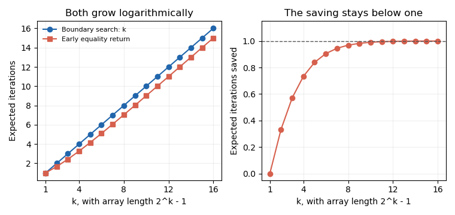

<h1 id="2/e/solution">Solution</h1>

↑ **Parent:** [E](../e.md)

The expected saving on the specified successful searches is

$$
k-e_n=\boxed{1-\frac{k}{n}},
$$

which tends to one iteration as $n=2^k-1$ increases. The fractional saving is $1/k-1/n$, which tends to zero. **Both versions have logarithmic expected time, and the improvement is a bounded average saving rather than a change of growth rate.** A target at the first middle position benefits greatly, but the [uniform distribution](../../../../../continuous-uniform-distribution.md) does not concentrate on that event. The extra equality branch and machine-level costs also matter when comparing measured execution times.

**[Figure 1](#2/e/image-early-equality-return-saves-less-than-one-iteration-on-average-in-perfect-search-arrays). Early equality return saves less than one iteration on average in perfect search arrays**. Original exact iteration counts and their difference for uniformly chosen present targets in arrays of length $2^k-1$. The curves describe loop iterations, not measured execution time.

## ↑ Ancestors (12)

1. [E](../e.md)
2. [2](../../2.md)
3. [Imperative programming (resit)](../../../imperative-programming-resit-split.md)
4. [2021](../../../split.md)
5. [Past exam of the year 1 of the computer science course of the University of Oxford](../../../../split.md)
6. [Year 1 of the computer science course of the University of Oxford](../../../../../year-1-of-the-computer-science-course-of-the-university-of-oxford.md)
7. [Computer science course of the University of Oxford](../../../../../computer-science-course-of-the-university-of-oxford.md)
8. [Undergraduate course of the University of Oxford](../../../../../undergraduate-course-of-the-university-of-oxford.md)
9. [Course of the University of Oxford](../../../../../course-of-the-university-of-oxford.md)
10. [University of Oxford](../../../../../university-of-oxford-split.md)
11. [List of universities](../../../../../list-of-universities.md)
12. [Codex Wiki](../../../../../split.md)
