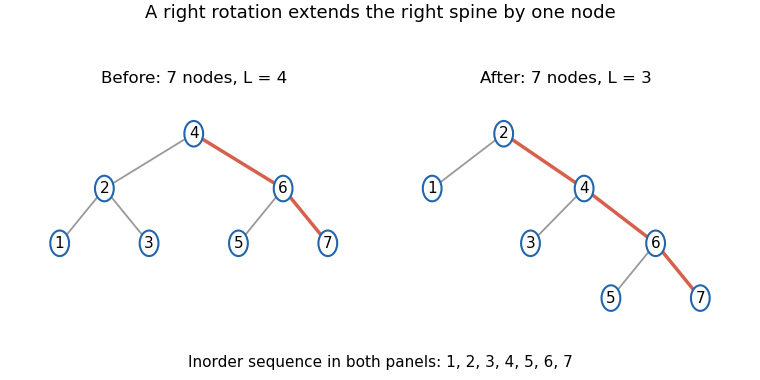

<h1 id="5/c/solution">Solution</h1>

↑ **Parent:** [C](../c.md)

Repeated right rotations expose the next inorder entry without a [recursion](../../../../../recursion-computer-science.md) stack:
```
def printDestructively(input: Tree): Unit = {
  var root = input
  while (root != null) {
    while (root.left != null) {
      val child = root.left
      root.left = child.right
      child.right = root
      root = child
    }
    println(root.datum)
    root = root.right
  }
}
```
A [right rotation](../../../../../right-tree-rotation.md) replaces a local shape with inorder order $A,x,B,y,C$ by another shape with exactly that same order. The inner loop therefore preserves the inorder [sequence](../../../../../sequence.md) of the remaining tree while moving its next output closer to the root. When the left child is null, the root is exactly the first remaining inorder entry. Printing it and advancing to its right child removes that entry from the remaining traversal.

The outer-[loop invariant](../../../../../loop-invariant.md) is that the output already produced, followed by the inorder [sequence](../../../../../sequence.md) of the current root, equals the original inorder [sequence](../../../../../sequence.md). Consequently the procedure prints every original entry once in order. It stores only a constant number of node references and uses **$O(1)$ [auxiliary space](../../../../../auxiliary-space.md)**. It changes the original links, as permitted; clients must not rely on the input tree retaining its earlier shape.

<a id="5/c/image-a-right-rotation-preserves-inorder-order-and-decreases-the-traversal-potential-by-one"></a>


**[Figure 2](#5/c/image-a-right-rotation-preserves-inorder-order-and-decreases-the-traversal-potential-by-one). A right rotation preserves inorder order and decreases the traversal potential by one**. Original seven-node example. Orange edges mark the right spine; nodes off that spine contribute to the left-size potential. The inorder labels remain 1 through 7 before and after the rotation.

## ↑ Ancestors (12)

1. [C](../c.md)
2. [5](../../5.md)
3. [Imperative programming (resit)](../../../imperative-programming-resit-split.md)
4. [2021](../../../split.md)
5. [Past exam of the year 1 of the computer science course of the University of Oxford](../../../../split.md)
6. [Year 1 of the computer science course of the University of Oxford](../../../../../year-1-of-the-computer-science-course-of-the-university-of-oxford.md)
7. [Computer science course of the University of Oxford](../../../../../computer-science-course-of-the-university-of-oxford.md)
8. [Undergraduate course of the University of Oxford](../../../../../undergraduate-course-of-the-university-of-oxford.md)
9. [Course of the University of Oxford](../../../../../course-of-the-university-of-oxford.md)
10. [University of Oxford](../../../../../university-of-oxford-split.md)
11. [List of universities](../../../../../list-of-universities.md)
12. [Codex Wiki](../../../../../split.md)
