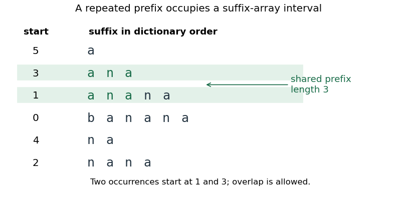
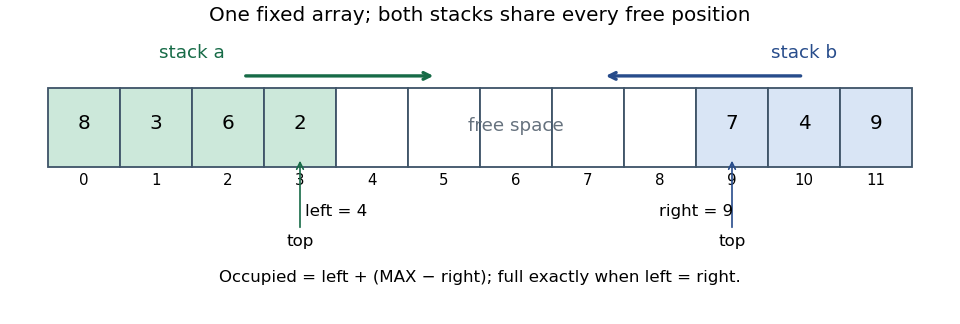

# Imperative programming

↑ **Parent:** [2021](../2021.md)

Source paper: [released examination archive](https://www.whatdotheyknow.com/request/ba_computer_science_past_papers/response/2577745/attach/2/202402%20183%20CS%20Papers.zip?cookie_passthrough=1).

**Table of contents**

- [1](#1)
  - [a](#1/a)
    - [Solution](#1/a/solution)
  - [b](#1/b)
    - [Solution](#1/b/solution)
  - [c](#1/c)
    - [Solution](#1/c/solution)
  - [d](#1/d)
    - [Solution](#1/d/solution)
- [2](#2)
  - [a](#2/a)
    - [Solution](#2/a/solution)
  - [b](#2/b)
    - [Solution](#2/b/solution)
  - [c](#2/c)
    - [Solution](#2/c/solution)
  - [d](#2/d)
    - [Solution](#2/d/solution)
  - [e](#2/e)
    - [Solution](#2/e/solution)
- [3](#3)
  - [a](#3/a)
    - [Solution](#3/a/solution)
  - [b](#3/b)
    - [Solution](#3/b/solution)
  - [c](#3/c)
    - [Solution](#3/c/solution)
- [4](#4)
  - [a](#4/a)
    - [Solution](#4/a/solution)
  - [b](#4/b)
    - [Solution](#4/b/solution)
  - [c](#4/c)
    - [Solution](#4/c/solution)
  - [d](#4/d)
    - [Solution](#4/d/solution)
  - [e](#4/e)
    - [Solution](#4/e/solution)
- [5](#5)
  - [a](#5/a)
    - [Solution](#5/a/solution)
  - [b](#5/b)
    - [Solution](#5/b/solution)
  - [c](#5/c)
    - [Solution](#5/c/solution)
  - [d](#5/d)
    - [Solution](#5/d/solution)
  - [e](#5/e)
    - [Solution](#5/e/solution)
  - [f](#5/f)
    - [Solution](#5/f/solution)
- [6](#6)
  - [a](#6/a)
    - [Solution](#6/a/solution)
  - [b](#6/b)
    - [Solution](#6/b/solution)
  - [c](#6/c)
    - [Solution](#6/c/solution)
  - [d](#6/d)
    - [Solution](#6/d/solution)
  - [e](#6/e)
    - [Solution](#6/e/solution)
  - [f](#6/f)
    - [Solution](#6/f/solution)
- [7](#7)
  - [a](#7/a)
    - [Solution](#7/a/solution)
  - [b](#7/b)
    - [Solution](#7/b/solution)
  - [c](#7/c)
    - [Solution](#7/c/solution)
  - [d](#7/d)
    - [i](#7/d/i)
      - [Solution](#7/d/i/solution)
    - [ii](#7/d/ii)
      - [Solution](#7/d/ii/solution)
  - [e](#7/e)
    - [Solution](#7/e/solution)
- [8](#8)
  - [a](#8/a)
    - [i](#8/a/i)
      - [Solution](#8/a/i/solution)
    - [ii](#8/a/ii)
      - [Solution](#8/a/ii/solution)
    - [iii](#8/a/iii)
      - [Solution](#8/a/iii/solution)
  - [b](#8/b)
    - [Solution](#8/b/solution)
  - [c](#8/c)
    - [i](#8/c/i)
      - [Solution](#8/c/i/solution)
    - [ii](#8/c/ii)
      - [Solution](#8/c/ii/solution)
  - [d](#8/d)
    - [i](#8/d/i)
      - [Solution](#8/d/i/solution)
    - [ii](#8/d/ii)
      - [Solution](#8/d/ii/solution)

## 1

↑ **Parent:** [Imperative programming](imperative-programming.md)

Code follows [Scala](../../programming-language.md#scala) 2 style. Each question uses its own enclosing declarations and the supplied fields; alternative implementations with the same name are separate solutions. Mathematical correctness arguments use exact values unless [floating-point arithmetic](../../floating-point-arithmetic.md) or machine-range bounds are discussed explicitly.

<h3 id="1/a">a</h3>

↑ **Parent:** [1](#1)

<h4 id="1/a/solution">Solution</h4>

↑ **Parent:** [A](#1/a)

Use [Horner's method](../../polynomial.md#horner-s-method), accumulating the high-degree coefficients before the low-degree ones:

```
def eval(x: Double): Double = {
  var i = a.length
  var value = 0.0
  while (i > 0) {
    i -= 1
    value = a(i) + x * value
  }
  value
}
```

At each [while loop](../../programming-language.md#while-loop) head the [loop invariant](../../algorithm.md#loop-invariant) is

$$
0\leq i\leq n,\qquad \mathrm{value}=\sum_{j=i}^{n-1}a(j)x^{j-i}.
$$

The initial sum is empty. Decreasing `i` and replacing the accumulator by `a(i) + x * value` extends that sum by one coefficient with the required powers shifted. The [loop variant](../../algorithm.md#loop-variant) is `i`; on exit it is zero, so the accumulator equals $p(x)$. The code uses **exactly $n$ [multiplications](../../arithmetic.md#multiplication) and $O(n)$ time**, with constant auxiliary space, and also handles the empty coefficient [array](../../data-structure.md#array-data-structure) as the zero [polynomial](../../polynomial.md). Initializing from the last coefficient instead would save one [multiplication](../../arithmetic.md#multiplication) for nonempty [arrays](../../data-structure.md#array-data-structure).

The invariant is an exact-arithmetic specification. With `Double`, each arithmetic operation rounds; consequently the code evaluates the Horner expression in [floating-point arithmetic](../../floating-point-arithmetic.md), rather than guaranteeing the exact real value for arbitrary coefficients.

<h3 id="1/b">b</h3>

↑ **Parent:** [1](#1)

<h4 id="1/b/solution">Solution</h4>

↑ **Parent:** [B](#1/b)

The coefficient assumptions imply a nonconstant [polynomial](../../polynomial.md) with $p(0)<0$ and a positive [leading coefficient](../../polynomial.md#leading-coefficient-of-a-polynomial). Thus $p(x)\to+\infty$ as $x\to+\infty$: dividing by its leading power of $x$ leaves the positive [leading coefficient](../../polynomial.md#leading-coefficient-of-a-polynomial) plus terms tending to zero. There is some $B>0$ with $p(B)>0$. A [polynomial](../../polynomial.md) is continuous, so the [intermediate value theorem](../../calculus.md#intermediate-value-theorem) supplies **at least one positive [root of a polynomial](../../polynomial.md#root-of-a-polynomial)** in $(0,B)$.

This gives neither uniqueness nor monotonicity. Multiple crossings are possible. If the [degree of a polynomial](../../polynomial.md#degree-of-a-polynomial) is an [even integer](../../integer.md#even-number), the same leading-term argument gives $p(x)\to+\infty$ as $x\to-\infty$, so there is also a negative [root of a polynomial](../../polynomial.md#root-of-a-polynomial). For an [odd integer](../../integer.md#odd-integer) [degree of a polynomial](../../polynomial.md#degree-of-a-polynomial) no negative [root of a polynomial](../../polynomial.md#root-of-a-polynomial) is forced; a linear [polynomial](../../polynomial.md) with negative constant coefficient and positive slope is a counterexample.

<h3 id="1/c">c</h3>

↑ **Parent:** [1](#1)

<h4 id="1/c/solution">Solution</h4>

↑ **Parent:** [C](#1/c)

Maintain opposite signs at the endpoints, rather than assuming that the [polynomial](../../polynomial.md) is monotone:

```
def floorRoot(X: Int): Int = {
  require(X > 0 && eval(0.0) <= 0.0 && eval(X.toDouble) > 0.0)
  var lo = 0
  var hi = X
  while (hi - lo > 1) {
    val mid = lo + (hi - lo) / 2
    if (eval(mid.toDouble) <= 0.0) lo = mid
    else hi = mid
  }
  lo
}
```

The [loop invariant](../../algorithm.md#loop-invariant) is **$0\leq\mathrm{lo}<\mathrm{hi}\leq X$ and $p(\mathrm{lo})\leq0<p(\mathrm{hi})$**. Both branches preserve those signs, even when there are other [roots of a polynomial](../../polynomial.md#root-of-a-polynomial) or sign reversals elsewhere. When the interval width exceeds one, the midpoint is strictly between its endpoints, so the positive [integer](../../integer.md) [loop variant](../../algorithm.md#loop-variant) `hi - lo` strictly decreases. On exit `hi == lo + 1`, giving the required [postcondition](../../algorithm.md#postcondition) **$p(\mathrm{lo})\leq0<p(\mathrm{lo}+1)$**. [Continuity](../../calculus.md#continuous-function) establishes a [root of a polynomial](../../polynomial.md#root-of-a-polynomial) between those adjacent [integers](../../integer.md), possibly at the left endpoint.

The width is at most halved with rounding upwards, so there are at most $\lceil\log_2X\rceil$ midpoint evaluations, plus two endpoint evaluations in the [precondition](../../algorithm.md#precondition) check. The midpoint expression avoids adding two large endpoints. The explicit positive upper-bound [precondition](../../algorithm.md#precondition) supplies the interval order assumed in the question. For the literal computed-`eval` contract, the same proof holds provided evaluated midpoints are not `NaN`; identifying its bracket with the real [polynomial](../../polynomial.md) additionally requires trustworthy evaluation signs.

<h3 id="1/d">d</h3>

↑ **Parent:** [1](#1)

<h4 id="1/d/solution">Solution</h4>

↑ **Parent:** [D](#1/d)

First find a sign bracket by [exponential search](../../algorithm.md#exponential-search), then bisect that bracket without evaluating its endpoints again:

```
def floorRoot(): Int = {
  require(eval(0.0) < 0.0)
  var lo = 0
  var hi = 1
  while (eval(hi.toDouble) <= 0.0) {
    lo = hi
    require(hi <= Int.MaxValue / 2, "doubling bound exceeds Int range")
    hi *= 2
  }
  while (hi - lo > 1) {
    val mid = lo + (hi - lo) / 2
    if (eval(mid.toDouble) <= 0.0) lo = mid
    else hi = mid
  }
  lo
}
```

For the first [while loop](../../programming-language.md#while-loop) the [loop invariant](../../algorithm.md#loop-invariant) is $p(\mathrm{lo})\leq0$, with `hi` a positive power of two, and either $(\mathrm{lo},\mathrm{hi})=(0,1)$ or $\mathrm{hi}=2\mathrm{lo}$. Every previously tested power of two has nonpositive value. Let $t$ be the least nonnegative [integer](../../integer.md) for which $p(2^t)>0$. It exists by the positive [leading coefficient](../../polynomial.md#leading-coefficient-of-a-polynomial). If the current upper endpoint is $2^k$, a mathematical [loop variant](../../algorithm.md#loop-variant) is $t-k$ while the guard holds; the next doubling decreases it by one. The first [while loop](../../programming-language.md#while-loop)'s [postcondition](../../algorithm.md#postcondition) is $p(\mathrm{lo})\leq0<p(\mathrm{hi})$. The second [while loop](../../programming-language.md#while-loop) has exactly the invariant, variant and adjacent-integer [postcondition](../../algorithm.md#postcondition) established in part c.

There are $t+1$ evaluations at powers of two. If $t\geq1$, the final bracket has width $2^{t-1}$ and takes exactly $t-1$ midpoint evaluations. Including the initial sign check, the total is **$2t+1$ evaluations for $t\geq1$, and two for $t=0$**. Thus evaluation cost is $O(\log U)$ for the first positive dyadic bound $U=2^t$; it is not a claim about the first positive [root of a polynomial](../../polynomial.md#root-of-a-polynomial) when the [polynomial](../../polynomial.md) is nonmonotone.

The mathematical argument uses unbounded [integer](../../integer.md) endpoints and reliable signs. The guarded `Int` implementation requires the successful dyadic bound to fit in `Int`; otherwise it explicitly fails rather than wrapping to a negative bound. The coefficient assumptions alone cannot guarantee that a requested [integer](../../integer.md) result fits a fixed-width type. Floating-point overflow or unreliable signs likewise need a wider or certified evaluator for a fully general implementation.

## 2

↑ **Parent:** [Imperative programming](imperative-programming.md)

<h3 id="2/a">a</h3>

↑ **Parent:** [2](#2)

<h4 id="2/a/solution">Solution</h4>

↑ **Parent:** [A](#2/a)

Scan the two suffixes until a mismatch or an endpoint:

```
def longestFrom(i: Int, j: Int): Int = {
  require(0 <= i && i <= N && 0 <= j && j <= N)
  var k = 0
  while (k < N - i && k < N - j && a(i + k) == a(j + k)) {
    k += 1
  }
  k
}
```

The [loop invariant](../../algorithm.md#loop-invariant) is $0\leq k\leq\min(N-i,N-j)$ and equality of the two [array](../../data-structure.md#array-data-structure) segments of length $k$. The [loop variant](../../algorithm.md#loop-variant) is $\min(N-i,N-j)-k$, which decreases whenever the [while loop](../../programming-language.md#while-loop) runs. [Short-circuit evaluation](../../programming-language.md#short-circuit-evaluation) checks both bounds before indexing. On exit either a [string suffix](../../foundations-of-mathematics.md#string-suffix) has ended or the next characters differ, so no longer common [string prefix](../../data-structure.md#string-prefix) is possible. Thus **the returned value is the [longest common prefix](../../foundations-of-mathematics.md#longest-common-prefix) length**. Overlap is allowed: the code only reads the [array](../../data-structure.md#array-data-structure), so the two matching segments need not occupy disjoint storage.

<h3 id="2/b">b</h3>

↑ **Parent:** [2](#2)

<h4 id="2/b/solution">Solution</h4>

↑ **Parent:** [B](#2/b)

Compare every unordered pair of distinct starting positions:

```
def longestRepeated(): (Int, Int, Int) = {
  require(N >= 2)
  var besti = 0
  var bestj = 1
  var bestk = 0
  var i = 0
  while (i < N - 1) {
    var j = i + 1
    while (j < N) {
      val k = longestFrom(i, j)
      if (k > bestk) {
        besti = i; bestj = j; bestk = k
      }
      j += 1
    }
    i += 1
  }
  (besti, bestj, bestk)
}
```

After each comparison, the stored triple attains the largest common-prefix length among pairs processed so far; its positions remain distinct. The nested [while loops](../../programming-language.md#while-loop) enumerate exactly $N(N-1)/2$ pairs. Reversing the two positions does not change their common-prefix length, so no omitted ordered pair could improve the answer. Initialization also supplies a valid length-zero answer if no character repeats.

Write $K$ for the final maximal length. Each comparison takes $O(K+1)$ time, including a possible first mismatch. Hence **time is $O(N^2(K+1))$, at worst $O(N^3)$**, and auxiliary space is $O(1)$. Writing merely $O(N^2K)$ would miss the $K=0$ case. The explicit [precondition](../../algorithm.md#precondition) excludes [arrays](../../data-structure.md#array-data-structure) with fewer than two valid starting positions; the requested distinct-position triple has no answer there under this domain convention.

<h3 id="2/c">c</h3>

↑ **Parent:** [2](#2)

<h4 id="2/c/solution">Solution</h4>

↑ **Parent:** [C](#2/c)

All suffixes beginning with a fixed [string](../../foundations-of-mathematics.md#string) form an interval in [lexicographic order](../../extremal-set-theory.md#lexicographic-order). To see this, suppose two suffixes start with a [string](../../foundations-of-mathematics.md#string) $u$, while a [string suffix](../../foundations-of-mathematics.md#string-suffix) between them fails to start with $u$. At its first differing character it must be either smaller than both or larger than both; if it ends before $u$ does, it is smaller than both. Either possibility contradicts its position between them.

Now take a [longest repeated substring](../../algorithm.md#longest-repeated-substring) $u$. Its two occurrences are prefixes of two distinct suffixes. Every [string suffix](../../foundations-of-mathematics.md#string-suffix) between them also begins with $u$, so at least one adjacent pair in that interval has a common [string prefix](../../data-structure.md#string-prefix) of length at least $|u|$. A greater length would contradict maximality of $u$. Therefore **the maximum common-prefix length over adjacent sorted suffixes equals the longest repeated-substring length**. If the maximum is zero, any adjacent pair still attains it. The argument does not assume nonoverlapping occurrences.

<a id="2/c/image-original-suffix-array-example-for-banana-an-interval-of-suffixes-shares-the-repeated-prefix-ana"></a>


**[Figure 1](#2/c/image-original-suffix-array-example-for-banana-an-interval-of-suffixes-shares-the-repeated-prefix-ana). Original suffix-array example for banana: an interval of suffixes shares the repeated prefix ana**.

<h3 id="2/d">d</h3>

↑ **Parent:** [2](#2)

<h4 id="2/d/solution">Solution</h4>

↑ **Parent:** [D](#2/d)

Reuse the verified longest-common-prefix scan, handling equality before scanning:

```
def before(i: Int, j: Int): Boolean = {
  require(0 <= i && i < N && 0 <= j && j < N)
  if (i == j) false
  else {
    val k = longestFrom(i, j)
    if (j + k == N) false
    else if (i + k == N) true
    else a(i + k) < a(j + k)
  }
}
```

There is no additional [while loop](../../programming-language.md#while-loop): the helper's [loop invariant](../../algorithm.md#loop-invariant) is that the first `k` characters agree and both indices remain in bounds. If the second [string suffix](../../foundations-of-mathematics.md#string-suffix) ends first, the first cannot precede it; if the first ends first, it is a proper [string prefix](../../data-structure.md#string-prefix) and precedes the second. Otherwise the first mismatching characters decide [lexicographic order](../../extremal-set-theory.md#lexicographic-order). Distinct suffixes cannot both end after the same number of characters, since their lengths differ.

The `i == j` case ensures **a strict comparator**, returning false for a [string suffix](../../foundations-of-mathematics.md#string-suffix) compared with itself, in constant time. For distinct suffixes its running time is $O(K+1)$, where $K$ is the longest repeated-substring length of the full [array](../../data-structure.md#array-data-structure).

<h3 id="2/e">e</h3>

↑ **Parent:** [2](#2)

<h4 id="2/e/solution">Solution</h4>

↑ **Parent:** [E](#2/e)

Sort [string suffix](../../foundations-of-mathematics.md#string-suffix) starting positions, then examine only adjacent entries:

```
def longestRepeated(): (Int, Int, Int) = {
  require(N >= 2)
  val suffixes = (0 until N).toArray.sortWith(before)
  var besti = suffixes(0)
  var bestj = suffixes(1)
  var bestk = 0
  var t = 1
  while (t < N) {
    val i = suffixes(t - 1)
    val j = suffixes(t)
    val k = longestFrom(i, j)
    if (k > bestk) {
      besti = i; bestj = j; bestk = k
    }
    t += 1
  }
  (besti, bestj, bestk)
}
```

The [while loop](../../programming-language.md#while-loop) retains a best triple among adjacent pairs already visited. All [string suffix](../../foundations-of-mathematics.md#string-suffix) starting positions are distinct, and the adjacent-suffix characterization proves that considering these $N-1$ pairs suffices. The two definitions named `longestRepeated` in parts b and e are alternatives, not duplicate members of one [software class](../../programming-language.md#class-programming).

Assuming a comparison sort using $O(N\log N)$ comparator calls, sorting takes $O(N\log N(K+1))$ time, because each comparison scans characters. The final pass takes $O(N(K+1))$. Thus **overall time is $O(N\log N(K+1))$, at worst $O(N^2\log N)$**, with $O(N)$ auxiliary storage for indices and ordinary sorting workspace. Merely storing indices does not make [string suffix](../../foundations-of-mathematics.md#string-suffix) comparisons constant-time; claiming $O(N\log N)$ here would omit their cost. Faster suffix-array constructions require additional machinery beyond this comparator-based solution.

## 3

↑ **Parent:** [Imperative programming](imperative-programming.md)

<h3 id="3/a">a</h3>

↑ **Parent:** [3](#3)

<h4 id="3/a/solution">Solution</h4>

↑ **Parent:** [A](#3/a)

Use two finite [integer](../../integer.md) [lists](../../data-structure.md#list-abstract-data-type) $A,B$, with the head of each [list](../../data-structure.md#list-abstract-data-type) representing its [stack](../../data-structure.md#stack-data-structure) top. Initially both are empty. A suitable abstract [object interface](../../programming-language.md#object-interface) is

```
trait DoubleStack {
  def pusha(x: Int): Unit
  def pushb(x: Int): Unit
  def popa: Int
  def popb: Int
  def isEmptya: Boolean
  def isEmptyb: Boolean
}
```

For the unbounded [abstract data type](../../computer-science.md#abstract-data-type), each push has no logical [precondition](../../algorithm.md#precondition). The [postcondition](../../algorithm.md#postcondition) of `pusha(x)` is $A'=x:A$ and $B'=B$; `pushb(x)` symmetrically gives $B'=x:B$ and $A'=A$. The [precondition](../../algorithm.md#precondition) of `popa` is $A\ne[]$, and its [postcondition](../../algorithm.md#postcondition) is return value $\operatorname{head}(A)$, new state $A'=\operatorname{tail}(A)$, and unchanged $B$. The specification for `popb` exchanges $A,B$. Each emptiness query leaves both [lists](../../data-structure.md#list-abstract-data-type) unchanged and returns exactly whether its corresponding [list](../../data-structure.md#list-abstract-data-type) is empty.

These frame conditions matter: an operation on one [stack](../../data-structure.md#stack-data-structure) must preserve the other, not merely produce the right return value.

<h3 id="3/b">b</h3>

↑ **Parent:** [3](#3)

<h4 id="3/b/solution">Solution</h4>

↑ **Parent:** [B](#3/b)

A fixed-capacity implementation needs a bounded contract: **$|A|+|B|\leq\mathrm{MAX}$**, and a push requires strict inequality. Pop [preconditions](../../algorithm.md#precondition) and all successful-operation [postconditions](../../algorithm.md#postcondition) remain unchanged. An implementation that rejects full-array pushes cannot satisfy an unbounded specification promising every push; the capacity restriction must be part of the agreed [abstract data type](../../computer-science.md#abstract-data-type), or its resource-failure behavior must be specified.

Use one [array](../../data-structure.md#array-data-structure) and two boundaries `left` and `right`. The first [stack](../../data-structure.md#stack-data-structure) occupies indices below `left` and grows rightwards; the second occupies indices at least `right` and grows leftwards. The [representation invariant](../../computer-science.md#representation-invariant) is

$$
\mathrm{data.length}=\mathrm{MAX},\qquad 0\leq\mathrm{left}\leq\mathrm{right}\leq\mathrm{MAX}.
$$

The [abstraction function](../../computer-science.md#abstraction-function) is

$$
A=\operatorname{reverse}(\mathrm{data}[0..\mathrm{left})),\qquad B=\mathrm{data}[\mathrm{right}..\mathrm{MAX}).
$$

Both [lists](../../data-structure.md#list-abstract-data-type) are top-first. The unoccupied middle interval has length `right - left`; a push is possible exactly when this is positive. Thus **every [array](../../data-structure.md#array-data-structure) position can be used by either [stack](../../data-structure.md#stack-data-structure)**, avoiding a rigid half-array allocation.

<a id="3/b/image-original-shared-array-double-stack-layout-two-stacks-grow-towards-a-common-free-interval"></a>


**[Figure 2](#3/b/image-original-shared-array-double-stack-layout-two-stacks-grow-towards-a-common-free-interval). Original shared-array double-stack layout: two stacks grow towards a common free interval**.

<h3 id="3/c">c</h3>

↑ **Parent:** [3](#3)

<h4 id="3/c/solution">Solution</h4>

↑ **Parent:** [C](#3/c)

The implementation maintains the two boundaries from part b:

```
class ArrayDoubleStack(val MAX: Int) extends DoubleStack {
  require(MAX >= 0)
  private val data = new Array[Int](MAX)
  private var left = 0
  private var right = MAX

  def isEmptya: Boolean = left == 0
  def isEmptyb: Boolean = right == MAX

  def pusha(x: Int): Unit = {
    require(left < right, "double stack is full")
    data(left) = x
    left += 1
  }
  def pushb(x: Int): Unit = {
    require(left < right, "double stack is full")
    right -= 1
    data(right) = x
  }
  def popa: Int = {
    require(left > 0, "stack a is empty")
    left -= 1
    data(left)
  }
  def popb: Int = {
    require(right < MAX, "stack b is empty")
    val answer = data(right)
    right += 1
    answer
  }
}
```

Initialization gives empty abstract [lists](../../data-structure.md#list-abstract-data-type). Each push consumes one free position next to the appropriate top; each pop returns that top and releases its position. The guards preserve the ordering of the two boundaries and prevent invalid indexing. The [abstraction function](../../computer-science.md#abstraction-function) shows directly that the untouched [stack](../../data-structure.md#stack-data-structure) is unchanged. Keeping `data` private prevents clients from violating the [representation invariant](../../computer-science.md#representation-invariant); this strengthens [encapsulation](../../computer-science.md#encapsulation-computer-programming) relative to a publicly exposed implementation field without changing the six required operations.

**All six operations run in $O(1)$ time**, with a fixed [array](../../data-structure.md#array-data-structure) of `MAX` [integers](../../integer.md) and constant extra state. Creating and zero-initializing the [array](../../data-structure.md#array-data-structure) takes $O(\mathrm{MAX})$ time, outside those operation bounds. Capacity zero gives a valid always-empty bounded structure whose pushes fail their [precondition](../../algorithm.md#precondition).

## 4

↑ **Parent:** [Imperative programming](imperative-programming.md)

<h3 id="4/a">a</h3>

↑ **Parent:** [4](#4)

<h4 id="4/a/solution">Solution</h4>

↑ **Parent:** [A](#4/a)

For a finite acyclic [linked list](../../data-structure.md#linked-list) define the node [sequence](../../sequence-and-series.md#sequence), retaining [software object](../../programming-language.md#software-object) identities, by

$$
L(\mathrm{null})=[],\qquad L(u)=u:L(u.\mathrm{next}).
$$

Then scan without changing any links:

```
def findMin(first: Node): Node = {
  require(first != null)
  var best = first
  var cursor = first.next
  while (cursor != null) {
    if (cursor.datum < best.datum) best = cursor
    cursor = cursor.next
  }
  best
}
```

At each [while loop](../../programming-language.md#while-loop) head, write $L(\mathrm{first})=P\mathbin{++}L(\mathrm{cursor})$. The [loop invariant](../../algorithm.md#loop-invariant) says $P$ is nonempty, `best` belongs to $P$, and its datum is no larger than that of every node in $P$. Initially $P$ contains only `first`; comparing the next node extends the processed [string prefix](../../data-structure.md#string-prefix) and preserves minimality. The [loop variant](../../algorithm.md#loop-variant) $|L(\mathrm{cursor})|$ strictly decreases. At exit the whole [list](../../data-structure.md#list-abstract-data-type) is processed, so **the returned reference identifies a minimum node**. Ties retain the earliest minimum. Time is linear in the number of nodes and auxiliary space is constant.

<h3 id="4/b">b</h3>

↑ **Parent:** [4](#4)

<h4 id="4/b/solution">Solution</h4>

↑ **Parent:** [B](#4/b)

A [sentinel node](../../data-structure.md#sentinel-node) supplies a permanent predecessor for the first real node. Inserting or deleting at the front then uses the same `predecessor.next` update as an interior operation. Its datum is **not a [multiset](../../set.md#multiset) element**: the chosen extreme [integer](../../integer.md) is merely unused sentinel data.

A [representation invariant](../../computer-science.md#representation-invariant) requires a nonnull fixed header, a finite acyclic chain starting at `bagHeader.next`, and exclusion of the header from that chain. Each node identity occurs once, although different nodes may have equal data. Representation links are owned by the implementation, so outside mutation cannot alter them unexpectedly.

The [abstraction function](../../computer-science.md#abstraction-function) counts occurrences:

$$
\mathrm{bag}(x)=\bigl|\{u\in L(\mathrm{bagHeader.next}):u.\mathrm{datum}=x\}\bigr|.
$$

This yields nonnegative multiplicities and finite support. Initialization with a null successor gives the empty [multiset](../../set.md#multiset). Excluding the sentinel is essential even when a real item equals its datum.

<h3 id="4/c">c</h3>

↑ **Parent:** [4](#4)

<h4 id="4/c/solution">Solution</h4>

↑ **Parent:** [C](#4/c)

The [precondition](../../algorithm.md#precondition) is **`n != null` and $n\in L(\mathrm{bagHeader.next})$**, using node identity rather than datum equality. Search for its predecessor:

```
def delete(n: Node): Unit = {
  var previous = bagHeader
  while (previous.next ne n) {
    previous = previous.next
  }
  previous.next = n.next
  n.next = null
}
```

The [loop invariant](../../algorithm.md#loop-invariant) states that `previous` is the header or a preceding real node, and $n\in L(\mathrm{previous.next})$. The [loop variant](../../algorithm.md#loop-variant) is the number of links from `previous` to `n` minus one. The [precondition](../../algorithm.md#precondition) guarantees that this search reaches the predecessor before a null dereference. Replacing its successor by `n.next` bypasses exactly the requested node; clearing the removed node's link detaches it for later reuse. The order and identities of every other node remain unchanged. In abstract terms, only the multiplicity of `n.datum` decreases, by one. The worst-case time is linear; the pointer modification itself is constant-time.

<h3 id="4/d">d</h3>

↑ **Parent:** [4](#4)

<h4 id="4/d/solution">Solution</h4>

↑ **Parent:** [D](#4/d)

Check that at least one real node exists, then compose the two helpers:

```
def deleteMin(): Int = {
  require(bagHeader.next != null, "bag is empty")
  val smallest = findMin(bagHeader.next)
  val answer = smallest.datum
  delete(smallest)
  answer
}
```

The [precondition](../../algorithm.md#precondition) check makes `findMin` applicable. Its result belongs to the real-node [sequence](../../sequence-and-series.md#sequence), satisfying `delete`'s [precondition](../../algorithm.md#precondition). Consequently **one minimum value is returned and exactly one occurrence is removed**; duplicates remain as distinct nodes. Saving the datum before deletion also separates the return value from subsequent link mutation. Two linear traversals still give $O(m)$ time for a [multiset](../../set.md#multiset) containing $m$ nodes, with constant auxiliary space.

<h3 id="4/e">e</h3>

↑ **Parent:** [4](#4)

<h4 id="4/e/solution">Solution</h4>

↑ **Parent:** [E](#4/e)

Let $B_0$ and $R_0=L(\mathrm{bagHeader.next})$ describe the entry state. The [postcondition](../../algorithm.md#postcondition) is: **the [multiset](../../set.md#multiset) is empty; the returned chain is sorted nondecreasingly; its node [sequence](../../sequence-and-series.md#sequence) is a [permutation](../../combinatorics.md#permutation) of $R_0$**. Thus it has exactly the original [multiset](../../set.md#multiset) of data and preserves all duplicates. Strict increase is impossible when the [multiset](../../set.md#multiset) contains repeated values.

```
def getAllSorted(): Node = {
  var head: Node = null
  var tail: Node = null
  while (bagHeader.next != null) {
    val nextSmallest = findMin(bagHeader.next)
    delete(nextSmallest)
    nextSmallest.next = null
    if (head == null) head = nextSmallest
    else tail.next = nextSmallest
    tail = nextSmallest
  }
  head
}
```

The [loop invariant](../../algorithm.md#loop-invariant) partitions the original node identities into the remaining [multiset](../../set.md#multiset) and the returned-prefix chain. The latter is sorted, its last node is `tail`, and every datum in it is no larger than every remaining datum. Selecting a minimum and appending that detached node preserves all these facts. The [loop variant](../../algorithm.md#loop-variant) is the number of real nodes remaining in the [multiset](../../set.md#multiset), decreasing by one. When it reaches zero the [string prefix](../../data-structure.md#string-prefix) contains the entire original node set, proving the [postcondition](../../algorithm.md#postcondition). An initially empty [multiset](../../set.md#multiset) returns null.

This is linked-list [selection sort](../../algorithm.md#selection-sort). Its time is $\Theta(m^2)$ in general, from successive scans of lengths $m,m-1,\ldots,1$, and it uses constant auxiliary space: it relinks original nodes instead of allocating a new node for each item.

## 5

↑ **Parent:** [Imperative programming](imperative-programming.md)

<h3 id="5/a">a</h3>

↑ **Parent:** [5](#5)

<h4 id="5/a/solution">Solution</h4>

↑ **Parent:** [A](#5/a)

Use null to indicate that the requested key is absent:

```
private def find(name: String, head: Entry): Entry = {
  var cursor = head
  while (cursor != null && cursor.name != name) {
    cursor = cursor.next
  }
  cursor
}
```

The [loop invariant](../../algorithm.md#loop-invariant) is that the skipped [string prefix](../../data-structure.md#string-prefix) contains no entry with the requested name and `cursor` starts the unsearched [string suffix](../../foundations-of-mathematics.md#string-suffix) of the unchanged bucket. Its remaining length is a [loop variant](../../algorithm.md#loop-variant). [Short-circuit evaluation](../../programming-language.md#short-circuit-evaluation) prevents accessing a null entry. On exit, either `cursor` is null and the whole bucket has been ruled out, or its name equals the key. **No [list](../../data-structure.md#list-abstract-data-type) links or stored numbers are modified.** [String](../../foundations-of-mathematics.md#string) comparison here uses value equality; node deletion elsewhere uses reference identity.

<h3 id="5/b">b</h3>

↑ **Parent:** [5](#5)

<h4 id="5/b/solution">Solution</h4>

↑ **Parent:** [B](#5/b)

Assume the supplied [hash function](../../computer-science.md#hash-function) is stable and produces valid table indices. The [representation invariant](../../computer-science.md#representation-invariant) places each name in its hashed bucket, permits at most one entry per name, and requires finite acyclic, disjoint bucket chains.

```
def store(name: String, number: String): Unit = {
  val bucket = hash(name)
  val entry = find(name, table(bucket))
  if (entry == null) {
    table(bucket) = new Entry(name, number, table(bucket))
  } else {
    entry.number = number
  }
}
```

If the key exists, updating its associated number implements map override without creating a duplicate entry. Otherwise a new entry is prepended to the correct bucket and leaves every existing mapping unchanged. Its immutable name preserves bucket membership. Thus **the mapping afterwards is the old mapping overridden at precisely the supplied key**. [Hash collisions](../../computer-science.md#hash-collision) between different names do not imply key equality and are handled by [separate chaining](../../data-structure.md#separate-chaining).

<h3 id="5/c">c</h3>

↑ **Parent:** [5](#5)

<h4 id="5/c/solution">Solution</h4>

↑ **Parent:** [C](#5/c)

Membership is exactly whether the bucket search finds an entry:

```
def isInBook(name: String): Boolean = {
  find(name, table(hash(name))) != null
}
```

By the bucket-placement [representation invariant](../../computer-science.md#representation-invariant), an entry with this name can occur only in this bucket. The `find` contract therefore proves **true exactly for keys in the map's domain**, with no state change. One hash calculation and one bucket traversal suffice; no insertion is performed during the query.

<h3 id="5/d">d</h3>

↑ **Parent:** [5](#5)

<h4 id="5/d/solution">Solution</h4>

↑ **Parent:** [D](#5/d)

Find the entry once and check the abstract membership [precondition](../../algorithm.md#precondition) on that result:

```
def recall(name: String): String = {
  val entry = find(name, table(hash(name)))
  require(entry != null, "name is not in the book")
  entry.number
}
```

The check turns an invalid call into an explicit [precondition](../../algorithm.md#precondition) failure rather than an accidental null dereference or an invented default number. For a valid call, the unique matching entry contains exactly the mapped value, so **the stored number is returned and the map is unchanged**. Testing membership by calling `isInBook` first would traverse the same bucket twice; retaining the found reference avoids that redundant work.

<h3 id="5/e">e</h3>

↑ **Parent:** [5](#5)

<h4 id="5/e/solution">Solution</h4>

↑ **Parent:** [E](#5/e)

The relevant quantity is the hash-table load factor $\alpha=n/M$, where $n$ is the number of distinct keys and $M$ the bucket count. With a suitable distribution of hashes, [separate chaining](../../data-structure.md#separate-chaining) has expected operation cost $O(1+\alpha)$, treating key operations as constant-cost. Keeping only one hundred buckets while $n$ grows therefore increases average search length.

Balanced [binary search trees](../../data-structure.md#binary-search-tree) could reduce a bucket search from linear time in its occupancy to logarithmic time. **Unbalanced [binary search trees](../../data-structure.md#binary-search-tree) provide no such guarantee**: insertion order can produce a chain. Even balanced trees add comparison and node-management overhead, which may dominate for small buckets.

A usual first remedy is **grow the table and rehash its entries, keeping the load factor bounded**. Geometric growth gives amortized constant resizing overhead per insertion; with suitable hashing, expected lookup, update and insertion costs remain constant. Resizing is $O(n)$ when performed and is not a worst-case constant-time guarantee for that particular operation. Balanced buckets can still be useful for heavy or adversarial collisions, but replacing every bucket tree does not by itself repair a poor [hash function](../../computer-science.md#hash-function). For variable-length [strings](../../foundations-of-mathematics.md#string), hashing and [string](../../foundations-of-mathematics.md#string) comparisons add their own character-processing costs.

<h3 id="5/f">f</h3>

↑ **Parent:** [5](#5)

<h4 id="5/f/solution">Solution</h4>

↑ **Parent:** [F](#5/f)

A single bucket holding about a quarter of all keys suggests **severely nonuniform hashing or a strongly skewed/adversarial key set**, rather than ordinary load growth alone. With one hundred well-used buckets the expected fraction in one fixed bucket is about one hundredth. Persistent concentration near one quarter is evidence to investigate, not a proof identifying one particular implementation bug.

Inspect the bucket histogram, raw hash outputs and patterns in the names. A hash depending only on an initial character, weak mixing of common prefixes, or an indexing rule using few possible buckets could create this behavior. Improve the hash so that it uses the complete key and spreads this workload across the table, then rehash every stored entry. Check the valid-index rule as well, including negative machine hash values.

Increasing the table size is useful if index reduction caused the concentration; **it cannot separate keys that all receive the same raw hash**. For maliciously chosen keys, randomized or keyed hashing and balanced collision structures may be appropriate. The observed occupancy does not justify assuming uniformly random hashes in a performance claim.

## 6

↑ **Parent:** [Imperative programming](imperative-programming.md)

<h3 id="6/a">a</h3>

↑ **Parent:** [6](#6)

<h4 id="6/a/solution">Solution</h4>

↑ **Parent:** [A](#6/a)

A suitable relationship is a circle implementing a read-only shape [object interface](../../programming-language.md#object-interface) whose operations include area. Every circle satisfies that [object interface](../../programming-language.md#object-interface)'s behavioral contract, so clients using a shape can use a circle through [subtype polymorphism](../../programming-language.md#subtype-polymorphism); [dynamic dispatch](../../programming-language.md#dynamic-dispatch) selects its area implementation.

A car is not appropriately modeled as a subclass of an engine merely because it needs engine behavior. **Use [object composition](../../programming-language.md#object-composition)**: the car contains an engine and delegates engine-related work to it. An engine is a component of a car, not a category containing cars. The design can replace the component independently without making all engine operations part of the car's public [object interface](../../programming-language.md#object-interface). [Class inheritance](../../programming-language.md#class-inheritance) should reflect substitutability, rather than serve solely as a convenient way to obtain another [software class](../../programming-language.md#class-programming)'s code.

<h3 id="6/b">b</h3>

↑ **Parent:** [6](#6)

<h4 id="6/b/solution">Solution</h4>

↑ **Parent:** [B](#6/b)

[Protected access](../../programming-language.md#protected-access) makes `size` available to subclasses implementing the set operations, while preventing ordinary outside clients from assigning arbitrary values to it. The implementations need to update the count when membership changes; clients should affect membership only through the public operations. A publicly writable count could make an emptiness query disagree with the stored elements.

**Protection supports [encapsulation](../../computer-science.md#encapsulation-computer-programming) but does not prove the [representation invariant](../../computer-science.md#representation-invariant).** Subclasses can still update the field incorrectly and must maintain its relationship to the actual set [cardinality](../../cardinal-number.md#cardinality). In particular, subclass code does not obtain unrestricted access to the protected field of every unrelated set [software object](../../programming-language.md#software-object).

<h3 id="6/c">c</h3>

↑ **Parent:** [6](#6)

<h4 id="6/c/solution">Solution</h4>

↑ **Parent:** [C](#6/c)

**Throw an informative exception**, such as `NoSuchElementException`, and leave the set unchanged. This makes a violated nonempty [precondition](../../algorithm.md#precondition) visible at the point of misuse. Returning a distinguished [integer](../../integer.md) would be ambiguous because every [integer](../../integer.md) is a legitimate set member.

A different [object interface](../../programming-language.md#object-interface) could return an optional [integer](../../integer.md), representing failure explicitly, but that changes the declared return type. For the supplied integer-returning operation, a checked failure is useful and consistent with the stated [precondition](../../algorithm.md#precondition).

<h3 id="6/d">d</h3>

↑ **Parent:** [6](#6)

<h4 id="6/d/solution">Solution</h4>

↑ **Parent:** [D](#6/d)

Count each invocation before delegating, including duplicate insertions, and reset after clearing:

```
class IntegerSetWithCount extends IntegerSet() {
  private var attempts = BigInt(0)

  override def insert(x: Int): Unit = {
    attempts += 1
    super.insert(x)
  }
  override def clear: Unit = {
    super.clear
    attempts = BigInt(0)
  }
  def getCount: BigInt = attempts
}
```

The inherited implementation already maintains `size`; the new counter measures insertion attempts, not successful increases in [cardinality](../../cardinal-number.md#cardinality). Deletion and popping do not subtract from it. Incrementing before delegation also counts an attempted insertion that subsequently fails a capacity check. [Arbitrary-precision arithmetic](../../arithmetic.md#arbitrary-precision-arithmetic) avoids silently wrapping the historical count, though its arithmetic is not constant-cost for arbitrarily large counts.

As the source supplies no [object constructor](../../programming-language.md#object-constructor) signature for the concrete set, this code uses a fresh default-constructible `IntegerSet`, with matching default capacity. Its correct behavior also assumes the base implementation does not internally invoke these overridable operations in a way that interferes with the counter. Part e exhibits that dependency.

**Source-signature qualification for the following set implementations:** the intended membership query must be declared `def contains(x: Int): Boolean`. The printed abstract declaration omits its result type; interpreted literally as [Scala](../../programming-language.md#scala) 2 procedure syntax, it returns `Unit`. The solutions use the explicit Boolean query contract, and `Unit` for the two mutators. Parameterless `clear` is overridden without adding parentheses.[Procedures: a method declaration omitting its result type implicitly has Unit result](../../computer-science-bibliography.md#scala-2-13-basic-declarations-and-definitions-specification)

<h3 id="6/e">e</h3>

↑ **Parent:** [6](#6)

<h4 id="6/e/solution">Solution</h4>

↑ **Parent:** [E](#6/e)

A base-class change can preserve its own set abstraction while breaking a subclass that intercepts internal calls. For example, suppose `IntegerSet.delete(x)` is reimplemented by collecting the elements to retain, calling `clear`, then calling `insert` for each retained element. Conceptually its body is

```
val retained = snapshotOfElements.filter(_ != x)
clear
retained.foreach(insert)
```

Here `snapshotOfElements` denotes the base implementer's own internal snapshot operation in this hypothetical revision, not an API supplied by the examination. The algorithm still removes exactly the requested value and preserves all other set members.

On an `IntegerSetWithCount`, however, these unqualified calls use [dynamic dispatch](../../programming-language.md#dynamic-dispatch). The internal `clear` resets the subclass counter and the internal insertions increase it. After client calls `insert(10)`, `insert(20)`, `insert(10)`, the correct count is three. Calling `delete(10)` with this revised base implementation leaves the right set, containing only the other value, but resets the counter and reinserts that value, leaving **count one instead of three**. The client made no further insertion attempt and requested no clear.

This is the [fragile base class problem](../../programming-language.md#fragile-base-class-problem): subclass correctness depends on the base implementation's internal call structure, beyond its public set [postconditions](../../algorithm.md#postcondition). A change need not alter the base API to expose that dependence.

<h3 id="6/f">f</h3>

↑ **Parent:** [6](#6)

<h4 id="6/f/solution">Solution</h4>

↑ **Parent:** [F](#6/f)

Give the wrapper exclusive ownership of a fresh delegate. It maintains its own inherited size so that inherited emptiness queries remain correct:

```
class IntegerSetWithCount extends IntegerSetPattern() {
  private val delegate = new IntegerSet()
  private var attempts = BigInt(0)

  override def contains(x: Int): Boolean = delegate.contains(x)

  override def insert(x: Int): Unit = {
    attempts += 1
    val wasPresent = delegate.contains(x)
    delegate.insert(x)
    if (!wasPresent) size += 1
  }
  override def delete(x: Int): Unit = {
    val wasPresent = delegate.contains(x)
    delegate.delete(x)
    if (wasPresent) size -= 1
  }
  override def pop(): Int = {
    if (isEmpty) throw new NoSuchElementException("set is empty")
    val answer = delegate.pop()
    size -= 1
    answer
  }
  override def clear: Unit = {
    delegate.clear
    size = 0
    attempts = BigInt(0)
  }
  def getCount: BigInt = attempts
}
```

Use the explicit membership signature and fresh default-constructible concrete set qualified in part d. The [representation invariant](../../computer-science.md#representation-invariant) is that the wrapper's `size` equals the delegate's [cardinality](../../cardinal-number.md#cardinality) and its counter equals client insertion attempts since construction or the latest successful client clear. The updates shown preserve that invariant when delegated operations fulfill their set contracts and failure checks leave the delegate unchanged. A duplicate does not increase size; deleting an absent element does not decrease it. Size changes follow successful delegation, whereas an attempted insertion is counted immediately.

**[Object composition](../../programming-language.md#object-composition) prevents internal delegate calls from dispatching into the wrapper's counter [object methods](../../programming-language.md#object-method).** It therefore survives the particular base revision in part e. The cost is forwarding code, another [software object](../../programming-language.md#software-object), some redundant size state imposed by the chosen abstract superclass, and extra membership queries. Future [object interface](../../programming-language.md#object-interface) [additions](../../arithmetic.md#addition) must also be forwarded explicitly. This solution is an alternative definition of the [software class](../../programming-language.md#class-programming) in part d, not a second simultaneous definition.

## 7

↑ **Parent:** [Imperative programming](imperative-programming.md)

<h3 id="7/a">a</h3>

↑ **Parent:** [7](#7)

<h4 id="7/a/solution">Solution</h4>

↑ **Parent:** [A](#7/a)

**[Subtype polymorphism](../../programming-language.md#subtype-polymorphism)** lets a reference with a common supertype denote values of different implementing classes. A call through that reference uses [dynamic dispatch](../../programming-language.md#dynamic-dispatch) to select the concrete implementation.

**[Parametric polymorphism](../../programming-language.md#parametric-polymorphism)** defines an operation or data structure using [type parameters](../../programming-language.md#type-parameter), such as a collection with an element-type parameter. Instantiations retain type information while reusing one generic definition.

**[Ad hoc polymorphism](../../programming-language.md#ad-hoc-polymorphism)**, commonly expressed by [method overloading](../../programming-language.md#method-overloading), gives several implementations the same name but different parameter signatures. The compiler selects a suitable overload using the available static types. This selection differs from later [dynamic dispatch](../../programming-language.md#dynamic-dispatch) on the receiver of a selected [instance method](../../programming-language.md#object-method). A programming language can support all three in one program.

<h3 id="7/b">b</h3>

↑ **Parent:** [7](#7)

<h4 id="7/b/solution">Solution</h4>

↑ **Parent:** [B](#7/b)

**TODO: supply or verify the exact Ewoks practical version used for this examination, including its relevant [object interface](../../programming-language.md#object-interface), implementing classes and call site.** The printed paper names the editor but supplies no [software class](../../programming-language.md#class-programming) hierarchy or API from which its particular example can be reconstructed.

An earlier official 2015–2016 synopsis identifies Ewoks as a text-editor case study and associates that material with commands represented as [software objects](../../programming-language.md#software-object) and with dynamic binding. That is historical context, not verification of the 2021 practical implementation.[Designing with objects, lectures 6–8: Ewoks, commands as objects, and dynamic binding](../../computer-science-bibliography.md#object-oriented-programming-course-synopsis-of-the-university-of-oxford-2015-2016)

The method for completing the answer is to identify a common command or editing [object interface](../../programming-language.md#object-interface), two actual implementations from the verified project, and a client call made through the common [object interface](../../programming-language.md#object-interface). [Subtype polymorphism](../../programming-language.md#subtype-polymorphism) would let that client select different behavior without inspecting concrete classes, improving extensibility and separating editing behavior from the code that invokes it. **No particular Ewoks [software class](../../programming-language.md#class-programming) names or [object method](../../programming-language.md#object-method) signatures are asserted here**, so this context-dependent leaf remains incomplete.

<h3 id="7/c">c</h3>

↑ **Parent:** [7](#7)

<h4 id="7/c/solution">Solution</h4>

↑ **Parent:** [C](#7/c)

Instantiate the two [type parameters](../../programming-language.md#type-parameter) and implement the [function](../../function.md) [object interface](../../programming-language.md#object-interface):

```
val square: Fun[Int, Int] = new Fun[Int, Int] {
  override def apply(x: Int): Int = x * x
}
```

**[Parametric polymorphism](../../programming-language.md#parametric-polymorphism)** occurs because the generic [trait](../../programming-language.md#trait) is specialized by choosing its argument and result types. **[Subtype polymorphism](../../programming-language.md#subtype-polymorphism)** occurs because the anonymous implementing [software class](../../programming-language.md#class-programming) is used through a `Fun[Int, Int]` reference; calls to its `apply` operation use the [object interface](../../programming-language.md#object-interface) contract and [dynamic dispatch](../../programming-language.md#dynamic-dispatch). [Multiplication](../../arithmetic.md#multiplication) itself is not the second polymorphism needed for this explanation.

For values whose mathematical squares fit in a signed 32-bit [integer](../../integer.md), the result is the ordinary square. Outside that range, the supplied [integer](../../integer.md) return type cannot represent every mathematical square, and the [multiplication](../../arithmetic.md#multiplication) follows [Scala](../../programming-language.md#scala) integer-overflow behavior. An implementation requiring exact mathematical results for all [integer](../../integer.md) inputs would need a wider result type or an explicit overflow exception.

<h3 id="7/d">d</h3>

↑ **Parent:** [7](#7)

<h4 id="7/d/i">i</h4>

↑ **Parent:** [D](#7/d)

<h5 id="7/d/i/solution">Solution</h5>

↑ **Parent:** [I](#7/d/i)

**A [function](../../function.md) accepting every `Base` can safely be used where only `Derived` inputs will be supplied. The reverse direction is unsafe.** A `Derived` argument is already a valid `Base` argument; restricting the possible callers introduces no new obligation for the [function](../../function.md). This is the contravariant input rule of [function](../../function.md) [subtyping](../../programming-language.md#subtyping).

The printed [trait](../../programming-language.md#trait) has [generic type invariance](../../programming-language.md#generic-type-invariance), so [Scala](../../programming-language.md#scala) does not directly permit either parameter-changing assignment. The safe behavior can be exposed using an explicit adapter without changing that [trait](../../programming-language.md#trait):

```
def restrictInput(f: Fun[Base, Base]): Fun[Derived, Base] =
  new Fun[Derived, Base] {
    def apply(x: Derived): Base = f(x)
  }
```

For the unsafe direction, take illustrative classes in which a derived [software object](../../programming-language.md#software-object) has an extra operation:

```
class Base
class Derived extends Base { def special(): Int = 1 }
val narrow = new Fun[Derived, Base] {
  def apply(x: Derived): Base = { x.special(); x }
}
def broadClient(f: Fun[Base, Base]): Base = f(new Base)
// broadClient(narrow) must be rejected.
```

If that substitution were accepted, the client could pass an ordinary base [software object](../../programming-language.md#software-object) to code that calls `special`, which that [software object](../../programming-language.md#software-object) does not support. The rejected call is intentional counterexample code, not a promised compilable application. Variance annotations are needed to make sound direct conversions part of the generic [trait](../../programming-language.md#trait)'s declared [subtyping](../../programming-language.md#subtyping) relation.[Variance Annotations: missing annotation is invariant; method-input positions reverse variance](../../computer-science-bibliography.md#scala-2-13-variance-annotations-specification)

<h4 id="7/d/ii">ii</h4>

↑ **Parent:** [D](#7/d)

<h5 id="7/d/ii/solution">Solution</h5>

↑ **Parent:** [Ii](#7/d/ii)

**`Fun[Base, Derived]` can safely supply a `Fun[Base, Base]` contract; `Fun[Base, Base]` cannot in general supply a `Fun[Base, Derived]` contract.** The input obligation is unchanged, while a derived result satisfies every base-result promise. This is the covariant output rule of [function](../../function.md) [subtyping](../../programming-language.md#subtyping).

With the invariant printed [trait](../../programming-language.md#trait), implement the safe view explicitly:

```
def widenResult(f: Fun[Base, Derived]): Fun[Base, Base] =
  new Fun[Base, Base] {
    def apply(x: Base): Base = f(x)
  }
```

Using the illustrative classes from part i, an unsafe substitution would let a client assume a derived-only operation on a result that is merely a base [software object](../../programming-language.md#software-object):

```
val broadResult = new Fun[Base, Base] {
  def apply(x: Base): Base = new Base
}
def derivedResultClient(f: Fun[Base, Derived]): Int =
  f(new Base).special()
// derivedResultClient(broadResult) must be rejected.
```

The direct, variance-aware [object interface](../../programming-language.md#object-interface) that would express both safe directions is `trait Fun[-S, +T] { def apply(x: S): T }`. Its [object method](../../programming-language.md#object-method) consumes the contravariant parameter and produces the covariant parameter. This is an explicitly proposed variant of the printed invariant declaration, not an assumption that its annotations were already present.

<h3 id="7/e">e</h3>

↑ **Parent:** [7](#7)

<h4 id="7/e/solution">Solution</h4>

↑ **Parent:** [E](#7/e)

Give the two components independent [upper type bounds](../../programming-language.md#upper-type-bound) and immutable fields:

```
final case class BoundedPair[+A <: Base, +B <: Base](first: A, second: B)
```

Each component type must be a [subtype](../../programming-language.md#subtyping) of `Base`, but the two need not be the same [subtype](../../programming-language.md#subtyping). The pair's fields cannot be reassigned. Their read-only use permits covariant [type parameters](../../programming-language.md#type-parameter); the separate [upper type bounds](../../programming-language.md#upper-type-bound) constrain admissible instantiations.[Type Parameters and Variance Annotations: upper bounds restrict admissible arguments; immutable output positions permit covariance](../../computer-science-bibliography.md#scala-2-13-basic-declarations-and-definitions-specification)

**The component accessors retain their precise static types.** For example, a `BoundedPair[Derived, Base]` exposes its first component as `Derived`, so derived-specific operations are available without a cast. A pair whose two fields are simply declared `Base` discards that distinction. Immutability here concerns the two stored references; it does not guarantee that the referenced [software objects](../../programming-language.md#software-object) have immutable internal state.

## 8

↑ **Parent:** [Imperative programming](imperative-programming.md)

<h3 id="8/a">a</h3>

↑ **Parent:** [8](#8)

<h4 id="8/a/i">i</h4>

↑ **Parent:** [A](#8/a)

<h5 id="8/a/i/solution">Solution</h5>

↑ **Parent:** [I](#8/a/i)

Override the operation and scale the result of exactly one superclass call:

```
class ScaledSumChannel(factor: Int) extends SumChannel {
  override def apply(n: Int): Int = factor * super.apply(n)
}
```

The superclass updates its previous-input state once and returns its ordinary sum; only that returned value is scaled. **The inputs and superclass history are unchanged by the scaling.** Reimplementing the state update is unnecessary and could accidentally diverge from the superclass contract. As in the supplied channel, arithmetic uses the declared fixed-width [integer](../../integer.md) type.

<h4 id="8/a/ii">ii</h4>

↑ **Parent:** [A](#8/a)

<h5 id="8/a/ii/solution">Solution</h5>

↑ **Parent:** [Ii](#8/a/ii)

Use the **[decorator pattern](../../programming-language.md#decorator-pattern)**. The wrapper implements the same [object interface](../../programming-language.md#object-interface) as its component and delegates before changing the output:

```
class ScaledChannel(inner: Channel, factor: Int) extends Channel {
  override def apply(n: Int): Int = factor * inner(n)
}
```

It can wrap any channel [software object](../../programming-language.md#software-object), not only a sum channel. Constructing the wrapper at run time chooses the additional behavior for an existing component, and several wrappers can be composed without adding a subclass for every combination. Each call reaches the wrapped channel once, preserving its state evolution. Scaling the input instead would define a different transformation, particularly for a component that already has history.

<h4 id="8/a/iii">iii</h4>

↑ **Parent:** [A](#8/a)

<h5 id="8/a/iii/solution">Solution</h5>

↑ **Parent:** [Iii](#8/a/iii)

**[Class inheritance](../../programming-language.md#class-inheritance) offers a compact specialized implementation**: the scaled sum is also a `SumChannel` and can be used where that concrete type is required, while its inherited state handling is reused directly.

**The decorator supports run-time [object composition](../../programming-language.md#object-composition) over any `Channel` implementation**, including an already constructed stateful [software object](../../programming-language.md#software-object), without editing or subclassing each concrete [software class](../../programming-language.md#class-programming). Its extra [software object](../../programming-language.md#software-object) and delegation are a small cost. The two approaches therefore serve different reuse needs; the wrapper need not pretend to be the concrete sum-channel [software class](../../programming-language.md#class-programming).

<h3 id="8/b">b</h3>

↑ **Parent:** [8](#8)

<h4 id="8/b/solution">Solution</h4>

↑ **Parent:** [B](#8/b)

Feed each returned output back as the next input to the same channel [software object](../../programming-language.md#software-object):

```
class RepeatedChannel(inner: Channel, times: Int) extends Channel {
  require(times > 0)
  override def apply(n: Int): Int = {
    var value = n
    var completed = 0
    while (completed < times) {
      value = inner(value)
      completed += 1
    }
    value
  }
}
```

The [loop invariant](../../algorithm.md#loop-invariant) says that `value` and the component's current state are exactly those after `completed` successive applications starting from this invocation's input and the entry state. The [loop variant](../../algorithm.md#loop-variant) is `times - completed`. On exit the specified number of applications has occurred; the component is not reset or replaced between them.

For input one and a freshly created sum channel, the successive outputs are

$$
1,\ 2,\ 3,\ 5,\ 8,\ 13,\ 21,\ 34,\ 55,\ \boxed{89}.
$$

Initially the component's previous input is zero. The first output is one; on each later call its previous-input state is the input used on the preceding call. Consequently outputs follow the [Fibonacci recurrence](../../sequence-and-series.md#fibonacci-recurrence) with initial outputs one and two. The answer is **89**, rather than the result of repeatedly supplying the unchanged external input or recreating the component at every iteration. The component retains its final state for later wrapper calls.

<h3 id="8/c">c</h3>

↑ **Parent:** [8](#8)

<h4 id="8/c/i">i</h4>

↑ **Parent:** [C](#8/c)

<h5 id="8/c/i/solution">Solution</h5>

↑ **Parent:** [I](#8/c/i)

The pipe [object interface](../../programming-language.md#object-interface) supports **[command-query separation](../../programming-language.md#command-query-separation)**: consuming an input changes state, while querying the result observes the current output without feeding another input. A client can inspect the result repeatedly, including an initial result when the concrete pipe defines one. That is useful for accumulated statistics.

The channel [object interface](../../programming-language.md#object-interface) instead packages an input update and its associated output into one call. For request-and-result processing this is simpler: the caller cannot forget which update precedes a query. A pipe caller must respect the intended order of operations, and interleaving other callers between consume and result can change the observation. A single channel [object method](../../programming-language.md#object-method) is not automatically thread-safe either; synchronization is a separate property.

**Neither [object interface](../../programming-language.md#object-interface) is universally better.** The choice depends on whether clients need independent observation of state or a combined transformation step. The adapters below can reconcile their protocols, provided the initial-result policy is made explicit.

<h4 id="8/c/ii">ii</h4>

↑ **Parent:** [C](#8/c)

<h5 id="8/c/ii/solution">Solution</h5>

↑ **Parent:** [Ii](#8/c/ii)

Use the **[adapter pattern](../../programming-language.md#adapter-pattern)**, keeping the existing component [software object](../../programming-language.md#software-object) in both directions:

```
class PipeAsChannel(pipe: Pipe) extends Channel {
  override def apply(n: Int): Int = {
    pipe.consume(n)
    pipe.result
  }
}

class ChannelAsPipe(channel: Channel, initialResult: Int) extends Pipe {
  private var last = initialResult
  override def consume(n: Int): Unit = {
    last = channel(n)
  }
  override def result: Int = last
}
```

The first adapter feeds the input before reading the pipe's output. The second invokes the channel exactly once per consume and caches its returned output; subsequent result queries do not advance it. **Its initial result must be supplied explicitly**, because a general channel [object interface](../../programming-language.md#object-interface) exposes no initial-output query. Calling the channel on a dummy input during construction would mutate arbitrary state and would invent behavior the [object interface](../../programming-language.md#object-interface) does not promise.

These adapters preserve the sequential update/output behavior after each real input, assuming no interfering access to the wrapped component. They do not claim a perfect inverse for every aspect of the original [object interfaces](../../programming-language.md#object-interface): pipe initialization is additional observable state, whereas a channel alone does not specify that observation.

<h3 id="8/d">d</h3>

↑ **Parent:** [8](#8)

<h4 id="8/d/i">i</h4>

↑ **Parent:** [D](#8/d)

<h5 id="8/d/i/solution">Solution</h5>

↑ **Parent:** [I](#8/d/i)

**[Garbage collection](../../computer-memory.md#garbage-collection) automatically reclaims allocated memory that is no longer reachable by the running program.** [Garbage collection roots](../../computer-memory.md#garbage-collection-root) such as active references and static storage lead through object-reference fields to reachable [software objects](../../programming-language.md#software-object) in [heap memory](../../computer-memory.md#heap-memory). A [tracing garbage collection](../../computer-memory.md#tracing-garbage-collection) implementation preserves reachable [software objects](../../programming-language.md#software-object) and can reclaim unreachable ones, including unreachable cycles.

An [software object](../../programming-language.md#software-object) becoming unreachable is different from its state being old or its last [object method](../../programming-language.md#object-method) call having finished. A retained reference can keep it live indefinitely. Collection timing is an implementation matter; automatic reclamation does not promise that an [software object](../../programming-language.md#software-object) is reclaimed immediately when the final useful reference disappears.

<h4 id="8/d/ii">ii</h4>

↑ **Parent:** [D](#8/d)

<h5 id="8/d/ii/solution">Solution</h5>

↑ **Parent:** [Ii](#8/d/ii)

Constructing channel implementations, decorators and adapters allocates [software objects](../../programming-language.md#software-object) that hold state and references to other [software objects](../../programming-language.md#software-object). As configurations and temporary processing chains are replaced, some old [software objects](../../programming-language.md#software-object) become unreachable. A typical [Scala](../../programming-language.md#scala) program on a managed runtime relies on [garbage collection](../../computer-memory.md#garbage-collection) to recycle that storage; otherwise unreclaimed allocation can exhaust the available [heap memory](../../computer-memory.md#heap-memory).

**A reachable wrapper keeps its wrapped component reachable.** Sharing a channel among several wrappers can extend its lifetime until all relevant references disappear. Many [software objects](../../programming-language.md#software-object) alone do not imply that collection can free them: if the program deliberately retains every channel, those [software objects](../../programming-language.md#software-object) remain live. The reason [garbage collection](../../computer-memory.md#garbage-collection) is useful is repeated allocation combined with changing reachability, not an assumption that the integer-returning `apply` operation allocates a fresh channel on every call.

## ↑ Ancestors (9)

1. [2021](../2021.md)
2. [Past exam of the year 1 of the computer science course of the University of Oxford](../../past-exam-of-the-year-1-of-the-computer-science-course-of-the-university-of-oxford.md)
3. [Year 1 of the computer science course of the University of Oxford](../../university-of-oxford.md#year-1-of-the-computer-science-course-of-the-university-of-oxford)
4. [Computer science course of the University of Oxford](../../university-of-oxford.md#computer-science-course-of-the-university-of-oxford)
5. [Undergraduate course of the University of Oxford](../../university-of-oxford.md#undergraduate-course-of-the-university-of-oxford)
6. [Course of the University of Oxford](../../university-of-oxford.md#course-of-the-university-of-oxford)
7. [University of Oxford](../../university-of-oxford.md)
8. [List of universities](../../README.md#list-of-universities)
9. [Codex Wiki](../../README.md)
