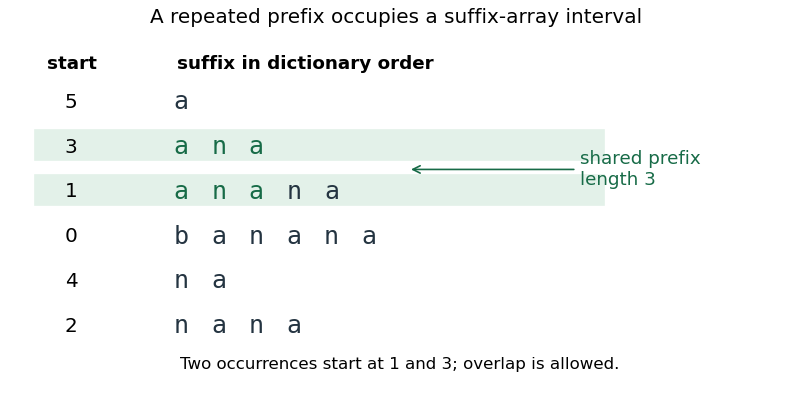

<h1 id="2/c/solution">Solution</h1>

↑ **Parent:** [C](../c.md)

All suffixes beginning with a fixed [string](../../../../../string.md) form an interval in [lexicographic order](../../../../../lexicographic-order.md). To see this, suppose two suffixes start with a [string](../../../../../string.md) $u$, while a [string suffix](../../../../../string-suffix.md) between them fails to start with $u$. At its first differing character it must be either smaller than both or larger than both; if it ends before $u$ does, it is smaller than both. Either possibility contradicts its position between them.

Now take a [longest repeated substring](../../../../../longest-repeated-substring.md) $u$. Its two occurrences are prefixes of two distinct suffixes. Every [string suffix](../../../../../string-suffix.md) between them also begins with $u$, so at least one adjacent pair in that interval has a common [string prefix](../../../../../string-prefix.md) of length at least $|u|$. A greater length would contradict maximality of $u$. Therefore **the maximum common-prefix length over adjacent sorted suffixes equals the longest repeated-substring length**. If the maximum is zero, any adjacent pair still attains it. The argument does not assume nonoverlapping occurrences.

**[Figure 1](#2/c/image-original-suffix-array-example-for-banana-an-interval-of-suffixes-shares-the-repeated-prefix-ana). Original suffix-array example for banana: an interval of suffixes shares the repeated prefix ana**.

## ↑ Ancestors (12)

1. [C](../c.md)
2. [2](../../2.md)
3. [Imperative programming](../../../imperative-programming-split.md)
4. [2021](../../../split.md)
5. [Past exam of the year 1 of the computer science course of the University of Oxford](../../../../split.md)
6. [Year 1 of the computer science course of the University of Oxford](../../../../../year-1-of-the-computer-science-course-of-the-university-of-oxford.md)
7. [Computer science course of the University of Oxford](../../../../../computer-science-course-of-the-university-of-oxford.md)
8. [Undergraduate course of the University of Oxford](../../../../../undergraduate-course-of-the-university-of-oxford.md)
9. [Course of the University of Oxford](../../../../../course-of-the-university-of-oxford.md)
10. [University of Oxford](../../../../../university-of-oxford-split.md)
11. [List of universities](../../../../../list-of-universities.md)
12. [Codex Wiki](../../../../../split.md)
