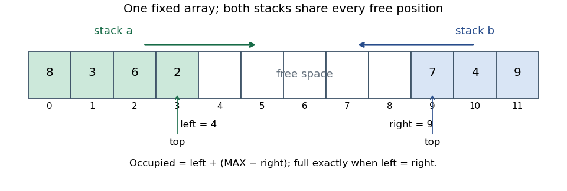

<h1 id="3/b/solution">Solution</h1>

↑ **Parent:** [B](../b.md)

A fixed-capacity implementation needs a bounded contract: **$|A|+|B|\leq\mathrm{MAX}$**, and a push requires strict inequality. Pop [preconditions](../../../../../precondition.md) and all successful-operation [postconditions](../../../../../postcondition.md) remain unchanged. An implementation that rejects full-array pushes cannot satisfy an unbounded specification promising every push; the capacity restriction must be part of the agreed [abstract data type](../../../../../abstract-data-type.md), or its resource-failure behavior must be specified.

Use one [array](../../../../../array-data-structure.md) and two boundaries `left` and `right`. The first [stack](../../../../../stack-data-structure.md) occupies indices below `left` and grows rightwards; the second occupies indices at least `right` and grows leftwards. The [representation invariant](../../../../../representation-invariant.md) is

$$
\mathrm{data.length}=\mathrm{MAX},\qquad 0\leq\mathrm{left}\leq\mathrm{right}\leq\mathrm{MAX}.
$$

The [abstraction function](../../../../../abstraction-function.md) is

$$
A=\operatorname{reverse}(\mathrm{data}[0..\mathrm{left})),\qquad B=\mathrm{data}[\mathrm{right}..\mathrm{MAX}).
$$

Both [lists](../../../../../list-abstract-data-type.md) are top-first. The unoccupied middle interval has length `right - left`; a push is possible exactly when this is positive. Thus **every [array](../../../../../array-data-structure.md) position can be used by either [stack](../../../../../stack-data-structure.md)**, avoiding a rigid half-array allocation.

**[Figure 2](#3/b/image-original-shared-array-double-stack-layout-two-stacks-grow-towards-a-common-free-interval). Original shared-array double-stack layout: two stacks grow towards a common free interval**.

## ↑ Ancestors (12)

1. [B](../b.md)
2. [3](../../3.md)
3. [Imperative programming](../../../imperative-programming-split.md)
4. [2021](../../../split.md)
5. [Past exam of the year 1 of the computer science course of the University of Oxford](../../../../split.md)
6. [Year 1 of the computer science course of the University of Oxford](../../../../../year-1-of-the-computer-science-course-of-the-university-of-oxford.md)
7. [Computer science course of the University of Oxford](../../../../../computer-science-course-of-the-university-of-oxford.md)
8. [Undergraduate course of the University of Oxford](../../../../../undergraduate-course-of-the-university-of-oxford.md)
9. [Course of the University of Oxford](../../../../../course-of-the-university-of-oxford.md)
10. [University of Oxford](../../../../../university-of-oxford-split.md)
11. [List of universities](../../../../../list-of-universities.md)
12. [Codex Wiki](../../../../../split.md)
