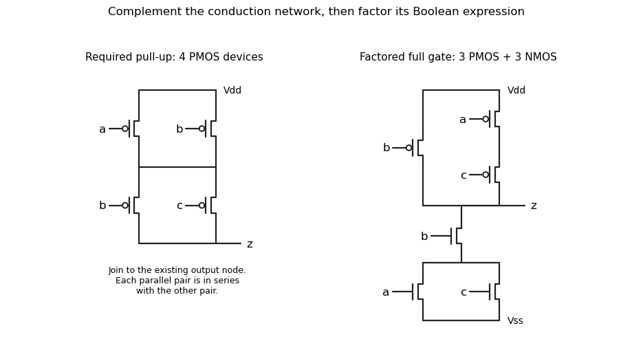

<h1 id="3/a/solution">Solution</h1>

↑ **Parent:** [A](../a.md)

The lower [NMOS transistor](../../../../../nmos-transistor.md) network conducts through either the $a,b$ series branch or the $b,c$ series branch. Complete the upper [PMOS transistor](../../../../../pmos-transistor.md) network by the series-parallel dual: between $V_{dd}$ and an intermediate node put $p(a)$ and $p(b)$ in parallel, and between that node and $z$ put $p(b)$ and $p(c)$ in parallel. There are **four upper transistors**, complementing the four lower transistors. Use the usual body ties to the corresponding supply rails. Each $p(x)$ denotes a [PMOS transistor](../../../../../pmos-transistor.md) controlled by input $x$, so it conducts when $x=0$.

The upper conducting condition is $(\neg a\lor\neg b)\land(\neg b\lor\neg c)$, exactly the complement of $ab\lor bc$. Thus for every stable input the output has a conducting path to exactly one rail in the ideal static [CMOS](../../../../../cmos.md) model. The left panel below specifies the added network independently of the source drawing; join its lower terminal to the existing output.

**[Figure 1](#3/a/image-original-solution-schematics-the-required-four-device-pull-up-network-and-a-factored-six-transistor-realization-of-the-same-gate-bubbles-identify-pmos-gates). Original solution schematics: the required four-device pull-up network, and a factored six-transistor realization of the same gate. Bubbles identify PMOS gates.**

## ↑ Ancestors (12)

1. [A](../a.md)
2. [3](../../3.md)
3. [Digital systems, linear algebra, introduction to formal proof resit](../../../digital-systems-linear-algebra-introduction-to-formal-proof-resit-split.md)
4. [2022](../../../split.md)
5. [Past exam of the year 1 of the computer science course of the University of Oxford](../../../../split.md)
6. [Year 1 of the computer science course of the University of Oxford](../../../../../year-1-of-the-computer-science-course-of-the-university-of-oxford.md)
7. [Computer science course of the University of Oxford](../../../../../computer-science-course-of-the-university-of-oxford.md)
8. [Undergraduate course of the University of Oxford](../../../../../undergraduate-course-of-the-university-of-oxford.md)
9. [Course of the University of Oxford](../../../../../course-of-the-university-of-oxford.md)
10. [University of Oxford](../../../../../university-of-oxford-split.md)
11. [List of universities](../../../../../list-of-universities.md)
12. [Codex Wiki](../../../../../split.md)
