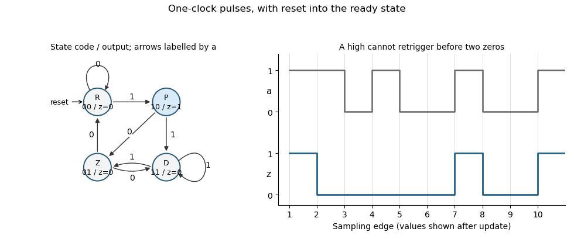

<h1 id="3/d/solution">Solution</h1>

↑ **Parent:** [D](../d.md)

Use a [synchronous sequential circuit](../../../../../synchronous-sequential-circuit.md) with four [Moore machine](../../../../../moore-machine.md) states. $R$ is ready, $P$ is the one-cycle pulse state, $D$ is disabled with no qualifying final zero, and $Z$ is disabled after one sampled zero. Reset into $R$, so an initial sampled high generates a pulse immediately. The complete transition/output table is:

| State | Code $q_1q_0$ | Next if $a=0$ | Next if $a=1$ | $z$ |
| --- | --- | --- | --- | --- |
| $R$ | $00$ | $R$ | $P$ | $0$ |
| $P$ | $10$ | $Z$ | $D$ | $1$ |
| $D$ | $11$ | $Z$ | $D$ | $0$ |
| $Z$ | $01$ | $R$ | $D$ | $0$ |

A particularly small implementation uses two [D flip-flops](../../../../../d-flip-flop.md) with the next-state equations

$$
\boxed{q_1^+=a,\qquad q_0^+=q_1\lor(q_0\land a),\qquad z=q_1\land\neg q_0,\qquad(q_1,q_0)_{\rm reset}=(0,0).}
$$

Both [D flip-flops](../../../../../d-flip-flop.md) share the clock; their outputs feed the displayed [logic gates](../../../../../logic-gate.md). The output depends only on the stored state, not combinationally on the external input. At each edge, evaluate the right-hand sides using the old state and the sampled input, then update both flip-flops together. The resulting $z$ applies throughout the following clock period.

From $R$, a high enters $P$. The next edge always leaves $P$, so the pulse lasts exactly one period. In the disabled states, a high leads to $D$ and erases progress towards rearming. A zero enters $Z$, and a second successive zero enters $R$. A later high can then enter $P$. This proves both the two-zero requirement and the startup exception. For example, sampled inputs $1,1,0,1,0,0,1,0,0,1$ yield outputs $1,0,0,0,0,0,1,0,0,1$.

**[Figure 2](#3/d/image-original-moore-state-design-and-clocked-example-for-the-two-zero-rearming-pulse-detector-state-and-output-are-shown-after-each-sampling-edge). Original Moore-state design and clocked example for the two-zero rearming pulse detector. State and output are shown after each sampling edge.**

The construction is a [synchronous pulse detector with two-zero rearming](../../../../../synchronous-pulse-detector-with-two-zero-rearming.md). Assume $a$ meets setup/hold requirements at the sampling edges. A genuinely asynchronous input would first require synchronization, with its associated latency; that is separate from this sampled-input specification.

## ↑ Ancestors (12)

1. [D](../d.md)
2. [3](../../3.md)
3. [Digital systems, linear algebra, introduction to formal proof resit](../../../digital-systems-linear-algebra-introduction-to-formal-proof-resit-split.md)
4. [2022](../../../split.md)
5. [Past exam of the year 1 of the computer science course of the University of Oxford](../../../../split.md)
6. [Year 1 of the computer science course of the University of Oxford](../../../../../year-1-of-the-computer-science-course-of-the-university-of-oxford.md)
7. [Computer science course of the University of Oxford](../../../../../computer-science-course-of-the-university-of-oxford.md)
8. [Undergraduate course of the University of Oxford](../../../../../undergraduate-course-of-the-university-of-oxford.md)
9. [Course of the University of Oxford](../../../../../course-of-the-university-of-oxford.md)
10. [University of Oxford](../../../../../university-of-oxford-split.md)
11. [List of universities](../../../../../list-of-universities.md)
12. [Codex Wiki](../../../../../split.md)
