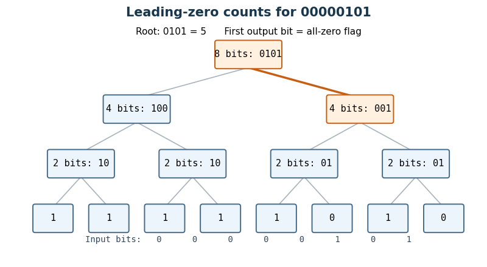
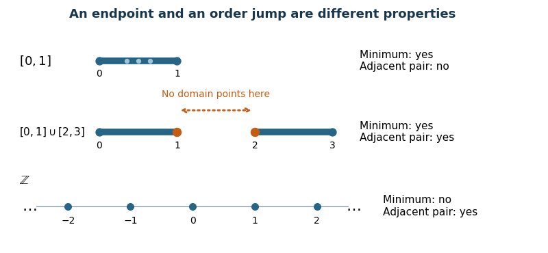

# Digital systems, linear algebra, introduction to formal proof

↑ **Parent:** [2022](../2022.md)

Worked solutions to the paper dated 16 June 2022. The released archive files it under `2021/T/a10101w1.pdf`; the printed date identifies the examination. Source release: [Oxford computer science examination release](https://www.whatdotheyknow.com/request/ba_computer_science_past_papers/response/2577745/attach/2/202402%20183%20CS%20Papers.zip?cookie_passthrough=1). All eight questions are covered, including those beyond the examination's choice requirement.

**Table of contents**

- [1](#1)
  - [a](#1/a)
    - [Solution](#1/a/solution)
  - [b](#1/b)
    - [Solution](#1/b/solution)
  - [c](#1/c)
    - [Solution](#1/c/solution)
  - [d](#1/d)
    - [Solution](#1/d/solution)
- [2](#2)
  - [a](#2/a)
    - [Solution](#2/a/solution)
  - [b](#2/b)
    - [Solution](#2/b/solution)
  - [c](#2/c)
    - [Solution](#2/c/solution)
- [3](#3)
  - [a](#3/a)
    - [Solution](#3/a/solution)
  - [b](#3/b)
    - [Solution](#3/b/solution)
  - [c](#3/c)
    - [Solution](#3/c/solution)
  - [d](#3/d)
    - [Solution](#3/d/solution)
- [4](#4)
  - [a](#4/a)
    - [Solution](#4/a/solution)
  - [b](#4/b)
    - [Solution](#4/b/solution)
  - [c](#4/c)
    - [Solution](#4/c/solution)
  - [d](#4/d)
    - [Solution](#4/d/solution)
  - [e](#4/e)
    - [Solution](#4/e/solution)
  - [f](#4/f)
    - [Solution](#4/f/solution)
  - [g](#4/g)
    - [Solution](#4/g/solution)
- [5](#5)
  - [a](#5/a)
    - [Solution](#5/a/solution)
  - [b](#5/b)
    - [i](#5/b/i)
      - [Solution](#5/b/i/solution)
    - [ii](#5/b/ii)
      - [Solution](#5/b/ii/solution)
    - [iii](#5/b/iii)
      - [Solution](#5/b/iii/solution)
  - [c](#5/c)
    - [Solution](#5/c/solution)
  - [d](#5/d)
    - [i](#5/d/i)
      - [Solution](#5/d/i/solution)
    - [ii](#5/d/ii)
      - [Solution](#5/d/ii/solution)
- [6](#6)
  - [a](#6/a)
    - [Solution](#6/a/solution)
  - [b](#6/b)
    - [i](#6/b/i)
      - [Solution](#6/b/i/solution)
    - [ii](#6/b/ii)
      - [Solution](#6/b/ii/solution)
  - [c](#6/c)
    - [Solution](#6/c/solution)
  - [d](#6/d)
    - [Solution](#6/d/solution)
- [7](#7)
  - [a](#7/a)
    - [Solution](#7/a/solution)
  - [b](#7/b)
    - [Solution](#7/b/solution)
  - [c](#7/c)
    - [Solution](#7/c/solution)
  - [d](#7/d)
    - [Solution](#7/d/solution)
  - [e](#7/e)
    - [Solution](#7/e/solution)
- [8](#8)
  - [a](#8/a)
    - [Solution](#8/a/solution)
  - [b](#8/b)
    - [Solution](#8/b/solution)
  - [c](#8/c)
    - [Solution](#8/c/solution)
  - [d](#8/d)
    - [Solution](#8/d/solution)
  - [e](#8/e)
    - [Solution](#8/e/solution)
  - [f](#8/f)
    - [i](#8/f/i)
      - [Solution](#8/f/i/solution)
    - [ii](#8/f/ii)
      - [Solution](#8/f/ii/solution)
  - [g](#8/g)
    - [Solution](#8/g/solution)

## 1

↑ **Parent:** [Digital systems, linear algebra, introduction to formal proof](digital-systems-linear-algebra-introduction-to-formal-proof.md)

<h3 id="1/a">a</h3>

↑ **Parent:** [1](#1)

<h4 id="1/a/solution">Solution</h4>

↑ **Parent:** [A](#1/a)

For [bits](../../information-theory.md#bit) $a,b$, use two [negation](../../theoretical-computer-science.md#negation) [logic gates](../../theoretical-computer-science.md#logic-gate) and two [AND gates](../../mathematical-logic.md#and-gate):

$$
\boxed{L=(\neg a)\land b,\qquad G=a\land(\neg b).}
$$

The two unequal [bit](../../information-theory.md#bit) pairs activate their respective output; the equal pairs activate neither. In particular, a [digital comparator](../../theoretical-computer-science.md#digital-comparator) never produces $L=G=1$.

<h3 id="1/b">b</h3>

↑ **Parent:** [1](#1)

<h4 id="1/b/solution">Solution</h4>

↑ **Parent:** [B](#1/b)

Split each input into its more and less significant $n$-[bit](../../information-theory.md#bit) halves: $a=2^na_H+a_L$ and $b=2^nb_H+b_L$. Let the two [digital comparators](../../theoretical-computer-science.md#digital-comparator) produce $(L_H,G_H)$ and $(L_L,G_L)$. The more significant halves are equal exactly when $E_H=\neg(L_H\lor G_H)$. The [comparator composition](../../theoretical-computer-science.md#comparator-composition) is therefore

$$
\boxed{L=L_H\lor(E_H\land L_L),\qquad G=G_H\lor(E_H\land G_L).}
$$

Implement $E_H$ with a [logical disjunction](../../mathematical-logic.md#logical-disjunction) followed by a [negation](../../theoretical-computer-science.md#negation), then use two [AND gates](../../mathematical-logic.md#and-gate) and two more [logical disjunction](../../mathematical-logic.md#logical-disjunction) [logic gates](../../theoretical-computer-science.md#logic-gate). If $a_H\ne b_H$, the difference $2^n(a_H-b_H)$ has magnitude at least $2^n$, whereas $|a_L-b_L|\le2^n-1$; hence the more significant comparison decides the result. If $a_H=b_H$, the lower comparison decides it. This proves correctness in every case using a constant number of extra [logic gates](../../theoretical-computer-science.md#logic-gate).

<h3 id="1/c">c</h3>

↑ **Parent:** [1](#1)

<h4 id="1/c/solution">Solution</h4>

↑ **Parent:** [C](#1/c)

Apply [comparator composition](../../theoretical-computer-science.md#comparator-composition) recursively in a [balanced binary tree](../../data-structure.md#balanced-binary-tree), with one-[bit](../../information-theory.md#bit) [digital comparators](../../theoretical-computer-science.md#digital-comparator) at its leaves. For a [power of two](../../integer.md#power-of-two) $n$, the [circuit size](../../theoretical-computer-science.md#circuit-size) and [circuit depth](../../theoretical-computer-science.md#depth-of-a-boolean-circuit) satisfy

$$
S(n)=2S(n/2)+O(1),\qquad D(n)=D(n/2)+O(1).
$$

There are $n$ leaves and $n-1$ internal nodes, so **the [circuit size](../../theoretical-computer-science.md#circuit-size) is $O(n)$ and the combinational delay is $O(\log n)$**. Here each fixed-fan-in [logic gate](../../theoretical-computer-science.md#logic-gate) has bounded delay. For arbitrary $n$, pad both inputs with leading zero [bits](../../information-theory.md#bit) to the next [power of two](../../integer.md#power-of-two), which is less than $2n$; this preserves their [unsigned interpretation](../../arithmetic.md#unsigned-interpretation-of-a-bit-string) and both bounds.

<h3 id="1/d">d</h3>

↑ **Parent:** [1](#1)

<h4 id="1/d/solution">Solution</h4>

↑ **Parent:** [D](#1/d)

Use a [hierarchical leading-zero counter](../../theoretical-computer-science.md#hierarchical-leading-zero-counter). A block of $2^j$ [bits](../../information-theory.md#bit) returns a zero flag $z$ and $j$ low count [bits](../../information-theory.md#bit) $r$: its [count leading zeros](../../theoretical-computer-science.md#count-leading-zeros) result is the concatenation $(z,r)$. Thus $z=1$ means that the block is entirely zero and $r=0$; otherwise $z=0$ and $r$ is its leading-zero count. A one-[bit](../../information-theory.md#bit) block needs just $z=\neg x$ and no low count [bits](../../information-theory.md#bit).

For a block of $n=2^k$ [bits](../../information-theory.md#bit), run two such [Boolean circuits](../../theoretical-computer-science.md#boolean-circuit) on the upper and lower halves in parallel. Write their flags as $z_H,z_L$ and their $k-1$ low count [bits](../../information-theory.md#bit) as $h_i,\ell_i$. Set

$$
\boxed{z=z_H\land z_L,\quad r_{k-1}=z_H\land\neg z_L,\quad r_i=(\neg z_H\land h_i)\lor(z_H\land\ell_i)\quad(0\le i<k-1).}
$$

The last expression is a two-input [multiplexer](../../theoretical-computer-science.md#multiplexer). When the upper half is nonzero, its count is already the answer and $r_{k-1}=0$. When only the upper half is zero, $r_{k-1}=1$ supplies the contribution $n/2$ while the [multiplexers](../../theoretical-computer-science.md#multiplexer) supply the lower half's count. When both halves are zero, the answer is $(1,0,\ldots,0)$, representing $n$. This special encoding avoids an [adder](../../theoretical-computer-science.md#adder) on the critical path.

Each node adds constant [circuit depth](../../theoretical-computer-science.md#depth-of-a-boolean-circuit), even though it uses $O(k)$ [logic gates](../../theoretical-computer-science.md#logic-gate) for its parallel [multiplexers](../../theoretical-computer-science.md#multiplexer). Hence

$$
D(2^k)=D(2^{k-1})+O(1)=O(k),\qquad S(2^k)=2S(2^{k-1})+O(k)=O(2^k).
$$

Indeed the internal-node work is bounded by a constant times $\sum_{j=1}^k(n/2^j)j<2n$, and the $n$ leaves add $O(n)$. **Delay is $O(\log n)$ and size is $O(n)$**, counting fixed-fan-in [logic gates](../../theoretical-computer-science.md#logic-gate) and the usual wire fan-out model.

<a id="1/d/image-leading-zero-summaries-combine-in-parallel-the-input-00000101-gives-the-four-bit-count-0101"></a>


**[Figure 1](#1/d/image-leading-zero-summaries-combine-in-parallel-the-input-00000101-gives-the-four-bit-count-0101). Leading-zero summaries combine in parallel: the input $00000101$ gives the four-bit count $0101$**. Internal nodes display their block length and encoded leading-zero count; leaves display the one-bit count. A count's first [bit](../../information-theory.md#bit) is the shared all-zero flag. The highlighted branch supplies the low count at the root.

## 2

↑ **Parent:** [Digital systems, linear algebra, introduction to formal proof](digital-systems-linear-algebra-introduction-to-formal-proof.md)

<h3 id="2/a">a</h3>

↑ **Parent:** [2](#2)

<h4 id="2/a/solution">Solution</h4>

↑ **Parent:** [A](#2/a)

Use the [AAPCS32](../../programming-language.md#aapcs32) convention: `r0` holds the input address, `r1` the length, and `r0` receives the result. The following [Thumb instruction set](../../computer-science.md#thumb-instruction-set) [assembly language](../../programming-language.md#assembly-language) uses only scratch [processor registers](../../computer-science.md#processor-register), so no [callee-saved registers](../../programming-language.md#callee-saved-register) need saving. Assume the [array](../../data-structure.md#array-data-structure) is valid, halfword-aligned, and has nonnegative length; for the mathematical [sum](../../arithmetic.md#sum) assume it fits a signed 32-[bit](../../information-theory.md#bit) [two's complement](../../programming-language.md#two-s-complement) [integer](../../integer.md).

```
.syntax unified
.thumb
.thumb_func
sum16:
    movs r2, #0             @ accumulated sum
    cmp  r1, #0
    ble  .Ldone             @ empty array; also returns 0 if n < 0
.Lloop:
    movs r3, #0             @ Thumb signed load needs a register offset
    ldrsh r3, [r0, r3]      @ signed halfword at a; offset read before r3 changes
    adds r2, r2, r3         @ include this signed value
    adds r0, r0, #2         @ advance by one short, not one byte
    subs r1, r1, #1         @ one fewer element remains
    bne  .Lloop
.Ldone:
    movs r0, r2             @ result register
    bx   lr                 @ leaf routine: lr was not overwritten
```

After $j$ iterations, the [loop invariant](../../algorithm.md#loop-invariant) is that `r2` contains the first $j$ elements' [sum](../../arithmetic.md#sum), `r0` points to element $j$, and `r1` is $n-j$. The [sign extension](../../programming-language.md#sign-extension) in `ldrsh` supplies the correct signed addend. One iteration preserves this [loop invariant](../../algorithm.md#loop-invariant), and the decreasing remaining length proves [algorithm termination](../../algorithm.md#algorithm-termination). For the seven-element calls, the [sum](../../arithmetic.md#sum) lies between $-229376$ and $229369$, so it fits. For longer [arrays](../../data-structure.md#array-data-structure) that overflow, these instructions compute the [sum](../../arithmetic.md#sum) modulo $2^{32}$; that is not a claim about defined signed [C programming language](../../programming-language.md#c-programming-language) overflow behavior. The operand forms are those of the paper's reference sheet.[Load: signed halfword; Add/Subtract; Branch](../../computer-science-bibliography.md#thumb-16-bit-instruction-set-quick-reference-by-arm)

<h3 id="2/b">b</h3>

↑ **Parent:** [2](#2)

<h4 id="2/b/solution">Solution</h4>

↑ **Parent:** [B](#2/b)

Let the stored [bits](../../information-theory.md#bit) be $b_{15},\ldots,b_0$ and let $s=b_{15}$. The [sign extension](../../programming-language.md#sign-extension) performed by `ldrsh` keeps output [bit](../../information-theory.md#bit) $i$ equal to $b_i$ for $0\le i\le15$, and sets every output [bit](../../information-theory.md#bit) $16\le i\le31$ to $s$. Thus a nonnegative halfword gets sixteen leading zero [bits](../../information-theory.md#bit), while a negative halfword gets sixteen leading one [bits](../../information-theory.md#bit).

Its signed 32-[bit](../../information-theory.md#bit) [two's complement](../../programming-language.md#two-s-complement) value is

$$
-s2^{31}+s\sum_{i=16}^{30}2^i+\sum_{i=0}^{15}b_i2^i
=-s2^{16}+s2^{15}+\sum_{i=0}^{14}b_i2^i
=\boxed{-s2^{15}+\sum_{i=0}^{14}b_i2^i}.
$$

The last expression is exactly the original signed 16-[bit](../../information-theory.md#bit) value. The equality uses the finite [geometric series](../../sequence-and-series.md#geometric-series) $\sum_{i=16}^{30}2^i=2^{31}-2^{16}$. In particular, simply inserting zero [bits](../../information-theory.md#bit) would be wrong for a negative halfword: its [unsigned interpretation](../../arithmetic.md#unsigned-interpretation-of-a-bit-string) differs from its signed value by $2^{16}$.

<h3 id="2/c">c</h3>

↑ **Parent:** [2](#2)

<h4 id="2/c/solution">Solution</h4>

↑ **Parent:** [C](#2/c)

Keep `total` in the [callee-saved register](../../programming-language.md#callee-saved-register) `r4`, and the first returned [sum](../../arithmetic.md#sum) in the [callee-saved register](../../programming-language.md#callee-saved-register) `r5`. Suppose the surrounding function has made an aligned [stack frame](../../data-structure.md#stack-frame) with the local seven-halfword [array](../../data-structure.md#array-data-structure) at the current `sp`, occupying fourteen bytes in a sixteen-byte slot. One possible frame setup is `push {r4,r5,r6,lr}` followed by `sub sp,sp,#16`; the earlier code initializes `total`, `regular`, and `special` before this fragment.

```
    ldr  r0, =regular       @ assembler literal load of the global array address
    movs r1, #7
    bl   sum16
    movs r5, r0             @ first sum must survive the next call

    add  r0, sp, #0         @ current frame's local special array
    movs r1, #7
    bl   sum16
    muls r0, r5, r0         @ second sum times first sum
    adds r4, r4, r0         @ update total
```

The [AAPCS32](../../programming-language.md#aapcs32) permits each call to overwrite `r0`–`r3`, `r12`, and condition flags, but requires preservation of `r4`–`r8`, `r10`, `r11`, and `sp`. Thus both `r4` and `r5` remain valid even if `sum16` is replaced by another conforming implementation. `bl` changes the link [processor register](../../computer-science.md#processor-register) `lr`, so the enclosing function saves its own return address in its prologue. Its epilogue can use `add sp,sp,#16` and `pop {r4,r5,r6,pc}`. The frame uses thirty-two bytes in total, preserving the required eight-byte [stack pointer](../../computer-science.md#stack-pointer) alignment at both calls.[Sections 6.1.1, 6.2.1.2 and 6.4: scratch/preserved registers, public-interface alignment and word return](../../computer-science-bibliography.md#procedure-call-standard-for-the-arm-architecture-by-arm-limited)

The two calls may be evaluated in this order. Assume the product and final addition fit the signed 32-[bit](../../information-theory.md#bit) result expected by the source program; unlike each individual seven-element [sum](../../arithmetic.md#sum), their product need not fit. The [assembly language](../../programming-language.md#assembly-language) operations retain their low 32 [bits](../../information-theory.md#bit) if this assumption fails, whereas signed [integer overflow](../../programming-language.md#integer-overflow) in the [C programming language](../../programming-language.md#c-programming-language) has different semantics.

## 3

↑ **Parent:** [Digital systems, linear algebra, introduction to formal proof](digital-systems-linear-algebra-introduction-to-formal-proof.md)

<h3 id="3/a">a</h3>

↑ **Parent:** [3](#3)

<h4 id="3/a/solution">Solution</h4>

↑ **Parent:** [A](#3/a)

Maintain the latest five [temperature](../../temperature.md) readings in a [circular buffer](../../data-structure.md#circular-buffer), together with their running [sum](../../arithmetic.md#sum). The following [C programming language](../../programming-language.md#c-programming-language) code spells out the [message passing](../../operating-system.md#message-passing) interface rather than assuming a particular library: `send(dst,&m)` is a blocking [synchronous message passing](../../operating-system.md#synchronous-message-passing) send; `receive(src,&m)` receives from the specified sender or `ANY` and returns the sender's identity; `sendrec(dst,&m)` atomically sends the request and waits for that sender's reply in the same message object. Successful, reliable operations are assumed. Message contents are copied by the interface.

```
enum { ANY = -1, TIMER = 1, TEMP = 2 };
enum { PULSE, PING, REQUEST, REPLY };
typedef struct {
    int type;
    int period_ms;
    double value;
} Message;

extern void send(int dst, const Message *m);
extern int receive(int src, Message *m);
extern void sendrec(int dst, Message *m);

void smooth(void) {
    double history[5] = {0};
    double sum = 0;
    int count = 0, next = 0;
    Message m = { .type = PULSE, .period_ms = 1000 };
    send(TIMER, &m);                 /* subscribe once */

    for (;;) {
        int sender = receive(count < 5 ? TIMER : ANY, &m);
        if (sender == TIMER && m.type == PING) {
            Message t = { .type = REQUEST };
            sendrec(TEMP, &t);       /* matching REPLY contains t.value */
            if (count == 5)
                sum -= history[next];
            else
                ++count;
            history[next] = t.value;
            sum += t.value;
            next = (next + 1) % 5;
        } else if (count == 5 && m.type == REQUEST) {
            Message answer = { .type = REPLY, .value = sum / 5.0 };
            send(sender, &answer);
        }
    }
}
```

Before the fifth reading, selective reception from `TIMER` prevents premature client requests from being accepted. Such clients wait at their synchronous sends; they are not given a partial [arithmetic mean](../../arithmetic.md#arithmetic-mean). Thereafter the [operating-system process](../../operating-system.md#process-computing) receives both timer messages and client requests. Each accepted `PING` initiates one measurement; each accepted client request returns the [arithmetic mean](../../arithmetic.md#arithmetic-mean) of the five most recently completed measurements, without initiating another measurement or changing the [circular buffer](../../data-structure.md#circular-buffer).

The [loop invariant](../../algorithm.md#loop-invariant) is that `count` is the number of valid readings, capped at five, `sum` is their [sum](../../arithmetic.md#sum), and `next` is the next unused slot during startup or the oldest slot afterwards. Removing the overwritten reading and adding the new one preserves this [loop invariant](../../algorithm.md#loop-invariant). Each update and reply uses $O(1)$ [time complexity](../../theoretical-computer-science.md#time-complexity) and $O(1)$ storage, since the window length is fixed. Under timely sensor replies, timer delivery and [process scheduling](../../operating-system.md#process-scheduling), measurements are initiated once per second. The next parts explain failures of these timing assumptions; the code does not promise one-second sampling when the [sensor](../../engineering.md#sensor) itself cannot sustain it.

<h3 id="3/b">b</h3>

↑ **Parent:** [3](#3)

<h4 id="3/b/solution">Solution</h4>

↑ **Parent:** [B](#3/b)

With [synchronous message passing](../../operating-system.md#synchronous-message-passing), the smoothing [operating-system process](../../operating-system.md#process-computing) can still be waiting for `TEMP` when its next `PING` is due. If the timer service sends to subscribers serially, it blocks on this unready recipient and cannot deliver the other subscribers' ticks: **one slow sensor can delay every timer client through [head-of-line blocking](../../operating-system.md#head-of-line-blocking)**. Once it resumes, implementations may deliver late ticks, drift from their schedule, or accumulate overdue work.

The consequence depends on the delivery model. With buffered sends the timer need not block immediately, but its [queue](../../queueing-theory.md#queue-queueing-theory) can grow or overflow; the smoothing [operating-system process](../../operating-system.md#process-computing) still cannot process readings at a sustained rate faster than the [sensor](../../engineering.md#sensor). A nonblocking notification mechanism or separate timer-delivery workers can isolate other subscribers, while coalescing missed ticks prevents an unlimited backlog. These changes do not make an over-slow [sensor](../../engineering.md#sensor) meet the original sampling rate.

<h3 id="3/c">c</h3>

↑ **Parent:** [3](#3)

<h4 id="3/c/solution">Solution</h4>

↑ **Parent:** [C](#3/c)

With a synchronous reply, `send(client,&answer)` blocks until the client receives. An indefinitely unready client therefore stalls the smoothing [operating-system process](../../operating-system.md#process-computing), which may in turn stall the timer service and its other clients as in the preceding part. If the client is merely delayed, this is blocking and delayed service; a [deadlock](../../operating-system.md#deadlock) requires a circular wait or a client that will never receive.

**Requiring correctly used [synchronous send-and-receive](../../operating-system.md#synchronous-send-and-receive) helps.** A client calling `sendrec(SMOOTH,&m)` is committed to waiting for the matching reply as soon as its request has been accepted. This closes the scheduling window between a separate send and receive and prevents unrelated client computation from postponing that receive. It does not by itself fix slow measurements, arbitrary failures, circular dependencies between other services, or lack of CPU scheduling. With buffered replies the initial effect may instead be queue growth, depending on the [message passing](../../operating-system.md#message-passing) contract.

<h3 id="3/d">d</h3>

↑ **Parent:** [3](#3)

<h4 id="3/d/solution">Solution</h4>

↑ **Parent:** [D](#3/d)

In a cooperative scheduler, a permanently runnable background [operating-system process](../../operating-system.md#process-computing) that never yields can monopolize the [CPU](../../computer-science.md#central-processing-unit). The timer service, smoothing [operating-system process](../../operating-system.md#process-computing), and display may then fail to run even when their messages are ready. Correct [message passing](../../operating-system.md#message-passing) alone does not supply [process scheduling](../../operating-system.md#process-scheduling).

Use **timer-driven [scheduling preemption](../../operating-system.md#scheduling-preemption)**, so an [interrupt](../../operating-system.md#interrupt) can force a [context switch](../../operating-system.md#context-switch) without cooperation. To give the measurement and display work bounded response despite background computation, use [priority scheduling](../../operating-system.md#priority-scheduling) with the background [operating-system process](../../operating-system.md#process-computing) below the responsive services, or an explicit reservation policy. [Round-robin scheduling](../../operating-system.md#round-robin-scheduling) gives CPU access among a fixed finite runnable set, but meeting a particular deadline additionally requires bounded service execution and sufficient CPU capacity.

## 4

↑ **Parent:** [Digital systems, linear algebra, introduction to formal proof](digital-systems-linear-algebra-introduction-to-formal-proof.md)

<h3 id="4/a">a</h3>

↑ **Parent:** [4](#4)

<h4 id="4/a/solution">Solution</h4>

↑ **Parent:** [A](#4/a)

Write $\widehat A=\operatorname{diag}(\lambda_1,\ldots,\lambda_n)$ and $v_i=P^{-1}e_i$, where $e_i$ are the [standard basis](../../vector-space.md#standard-basis) [vectors](../../vector-space.md#vector). Since $AP^{-1}=P^{-1}\widehat A$,

$$
Av_i=P^{-1}\widehat Ae_i=\lambda_iv_i.
$$

Thus **the columns of $P^{-1}$ form an [eigenbasis](../../linear-operator-theory.md#eigenbasis)**, and the requested [ordered basis](../../vector-space.md#ordered-basis) is $D=(P^{-1}e_1,\ldots,P^{-1}e_n)$. Its [basis matrix](../../vector-space.md#basis-matrix) is $P^{-1}$, giving $[t]_D=PAP^{-1}=\widehat A$. More completely, for each distinct [eigenvalue](../../linear-operator-theory.md#eigenvalue) $\lambda$, its [eigenspace](../../linear-operator-theory.md#eigenspace) is

$$
E_\lambda(A)=\operatorname{span}\{P^{-1}e_i:\lambda_i=\lambda\}.
$$

All nonzero [vectors](../../vector-space.md#vector) in these [eigenspaces](../../linear-operator-theory.md#eigenspace) are [eigenvectors](../../linear-operator-theory.md#eigenvector); when an [eigenvalue](../../linear-operator-theory.md#eigenvalue) repeats, they need not be individual columns of $P^{-1}$.

<h3 id="4/b">b</h3>

↑ **Parent:** [4](#4)

<h4 id="4/b/solution">Solution</h4>

↑ **Parent:** [B](#4/b)

Let $PAP^{-1}=\operatorname{diag}(\alpha_1,\ldots,\alpha_n)$ and $PBP^{-1}=\operatorname{diag}(\beta_1,\ldots,\beta_n)$. Then

$$
P(A+B)P^{-1}=\operatorname{diag}(\alpha_1+\beta_1,\ldots,\alpha_n+\beta_n).
$$

By [matrix similarity](../../linear-algebra.md#matrix-similarity), **every [eigenvalue](../../linear-operator-theory.md#eigenvalue) of $A+B$ is $\alpha_i+\beta_i$ for some $i$**. These are corresponding [eigenvalues](../../linear-operator-theory.md#eigenvalue) on the common [eigenbasis](../../linear-operator-theory.md#eigenbasis), rather than every possible pairwise sum. This is [eigenvalue addition in a common eigenbasis](../../mathematics.md#eigenvalue-addition-in-a-common-eigenbasis).

<h3 id="4/c">c</h3>

↑ **Parent:** [4](#4)

<h4 id="4/c/solution">Solution</h4>

↑ **Parent:** [C](#4/c)

With the two [diagonal matrices](../../linear-algebra.md#diagonal-matrix) from the preceding part, write $D_A=PAP^{-1}$ and $D_B=PBP^{-1}$. Their diagonal products agree entry by entry, so $D_AD_B=D_BD_A$. Therefore

$$
AB=P^{-1}D_AD_BP=P^{-1}D_BD_AP=BA.
$$

Hence [simultaneous diagonalization](../../mathematics.md#simultaneous-diagonalization) implies that $A,B$ are **[commuting operators](../../vector-space.md#commuting-operators)**.

<h3 id="4/d">d</h3>

↑ **Parent:** [4](#4)

<h4 id="4/d/solution">Solution</h4>

↑ **Parent:** [D](#4/d)

Using $BA=AB$ and [linearity](../../vector-space.md#linearity),

$$
\boxed{B(Av)=A(Bv)=A(\lambda v)=\lambda Av.}
$$

This establishes that [commuting maps preserve eigenspaces](../../vector-space.md#commuting-maps-preserve-eigenspaces). The [vector](../../vector-space.md#vector) $Av$ can be zero, so this step alone does not assert that $Av$ is an [eigenvector](../../linear-operator-theory.md#eigenvector).

<h3 id="4/e">e</h3>

↑ **Parent:** [4](#4)

<h4 id="4/e/solution">Solution</h4>

↑ **Parent:** [E](#4/e)

Work over the [field](../../algebra.md#field) containing the stated $n$ distinct [eigenvalues](../../linear-operator-theory.md#eigenvalue) of $B$; in a real formulation these must be real to obtain real [eigenvectors](../../linear-operator-theory.md#eigenvector). Choose one [eigenvector](../../linear-operator-theory.md#eigenvector) for each distinct [eigenvalue](../../linear-operator-theory.md#eigenvalue). By [independence of eigenvectors for distinct eigenvalues](../../linear-operator-theory.md#independence-of-eigenvectors-for-distinct-eigenvalues), these $n$ [vectors](../../vector-space.md#vector) are a [basis](../../vector-space.md#basis). Consequently each [eigenspace](../../linear-operator-theory.md#eigenspace) $E_\lambda(B)$ has [dimension](../../vector-space.md#dimension-vector-space) one: in an expansion in this [eigenbasis](../../linear-operator-theory.md#eigenbasis), $Bw=\lambda w$ forces every coefficient with a different [eigenvalue](../../linear-operator-theory.md#eigenvalue) to vanish.

Now let $v\ne0$ be any [eigenvector](../../linear-operator-theory.md#eigenvector) of $B$. By part (d), $Av$ belongs to its one-dimensional [eigenspace](../../linear-operator-theory.md#eigenspace), so $Av=\mu v$ for some [scalar](../../vector-space.md#scalar) $\mu$. This proves that **$v$ is an [eigenvector](../../linear-operator-theory.md#eigenvector) of $A$**, including the case $Av=0$, where $\mu=0$. This is the crucial one-dimensional step in [simple spectrum gives simultaneous diagonalization](../../mathematics.md#simple-spectrum-gives-simultaneous-diagonalization).

<h3 id="4/f">f</h3>

↑ **Parent:** [4](#4)

<h4 id="4/f/solution">Solution</h4>

↑ **Parent:** [F](#4/f)

The $n$ independent [eigenvectors](../../linear-operator-theory.md#eigenvector) $v_1,\ldots,v_n$ of $B$ from part (e) are also [eigenvectors](../../linear-operator-theory.md#eigenvector) of $A$. Put $S=(v_1\ \cdots\ v_n)$ and $P=S^{-1}$. Then

$$
\boxed{PAP^{-1}=\operatorname{diag}(\mu_1,\ldots,\mu_n),\qquad PBP^{-1}=\operatorname{diag}(\lambda_1,\ldots,\lambda_n).}
$$

This supplies the required [simultaneous diagonalization](../../mathematics.md#simultaneous-diagonalization) over the same [field](../../algebra.md#field) as in part (e).

<h3 id="4/g">g</h3>

↑ **Parent:** [4](#4)

<h4 id="4/g/solution">Solution</h4>

↑ **Parent:** [G](#4/g)

For $n=2$, take

$$
A=\begin{pmatrix}0&1\\0&0\end{pmatrix},\qquad B=I_2.
$$

They are [commuting operators](../../vector-space.md#commuting-operators) because every [matrix](../../vector-space.md#matrix) commutes with the [identity matrix](../../vector-space.md#identity-matrix). However $A$ has only the [eigenvalue](../../linear-operator-theory.md#eigenvalue) zero, and $\ker A=\operatorname{span}\{(1,0)^T\}$ has [dimension](../../vector-space.md#dimension-vector-space) one. It has no [eigenbasis](../../linear-operator-theory.md#eigenbasis), so it cannot appear in any [simultaneous diagonalization](../../mathematics.md#simultaneous-diagonalization). Equivalently, a [diagonal matrix](../../linear-algebra.md#diagonal-matrix) similar to this nonzero [nilpotent matrix](../../linear-operator-theory.md#nilpotent-matrix) would have to be zero, an impossibility. For any prescribed $n\ge2$, use $A=E_{12}$ and $B=I_n$; its zero [eigenspace](../../linear-operator-theory.md#eigenspace) has [dimension](../../vector-space.md#dimension-vector-space) $n-1$. For $n=1$ no such example exists.

## 5

↑ **Parent:** [Digital systems, linear algebra, introduction to formal proof](digital-systems-linear-algebra-introduction-to-formal-proof.md)

<h3 id="5/a">a</h3>

↑ **Parent:** [5](#5)

<h4 id="5/a/solution">Solution</h4>

↑ **Parent:** [A](#5/a)

The zero [matrix](../../vector-space.md#matrix) has the required pattern, and [matrix addition](../../vector-space.md#matrix-addition) and [scalar multiplication](../../vector-space.md#scalar-multiplication) preserve every prescribed zero entry. This proves the [vector subspace](../../vector-space.md#vector-subspace) condition. A [basis](../../vector-space.md#basis) consists of the [matrix units](../../vector-space.md#matrix-unit)

$$
\{E_{ii}:1\le i\le n\}\ \cup\ \{E_{i,i+1},E_{i+1,i}:1\le i<n\}.
$$

They independently select every permitted entry of a [tridiagonal matrix](../../vector-space.md#tridiagonal-matrix), so **the [dimension](../../vector-space.md#dimension-vector-space) is $n+2(n-1)=3n-2$** for $n\ge1$.

<h3 id="5/b">b</h3>

↑ **Parent:** [5](#5)

<h4 id="5/b/i">i</h4>

↑ **Parent:** [B](#5/b)

<h5 id="5/b/i/solution">Solution</h5>

↑ **Parent:** [I](#5/b/i)

For $D=\operatorname{diag}(d_1,d_2,d_3)$, the upper entry of $D^{-1}AD$ in positions $i,i+1$ is $b_id_{i+1}/d_i$, and the corresponding lower entry is $c_id_i/d_{i+1}$. They are equal when $(d_{i+1}/d_i)^2=c_i/b_i$. All coefficients used here are positive, so choose

$$
\boxed{D=\operatorname{diag}\left(1,\sqrt{c_1/b_1},\sqrt{c_1c_2/(b_1b_2)}\right).}
$$

Direct [matrix multiplication](../../vector-space.md#matrix-multiplication) gives the [symmetric matrix](../../linear-algebra.md#symmetric-matrix)

$$
D^{-1}AD=\begin{pmatrix}
a_1&\sqrt{b_1c_1}&0\\
\sqrt{b_1c_1}&a_2&\sqrt{b_2c_2}\\
0&\sqrt{b_2c_2}&a_3
\end{pmatrix}.
$$

Its pattern remains [tridiagonal](../../vector-space.md#tridiagonal-matrix). This is [positive diagonal symmetrization of a tridiagonal matrix](../../linear-algebra.md#positive-diagonal-symmetrization-of-a-tridiagonal-matrix).

<h4 id="5/b/ii">ii</h4>

↑ **Parent:** [B](#5/b)

<h5 id="5/b/ii/solution">Solution</h5>

↑ **Parent:** [Ii](#5/b/ii)

For the analogous positive off-diagonal entries in size $n$, take

$$
\boxed{d_1=1,\qquad d_i=\sqrt{\prod_{j=1}^{i-1}\frac{c_j}{b_j}}\quad(2\le i\le n),\qquad D=\operatorname{diag}(d_1,\ldots,d_n).}
$$

The same entrywise computation gives $(D^{-1}AD)_{ii}=a_i$ and $(D^{-1}AD)_{i,i+1}=(D^{-1}AD)_{i+1,i}=\sqrt{b_ic_i}$, with every other entry zero. Thus the result is a [symmetric matrix](../../linear-algebra.md#symmetric-matrix) with a [tridiagonal](../../vector-space.md#tridiagonal-matrix) pattern. Positivity of the diagonal entries $a_i$ is not needed for this [positive diagonal symmetrization of a tridiagonal matrix](../../linear-algebra.md#positive-diagonal-symmetrization-of-a-tridiagonal-matrix); positivity of $b_i,c_i$ ensures the displayed positive, invertible $D$. In particular, the assertion is not an arbitrary-real-coefficient symmetrization claim when the off-diagonal signs differ.

<h4 id="5/b/iii">iii</h4>

↑ **Parent:** [B](#5/b)

<h5 id="5/b/iii/solution">Solution</h5>

↑ **Parent:** [Iii](#5/b/iii)

They are [similar matrices](../../linear-algebra.md#matrix-similarity), so **their [eigenvalues](../../linear-operator-theory.md#eigenvalue), with [algebraic multiplicities](../../linear-operator-theory.md#algebraic-multiplicity), are identical**. Explicitly,

$$
\det(tI-D^{-1}AD)=\det\bigl(D^{-1}(tI-A)D\bigr)=\det(tI-A).
$$

Moreover their [eigenvectors](../../linear-operator-theory.md#eigenvector) correspond by $Av=\lambda v\Longleftrightarrow(D^{-1}AD)(D^{-1}v)=\lambda D^{-1}v$. Since the transformed [matrix](../../vector-space.md#matrix) is a real [symmetric matrix](../../linear-algebra.md#symmetric-matrix), the [spectral theorem for real symmetric matrices](../../linear-algebra.md#spectral-theorem-for-real-symmetric-matrices) also shows that $A$ has real [eigenvalues](../../linear-operator-theory.md#eigenvalue) and is a [diagonalizable matrix](../../linear-operator-theory.md#diagonalizable-matrix).

<h3 id="5/c">c</h3>

↑ **Parent:** [5](#5)

<h4 id="5/c/solution">Solution</h4>

↑ **Parent:** [C](#5/c)

Use banded [Gaussian elimination](../../numerical-linear-algebra.md#gaussian-elimination) followed by [back substitution](../../linear-algebra.md#back-substitution). To distinguish the right-hand side from the upper-diagonal coefficients $b_i$, write it as $r_i$. If the modified [pivot elements](../../numerical-linear-algebra.md#pivot-element) are nonzero, the [tridiagonal elimination recurrences](../../numerical-analysis.md#tridiagonal-elimination-recurrences) are

$$
p_1=a_1,\quad q_1=r_1,\qquad m_i=\frac{c_{i-1}}{p_{i-1}},\quad p_i=a_i-m_ib_{i-1},\quad q_i=r_i-m_iq_{i-1}\quad(2\le i\le n).
$$

They eliminate just the one entry below each [pivot element](../../numerical-linear-algebra.md#pivot-element). Solve the resulting upper [bidiagonal matrix](../../vector-space.md#bidiagonal-matrix) system by

$$
x_n=q_n/p_n,\qquad x_i=(q_i-b_ix_{i+1})/p_i\quad(i=n-1,\ldots,1).
$$

There is a bounded number of [arithmetic operations](../../numerical-analysis.md#arithmetic-operation) per row in each sweep, giving **$O(n)$ [arithmetic operations](../../numerical-analysis.md#arithmetic-operation) and $O(n)$ storage**. The unpivoted recurrences cost $8n-7$ [arithmetic operations](../../numerical-analysis.md#arithmetic-operation) under the usual scalar-operation count.

For a general [tridiagonal matrix](../../vector-space.md#tridiagonal-matrix), nonsingularity alone does not guarantee these [pivot elements](../../numerical-linear-algebra.md#pivot-element). If a zero or unsafe [pivot element](../../numerical-linear-algebra.md#pivot-element) occurs, use [partial pivoting](../../numerical-linear-algebra.md#columnwise-partial-pivoting) between the current row and the next row. These are the only possible nonzero candidates in the current column; adjacent row swaps introduce at most a second upper diagonal. Tracking that [fill-in](../../numerical-linear-algebra.md#fill-in) keeps both [Gaussian elimination](../../numerical-linear-algebra.md#gaussian-elimination) and [back substitution](../../linear-algebra.md#back-substitution) at $O(n)$ [arithmetic operations](../../numerical-analysis.md#arithmetic-operation). For example, $\begin{pmatrix}0&1\\1&0\end{pmatrix}$ is invertible but requires a row swap. If the input is singular, report a zero final [pivot element](../../numerical-linear-algebra.md#pivot-element); a unique solution cannot be promised, and compatibility or free-variable analysis is a separate issue. No nonsingularity or safe-pivot assumption is silently inferred from the word [tridiagonal](../../vector-space.md#tridiagonal-matrix).

<h3 id="5/d">d</h3>

↑ **Parent:** [5](#5)

<h4 id="5/d/i">i</h4>

↑ **Parent:** [D](#5/d)

<h5 id="5/d/i/solution">Solution</h5>

↑ **Parent:** [I](#5/d/i)

Let $f_j$ be the [determinant](../../multilinear-algebra.md#determinant) of the leading $j\times j$ [principal submatrix](../../vector-space.md#principal-submatrix). Expansion along the last row gives an $a_jf_{j-1}$ term and a $c_{j-1}$ term with negative [cofactor](../../linear-algebra.md#cofactor) sign. In the latter minor, the final column has only $b_{j-1}$ nonzero, and deleting that row and column leaves the leading $(j-2)\times(j-2)$ [principal submatrix](../../vector-space.md#principal-submatrix). Thus the [tridiagonal determinant recurrence](../../multilinear-algebra.md#tridiagonal-determinant-recurrence) is

$$
\boxed{f_0=1,\qquad f_1=a_1,\qquad f_j=a_jf_{j-1}-c_{j-1}b_{j-1}f_{j-2}\quad(j\ge2).}
$$

Here $f_0=1$ is the empty [determinant](../../multilinear-algebra.md#determinant) convention, needed to include $f_2=a_1a_2-b_1c_1$. The derivation uses [cofactor expansion](../../multilinear-algebra.md#laplace-expansion), so the [recurrence relation](../../sequence-and-series.md#recurrence-relation) remains valid when coefficients or intermediate [determinants](../../multilinear-algebra.md#determinant) vanish; it never divides by a [pivot element](../../numerical-linear-algebra.md#pivot-element).

<h4 id="5/d/ii">ii</h4>

↑ **Parent:** [D](#5/d)

<h5 id="5/d/ii/solution">Solution</h5>

↑ **Parent:** [Ii](#5/d/ii)

Evaluate the [recurrence relation](../../sequence-and-series.md#recurrence-relation) successively, retaining only the preceding two values. Each of the $n-1$ updates uses three [multiplications](../../arithmetic.md#multiplication) and one [subtraction](../../arithmetic.md#subtraction). Hence **$4(n-1)=O(n)$ [arithmetic operations](../../numerical-analysis.md#arithmetic-operation) and $O(1)$ auxiliary storage** suffice, excluding the stored input. Naively branching into two recursive calls would repeat work; the sequential computation is essential. This is an arithmetic-operation bound, not a bit-complexity bound for arbitrarily large exact [integers](../../integer.md).

## 6

↑ **Parent:** [Digital systems, linear algebra, introduction to formal proof](digital-systems-linear-algebra-introduction-to-formal-proof.md)

<h3 id="6/a">a</h3>

↑ **Parent:** [6](#6)

<h4 id="6/a/solution">Solution</h4>

↑ **Parent:** [A](#6/a)

Writing the given [bases](../../vector-space.md#basis) as $(u_1,\ldots,u_p)$ and $(v_1,\ldots,v_q)$, a [basis](../../vector-space.md#basis) of the [Cartesian product](../../set-theory.md#cartesian-product) with its componentwise [vector space](../../vector-space.md) operations is

$$
\boxed{\bigl((u_1,0),\ldots,(u_p,0),(0,v_1),\ldots,(0,v_q)\bigr).}
$$

This is the [direct sum basis](../../vector-space.md#direct-sum-basis). Therefore **$\dim(W_1\times W_2)=p+q=\dim W_1+\dim W_2$**. The construction includes zero-dimensional factors, whose corresponding portion of the [basis](../../vector-space.md#basis) is empty.

<h3 id="6/b">b</h3>

↑ **Parent:** [6](#6)

<h4 id="6/b/i">i</h4>

↑ **Parent:** [B](#6/b)

<h5 id="6/b/i/solution">Solution</h5>

↑ **Parent:** [I](#6/b/i)

The [intersection of vector subspaces](../../vector-space.md#intersection-of-vector-subspaces) $W_1\cap W_2$ contains zero, so $(0,0)\in U$. If $(u,-u),(v,-v)\in U$ and $a,b$ are [scalars](../../vector-space.md#scalar), then

$$
a(u,-u)+b(v,-v)=(au+bv,-(au+bv))\in U,
$$

because $au+bv\in W_1\cap W_2$ by the [vector subspace](../../vector-space.md#vector-subspace) conditions. These pairs belong to $W_1\times W_2$, since both $u$ and $-u$ belong to the required factors. Thus **$U$ is a [vector subspace](../../vector-space.md#vector-subspace) of $W_1\times W_2$**.

<h4 id="6/b/ii">ii</h4>

↑ **Parent:** [B](#6/b)

<h5 id="6/b/ii/solution">Solution</h5>

↑ **Parent:** [Ii](#6/b/ii)

Define $f:W_1\cap W_2\to U$ by $f(u)=(u,-u)$. It is well-defined by the definition of $U$, and

$$
f(au+bv)=(au+bv,-au-bv)=af(u)+bf(v).
$$

Thus $f$ is a [linear map](../../vector-space.md#linear-map). If $f(u)=f(v)$, comparing first components gives $u=v$, proving [injectivity](../../algebra.md#injective-function). Every element of $U$ has the form $(u,-u)=f(u)$, proving [surjectivity](../../algebra.md#surjective-function). Hence **$f$ is a [linear isomorphism](../../vector-space.md#linear-isomorphism)**, with inverse $(u,-u)\mapsto u$, and $\dim U=\dim(W_1\cap W_2)$.

<h3 id="6/c">c</h3>

↑ **Parent:** [6](#6)

<h4 id="6/c/solution">Solution</h4>

↑ **Parent:** [C](#6/c)

Every output $u_1+u_2$ lies in the [sum of subspaces](../../vector-space.md#sum-of-vector-subspaces) $W_1+W_2$, since it is a [linear combination](../../vector-space.md#linear-combination) of members of the two [vector subspaces](../../vector-space.md#vector-subspace). For $u=(u_1,u_2)$, $v=(v_1,v_2)$ and [scalars](../../vector-space.md#scalar) $a,b$,

$$
g(au+bv)=(au_1+bv_1)+(au_2+bv_2)=a(u_1+u_2)+b(v_1+v_2)=ag(u)+bg(v).
$$

Therefore **$g$ is a [linear map](../../vector-space.md#linear-map)**. Every [vector](../../vector-space.md#vector) in $W_1+W_2$ is such an output: group the terms of any [linear combination](../../vector-space.md#linear-combination) from $W_1\cup W_2$ according to their originating [vector subspace](../../vector-space.md#vector-subspace). Thus the [addition map of subspaces](../../vector-space.md#addition-map-of-subspaces) is also [surjective](../../algebra.md#surjective-function).

<h3 id="6/d">d</h3>

↑ **Parent:** [6](#6)

<h4 id="6/d/solution">Solution</h4>

↑ **Parent:** [D](#6/d)

The [kernel of a linear map](../../kernel-of-a-linear-map.md) $g$ is precisely $U$, since

$$
g(u_1,u_2)=0\quad\Longleftrightarrow\quad u_2=-u_1\quad\Longleftrightarrow\quad (u_1,u_2)=(u,-u),\ u\in W_1\cap W_2.
$$

Part (c) gives $\operatorname{im}g=W_1+W_2$. Apply the [rank-nullity theorem](../../kernel-of-a-linear-map.md#rank-nullity-theorem) to the [finite-dimensional vector space](../../vector-space.md#finite-dimensional-vector-space) $W_1\times W_2$, and then parts (a) and (b):

$$
\dim W_1+\dim W_2=\dim(W_1\times W_2)=\dim\ker g+\dim\operatorname{im}g=\dim(W_1\cap W_2)+\dim(W_1+W_2).
$$

This proves the [dimension formula for a sum of subspaces](../../vector-space.md#dimension-formula-for-a-sum-of-subspaces). The [kernel of a linear map](../../kernel-of-a-linear-map.md) records exactly the freedom to transfer a shared [vector](../../vector-space.md#vector) from one summand to the other without changing their [sum](../../arithmetic.md#sum).

## 7

↑ **Parent:** [Digital systems, linear algebra, introduction to formal proof](digital-systems-linear-algebra-introduction-to-formal-proof.md)

<h3 id="7/a">a</h3>

↑ **Parent:** [7](#7)

<h4 id="7/a/solution">Solution</h4>

↑ **Parent:** [A](#7/a)

Eliminating [logical implications](../../mathematical-logic.md#logical-implication) gives

$$
(A\to C)\to(B\to C)\equiv\neg(\neg A\lor C)\lor\neg B\lor C\equiv(A\land\neg C)\lor\neg B\lor C.
$$

An absorption step simplifies this to the [disjunctive normal form](../../theoretical-computer-science.md#disjunctive-normal-form)

$$
\boxed{A\lor\neg B\lor C.}
$$

Each one-[literal](../../theoretical-computer-science.md#boolean-literal) term is a permitted [logical conjunction](../../mathematical-logic.md#logical-conjunction) in a [disjunctive normal form](../../theoretical-computer-science.md#disjunctive-normal-form).

<h3 id="7/b">b</h3>

↑ **Parent:** [7](#7)

<h4 id="7/b/solution">Solution</h4>

↑ **Parent:** [B](#7/b)

The given [logical implication](../../mathematical-logic.md#logical-implication) is false exactly when $A=B$ and $C\ne D$. For every [literal](../../theoretical-computer-science.md#boolean-literal) on $A,B,C,D$, there is such a false [Boolean valuation](../../mathematical-logic.md#boolean-valuation) making that [literal](../../theoretical-computer-science.md#boolean-literal) true. For a prescribed value of $A$ or $B$, give the other the same value and choose $C\ne D$. For a prescribed value of $C$ or $D$, give the other the opposite value and choose $A=B$.

Consequently no [literal](../../theoretical-computer-science.md#boolean-literal) implies the whole [propositional formula](../../mathematical-logic.md#propositional-formula): **there is no one-[literal](../../theoretical-computer-science.md#boolean-literal) [implicant](../../analysis-of-boolean-functions.md#implicant)**. If an equivalent [disjunctive normal form](../../theoretical-computer-science.md#disjunctive-normal-form) contained a one-[literal](../../theoretical-computer-science.md#boolean-literal) conjunction term $\ell$, then every [Boolean valuation](../../mathematical-logic.md#boolean-valuation) satisfying $\ell$ would satisfy that [disjunctive normal form](../../theoretical-computer-science.md#disjunctive-normal-form), contradicting its equivalence to the given [propositional formula](../../mathematical-logic.md#propositional-formula). This proves the claim. Even if auxiliary [Boolean variables](../../theoretical-computer-science.md#boolean-variable) are allowed in the equivalent expression, a one-[literal](../../theoretical-computer-science.md#boolean-literal) term on one of them fails too: fix any false [Boolean valuation](../../mathematical-logic.md#boolean-valuation) of the original four and set the auxiliary [literal](../../theoretical-computer-science.md#boolean-literal) true. The word “conjunct” here refers to a conjunction term in the [disjunctive normal form](../../theoretical-computer-science.md#disjunctive-normal-form), not a factor in a [conjunctive normal form](../../theoretical-computer-science.md#conjunctive-normal-form).

<h3 id="7/c">c</h3>

↑ **Parent:** [7](#7)

<h4 id="7/c/solution">Solution</h4>

↑ **Parent:** [C](#7/c)

Use [structural induction](../../foundations-of-mathematics.md#structural-induction) on the [propositional formula](../../mathematical-logic.md#propositional-formula). The induction claim is that its [truth value](../../mathematical-logic.md#truth-value) under the all-one [Boolean valuation](../../mathematical-logic.md#boolean-valuation) is one. A variable has this [truth value](../../mathematical-logic.md#truth-value) by definition. For the induction step, suppose the immediate subformulas $\alpha,\beta$ each have [truth value](../../mathematical-logic.md#truth-value) one. Then

$$
\llbracket\alpha\lor\beta\rrbracket=1\lor1=1,\qquad
\llbracket\alpha\land\beta\rrbracket=1\land1=1,\qquad
\llbracket\alpha\to\beta\rrbracket=1\to1=1.
$$

These are all permitted construction cases. Thus every such [propositional formula](../../mathematical-logic.md#propositional-formula) evaluates to one. Equivalently, the three [logical connectives](../../mathematical-logic.md#logical-connective) define [one-preserving Boolean functions](../../analysis-of-boolean-functions.md#one-preserving-boolean-function), and composition preserves this property. The variable-only base grammar matters: admitting a constant false formula would invalidate the claim.

<h3 id="7/d">d</h3>

↑ **Parent:** [7](#7)

<h4 id="7/d/solution">Solution</h4>

↑ **Parent:** [D](#7/d)

Let $F=(A\to C)\lor(B\to C)$ and $H=(A\lor B)\to C$, so the two displayed [propositional formulas](../../mathematical-logic.md#propositional-formula) are $\varphi=F\to H$ and $\psi=H\to F$. Their complete [truth tables](../../mathematical-logic.md#truth-table) are

$$
\begin{array}{ccc|cc|cc|cc}
A&B&C&A\to C&B\to C&F&H&\varphi&\psi\\\hline
0&0&0&1&1&1&1&1&1\\
0&0&1&1&1&1&1&1&1\\
0&1&0&1&0&1&0&0&1\\
0&1&1&1&1&1&1&1&1\\
1&0&0&0&1&1&0&0&1\\
1&0&1&1&1&1&1&1&1\\
1&1&0&0&0&0&0&1&1\\
1&1&1&1&1&1&1&1&1
\end{array}
$$

Therefore **$\psi$ is a [tautology](../../mathematical-logic.md#tautology); $\varphi$ is not**. For example $(A,B,C)=(0,1,0)$ makes the antecedent $F$ true via $A\to C$, while $H$ is false because $B$ is true and $C$ is false. This explains why having just one of the two [logical implications](../../mathematical-logic.md#logical-implication) is insufficient for the forward direction.

<h3 id="7/e">e</h3>

↑ **Parent:** [7](#7)

<h4 id="7/e/solution">Solution</h4>

↑ **Parent:** [E](#7/e)

Only $\psi$ requires a [natural deduction](../../mathematical-logic.md#natural-deduction) proof. Assume $h:(A\lor B)\to C$. Within that assumption, temporarily assume $a:A$. By disjunction introduction, obtain $A\lor B$; applying $h$ by the [implication elimination rule](../../mathematical-logic.md#implication-elimination-rule) gives $C$. Discharge $a$ by the [implication introduction rule](../../mathematical-logic.md#implication-introduction-rule) to derive $A\to C$. Disjunction introduction now gives $(A\to C)\lor(B\to C)$. Finally discharge $h$ by the [implication introduction rule](../../mathematical-logic.md#implication-introduction-rule):

$$
\frac{
\begin{array}{c}
[(A\lor B)\to C]^1\qquad
\dfrac{[A]^2}{A\lor B}\ {\lor I_L}\\[3pt]
\dfrac{(A\lor B)\to C\qquad A\lor B}{C}\ {\to E}\\[5pt]
\dfrac{C}{A\to C}\ {\to I}^{,2}\\[5pt]
\dfrac{A\to C}{(A\to C)\lor(B\to C)}\ {\lor I_L}
\end{array}}
{\bigl((A\lor B)\to C\bigr)\to\bigl((A\to C)\lor(B\to C)\bigr)}\ {\to I}^{,1}.
$$

All temporary assumptions are discharged. No classical rule is needed; the same proof works in [Intuitionistic propositional logic](../../mathematical-logic.md#intuitionistic-propositional-logic). The false [propositional formula](../../mathematical-logic.md#propositional-formula) $\varphi$ has no proof in this sound [natural deduction](../../mathematical-logic.md#natural-deduction) system.

## 8

↑ **Parent:** [Digital systems, linear algebra, introduction to formal proof](digital-systems-linear-algebra-introduction-to-formal-proof.md)

<h3 id="8/a">a</h3>

↑ **Parent:** [8](#8)

<h4 id="8/a/solution">Solution</h4>

↑ **Parent:** [A](#8/a)

Express existence of a [minimum](../../set.md#minimum-of-a-subset-of-a-total-order) using only the given strict-order relation:

$$
\boxed{\varphi=\exists m\,\forall x\,\neg(x<m).}
$$

In the closed [interval](../../real-analysis.md#interval-mathematics) $[0,1]$, the witness is $m=0$. In the open [interval](../../real-analysis.md#interval-mathematics) $(0,1)$, every possible witness $m$ has the smaller member $m/2$, so the [first-order sentence](../../mathematical-logic.md#first-order-sentence) is false. These witnesses are explanations in the ambient [real numbers](../../arithmetic.md#real-number), not additional symbols in the [first-order signature](../../mathematical-logic.md#first-order-signature).

<h3 id="8/b">b</h3>

↑ **Parent:** [8](#8)

<h4 id="8/b/solution">Solution</h4>

↑ **Parent:** [B](#8/b)

Express that the order is a [dense order](../../set.md#dense-order):

$$
\boxed{\psi=\forall x\,\forall y\,\bigl(x<y\to\exists z\,(x<z\land z<y)\bigr).}
$$

In either real [interval](../../real-analysis.md#interval-mathematics), $(x+y)/2$ lies strictly between any two distinct ordered elements and remains in the domain. In the [integers](../../integer.md), $x=0,y=1$ have no intervening [integer](../../integer.md), so this [first-order sentence](../../mathematical-logic.md#first-order-sentence) is false. The endpoints of a closed [interval](../../real-analysis.md#interval-mathematics) do not prevent a [dense order](../../set.md#dense-order).

<h3 id="8/c">c</h3>

↑ **Parent:** [8](#8)

<h4 id="8/c/solution">Solution</h4>

↑ **Parent:** [C](#8/c)

Combine a [minimum](../../set.md#minimum-of-a-subset-of-a-total-order) with an [adjacent pair in a linear order](../../set.md#adjacent-pair-in-a-linear-order):

$$
\boxed{\xi=\bigl(\exists m\,\forall x\,\neg(x<m)\bigr)\land\exists u\,\exists v\,\bigl(u<v\land\neg\exists w\,(u<w\land w<v)\bigr).}
$$

In $[0,1]\cup[2,3]$, choose $m=0,u=1,v=2$. The [minimum](../../set.md#minimum-of-a-subset-of-a-total-order) and the [adjacent pair in a linear order](../../set.md#adjacent-pair-in-a-linear-order) both exist. In $[0,1]$, the [dense order](../../set.md#dense-order) property rules out such an adjacent pair. In $\mathbb Z$, adjacent pairs exist, but no [minimum](../../set.md#minimum-of-a-subset-of-a-total-order) exists: for any $m$, the [integer](../../integer.md) $m-1$ is smaller. Thus this [first-order sentence](../../mathematical-logic.md#first-order-sentence) has precisely the required three [truth values](../../mathematical-logic.md#truth-value). Neither the endpoints nor the numerical witnesses occur as constant symbols in the [first-order sentence](../../mathematical-logic.md#first-order-sentence).

<a id="8/c/image-a-minimum-and-an-adjacent-pair-distinguish-the-two-interval-order-from-a-closed-interval-and-the-integers"></a>


**[Figure 2](#8/c/image-a-minimum-and-an-adjacent-pair-distinguish-the-two-interval-order-from-a-closed-interval-and-the-integers). A minimum and an adjacent pair distinguish the two-interval order from a closed interval and the integers**. Orange highlights the consecutive domain members $1$ and $2$ in the two-interval order. The dotted arrow crosses points absent from that domain. A closed real [interval](../../real-analysis.md#interval-mathematics) has intervening domain members; the [integers](../../integer.md) have adjacent pairs but no [minimum](../../set.md#minimum-of-a-subset-of-a-total-order).

<h3 id="8/d">d</h3>

↑ **Parent:** [8](#8)

<h4 id="8/d/solution">Solution</h4>

↑ **Parent:** [D](#8/d)

Use the intended [first-order structure](../../mathematical-logic.md#first-order-structure) of real arithmetic, with `Int` selecting the [integers](../../integer.md); $z$ is the parameter in $\phi_z$. A suitable [first-order formula](../../mathematical-logic.md#first-order-formula) is

$$
\boxed{\phi_z=\exists r\left(r*r=(1+1)*z\ \land\ \neg\exists p\,\exists q\left(\operatorname{Int}(p)\land\operatorname{Int}(q)\land\neg(q=0)\land q*r=p\right)\right).}
$$

The first condition requires a real [square root](../../algebra.md#square-root) of $2z$. The second excludes every representation as a [rational number](../../number-theory.md#rational-number) $p/q$ with a nonzero [integer](../../integer.md) denominator. This uses only the listed function and constant symbols, the `Int` predicate and [logical equality](../../mathematical-logic.md#logical-equality); in particular, $2$ is written $1+1$ and there is no extra division symbol. A [square root](../../algebra.md#square-root) exists exactly when $z\ge0$, and either sign of a root is a [rational number](../../number-theory.md#rational-number) exactly when the other sign is a [rational number](../../number-theory.md#rational-number), so the absence of a positivity condition on $r$ does not affect the claim about the principal [square root](../../algebra.md#square-root). At $z=0$ the formula is false; for $z<0$ there is no real witness. The meanings of $+$ and $*$ as real arithmetic, not just the meaning of `Int`, are part of this interpretation.

<h3 id="8/e">e</h3>

↑ **Parent:** [8](#8)

<h4 id="8/e/solution">Solution</h4>

↑ **Parent:** [E](#8/e)

Two unary predicates suffice. Require all four [unary predicate types](../../mathematical-logic.md#unary-predicate-type) to be inhabited:

$$
\boxed{
\exists x\,(P(x)\land Q(x))\ \land\
\exists x\,(P(x)\land\neg Q(x))\ \land\
\exists x\,(\neg P(x)\land Q(x))\ \land\
\exists x\,(\neg P(x)\land\neg Q(x)).}
$$

There are no constants, no [logical equality](../../mathematical-logic.md#logical-equality) and no nonunary predicates. Any two of these conditions disagree on at least one predicate, so one domain element cannot witness both. Hence every satisfying [first-order structure](../../mathematical-logic.md#first-order-structure) has at least four elements, by [distinct witnesses from incompatible unary predicates](../../mathematical-logic.md#distinct-witnesses-from-incompatible-unary-predicates). Conversely take domain $\{a,b,c,d\}$, $P=\{a,b\}$ and $Q=\{a,c\}$: the four elements realize the four displayed [unary predicate types](../../mathematical-logic.md#unary-predicate-type), respectively. These element names describe the example; they are not constants in the [first-order sentence](../../mathematical-logic.md#first-order-sentence).

<h3 id="8/f">f</h3>

↑ **Parent:** [8](#8)

<h4 id="8/f/i">i</h4>

↑ **Parent:** [F](#8/f)

<h5 id="8/f/i/solution">Solution</h5>

↑ **Parent:** [I](#8/f/i)

**The term $x+z$ is not [free for substitution](../../mathematical-logic.md#free-for-substitution) for $y$.** The occurrence of $y$ in $x<y$ is under $\exists x$, which would capture the inserted $x$. The other occurrence, in the outside disjunct $y<z$, has no enclosing [quantifier](../../mathematical-logic.md#quantifier). The inner $\forall z$ does not bind the occurrence of $y$ in its antecedent, so it creates no additional capture at that substitution site.

Rename the bound $x$ to a fresh $u$, then carry out [capture-avoiding first-order substitution](../../mathematical-logic.md#capture-avoiding-first-order-substitution). The result is

$$
\boxed{\varphi[x+z/y]=\bigl(\exists u\,(u<x+z\to\forall z\,(u<z+2))\bigr)\lor(x+z<z).}
$$

The inserted $z$ in $u<x+z$ remains free because it lies outside the scope of $\forall z$. One may additionally rename that bound $z$ for readability, but it is not necessary for correctness.

<h4 id="8/f/ii">ii</h4>

↑ **Parent:** [F](#8/f)

<h5 id="8/f/ii/solution">Solution</h5>

↑ **Parent:** [Ii](#8/f/ii)

**The term $x+z$ is [free for substitution](../../mathematical-logic.md#free-for-substitution) for $z$.** The only free occurrence of the target $z$ is in the outside disjunct $y<z$, beyond both [quantifier](../../mathematical-logic.md#quantifier) scopes. The occurrences under $\forall z$ are [bound variables](../../mathematical-logic.md#bound-variable) and are not replaced. Therefore no renaming is required, and

$$
\boxed{\varphi[x+z/z]=\bigl(\exists x\,(x<y\to\forall z\,(x<z+2))\bigr)\lor\bigl(y<x+z\bigr).}
$$

The new $x$ and $z$ in the last disjunct are free. [First-order substitution](../../mathematical-logic.md#first-order-substitution) replaces the original free occurrences once; it does not recursively substitute into the inserted term.

<h3 id="8/g">g</h3>

↑ **Parent:** [8](#8)

<h4 id="8/g/solution">Solution</h4>

↑ **Parent:** [G](#8/g)

The printed expression has one unmatched closing parenthesis. Remove that final surplus parenthesis and read the first disjunct as $\exists x\,P(x)$; the other disjunct has outer [universal quantification](../../mathematical-logic.md#universal-quantification) over the displayed implication. To distinguish the two independent bound uses of $x$, rename the first to $u$.

Push the outer [negation](../../theoretical-computer-science.md#negation) through the [logical disjunction](../../mathematical-logic.md#logical-disjunction) and through the [quantifiers](../../mathematical-logic.md#quantifier). Negating the implication preserves its existential antecedent and negates its consequent. Applying [De Morgan's laws](../../theoretical-computer-science.md#de-morgan-s-laws) and the [quantifier](../../mathematical-logic.md#quantifier) negation rules gives the [negation normal form](../../mathematical-logic.md#negation-normal-form)

$$
\boxed{\bigl(\forall u\,\neg P(u)\bigr)\land\exists x\left[\bigl(\exists y\,Q(x,y)\bigr)\land\bigl(\forall z\,\neg R(z)\bigr)\land\bigl(\exists t\,\neg T(x,t)\bigr)\right].}
$$

Each [negation](../../theoretical-computer-science.md#negation) is now directly before an [atomic formula](../../mathematical-logic.md#atomic-formula). No [bound variable](../../mathematical-logic.md#bound-variable) has been captured, and no original [existential quantification](../../mathematical-logic.md#existential-quantification) in the antecedent has accidentally been negated twice.

## ↑ Ancestors (9)

1. [2022](../2022.md)
2. [Past exam of the year 1 of the computer science course of the University of Oxford](../../past-exam-of-the-year-1-of-the-computer-science-course-of-the-university-of-oxford.md)
3. [Year 1 of the computer science course of the University of Oxford](../../university-of-oxford.md#year-1-of-the-computer-science-course-of-the-university-of-oxford)
4. [Computer science course of the University of Oxford](../../university-of-oxford.md#computer-science-course-of-the-university-of-oxford)
5. [Undergraduate course of the University of Oxford](../../university-of-oxford.md#undergraduate-course-of-the-university-of-oxford)
6. [Course of the University of Oxford](../../university-of-oxford.md#course-of-the-university-of-oxford)
7. [University of Oxford](../../university-of-oxford.md)
8. [List of universities](../../README.md#list-of-universities)
9. [Codex Wiki](../../README.md)
