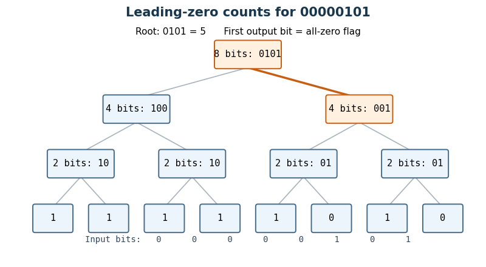

<h1 id="1/d/solution">Solution</h1>

↑ **Parent:** [D](../d.md)

Use a [hierarchical leading-zero counter](../../../../../hierarchical-leading-zero-counter.md). A block of $2^j$ [bits](../../../../../bit.md) returns a zero flag $z$ and $j$ low count [bits](../../../../../bit.md) $r$: its [count leading zeros](../../../../../count-leading-zeros.md) result is the concatenation $(z,r)$. Thus $z=1$ means that the block is entirely zero and $r=0$; otherwise $z=0$ and $r$ is its leading-zero count. A one-[bit](../../../../../bit.md) block needs just $z=\neg x$ and no low count [bits](../../../../../bit.md).

For a block of $n=2^k$ [bits](../../../../../bit.md), run two such [Boolean circuits](../../../../../boolean-circuit.md) on the upper and lower halves in parallel. Write their flags as $z_H,z_L$ and their $k-1$ low count [bits](../../../../../bit.md) as $h_i,\ell_i$. Set

$$
\boxed{z=z_H\land z_L,\quad r_{k-1}=z_H\land\neg z_L,\quad r_i=(\neg z_H\land h_i)\lor(z_H\land\ell_i)\quad(0\le i<k-1).}
$$

The last expression is a two-input [multiplexer](../../../../../multiplexer.md). When the upper half is nonzero, its count is already the answer and $r_{k-1}=0$. When only the upper half is zero, $r_{k-1}=1$ supplies the contribution $n/2$ while the [multiplexers](../../../../../multiplexer.md) supply the lower half's count. When both halves are zero, the answer is $(1,0,\ldots,0)$, representing $n$. This special encoding avoids an [adder](../../../../../adder.md) on the critical path.

Each node adds constant [circuit depth](../../../../../depth-of-a-boolean-circuit.md), even though it uses $O(k)$ [logic gates](../../../../../logic-gate.md) for its parallel [multiplexers](../../../../../multiplexer.md). Hence

$$
D(2^k)=D(2^{k-1})+O(1)=O(k),\qquad S(2^k)=2S(2^{k-1})+O(k)=O(2^k).
$$

Indeed the internal-node work is bounded by a constant times $\sum_{j=1}^k(n/2^j)j<2n$, and the $n$ leaves add $O(n)$. **Delay is $O(\log n)$ and size is $O(n)$**, counting fixed-fan-in [logic gates](../../../../../logic-gate.md) and the usual wire fan-out model.

**[Figure 1](#1/d/image-leading-zero-summaries-combine-in-parallel-the-input-00000101-gives-the-four-bit-count-0101). Leading-zero summaries combine in parallel: the input $00000101$ gives the four-bit count $0101$**. Internal nodes display their block length and encoded leading-zero count; leaves display the one-bit count. A count's first [bit](../../../../../bit.md) is the shared all-zero flag. The highlighted branch supplies the low count at the root.

## ↑ Ancestors (12)

1. [D](../d.md)
2. [1](../../1.md)
3. [Digital systems, linear algebra, introduction to formal proof](../../../digital-systems-linear-algebra-introduction-to-formal-proof-split.md)
4. [2022](../../../split.md)
5. [Past exam of the year 1 of the computer science course of the University of Oxford](../../../../split.md)
6. [Year 1 of the computer science course of the University of Oxford](../../../../../year-1-of-the-computer-science-course-of-the-university-of-oxford.md)
7. [Computer science course of the University of Oxford](../../../../../computer-science-course-of-the-university-of-oxford.md)
8. [Undergraduate course of the University of Oxford](../../../../../undergraduate-course-of-the-university-of-oxford.md)
9. [Course of the University of Oxford](../../../../../course-of-the-university-of-oxford.md)
10. [University of Oxford](../../../../../university-of-oxford-split.md)
11. [List of universities](../../../../../list-of-universities.md)
12. [Codex Wiki](../../../../../split.md)
