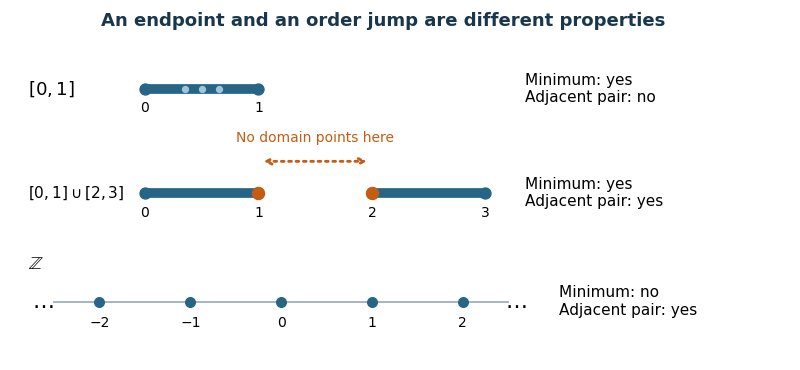

<h1 id="8/c/solution">Solution</h1>

↑ **Parent:** [C](../c.md)

Combine a [minimum](../../../../../minimum-of-a-subset-of-a-total-order.md) with an [adjacent pair in a linear order](../../../../../adjacent-pair-in-a-linear-order.md):

$$
\boxed{\xi=\bigl(\exists m\,\forall x\,\neg(x<m)\bigr)\land\exists u\,\exists v\,\bigl(u<v\land\neg\exists w\,(u<w\land w<v)\bigr).}
$$

In $[0,1]\cup[2,3]$, choose $m=0,u=1,v=2$. The [minimum](../../../../../minimum-of-a-subset-of-a-total-order.md) and the [adjacent pair in a linear order](../../../../../adjacent-pair-in-a-linear-order.md) both exist. In $[0,1]$, the [dense order](../../../../../dense-order.md) property rules out such an adjacent pair. In $\mathbb Z$, adjacent pairs exist, but no [minimum](../../../../../minimum-of-a-subset-of-a-total-order.md) exists: for any $m$, the [integer](../../../../../integer-split.md) $m-1$ is smaller. Thus this [first-order sentence](../../../../../first-order-sentence.md) has precisely the required three [truth values](../../../../../truth-value.md). Neither the endpoints nor the numerical witnesses occur as constant symbols in the [first-order sentence](../../../../../first-order-sentence.md).

**[Figure 2](#8/c/image-a-minimum-and-an-adjacent-pair-distinguish-the-two-interval-order-from-a-closed-interval-and-the-integers). A minimum and an adjacent pair distinguish the two-interval order from a closed interval and the integers**. Orange highlights the consecutive domain members $1$ and $2$ in the two-interval order. The dotted arrow crosses points absent from that domain. A closed real [interval](../../../../../interval-mathematics.md) has intervening domain members; the [integers](../../../../../integer-split.md) have adjacent pairs but no [minimum](../../../../../minimum-of-a-subset-of-a-total-order.md).

## ↑ Ancestors (12)

1. [C](../c.md)
2. [8](../../8.md)
3. [Digital systems, linear algebra, introduction to formal proof](../../../digital-systems-linear-algebra-introduction-to-formal-proof-split.md)
4. [2022](../../../split.md)
5. [Past exam of the year 1 of the computer science course of the University of Oxford](../../../../split.md)
6. [Year 1 of the computer science course of the University of Oxford](../../../../../year-1-of-the-computer-science-course-of-the-university-of-oxford.md)
7. [Computer science course of the University of Oxford](../../../../../computer-science-course-of-the-university-of-oxford.md)
8. [Undergraduate course of the University of Oxford](../../../../../undergraduate-course-of-the-university-of-oxford.md)
9. [Course of the University of Oxford](../../../../../course-of-the-university-of-oxford.md)
10. [University of Oxford](../../../../../university-of-oxford-split.md)
11. [List of universities](../../../../../list-of-universities.md)
12. [Codex Wiki](../../../../../split.md)
