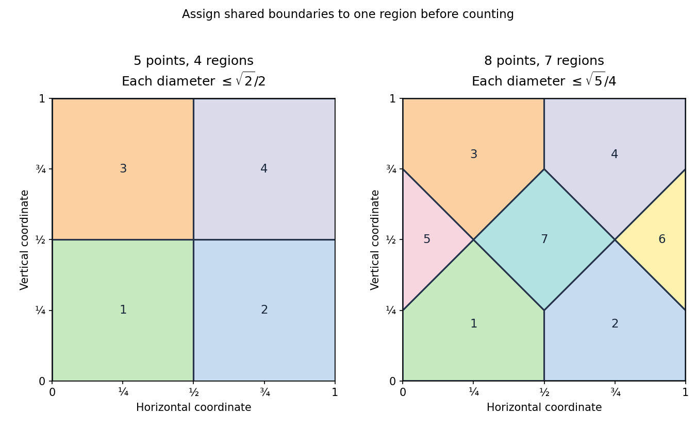

# Discrete mathematics, continuous mathematics and probability resit

↑ **Parent:** [2022](../2022.md)

Source paper: [released examination archive](https://www.whatdotheyknow.com/request/ba_computer_science_past_papers/response/2577745/attach/2/202402%20183%20CS%20Papers.zip?cookie_passthrough=1), member `2021/L/a10100w1.pdf`. The cover identifies the September 2022 resit; the source filename is undated and the ZIP directory says 2021.

**Table of contents**

- [1](#1)
  - [a](#1/a)
    - [Solution](#1/a/solution)
  - [b](#1/b)
    - [Solution](#1/b/solution)
  - [c](#1/c)
    - [Solution](#1/c/solution)
  - [d](#1/d)
    - [Solution](#1/d/solution)
- [2](#2)
  - [a](#2/a)
    - [Solution](#2/a/solution)
  - [b](#2/b)
    - [Solution](#2/b/solution)
  - [c](#2/c)
    - [i](#2/c/i)
      - [Solution](#2/c/i/solution)
    - [ii](#2/c/ii)
      - [Solution](#2/c/ii/solution)
    - [iii](#2/c/iii)
      - [Solution](#2/c/iii/solution)
    - [iv](#2/c/iv)
      - [Solution](#2/c/iv/solution)
    - [v](#2/c/v)
      - [Solution](#2/c/v/solution)
- [3](#3)
  - [a](#3/a)
    - [Solution](#3/a/solution)
  - [b](#3/b)
    - [Solution](#3/b/solution)
  - [c](#3/c)
    - [Solution](#3/c/solution)
  - [d](#3/d)
    - [Solution](#3/d/solution)
  - [e](#3/e)
    - [Solution](#3/e/solution)
- [4](#4)
  - [a](#4/a)
    - [Solution](#4/a/solution)
  - [b](#4/b)
    - [Solution](#4/b/solution)
  - [c](#4/c)
    - [Solution](#4/c/solution)
  - [d](#4/d)
    - [Solution](#4/d/solution)
  - [e](#4/e)
    - [Solution](#4/e/solution)
- [5](#5)
  - [a](#5/a)
    - [i](#5/a/i)
      - [Solution](#5/a/i/solution)
    - [ii](#5/a/ii)
      - [Solution](#5/a/ii/solution)
    - [iii](#5/a/iii)
      - [Solution](#5/a/iii/solution)
  - [b](#5/b)
    - [i](#5/b/i)
      - [Solution](#5/b/i/solution)
    - [ii](#5/b/ii)
      - [Solution](#5/b/ii/solution)
    - [iii](#5/b/iii)
      - [Solution](#5/b/iii/solution)
  - [c](#5/c)
    - [i](#5/c/i)
      - [Solution](#5/c/i/solution)
    - [ii](#5/c/ii)
      - [Solution](#5/c/ii/solution)
    - [iii](#5/c/iii)
      - [Solution](#5/c/iii/solution)
- [6](#6)
  - [a](#6/a)
    - [Solution](#6/a/solution)
  - [b](#6/b)
    - [Solution](#6/b/solution)
  - [c](#6/c)
    - [Solution](#6/c/solution)
  - [d](#6/d)
    - [Solution](#6/d/solution)
  - [e](#6/e)
    - [Solution](#6/e/solution)
- [7](#7)
  - [a](#7/a)
    - [i](#7/a/i)
      - [Solution](#7/a/i/solution)
    - [ii](#7/a/ii)
      - [Solution](#7/a/ii/solution)
    - [iii](#7/a/iii)
      - [Solution](#7/a/iii/solution)
  - [b](#7/b)
    - [i](#7/b/i)
      - [Solution](#7/b/i/solution)
    - [ii](#7/b/ii)
      - [Solution](#7/b/ii/solution)
    - [iii](#7/b/iii)
      - [Solution](#7/b/iii/solution)
    - [iv](#7/b/iv)
      - [Solution](#7/b/iv/solution)
- [8](#8)
  - [a](#8/a)
    - [Solution](#8/a/solution)
  - [b](#8/b)
    - [i](#8/b/i)
      - [Solution](#8/b/i/solution)
    - [ii](#8/b/ii)
      - [Solution](#8/b/ii/solution)
    - [iii](#8/b/iii)
      - [Solution](#8/b/iii/solution)
- [9](#9)
  - [a](#9/a)
    - [i](#9/a/i)
      - [Solution](#9/a/i/solution)
    - [ii](#9/a/ii)
      - [Solution](#9/a/ii/solution)
  - [b](#9/b)
    - [i](#9/b/i)
      - [Solution](#9/b/i/solution)
    - [ii](#9/b/ii)
      - [Solution](#9/b/ii/solution)
  - [c](#9/c)
    - [i](#9/c/i)
      - [Solution](#9/c/i/solution)
    - [ii](#9/c/ii)
      - [Solution](#9/c/ii/solution)

## 1

↑ **Parent:** [Discrete mathematics, continuous mathematics and probability resit](discrete-mathematics-continuous-mathematics-and-probability-resit.md)

<h3 id="1/a">a</h3>

↑ **Parent:** [1](#1)

<h4 id="1/a/solution">Solution</h4>

↑ **Parent:** [A](#1/a)

Let $A$ and $B$ be the finite [sets](../../set.md) of objects satisfying the two properties. The [rule of sum](../../combinatorics.md#addition-principle) says that mutually exclusive alternatives have additive counts: if $A\cap B=\varnothing$, then $|A\cup B|=|A|+|B|$. Without disjointness, the corresponding [inclusion-exclusion principle](../../combinatorics.md#inclusion-exclusion-principle) is

$$
|A\cup B|=|A|+|B|-|A\cap B|.
$$

The [rule of subtraction](../../combinatorics.md#rule-of-subtraction) counts objects satisfying the first property but not the second:

$$
\boxed{|A\setminus B|=|A|-|A\cap B|.}
$$

In particular, if the objects with the second property form a [subset](../../set.md#subset) of those with the first, the count is $|A|-|B|$. These conditions prevent either double counting an overlap or subtracting objects that were not counted initially.

<h3 id="1/b">b</h3>

↑ **Parent:** [1](#1)

<h4 id="1/b/solution">Solution</h4>

↑ **Parent:** [B](#1/b)

The [rule of product](../../combinatorics.md#rule-of-product) says that if a construction has $r$ stages, with exactly $a_j$ choices at stage $j$ after every permitted earlier history, then it has $\prod_{j=1}^r a_j$ possible outcomes. The later choices need not be identical [sets](../../set.md) after different histories; their numbers must have the stated values.

For a [permutation](../../combinatorics.md#permutation) of $n$ distinct objects, choose the first object in $n$ ways, the second in $n-1$ ways, and continue until only one remains. Thus the number is

$$
\boxed{n(n-1)\cdots1=n!.}
$$

Every ordered arrangement is produced exactly once by its successive choices, so this counts [permutations](../../combinatorics.md#permutation) without omissions or repetitions. For $n=0$, the unique empty arrangement agrees with $0!=1$.

<h3 id="1/c">c</h3>

↑ **Parent:** [1](#1)

<h4 id="1/c/solution">Solution</h4>

↑ **Parent:** [C](#1/c)

An allocation is a [tuple](../../set-theory.md#finite-tuple) $(x_1,\ldots,x_k)$ of nonnegative [integers](../../integer.md) with $\sum_jx_j=n$, where $x_j$ is the number in labelled box $j$. Empty boxes are allowed. Encode the allocation by $n$ stars and $k-1$ bars: put $x_1$ stars before the first bar, $x_2$ between the first two bars, and so on. Adjacent bars represent an empty intermediate box; a bar at an end represents an empty end box.

Reading the group sizes recovers exactly one allocation from every such string, so this is a [bijection](../../function.md#bijection). There are $n+k-1$ positions and we choose the $k-1$ bar positions. Hence [stars and bars](../../combinatorics.md#stars-and-bars-combinatorics) gives

$$
\boxed{\binom{n+k-1}{k-1}.}
$$

No extra factor for ordering the objects is present, because the objects are indistinguishable. For $k=1$ the string has no bars and gives the single allocation of all objects to that box; for $n=0$ all boxes are empty, also a single allocation.

<h3 id="1/d">d</h3>

↑ **Parent:** [1](#1)

<h4 id="1/d/solution">Solution</h4>

↑ **Parent:** [D](#1/d)

Pad every [integer](../../integer.md) from $0$ through $999999$ with leading zeros to obtain a unique six-digit decimal string. If its digits sum to $5$, each digit is automatically at most $5$, so the usual digit [upper bound](../../set.md#upper-bound-in-a-partially-ordered-set) $9$ adds no restriction. We therefore count the nonnegative [integer](../../integer.md) solutions of

$$
d_1+d_2+\cdots+d_6=5.
$$

By [stars and bars](../../combinatorics.md#stars-and-bars-combinatorics), there are $\binom{5+6-1}{6-1}=\binom{10}{5}$. The all-zero string is not counted because its [digit sum](../../integer.md#digit-sum) is zero, so every counted [integer](../../integer.md) is positive. Thus the answer is **$252$**.

## 2

↑ **Parent:** [Discrete mathematics, continuous mathematics and probability resit](discrete-mathematics-continuous-mathematics-and-probability-resit.md)

<h3 id="2/a">a</h3>

↑ **Parent:** [2](#2)

<h4 id="2/a/solution">Solution</h4>

↑ **Parent:** [A](#2/a)

For real-valued [functions](../../function.md), use magnitude comparisons. The constants below are independent of $n$.

The statement $f(n)=O(g(n))$ in [Big O notation](../../real-analysis.md#big-o-notation) means that some $C>0$ and [integer](../../integer.md) $N$ satisfy $|f(n)|\leq C|g(n)|$ for all $n\geq N$. The statement $f(n)=\Omega(g(n))$ in [big omega notation](../../real-analysis.md#big-omega-notation) means that some $c>0$ and $N$ satisfy $|f(n)|\geq c|g(n)|$ for all $n\geq N$.

Finally, $f(n)=\Theta(g(n))$ in [big theta notation](../../real-analysis.md#big-theta-notation) means that some $c,C>0$ and $N$ satisfy

$$
\boxed{c|g(n)|\leq|f(n)|\leq C|g(n)|\qquad(n\geq N).}
$$

Equivalently it is both an eventual [upper bound](../../set.md#upper-bound-in-a-partially-ordered-set) and an eventual [lower bound](../../set.md#lower-bound-in-a-partially-ordered-set). These definitions ignore a finite initial segment; they do not assert pointwise inequalities with constant one.

<h3 id="2/b">b</h3>

↑ **Parent:** [2](#2)

<h4 id="2/b/solution">Solution</h4>

↑ **Parent:** [B](#2/b)

Suppose first that $f=O(g)$. Choose $C>0$ and $N$ so that $|f(n)|\leq C|g(n)|$ for $n\geq N$. There are only finitely many natural numbers below $N$. Because $g(n)\ne0$ at each of them, all ratios $|f(n)|/|g(n)|$ in this finite prefix are finite. Let

$$
c=\max\left(\{C\}\cup\left\{\frac{|f(n)|}{|g(n)|}:n<N\right\}\right).
$$

Then $|f(n)|\leq c|g(n)|$ both in the prefix and in the tail, hence on the entire [domain of a function](../../function.md#domain-of-a-function). This proves the [finite-prefix extension of a big O bound](../../real-analysis.md#finite-prefix-extension-of-a-big-o-bound).

Conversely, a bound valid for every natural number is certainly valid eventually. The purported real constant cannot be negative because $g$ never vanishes; if it is zero, enlarge it to a positive constant. The definition of [Big O notation](../../real-analysis.md#big-o-notation) then applies. The nonvanishing assumption is what permits the finite exceptions to be absorbed into one constant.

<h3 id="2/c">c</h3>

↑ **Parent:** [2](#2)

<h4 id="2/c/i">i</h4>

↑ **Parent:** [C](#2/c)

<h5 id="2/c/i/solution">Solution</h5>

↑ **Parent:** [I](#2/c/i)

**True.** For every [integer](../../integer.md) $n\geq1$, $n^2\leq n^3$ and $1\leq n^3$. Therefore

$$
0\leq n^3+1000n^2+96\leq1097n^3.
$$

The constants $C=1097$ and $N=1$ satisfy the definition of [Big O notation](../../real-analysis.md#big-o-notation). Whether the chosen convention for natural numbers includes zero is immaterial to this eventual assertion.

<h4 id="2/c/ii">ii</h4>

↑ **Parent:** [C](#2/c)

<h5 id="2/c/ii/solution">Solution</h5>

↑ **Parent:** [Ii](#2/c/ii)

**False.** Put $r_n=3^n/n^3$ for $n\geq1$. For $n\geq4$,

$$
\frac{r_{n+1}}{r_n}=3\left(\frac n{n+1}\right)^3
\geq3\left(\frac45\right)^3=\frac{192}{125}>1.
$$

Thus $r_n\geq r_4(192/125)^{n-4}\to\infty$. No fixed constant can bound $3^n/n^3$ eventually, so $3^n\ne O(n^3)$. This is an explicit comparison of [exponential growth](../../calculus.md#exponential-growth) with [polynomial growth](../../analysis.md#polynomial-growth).

<h4 id="2/c/iii">iii</h4>

↑ **Parent:** [C](#2/c)

<h5 id="2/c/iii/solution">Solution</h5>

↑ **Parent:** [Iii](#2/c/iii)

**True.** Rationalization gives, for $n\geq1$,

$$
\sqrt{4n^2+n}-2n
=\frac n{\sqrt{4n^2+n}+2n}
=\frac1{\sqrt{4+1/n}+2}.
$$

This lies between zero and $1/4$, so it is $O(1)$ in [Big O notation](../../real-analysis.md#big-o-notation). In fact it converges to $1/4$, rather than to zero. The rationalized form also avoids the [catastrophic cancellation](../../floating-point-arithmetic.md#catastrophic-cancellation) of subtracting two nearby large quantities.

<h4 id="2/c/iv">iv</h4>

↑ **Parent:** [C](#2/c)

<h5 id="2/c/iv/solution">Solution</h5>

↑ **Parent:** [Iv](#2/c/iv)

**True for every fixed $k\geq0$.** Extract $e^n$ from inside the [logarithm](../../calculus.md#logarithm):

$$
\log(e^n+n^k)-n=\log(1+n^ke^{-n}).
$$

Choose an [integer](../../integer.md) $m>k$. The nonnegative terms of the [exponential series](../../calculus.md#exponential-series) give $e^n\geq n^m/m!$ for $n>0$, whence

$$
0\leq n^ke^{-n}\leq m!n^{k-m}\longrightarrow0.
$$

Since $0\leq\log(1+u)\leq u$ for $u\geq0$, the displayed expression tends to zero and is therefore $O(1)$. The constant and cutoff may depend on the fixed $k$; no uniform assertion over unbounded $k$ is being made.

<h4 id="2/c/v">v</h4>

↑ **Parent:** [C](#2/c)

<h5 id="2/c/v/solution">Solution</h5>

↑ **Parent:** [V](#2/c/v)

**False.** On the unbounded [subsequence](../../sequence-and-series.md#subsequence) of odd positive [integers](../../integer.md), $f(n)/g(n)=n$. For any proposed constants $C>0,N$, choose an odd $n>\max(C,N)$. Then $|f(n)|=n>C|g(n)|=C$, contradicting the eventual [upper bound](../../set.md#upper-bound-in-a-partially-ordered-set) required by [Big O notation](../../real-analysis.md#big-o-notation). The small ratio on even [integers](../../integer.md) cannot compensate for this failure on infinitely many odd [integers](../../integer.md).

## 3

↑ **Parent:** [Discrete mathematics, continuous mathematics and probability resit](discrete-mathematics-continuous-mathematics-and-probability-resit.md)

<h3 id="3/a">a</h3>

↑ **Parent:** [3](#3)

<h4 id="3/a/solution">Solution</h4>

↑ **Parent:** [A](#3/a)

The [integer congruence](../../modular-arithmetic.md#integer-congruence) $x\equiv y\pmod n$ means $n\mid(x-y)$: the difference is an [integer](../../integer.md) multiple of the positive modulus $n$. Write $x_1-x_2=na$ and $y_1-y_2=nb$ for [integers](../../integer.md) $a,b$. Then

$$
(x_1+y_1)-(x_2+y_2)=n(a+b),
$$

so [addition](../../arithmetic.md#addition) preserves [integer congruence](../../modular-arithmetic.md#integer-congruence). For [multiplication](../../arithmetic.md#multiplication),

$$
x_1y_1-x_2y_2=y_1(x_1-x_2)+x_2(y_1-y_2)=n(ay_1+bx_2).
$$

The final coefficient is an [integer](../../integer.md), so [multiplication](../../arithmetic.md#multiplication) also preserves [integer congruence](../../modular-arithmetic.md#integer-congruence). These properties make [addition](../../arithmetic.md#addition) and [multiplication](../../arithmetic.md#multiplication) well defined on [residue classes](../../modular-arithmetic.md#residue-class).

<h3 id="3/b">b</h3>

↑ **Parent:** [3](#3)

<h4 id="3/b/solution">Solution</h4>

↑ **Parent:** [B](#3/b)

The [Euclidean algorithm](../../number-theory.md#euclidean-algorithm) gives

$$
\begin{aligned}
2392&=1748+644,\\
1748&=2\cdot644+460,\\
644&=460+184,\\
460&=2\cdot184+92,\\
184&=2\cdot92.
\end{aligned}
$$

The last nonzero remainder is **$g=92$**. Back-substitution produces its [Bézout coefficients](../../algebra.md#bezout-coefficient):

$$
\begin{aligned}
92&=460-2\cdot184\\
&=3\cdot460-2\cdot644\\
&=3\cdot1748-8\cdot644\\
&=-8\cdot2392+11\cdot1748.
\end{aligned}
$$

Thus **$(m,n)=(-8,11)$** is a requested pair. The final equality independently checks the calculation.

<h3 id="3/c">c</h3>

↑ **Parent:** [3](#3)

<h4 id="3/c/solution">Solution</h4>

↑ **Parent:** [C](#3/c)

The [pigeonhole principle](../../combinatorics.md#pigeonhole-principle) states that if more than $r$ objects are placed in $r$ boxes, with $r\geq1$, at least one box contains two or more objects. Equivalently, a [function](../../function.md) from a finite [set](../../set.md) of more than $r$ elements to a [set](../../set.md) of $r$ elements cannot be injective: if every box held at most one object, there would be at most $r$ objects altogether.

<h3 id="3/d">d</h3>

↑ **Parent:** [3](#3)

<h4 id="3/d/solution">Solution</h4>

↑ **Parent:** [D](#3/d)

For five points, partition the [unit square](../../euclidean-geometry.md#unit-square) into four [squares](../../euclidean-geometry.md#square) of side $1/2$. Assign boundary points to just one neighbouring piece. By the [pigeonhole principle](../../combinatorics.md#pigeonhole-principle), two of the points lie in one piece, whose [diameter](../../topological-analysis.md#diameter) is its diagonal, $\sqrt{(1/2)^2+(1/2)^2}=\sqrt2/2$.

For eight points, use seven smaller-[diameter](../../topological-analysis.md#diameter) pieces rather than eight [rectangles](../../euclidean-geometry.md#rectangle). Start with the convex [pentagon](../../euclidean-geometry.md#pentagon)

$$
P=\operatorname{conv}\{(0,0),(1/2,0),(1/2,1/4),(1/4,1/2),(0,1/4)\}.
$$

Take its four reflected copies at the corners of the [square](../../euclidean-geometry.md#square). The remaining pieces are the left [triangle](../../euclidean-geometry.md#triangle) with vertices $(0,1/4),(1/4,1/2),(0,3/4)$, its right-hand [reflection](../../linear-algebra.md#reflection-mathematics), and the central diamond with vertices $(1/4,1/2),(1/2,1/4),(3/4,1/2),(1/2,3/4)$. These seven [polygons](../../euclidean-geometry.md#polygon) cover the [square](../../euclidean-geometry.md#square) with disjoint interiors. To verify coverage directly, for $0\leq y\leq1/4$ the two bottom pentagons split the horizontal section at $x=1/2$. For $1/4\leq y\leq1/2$, the five successive sections have endpoints $0,y-1/4,3/4-y,y+1/4,5/4-y,1$ and belong respectively to the left triangle, bottom-left pentagon, diamond, bottom-right pentagon and right triangle. Reflection gives the top half.

The [diameter of a finite convex hull](../../topological-analysis.md#diameter-of-a-finite-convex-hull) is the greatest [distance](../../geometry-and-topology.md#distance) between its vertices: if two points are [convex combinations](../../convex-set.md#convex-combination) of vertices, their difference is a [convex combination](../../convex-set.md#convex-combination) of [vertex](../../graph.md#vertex-graph-theory) differences, and the [triangle inequality](../../topological-analysis.md#triangle-inequality) bounds its [norm](../../normed-vector-space.md#norm) by the largest such [distance](../../geometry-and-topology.md#distance). Checking the five vertices of $P$ gives [diameter](../../topological-analysis.md#diameter) $\sqrt{(1/2)^2+(1/4)^2}=\sqrt5/4$; [reflections](../../linear-algebra.md#reflection-mathematics) preserve that value. Each remaining [triangle](../../euclidean-geometry.md#triangle) and the diamond has [diameter](../../topological-analysis.md#diameter) $1/2$, which is smaller. After assigning shared boundaries to one piece, eight points in these seven pieces force a pair in a common piece. Hence **some pair is at [distance](../../geometry-and-topology.md#distance) at most $\sqrt5/4$**.

**[Figure 1](#3/d/image-four-and-seven-regions-give-the-two-distance-bounds-by-the-pigeonhole-principle). Four and seven regions give the two distance bounds by the pigeonhole principle**.

Both arguments are instances of a [pigeonhole distance bound from a partition](../../combinatorics.md#pigeonhole-distance-bound-from-a-partition).

<h3 id="3/e">e</h3>

↑ **Parent:** [3](#3)

<h4 id="3/e/solution">Solution</h4>

↑ **Parent:** [E](#3/e)

Prove the stronger statement with a nonempty [subset](../../set.md#subset). Order the $n\geq1$ [integers](../../integer.md) as $a_1,\ldots,a_n$, and form the [prefix sums](../../arithmetic.md#prefix-sum)

$$
s_0=0,\qquad s_j=\sum_{k=1}^ja_k\quad(1\leq j\leq n).
$$

There are $n+1$ such sums but only $n$ [residue classes](../../modular-arithmetic.md#residue-class) modulo $n$. The [pigeonhole principle](../../combinatorics.md#pigeonhole-principle) gives indices $0\leq i<j\leq n$ with $s_i\equiv s_j\pmod n$. Their difference satisfies

$$
s_j-s_i=a_{i+1}+\cdots+a_j\equiv0\pmod n.
$$

The selected elements form a nonempty [subset](../../set.md#subset) of $S$, proving the claim. Neither positivity nor distinct values in a general ordered [sequence](../../sequence-and-series.md#sequence) are needed for the [consecutive sum divisible by the sequence length](../../combinatorics.md#consecutive-sum-divisible-by-the-sequence-length) argument; distinctness merely makes the present input a [set](../../set.md).

## 4

↑ **Parent:** [Discrete mathematics, continuous mathematics and probability resit](discrete-mathematics-continuous-mathematics-and-probability-resit.md)

<h3 id="4/a">a</h3>

↑ **Parent:** [4](#4)

<h4 id="4/a/solution">Solution</h4>

↑ **Parent:** [A](#4/a)

Let $e_n=x_n-x_*$ for the [limit](../../calculus.md#limit-of-a-function) $x_*$. [Quadratic convergence](../../numerical-analysis.md#quadratic-convergence) means that eventually $|e_{n+1}|\leq C|e_n|^2$ for a fixed constant $C$; exact asymptotic order two has $|e_{n+1}|/|e_n|^2\to c$ with $0<c<\infty$.

For this iteration and $x_*=3$, direct algebra gives

$$
x_{n+1}-3=x_n-6+\frac9{x_n}=\frac{(x_n-3)^2}{x_n}.
$$

Using the stipulated convergence $x_n\to3$, the ratio of successive squared errors is

$$
\boxed{\frac{|e_{n+1}|}{|e_n|^2}=\frac1{|x_n|}\longrightarrow\frac13.}
$$

Thus the convergence is quadratic. The iteration is well defined here: $x_1=7/2$, and thereafter $x_n>3$ implies $3<x_{n+1}<x_n$. The initial point is not already the [limit](../../calculus.md#limit-of-a-function), so the error ratio is meaningful.

<h3 id="4/b">b</h3>

↑ **Parent:** [4](#4)

<h4 id="4/b/solution">Solution</h4>

↑ **Parent:** [B](#4/b)

Assume $f$ and $g$ are continuously differentiable near the point. At a regular [feasible point](../../mathematical-optimization.md#feasible-point), meaning $g(x)=0$ and $\nabla g(x)\ne0$, a differentiable constrained local extremum satisfies the [Lagrange multiplier](../../mathematical-optimization.md#lagrange-multiplier) equations

$$
\nabla f(x)=\lambda\nabla g(x),\qquad g(x)=0.
$$

They arise by differentiating the [optimization Lagrangian](../../mathematical-optimization.md#optimization-lagrangian) $L(x,\lambda)=f(x)-\lambda g(x)$ with respect to all coordinates and the multiplier. Geometrically, the objective has zero [derivative](../../calculus.md#derivative) along the [tangent space](../../tangent-vector.md#tangent-space) of the [constraint](../../classical-mechanics.md#constraint-mechanics) surface, so its [gradient](../../multivariable-calculus.md#gradient) must lie in the normal direction.

Solve these equations for candidates, examine [feasible points](../../mathematical-optimization.md#feasible-point) where the regularity condition fails separately, and compare objective values or use a second-order test restricted to feasible directions. The equations locate [stationary points](../../calculus-of-variations.md#stationary-point); they do not by themselves establish which are minima or whether a [global minimum](../../analysis.md#global-minimum) is attained.

<h3 id="4/c">c</h3>

↑ **Parent:** [4](#4)

<h4 id="4/c/solution">Solution</h4>

↑ **Parent:** [C](#4/c)

Use $F=x^6+\tfrac32y^4$ and $G=x^4-2y^2-3$. Every [feasible point](../../mathematical-optimization.md#feasible-point) has $x\ne0$, so $\nabla G=(4x^3,-4y)$ cannot vanish. The [Lagrange multiplier](../../mathematical-optimization.md#lagrange-multiplier) equations are

$$
6x^5=4\lambda x^3,\qquad6y^3=-4\lambda y.
$$

The first gives $\lambda=\tfrac32x^2>0$. If $y\ne0$, the second would give $\lambda=-\tfrac32y^2<0$, a contradiction. Therefore $y=0$, and the [constraint](../../classical-mechanics.md#constraint-mechanics) gives $x^4=3$. The only constrained [stationary points](../../calculus-of-variations.md#stationary-point) are $(\pm3^{1/4},0)$.

For a global certificate, feasibility implies $x^4\geq3$, and hence

$$
F=(x^4)^{3/2}+\tfrac32y^4\geq3^{3/2}.
$$

Equality requires $y=0$ and $x^4=3$. Thus

$$
\boxed{\min F=3\sqrt3,\qquad (x,y)=(\pm3^{1/4},0).}
$$

The case split is essential: dividing by $y$ would discard precisely the minimizers.

<h3 id="4/d">d</h3>

↑ **Parent:** [4](#4)

<h4 id="4/d/solution">Solution</h4>

↑ **Parent:** [D](#4/d)

Here the [constraint](../../classical-mechanics.md#constraint-mechanics) surface $x^4+2y^2=3$ is compact and regular, so a [global minimum](../../analysis.md#global-minimum) exists and satisfies the [Lagrange multiplier](../../mathematical-optimization.md#lagrange-multiplier) equations

$$
x^3(6x^2-4\lambda)=0,\qquad y(6y^2-4\lambda)=0.
$$

Keep the zero-coordinate cases. If $y=0$, the two points are $(\pm3^{1/4},0)$, with value $3\sqrt3$. If $x=0$, the two points are $(0,\pm\sqrt{3/2})$, with value $27/8$. If both coordinates are nonzero, the equations give $x^2=y^2=t>0$. The [constraint](../../classical-mechanics.md#constraint-mechanics) becomes $t^2+2t=3$, whose only positive solution is $t=1$. These are the four points $(\pm1,\pm1)$, all with value $5/2$.

These cases exhaust the stated eight constrained [stationary points](../../calculus-of-variations.md#stationary-point). Comparing their values gives

$$
\boxed{\min F=\frac52,\qquad (x,y)\in\{(1,1),(1,-1),(-1,1),(-1,-1)\}.}
$$

For additional classification, substituting $u=x^2\in[0,\sqrt3]$ gives $F(u)=u^3+\tfrac38(3-u^2)^2$, with

$$
F'(u)=\tfrac32u(u-1)(u+3).
$$

It decreases from $u=0$ to $u=1$ and increases from $u=1$ to $u=\sqrt3$. Thus the two $y$-axis points are constrained local maxima, the two $x$-axis points are global maxima, and the four mixed-coordinate points are global minima.

<h3 id="4/e">e</h3>

↑ **Parent:** [4](#4)

<h4 id="4/e/solution">Solution</h4>

↑ **Parent:** [E](#4/e)

Both terms $x^6$ and $\tfrac32y^4$ are nonnegative, and they vanish simultaneously only at $(0,0)$. That point satisfies $x^4+2y^2\leq3$. Consequently

$$
\boxed{(x_*,y_*)=(0,0),\qquad F_*=0,}
$$

and the [global minimum](../../analysis.md#global-minimum) is unique. No [Lagrange multiplier](../../mathematical-optimization.md#lagrange-multiplier) calculation is needed: nonnegativity gives a [lower bound](../../set.md#lower-bound-in-a-partially-ordered-set) attained at a [feasible point](../../mathematical-optimization.md#feasible-point).

## 5

↑ **Parent:** [Discrete mathematics, continuous mathematics and probability resit](discrete-mathematics-continuous-mathematics-and-probability-resit.md)

<h3 id="5/a">a</h3>

↑ **Parent:** [5](#5)

<h4 id="5/a/i">i</h4>

↑ **Parent:** [A](#5/a)

<h5 id="5/a/i/solution">Solution</h5>

↑ **Parent:** [I](#5/a/i)

Use compatible dimensions $A\in\mathbb R^{d\times d}$ and $b,x\in\mathbb R^d$; the printed “b-by-b” size is read consistently with the displayed products and domain. Take [derivatives](../../calculus.md#derivative) as column [gradients](../../multivariable-calculus.md#gradient). [Symmetry](../../physics.md#symmetry-physics) of $A$ gives

$$
\boxed{\nabla f(x)=2Ax+b,\qquad H_f(x)=2A.}
$$

For example, the directional [differential](../../smooth-manifold.md#differential-of-a-smooth-map) of $x^TAx$ is $dx^TAx+x^TAdx=2(Ax)^Tdx$. The linear term contributes $b$ to the [gradient](../../multivariable-calculus.md#gradient) and zero to the [Hessian matrix](../../multivariable-calculus.md#hessian-matrix).

<h4 id="5/a/ii">ii</h4>

↑ **Parent:** [A](#5/a)

<h5 id="5/a/ii/solution">Solution</h5>

↑ **Parent:** [Ii](#5/a/ii)

The [eigenvector](../../linear-operator-theory.md#eigenvector) identity $Ab=\tfrac12b$ gives $\nabla f(-b)=-2Ab+b=0$. Since $H_f=2A$ is a [positive-definite matrix](../../quadratic-form.md#positive-definite-matrix), this is a strict [local minimum](../../analysis.md#local-minimum). A global certificate follows by completing the [quadratic form](../../quadratic-form.md):

$$
f(x)=(x+b)^TA(x+b)-b^TAb=(x+b)^TA(x+b)-\tfrac12.
$$

[Positive definiteness](../../bilinear-form.md#positive-definiteness) makes the first term nonnegative, with equality only at $x=-b$. Thus **$-b$ is the unique [global minimum](../../analysis.md#global-minimum)**, with value $-1/2$.

<h4 id="5/a/iii">iii</h4>

↑ **Parent:** [A](#5/a)

<h5 id="5/a/iii/solution">Solution</h5>

↑ **Parent:** [Iii](#5/a/iii)

The full, undamped [Newton's method in optimization](../../mathematical-optimization.md#newton-s-method-in-optimization) step is

$$
x_1=x_0-H_f(x_0)^{-1}\nabla f(x_0)
=x_0-(2A)^{-1}(2Ax_0+b)
=-\tfrac12A^{-1}b.
$$

The [eigenvector](../../linear-operator-theory.md#eigenvector) identity gives $A^{-1}b=2b$. Consequently **$x_1=-b$ for every starting point**. This is a [one-step Newton solution of a quadratic stationary equation](../../mathematical-optimization.md#one-step-newton-solution-of-a-quadratic-stationary-equation): its [gradient](../../multivariable-calculus.md#gradient) is an [affine function](../../vector-space.md#affine-function), so a single exact Newton solve resolves it completely.

<h3 id="5/b">b</h3>

↑ **Parent:** [5](#5)

<h4 id="5/b/i">i</h4>

↑ **Parent:** [B](#5/b)

<h5 id="5/b/i/solution">Solution</h5>

↑ **Parent:** [I](#5/b/i)

Write $(x^Tb)^2=x^Tbb^Tx$ and put $C=A-bb^T$, which is symmetric. Differentiating this [quadratic form](../../quadratic-form.md) gives

$$
\boxed{\nabla g(x)=2Cx=2Ax-2(x^Tb)b,\qquad H_g(x)=2(A-bb^T).}
$$

Unlike $A$, $C$ need not be a [positive-definite matrix](../../quadratic-form.md#positive-definite-matrix). Its behaviour must be checked before classifying the [stationary point](../../calculus-of-variations.md#stationary-point).

<h4 id="5/b/ii">ii</h4>

↑ **Parent:** [B](#5/b)

<h5 id="5/b/ii/solution">Solution</h5>

↑ **Parent:** [Ii](#5/b/ii)

The [gradient](../../multivariable-calculus.md#gradient) vanishes at $0$. Decompose any [vector](../../vector-space.md#vector) as $x=tb+w$, with $w\perp b$. [Symmetry](../../physics.md#symmetry-physics) of $A$ and $Ab=\tfrac12b$ imply $b^TAw=(Ab)^Tw=0$. Since $\|b\|=1$,

$$
g(tb+w)=-\tfrac12t^2+w^TAw.
$$

If $d\geq2$, choose a nonzero $w\perp b$. Arbitrarily close to zero, the direction $b$ gives negative values and the direction $w$ gives positive values. Thus **$0$ is a [saddle point](../../analysis.md#saddle-point) for $d\geq2$**. Equivalently, the [Hessian matrix](../../multivariable-calculus.md#hessian-matrix) has one negative [eigenvalue](../../linear-operator-theory.md#eigenvalue) and all its other [eigenvalues](../../linear-operator-theory.md#eigenvalue) positive.

The dimension matters: if $d=1$, the [orthogonal complement](../../hilbert-space.md#orthogonal-complement) is zero-dimensional and $g(tb)=-t^2/2$. In that case **$0$ is the unique [global maximum](../../function.md#global-maximum)**. This edge case is not excluded by the stated hypotheses. The decomposition is a [rank-one downdate along an eigenvector](../../quadratic-form.md#rank-one-downdate-along-an-eigenvector).

<h4 id="5/b/iii">iii</h4>

↑ **Parent:** [B](#5/b)

<h5 id="5/b/iii/solution">Solution</h5>

↑ **Parent:** [Iii](#5/b/iii)

The [matrix](../../vector-space.md#matrix) $C=A-bb^T$ is an [invertible matrix](../../linear-algebra.md#invertible-matrix). Indeed, on the line spanned by $b$ it has [eigenvalue](../../linear-operator-theory.md#eigenvalue) $-1/2$, and on $b^\perp$ it agrees with the positive-definite restriction of $A$. Therefore the full [Newton step](../../mathematical-optimization.md#newton-step) is well defined and gives

$$
\boxed{x_1=x_0-(2C)^{-1}(2Cx_0)=0.}
$$

This is the unique [stationary point](../../calculus-of-variations.md#stationary-point) because $C$ is an [invertible matrix](../../linear-algebra.md#invertible-matrix). The algebra applies to every starting point, but it does not make the answer a minimum: for $d\geq2$ it is the [saddle point](../../analysis.md#saddle-point) just classified, and for $d=1$ it is a maximum. A safeguarded minimization algorithm that replaces an [indefinite matrix](../../quadratic-form.md#indefinite-matrix) used as its [Hessian matrix](../../multivariable-calculus.md#hessian-matrix) or damps the step need not take this exact step; the assertion concerns the ordinary full [Newton step](../../mathematical-optimization.md#newton-step) formula.

<h3 id="5/c">c</h3>

↑ **Parent:** [5](#5)

<h4 id="5/c/i">i</h4>

↑ **Parent:** [C](#5/c)

<h5 id="5/c/i/solution">Solution</h5>

↑ **Parent:** [I](#5/c/i)

Put $q(x)=x^TAx$ and $t(x)=x^Tb$. The [product rule](../../calculus.md#product-rule) gives

$$
\boxed{\nabla h(x)=2t(x)Ax+q(x)b.}
$$

Differentiate each term. The [derivative](../../calculus.md#derivative) of $2tAx$ is $2(Ax)b^T+2tA$, while that of $qb$ is $2b(Ax)^T$. Hence

$$
\boxed{H_h(x)=2(x^Tb)A+2(Ax)b^T+2b(Ax)^T.}
$$

The last two terms are transposes of each other, so this [Hessian matrix](../../multivariable-calculus.md#hessian-matrix) is symmetric, as expected.

<h4 id="5/c/ii">ii</h4>

↑ **Parent:** [C](#5/c)

<h5 id="5/c/ii/solution">Solution</h5>

↑ **Parent:** [Ii](#5/c/ii)

At $x=0$, the [gradient](../../multivariable-calculus.md#gradient) from the preceding part vanishes and the [Hessian matrix](../../multivariable-calculus.md#hessian-matrix) is zero. The second-order test is therefore inconclusive. Instead inspect the [eigenline](../../linear-operator-theory.md#eigenline):

$$
h(tb)=(t^2b^TAb)(t\|b\|^2)=\tfrac12t^3.
$$

For arbitrarily small positive and negative $t$, these values have opposite signs. Thus **$0$ is neither a [local maximum](../../analysis.md#local-maximum) nor a [local minimum](../../analysis.md#local-minimum)**. In dimension at least two it is a degenerate [saddle point](../../analysis.md#saddle-point); in one dimension it is a stationary [inflection point](../../topology.md#inflection-point). Looking only at the zero [Hessian matrix](../../multivariable-calculus.md#hessian-matrix) would not determine this classification.

<h4 id="5/c/iii">iii</h4>

↑ **Parent:** [C](#5/c)

<h5 id="5/c/iii/solution">Solution</h5>

↑ **Parent:** [Iii](#5/c/iii)

Use [mathematical induction](../../foundations-of-mathematics.md#mathematical-induction) on the iteration. Initially $x_0=b=1\cdot b$. If $x_n=\lambda_nb$, then $Ax_n=\lambda_nb/2$, $x_n^Tb=\lambda_n$, and $x_n^TAx_n=\lambda_n^2/2$. Therefore

$$
\nabla h(x_n)=\tfrac32\lambda_n^2b.
$$

A [gradient descent](../../gradient-descent.md) step with any scalar step length $\alpha_n$ consequently has the form

$$
x_{n+1}=x_n-\alpha_n\nabla h(x_n)
=\left(\lambda_n-\tfrac32\alpha_n\lambda_n^2\right)b.
$$

Thus every iterate remains on the same [eigenline](../../linear-operator-theory.md#eigenline), with

$$
\boxed{\lambda_0=1,\qquad
\lambda_{n+1}=\lambda_n-\tfrac32\alpha_n\lambda_n^2.}
$$

This proves that [gradient descent preserves an eigenline for a cubic product](../../gradient-descent.md#gradient-descent-preserves-an-eigenline-for-a-cubic-product). The statement is invariance, not convergence to a minimum: along the negative direction of this line the [cubic polynomial](../../polynomial.md#cubic-polynomial) objective is unbounded below.

## 6

↑ **Parent:** [Discrete mathematics, continuous mathematics and probability resit](discrete-mathematics-continuous-mathematics-and-probability-resit.md)

<h3 id="6/a">a</h3>

↑ **Parent:** [6](#6)

<h4 id="6/a/solution">Solution</h4>

↑ **Parent:** [A](#6/a)

The displayed rational expression has domain $\mathbb R\setminus\{0\}$; its value at zero is undefined despite the printed $\mathbb R\to\mathbb R$ notation. On that domain, the [power rule](../../calculus.md#power-rule) gives

$$
\boxed{\begin{aligned}
f'(x)&=2x-4+\frac4{x^2}-\frac2{x^3},\\
f''(x)&=2-\frac8{x^3}+\frac6{x^4},\\
f^{(3)}(x)&=\frac{24}{x^4}-\frac{24}{x^5},\\
f^{(4)}(x)&=-\frac{96}{x^5}+\frac{120}{x^6},\\
f^{(5)}(x)&=\frac{480}{x^6}-\frac{720}{x^7}.
\end{aligned}}
$$

These [derivatives](../../calculus.md#derivative) are smooth on every interval avoiding zero, including all intervals used below.

<h3 id="6/b">b</h3>

↑ **Parent:** [6](#6)

<h4 id="6/b/solution">Solution</h4>

↑ **Parent:** [B](#6/b)

Substitution gives

$$
f(1)=-6,\qquad f'(1)=f''(1)=f^{(3)}(1)=0,\qquad f^{(4)}(1)=24.
$$

In particular, $1$ is a [stationary point](../../calculus-of-variations.md#stationary-point). For $x$ sufficiently close to $1$, [Taylor's theorem](../../calculus.md#taylor-s-theorem) with fifth-order remainder gives

$$
\boxed{f(x)=-6+(x-1)^4+\frac{f^{(5)}(\xi)}{120}(x-1)^5,}
$$

where $\xi$ lies between $1$ and $x$. The fifth [derivative](../../calculus.md#derivative) is bounded near $1$, so the remainder is $O((x-1)^5)$ and is smaller in magnitude than half the positive quartic term for sufficiently small nonzero $x-1$. Therefore **$x=1$ is a strict [local minimum](../../analysis.md#local-minimum)**, despite the vanishing [second derivative](../../calculus.md#second-derivative).

An exact algebraic check gives the stronger global conclusion:

$$
f(x)+6=\frac{(x-1)^4}{x^2}\geq0\qquad(x\ne0).
$$

Equality holds only at $x=1$, so it is the unique [global minimum](../../analysis.md#global-minimum) on the actual domain.

<h3 id="6/c">c</h3>

↑ **Parent:** [6](#6)

<h4 id="6/c/solution">Solution</h4>

↑ **Parent:** [C](#6/c)

Let $h=(b-a)/n$ and let $M_4=\max_{x\in[a,b]}|f^{(4)}(x)|$. A [composite Simpson's rule](../../numerical-integration.md#composite-simpson-s-rule) panel covers two strips, so it has width $2h$ and absolute error at most

$$
\frac{(2h)^5}{2880}M_4=\frac{h^5}{90}M_4.
$$

There are $n/2$ panels. By the [triangle inequality](../../topological-analysis.md#triangle-inequality), the absolute error of their sum is at most the sum of their absolute errors. Hence

$$
\boxed{|I-S_n|\leq\frac n2\frac{h^5}{90}M_4
=\frac{(b-a)^5}{180n^4}M_4.}
$$

This assumes even $n$ and, for the usual Simpson remainder theorem, $f\in C^4[a,b]$. In particular its fourth [derivative](../../calculus.md#derivative) is bounded on the interval. It is the [error bound for composite Simpson's rule](../../numerical-integration.md#error-bound-for-composite-simpson-s-rule), expressed in strip count rather than panel count.[NIST DLMF §3.5(ii), equations 3.5.6–3.5.8: elementary and composite Simpson error terms](../../mathematics-bibliography.md#nist-digital-library-of-mathematical-functions/3-5-quadrature-subsection-ii-simpson’s-rule)

<h3 id="6/d">d</h3>

↑ **Parent:** [6](#6)

<h4 id="6/d/solution">Solution</h4>

↑ **Parent:** [D](#6/d)

Write $f^{(4)}(x)=24(5-4x)/x^6$. Its [derivative](../../calculus.md#derivative) is $f^{(5)}(x)=240(2x-3)/x^7$, so on $[1,2]$ it decreases to $x=3/2$ and then increases. Its endpoint and turning-point values are

$$
f^{(4)}(1)=24,\qquad
f^{(4)}(3/2)=-\frac{512}{243},\qquad
f^{(4)}(2)=-\frac98.
$$

Thus $M_4=24$, and the preceding bound becomes

$$
\boxed{|I-S_n|\leq\frac{2}{15n^4}\qquad(n\text{ even}).}
$$

For the [rounding](../../numerical-analysis.md#rounding) estimate, standard binary64 has spacing $\epsilon=2^{-52}$ above one. Balancing this nominal absolute accuracy with the bound gives

$$
n\approx\left(\frac{2}{15\epsilon}\right)^{1/4}\approx4.95\times10^3.
$$

Thus **a few thousand even strips, roughly $5000$, reach the double-precision scale according to this bound**. A scale-aware estimate leads to the same order. Indeed,

$$
I=-\frac{19}{6}-4\log2\approx-5.9392553889
$$

lies in magnitude between $4$ and $8$, where the binary64 spacing is $2^{-50}$. Balancing the error bound against half that spacing gives about $4.16\times10^3$ strips.

These are saturation estimates from [balancing quadrature truncation and round-off error](../../numerical-integration.md#balancing-quadrature-truncation-and-round-off-error), not sharp guarantees of the actual [rounding](../../numerical-analysis.md#rounding) plateau. The error bound can be conservative, and evaluation and summation errors can limit accuracy earlier. Merely storing the final result does not specify every source of [rounding error](../../numerical-analysis.md#round-off-error).

<h3 id="6/e">e</h3>

↑ **Parent:** [6](#6)

<h4 id="6/e/solution">Solution</h4>

↑ **Parent:** [E](#6/e)

**Not near the minimum at $1$.** The [derivative](../../calculus.md#derivative) being set to zero factors as

$$
f'(x)=\frac{2(x-1)^3(x+1)}{x^3},
$$

so $1$ has [multiplicity of a root](../../polynomial.md#multiplicity-of-a-root) equal to three. The ordinary [Newton iteration at a multiple root](../../numerical-analysis.md#newton-iteration-at-a-multiple-root) is generally only linearly convergent, with error ratio $(3-1)/3=2/3$ here.

In fact, cancellation in $x-f'(x)/f''(x)$ gives the exact error identity, away from the original undefined quotient at the root,

$$
x_{n+1}-1=(x_n-1)\frac{x_n+3}{x_n^2+2x_n+3}.
$$

For iterates approaching $1$, the factor tends to $2/3$, proving [linear convergence](../../numerical-analysis.md#linear-convergence). The other zero of $f'$ at $-1$ is simple and could instead give quadratic local convergence; the failure at $1$ is due to its multiplicity, not to every [stationary point](../../calculus-of-variations.md#stationary-point) of this [rational function](../../isolated-singularity.md#rational-function).

## 7

↑ **Parent:** [Discrete mathematics, continuous mathematics and probability resit](discrete-mathematics-continuous-mathematics-and-probability-resit.md)

<h3 id="7/a">a</h3>

↑ **Parent:** [7](#7)

<h4 id="7/a/i">i</h4>

↑ **Parent:** [A](#7/a)

<h5 id="7/a/i/solution">Solution</h5>

↑ **Parent:** [I](#7/a/i)

For each [integer](../../integer.md) $x$, the [events](../../probability-space.md#event) $\{X=x,Y=y\}$, indexed by the [integers](../../integer.md) $y$, are disjoint and their union is $\{X=x\}$. Therefore [countable additivity](../../measure.md#countable-additivity) gives the marginal [probability mass function](../../probability-distribution.md#probability-mass-function)

$$
\boxed{p_X(x)=\sum_{y\in\mathbb Z}p_{X,Y}(x,y).}
$$

The nonnegative terms make this sum well-defined, even when the [support](../../function.md#support) is infinite.

<h4 id="7/a/ii">ii</h4>

↑ **Parent:** [A](#7/a)

<h5 id="7/a/ii/solution">Solution</h5>

↑ **Parent:** [Ii](#7/a/ii)

The [random variables](../../random-variable.md) are [independent random variables](../../random-variable.md#independent-random-variables) if the [events](../../probability-space.md#event) determined by one are independent of the [events](../../probability-space.md#event) determined by the other. For [integer](../../integer.md)-valued variables, this is equivalent to the factorization

$$
\boxed{p_{X,Y}(x,y)=p_X(x)p_Y(y)\quad\hbox{for every }x,y\in\mathbb Z.}
$$

Indeed, [independence](../../random-variable.md#independent-random-variables) gives the factorization by taking singleton [events](../../probability-space.md#event). Conversely, summing it over $x\in A$ and $y\in B$, for any [subsets](../../set.md#subset) $A,B\subseteq\mathbb Z$, gives $\mathbb P(X\in A,Y\in B)=\mathbb P(X\in A)\mathbb P(Y\in B)$. Thus the singleton condition implies [independence](../../random-variable.md#independent-random-variables) of all [events](../../probability-space.md#event) in question.

<h4 id="7/a/iii">iii</h4>

↑ **Parent:** [A](#7/a)

<h5 id="7/a/iii/solution">Solution</h5>

↑ **Parent:** [Iii](#7/a/iii)

Interpret existence of the [expectations](../../expected-value.md) as finite [expected values](../../expected-value.md), equivalently $\mathbb E|X|<\infty$ and $\mathbb E|Y|<\infty$. First justify the summations rather than assuming that a signed double series can be rearranged. [Independence](../../random-variable.md#independent-random-variables) and [Tonelli theorem](../../measure-theory.md#tonelli-theorem) give

$$
\sum_{x,y}|xy|p_{X,Y}(x,y)=\sum_{x,y}|x|p_X(x)|y|p_Y(y)=\mathbb E|X|\,\mathbb E|Y|<\infty.
$$

Consequently $XY$ is an [integrable random variable](../../expected-value.md#integrable-random-variable), and [Fubini theorem](../../measure-theory.md#fubini-s-theorem) permits summing the signed terms in either order:

$$
\mathbb E[XY]=\sum_x\sum_yxy\,p_X(x)p_Y(y)=\left(\sum_xxp_X(x)\right)\left(\sum_yyp_Y(y)\right)=\boxed{\mathbb E[X]\mathbb E[Y].}
$$

If extended infinite [expectations](../../expected-value.md) are allowed instead, the phrase “exist” needs additional care: expressions such as $0\cdot\infty$ do not define an [expectation](../../expected-value.md). The finite-[expectation](../../expected-value.md) convention avoids that ambiguity.

<h3 id="7/b">b</h3>

↑ **Parent:** [7](#7)

<h4 id="7/b/i">i</h4>

↑ **Parent:** [B](#7/b)

<h5 id="7/b/i/solution">Solution</h5>

↑ **Parent:** [I](#7/b/i)

Summing the two nonzero entries with $X=1$ gives

$$
\mathbb P(X=1)=p(1-e^{-p})+pe^{-p}=p.
$$

The remaining [probability](../../probability-theory.md#probability) is $\mathbb P(X=0)=1-p$, so **$X$ has the [Bernoulli distribution](../../discrete-probability-distribution.md#bernoulli-distribution) with parameter $p$**.

For the other marginal, the two entries at $Y=0$ add to $e^{-p}$, the entry at $Y=1$ is $pe^{-p}$, and for $k\geqslant2$ the only nonzero entry is already $e^{-p}p^k/k!$. Thus

$$
\boxed{\mathbb P(Y=k)=e^{-p}\frac{p^k}{k!},\qquad k=0,1,2,\ldots,}
$$

and **$Y$ has the [Poisson distribution](../../discrete-probability-distribution.md#poisson-distribution) with parameter $p$**. This also checks normalization of the [joint probability mass function](../../random-variable.md#joint-probability-mass-function) by summing the marginal.

<h4 id="7/b/ii">ii</h4>

↑ **Parent:** [B](#7/b)

<h5 id="7/b/ii/solution">Solution</h5>

↑ **Parent:** [Ii](#7/b/ii)

Equality can occur only at the two pairs $(0,0)$ and $(1,1)$. Their combined [probability](../../probability-theory.md#probability) is

$$
e^{-p}-p(1-e^{-p})+pe^{-p}=(1+2p)e^{-p}-p.
$$

Taking the complementary [probability](../../probability-theory.md#probability) gives

$$
\boxed{\mathbb P(X\ne Y)=1+p-(1+2p)e^{-p}.}
$$

Since $1+2p>0$, the supplied exponential bound implies

$$
\mathbb P(X\ne Y)\leqslant1+p-(1+2p)(1-p)=\boxed{2p^2}.
$$

This is a bound on the mismatch [probability](../../probability-theory.md#probability) for this particular [coupling](../../probability-and-statistics.md#coupling) of the two [marginal distributions](../../probability-distribution.md#marginal-distribution); the variables are not presumed independent.

<h4 id="7/b/iii">iii</h4>

↑ **Parent:** [B](#7/b)

<h5 id="7/b/iii/solution">Solution</h5>

↑ **Parent:** [Iii](#7/b/iii)

The [marginal distributions](../../probability-distribution.md#marginal-distribution) have [means](../../expected-value.md) $\mathbb E[X]=p$ and $\mathbb E[Y]=p$. In the joint distribution, $XY$ is nonzero only at $(1,1)$: when $X=1$, the only possible values of $Y$ are $0$ and $1$. Hence

$$
\mathbb E[XY]=pe^{-p},\qquad\boxed{\operatorname{Cov}(X,Y)=pe^{-p}-p^2=p(e^{-p}-p).}
$$

These quantities are finite; for example, $0\leqslant XY\leqslant1$. The [covariance](../../variance.md#covariance) changes sign when $p=e^{-p}$.

<h4 id="7/b/iv">iv</h4>

↑ **Parent:** [B](#7/b)

<h5 id="7/b/iv/solution">Solution</h5>

↑ **Parent:** [Iv](#7/b/iv)

**There is no such value of $p$ in the specified interval.** Indeed, $\mathbb P(Y=1)=pe^{-p}>0$, and the [joint probability mass function](../../random-variable.md#joint-probability-mass-function) gives

$$
\mathbb P(X=1\mid Y=1)=1\ne p=\mathbb P(X=1).
$$

This contradicts [independence](../../random-variable.md#independent-random-variables) for every $0<p<0.8$. Equivalently, $(1,2)$ has joint [probability](../../probability-theory.md#probability) zero but the product of its marginal [probabilities](../../probability-theory.md#probability) is $p\,e^{-p}p^2/2>0$.

At the suggested value $r=e^{-r}$, the [covariance](../../variance.md#covariance) is zero, but the same [conditional probability](../../probability-theory.md#conditional-probability) contradiction still applies. This is an explicit example of how [uncorrelated Bernoulli and Poisson variables need not be independent](../../variance.md#uncorrelated-bernoulli-and-poisson-variables-need-not-be-independent). Zero [covariance](../../variance.md#covariance) controls one mixed [moment](../../expected-value.md#moment), whereas [independence](../../random-variable.md#independent-random-variables) requires the entire [joint probability mass function](../../random-variable.md#joint-probability-mass-function) to factor.

## 8

↑ **Parent:** [Discrete mathematics, continuous mathematics and probability resit](discrete-mathematics-continuous-mathematics-and-probability-resit.md)

<h3 id="8/a">a</h3>

↑ **Parent:** [8](#8)

<h4 id="8/a/solution">Solution</h4>

↑ **Parent:** [A](#8/a)

Let $(B_j)$ be a finite or countable [partition of a set](../../set.md#partition-of-a-set) of the [sample space](../../probability-space.md#sample-space) into disjoint [events](../../probability-space.md#event), with $\mathbb P(B_j)>0$. For any [event](../../probability-space.md#event) $A$, the [law of total probability](../../probability-space.md#law-of-total-probability) is

$$
\boxed{\mathbb P(A)=\sum_j\mathbb P(A\mid B_j)\mathbb P(B_j).}
$$

To prove it, the intersections $A\cap B_j$ are disjoint and have union $A$. [Countable additivity](../../measure.md#countable-additivity) and the definition of [conditional probability](../../probability-theory.md#conditional-probability) therefore give

$$
\mathbb P(A)=\sum_j\mathbb P(A\cap B_j)=\sum_j\mathbb P(A\mid B_j)\mathbb P(B_j).
$$

It is enough that the union of the partition [events](../../probability-space.md#event) has [probability](../../probability-theory.md#probability) one. Parts of [probability](../../probability-theory.md#probability) zero contribute zero in the intersection formula and can be omitted before writing [conditional probabilities](../../probability-theory.md#conditional-probability); conditioning by division on a zero-[probability](../../probability-theory.md#probability) part would be undefined.

<h3 id="8/b">b</h3>

↑ **Parent:** [8](#8)

<h4 id="8/b/i">i</h4>

↑ **Parent:** [B](#8/b)

<h5 id="8/b/i/solution">Solution</h5>

↑ **Parent:** [I](#8/b/i)

For $X=m$, the first $m-1$ digits must all differ from $3$ and the next digit must be $3$. [Independence](../../random-variable.md#independent-random-variables) gives

$$
\boxed{\mathbb P(X=m)=\left(\frac23\right)^{m-1}\frac13,\qquad m=1,2,\ldots.}
$$

Thus $X$ has the [geometric distribution](../../discrete-probability-distribution.md#geometric-distribution) counting trials up to and including the first success, with success [probability](../../probability-theory.md#probability) $1/3$. For completeness, its [mean](../../expected-value.md) follows from the [tail-sum formula](../../expected-value.md#tail-sum-formula):

$$
\mathbb E[X]=\sum_{n=0}^{\infty}\mathbb P(X>n)=\sum_{n=0}^{\infty}\left(\frac23\right)^n=\boxed{3}.
$$

The sum of the [geometric series](../../sequence-and-series.md#geometric-series) also proves finiteness of this [expectation](../../expected-value.md).

<h4 id="8/b/ii">ii</h4>

↑ **Parent:** [B](#8/b)

<h5 id="8/b/ii/solution">Solution</h5>

↑ **Parent:** [Ii](#8/b/ii)

There is no forbidden pair in a [sequence](../../sequence-and-series.md#sequence) of length zero or one, so $p_0=p_1=1$. For $n\geqslant2$, divide acceptable [sequences](../../sequence-and-series.md#sequence) into two disjoint cases. If the first digit differs from $3$, its [probability](../../probability-theory.md#probability) is $2/3$, and the remaining $n-1$ independent digits must avoid the pair. If the first digit is $3$, the next must differ from $3$, which has combined [probability](../../probability-theory.md#probability) $2/9$, and the remaining $n-2$ digits must avoid the pair. The boundary between this prefix and the remaining digits cannot create a forbidden pair, because the prefix ends in a digit other than $3$. Consequently

$$
\boxed{p_n=\frac23p_{n-1}+\frac29p_{n-2},\qquad p_0=p_1=1.}
$$

The [characteristic polynomial of a linear recurrence](../../algebra.md#characteristic-polynomial-of-a-linear-recurrence) is $r^2-\frac23r-\frac29$, with distinct roots

$$
r_+=\frac{1+\sqrt3}{3},\qquad r_-=\frac{1-\sqrt3}{3}.
$$

Writing $p_n=Ar_+^n+Br_-^n$, the [initial conditions](../../differential-equation.md#initial-condition) give $A+B=1$ and $Ar_++Br_-=1$. Therefore

$$
\boxed{p_n=\frac{2+\sqrt3}{2\sqrt3}\left(\frac{1+\sqrt3}{3}\right)^n+\frac{\sqrt3-2}{2\sqrt3}\left(\frac{1-\sqrt3}{3}\right)^n,\qquad n\geqslant0.}
$$

For example, $p_2=8/9$, since only one of the nine equally likely pairs is forbidden. This is the case with success [probability](../../probability-theory.md#probability) $1/3$ of the [avoidance recurrence for two consecutive successes](../../martingale.md#avoidance-recurrence-for-two-consecutive-successes).

<h4 id="8/b/iii">iii</h4>

↑ **Parent:** [B](#8/b)

<h5 id="8/b/iii/solution">Solution</h5>

↑ **Parent:** [Iii](#8/b/iii)

Let $T_2$ be the time of the second occurrence of $3$, whether or not it is adjacent to the first. On every digit [sequence](../../sequence-and-series.md#sequence), completion of a consecutive pair requires at least two occurrences of $3$, so $Y\geqslant T_2$.

The waiting time for the first $3$ has [mean](../../expected-value.md) $3$. Once that digit has appeared, the fresh independent digits give another waiting time with the same [mean](../../expected-value.md) for the next $3$. Thus $\mathbb E[T_2]=3+3=6$, the [mean](../../expected-value.md) of the corresponding [negative binomial distribution](../../discrete-probability-distribution.md#negative-binomial-distribution). Monotonicity of [expectation](../../expected-value.md) now proves **$\mathbb E[Y]\geqslant6$**, without computing the waiting time for the consecutive pair itself. The argument remains valid even before establishing that $Y$ has finite mean, since these waiting times are nonnegative.

## 9

↑ **Parent:** [Discrete mathematics, continuous mathematics and probability resit](discrete-mathematics-continuous-mathematics-and-probability-resit.md)

<h3 id="9/a">a</h3>

↑ **Parent:** [9](#9)

<h4 id="9/a/i">i</h4>

↑ **Parent:** [A](#9/a)

<h5 id="9/a/i/solution">Solution</h5>

↑ **Parent:** [I](#9/a/i)

In the [probability density function](../../continuous-probability-distribution.md#probability-density-function) convention used here, a [random variable](../../random-variable.md) $X$ has a nonnegative [probability density function](../../continuous-probability-distribution.md#probability-density-function) $f$, with $\int_{\mathbb R}f(x)\,\mathrm dx=1$, such that for every [Borel set](../../measure-theory.md#borel-set) $A$,

$$
\boxed{\mathbb P(X\in A)=\int_A f(x)\,\mathrm dx.}
$$

In particular, its [cumulative distribution function](../../probability-distribution.md#cumulative-distribution-function) is $F(x)=\int_{-\infty}^x f(t)\,\mathrm dt$ and individual points have [probability](../../probability-theory.md#probability) zero. More precisely, this property is the statement that the distribution is an [absolutely continuous probability distribution](../../continuous-probability-distribution.md#absolutely-continuous-probability-distribution); [continuity](../../calculus.md#continuous-function) of the [cumulative distribution function](../../probability-distribution.md#cumulative-distribution-function) alone is a weaker property and need not imply a [probability density function](../../continuous-probability-distribution.md#probability-density-function).

<h4 id="9/a/ii">ii</h4>

↑ **Parent:** [A](#9/a)

<h5 id="9/a/ii/solution">Solution</h5>

↑ **Parent:** [Ii](#9/a/ii)

For a [probability density function](../../continuous-probability-distribution.md#probability-density-function) $f$, the finite [expected value](../../expected-value.md) is

$$
\boxed{\mathbb E[X]=\int_{-\infty}^{\infty}x f(x)\,\mathrm dx,\qquad\int_{-\infty}^{\infty}|x|f(x)\,\mathrm dx<\infty.}
$$

The [absolute integrability](../../measure-theory.md#integrability) condition makes the signed integral unambiguous. One can also allow an extended [expectation](../../expected-value.md) when exactly one of the positive and negative parts has infinite integral, obtaining $+\infty$ or $-\infty$. If both parts have infinite integral, the [expectation](../../expected-value.md) is undefined; subtracting two infinities is not a definition.

<h3 id="9/b">b</h3>

↑ **Parent:** [9](#9)

<h4 id="9/b/i">i</h4>

↑ **Parent:** [B](#9/b)

<h5 id="9/b/i/solution">Solution</h5>

↑ **Parent:** [I](#9/b/i)

Multiply the [probability density function](../../continuous-probability-distribution.md#probability-density-function) by $x$ and integrate over its [support](../../function.md#support):

$$
\begin{aligned}
\mathbb E[X]&=\frac{\Gamma(\alpha+\beta)}{\Gamma(\alpha)\Gamma(\beta)}\int_0^1x^{\alpha}(1-x)^{\beta-1}\,\mathrm dx\\
&=\frac{\Gamma(\alpha+\beta)}{\Gamma(\alpha)\Gamma(\beta)}\frac{\Gamma(\alpha+1)\Gamma(\beta)}{\Gamma(\alpha+\beta+1)}\\
&=\boxed{\frac{\alpha}{\alpha+\beta}}.
\end{aligned}
$$

The middle equality is the [beta function](../../complex-analysis.md#beta-function) integral with parameters $\alpha+1$ and $\beta$; the last uses the recurrence for the [gamma function](../../complex-analysis.md#gamma-function). Both parameters are positive, so the integral converges. Equivalently, multiplying the [beta distribution](../../probability-distribution.md#beta-distribution) [probability density function](../../continuous-probability-distribution.md#probability-density-function) by $x$ converts its kernel to that of a [beta distribution](../../probability-distribution.md#beta-distribution) [probability density function](../../continuous-probability-distribution.md#probability-density-function) with its first parameter increased by one.[NIST DLMF §5.12, equation 5.12.1](../../mathematics-bibliography.md#nist-digital-library-of-mathematical-functions/5-12-beta-function)

<h4 id="9/b/ii">ii</h4>

↑ **Parent:** [B](#9/b)

<h5 id="9/b/ii/solution">Solution</h5>

↑ **Parent:** [Ii](#9/b/ii)

The same integral works with both powers shifted:

$$
\begin{aligned}
\mathbb E[X^s(1-X)^t]&=\frac{\Gamma(\alpha+\beta)}{\Gamma(\alpha)\Gamma(\beta)}\int_0^1x^{\alpha+s-1}(1-x)^{\beta+t-1}\,\mathrm dx\\
&=\boxed{\frac{\Gamma(\alpha+\beta)\Gamma(\alpha+s)\Gamma(\beta+t)}{\Gamma(\alpha)\Gamma(\beta)\Gamma(\alpha+\beta+s+t)}}.
\end{aligned}
$$

The assumptions $s>-\alpha$ and $t>-\beta$ say precisely that the exponents at each endpoint are greater than $-1$, ensuring [integrability](../../measure-theory.md#integrability) there. Values of a negative power at the endpoints themselves can be assigned arbitrarily, because those endpoints have [probability](../../probability-theory.md#probability) zero. This establishes the [mixed power moments of a beta distribution](../../probability-distribution.md#mixed-power-moments-of-a-beta-distribution) without requiring $s$ and $t$ to be [integers](../../integer.md).[NIST DLMF §5.12, equation 5.12.1](../../mathematics-bibliography.md#nist-digital-library-of-mathematical-functions/5-12-beta-function)

<h3 id="9/c">c</h3>

↑ **Parent:** [9](#9)

<h4 id="9/c/i">i</h4>

↑ **Parent:** [C](#9/c)

<h5 id="9/c/i/solution">Solution</h5>

↑ **Parent:** [I](#9/c/i)

Write $Z=U^a$. Since $a>0$, the map is increasing on $[0,1]$, and for $0\leqslant z\leqslant1$,

$$
\mathbb P(Z\leqslant z)=\mathbb P(U\leqslant z^{1/a})=z^{1/a}.
$$

[Differentiation](../../calculus.md#differentiation) gives

$$
f_Z(z)=\frac1a z^{1/a-1},\qquad0<z<1,
$$

and zero outside this interval. Since $B(1/a,1)=a$, this is exactly the [beta distribution](../../probability-distribution.md#beta-distribution) [probability density function](../../continuous-probability-distribution.md#probability-density-function) with **parameters $(1/a,1)$**. The [power transform of a uniform random variable](../../continuous-probability-distribution.md#power-transform-of-a-uniform-random-variable) therefore satisfies $U^a\sim\operatorname{Beta}(1/a,1)$; the second parameter does not depend on $a$.

<h4 id="9/c/ii">ii</h4>

↑ **Parent:** [C](#9/c)

<h5 id="9/c/ii/solution">Solution</h5>

↑ **Parent:** [Ii](#9/c/ii)

Let $W_i=U_i^2$. Applying the same [measurable function](../../measure-theory.md#measurable-function) separately to [independent and identically distributed](../../random-variable.md#independent-and-identically-distributed-random-variables) [random variables](../../random-variable.md) preserves those two properties, and

$$
\mathbb E[W_i]=\int_0^1u^2\,\mathrm du=\frac13.
$$

In particular, these bounded [random variables](../../random-variable.md) are [integrable random variables](../../expected-value.md#integrable-random-variable). The [weak law of large numbers](../../convergence-of-random-variables.md#weak-law-of-large-numbers) gives

$$
\overline W_n=\frac1n\sum_{i=1}^nW_i\xrightarrow{\mathbb P}\frac13.
$$

If $c>1/3$, then $\{\overline W_n>c\}\subseteq\{|\overline W_n-1/3|\geqslant c-1/3\}$, whose [probability](../../probability-theory.md#probability) tends to zero. If $0\leqslant c<1/3$, then $\{\overline W_n\leqslant c\}\subseteq\{|\overline W_n-1/3|\geqslant1/3-c\}$, whose [probability](../../probability-theory.md#probability) also tends to zero. Taking a complement in the second case proves

$$
\boxed{\mathbb P\!\left(\sum_{i=1}^nU_i^2>cn\right)\longrightarrow\begin{cases}0,&c>1/3,\\1,&0\leqslant c<1/3.\end{cases}}
$$

The positive gap from $1/3$ is essential to this argument. [Convergence in probability](../../convergence-of-random-variables.md#convergence-in-probability) alone does not determine the answer at the excluded threshold $c=1/3$.

## ↑ Ancestors (9)

1. [2022](../2022.md)
2. [Past exam of the year 1 of the computer science course of the University of Oxford](../../past-exam-of-the-year-1-of-the-computer-science-course-of-the-university-of-oxford.md)
3. [Year 1 of the computer science course of the University of Oxford](../../university-of-oxford.md#year-1-of-the-computer-science-course-of-the-university-of-oxford)
4. [Computer science course of the University of Oxford](../../university-of-oxford.md#computer-science-course-of-the-university-of-oxford)
5. [Undergraduate course of the University of Oxford](../../university-of-oxford.md#undergraduate-course-of-the-university-of-oxford)
6. [Course of the University of Oxford](../../university-of-oxford.md#course-of-the-university-of-oxford)
7. [University of Oxford](../../university-of-oxford.md)
8. [List of universities](../../README.md#list-of-universities)
9. [Codex Wiki](../../README.md)
