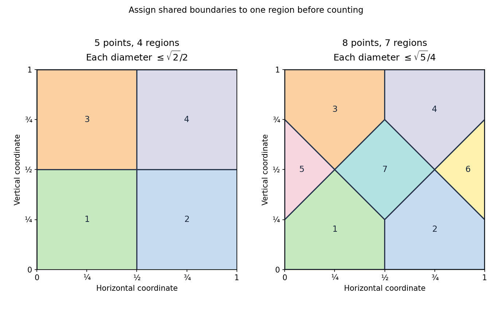

<h1 id="3/d/solution">Solution</h1>

↑ **Parent:** [D](../d.md)

For five points, partition the [unit square](../../../../../unit-square.md) into four [squares](../../../../../square.md) of side $1/2$. Assign boundary points to just one neighbouring piece. By the [pigeonhole principle](../../../../../pigeonhole-principle.md), two of the points lie in one piece, whose [diameter](../../../../../diameter.md) is its diagonal, $\sqrt{(1/2)^2+(1/2)^2}=\sqrt2/2$.

For eight points, use seven smaller-[diameter](../../../../../diameter.md) pieces rather than eight [rectangles](../../../../../rectangle.md). Start with the convex [pentagon](../../../../../pentagon.md)

$$
P=\operatorname{conv}\{(0,0),(1/2,0),(1/2,1/4),(1/4,1/2),(0,1/4)\}.
$$

Take its four reflected copies at the corners of the [square](../../../../../square.md). The remaining pieces are the left [triangle](../../../../../triangle.md) with vertices $(0,1/4),(1/4,1/2),(0,3/4)$, its right-hand [reflection](../../../../../reflection-mathematics.md), and the central diamond with vertices $(1/4,1/2),(1/2,1/4),(3/4,1/2),(1/2,3/4)$. These seven [polygons](../../../../../polygon.md) cover the [square](../../../../../square.md) with disjoint interiors. To verify coverage directly, for $0\leq y\leq1/4$ the two bottom pentagons split the horizontal section at $x=1/2$. For $1/4\leq y\leq1/2$, the five successive sections have endpoints $0,y-1/4,3/4-y,y+1/4,5/4-y,1$ and belong respectively to the left triangle, bottom-left pentagon, diamond, bottom-right pentagon and right triangle. Reflection gives the top half.

The [diameter of a finite convex hull](../../../../../diameter-of-a-finite-convex-hull.md) is the greatest [distance](../../../../../distance.md) between its vertices: if two points are [convex combinations](../../../../../convex-combination.md) of vertices, their difference is a [convex combination](../../../../../convex-combination.md) of [vertex](../../../../../vertex-graph-theory.md) differences, and the [triangle inequality](../../../../../triangle-inequality.md) bounds its [norm](../../../../../norm.md) by the largest such [distance](../../../../../distance.md). Checking the five vertices of $P$ gives [diameter](../../../../../diameter.md) $\sqrt{(1/2)^2+(1/4)^2}=\sqrt5/4$; [reflections](../../../../../reflection-mathematics.md) preserve that value. Each remaining [triangle](../../../../../triangle.md) and the diamond has [diameter](../../../../../diameter.md) $1/2$, which is smaller. After assigning shared boundaries to one piece, eight points in these seven pieces force a pair in a common piece. Hence **some pair is at [distance](../../../../../distance.md) at most $\sqrt5/4$**.

**[Figure 1](#3/d/image-four-and-seven-regions-give-the-two-distance-bounds-by-the-pigeonhole-principle). Four and seven regions give the two distance bounds by the pigeonhole principle**.

Both arguments are instances of a [pigeonhole distance bound from a partition](../../../../../pigeonhole-distance-bound-from-a-partition.md).

## ↑ Ancestors (12)

1. [D](../d.md)
2. [3](../../3.md)
3. [Discrete mathematics, continuous mathematics and probability resit](../../../discrete-mathematics-continuous-mathematics-and-probability-resit-split.md)
4. [2022](../../../split.md)
5. [Past exam of the year 1 of the computer science course of the University of Oxford](../../../../split.md)
6. [Year 1 of the computer science course of the University of Oxford](../../../../../year-1-of-the-computer-science-course-of-the-university-of-oxford.md)
7. [Computer science course of the University of Oxford](../../../../../computer-science-course-of-the-university-of-oxford.md)
8. [Undergraduate course of the University of Oxford](../../../../../undergraduate-course-of-the-university-of-oxford.md)
9. [Course of the University of Oxford](../../../../../course-of-the-university-of-oxford.md)
10. [University of Oxford](../../../../../university-of-oxford-split.md)
11. [List of universities](../../../../../list-of-universities.md)
12. [Codex Wiki](../../../../../split.md)
