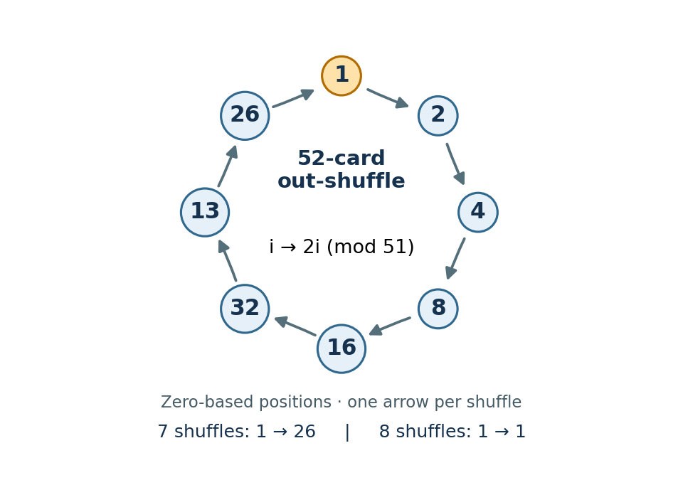

# Functional programming, design and analysis of algorithms (resit)

↑ **Parent:** [2022](../2022.md)

Solutions for all eight questions of the 5 September 2022, three-hour resit in the [Year 1 of the computer science course of the University of Oxford](../../university-of-oxford.md#year-1-of-the-computer-science-course-of-the-university-of-oxford). The cover date identifies this paper despite the archive member being filed under `2021/L`.

Public source: [Oxford-supplied archive, member 2021/L/a10097w1.pdf](https://www.whatdotheyknow.com/request/ba_computer_science_past_papers/response/2577745/attach/2/202402%20183%20CS%20Papers.zip?cookie_passthrough=1).[Cover, formal code A10097W1; original pages 2–8](../../computer-science-bibliography.md#functional-programming-design-and-analysis-of-algorithms-long-vacation-2022-by-university-of-oxford)

**Table of contents**

- [1](#1)
  - [a](#1/a)
    - [Solution](#1/a/solution)
  - [b](#1/b)
    - [Solution](#1/b/solution)
  - [c](#1/c)
    - [Solution](#1/c/solution)
  - [d](#1/d)
    - [Solution](#1/d/solution)
  - [e](#1/e)
    - [Solution](#1/e/solution)
- [2](#2)
  - [a](#2/a)
    - [Solution](#2/a/solution)
  - [b](#2/b)
    - [Solution](#2/b/solution)
  - [c](#2/c)
    - [Solution](#2/c/solution)
  - [d](#2/d)
    - [Solution](#2/d/solution)
  - [e](#2/e)
    - [Solution](#2/e/solution)
  - [f](#2/f)
    - [Solution](#2/f/solution)
  - [g](#2/g)
    - [Solution](#2/g/solution)
  - [h](#2/h)
    - [Solution](#2/h/solution)
- [3](#3)
  - [a](#3/a)
    - [Solution](#3/a/solution)
  - [b](#3/b)
    - [Solution](#3/b/solution)
  - [c](#3/c)
    - [Solution](#3/c/solution)
  - [d](#3/d)
    - [Solution](#3/d/solution)
  - [e](#3/e)
    - [Solution](#3/e/solution)
  - [f](#3/f)
    - [Solution](#3/f/solution)
  - [g](#3/g)
    - [Solution](#3/g/solution)
- [4](#4)
  - [a](#4/a)
    - [Solution](#4/a/solution)
  - [b](#4/b)
    - [Solution](#4/b/solution)
  - [c](#4/c)
    - [Solution](#4/c/solution)
  - [d](#4/d)
    - [Solution](#4/d/solution)
  - [e](#4/e)
    - [Solution](#4/e/solution)
  - [f](#4/f)
    - [Solution](#4/f/solution)
- [5](#5)
  - [a](#5/a)
    - [Solution](#5/a/solution)
  - [b](#5/b)
    - [Solution](#5/b/solution)
  - [c](#5/c)
    - [Solution](#5/c/solution)
- [6](#6)
  - [a](#6/a)
    - [Solution](#6/a/solution)
  - [b](#6/b)
    - [Solution](#6/b/solution)
  - [c](#6/c)
    - [Solution](#6/c/solution)
- [7](#7)
  - [a](#7/a)
    - [Solution](#7/a/solution)
  - [b](#7/b)
    - [Solution](#7/b/solution)
  - [c](#7/c)
    - [Solution](#7/c/solution)
  - [d](#7/d)
    - [Solution](#7/d/solution)
- [8](#8)
  - [a](#8/a)
    - [Solution](#8/a/solution)
  - [b](#8/b)
    - [Solution](#8/b/solution)
  - [c](#8/c)
    - [Solution](#8/c/solution)
  - [d](#8/d)
    - [Solution](#8/d/solution)

## 1

↑ **Parent:** [Functional programming, design and analysis of algorithms (resit)](functional-programming-design-and-analysis-of-algorithms-resit.md)

<h3 id="1/a">a</h3>

↑ **Parent:** [1](#1)

<h4 id="1/a/solution">Solution</h4>

↑ **Parent:** [A](#1/a)

For finite [lists](../../data-structure.md#list-abstract-data-type), use [structural induction](../../foundations-of-mathematics.md#structural-induction): establish `P []`; then, for arbitrary `x` and `xs`, assume `P xs` and prove `P (x:xs)`. The [induction hypothesis](../../foundations-of-mathematics.md#induction-hypothesis) must quantify over any other parameters that need to change in the step.

For _all_ [Haskell](../../programming-language.md#haskell) [list](../../data-structure.md#list-abstract-data-type) values, finite terminating spines are insufficient: also establish `P undefined`, and allow arbitrary, possibly undefined, heads in the cons step. This proves the equation for finite [partial lists](../../data-structure.md#partial-list) ending in the [bottom value](../../programming-language.md#bottom-value). An infinite [lazy list](../../data-structure.md#lazy-list) is the limit of these finite approximations. Equations between pure definable [computable functions](../../computability-theory.md#computable-function) are preserved by those limits, so the equation extends to infinite inputs. This last argument requires that admissibility property; an arbitrary logical property of [lists](../../data-structure.md#list-abstract-data-type) need not have it. The distinction between `[]` and the [bottom value](../../programming-language.md#bottom-value) is essential.[§3.1, Errors, and §3.17.2, Informal Semantics of Pattern Matching](../../computer-science-bibliography.md#haskell-2010-language-report)

<h3 id="1/b">b</h3>

↑ **Parent:** [1](#1)

<h4 id="1/b/solution">Solution</h4>

↑ **Parent:** [B](#1/b)

Take compatible [function types](../../programming-language.md#function-type) `f :: b -> c`, `g :: b -> a -> b`, and `h :: c -> a -> c`. The necessary conditions obtained from the two [induction base cases](../../foundations-of-mathematics.md#induction-base-case) are **strictness of `f` and the fusion equation**

$$
f(\bot)=\bot,\qquad f(g\ x\ y)=h\ (f\ x)\ y\quad\text{for all }x,y.
$$

At `zs = []`, the desired equation is exactly the displayed fusion equation. At `zs = undefined`, both [left folds](../../programming-language.md#left-fold) diverge because their [list](../../data-structure.md#list-abstract-data-type) argument has no outer constructor; the equation therefore requires `f undefined = undefined`. This is the [strict function](../../programming-language.md#strict-function) condition. If only finite total spines were considered, the first condition would not be necessary.

These conditions also support the step. The [induction hypothesis](../../foundations-of-mathematics.md#induction-hypothesis) must hold for _every_ accumulator and element. For `z:zs`, instantiate that hypothesis at `g x y` and `z`:
```
f (foldl g (g x y) (z:zs))
 = f (foldl g (g (g x y) z) zs)
 = foldl h (h (f (g x y)) z) zs
 = foldl h (h (h (f x) y) z) zs
 = foldl h (h (f x) y) (z:zs).
```
The middle rewrite uses the fusion equation at `x,y`. For pure [computable functions](../../computability-theory.md#computable-function), equality on infinite spines follows from finite approximations as in part (a).

<h3 id="1/c">c</h3>

↑ **Parent:** [1](#1)

<h4 id="1/c/solution">Solution</h4>

↑ **Parent:** [C](#1/c)

Prove the stronger equation, quantified over the accumulator:

$$
f(\operatorname{foldl}\ g\ a\ xs)=\operatorname{foldl}\ h\ (f\ a)\ xs\qquad\text{for all }a,xs.
$$

For `[]`, both sides are `f a`. For the [bottom value](../../programming-language.md#bottom-value), both sides are bottom because `f` is a [strict function](../../programming-language.md#strict-function). For the cons step, the universal [induction hypothesis](../../foundations-of-mathematics.md#induction-hypothesis) allows the accumulator to become `g a x`:
```
f (foldl g a (x:xs))
 = f (foldl g (g a x) xs)
 = foldl h (f (g a x)) xs
 = foldl h (h (f a) x) xs
 = foldl h (f a) (x:xs).
```
Thus [structural induction](../../foundations-of-mathematics.md#structural-induction) proves the claim for finite and finite partial spines; definable continuity extends it to infinite [lazy lists](../../data-structure.md#lazy-list). Pointwise equality is exactly the asserted equality of [function compositions](../../function.md#function-composition). This is the [left-fold fusion law](../../programming-language.md#left-fold-fusion-law).

<h3 id="1/d">d</h3>

↑ **Parent:** [1](#1)

<h4 id="1/d/solution">Solution</h4>

↑ **Parent:** [D](#1/d)

Use a type with distinct values `a` and `n`, and let `s _ y = y`. Suppose a direct [right fold](../../programming-language.md#list-fold) with the same result type represented this [left fold](../../programming-language.md#left-fold). The empty [list](../../data-structure.md#list-abstract-data-type) forces `k = n`. The singleton [lists](../../data-structure.md#list-abstract-data-type) force `c n n = n` and `c a n = a`. But then
```
foldr c k [a,n] = c a (c n n) = c a n = a,
foldl s n [a,n] = n.
```
Since `a /= n`, this is a [counterexample](../../foundations-of-mathematics.md#counterexample). A direct [right fold](../../programming-language.md#list-fold) cannot recover whether its tail result `n` came from the empty [list](../../data-structure.md#list-abstract-data-type) or from the singleton `[n]`. The obstruction already occurs on finite total inputs, so it also rules out an implementation valid on all [lazy lists](../../data-structure.md#lazy-list).

<h3 id="1/e">e</h3>

↑ **Parent:** [1](#1)

<h4 id="1/e/solution">Solution</h4>

↑ **Parent:** [E](#1/e)

Change the [right fold](../../programming-language.md#list-fold)'s result type to an accumulator-transforming [function type](../../programming-language.md#function-type):
```
foldlAsFoldr :: (b -> a -> b) -> b -> [a] -> b
foldlAsFoldr s n xs = foldr c id xs n
  where
    c x k a = k (s a x)
```
Thus **`c x k = \a -> k (s a x)` and `k = id`** in the question's notation. Here `c :: a -> (b -> b) -> (b -> b)`, and the fold's base value is the identity [function](../../function.md), not the initial accumulator `n`.

The [recursion invariant](../../algorithm.md#recursion-invariant) is `foldr c id xs a = foldl s a xs` for every `a`. For `[]`, both sides equal `a`. For a cons:
```
foldr c id (x:xs) a
 = c x (foldr c id xs) a
 = foldr c id xs (s a x)
 = foldl s (s a x) xs
 = foldl s a (x:xs).
```
At an undefined spine, applying the undefined folded [function](../../function.md) also gives the [bottom value](../../programming-language.md#bottom-value). The finite-approximation argument then covers infinite [lazy lists](../../data-structure.md#lazy-list). This is a [continuation representation of a left fold](../../programming-language.md#continuation-representation-of-a-left-fold): the result retains the operation still to be performed, avoiding the information loss in part (d).

## 2

↑ **Parent:** [Functional programming, design and analysis of algorithms (resit)](functional-programming-design-and-analysis-of-algorithms-resit.md)

<h3 id="2/a">a</h3>

↑ **Parent:** [2](#2)

<h4 id="2/a/solution">Solution</h4>

↑ **Parent:** [A](#2/a)

A value-bearing [perfect binary tree](../../data-structure.md#perfect-binary-tree) has size $w=2^{h+1}-1$, and the next size is $2w+1$. Suppose two size-$w$ trees have at least one smaller tree before them. The portion represented by these trees and that nonempty preceding portion has at least $2w+1$ elements. The greedy choice would have used a larger [perfect binary tree](../../data-structure.md#perfect-binary-tree) instead, contradicting the specified representation. Three size-$w$ trees are likewise impossible, since $3w\geq2w+1$. Therefore **the only possible repeated size is a pair at the beginning**. This is the representation invariant of a [skew-binary random-access list](../../data-structure.md#skew-binary-random-access-list).

<h3 id="2/b">b</h3>

↑ **Parent:** [2](#2)

<h4 id="2/b/solution">Solution</h4>

↑ **Parent:** [B](#2/b)

A [Haskell](../../programming-language.md#haskell) representation is:
```
import Prelude hiding (null, head, tail)

data RTree a = Leaf a | Node a (RTree a) (RTree a)
newtype List a = List [(Int, RTree a)]
```
Every tree stores a value at its root, including internal nodes. Interpret the [forest](../../tree-graph-theory.md#forest) by root-left-right [preorder traversal](../../tree-graph-theory.md#preorder-traversal), concatenating the results in [forest](../../tree-graph-theory.md#forest) order. Valid values have correct cached sizes, [perfect binary trees](../../data-structure.md#perfect-binary-tree), nondecreasing sizes and only the permitted initial duplicate. The raw constructors can express invalid representations, so the operations below assume valid values and should form the public interface. Sizes are assumed to fit in `Int`; the stated [time complexities](../../theoretical-computer-science.md#time-complexity) use constant-time size arithmetic.

<h3 id="2/c">c</h3>

↑ **Parent:** [2](#2)

<h4 id="2/c/solution">Solution</h4>

↑ **Parent:** [C](#2/c)

The empty [skew-binary random-access list](../../data-structure.md#skew-binary-random-access-list) contains no trees:
```
nil :: List a
nil = List []

null :: List a -> Bool
null (List []) = True
null _         = False
```
Both construction of `nil` and testing `null` take [constant time](../../theoretical-computer-science.md#constant-time).

<h3 id="2/d">d</h3>

↑ **Parent:** [2](#2)

<h4 id="2/d/solution">Solution</h4>

↑ **Parent:** [D](#2/d)

Only the first two trees need inspection:
```
cons :: a -> List a -> List a
cons x (List ((w,t):(v,u):ts))
  | w == v = List ((2*w+1, Node x t u):ts)
cons x (List ts) = List ((1, Leaf x):ts)
```
When the first sizes agree, place `x` above those two [perfect binary trees](../../data-structure.md#perfect-binary-tree). Its [preorder traversal](../../tree-graph-theory.md#preorder-traversal) is `x` followed by the old two traversals. No further size-$w$ tree can occur, so all remaining sizes are at least $2w+1$; equality creates at most the allowed initial duplicate. When the first sizes differ, adjoining a singleton is valid, including the case that the old first tree is also a singleton. These are exactly the two possible greedy representations after increasing the length by one. Each case creates a bounded number of constructors and inspects no tree interior, giving **worst-case $O(1)$ [time complexity](../../theoretical-computer-science.md#time-complexity)**. Existing trees are shared.

<h3 id="2/e">e</h3>

↑ **Parent:** [2](#2)

<h4 id="2/e/solution">Solution</h4>

↑ **Parent:** [E](#2/e)

Repeated [constant time](../../theoretical-computer-science.md#constant-time) insertion constructs the representation:
```
fromList :: [a] -> List a
fromList = foldr cons nil
```
The [right fold](../../programming-language.md#list-fold) preserves order because `cons` prepends its argument. On a finite length-$n$ [list](../../data-structure.md#list-abstract-data-type), there are $n$ calls of `cons`; completely constructing the result takes **$\Theta(n)$ time** and $O(n)$ constructors. This claim concerns finite inputs, not productivity of conversion from an infinite [lazy list](../../data-structure.md#lazy-list).

<h3 id="2/f">f</h3>

↑ **Parent:** [2](#2)

<h4 id="2/f/solution">Solution</h4>

↑ **Parent:** [F](#2/f)

The first tree's root is the first element. Deleting that root either discards a singleton or exposes two equal-sized child trees:
```
head :: List a -> a
head (List ((_,Leaf x):_))     = x
head (List ((_,Node x _ _):_)) = x
head (List []) = error "head: empty list"

tail :: List a -> List a
tail (List ((_,Leaf _):ts)) = List ts
tail (List ((w,Node _ l r):ts)) =
  let h = w `div` 2 in List ((h,l):(h,r):ts)
tail (List []) = error "tail: empty list"
```
For a node of size $w=2h+1$, both children have size $h$. Their order agrees with the old [preorder traversal](../../tree-graph-theory.md#preorder-traversal), and they become the sole permitted initial duplicate. The rest of the [forest](../../tree-graph-theory.md#forest) was no smaller than the old root tree. Thus both operations preserve the representation invariant and take **worst-case $O(1)$ time** on a nonempty [skew-binary random-access list](../../data-structure.md#skew-binary-random-access-list).

<h3 id="2/g">g</h3>

↑ **Parent:** [2](#2)

<h4 id="2/g/solution">Solution</h4>

↑ **Parent:** [G](#2/g)

Repeated root removal gives the conventional [list](../../data-structure.md#list-abstract-data-type):
```
toList :: List a -> [a]
toList rs
  | null rs   = []
  | otherwise = head rs : toList (tail rs)
```
The representation interpretation satisfies `toList (cons x rs) = x : toList rs`; alternatively, [structural induction](../../foundations-of-mathematics.md#structural-induction) on the number of stored elements proves that each step emits exactly the next [preorder traversal](../../tree-graph-theory.md#preorder-traversal) value. The output has $n$ cons cells, and each step takes [constant time](../../theoretical-computer-science.md#constant-time), so fully consuming it costs **$\Theta(n)$ time**. No repeated [list concatenation](../../data-structure.md#list-concatenation) is needed.

<h3 id="2/h">h</h3>

↑ **Parent:** [2](#2)

<h4 id="2/h/solution">Solution</h4>

↑ **Parent:** [H](#2/h)

Skip whole trees using their cached sizes, then descend through one tree:
```
index :: List a -> Int -> a
index (List ts) i
  | i < 0     = error "index: negative index"
  | otherwise = seek ts i
  where
    seek [] _ = error "index: out of bounds"
    seek ((w,t):us) j
      | j < w     = at w t j
      | otherwise = seek us (j-w)
    at _ (Leaf x) 0 = x
    at w (Node x l r) j
      | j == 0 = x
      | j <= h = at h l (j-1)
      | otherwise = at h r (j-1-h)
      where h = w `div` 2
    at _ _ _ = error "index: invalid representation"
```
After skipping a size-$w$ tree, the desired index decreases by $w$. Inside a node, position zero is the root, positions $1,\ldots,h$ belong to the left child and the following $h$ positions to the right child. This proves correctness by [structural induction](../../foundations-of-mathematics.md#structural-induction) on the search.

There are at most $\lceil\log_2(n+1)\rceil$ [forest](../../tree-graph-theory.md#forest) entries by the supplied bound, and each tree has logarithmic height. Consequently a valid query takes **$O(\log(n+1))$ time**, with logarithmic worst cases. On a conventional [linked list](../../data-structure.md#linked-list), `xs !! i` follows $i$ links and costs $\Theta(i+1)$, hence $\Theta(n)$ in the worst case. The first element remains a [constant time](../../theoretical-computer-science.md#constant-time) query in either representation.

## 3

↑ **Parent:** [Functional programming, design and analysis of algorithms (resit)](functional-programming-design-and-analysis-of-algorithms-resit.md)

<h3 id="3/a">a</h3>

↑ **Parent:** [3](#3)

<h4 id="3/a/solution">Solution</h4>

↑ **Parent:** [A](#3/a)

The following shared step consumes exactly one input element per recursive call of `group1`:
```
prependRun :: Eq a => a -> [[a]] -> [[a]]
prependRun x xss = (x:same):rest
  where
    ~(same,rest) = case xss of
      [] -> ([],[])
      run@(y:_):runs
        | x == y    -> (run,runs)
        | otherwise -> ([],xss)

group1 :: Eq a => [a] -> [[a]]
group1 []     = []
group1 (x:xs) = prependRun x (group1 xs)
```
The helper's input consists of nonempty runs. If its first run starts with `x`, prepend `x` to that run; otherwise create a new singleton run. [Structural induction](../../foundations-of-mathematics.md#structural-induction) proves that these are the maximal equal runs in order. The irrefutable pair binding `~(same,rest)` preserves [lazy evaluation](../../programming-language.md#lazy-evaluation): the first output group exposes its initial `x` without inspecting the recursively grouped tail. Thus even an infinite constant input can expose the first group and each finite prefix of that group. Finite inputs take [linear time](../../theoretical-computer-science.md#linear-time) when [equality tests](../../algorithm.md#equality-test) take [constant time](../../theoretical-computer-science.md#constant-time).

<h3 id="3/b">b</h3>

↑ **Parent:** [3](#3)

<h4 id="3/b/solution">Solution</h4>

↑ **Parent:** [B](#3/b)

Use the same step from part (a):
```
groupFold :: Eq a => [a] -> [[a]]
groupFold = foldr prependRun []
```
The [right fold](../../programming-language.md#list-fold) obeys `groupFold [] = []` and `groupFold (x:xs) = prependRun x (groupFold xs)`, exactly the recursive equations already proved. Both implementations give the [bottom value](../../programming-language.md#bottom-value) for an entirely undefined input spine. Their equal behaviour on finite [partial lists](../../data-structure.md#partial-list), together with definable continuity, establishes equality on infinite [lazy lists](../../data-structure.md#lazy-list) as well. The helper's irrefutable binding is what lets the first run be produced without demanding that all subsequent runs already exist.

<h3 id="3/c">c</h3>

↑ **Parent:** [3](#3)

<h4 id="3/c/solution">Solution</h4>

↑ **Parent:** [C](#3/c)

A call can instead produce an entire run and recurse on the unused input:
```
groupRuns :: Eq a => [a] -> [[a]]
groupRuns [] = []
groupRuns (x:xs) = (x:ys) : groupRuns zs
  where (ys,zs) = span (== x) xs
```
Here `span` returns the longest matching [prefix of a list](../../data-structure.md#prefix-of-a-list) and the remaining [suffix of a list](../../data-structure.md#suffix-of-a-list). Thus `x:ys` is the first maximal run, while `zs` begins the next run or is empty. Each recursive call produces one outer output element. The lazy pair binding permits output of the first constructor before the run's endpoint is known. Every finite input position is scanned a bounded number of times, so the [time complexity](../../theoretical-computer-science.md#time-complexity) is $\Theta(n)$ for unit-cost equality, including output construction.[Chapter 9, Standard Prelude, definition of span](../../computer-science-bibliography.md#haskell-2010-language-report)

<h3 id="3/d">d</h3>

↑ **Parent:** [3](#3)

<h4 id="3/d/solution">Solution</h4>

↑ **Parent:** [D](#3/d)

The [list unfold](../../programming-language.md#list-unfold) operation has the following [type signature](../../programming-language.md#type-signature) and definition:
```
unfoldr :: (s -> Maybe (a,s)) -> s -> [a]
unfoldr step s = case step s of
  Nothing     -> []
  Just (x,s') -> x : unfoldr step s'

groupUnfold :: Eq a => [a] -> [[a]]
groupUnfold = unfoldr next
  where
    next [] = Nothing
    next (x:xs) = Just (x:ys,zs)
      where (ys,zs) = span (== x) xs
```
The seed is the unprocessed [suffix of a list](../../data-structure.md#suffix-of-a-list). An empty seed terminates the unfold; otherwise `next` returns the first maximal run and precisely the seed for the next call. Substituting the definition of `unfoldr` recovers part (c)'s equations, proving correctness. The `Just` pair and first group constructor can be produced before `span` finishes, retaining the same [lazy evaluation](../../programming-language.md#lazy-evaluation) behaviour.

<h3 id="3/e">e</h3>

↑ **Parent:** [3](#3)

<h4 id="3/e/solution">Solution</h4>

↑ **Parent:** [E](#3/e)

Share the recursive pair and inspect the [predicate](../../analysis-of-boolean-functions.md#predicate) once:
```
partition :: (a -> Bool) -> [a] -> ([a],[a])
partition _ [] = ([],[])
partition p (x:xs)
  | p x       = (x:yes,no)
  | otherwise = (yes,x:no)
  where ~(yes,no) = partition p xs
```
For a finite [list](../../data-structure.md#list-abstract-data-type), [structural induction](../../foundations-of-mathematics.md#structural-induction) establishes that `yes` and `no` are the two required filtered subsequences. The guard evaluates `p x` once and prepends `x` to exactly one output, preserving input order in both. Fully consuming both results uses $n$ [predicate](../../analysis-of-boolean-functions.md#predicate) applications and $\Theta(n)$ additional work. Sharing the recursive result avoids making separate recursive traversals. This is a [stable list partition](../../programming-language.md#stable-list-partition).

<h3 id="3/f">f</h3>

↑ **Parent:** [3](#3)

<h4 id="3/f/solution">Solution</h4>

↑ **Parent:** [F](#3/f)

Choose the first unclassified element as the next [equivalence class representative](../../set-theory.md#equivalence-class-representative):
```
equiv :: Eq a => [a] -> [[a]]
equiv [] = []
equiv (x:xs) = (x:same) : equiv rest
  where ~(same,rest) = partition (== x) xs
```
Assume the `Eq` instance is an [equivalence relation](../../set-theory.md#equivalence-relation). The [stable list partition](../../programming-language.md#stable-list-partition) collects every later occurrence equivalent to `x`, and `rest` contains none of that [equivalence class](../../set-theory.md#equivalence-class). [Induction](../../foundations-of-mathematics.md#mathematical-induction) therefore gives exactly one group per class, preserving order within each group and ordering groups by their first occurrence. For $d$ distinct classes, each input element is tested against at most $d$ representatives: the cost is $O(nd)$ and **$\Theta(n^2)$ in the all-distinct worst case**; a single class takes $\Theta(n)$.

The [equality-only grouping lower bound](../../algorithm.md#equality-only-grouping-lower-bound) shows that this worst case is unavoidable in the unrestricted equality-oracle model. On an all-distinct input, an untested pair could instead be equal without changing any observed comparison. Certifying that all $n$ elements belong to different classes therefore requires all $\binom n2$ pairwise [equality tests](../../algorithm.md#equality-test).

<h3 id="3/g">g</h3>

↑ **Parent:** [3](#3)

<h4 id="3/g/solution">Solution</h4>

↑ **Parent:** [G](#3/g)

A compatible `Ord` instance supplies a [total order](../../set.md#total-order), so use [comparison sort](../../algorithm.md#comparison-sort) to put equal values together in $O(n\log n)$ time and then group adjacent equals in [linear time](../../theoretical-computer-science.md#linear-time). To preserve the first-occurrence group ordering of part (f), first tag every element with its original index and [stable sorting](../../algorithm.md#stable-sorting) by value. Group the sorted records by value; stability preserves their internal input order. Each group's first record carries its smallest original index. Sort the groups by that index and finally remove the tags. The second sort has at most $n$ records, so the total remains **$O(n\log n)$ time** and $O(n)$ storage. Merely returning the value-sorted groups could reorder the classes, so the index step matters when preserving the exact earlier convention. The stronger interface evades the equality-only lower bound by permitting order comparisons.

## 4

↑ **Parent:** [Functional programming, design and analysis of algorithms (resit)](functional-programming-design-and-analysis-of-algorithms-resit.md)

<h3 id="4/a">a</h3>

↑ **Parent:** [4](#4)

<h4 id="4/a/solution">Solution</h4>

↑ **Parent:** [A](#4/a)

For finite even [lists](../../data-structure.md#list-abstract-data-type), these definitions take at most [linear time](../../theoretical-computer-science.md#linear-time):
```
halve :: [a] -> ([a],[a])
halve xs = splitAt (length xs `div` 2) xs

pairs :: [a] -> [(a,a)]
pairs [] = []
pairs (x:y:xs) = (x,y) : pairs xs
pairs [_] = error "pairs: odd length"
```
The length calculation and the prefix split each take $O(n)$ time. The second operation consumes two constructors per step and emits one pair. Under the stated even-length precondition, neither definition encounters an unmatched final element.

<h3 id="4/b">b</h3>

↑ **Parent:** [4](#4)

<h4 id="4/b/solution">Solution</h4>

↑ **Parent:** [B](#4/b)

Join either two halves or successive pairs:
```
unhalve :: ([a],[a]) -> [a]
unhalve (xs,ys) = xs ++ ys

unpairs :: [(a,a)] -> [a]
unpairs = foldr (\(x,y) zs -> x:y:zs) []
```
By the defining property of `splitAt`, concatenating the two halves restores the original [list](../../data-structure.md#list-abstract-data-type). For `unpairs`, [structural induction](../../foundations-of-mathematics.md#structural-induction) on the even input proves that its first pair restores its first two elements and the recursive result restores the rest. Thus both requested [function compositions](../../function.md#function-composition) are the identity. Fully consuming either result takes at most [linear time](../../theoretical-computer-science.md#linear-time); [list concatenation](../../data-structure.md#list-concatenation) only copies the left half once.

<h3 id="4/c">c</h3>

↑ **Parent:** [4](#4)

<h4 id="4/c/solution">Solution</h4>

↑ **Parent:** [C](#4/c)

Interleave equal halves, or collect the first and second components of adjacent pairs:
```
riffle :: [a] -> [a]
riffle = unpairs . uncurry zip . halve

unriffle :: [a] -> [a]
unriffle = unhalve . unzip . pairs
```
For halves `as` and `bs` of equal length, `pairs (riffle xs) = zip as bs`, and `unzip (zip as bs) = (as,bs)`. Therefore `unriffle (riffle xs) = xs`. Conversely, starting from the adjacent pairs of any even [list](../../data-structure.md#list-abstract-data-type), separating the components, halving their concatenation and zipping them restores those same pairs. Hence `riffle (unriffle xs) = xs` too. Every stage takes [linear time](../../theoretical-computer-science.md#linear-time). This [perfect out-shuffle](../../combinatorics.md#perfect-out-shuffle) leaves the first and last positions fixed.

<h3 id="4/d">d</h3>

↑ **Parent:** [4](#4)

<h4 id="4/d/solution">Solution</h4>

↑ **Parent:** [D](#4/d)

**For the defined shuffle, `count 52 = 8`.** The printed assertion about seven shuffles is inconsistent with the actual [permutation](../../combinatorics.md#permutation). Number positions from zero. On an even length $n>2$, a position $i<n-1$ moves to $2i\bmod(n-1)$, while the last position stays fixed. Indeed, positions in the first half move to $2i$, and positions in the second half move to $2i-(n-1)$. Consequently the number sought is the [multiplicative order](../../number-theory.md#multiplicative-order) of $2$ modulo $n-1$:
```
count :: Int -> Int
count n
  | n < 0 || odd n = error "count: nonnegative even length required"
  | n <= 2 = 1
  | otherwise = go 1 (2 `mod` m)
  where
    m = toInteger n - 1
    go k r
      | r == 1    = k
      | otherwise = go (k+1) ((2*r) `mod` m)
```
Here the identity's period means the least _positive_ number of applications, so the empty and two-element [lists](../../data-structure.md#list-abstract-data-type) have period one. Since $n-1$ is odd, $2$ is invertible modulo $n-1$, ensuring termination. Using `Integer` for residues avoids overflow in doubling; the mathematical correctness assumes the returned period fits `Int`. The algorithm uses one modular update per shuffle in the period, rather than constructing each shuffled deck.

For $n=52$, $2^8\equiv1\pmod{51}$, whereas $2$, $2^2$ and $2^4$ are not congruent to one, ruling out every proper divisor of eight. After seven shuffles, the original position $1$ is at position $26$, not back at $1$.

<a id="4/d/image-an-eight-step-position-cycle-under-the-52-card-perfect-out-shuffle"></a>


**[Figure 1](#4/d/image-an-eight-step-position-cycle-under-the-52-card-perfect-out-shuffle). An eight-step position cycle under the 52-card perfect out-shuffle**.

This single position already disproves a seven-step return; the modular calculation proves that the whole [permutation](../../combinatorics.md#permutation) returns after eight.

<h3 id="4/e">e</h3>

↑ **Parent:** [4](#4)

<h4 id="4/e/solution">Solution</h4>

↑ **Parent:** [E](#4/e)

Apply the supplied bitonic-merging fact directly:
```
merge :: Ord a => [a] -> [a]
merge xs = rounds (levels (length xs)) xs
  where
    levels n
      | n <= 1    = 0
      | otherwise = 1 + levels (n `div` 2)
    order (x,y)
      | x <= y    = (x,y)
      | otherwise = (y,x)
    pass = unpairs . map order . pairs . riffle
    rounds 0 ys = ys
    rounds r ys = rounds (r-1) (pass ys)
```
For length $n=2^k$, `levels n = k`. Each `pass` performs exactly the required shuffle and adjacent compare-exchange operations. The supplied fact therefore proves that `rounds k` yields ascending order from a [bitonic sequence](../../sequence-and-series.md#bitonic-sequence). Each pass preserves the [multiset](../../set.md#multiset) of entries and costs $\Theta(n)$, giving **$\Theta(n\log n)$ time** for $n\ge2$. Length one needs no pass. The definition also harmlessly returns `[]` on empty input.

<h3 id="4/f">f</h3>

↑ **Parent:** [4](#4)

<h4 id="4/f/solution">Solution</h4>

↑ **Parent:** [F](#4/f)

Sort the two halves ascending, reverse the second, and concatenate to form a [bitonic sequence](../../sequence-and-series.md#bitonic-sequence):
```
sort :: Ord a => [a] -> [a]
sort []  = []
sort [x] = [x]
sort xs  = merge (sort as ++ reverse (sort bs))
  where (as,bs) = halve xs
```
For a power-of-two length greater than one, both halves are smaller powers of two. By [induction](../../foundations-of-mathematics.md#mathematical-induction), the recursive calls return ascending [permutations](../../combinatorics.md#permutation) of their respective inputs. Reversal makes the second half descending, so part (e)'s precondition holds and `merge` sorts their concatenation without losing entries. This proves both [sortedness](../../algorithm.md#sortedness) and [sorting permutation preservation](../../algorithm.md#sorting-permutation-preservation). Its [recurrence relation](../../sequence-and-series.md#recurrence-relation) is $T(n)=2T(n/2)+\Theta(n\log n)$, so summing the levels gives **$\Theta(n(\log n)^2)$ time**. Equal keys cause no difficulty; ascending and descending here permit equality. This is a [bitonic sorting algorithm](../../algorithm.md#bitonic-sorting-algorithm).

## 5

↑ **Parent:** [Functional programming, design and analysis of algorithms (resit)](functional-programming-design-and-analysis-of-algorithms-resit.md)

<h3 id="5/a">a</h3>

↑ **Parent:** [5](#5)

<h4 id="5/a/solution">Solution</h4>

↑ **Parent:** [A](#5/a)

For the first [recurrence relation](../../sequence-and-series.md#recurrence-relation), the [master theorem](../../sequence-and-series.md#master-theorem) compares $n^2$ with $n^{\log_2 6}$. Since $2<\log_2 6$, the recursive leaves dominate and the answer is **$\Theta(n^{\log_2 6})$**. More explicitly, the work at depth $j$ is $n^2(6/4)^j$, a growing [geometric series](../../sequence-and-series.md#geometric-series) that stops at depth $\log_2 n-O(1)$, where its sum has that order.

For the second [recurrence relation](../../sequence-and-series.md#recurrence-relation), each step subtracts two and adds one until reaching a base case. For integral $n>4$ there are $\lceil(n-4)/2\rceil$ steps, so $T(n)=1+\lceil(n-4)/2\rceil$ and the answer is **$\Theta(n)$**.

The third set of printed requirements is inconsistent. The specified base values and its [recurrence relation](../../sequence-and-series.md#recurrence-relation) give $T(n)=1$ identically, as [strong induction](../../foundations-of-mathematics.md#strong-induction) immediately verifies: $4\cdot1-4\cdot1+1=1$. In particular $T(8)=1$, while the extra condition demands $T(8)>2T(4)=2$. Thus **no [function](../../function.md) satisfies all the printed conditions**. Dropping that extra inequality gives **$\Theta(1)$**.

The likely intended growth calculation can nevertheless be made precise, without treating it as a solution of the contradictory data. On dyadic arguments put $U_j=T(2^j)$. Its equation has the general form

$$
U_j=1+(A+Bj)2^j,
$$

because $U_j-1$ has characteristic equation $(r-2)^2=0$. The printed values $U_1=U_2=1$ force $A=B=0$. With suitably different initial values, the condition $U_j>2U_{j-1}$ for arbitrarily large $j$ instead requires $B2^j-1>0$, hence $B>0$ and $U_j=\Theta(j2^j)$, or $T(n)=\Theta(n\log n)$. That last order describes corrected initial data, not the paper as printed. All three bullets belong to this single marked part.

<h3 id="5/b">b</h3>

↑ **Parent:** [5](#5)

<h4 id="5/b/solution">Solution</h4>

↑ **Parent:** [B](#5/b)

Maintain the two largest entries of each segment, counting repeated values as separate entries. A singleton returns its value and a sentinel $-\infty$ for its missing runner-up. Split a longer segment into two nonempty halves, recursively obtain $(m_L,s_L)$ and $(m_R,s_R)$, and combine them by

$$
(m,s)=\begin{cases}
(m_L,\max(s_L,m_R)),&m_L\ge m_R,\\
(m_R,\max(m_L,s_R)),&m_L<m_R.
\end{cases}
$$

For example, an implementation on an indexed [sequence](../../sequence-and-series.md#sequence) can use:
```
top2(lo, hi):
    if hi-lo == 1: return (a[lo], -infinity)
    mid = (lo+hi)//2
    (mL,sL) = top2(lo,mid)
    (mR,sR) = top2(mid,hi)
    if mL >= mR: return (mL, max(sL,mR))
    else:        return (mR, max(mL,sR))
```
The result is `top2(0,n)`. The global maximum is one of the two child maxima. Once its side is identified, the global second maximum is either that side's runner-up or the other side's maximum; the displayed formula exhausts these possibilities. This proves the [divide-and-conquer algorithm](../../algorithm.md#divide-and-conquer-algorithm) by [induction](../../foundations-of-mathematics.md#mathematical-induction) on segment length. There are $n$ leaves and $n-1$ constant-cost combinations, so its [time complexity](../../theoretical-computer-science.md#time-complexity) is **$\Theta(n)$**, with $O(\log n)$ recursive stack space for balanced splits. A `Maybe` value can replace the formal sentinel for a generic ordered element type. If both largest entries are equal, both are returned; a second _distinct_ value is a different specification.

<h3 id="5/c">c</h3>

↑ **Parent:** [5](#5)

<h4 id="5/c/solution">Solution</h4>

↑ **Parent:** [C](#5/c)

For each segment retain its total weight $S$, largest possibly-empty prefix weight $P$, largest possibly-empty suffix weight $Q$, and largest possibly-empty internal contiguous weight $B$. The [maximum-subarray segment summary](../../algorithm.md#maximum-subarray-segment-summary) combines adjacent segments as

$$
\begin{aligned}
S&=S_L+S_R,\\
P&=\max(P_L,S_L+P_R),\\
Q&=\max(Q_R,S_R+Q_L),\\
B&=\max(B_L,B_R,Q_L+P_R).
\end{aligned}
$$

An empty segment has all four values zero. For a singleton of weight $x$, use $(x,\max(0,x),\max(0,x),\max(0,x))$. The recursive procedure splits into halves, computes their summaries and applies these four formulas; the root's $B$ is the desired maximum weight.

To return an actual subsequence, attach half-open endpoints to each of $P,Q,B$. A prefix endpoint starts at its segment's left boundary, and a suffix endpoint ends at its right boundary, including empty prefixes and suffixes. Store the interval belonging to whichever candidate wins a maximum. The crossing candidate joins a left suffix to a right prefix, which meet at the split point; the other candidates keep their child endpoints. Choose an empty interval on ties at weight zero. Return the root's winning interval as a slice of the original input. This augmentation still has constant-size state and constant-time combinations.

For correctness, a prefix either stays inside the left half or consists of the entire left half and a right prefix. The suffix argument is symmetric. An optimal contiguous segment either lies in one half or crosses the split, in which case it consists of a left suffix and a right prefix. Each upper bound in the formulas is attained by its recorded candidate, proving exactness. Empty candidates ensure that an all-negative input returns the empty subsequence.

There are $\Theta(n)$ tree nodes, each using a constant number of additions and comparisons. The [divide-and-conquer algorithm](../../algorithm.md#divide-and-conquer-algorithm) therefore takes **$\Theta(n)$ time** and $O(\log n)$ stack space, plus the cost of copying the returned slice if a copy is required. In the stated example it selects zero-based interval $[3,6)$ of weight **8**. Carrying all four summary values avoids rescanning the halves at each split.

## 6

↑ **Parent:** [Functional programming, design and analysis of algorithms (resit)](functional-programming-design-and-analysis-of-algorithms-resit.md)

<h3 id="6/a">a</h3>

↑ **Parent:** [6](#6)

<h4 id="6/a/solution">Solution</h4>

↑ **Parent:** [A](#6/a)

Use positive integral item weights and a nonnegative integral capacity. For the [unbounded knapsack problem](../../mathematical-optimization.md#unbounded-knapsack-problem), define $K(c)$ to be the best value with total weight _at most_ $c$. Then

$$
\boxed{K(c)=\max\bigl(\{0\}\cup\{v_i+K(c-w_i):1\le i\le n,\ w_i\le c\}\bigr),\quad K(0)=0.}
$$

The zero candidate is the empty selection, so unused capacity is allowed and an empty set of fitting items causes no problem. Every nonempty feasible selection has some last item $i$; removing one copy leaves a feasible solution at capacity $c-w_i$. Its value is bounded by the corresponding candidate. Conversely, taking an optimal smaller selection and adding that item attains the candidate, proving the [recurrence relation](../../sequence-and-series.md#recurrence-relation) by [optimal substructure](../../mathematical-optimization.md#optimal-substructure). Positive weights make every dependency strictly smaller.

Fill capacities in increasing order. There are $W+1$ entries, each scanning $n$ items, so the [dynamic programming](../../mathematical-optimization.md#dynamic-programming) takes $O(nW)$ time and $O(W)$ storage. A winning item pointer at each capacity reconstructs the chosen multiplicities. These are capacity-dependent, [pseudopolynomial](../../theoretical-computer-science.md#pseudopolynomial-time) bounds. For zero-weight items, any positive value makes the repetition problem unbounded; nonpositive-value zero-weight items may simply be discarded before using the recurrence.

<h3 id="6/b">b</h3>

↑ **Parent:** [6](#6)

<h4 id="6/b/solution">Solution</h4>

↑ **Parent:** [B](#6/b)

Capacity alone cannot say which items have already been used. For the [0-1 knapsack problem](../../mathematical-optimization.md#0-1-knapsack-problem), let $D(i,c)$ use only the first $i$ items, each at most once. Then

$$
\boxed{D(0,c)=0,\qquad D(i,c)=\begin{cases}
D(i-1,c),&w_i>c,\\
\max\{D(i-1,c),\ v_i+D(i-1,c-w_i)\},&w_i\le c.
\end{cases}}
$$

The two alternatives omit item $i$ or take it. In the latter case its remaining companions must solve the smaller problem using the first $i-1$ items; otherwise replacing them would improve the whole selection. Both branches reduce the item index, so taking item $i$ cannot take it again. This establishes the [recurrence relation](../../sequence-and-series.md#recurrence-relation) and [optimal substructure](../../mathematical-optimization.md#optimal-substructure).

Fill rows in increasing $i$ and return $D(n,W)$. There are $O(nW)$ entries with constant work each. Store the decisions for reconstruction; value-only computation uses $O(W)$ space by keeping two rows, or by scanning capacities downwards in a single row. A forward scan in a single row would instead allow repetitions. Nonnegative integral weights suffice for this version, including zero-weight items, because the item index always decreases.

<h3 id="6/c">c</h3>

↑ **Parent:** [6](#6)

<h4 id="6/c/solution">Solution</h4>

↑ **Parent:** [C](#6/c)

This version of [Kadane's algorithm](../../algorithm.md#kadane-s-algorithm), named for [Joseph Born Kadane](../../probability-and-statistics.md#joseph-born-kadane), permits the empty subsequence. For $j\ge1$, let $E_j$ be the maximum of zero and the weight of a contiguous subsequence ending exactly at position $j$. Let $B_j$ be the best weight anywhere in the first $j$ positions. Use

$$
\boxed{E_0=B_0=0,\qquad E_j=\max(0,E_{j-1}+a_j),\qquad B_j=\max(B_{j-1},E_j).}
$$

A segment ending at $j$ either extends one ending at $j-1$ or starts at $j$; the zero candidate permits discarding a negative predecessor and the empty answer. Any best segment of the first $j$ positions either ends at $j$ or already occurs in the first $j-1$. These two decompositions prove the [dynamic programming](../../mathematical-optimization.md#dynamic-programming) equations by [induction](../../foundations-of-mathematics.md#mathematical-induction).

Here is an implementation returning endpoints, using zero-based indexing:
```
best_segment(a):
    end_weight = best_weight = 0
    start = best_lo = best_hi = 0
    for j in range(len(a)):
        trial = end_weight + a[j]
        if trial <= 0:
            end_weight = 0
            start = j+1
        else:
            end_weight = trial
        if end_weight > best_weight:
            best_weight = end_weight
            best_lo, best_hi = start, j+1
    return (best_lo, best_hi, best_weight)
```
There is exactly **one addition per input element**, hence $n$ additions and $O(n)$ comparisons. Auxiliary storage is $O(1)$. The all-negative case retains interval $[0,0)$ and weight zero. The example returns $[3,6)$ and weight **8**, hence the desired contiguous subsequence.

## 7

↑ **Parent:** [Functional programming, design and analysis of algorithms (resit)](functional-programming-design-and-analysis-of-algorithms-resit.md)

<h3 id="7/a">a</h3>

↑ **Parent:** [7](#7)

<h4 id="7/a/solution">Solution</h4>

↑ **Parent:** [A](#7/a)

The [Dijkstra algorithm](../../shortest-path-problem.md#dijkstra-algorithm) finalises [vertices](../../graph.md#vertex-graph-theory) in the order **$1,3,2,5,4$**. After finalising $1$, tentative distances to $2,3$ are $3,2$. Finalising $3$ sets the distance to $5$ to $4$. Finalising $2$ sets the distance to $4$ to $6$. Finalising $5$ improves the distance to $4$ to $5$; its [edge](../../graph-theory.md#edge-of-a-graph) to $2$ proposes $5$ and causes no improvement. The final distance vector in [vertex](../../graph.md#vertex-graph-theory) order is **$(0,3,2,5,4)$**. All weights are positive, so every finalisation is justified by the usual [label-setting shortest-path algorithm](../../shortest-path-problem.md#label-setting-shortest-path-algorithm) invariant. The method is named for [Edsger W. Dijkstra](../../computer-science.md#edsger-w-dijkstra).

<h3 id="7/b">b</h3>

↑ **Parent:** [7](#7)

<h4 id="7/b/solution">Solution</h4>

↑ **Parent:** [B](#7/b)

The intermediate states of the [Bellman-Ford algorithm](../../shortest-path-problem.md#bellman-ford-algorithm) depend on [edge](../../graph-theory.md#edge-of-a-graph) order. Specify in-place [edge relaxation](../../shortest-path-problem.md#edge-relaxation) in lexicographic directed-edge order:

$$
(1,2),(1,3),(2,3),(2,4),(3,5),(5,2),(5,4).
$$

Starting with $(0,\infty,\infty,\infty,\infty)$, the first pass changes the vector as follows; omitted relaxations make no change:

$$
\begin{array}{c|ccccc}
\text{after edge}&d_1&d_2&d_3&d_4&d_5\\\hline
(1,2)&0&3&\infty&\infty&\infty\\
(1,3)&0&3&2&\infty&\infty\\
(2,4)&0&3&2&6&\infty\\
(3,5)&0&3&2&6&4\\
(5,4)&0&3&2&5&4
\end{array}
$$

The next pass makes no change, allowing early termination. If all $|V|-1=4$ passes are performed, passes two through four retain **$(0,3,2,5,4)$**.

For the synchronous convention, where every relaxation reads only the previous row, the [Synchronous Bellman-Ford recurrence](../../shortest-path-problem.md#synchronous-bellman-ford-recurrence) instead gives

$$
\begin{array}{c|ccccc}
\text{allowed edges}&d_1&d_2&d_3&d_4&d_5\\\hline
0&0&\infty&\infty&\infty&\infty\\
1&0&3&2&\infty&\infty\\
2&0&3&2&6&4\\
3&0&3&2&5&4\\
4&0&3&2&5&4
\end{array}
$$

Both conventions reach the same shortest distances. The algorithm's eponyms are [Richard Bellman](../../mathematics.md#richard-bellman) and [L. R. Ford Jr.](../../mathematics.md#l-r-ford-jr).

<h3 id="7/c">c</h3>

↑ **Parent:** [7](#7)

<h4 id="7/c/solution">Solution</h4>

↑ **Parent:** [C](#7/c)

Let $N=|V|$ and replace every [edge](../../graph-theory.md#edge-of-a-graph) weight by **$w'(e)=Nw(e)+1$**. Call the supplied shortest-path routine once using these new weights, and return its path in the original graph. For every path $P$,

$$
w'(P)=Nw(P)+|P|,
$$

where $|P|$ is its number of [edges](../../graph-theory.md#edge-of-a-graph). Positive original weights imply positive transformed weights, so a shortest route can be taken to be simple and has at most $N-1$ [edges](../../graph-theory.md#edge-of-a-graph). Distinct integral original weights of paths differ by at least one. Thus if $w(P)<w(Q)$ for simple paths, then

$$
w'(Q)-w'(P)=N\bigl(w(Q)-w(P)\bigr)+|Q|-|P|\ge N-(N-1)>0.
$$

For equal original weights, the transformed comparison is exactly the comparison of hop counts. Therefore every transformed shortest path minimises original weight first and number of [edges](../../graph-theory.md#edge-of-a-graph) second, proving the [integer-weight shortest-path tie-breaking lemma](../../shortest-path-problem.md#integer-weight-shortest-path-tie-breaking-lemma). The transformation costs $O(N+|E|)$ time, followed by one subroutine call. Weights gain only $O(\log N)$ bits; exact arithmetic should be used if multiplying machine-sized weights might overflow. If $t$ is unreachable, it remains unreachable.

<h3 id="7/d">d</h3>

↑ **Parent:** [7](#7)

<h4 id="7/d/solution">Solution</h4>

↑ **Parent:** [D](#7/d)

Use a [dynamic programming state](../../mathematical-optimization.md#dynamic-programming-state) indexed by an [edge](../../graph-theory.md#edge-of-a-graph) budget. Put $D_0(s)=0$ and $D_0(v)=\infty$ for $v\ne s$, then for $r=1,\ldots,k$ compute

$$
\boxed{D_r(v)=\min\left(D_{r-1}(v),\ \min_{(u,v)\in E}\{D_{r-1}(u)+w(u,v)\}\right).}
$$

Every route using at most $r$ [edges](../../graph-theory.md#edge-of-a-graph) either already uses at most $r-1$, or ends with some [edge](../../graph-theory.md#edge-of-a-graph) $(u,v)$ whose preceding route uses at most $r-1$. Conversely every finite candidate in the displayed equation is attained by such a route. This proves the [hop-bounded shortest-route recurrence](../../shortest-path-problem.md#hop-bounded-shortest-route-recurrence) by [induction](../../foundations-of-mathematics.md#mathematical-induction) on $r$, even when weights are negative.

In each round, copy the previous distance row and relax every [edge](../../graph-theory.md#edge-of-a-graph) into the new row, always reading from the old row. An in-place pass would allow several new [edges](../../graph-theory.md#edge-of-a-graph) in one round and violate the [edge](../../graph-theory.md#edge-of-a-graph) budget. Store a predecessor record for every selected candidate, either a carry to $(r-1,v)$ or the incoming [edge](../../graph-theory.md#edge-of-a-graph) from $(r-1,u)$. Following records backwards from $(k,t)$ and reversing the collected [edges](../../graph-theory.md#edge-of-a-graph) returns the actual optimum route; an infinite final distance means no feasible route exists.

Only [vertices](../../graph.md#vertex-graph-theory) incident to an [edge](../../graph-theory.md#edge-of-a-graph), together with $s,t$, need distance fields. In a graph representation whose [edges](../../graph-theory.md#edge-of-a-graph) reference [vertex](../../graph.md#vertex-graph-theory) records, initialise those fields by visiting both endpoints of every [edge](../../graph-theory.md#edge-of-a-graph), then $s,t$; repeated initialisations are harmless. In each round, first copy old fields to new fields by another complete endpoint pass, and only then begin the relaxation pass. Copying the same endpoint several times before any relaxation also does no harm. Thus each round costs $O(m+1)$, with no scan of isolated [vertices](../../graph.md#vertex-graph-theory), and for $m,k\ge1$ the total is **$O(km)$ time**. An implementation that instead initialises full arrays for all [vertices](../../graph.md#vertex-graph-theory) has the conventional bound $O(|V|+km)$. For $k=0$ or no [edges](../../graph-theory.md#edge-of-a-graph), only the empty route $s=t$ can succeed.

To realise reconstruction without a dense table, associate a persistent route record with each finite distance. A successful relaxation in round $r$ creates a record containing the new [edge](../../graph-theory.md#edge-of-a-graph) and a pointer to the old round's route record at its source; a carry shares its record. All reads use old-round records. At most $km$ such records are created, taking $O(km)$ space, and the returned chain has at most $k$ [edges](../../graph-theory.md#edge-of-a-graph). Distances alone need only two fields per relevant [vertex](../../graph.md#vertex-graph-theory).

Here “route” uses the standard edge-budget shortest-path convention permitting repeated [vertices](../../graph.md#vertex-graph-theory); a bounded budget prevents an arbitrarily long negative-cycle traversal. If “path” instead requires [vertex](../../graph.md#vertex-graph-theory) simplicity with unrestricted negative weights, this recurrence does not enforce that extra restriction. With nonnegative weights, removing cycles gives a simple optimum within the same budget.

## 8

↑ **Parent:** [Functional programming, design and analysis of algorithms (resit)](functional-programming-design-and-analysis-of-algorithms-resit.md)

<h3 id="8/a">a</h3>

↑ **Parent:** [8](#8)

<h4 id="8/a/solution">Solution</h4>

↑ **Parent:** [A](#8/a)

Start [Prim's algorithm](../../tree-graph-theory.md#prim-s-algorithm) at [vertex](../../graph.md#vertex-graph-theory) $1$, since the source does not specify a starting [vertex](../../graph.md#vertex-graph-theory). Write every undirected [edge](../../graph-theory.md#edge-of-a-graph) with its smaller endpoint first. With lexicographic tie-breaking, the accepted [edges](../../graph-theory.md#edge-of-a-graph) are **$(1,2),(1,3),(2,4),(4,6),(4,5)$**, of total weight **9**.

Initially $(1,2)$ is the cheapest crossing [edge](../../graph-theory.md#edge-of-a-graph). The next minimum is a weight-two tie between $(1,3)$ and $(2,4)$, so choose $(1,3)$. Then the weight-two tie between $(2,4)$ and $(3,4)$ is resolved in favour of $(2,4)$. Adding [vertex](../../graph.md#vertex-graph-theory) $4$ exposes the weight-one [edge](../../graph-theory.md#edge-of-a-graph) $(4,6)$, which is selected next. Finally $(4,5)$ precedes $(5,6)$ among the weight-three choices. Every accepted [edge](../../graph-theory.md#edge-of-a-graph) crosses from the existing tree to a new [vertex](../../graph.md#vertex-graph-theory), as required by the [minimum spanning tree cut property](../../tree-graph-theory.md#minimum-spanning-tree-cut-property). A different starting [vertex](../../graph.md#vertex-graph-theory) can produce a different accepted-edge order; the displayed answer fixes that unspecified choice. The algorithm is named for [Robert C. Prim](../../computer-science.md#robert-c-prim).

<h3 id="8/b">b</h3>

↑ **Parent:** [8](#8)

<h4 id="8/b/solution">Solution</h4>

↑ **Parent:** [B](#8/b)

Sort [edges](../../graph-theory.md#edge-of-a-graph) by weight and then lexicographically. [Kruskal's algorithm](../../tree-graph-theory.md#kruskal-s-algorithm) accepts **$(1,2),(4,6),(1,3),(2,4),(4,5)$**, again of total weight **9**.

The two weight-one [edges](../../graph-theory.md#edge-of-a-graph) $(1,2),(4,6)$ join different components. Among weight-two [edges](../../graph-theory.md#edge-of-a-graph), $(1,3)$ is accepted, then $(2,4)$ joins the two larger components; $(3,4)$ would now create a cycle and is rejected. Among weight-three [edges](../../graph-theory.md#edge-of-a-graph), $(1,4)$ is rejected for the same reason, and $(4,5)$ joins the remaining [vertex](../../graph.md#vertex-graph-theory). Five accepted [edges](../../graph-theory.md#edge-of-a-graph) connect all six [vertices](../../graph.md#vertex-graph-theory), so the algorithm can stop. The [disjoint-set data structure](../../data-structure.md#disjoint-set-data-structure) implements precisely these component tests. The eponym is [Joseph Kruskal](../../mathematics.md#joseph-kruskal).

<h3 id="8/c">c</h3>

↑ **Parent:** [8](#8)

<h4 id="8/c/solution">Solution</h4>

↑ **Parent:** [C](#8/c)

To find a [minimum-weight acyclic subgraph](../../tree-graph-theory.md#minimum-weight-acyclic-subgraph), filter to the subgraph $G_-$ containing only **strictly negative-weight [edges](../../graph-theory.md#edge-of-a-graph)**, and run [Kruskal's algorithm](../../tree-graph-theory.md#kruskal-s-algorithm) on those [edges](../../graph-theory.md#edge-of-a-graph), accepting an [edge](../../graph-theory.md#edge-of-a-graph) exactly when it joins different current components. Return the resulting [forest](../../tree-graph-theory.md#forest), with any omitted [vertices](../../graph.md#vertex-graph-theory) regarded as isolated. Zero-weight [edges](../../graph-theory.md#edge-of-a-graph) may be omitted without worsening the objective.

To prove correctness, first remove all nonnegative [edges](../../graph-theory.md#edge-of-a-graph) from any feasible [acyclic graph](../../tree-graph-theory.md#forest); removing them preserves acyclicity and cannot increase weight. Thus an optimum using only negative [edges](../../graph-theory.md#edge-of-a-graph) exists. Inside a connected component of $G_-$, any [forest](../../tree-graph-theory.md#forest) not yet connected can be extended by a negative crossing [edge](../../graph-theory.md#edge-of-a-graph): some such [edge](../../graph-theory.md#edge-of-a-graph) exists because the original component is connected. Adding it preserves acyclicity and strictly reduces total weight. Consequently an optimum must span each component of $G_-$, and its restriction there must be a [minimum spanning tree](../../tree-graph-theory.md#minimum-spanning-tree). [Kruskal's algorithm](../../tree-graph-theory.md#kruskal-s-algorithm) finds exactly the resulting [minimum spanning forest](../../tree-graph-theory.md#minimum-spanning-forest) of $G_-$. This proves optimality among all acyclic subgraphs, including disconnected ones.

With $m_-$ negative [edges](../../graph-theory.md#edge-of-a-graph), filtering costs $O(|V|+|E|)$, sorting costs $O(m_-\log(m_-+1))$, and the [union-find](../../data-structure.md#disjoint-set-data-structure) operations take $O((|V|+m_-)\alpha(|V|))$ time. A standard overall bound is **$O(|V|+|E|\log(|E|+1))$ time**. If there are no negative [edges](../../graph-theory.md#edge-of-a-graph), the empty [edge](../../graph-theory.md#edge-of-a-graph) set is optimal.

<h3 id="8/d">d</h3>

↑ **Parent:** [8](#8)

<h4 id="8/d/solution">Solution</h4>

↑ **Parent:** [D](#8/d)

Assume the graph is connected so that a [minimum spanning tree](../../tree-graph-theory.md#minimum-spanning-tree) exists, and let $T$ be the output of [Kruskal's algorithm](../../tree-graph-theory.md#kruskal-s-algorithm). With distinct weights there is a strict total [edge](../../graph-theory.md#edge-of-a-graph) ordering. Suppose another [minimum spanning tree](../../tree-graph-theory.md#minimum-spanning-tree) $T'\ne T$ existed. Choose $e\in T\setminus T'$ and increase only $w(e)$ by a positive $\varepsilon$ so small that the strict ordering of _all_ [edge](../../graph-theory.md#edge-of-a-graph) weights remains unchanged. For a finite graph such an $\varepsilon$ exists, using less than the gap to the next larger weight; if $e$ is largest, any sufficiently small positive increase works.

Running [Kruskal's algorithm](../../tree-graph-theory.md#kruskal-s-algorithm) again examines exactly the same order and makes exactly the same component decisions. It therefore still returns $T$, which must remain optimal for the perturbed weights. But $T$ has become more expensive by $\varepsilon$, while $T'$ is unchanged. They had equal original weight, so now $T'$ is cheaper, a contradiction. This proves that [distinct weights imply a unique minimum spanning tree](../../tree-graph-theory.md#distinct-weights-imply-a-unique-minimum-spanning-tree).

The converse is **false**. A triangle with [edge](../../graph-theory.md#edge-of-a-graph) weights $1,1,2$ has a unique [minimum spanning tree](../../tree-graph-theory.md#minimum-spanning-tree), consisting of its two weight-one [edges](../../graph-theory.md#edge-of-a-graph). Its total is $2$, while either other spanning tree has total $3$. Thus equal [edge](../../graph-theory.md#edge-of-a-graph) weights permit, but do not force, multiple optimum trees. The same perturbation proof applies componentwise to a [minimum spanning forest](../../tree-graph-theory.md#minimum-spanning-forest).

## ↑ Ancestors (9)

1. [2022](../2022.md)
2. [Past exam of the year 1 of the computer science course of the University of Oxford](../../past-exam-of-the-year-1-of-the-computer-science-course-of-the-university-of-oxford.md)
3. [Year 1 of the computer science course of the University of Oxford](../../university-of-oxford.md#year-1-of-the-computer-science-course-of-the-university-of-oxford)
4. [Computer science course of the University of Oxford](../../university-of-oxford.md#computer-science-course-of-the-university-of-oxford)
5. [Undergraduate course of the University of Oxford](../../university-of-oxford.md#undergraduate-course-of-the-university-of-oxford)
6. [Course of the University of Oxford](../../university-of-oxford.md#course-of-the-university-of-oxford)
7. [University of Oxford](../../university-of-oxford.md)
8. [List of universities](../../README.md#list-of-universities)
9. [Codex Wiki](../../README.md)
