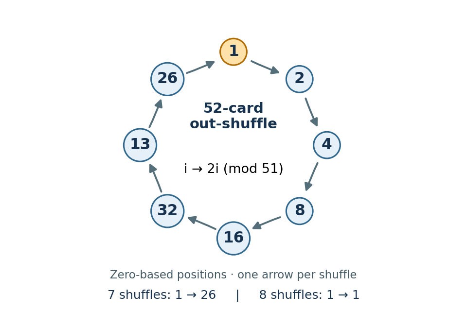

<h1 id="4/d/solution">Solution</h1>

↑ **Parent:** [D](../d.md)

**For the defined shuffle, `count 52 = 8`.** The printed assertion about seven shuffles is inconsistent with the actual [permutation](../../../../../permutation.md). Number positions from zero. On an even length $n>2$, a position $i<n-1$ moves to $2i\bmod(n-1)$, while the last position stays fixed. Indeed, positions in the first half move to $2i$, and positions in the second half move to $2i-(n-1)$. Consequently the number sought is the [multiplicative order](../../../../../multiplicative-order.md) of $2$ modulo $n-1$:
```
count :: Int -> Int
count n
  | n < 0 || odd n = error "count: nonnegative even length required"
  | n <= 2 = 1
  | otherwise = go 1 (2 `mod` m)
  where
    m = toInteger n - 1
    go k r
      | r == 1    = k
      | otherwise = go (k+1) ((2*r) `mod` m)
```
Here the identity's period means the least _positive_ number of applications, so the empty and two-element [lists](../../../../../list-abstract-data-type.md) have period one. Since $n-1$ is odd, $2$ is invertible modulo $n-1$, ensuring termination. Using `Integer` for residues avoids overflow in doubling; the mathematical correctness assumes the returned period fits `Int`. The algorithm uses one modular update per shuffle in the period, rather than constructing each shuffled deck.

For $n=52$, $2^8\equiv1\pmod{51}$, whereas $2$, $2^2$ and $2^4$ are not congruent to one, ruling out every proper divisor of eight. After seven shuffles, the original position $1$ is at position $26$, not back at $1$.

<a id="4/d/image-an-eight-step-position-cycle-under-the-52-card-perfect-out-shuffle"></a>


**[Figure 1](#4/d/image-an-eight-step-position-cycle-under-the-52-card-perfect-out-shuffle). An eight-step position cycle under the 52-card perfect out-shuffle**.

This single position already disproves a seven-step return; the modular calculation proves that the whole [permutation](../../../../../permutation.md) returns after eight.

## ↑ Ancestors (12)

1. [D](../d.md)
2. [4](../../4.md)
3. [Functional programming, design and analysis of algorithms (resit)](../../../functional-programming-design-and-analysis-of-algorithms-resit-split.md)
4. [2022](../../../split.md)
5. [Past exam of the year 1 of the computer science course of the University of Oxford](../../../../split.md)
6. [Year 1 of the computer science course of the University of Oxford](../../../../../year-1-of-the-computer-science-course-of-the-university-of-oxford.md)
7. [Computer science course of the University of Oxford](../../../../../computer-science-course-of-the-university-of-oxford.md)
8. [Undergraduate course of the University of Oxford](../../../../../undergraduate-course-of-the-university-of-oxford.md)
9. [Course of the University of Oxford](../../../../../course-of-the-university-of-oxford.md)
10. [University of Oxford](../../../../../university-of-oxford-split.md)
11. [List of universities](../../../../../list-of-universities.md)
12. [Codex Wiki](../../../../../split.md)
