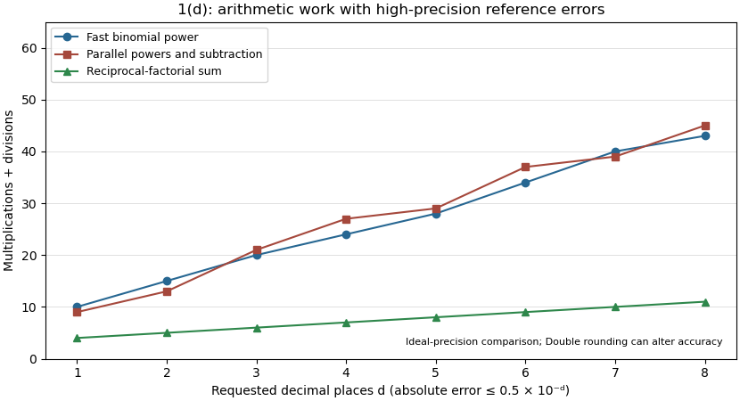

<h1 id="1/d/solution">Solution</h1>

↑ **Parent:** [D](../d.md)

**Use the reciprocal-[factorial](../../../../../factorial.md) sum for increasing accuracy.** Let $d$ be the requested number of decimal places and use absolute error tolerance proportional to $10^{-d}$. Expanding $\log(1+1/n)$ gives $e_a(n)=e-e/(2n)+O(n^{-2})$ and $e_c(n)=e+e/(24n^2)+O(n^{-3})$, so these are genuine first nonzero error orders. The first approximation needs $n$ of order $10^d$. Even its fast implementation therefore uses $\Theta(d)$ multiplications, while the linear version uses exponentially many in $d$. The third approximation needs $n$ of order $10^{d/2}$, but its fast powering still uses $\Theta(d)$ multiplications, with two parallel accumulators and a cancellation-prone subtraction.

For the [Taylor series](../../../../../taylor-series.md) sum, [Stirling's formula](../../../../../stirling-formula.md) gives $\log(n!)=\Theta(n\log n)$, so a sufficient term count grows as **$n=\Theta(d/\log d)$**. Its divisions therefore grow more slowly than the multiplication counts of either fast-power alternative. More concretely, its positive tail satisfies

$$
0<e-e_b(n)\leq\frac1{(n+1)!}\sum_{j=0}^{\infty}\frac1{(n+2)^j}=\frac{n+2}{(n+1)(n+1)!}.
$$

The first omitted term also gives a lower bound $1/(n+1)!$. This is the [reciprocal-factorial series remainder bound](../../../../../reciprocal-factorial-series-remainder-bound.md), supplying an explicit stopping certificate rather than relying only on [Big O notation](../../../../../big-o-notation.md). It follows by bounding every successive tail denominator factor below by $n+2$.

The sum also avoids subtraction of nearly equal large values and has small positive terms, making it numerically preferable. For a particular small accuracy request, constants and actual term counts may be compared directly; an asymptotic error bound alone does not prove a universal finite-input operation ranking. With ordinary `Double`, sufficiently many tiny positive terms stop changing the rounded sum, so beyond machine precision a higher-precision version is necessary regardless of the formula.

**[Figure 1](#1/d/image-arithmetic-work-for-eight-decimal-accuracy-targets-using-high-precision-reference-errors-rather-than-double-error-estimates). Arithmetic work for eight decimal-accuracy targets, using high-precision reference errors rather than Double error estimates**.

## ↑ Ancestors (12)

1. [D](../d.md)
2. [1](../../1.md)
3. [Imperative programming (resit)](../../../imperative-programming-resit-split.md)
4. [2022](../../../split.md)
5. [Past exam of the year 1 of the computer science course of the University of Oxford](../../../../split.md)
6. [Year 1 of the computer science course of the University of Oxford](../../../../../year-1-of-the-computer-science-course-of-the-university-of-oxford.md)
7. [Computer science course of the University of Oxford](../../../../../computer-science-course-of-the-university-of-oxford.md)
8. [Undergraduate course of the University of Oxford](../../../../../undergraduate-course-of-the-university-of-oxford.md)
9. [Course of the University of Oxford](../../../../../course-of-the-university-of-oxford.md)
10. [University of Oxford](../../../../../university-of-oxford-split.md)
11. [List of universities](../../../../../list-of-universities.md)
12. [Codex Wiki](../../../../../split.md)
