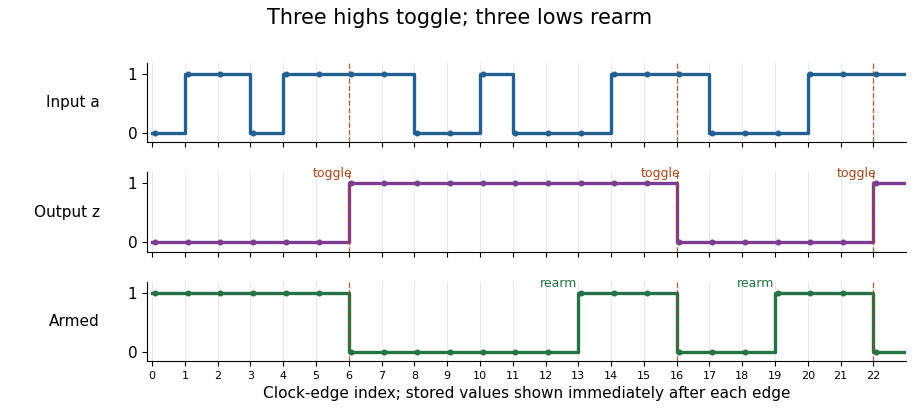
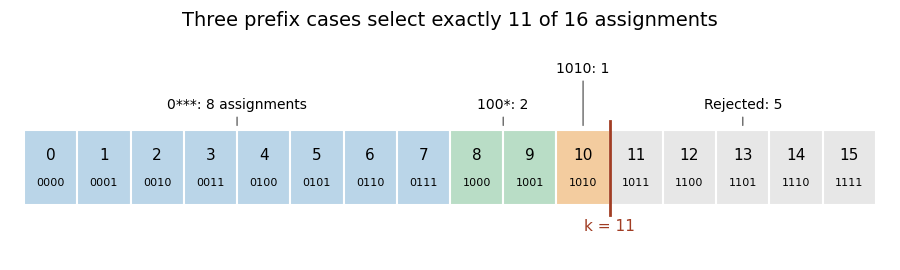

# Digital systems, linear algebra and introduction to formal proof

↑ **Parent:** [2023](../2023.md)

Solutions to all eight questions of the Oxford Preliminary Examination held on 15 June 2023. Source release: [released examination archive](https://www.whatdotheyknow.com/request/ba_computer_science_past_papers/response/2577745/attach/2/202402%20183%20CS%20Papers.zip?cookie_passthrough=1), member `2022/T/a10101w1.pdf`. The cover identifies Trinity Term 2023. The three section headings and all question labels below follow this historical paper; its grouping is independent of subsequent course changes. Although candidates were asked to attempt at most five questions, every marked subpart is solved here.

In 8(b), the source's parenthetical definition describes a [dominating set](../../graph-theory.md#dominating-set), while its name suggests a [vertex cover](../../graph-theory.md#vertex-cover). Both readings are treated explicitly. In 8(c)–(d), we make the scopes of the printed [quantifiers](../../mathematical-logic.md#quantifier) explicit; in particular, the opening universal [quantifiers](../../mathematical-logic.md#quantifier) in 8(c) govern both irreflexivity and transitivity. As usual in [first-order logic](../../mathematical-logic.md#first-order-logic), domains are nonempty, and [graphs](../../graph.md) are finite [simple graphs](../../graph.md#simple-graph) unless an infinite domain is specified.

**Table of contents**

- [Digital systems](#digital-systems)
  - [1](#1)
    - [a](#1/a)
      - [Solution](#1/a/solution)
    - [b](#1/b)
      - [Solution](#1/b/solution)
    - [c](#1/c)
      - [Solution](#1/c/solution)
    - [d](#1/d)
      - [Solution](#1/d/solution)
    - [e](#1/e)
      - [Solution](#1/e/solution)
  - [2](#2)
    - [a](#2/a)
      - [Solution](#2/a/solution)
    - [b](#2/b)
      - [Solution](#2/b/solution)
    - [c](#2/c)
      - [Solution](#2/c/solution)
  - [3](#3)
    - [a](#3/a)
      - [Solution](#3/a/solution)
    - [b](#3/b)
      - [Solution](#3/b/solution)
    - [c](#3/c)
      - [Solution](#3/c/solution)
    - [d](#3/d)
      - [Solution](#3/d/solution)
- [Linear algebra](#linear-algebra)
  - [4](#4)
    - [a](#4/a)
      - [Solution](#4/a/solution)
    - [b](#4/b)
      - [Solution](#4/b/solution)
    - [c](#4/c)
      - [Solution](#4/c/solution)
    - [d](#4/d)
      - [Solution](#4/d/solution)
    - [e](#4/e)
      - [Solution](#4/e/solution)
    - [f](#4/f)
      - [Solution](#4/f/solution)
    - [g](#4/g)
      - [Solution](#4/g/solution)
  - [5](#5)
    - [a](#5/a)
      - [Solution](#5/a/solution)
    - [b](#5/b)
      - [Solution](#5/b/solution)
    - [c](#5/c)
      - [Solution](#5/c/solution)
    - [d](#5/d)
      - [Solution](#5/d/solution)
    - [e](#5/e)
      - [Solution](#5/e/solution)
  - [6](#6)
    - [a](#6/a)
      - [Solution](#6/a/solution)
    - [b](#6/b)
      - [Solution](#6/b/solution)
    - [c](#6/c)
      - [Solution](#6/c/solution)
    - [d](#6/d)
      - [Solution](#6/d/solution)
    - [e](#6/e)
      - [Solution](#6/e/solution)
    - [f](#6/f)
      - [Solution](#6/f/solution)
    - [g](#6/g)
      - [Solution](#6/g/solution)
    - [h](#6/h)
      - [Solution](#6/h/solution)
- [Introduction to formal proof](#introduction-to-formal-proof)
  - [7](#7)
    - [a](#7/a)
      - [Solution](#7/a/solution)
    - [b](#7/b)
      - [Solution](#7/b/solution)
    - [c](#7/c)
      - [Solution](#7/c/solution)
    - [d](#7/d)
      - [Solution](#7/d/solution)
    - [e](#7/e)
      - [Solution](#7/e/solution)
  - [8](#8)
    - [a](#8/a)
      - [Solution](#8/a/solution)
    - [b](#8/b)
      - [Solution](#8/b/solution)
    - [c](#8/c)
      - [Solution](#8/c/solution)
    - [d](#8/d)
      - [1](#8/d/1)
        - [Solution](#8/d/1/solution)
      - [2](#8/d/2)
        - [Solution](#8/d/2/solution)
    - [e](#8/e)
      - [Solution](#8/e/solution)

## Digital systems

↑ **Parent:** [Digital systems, linear algebra and introduction to formal proof](digital-systems-linear-algebra-and-introduction-to-formal-proof.md)

### 1

↑ **Parent:** [Digital systems](#digital-systems)

<h4 id="1/a">a</h4>

↑ **Parent:** [1](#1)

<h5 id="1/a/solution">Solution</h5>

↑ **Parent:** [A](#1/a)

Write an $n$-[bit](../../information-theory.md#bit) [binary string](../../theoretical-computer-science.md#binary-string) as $A=a_{n-1}\cdots a_1a_0$, where each $a_i\in\{0,1\}$ and $a_{n-1}$ is most significant. Its [unsigned interpretation](../../arithmetic.md#unsigned-interpretation-of-a-bit-string) and [two's complement](../../programming-language.md#two-s-complement) interpretation are

$$
\boxed{\operatorname{bin}(A)=\sum_{i=0}^{n-1}a_i2^i,\qquad
\operatorname{twoc}(A)=-a_{n-1}2^{n-1}+\sum_{i=0}^{n-2}a_i2^i.}
$$

Equivalently, $\operatorname{twoc}(A)=\operatorname{bin}(A)-a_{n-1}2^n$. The ranges are $0$ through $2^n-1$ and $-2^{n-1}$ through $2^{n-1}-1$, respectively. The same stored [bits](../../information-theory.md#bit) can therefore denote different [integers](../../integer.md) depending on the chosen interpretation.

<h4 id="1/b">b</h4>

↑ **Parent:** [1](#1)

<h5 id="1/b/solution">Solution</h5>

↑ **Parent:** [B](#1/b)

A [logical right shift](../../programming-language.md#logical-right-shift) by $k$ moves $a_{i+k}$ into position $i$ and fills the high positions with zero. Its [unsigned interpretation](../../arithmetic.md#unsigned-interpretation-of-a-bit-string) is

$$
\operatorname{bin}(A\mathbin{\mathrm{LSR}}k)=\sum_{i=k}^{n-1}a_i2^{i-k}=:q.
$$

Meanwhile the original [unsigned interpretation](../../arithmetic.md#unsigned-interpretation-of-a-bit-string) decomposes as

$$
a=2^kq+\underbrace{\sum_{i=0}^{k-1}a_i2^i}_{r},\qquad 0\leq r\leq2^k-1.
$$

By [integer division](../../arithmetic.md#integer-division), **$q=\lfloor a/2^k\rfloor$**, exactly the unsigned quotient. Thus the source instruction puts the required quotient into `r1`. This is a proof from [binary representation](../../arithmetic.md#binary-number), rather than an assumption that every kind of right shift implements every kind of division. The displayed [bit](../../information-theory.md#bit) argument applies to $0\leq k\leq n$, with endpoint operations implemented as a copy or zero where appropriate.

<h4 id="1/c">c</h4>

↑ **Parent:** [1](#1)

<h5 id="1/c/solution">Solution</h5>

↑ **Parent:** [C](#1/c)

For a 32-[bit](../../information-theory.md#bit) [machine word](../../computer-science.md#machine-word) and $1\leq k\leq31$, use a [left bit shift](../../programming-language.md#left-bit-shift) followed by a [logical right shift](../../programming-language.md#logical-right-shift):
```
lsls r1, r0, #(32-k)
lsrs r1, r1, #(32-k)
```
The left shift discards all but the lowest $k$ [bits](../../information-theory.md#bit) and moves those retained [bits](../../information-theory.md#bit) to the top. The [logical right shift](../../programming-language.md#logical-right-shift) returns them to their original positions and fills the rest with zero. Hence **`r1` contains $a\bmod 2^k$**, the remainder identified in (b). For $k=0$ the remainder is zero; for $k=32$ it is $a$, so these endpoints can be handled directly.

On a [reduced instruction set computer](../../computer-science.md#reduced-instruction-set-computer), a [bit mask](../../programming-language.md#bit-mask) such as $2^k-1$ may not fit an instruction's immediate field. Masking may therefore require materializing the constant in another [processor register](../../computer-science.md#processor-register), possibly using several instructions or a memory load. Small shift counts are directly encodable, so the two shifts can save code space, a temporary [processor register](../../computer-science.md#processor-register), or a load. This is an architecture-dependent advantage, rather than a universal speed claim. The source's compact instruction forms support these immediate shifts, while their [bitwise AND](../../algorithm.md#bitwise-and) form takes its other operand from a [processor register](../../computer-science.md#processor-register).[page 1, Logical and Shift/rotate tables](../../computer-science-bibliography.md#thumb-16-bit-instruction-set-quick-reference-by-arm)

<h4 id="1/d">d</h4>

↑ **Parent:** [1](#1)

<h5 id="1/d/solution">Solution</h5>

↑ **Parent:** [D](#1/d)

Let $s=\mathbf1_{\{a<0\}}$, let $b=1023s$, and let $u=(a+b)\bmod1024$ denote the least nonnegative residue. Here $a$ is a signed 32-[bit](../../information-theory.md#bit) [two's complement](../../programming-language.md#two-s-complement) value. The source instructions, annotated with their derived values, are:
```
rem1024:
    asrs r3, r0, #31    // r3 = -s: all zero bits or all one bits
    lsrs r3, r3, #22    // r3 = b = 1023*s
    adds r0, r0, r3     // r0 = a+b
    lsls r0, r0, #22    // r0 has word value (a+b)*2^22 modulo 2^32
    lsrs r0, r0, #22    // r0 = u = (a+b) modulo 1024, in 0,...,1023
    subs r0, r0, r3     // r0 = u-b
    bx lr              // return u-b
```
The first instruction is an [arithmetic right shift](../../programming-language.md#arithmetic-right-shift), so it replicates the sign [bit](../../information-theory.md#bit). The second is a [logical right shift](../../programming-language.md#logical-right-shift), turning the all-one word into $1023$. The paired shifts then extract the low ten [bits](../../information-theory.md#bit), as in (c). Their effect is the residue of $a+b$ even if its [two's complement](../../programming-language.md#two-s-complement) interpretation is negative, because $1024$ divides the word modulus $2^{32}$. The adjusted value $a+b$ is representable for every input: positive inputs are unchanged, and negative inputs gain only $1023$.

For $a\geq0$, $b=0$, so the return value is the usual nonnegative remainder $a\bmod1024$. For $a<0$, put $t=-a>0$ as a mathematical [integer](../../integer.md), and write $t=1024q+r$ with $0\leq r<1024$. If $r=0$, then $u=1023$ and the return value is zero. If $1\leq r\leq1023$, then

$$
u=(-t+1023)\bmod1024=1023-r,
\qquad u-b=-r.
$$

These are precisely the remainders for [C integer division](../../arithmetic.md#c-integer-division), whose quotient truncates towards zero. In every case the result has the dividend's sign or is zero, has magnitude below $1024$, and satisfies $a=1024q_C+r_C$. The proof includes the smallest representable input: $t=-a$ was used only in mathematical reasoning, not as an overflowing machine operation.[section 6.5.5 paragraph 6, quotient truncation and the quotient–remainder identity](../../computer-science-bibliography.md#c11-committee-draft-n1570)

<h4 id="1/e">e</h4>

↑ **Parent:** [1](#1)

<h5 id="1/e/solution">Solution</h5>

↑ **Parent:** [E](#1/e)

Use the same bias, then an [arithmetic right shift](../../programming-language.md#arithmetic-right-shift) by ten:
```
div1024:
    asrs r3, r0, #31    // -1 when a<0, otherwise 0
    lsrs r3, r3, #22    // b = 1023 when a<0, otherwise 0
    adds r0, r0, r3     // a+b, representable for every signed input
    asrs r0, r0, #10    // floor((a+b)/1024)
    bx lr
```
An [arithmetic right shift](../../programming-language.md#arithmetic-right-shift) of a [two's complement](../../programming-language.md#two-s-complement) [integer](../../integer.md) computes division rounded down. For $a\geq0$, this already equals truncation towards zero. For $a<0$, the [signed power-of-two division by biasing](../../arithmetic.md#signed-power-of-two-division-by-biasing) identity is

$$
\boxed{\operatorname{trunc}(a/1024)=\left\lfloor\frac{a+1023}{1024}\right\rfloor.}
$$

Indeed, writing $-a=1024q+r$ with $0\leq r<1024$ makes the adjusted numerator $-1024q+(1023-r)$; its quotient rounded down is $-q$ for every $r$, including zero. Thus the code returns the signed quotient in all cases and contains no data-dependent branch. The final `bx lr` simply returns to the caller.

### 2

↑ **Parent:** [Digital systems](#digital-systems)

<h4 id="2/a">a</h4>

↑ **Parent:** [2](#2)

<h5 id="2/a/solution">Solution</h5>

↑ **Parent:** [A](#2/a)

Use a [message-passing mutual exclusion server](../../operating-system.md#message-passing-mutual-exclusion-server) with an `owner` field and a [FIFO queue](../../data-structure.md#fifo-queue). A request includes its client's identity. The server handles one received message at a time, and a client has at most one outstanding request. The following pseudocode assumes reliable [message passing](../../operating-system.md#message-passing) and compliant clients:
```
owner = NONE
waiting = empty FIFO queue

forever:
    (kind, client) = receive_from_any_client()
    if kind == REQUEST:
        waiting.push_back(client)
    else if kind == RELEASE:
        assert client == owner
        owner = NONE

    if owner == NONE and not waiting.empty():
        owner = waiting.pop_front()
        send(owner, GRANT)
```
A client sends `REQUEST`, waits for `GRANT`, runs its complete animation, and sends `RELEASE` before making another request.

The invariant proving [mutual exclusion](../../operating-system.md#mutual-exclusion) is: **at most one client has received an unreturned grant, and that client is `owner`.** Only the final block issues a grant, and it first requires no current owner. A valid release removes that ownership. Since clients use the display only while holding a grant, simultaneous use is impossible. The [FIFO queue](../../data-structure.md#fifo-queue) prevents accepted requests from being overtaken by later ones. With eventual message delivery, continued server execution, and finite animations, each accepted request is eventually served; these progress assumptions are separate from the safety invariant.

<h4 id="2/b">b</h4>

↑ **Parent:** [2](#2)

<h5 id="2/b/solution">Solution</h5>

↑ **Parent:** [B](#2/b)

Use two [FIFO queues](../../data-structure.md#fifo-queue), one for each priority class, and perform [nonpreemptive strict-priority arbitration](../../operating-system.md#nonpreemptive-strict-priority-arbitration) whenever the display becomes free:
```
owner = NONE
ordinary = empty FIFO queue
urgent = empty FIFO queue

forever:
    message = receive_from_any_client()
    if message.kind == REQUEST:
        assert message.priority in {0, 1}
        if message.priority == 1:
            urgent.push_back(message.client)
        else:
            ordinary.push_back(message.client)
    else if message.kind == RELEASE:
        assert message.client == owner
        owner = NONE

    if owner == NONE:
        if not urgent.empty():
            owner = urgent.pop_front()
        else if not ordinary.empty():
            owner = ordinary.pop_front()
        if owner != NONE:
            send(owner, GRANT)
```
The same ownership invariant proves [mutual exclusion](../../operating-system.md#mutual-exclusion). Among requests already accepted by the server, every pending urgent request takes precedence over every ordinary one. Each class retains its own arrival order. A newly received urgent request goes ahead of waiting ordinary requests but waits for the current animation's `RELEASE`; the given protocol has no interruption or revocation operation.

This is strict priority at dispatch, based on requests the server has received. Requests still in transit cannot influence a decision. If the transport provides a mailbox-draining operation, the server may also collect all currently delivered requests before dispatching; the two-[FIFO queue](../../data-structure.md#fifo-queue) selection rule remains the same.

Strict priority does not guarantee [starvation freedom](../../operating-system.md#starvation-freedom) for ordinary clients under an endless supply of urgent work. If urgent traffic eventually stops, accepted requests have only finitely many earlier requests, and all service times are finite, every pending ordinary request is eventually granted. Guaranteeing ordinary progress under unlimited urgent traffic would require a different fairness policy, such as limiting consecutive urgent grants; that would relax strict priority.

<h4 id="2/c">c</h4>

↑ **Parent:** [2](#2)

<h5 id="2/c/solution">Solution</h5>

↑ **Parent:** [C](#2/c)

**A [LIFO stack](../../data-structure.md#stack-data-structure) can make waiting clients starve.** Suppose client $A$ waits at the bottom of the [stack](../../data-structure.md#stack-data-structure). Before each current owner releases, a fresh client submits a request. That newest request is pushed above $A$ and is selected next. Every animation can finish promptly while $A$ waits forever.

This is [LIFO starvation](../../operating-system.md#lifo-starvation): service completion alone does not ensure [starvation freedom](../../operating-system.md#starvation-freedom). A [FIFO queue](../../data-structure.md#fifo-queue) prevents newer same-priority requests from passing $A$, whereas replacing either priority-class [FIFO queue](../../data-structure.md#fifo-queue) by a [LIFO stack](../../data-structure.md#stack-data-structure) adds this problem even within one priority class. Strict priority can already starve ordinary work, as in (b); the [LIFO stack](../../data-structure.md#stack-data-structure) introduces a further unfairness that can also affect urgent work.

### 3

↑ **Parent:** [Digital systems](#digital-systems)

<h4 id="3/a">a</h4>

↑ **Parent:** [3](#3)

<h5 id="3/a/solution">Solution</h5>

↑ **Parent:** [A](#3/a)

Use a [three-sample run detector](../../foundations-of-mathematics.md#three-sample-run-detector). Just before [clock edge](../../computer-science.md#clock-edge) $t$, let two stored [bits](../../information-theory.md#bit) $p$ and $q$ hold the input values at edges $t-1$ and $t-2$. Initialise both to zero. With input $a_t$, define

$$
\boxed{w_t=a_t\land p\land q,\qquad p'=a_t,\qquad q'=p.}
$$

Primes denote the next stored state, with all assignments simultaneous at the [clock edge](../../computer-science.md#clock-edge). The output is the [logical conjunction](../../mathematical-logic.md#logical-conjunction) of the present input and its two preceding samples. By induction on [clock edges](../../computer-science.md#clock-edge), the stated interpretation of $p,q$ is maintained, proving the required behaviour. Two [bits](../../information-theory.md#bit) of state suffice.

<h4 id="3/b">b</h4>

↑ **Parent:** [3](#3)

<h5 id="3/b/solution">Solution</h5>

↑ **Parent:** [B](#3/b)

Store two [bits](../../information-theory.md#bit): the output $z$, initially zero, and an `armed` [bit](../../information-theory.md#bit) $e$, initially one. Define the [synchronous sequential circuit](../../foundations-of-mathematics.md#synchronous-sequential-circuit) by

$$
\boxed{z'=z\mathbin{\oplus}(e\land c),\qquad e'=d\lor(e\land\neg c).}
$$

Here $\oplus$ is [exclusive or](../../theoretical-computer-science.md#exclusive-or), and the input restriction $c\land d=0$ excludes conflicting commands. The output is the current stored $z$.

When armed, a sampled $c=1$ toggles $z$ and clears $e$. Further $c$ samples leave the output unchanged. A sampled $d=1$ sets $e=1$ without changing $z$, allowing a later $c$ to toggle it again. The same [clock edge](../../computer-science.md#clock-edge) cannot both rearm and trigger because $c,d$ are never simultaneously high. Thus the first $c$ toggles from zero to one, and subsequent toggles each require a new $d$ followed by a later $c$.

<h4 id="3/c">c</h4>

↑ **Parent:** [3](#3)

<h5 id="3/c/solution">Solution</h5>

↑ **Parent:** [C](#3/c)

Share the input-history [bits](../../information-theory.md#bit) of (a) between a high-run detector and a low-run detector. With $p,q$ the two preceding input samples, put

$$
c=a\land p\land q,\qquad d=\neg a\land\neg p\land\neg q.
$$

These detector outputs are mutually exclusive. Feed them into (b). An explicit four-[bit](../../information-theory.md#bit) [synchronous sequential circuit](../../foundations-of-mathematics.md#synchronous-sequential-circuit), with initial state $(p,q,e,z)=(0,0,1,0)$, is

$$
\boxed{p'=a,\quad q'=p,\quad
e'=d\lor(e\land\neg c),\quad
z'=z\mathbin{\oplus}(e\land c).}
$$

Every right-hand side uses the old state and the current input. In particular, the run detectors' combinational outputs are sampled by the toggle module at that same edge; there is no extra pipeline stage.

The first three consecutive high samples make $c=1$ at the third edge, toggling $z$ and clearing $e$. Continuing high input cannot toggle it again. Only three consecutive low samples can make $d=1$ and rearm it; interrupted low runs do not suffice. After rearming, a new three-sample high run produces the next toggle. This proves the [debounced toggle switch](../../foundations-of-mathematics.md#debounced-toggle-switch) behaviour, including rejection of short high and low disturbances.

<a id="3/c/image-the-debounced-toggle-switch-rejects-interrupted-runs-toggles-on-the-third-consecutive-high-sample-and-rearms-only-on-the-third-consecutive-low-sample-stored-outputs-are-shown-just-after-each-clock-edge"></a>


**[Figure 1](#3/c/image-the-debounced-toggle-switch-rejects-interrupted-runs-toggles-on-the-third-consecutive-high-sample-and-rearms-only-on-the-third-consecutive-low-sample-stored-outputs-are-shown-just-after-each-clock-edge). The debounced toggle switch rejects interrupted runs, toggles on the third consecutive high sample, and rearms only on the third consecutive low sample; stored outputs are shown just after each clock edge**.

<h4 id="3/d">d</h4>

↑ **Parent:** [3](#3)

<h5 id="3/d/solution">Solution</h5>

↑ **Parent:** [D](#3/d)

**Four state [bits](../../information-theory.md#bit) are necessary and sufficient.** For each output value, distinguish three armed situations, remembering a trailing high run of length $0,1,2$, and three disarmed situations, remembering a trailing low run of length $0,1,2$. Thus a direct minimal behavioural description has

$$
2(3+3)=12\text{ states},\qquad\lceil\log_2 12\rceil=4\text{ bits}.
$$

All twelve situations are reachable. Different output values are immediately distinguishable. Within an armed group, a suitable number of high samples distinguishes the three run lengths by when the next toggle occurs. Within a disarmed group, a suitable number of low samples followed by three highs distinguishes the three rearming distances. An armed situation and a disarmed situation of the same output value are distinguished by an all-high continuation: the armed one eventually toggles and the disarmed one does not. Hence these twelve situations cannot be merged in a [finite-state machine](../../foundations-of-mathematics.md#finite-state-machine) implementing the specification.

The shared-history design in (c) uses four [bits](../../information-theory.md#bit), meeting this lower bound. Its sixteen encoded states have some behaviourally equivalent histories, so its encoding need not use only twelve combinations. Building two separate copies of (a) plus the two-[bit](../../information-theory.md#bit) module (b) would use six state-bearing elements; sharing the input history saves two.

## Linear algebra

↑ **Parent:** [Digital systems, linear algebra and introduction to formal proof](digital-systems-linear-algebra-and-introduction-to-formal-proof.md)

### 4

↑ **Parent:** [Linear algebra](#linear-algebra)

<h4 id="4/a">a</h4>

↑ **Parent:** [4](#4)

<h5 id="4/a/solution">Solution</h5>

↑ **Parent:** [A](#4/a)

The $m$ columns of $L$ form a [basis](../../vector-space.md#basis) of $\ker A^\top$, so that [null space](../../kernel-of-a-linear-map.md) has [dimension](../../vector-space.md#dimension-vector-space) $m$. The [rank-nullity theorem](../../kernel-of-a-linear-map.md#rank-nullity-theorem) applied to $A^\top:\mathbb R^n\to\mathbb R^n$ gives $\operatorname{rank}A^\top=n-m$. A [matrix](../../vector-space.md#matrix) and its [transpose](../../vector-space.md#transpose) have equal [matrix rank](../../vector-space.md#matrix-rank), hence

$$
\boxed{\operatorname{rank}A=n-m.}
$$

<h4 id="4/b">b</h4>

↑ **Parent:** [4](#4)

<h5 id="4/b/solution">Solution</h5>

↑ **Parent:** [B](#4/b)

If $A^\top x=0$, the [vector](../../vector-space.md#vector) $x$ belongs to the [null space](../../kernel-of-a-linear-map.md) for which the columns of $L$ are a [basis](../../vector-space.md#basis). It is therefore a [linear combination](../../vector-space.md#linear-combination) of those columns, so $x=Ly$ for some $y\in\mathbb R^m$. Conversely, each column is annihilated by $A^\top$, hence $A^\top L=0$ and $x=Ly$ implies $A^\top x=0$. Thus

$$
\boxed{A^\top x=0\iff x=Ly\text{ for some }y\in\mathbb R^m.}
$$

The coordinate [vector](../../vector-space.md#vector) $y$ is unique because the columns of $L$ are [linearly independent](../../vector-space.md#linear-independence).

<h4 id="4/c">c</h4>

↑ **Parent:** [4](#4)

<h5 id="4/c/solution">Solution</h5>

↑ **Parent:** [C](#4/c)

The analogous [null space](../../kernel-of-a-linear-map.md) statement is

$$
\boxed{Ax=0\iff x=Ry\text{ for some }y\in\mathbb R^m.}
$$

Here the [rank-nullity theorem](../../kernel-of-a-linear-map.md#rank-nullity-theorem) and (a) ensure that $\ker A$ also has [dimension](../../vector-space.md#dimension-vector-space) $m$.

<h4 id="4/d">d</h4>

↑ **Parent:** [4](#4)

<h5 id="4/d/solution">Solution</h5>

↑ **Parent:** [D](#4/d)

The columnwise [null space](../../kernel-of-a-linear-map.md) conditions say $A^\top L=0$ and $AR=0$. Therefore

$$
\boxed{A^\top B=A^\top LR^\top=0,\qquad
AB^\top=A(RL^\top)=(AR)L^\top=0.}
$$

Both right-hand sides are the $n\times n$ [zero matrix](../../vector-space.md#zero-matrix).

<h4 id="4/e">e</h4>

↑ **Parent:** [4](#4)

<h5 id="4/e/solution">Solution</h5>

↑ **Parent:** [E](#4/e)

Both $L$ and $R$ have $m$ [linearly independent](../../vector-space.md#linear-independence) columns. The [Gram matrix](../../inner-product.md#gram-matrix) $R^\top R$ is invertible because

$$
y^\top R^\top Ry=\|Ry\|^2>0\qquad(y\ne0).
$$

Consequently $R^\top$ is a [surjective linear map](../../vector-space.md#surjective-linear-map): for any $y\in\mathbb R^m$, the choice $x=R(R^\top R)^{-1}y$ satisfies $R^\top x=y$. Hence

$$
\operatorname{im}B=L(\operatorname{im}R^\top)=\operatorname{im}L.
$$

The latter [image of a linear map](../../vector-space.md#image-of-a-linear-map) has [dimension](../../vector-space.md#dimension-vector-space) $m$, giving **$\operatorname{rank}B=m$**. If $m=0$, $B=0$ and the conclusion is immediate. This argument explains why the product retains its full possible [matrix rank](../../vector-space.md#matrix-rank); a general product of two [matrices](../../vector-space.md#matrix) need not do so.

<h4 id="4/f">f</h4>

↑ **Parent:** [4](#4)

<h5 id="4/f/solution">Solution</h5>

↑ **Parent:** [F](#4/f)

Expand the product and use (d) together with its [transpose](../../vector-space.md#transpose):

$$
MM^\top=(A+B)(A^\top+B^\top)
=AA^\top+AB^\top+BA^\top+BB^\top
=\boxed{AA^\top+BB^\top}.
$$

Indeed $AB^\top=0$ and $BA^\top=(AB^\top)^\top=0$.

<h4 id="4/g">g</h4>

↑ **Parent:** [4](#4)

<h5 id="4/g/solution">Solution</h5>

↑ **Parent:** [G](#4/g)

Fix one common [eigenvector](../../linear-operator-theory.md#eigenvector) $v\ne0$, and write $AA^\top v=\lambda v$ and $BB^\top v=\mu v$. By (d),

$$
AA^\top BB^\top=A(A^\top B)B^\top=0,
$$

so $\lambda\mu v=0$ and **at least one of the two [eigenvalues](../../linear-operator-theory.md#eigenvalue) is zero**.

To exclude both being zero, use the [kernel of a Gram product](../../kernel-of-a-linear-map.md#kernel-of-a-gram-product) identity:

$$
v^\top AA^\top v=\|A^\top v\|^2,\qquad
v^\top BB^\top v=\|B^\top v\|^2.
$$

If both products annihilate $v$, then $A^\top v=B^\top v=0$. By (b), $v\in\operatorname{im}L$, and by (e), this is $\operatorname{im}B$. On the other hand, $B^\top v=0$ makes $v$ [orthogonal](../../inner-product.md#orthogonal-vectors) to every [vector](../../vector-space.md#vector) in $\operatorname{im}B$. In particular $v$ is [orthogonal](../../inner-product.md#orthogonal-vectors) to itself, so $\|v\|^2=0$ and $v=0$, a contradiction.

Therefore **each specified common [eigenvector](../../linear-operator-theory.md#eigenvector) belongs to exactly one of $\ker(AA^\top)$ and $\ker(BB^\top)$**. Both [eigenvalues](../../linear-operator-theory.md#eigenvalue) are nonnegative by the displayed squared-[norm](../../normed-vector-space.md#norm) identities, so the other [eigenvalue](../../linear-operator-theory.md#eigenvalue) is strictly positive. This is the spectral mechanism behind [orthogonal null-space completion of a square matrix](../../vector-space.md#orthogonal-null-space-completion-of-a-square-matrix).

### 5

↑ **Parent:** [Linear algebra](#linear-algebra)

<h4 id="5/a">a</h4>

↑ **Parent:** [5](#5)

<h5 id="5/a/solution">Solution</h5>

↑ **Parent:** [A](#5/a)

Take $V=\mathbb R^2$ and the [linear map](../../vector-space.md#linear-map) $h(x,y)=(x,0)$. Then

$$
\mathcal R(h)=\operatorname{span}\{(1,0)\},\qquad
\mathcal N(h)=\operatorname{span}\{(0,1)\}.
$$

These two [vector subspaces](../../vector-space.md#vector-subspace) have zero [intersection](../../set.md#set-intersection) and together span $\mathbb R^2$, so **$V=\mathcal R(h)\oplus\mathcal N(h)$** as a [direct sum of vector spaces](../../vector-space.md#direct-sum).

<h4 id="5/b">b</h4>

↑ **Parent:** [5](#5)

<h5 id="5/b/solution">Solution</h5>

↑ **Parent:** [B](#5/b)

Take $V=\mathbb R^2$ and the [linear map](../../vector-space.md#linear-map) $h(x,y)=(y,0)$. Then

$$
\mathcal R(h)=\mathcal N(h)=\operatorname{span}\{(1,0)\}.
$$

Their [intersection](../../set.md#set-intersection) is nonzero and their sum is only one-dimensional. Hence **$V\ne\mathcal R(h)\oplus\mathcal N(h)$**. This [nilpotent linear map](../../linear-operator-theory.md#nilpotent-linear-map) has $h^2=0$, illustrating why taking sufficiently high powers changes the situation.

<h4 id="5/c">c</h4>

↑ **Parent:** [5](#5)

<h5 id="5/c/solution">Solution</h5>

↑ **Parent:** [C](#5/c)

For $v\in\mathcal R(h^{m+k})$, choose $u$ with $v=h^{m+k}u=h^m(h^ku)$. Thus $v\in\mathcal R(h^m)$, proving

$$
\boxed{\mathcal R(h^{m+k})\subseteq\mathcal R(h^m).}
$$

This is the decreasing-image part of [stabilization of images of powers of a linear map](../../algebra.md#stabilization-of-images-of-powers-of-a-linear-map). The convention $h^0=\operatorname{id}_V$ includes $m=0$ and $k=0$.

<h4 id="5/d">d</h4>

↑ **Parent:** [5](#5)

<h5 id="5/d/solution">Solution</h5>

↑ **Parent:** [D](#5/d)

Apply $h$ to both sides of $\mathcal R(h^m)=\mathcal R(h^{m+1})$. Because $h(\mathcal R(h^j))=\mathcal R(h^{j+1})$, we obtain $\mathcal R(h^{m+1})=\mathcal R(h^{m+2})$. Repeating this argument proves equality at every later step. More formally, an [induction](../../foundations-of-mathematics.md#mathematical-induction) on $k$ gives

$$
\boxed{\mathcal R(h^{m+k})=\mathcal R(h^m)\quad\text{for all }k\geq0.}
$$

The base case is $k=0$; the induction step follows from applying the [linear map](../../vector-space.md#linear-map) $h$ and then the assumed first equality. Thus one equality permanently stabilizes the descending sequence of [images of a linear map](../../vector-space.md#image-of-a-linear-map).

<h4 id="5/e">e</h4>

↑ **Parent:** [5](#5)

<h5 id="5/e/solution">Solution</h5>

↑ **Parent:** [E](#5/e)

The [dimensions](../../vector-space.md#dimension-vector-space) of the nested [images of a linear map](../../vector-space.md#image-of-a-linear-map)

$$
V=\mathcal R(h^0)\supseteq\mathcal R(h)\supseteq\cdots
$$

can strictly decrease at most $n$ times. If all the first $n$ inclusions are strict, $\mathcal R(h^n)=0$ and is stable. Otherwise an earlier equality occurs and (d) makes every subsequent image equal. Thus in all cases

$$
\mathcal R(h^n)=\mathcal R(h^{2n}).
$$

By the [rank-nullity theorem](../../kernel-of-a-linear-map.md#rank-nullity-theorem) and inclusion of the [null spaces](../../kernel-of-a-linear-map.md), this also gives $\ker h^n=\ker h^{2n}$. If $v\in\mathcal R(h^n)\cap\ker h^n$, write $v=h^nu$. Then $0=h^nv=h^{2n}u$, so $u\in\ker h^{2n}=\ker h^n$ and $v=0$. Hence the [intersection](../../set.md#set-intersection) is zero. Finally the [rank-nullity theorem](../../kernel-of-a-linear-map.md#rank-nullity-theorem) gives

$$
\dim\mathcal R(h^n)+\dim\ker h^n=n.
$$

Zero [intersection](../../set.md#set-intersection) and this [dimension](../../vector-space.md#dimension-vector-space) sum prove

$$
\boxed{V=\mathcal R(h^n)\oplus\mathcal N(h^n).}
$$

This is the [finite-dimensional Fitting decomposition](../../module-theory.md#finite-dimensional-fitting-decomposition). It includes the zero-dimensional case, for which $V=0$ and the assertion is immediate.

### 6

↑ **Parent:** [Linear algebra](#linear-algebra)

<h4 id="6/a">a</h4>

↑ **Parent:** [6](#6)

<h5 id="6/a/solution">Solution</h5>

↑ **Parent:** [A](#6/a)

Let $E_{ij}$ denote a [matrix unit](../../vector-space.md#matrix-unit), with its only nonzero entry equal to one in row $i$, column $j$. A [basis](../../vector-space.md#basis) for the [vector space](../../vector-space.md) of real [skew-symmetric matrices](../../linear-algebra.md#skew-symmetric-matrix) is

$$
\boxed{\{E_{ij}-E_{ji}:1\leq i<j\leq n\},\qquad
\dim=\frac{n(n-1)}2.}
$$

Each upper-triangular entry is free, its reflected lower-triangular entry is its negative, and every diagonal entry is zero. This is the [basis of the space of real skew-symmetric matrices](../../linear-algebra.md#basis-of-the-space-of-real-skew-symmetric-matrices).

<h4 id="6/b">b</h4>

↑ **Parent:** [6](#6)

<h5 id="6/b/solution">Solution</h5>

↑ **Parent:** [B](#6/b)

Using linearity and involutivity of the [matrix transpose](../../vector-space.md#transpose),

$$
(B-B^\top)^\top=B^\top-B=-(B-B^\top).
$$

Therefore **$B-B^\top$ is a [skew-symmetric matrix](../../linear-algebra.md#skew-symmetric-matrix)**.

<h4 id="6/c">c</h4>

↑ **Parent:** [6](#6)

<h5 id="6/c/solution">Solution</h5>

↑ **Parent:** [C](#6/c)

Split $B$ into its [symmetric part](../../linear-algebra.md#symmetric-part-of-a-matrix) and [skew-symmetric part](../../linear-algebra.md#skew-symmetric-part-of-a-matrix):

$$
\boxed{B=\underbrace{\frac{B+B^\top}{2}}_{S}+\underbrace{\frac{B-B^\top}{2}}_{K}.}
$$

Taking the [transpose](../../vector-space.md#transpose) gives $S^\top=S$ and $K^\top=-K$. Thus $S$ is a [symmetric matrix](../../linear-algebra.md#symmetric-matrix) and $K$ a [skew-symmetric matrix](../../linear-algebra.md#skew-symmetric-matrix). These formulas also show uniqueness, since a real [matrix](../../vector-space.md#matrix) that is both symmetric and skew-symmetric is zero.

<h4 id="6/d">d</h4>

↑ **Parent:** [6](#6)

<h5 id="6/d/solution">Solution</h5>

↑ **Parent:** [D](#6/d)

If $A^\top=-A$, then the [dot product](../../inner-product.md#dot-product) satisfies

$$
(Ax)\cdot y=x^\top A^\top y=-x^\top Ay=-(Ay)\cdot x.
$$

Conversely, the assumed [dot product](../../inner-product.md#dot-product) identity gives $x^\top(A^\top+A)y=0$ for every $x,y$. Take $x=e_i$ and $y=e_j$ from the [standard basis](../../vector-space.md#standard-basis): every entry of $A^\top+A$ is zero. Hence **$A^\top=-A$**, proving the equivalence.

<h4 id="6/e">e</h4>

↑ **Parent:** [6](#6)

<h5 id="6/e/solution">Solution</h5>

↑ **Parent:** [E](#6/e)

If $A$ is a [skew-symmetric matrix](../../linear-algebra.md#skew-symmetric-matrix), the scalar $x^\top Ax$ equals its own [transpose](../../vector-space.md#transpose), so

$$
x^\top Ax=x^\top A^\top x=-x^\top Ax,
$$

and it is zero over the [real numbers](../../arithmetic.md#real-number).

Conversely, suppose the [quadratic form](../../quadratic-form.md) $x^\top Ax$ vanishes for every real [vector](../../vector-space.md#vector). Substituting $x=e_i$ gives $a_{ii}=0$. Substituting $x=e_i+e_j$ gives $a_{ij}+a_{ji}=0$ for $i\ne j$. Therefore $A^\top=-A$. This proves the [quadratic-form criterion for a skew-symmetric matrix](../../linear-algebra.md#quadratic-form-criterion-for-a-skew-symmetric-matrix):

$$
\boxed{x^\top Ax=0\text{ for every }x\iff A^\top=-A.}
$$

<h4 id="6/f">f</h4>

↑ **Parent:** [6](#6)

<h5 id="6/f/solution">Solution</h5>

↑ **Parent:** [F](#6/f)

For a real [eigenvalue](../../linear-operator-theory.md#eigenvalue) $\lambda$, choose a nonzero real [eigenvector](../../linear-operator-theory.md#eigenvector) $v$ with $Av=\lambda v$. By (e),

$$
0=v^\top Av=\lambda v^\top v.
$$

Since $v^\top v=\|v\|^2>0$, **$\lambda=0$**. If [eigenvectors](../../linear-operator-theory.md#eigenvector) were initially allowed to be complex, the real [matrix](../../vector-space.md#matrix) $A-\lambda I$ has a nonzero real [null space](../../kernel-of-a-linear-map.md) whenever it has a nonzero complex [null space](../../kernel-of-a-linear-map.md), so this choice of $v$ remains justified.

<h4 id="6/g">g</h4>

↑ **Parent:** [6](#6)

<h5 id="6/g/solution">Solution</h5>

↑ **Parent:** [G](#6/g)

The [determinant](../../multilinear-algebra.md#determinant) is invariant under [transpose](../../vector-space.md#transpose), while multiplying all $n$ rows by $-1$ multiplies it by $(-1)^n$. Thus, for [odd integer](../../integer.md#odd-integer) $n$,

$$
\det A=\det A^\top=\det(-A)=(-1)^n\det A=-\det A.
$$

Over the [real numbers](../../arithmetic.md#real-number), this forces **$\det A=0$**, so $A$ is a [singular matrix](../../linear-algebra.md#singular-matrix). This is the [odd-dimensional skew-symmetric singularity theorem](../../linear-algebra.md#odd-dimensional-skew-symmetric-singularity-theorem).

<h4 id="6/h">h</h4>

↑ **Parent:** [6](#6)

<h5 id="6/h/solution">Solution</h5>

↑ **Parent:** [H](#6/h)

If $(I+A)x=0$, take its [dot product](../../inner-product.md#dot-product) with $x$ and apply (e):

$$
0=x^\top(I+A)x=\|x\|^2+x^\top Ax=\|x\|^2.
$$

Hence $x=0$. A square [matrix](../../vector-space.md#matrix) with zero [null space](../../kernel-of-a-linear-map.md) is an [invertible matrix](../../linear-algebra.md#invertible-matrix) by the [rank-nullity theorem](../../kernel-of-a-linear-map.md#rank-nullity-theorem). Therefore **$I+A$ is nonsingular**. This proves [invertibility of identity plus a real skew-symmetric matrix](../../linear-algebra.md#invertibility-of-identity-plus-a-real-skew-symmetric-matrix).

## Introduction to formal proof

↑ **Parent:** [Digital systems, linear algebra and introduction to formal proof](digital-systems-linear-algebra-and-introduction-to-formal-proof.md)

### 7

↑ **Parent:** [Introduction to formal proof](#introduction-to-formal-proof)

<h4 id="7/a">a</h4>

↑ **Parent:** [7](#7)

<h5 id="7/a/solution">Solution</h5>

↑ **Parent:** [A](#7/a)

Use $0$ and $1$ for false and true [truth values](../../mathematical-logic.md#truth-value). The [truth table](../../mathematical-logic.md#truth-table) is:

| $A$ | $B$ | $C$ | $A\leftrightarrow B$ | $\neg B\to C$ | $\varphi$ |
| --- | --- | --- | --- | --- | --- |
| $0$ | $0$ | $0$ | $1$ | $0$ | $0$ |
| $0$ | $0$ | $1$ | $1$ | $1$ | $1$ |
| $0$ | $1$ | $0$ | $0$ | $1$ | $0$ |
| $0$ | $1$ | $1$ | $0$ | $1$ | $0$ |
| $1$ | $0$ | $0$ | $0$ | $0$ | $0$ |
| $1$ | $0$ | $1$ | $0$ | $1$ | $0$ |
| $1$ | $1$ | $0$ | $1$ | $1$ | $1$ |
| $1$ | $1$ | $1$ | $1$ | $1$ | $1$ |

The two satisfying rows with $A=B=1$ combine by eliminating $C$, while the remaining satisfying row has $A=B=0,C=1$. An equivalent [disjunctive normal form](../../theoretical-computer-science.md#disjunctive-normal-form) is therefore

$$
\boxed{(A\land B)\lor(\neg A\land\neg B\land C).}
$$

Expanding the [logical biconditional](../../mathematical-logic.md#logical-biconditional) into its two implications, and using $\neg B\to C\equiv B\lor C$, gives the [conjunctive normal form](../../theoretical-computer-science.md#conjunctive-normal-form)

$$
\boxed{(\neg A\lor B)\land(A\lor\neg B)\land(B\lor C).}
$$

Each form has exactly the same three [satisfying assignments](../../theoretical-computer-science.md#satisfying-assignment) as the original [propositional formula](../../mathematical-logic.md#propositional-formula).

<h4 id="7/b">b</h4>

↑ **Parent:** [7](#7)

<h5 id="7/b/solution">Solution</h5>

↑ **Parent:** [B](#7/b)

Apply [structural induction](../../foundations-of-mathematics.md#structural-induction) to the formation of a [propositional formula](../../mathematical-logic.md#propositional-formula). Let $L(\theta)$ and $R(\theta)$ count its opening and closing parentheses, and use the usual grammar generated by propositional variables, any allowed truth constants, [negation](../../theoretical-computer-science.md#negation), and parenthesized binary [logical connectives](../../mathematical-logic.md#logical-connective).

An atomic variable or truth constant contains neither kind of parenthesis, so $L=R=0$. If $L(\alpha)=R(\alpha)$, prefixing [negation](../../theoretical-computer-science.md#negation) leaves both counts unchanged. If the notation writes a negated formula with an extra pair of parentheses, it adds one to each and still preserves equality.

For a binary construction $(\alpha\circ\beta)$, where $\circ$ is an allowed binary [logical connective](../../mathematical-logic.md#logical-connective),

$$
L((\alpha\circ\beta))=L(\alpha)+L(\beta)+1,
\qquad R((\alpha\circ\beta))=R(\alpha)+R(\beta)+1.
$$

The two induction hypotheses make these equal. Every grammar construction preserves the property, so **every [propositional formula](../../mathematical-logic.md#propositional-formula) contains equally many left and right parentheses**. This is [balanced parentheses in propositional syntax](../../mathematical-logic.md#balanced-parentheses-in-propositional-syntax).

<h4 id="7/c">c</h4>

↑ **Parent:** [7](#7)

<h5 id="7/c/solution">Solution</h5>

↑ **Parent:** [C](#7/c)

Apply the [propositional substitution](../../mathematical-logic.md#propositional-substitution) simultaneously to the atomic variables:

$$
\varphi S=\bigl((X\lor Y)\land(X\lor\neg Y)\bigr)
\lor\bigl((Y\to X)\to\neg X\bigr).
$$

By distributivity and the complementary [literals](../../theoretical-computer-science.md#boolean-literal) $Y,\neg Y$,

$$
(X\lor Y)\land(X\lor\neg Y)\equiv X.
$$

The other disjunct simplifies using [logical implication](../../mathematical-logic.md#logical-implication) and absorption:

$$
(Y\to X)\to\neg X
\equiv\neg(\neg Y\lor X)\lor\neg X
\equiv(Y\land\neg X)\lor\neg X
\equiv\neg X.
$$

Thus **$\varphi S\equiv X\lor\neg X\equiv\top$**, a [tautology](../../mathematical-logic.md#tautology).

<h4 id="7/d">d</h4>

↑ **Parent:** [7](#7)

<h5 id="7/d/solution">Solution</h5>

↑ **Parent:** [D](#7/d)

Interpret $x_1,\ldots,x_n$ as the [bits](../../information-theory.md#bit) of a [binary number](../../arithmetic.md#binary-number), with $x_1$ most significant. Construct a [propositional formula](../../mathematical-logic.md#propositional-formula) saying that this number is strictly less than $k$. This gives a [quadratic-size formula with prescribed model count](../../theoretical-computer-science.md#quadratic-size-formula-with-prescribed-model-count).

For $0<k<2^n$, write $k=(b_1\cdots b_n)_2$. For each $i$ with $b_i=1$, define the conjunction

$$
T_i=\left(\bigwedge_{j<i}\ell_j\right)\land\neg x_i,
\qquad
\ell_j=\begin{cases}x_j,&b_j=1,\\\neg x_j,&b_j=0.\end{cases}
$$

The empty prefix for $i=1$ is omitted. Let **$\varphi_k=\bigvee_{i:b_i=1}T_i$**. A [Boolean valuation](../../mathematical-logic.md#boolean-valuation) satisfies $T_i$ exactly when its first difference from the [binary representation](../../arithmetic.md#binary-number) of $k$ is at position $i$, changing a one of $k$ to a zero. All later [bits](../../information-theory.md#bit) are unrestricted. Hence these cases are disjoint and cover exactly the numbers $0,\ldots,k-1$.

Alternatively, counting the disjoint cases directly gives

$$
\#\{\text{satisfying assignments of }\varphi_k\}
=\sum_{i:b_i=1}2^{n-i}=k.
$$

Each $T_i$ has length $O(i)$, including its [logical connectives](../../mathematical-logic.md#logical-connective) and parentheses; the total length is at most a constant multiple of $\sum_{i=1}^n i=O(n^2)$. The endpoints are $\varphi_0=\bot$ and $\varphi_{2^n}=\top$. If constants are unavailable and $n\geq1$, use $x_1\land\neg x_1$ and $x_1\lor\neg x_1$ instead. Assignments are counted over all $n$ specified variables, including any absent from the formula. For $n=0$, the constants describe the two possible counts, zero and one. Thus the construction covers $0\leq k\leq2^n$, including the endpoint zero despite the source's word “positive”.

For example, $n=4,k=11=(1011)_2$ gives the disjoint cases $0***$, $100*$ and $1010$, with $8+2+1=11$ [satisfying assignments](../../theoretical-computer-science.md#satisfying-assignment).

<a id="7/d/image-a-quadratic-size-formula-with-prescribed-model-count-accepts-the-eleven-four-bit-numbers-below-11-three-disjoint-prefix-cases-contribute-8-2-and-1-satisfying-assignments"></a>


**[Figure 2](#7/d/image-a-quadratic-size-formula-with-prescribed-model-count-accepts-the-eleven-four-bit-numbers-below-11-three-disjoint-prefix-cases-contribute-8-2-and-1-satisfying-assignments). A quadratic-size formula with prescribed model count accepts the eleven four-bit numbers below $11$: three disjoint prefix cases contribute $8$, $2$ and $1$ satisfying assignments**.

<h4 id="7/e">e</h4>

↑ **Parent:** [7](#7)

<h5 id="7/e/solution">Solution</h5>

↑ **Parent:** [E](#7/e)

Keep the premise $P\to Q$ open. Assume $Q\to\neg P$, then temporarily assume $P$. Two applications of the [implication elimination rule](../../mathematical-logic.md#implication-elimination-rule) produce $Q$ and then $\neg P$, contradicting the temporary $P$. Discharge $P$ using the [negation introduction rule](../../mathematical-logic.md#negation-introduction-rule), then discharge $Q\to\neg P$ using the [implication introduction rule](../../mathematical-logic.md#implication-introduction-rule).

$$
\begin{array}{rll}
1.&P\to Q&\text{premise}\\
2.&\quad Q\to\neg P&\text{assumption }[i]\\
3.&\qquad P&\text{assumption }[j]\\
4.&\qquad Q&\to\text{-elimination, }1,3\\
5.&\qquad\neg P&\to\text{-elimination, }2,4\\
6.&\qquad\bot&\neg\text{-elimination, }3,5\\
7.&\quad\neg P&\neg\text{-introduction, }3\text{--}6;\ [j]\text{ discharged}\\
8.&(Q\to\neg P)\to\neg P&\to\text{-introduction, }2\text{--}7;\ [i]\text{ discharged}.
\end{array}
$$

This [natural deduction](../../mathematical-logic.md#natural-deduction) proof uses only the supplied introduction and elimination rules. Line 6 is an application of the [negation elimination rule](../../mathematical-logic.md#negation-elimination-rule); no classical contradiction principle is needed.

### 8

↑ **Parent:** [Introduction to formal proof](#introduction-to-formal-proof)

<h4 id="8/a">a</h4>

↑ **Parent:** [8](#8)

<h5 id="8/a/solution">Solution</h5>

↑ **Parent:** [A](#8/a)

**The nonempty [simple graphs](../../graph.md#simple-graph) having an [independent vertex cover](../../graph-theory.md#independent-vertex-cover) of size at most two.** The witnesses $x,y$ select the cover. The clause $\neg E(x,y)$ makes the selected [vertices](../../graph.md#vertex-graph-theory) nonadjacent; the universal clause forbids every [edge](../../graph-theory.md#edge-of-a-graph) whose two endpoints both lie outside the selected [set](../../set.md).

The witnesses need not be distinct, so a one-[vertex](../../graph.md#vertex-graph-theory) cover is permitted by choosing $x=y$. A nonempty edgeless [graph](../../graph.md) also satisfies the formula. The empty [graph](../../graph.md) does not, because the existential [quantifiers](../../mathematical-logic.md#quantifier) have no witnesses. Here [independent vertex cover](../../graph-theory.md#independent-vertex-cover) has its standard [vertex cover](../../graph-theory.md#vertex-cover) meaning; 8(b)'s differing parenthetical definition is addressed separately below.

<h4 id="8/b">b</h4>

↑ **Parent:** [8](#8)

<h5 id="8/b/solution">Solution</h5>

↑ **Parent:** [B](#8/b)

The source's explicit parenthetical condition is domination: every unselected [vertex](../../graph.md#vertex-graph-theory) has a neighbour in the selected [set](../../set.md). Together with independence this defines an [independent dominating set](../../graph-theory.md#independent-dominating-set). A [first-order sentence](../../mathematical-logic.md#first-order-sentence) expressing that definition with size at most three is

$$
\boxed{\exists x_1\exists x_2\exists x_3\left(
\bigwedge_{1\leq i<j\leq3}(x_i=x_j\lor\neg E(x_i,x_j))
\ \land\ 
\forall v\left(\bigvee_{i=1}^3v=x_i\ \lor\ \bigvee_{i=1}^3E(v,x_i)\right)
\right).}
$$

The finite conjunctions and disjunctions abbreviate three explicitly fixed terms, so this is a [first-order formula](../../mathematical-logic.md#first-order-formula). Repeated witnesses allow one- or two-element choices; the first conjunction enforces independence only between distinct selected [vertices](../../graph.md#vertex-graph-theory). The last clause says that every [vertex](../../graph.md#vertex-graph-theory) is selected or adjacent to a selected [vertex](../../graph.md#vertex-graph-theory). With the usual nonempty-domain convention, any such choice has size at least one, so repeated witnesses cover all possibilities of size at most three.

For the standard meaning of [independent vertex cover](../../graph-theory.md#independent-vertex-cover), replace the domination clause by

$$
\forall u\forall v\left(E(u,v)\to
\left(\bigvee_{i=1}^3u=x_i\ \lor\ \bigvee_{i=1}^3v=x_i\right)\right).
$$

This instead demands that every [edge](../../graph-theory.md#edge-of-a-graph) has a selected endpoint. These interpretations differ: in a [triangle in a graph](../../graph.md#triangle-in-a-graph), any singleton is an [independent dominating set](../../graph-theory.md#independent-dominating-set), but no [independent vertex cover](../../graph-theory.md#independent-vertex-cover) exists. Giving both clauses avoids silently treating the source's two definitions as equivalent.

<h4 id="8/c">c</h4>

↑ **Parent:** [8](#8)

<h5 id="8/c/solution">Solution</h5>

↑ **Parent:** [C](#8/c)

Read the initial universal [quantifiers](../../mathematical-logic.md#quantifier) as governing the conjunction of irreflexivity and transitivity. Explicitly, the intended [first-order sentence](../../mathematical-logic.md#first-order-sentence) asserts

$$
\forall x\forall y\forall z\bigl(\neg Q(x,x)\land
((Q(x,y)\land Q(y,z))\to Q(x,z))\bigr)
\quad\land\quad\forall x\exists y\,Q(x,y).
$$

Thus $Q$ is an [irreflexive relation](../../set-theory.md#irreflexive-relation), a [transitive relation](../../set-theory.md#transitive-relation), and a [serial relation](../../set-theory.md#serial-relation).

Suppose a [first-order model](../../mathematical-logic.md#model-of-a-first-order-theory) had a finite nonempty domain of [cardinality](../../cardinal-number.md#cardinality) $N$. Choose $a_0$. Seriality supplies successive elements $a_1,\ldots,a_N$ with $Q(a_i,a_{i+1})$. By the [pigeonhole principle](../../combinatorics.md#pigeonhole-principle), $a_i=a_j$ for some $i<j$. Repeated transitivity along that part of the chain gives $Q(a_i,a_j)=Q(a_i,a_i)$, contradicting irreflexivity. Hence **there is no finite nonempty model**. This is the [infinite-model property of a serial strict partial order](../../set.md#infinite-model-property-of-a-serial-strict-partial-order).

**An infinite model exists:** take domain $\mathbb N$ and $Q(x,y)$ to mean $x<y$. It is irreflexive and transitive, and $y=x+1$ witnesses seriality for every $x$.

The quantifier-scope convention matters: giving each printed universal [quantifier](../../mathematical-logic.md#quantifier) only the immediately following atomic scope would leave the transitivity implication with [free variables](../../mathematical-logic.md#free-variable) and would not express the claimed theorem. The explicit parenthesisation above records the reading under which the source's requested assertion is valid.

<h4 id="8/d">d</h4>

↑ **Parent:** [8](#8)

<h5 id="8/d/1">1</h5>

↑ **Parent:** [D](#8/d)

<h6 id="8/d/1/solution">Solution</h6>

↑ **Parent:** [1](#8/d/1)

Use broad scope up to the enclosing parenthesis, consistent with (c). Thus the first conjunct is read as

$$
\forall x\left(P(x,y,z)\lor
\exists t\bigl(Q(z,t)\land Q(f(x,y),f(z,z))\bigr)\right).
$$

**$f(u,t)$ is not [free for substitution](../../mathematical-logic.md#free-for-substitution) for $z$.** The free occurrence of $z$ in $Q(z,t)$ lies under $\exists t$; inserting $f(u,t)$ there would capture its $t$. Rename that [bound variable](../../mathematical-logic.md#bound-variable) to a fresh $s$ first, using [alpha equivalence](../../computability-theory.md#alpha-equivalence). The [capture-avoiding first-order substitution](../../mathematical-logic.md#capture-avoiding-first-order-substitution) is then

$$
\boxed{\forall x\left(P(x,y,f(u,t))\lor
\exists s\left(Q(f(u,t),s)\land
Q\bigl(f(x,y),f(f(u,t),f(u,t))\bigr)\right)\right)
\land\exists y\,Q(y,y).}
$$

Every occurrence of $z$ in the original formula is free, so all four are replaced. The variable $t$ introduced by the term remains free, and the final $\exists y\,Q(y,y)$ is unchanged.

<h5 id="8/d/2">2</h5>

↑ **Parent:** [D](#8/d)

<h6 id="8/d/2/solution">Solution</h6>

↑ **Parent:** [2](#8/d/2)

Under the same scope convention, **$g(t,z)$ is not [free for substitution](../../mathematical-logic.md#free-for-substitution) for $y$**. The occurrence of $y$ inside $Q(f(x,y),f(z,z))$ is free but lies under $\exists t$, so its replacement would capture the new $t$. Rename this binder to fresh $s$. Substitute only for the free $y$ occurrences in the first conjunct:

$$
\boxed{\forall x\left(P(x,g(t,z),z)\lor
\exists s\left(Q(z,s)\land
Q\bigl(f(x,g(t,z)),f(z,z)\bigr)\right)\right)
\land\exists y\,Q(y,y).}
$$

The two occurrences of $y$ in the final conjunct are [bound variables](../../mathematical-logic.md#bound-variable) and remain unchanged. The inserted $t,z$ remain free.

If instead one gives the printed $\exists t$ only the scope $Q(z,t)$, this part's free-for-substitution answer becomes **yes**, because neither free $y$ occurrence then lies under that binder. Under that alternative parsing, the result is explicitly

$$
\forall x\left(P(x,g(t,z),z)\lor
\left((\exists t\,Q(z,t))\land Q(f(x,g(t,z)),f(z,z))\right)\right)
\land\exists y\,Q(y,y).
$$

The narrower reading does not change the negative answer in (1): its occurrence of $z$ inside $Q(z,t)$ still requires renaming that binder before substitution. The broad-scope answers above give a single consistent parsing across the paper.

<h4 id="8/e">e</h4>

↑ **Parent:** [8](#8)

<h5 id="8/e/solution">Solution</h5>

↑ **Parent:** [E](#8/e)

Push the outer [negation](../../theoretical-computer-science.md#negation) inward using [De Morgan's laws](../../theoretical-computer-science.md#de-morgan-s-laws) and the duality of universal and existential [quantifiers](../../mathematical-logic.md#quantifier). Negating the outer universal [quantifier](../../mathematical-logic.md#quantifier) first gives an existential $x$. Negating its conjunction produces either $\forall y\,\neg P(x,y)$ or a witness $z$ for failure of the other conjunct. The implication fails precisely when $\neg Q(z)$ holds but its consequent fails. Therefore a [negation normal form](../../mathematical-logic.md#negation-normal-form) is

$$
\boxed{\exists x\left(
(\forall y\,\neg P(x,y))\lor
\exists z\left(\neg Q(z)\land
\left(\neg P(x,z)\lor\forall t\,\neg P(z,t)\right)\right)
\right).}
$$

All [negations](../../theoretical-computer-science.md#negation) now apply directly to [atomic formulas](../../mathematical-logic.md#atomic-formula). In particular, the $\neg Q(z)$ remains negative: failure of an implication requires its antecedent to be true.

## ↑ Ancestors (9)

1. [2023](../2023.md)
2. [Past exam of the year 1 of the computer science course of the University of Oxford](../../past-exam-of-the-year-1-of-the-computer-science-course-of-the-university-of-oxford.md)
3. [Year 1 of the computer science course of the University of Oxford](../../university-of-oxford.md#year-1-of-the-computer-science-course-of-the-university-of-oxford)
4. [Computer science course of the University of Oxford](../../university-of-oxford.md#computer-science-course-of-the-university-of-oxford)
5. [Undergraduate course of the University of Oxford](../../university-of-oxford.md#undergraduate-course-of-the-university-of-oxford)
6. [Course of the University of Oxford](../../university-of-oxford.md#course-of-the-university-of-oxford)
7. [University of Oxford](../../university-of-oxford.md)
8. [List of universities](../../README.md#list-of-universities)
9. [Codex Wiki](../../README.md)
