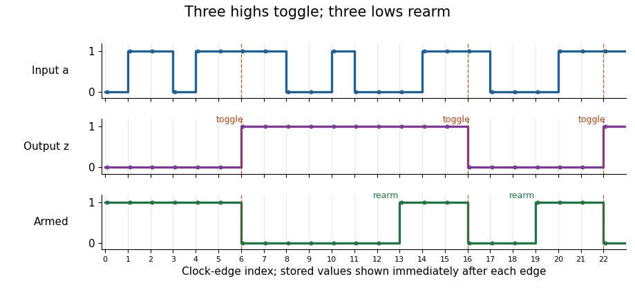

<h1 id="3/c/solution">Solution</h1>

↑ **Parent:** [C](../c.md)

Share the input-history [bits](../../../../../bit.md) of (a) between a high-run detector and a low-run detector. With $p,q$ the two preceding input samples, put

$$
c=a\land p\land q,\qquad d=\neg a\land\neg p\land\neg q.
$$

These detector outputs are mutually exclusive. Feed them into (b). An explicit four-[bit](../../../../../bit.md) [synchronous sequential circuit](../../../../../synchronous-sequential-circuit.md), with initial state $(p,q,e,z)=(0,0,1,0)$, is

$$
\boxed{p'=a,\quad q'=p,\quad
e'=d\lor(e\land\neg c),\quad
z'=z\mathbin{\oplus}(e\land c).}
$$

Every right-hand side uses the old state and the current input. In particular, the run detectors' combinational outputs are sampled by the toggle module at that same edge; there is no extra pipeline stage.

The first three consecutive high samples make $c=1$ at the third edge, toggling $z$ and clearing $e$. Continuing high input cannot toggle it again. Only three consecutive low samples can make $d=1$ and rearm it; interrupted low runs do not suffice. After rearming, a new three-sample high run produces the next toggle. This proves the [debounced toggle switch](../../../../../debounced-toggle-switch.md) behaviour, including rejection of short high and low disturbances.

**[Figure 1](#3/c/image-the-debounced-toggle-switch-rejects-interrupted-runs-toggles-on-the-third-consecutive-high-sample-and-rearms-only-on-the-third-consecutive-low-sample-stored-outputs-are-shown-just-after-each-clock-edge). The debounced toggle switch rejects interrupted runs, toggles on the third consecutive high sample, and rearms only on the third consecutive low sample; stored outputs are shown just after each clock edge**.

## ↑ Ancestors (13)

1. [C](../c.md)
2. [3](../../3.md)
3. [Digital systems](../../digital-systems.md)
4. [Digital systems, linear algebra and introduction to formal proof](../../../digital-systems-linear-algebra-and-introduction-to-formal-proof-split.md)
5. [2023](../../../split.md)
6. [Past exam of the year 1 of the computer science course of the University of Oxford](../../../../split.md)
7. [Year 1 of the computer science course of the University of Oxford](../../../../../year-1-of-the-computer-science-course-of-the-university-of-oxford.md)
8. [Computer science course of the University of Oxford](../../../../../computer-science-course-of-the-university-of-oxford.md)
9. [Undergraduate course of the University of Oxford](../../../../../undergraduate-course-of-the-university-of-oxford.md)
10. [Course of the University of Oxford](../../../../../course-of-the-university-of-oxford.md)
11. [University of Oxford](../../../../../university-of-oxford-split.md)
12. [List of universities](../../../../../list-of-universities.md)
13. [Codex Wiki](../../../../../split.md)
