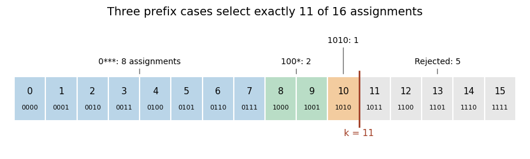

<h1 id="7/d/solution">Solution</h1>

↑ **Parent:** [D](../d.md)

Interpret $x_1,\ldots,x_n$ as the [bits](../../../../../bit.md) of a [binary number](../../../../../binary-number.md), with $x_1$ most significant. Construct a [propositional formula](../../../../../propositional-formula.md) saying that this number is strictly less than $k$. This gives a [quadratic-size formula with prescribed model count](../../../../../quadratic-size-formula-with-prescribed-model-count.md).

For $0<k<2^n$, write $k=(b_1\cdots b_n)_2$. For each $i$ with $b_i=1$, define the conjunction

$$
T_i=\left(\bigwedge_{j<i}\ell_j\right)\land\neg x_i,
\qquad
\ell_j=\begin{cases}x_j,&b_j=1,\\\neg x_j,&b_j=0.\end{cases}
$$

The empty prefix for $i=1$ is omitted. Let **$\varphi_k=\bigvee_{i:b_i=1}T_i$**. A [Boolean valuation](../../../../../boolean-valuation.md) satisfies $T_i$ exactly when its first difference from the [binary representation](../../../../../binary-number.md) of $k$ is at position $i$, changing a one of $k$ to a zero. All later [bits](../../../../../bit.md) are unrestricted. Hence these cases are disjoint and cover exactly the numbers $0,\ldots,k-1$.

Alternatively, counting the disjoint cases directly gives

$$
\#\{\text{satisfying assignments of }\varphi_k\}
=\sum_{i:b_i=1}2^{n-i}=k.
$$

Each $T_i$ has length $O(i)$, including its [logical connectives](../../../../../logical-connective.md) and parentheses; the total length is at most a constant multiple of $\sum_{i=1}^n i=O(n^2)$. The endpoints are $\varphi_0=\bot$ and $\varphi_{2^n}=\top$. If constants are unavailable and $n\geq1$, use $x_1\land\neg x_1$ and $x_1\lor\neg x_1$ instead. Assignments are counted over all $n$ specified variables, including any absent from the formula. For $n=0$, the constants describe the two possible counts, zero and one. Thus the construction covers $0\leq k\leq2^n$, including the endpoint zero despite the source's word “positive”.

For example, $n=4,k=11=(1011)_2$ gives the disjoint cases $0***$, $100*$ and $1010$, with $8+2+1=11$ [satisfying assignments](../../../../../satisfying-assignment.md).

**[Figure 2](#7/d/image-a-quadratic-size-formula-with-prescribed-model-count-accepts-the-eleven-four-bit-numbers-below-11-three-disjoint-prefix-cases-contribute-8-2-and-1-satisfying-assignments). A quadratic-size formula with prescribed model count accepts the eleven four-bit numbers below $11$: three disjoint prefix cases contribute $8$, $2$ and $1$ satisfying assignments**.

## ↑ Ancestors (13)

1. [D](../d.md)
2. [7](../../7.md)
3. [Introduction to formal proof](../../introduction-to-formal-proof.md)
4. [Digital systems, linear algebra and introduction to formal proof](../../../digital-systems-linear-algebra-and-introduction-to-formal-proof-split.md)
5. [2023](../../../split.md)
6. [Past exam of the year 1 of the computer science course of the University of Oxford](../../../../split.md)
7. [Year 1 of the computer science course of the University of Oxford](../../../../../year-1-of-the-computer-science-course-of-the-university-of-oxford.md)
8. [Computer science course of the University of Oxford](../../../../../computer-science-course-of-the-university-of-oxford.md)
9. [Undergraduate course of the University of Oxford](../../../../../undergraduate-course-of-the-university-of-oxford.md)
10. [Course of the University of Oxford](../../../../../course-of-the-university-of-oxford.md)
11. [University of Oxford](../../../../../university-of-oxford-split.md)
12. [List of universities](../../../../../list-of-universities.md)
13. [Codex Wiki](../../../../../split.md)
