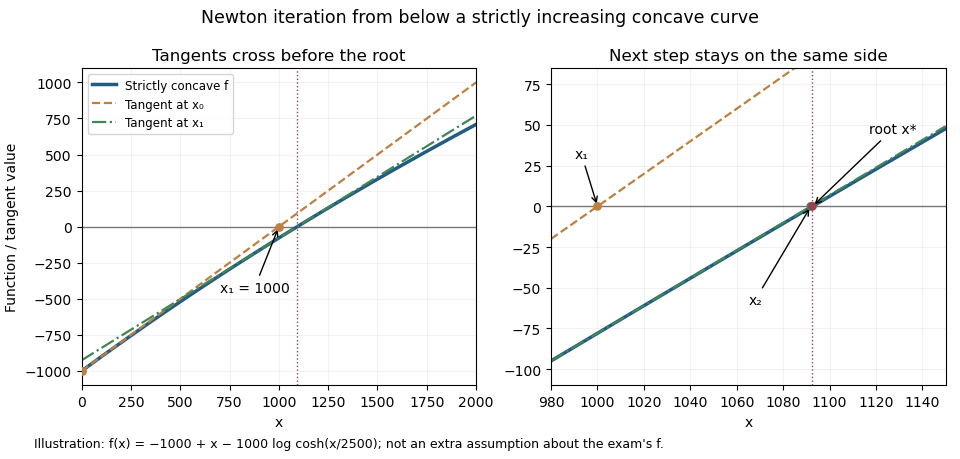

# Discrete mathematics, probability and continuous mathematics

↑ **Parent:** [2023](../2023.md)

Solutions to every answerable part of the 22 June 2023 preliminary examination in the [Year 1 of the computer science course of the University of Oxford](../../university-of-oxford.md#year-1-of-the-computer-science-course-of-the-university-of-oxford). The source groups Questions 1–3, 4–6 and 7–9 into its discrete, continuous and probability sections respectively. All nine questions are treated, although candidates were permitted at most five, with at most two from each section. Throughout, $\mathbb N=\{0,1,2,\ldots\}$, consistent with the source's explicit exclusions of zero. [Source release](https://www.whatdotheyknow.com/request/ba_computer_science_past_papers/response/2577745/attach/2/202402%20183%20CS%20Papers.zip?cookie_passthrough=1), member `2022/T/a10100w1.pdf`: the PDF itself prints Trinity Term 2023 and A10100W1. Question statements are not reproduced.

**Table of contents**

- [1](#1)
  - [a](#1/a)
    - [i](#1/a/i)
      - [Solution](#1/a/i/solution)
    - [ii](#1/a/ii)
      - [Solution](#1/a/ii/solution)
    - [iii](#1/a/iii)
      - [Solution](#1/a/iii/solution)
  - [b](#1/b)
    - [i](#1/b/i)
      - [Solution](#1/b/i/solution)
    - [ii](#1/b/ii)
      - [Solution](#1/b/ii/solution)
  - [c](#1/c)
    - [i](#1/c/i)
      - [1](#1/c/i/1)
        - [Solution](#1/c/i/1/solution)
      - [2](#1/c/i/2)
        - [Solution](#1/c/i/2/solution)
    - [ii](#1/c/ii)
      - [Solution](#1/c/ii/solution)
  - [d](#1/d)
    - [i](#1/d/i)
      - [Solution](#1/d/i/solution)
    - [ii](#1/d/ii)
      - [Solution](#1/d/ii/solution)
    - [iii](#1/d/iii)
      - [Solution](#1/d/iii/solution)
    - [iv](#1/d/iv)
      - [Solution](#1/d/iv/solution)
- [2](#2)
  - [a](#2/a)
    - [Solution](#2/a/solution)
  - [b](#2/b)
    - [Solution](#2/b/solution)
  - [c](#2/c)
    - [Solution](#2/c/solution)
  - [d](#2/d)
    - [i](#2/d/i)
      - [Solution](#2/d/i/solution)
    - [ii](#2/d/ii)
      - [Solution](#2/d/ii/solution)
    - [iii](#2/d/iii)
      - [Solution](#2/d/iii/solution)
    - [iv](#2/d/iv)
      - [Solution](#2/d/iv/solution)
    - [v](#2/d/v)
      - [Solution](#2/d/v/solution)
- [3](#3)
  - [a](#3/a)
    - [i](#3/a/i)
      - [Solution](#3/a/i/solution)
    - [ii](#3/a/ii)
      - [Solution](#3/a/ii/solution)
  - [b](#3/b)
    - [i](#3/b/i)
      - [Solution](#3/b/i/solution)
    - [ii](#3/b/ii)
      - [Solution](#3/b/ii/solution)
    - [iii](#3/b/iii)
      - [Solution](#3/b/iii/solution)
  - [c](#3/c)
    - [Solution](#3/c/solution)
- [4](#4)
  - [a](#4/a)
    - [Solution](#4/a/solution)
  - [b](#4/b)
    - [Solution](#4/b/solution)
  - [c](#4/c)
    - [i](#4/c/i)
      - [Solution](#4/c/i/solution)
    - [ii](#4/c/ii)
      - [Solution](#4/c/ii/solution)
    - [iii](#4/c/iii)
      - [Solution](#4/c/iii/solution)
- [5](#5)
  - [a](#5/a)
    - [Solution](#5/a/solution)
  - [b](#5/b)
    - [i](#5/b/i)
      - [Solution](#5/b/i/solution)
    - [ii](#5/b/ii)
      - [Solution](#5/b/ii/solution)
  - [c](#5/c)
    - [i](#5/c/i)
      - [Solution](#5/c/i/solution)
    - [ii](#5/c/ii)
      - [Solution](#5/c/ii/solution)
    - [iii](#5/c/iii)
      - [Solution](#5/c/iii/solution)
- [6](#6)
  - [a](#6/a)
    - [Solution](#6/a/solution)
  - [b](#6/b)
    - [Solution](#6/b/solution)
  - [c](#6/c)
    - [Solution](#6/c/solution)
  - [d](#6/d)
    - [Solution](#6/d/solution)
  - [e](#6/e)
    - [Solution](#6/e/solution)
  - [f](#6/f)
    - [Solution](#6/f/solution)
- [7](#7)
  - [a](#7/a)
    - [i](#7/a/i)
      - [Solution](#7/a/i/solution)
    - [ii](#7/a/ii)
      - [Solution](#7/a/ii/solution)
    - [iii](#7/a/iii)
      - [Solution](#7/a/iii/solution)
  - [b](#7/b)
    - [i](#7/b/i)
      - [Solution](#7/b/i/solution)
    - [ii](#7/b/ii)
      - [Solution](#7/b/ii/solution)
    - [iii](#7/b/iii)
      - [Solution](#7/b/iii/solution)
    - [iv](#7/b/iv)
      - [Solution](#7/b/iv/solution)
    - [v](#7/b/v)
      - [Solution](#7/b/v/solution)
- [8](#8)
  - [a](#8/a)
    - [i](#8/a/i)
      - [Solution](#8/a/i/solution)
    - [ii](#8/a/ii)
      - [Solution](#8/a/ii/solution)
    - [iii](#8/a/iii)
      - [Solution](#8/a/iii/solution)
  - [b](#8/b)
    - [i](#8/b/i)
      - [Solution](#8/b/i/solution)
    - [ii](#8/b/ii)
      - [Solution](#8/b/ii/solution)
    - [iii](#8/b/iii)
      - [Solution](#8/b/iii/solution)
  - [c](#8/c)
    - [Solution](#8/c/solution)
- [9](#9)
  - [a](#9/a)
    - [i](#9/a/i)
      - [Solution](#9/a/i/solution)
    - [ii](#9/a/ii)
      - [Solution](#9/a/ii/solution)
    - [iii](#9/a/iii)
      - [Solution](#9/a/iii/solution)
  - [b](#9/b)
    - [i](#9/b/i)
      - [Solution](#9/b/i/solution)
    - [ii](#9/b/ii)
      - [Solution](#9/b/ii/solution)
    - [iii](#9/b/iii)
      - [Solution](#9/b/iii/solution)
    - [iv](#9/b/iv)
      - [Solution](#9/b/iv/solution)
    - [v](#9/b/v)
      - [Solution](#9/b/v/solution)

## 1

↑ **Parent:** [Discrete mathematics, probability and continuous mathematics](discrete-mathematics-probability-and-continuous-mathematics.md)

<h3 id="1/a">a</h3>

↑ **Parent:** [1](#1)

<h4 id="1/a/i">i</h4>

↑ **Parent:** [A](#1/a)

<h5 id="1/a/i/solution">Solution</h5>

↑ **Parent:** [I](#1/a/i)

A [preorder](../../set.md#preorder) is a [binary relation](../../set-theory.md#binary-relation) that is both [reflexive](../../set-theory.md#reflexive-relation) and [transitive](../../set-theory.md#transitive-relation): $a\preceq a$ for every $a\in A$, and $a\preceq b\preceq c$ implies $a\preceq c$.

<h4 id="1/a/ii">ii</h4>

↑ **Parent:** [A](#1/a)

<h5 id="1/a/ii/solution">Solution</h5>

↑ **Parent:** [Ii](#1/a/ii)

A [partial order](../../set.md#partially-ordered-set) is a [preorder](../../set.md#preorder) satisfying the [antisymmetric relation](../../set-theory.md#antisymmetric-relation) axiom. In addition to [reflexivity](../../set-theory.md#reflexive-relation) and [transitivity](../../set-theory.md#transitive-relation), it satisfies $a\preceq b$ and $b\preceq a$ only when $a=b$.

<h4 id="1/a/iii">iii</h4>

↑ **Parent:** [A](#1/a)

<h5 id="1/a/iii/solution">Solution</h5>

↑ **Parent:** [Iii](#1/a/iii)

A [total order](../../set.md#total-order) is a [partial order](../../set.md#partially-ordered-set) in which every pair is comparable: for every $a,b\in A$, at least one of $a\preceq b$ and $b\preceq a$ holds. Both hold exactly when $a=b$.

<h3 id="1/b">b</h3>

↑ **Parent:** [1](#1)

<h4 id="1/b/i">i</h4>

↑ **Parent:** [B](#1/b)

<h5 id="1/b/i/solution">Solution</h5>

↑ **Parent:** [I](#1/b/i)

For the [product order](../../set.md#product-order), [reflexivity](../../set-theory.md#reflexive-relation) follows from $a_i\le a_i$ in every coordinate. If $\mathbf a\preceq\mathbf b$ and $\mathbf b\preceq\mathbf a$, the [antisymmetric relation](../../set-theory.md#antisymmetric-relation) axiom for the usual real order gives $a_i=b_i$ for every $i$, hence $\mathbf a=\mathbf b$. If $\mathbf a\preceq\mathbf b\preceq\mathbf c$, [transitivity](../../set-theory.md#transitive-relation) in each coordinate gives $a_i\le c_i$, hence $\mathbf a\preceq\mathbf c$. Thus this is a [partial order](../../set.md#partially-ordered-set).

For $n\ge2$, the [vectors](../../vector-space.md#vector) $(1,0,0,\ldots)$ and $(0,1,0,\ldots)$ are incomparable: each has a coordinate larger than the corresponding coordinate of the other. **It is not a [total order](../../set.md#total-order) for $n\ge2$.** The dimension qualification matters: for $n=1$ this is the usual [total order](../../set.md#total-order) on $\mathbb R$, so the printed non-totality claim needs the implicit assumption $n\ge2$.

<h4 id="1/b/ii">ii</h4>

↑ **Parent:** [B](#1/b)

<h5 id="1/b/ii/solution">Solution</h5>

↑ **Parent:** [Ii](#1/b/ii)

For the [pointwise order on real polynomials](../../polynomial.md#pointwise-order-on-real-polynomials), $p(x)\le p(x)$ proves [reflexivity](../../set-theory.md#reflexive-relation). Two opposite inequalities imply $p(x)=q(x)$ for every real $x$; the [polynomials](../../polynomial.md) are therefore equal, proving the [antisymmetric relation](../../set-theory.md#antisymmetric-relation) axiom. Chaining the inequalities at every $x$ proves [transitivity](../../set-theory.md#transitive-relation).

To disprove [total order](../../set.md#total-order), take $p(x)=x$ and $q(x)=0$. The inequality $p\preceq q$ fails at $x=1$, whereas $q\preceq p$ fails at $x=-1$. **The order is partial but non-total.**

<h3 id="1/c">c</h3>

↑ **Parent:** [1](#1)

<h4 id="1/c/i">i</h4>

↑ **Parent:** [C](#1/c)

<h5 id="1/c/i/1">1</h5>

↑ **Parent:** [I](#1/c/i)

<h6 id="1/c/i/1/solution">Solution</h6>

↑ **Parent:** [1](#1/c/i/1)

The [greatest element](../../set.md#greatest-element) of $S$, also called its maximum, is an element $m\in S$ such that $s\preceq m$ for every $s\in S$. Membership in $S$ is essential; an [upper bound](../../set.md#upper-bound-in-a-partially-ordered-set) need not belong to $S$.

<h5 id="1/c/i/2">2</h5>

↑ **Parent:** [I](#1/c/i)

<h6 id="1/c/i/2/solution">Solution</h6>

↑ **Parent:** [2](#1/c/i/2)

A [least upper bound](../../set.md#least-upper-bound-in-a-partially-ordered-set) of $S$ is an element $u\in A$ such that $s\preceq u$ for every $s\in S$, and such that $u\preceq v$ for every other [upper bound](../../set.md#upper-bound-in-a-partially-ordered-set) $v\in A$ of $S$. It need not belong to $S$. The [antisymmetric relation](../../set-theory.md#antisymmetric-relation) axiom makes it unique whenever it exists.

<h4 id="1/c/ii">ii</h4>

↑ **Parent:** [C](#1/c)

<h5 id="1/c/ii/solution">Solution</h5>

↑ **Parent:** [Ii](#1/c/ii)

Write each member as $3-2/(n+1)$. Every member is strictly below $3$, so $3$ is an [upper bound](../../set.md#upper-bound-in-a-partially-ordered-set). If $u<3$, the [Archimedean property](../../arithmetic.md#archimedean-property) supplies $n\in\mathbb N$ with $n+1>2/(3-u)$; then $3-2/(n+1)>u$. Thus no smaller number is an [upper bound](../../set.md#upper-bound-in-a-partially-ordered-set), proving **$\sup S=3$**. Since $3\notin S$, there is **no [greatest element](../../set.md#greatest-element)**. Equivalently, each member is followed by a larger member because $2/(n+2)<2/(n+1)$.

<h3 id="1/d">d</h3>

↑ **Parent:** [1](#1)

<h4 id="1/d/i">i</h4>

↑ **Parent:** [D](#1/d)

<h5 id="1/d/i/solution">Solution</h5>

↑ **Parent:** [I](#1/d/i)

For every $a$, both $aRa$ and $aSa$ hold, so the [intersection of equivalence relations](../../set-theory.md#intersection-of-equivalence-relations) is [reflexive](../../set-theory.md#reflexive-relation). If $a(R\cap S)b$, [symmetry](../../physics.md#symmetry-physics) of both component [binary relations](../../set-theory.md#binary-relation) gives $bRa$ and $bSa$, hence $b(R\cap S)a$. Finally, if $a(R\cap S)b$ and $b(R\cap S)c$, [transitivity](../../set-theory.md#transitive-relation) in each component gives $aRc$ and $aSc$, hence $a(R\cap S)c$. These are precisely the three conditions for an [equivalence relation](../../set-theory.md#equivalence-relation).

<h4 id="1/d/ii">ii</h4>

↑ **Parent:** [D](#1/d)

<h5 id="1/d/ii/solution">Solution</h5>

↑ **Parent:** [Ii](#1/d/ii)

For every $x\in A$, membership in the relevant [equivalence class](../../set-theory.md#equivalence-class) satisfies

$$
x\in[a]_{R\cap S}\iff a(R\cap S)x\iff (aRx\text{ and }aSx)\iff x\in[a]_R\cap[a]_S.
$$

Equality follows by [axiom of extensionality](../../set-theory.md#axiom-of-extensionality). Thus **$[a]_{R\cap S}=[a]_R\cap[a]_S$**.

<h4 id="1/d/iii">iii</h4>

↑ **Parent:** [D](#1/d)

<h5 id="1/d/iii/solution">Solution</h5>

↑ **Parent:** [Iii](#1/d/iii)

The [floor function](../../calculus.md#floor-function) is constant at $j$ on the four consecutive [integers](../../integer.md) $4j,4j+1,4j+2,4j+3$. Consequently the [partition of a set](../../set.md#partition-of-a-set) is **$\{\{4j,4j+1,4j+2,4j+3\}:j\in\mathbb N\}$**. Different blocks are disjoint and every [nonnegative integer](../../arithmetic.md#natural-number) has exactly one quotient and remainder upon division by $4$.

<h4 id="1/d/iv">iv</h4>

↑ **Parent:** [D](#1/d)

<h5 id="1/d/iv/solution">Solution</h5>

↑ **Parent:** [Iv](#1/d/iv)

Take the nonempty intersections of the length-three and length-four blocks. Within the first twelve [nonnegative integers](../../arithmetic.md#natural-number) the common cut points are $0,3,4,6,8,9,12$, giving

$$
\{0,1,2\},\quad\{3\},\quad\{4,5\},\quad\{6,7\},\quad\{8\},\quad\{9,10,11\}.
$$

The complete [partition of a set](../../set.md#partition-of-a-set) consists of these six blocks translated by $12j$ for every $j\in\mathbb N$. Indeed, adding $12$ increases the two floor quotients by $4$ and $3$ respectively, preserving equality of both quotients within each translated block. No adjacent displayed blocks can merge because at least one quotient changes at their boundary. This is the [periodic common refinement of floor-quotient partitions](../../set-theory.md#periodic-common-refinement-of-floor-quotient-partitions), with period $\operatorname{lcm}(3,4)=12$.

<h2 id="2">2</h2>

↑ **Parent:** [Discrete mathematics, probability and continuous mathematics](discrete-mathematics-probability-and-continuous-mathematics.md)

<h3 id="2/a">a</h3>

↑ **Parent:** [2](#2)

<h4 id="2/a/solution">Solution</h4>

↑ **Parent:** [A](#2/a)

Use [strong induction](../../foundations-of-mathematics.md#strong-induction) with three consecutive base cases:

$$
8=3+5,\qquad9=3\cdot3,\qquad10=5\cdot2.
$$

For $n\ge11$, assume all values from $8$ through $n-1$ have the required representation. Since $8\le n-3<n$, write $n-3=3k+5m$ with $k,m$ [nonnegative integers](../../arithmetic.md#natural-number). Then $n=3(k+1)+5m$ is another such representation. [Strong induction](../../foundations-of-mathematics.md#strong-induction) proves the claim for every $n\ge8$. This is a [consecutive-base induction for additive semigroups](../../algebraic-operation.md#consecutive-base-induction-for-additive-semigroups): the three base cases handle all residues before repeated addition of $3$.

<h3 id="2/b">b</h3>

↑ **Parent:** [2](#2)

<h4 id="2/b/solution">Solution</h4>

↑ **Parent:** [B](#2/b)

At $n=2$, the product is $1-1/4=3/4$, as required. Suppose the formula holds at $n\ge2$. Appending the next factor gives

$$
\prod_{i=2}^{n+1}\left(1-\frac1{i^2}\right)
=\frac{n+1}{2n}\frac{n(n+2)}{(n+1)^2}
=\frac{n+2}{2(n+1)},
$$

which is exactly the formula at $n+1$. Thus [mathematical induction](../../foundations-of-mathematics.md#mathematical-induction) gives **$(n+1)/(2n)$** for every $n\ge2$. The factorization $1-i^{-2}=(i-1)(i+1)/i^2$ also explains the cancellation in this [telescoping product](../../sequence-and-series.md#telescoping-product).

<h3 id="2/c">c</h3>

↑ **Parent:** [2](#2)

<h4 id="2/c/solution">Solution</h4>

↑ **Parent:** [C](#2/c)

Fix $m\ge1$ and use two-base [mathematical induction](../../foundations-of-mathematics.md#mathematical-induction) on $n$. At $n=0$, the proposed right side is $F_m$; at $n=1$, it is $F_{m-1}+F_m=F_{m+1}$. Suppose the identity holds at $n$ and $n+1$. The defining [recurrence relation](../../sequence-and-series.md#recurrence-relation) for the [Fibonacci numbers](../../sequence-and-series.md#fibonacci-number) gives

$$
F_{m+n+2}=F_{m+n+1}+F_{m+n}
=F_{m-1}(F_{n+1}+F_n)+F_m(F_{n+2}+F_{n+1})
=F_{m-1}F_{n+2}+F_mF_{n+3}.
$$

This is the assertion at $n+2$, completing the proof of the [Fibonacci addition formula](../../sequence-and-series.md#fibonacci-addition-formula). The argument includes $m=1$, since $F_{m-1}=F_0$ is defined.

<h3 id="2/d">d</h3>

↑ **Parent:** [2](#2)

<h4 id="2/d/i">i</h4>

↑ **Parent:** [D](#2/d)

<h5 id="2/d/i/solution">Solution</h5>

↑ **Parent:** [I](#2/d/i)

Suppose $(g\circ f)(a)=(g\circ f)(a')$. [Injectivity](../../algebra.md#injective-function) of $g$ gives $f(a)=f(a')$, and [injectivity](../../algebra.md#injective-function) of $f$ then gives $a=a'$. Thus the [function composition](../../function.md#function-composition) is [injective](../../algebra.md#injective-function).

<h4 id="2/d/ii">ii</h4>

↑ **Parent:** [D](#2/d)

<h5 id="2/d/ii/solution">Solution</h5>

↑ **Parent:** [Ii](#2/d/ii)

For any $c\in C$, [surjectivity](../../algebra.md#surjective-function) of $g\circ f$ supplies $a\in A$ with $g(f(a))=c$. Taking $b=f(a)\in B$ proves that $c$ has a preimage under $g$. Thus $g$ is [surjective](../../algebra.md#surjective-function).

<h4 id="2/d/iii">iii</h4>

↑ **Parent:** [D](#2/d)

<h5 id="2/d/iii/solution">Solution</h5>

↑ **Parent:** [Iii](#2/d/iii)

If $f(a)=f(a')$, applying $g$ gives $(g\circ f)(a)=(g\circ f)(a')$. [Injectivity](../../algebra.md#injective-function) of the [function composition](../../function.md#function-composition) forces $a=a'$. Hence $f$ is [injective](../../algebra.md#injective-function).

<h4 id="2/d/iv">iv</h4>

↑ **Parent:** [D](#2/d)

<h5 id="2/d/iv/solution">Solution</h5>

↑ **Parent:** [Iv](#2/d/iv)

Suppose $g(b)=g(b')$. Since $f$ is [surjective](../../algebra.md#surjective-function), choose $a,a'\in A$ with $f(a)=b$ and $f(a')=b'$. Then $(g\circ f)(a)=(g\circ f)(a')$, so [injectivity](../../algebra.md#injective-function) gives $a=a'$ and therefore $b=b'$. Thus $g$ is [injective](../../algebra.md#injective-function). The use of [surjectivity](../../algebra.md#surjective-function) is what makes every point of $B$ accessible to this argument.

<h4 id="2/d/v">v</h4>

↑ **Parent:** [D](#2/d)

<h5 id="2/d/v/solution">Solution</h5>

↑ **Parent:** [V](#2/d/v)

Fix $b\in B$. Since $g\circ f$ is [surjective](../../algebra.md#surjective-function), there is $a\in A$ with $g(f(a))=g(b)$. [Injectivity](../../algebra.md#injective-function) of $g$ gives $f(a)=b$, proving that $f$ is [surjective](../../algebra.md#surjective-function). All five conclusions are instances of [injectivity and surjectivity under composition](../../function.md#injectivity-and-surjectivity-under-composition).

## 3

↑ **Parent:** [Discrete mathematics, probability and continuous mathematics](discrete-mathematics-probability-and-continuous-mathematics.md)

<h3 id="3/a">a</h3>

↑ **Parent:** [3](#3)

<h4 id="3/a/i">i</h4>

↑ **Parent:** [A](#3/a)

<h5 id="3/a/i/solution">Solution</h5>

↑ **Parent:** [I](#3/a/i)

The [greatest common divisor](../../divisibility.md#greatest-common-divisor) of positive [integers](../../integer.md) $a,b$ is **the largest positive [integer](../../integer.md) dividing both**, denoted $\gcd(a,b)$. The set of positive common divisors contains $1$ and is finite, so this definition supplies a value.

<h4 id="3/a/ii">ii</h4>

↑ **Parent:** [A](#3/a)

<h5 id="3/a/ii/solution">Solution</h5>

↑ **Parent:** [Ii](#3/a/ii)

The [Euclidean algorithm](../../number-theory.md#euclidean-algorithm) repeatedly replaces $(r_{i-1},r_i)$ by $(r_i,r_{i-1}-q_i r_i)$, where the new remainder lies between $0$ and $r_i-1$. Common divisors are unchanged by this subtraction, and decreasing positive remainders ensure termination. The last nonzero remainder is the [greatest common divisor](../../divisibility.md#greatest-common-divisor).

The [extended Euclidean algorithm](../../number-theory.md#extended-euclidean-algorithm) also tracks coefficients $r_i=u_i a+v_i b$, beginning with coefficient pairs $(1,0)$ and $(0,1)$ and applying the same subtraction to the pairs. This invariant produces [Bézout coefficients](../../algebra.md#bezout-coefficient) for the last nonzero remainder. Here the divisions are

$$
580=2\cdot252+76,\qquad
252=3\cdot76+24,\qquad
76=3\cdot24+4,\qquad
24=6\cdot4.
$$

Back substitution gives

$$
4=76-3\cdot24=10\cdot76-3\cdot252=10\cdot580-23\cdot252.
$$

Thus **$\gcd(580,252)=4$**, with **$m=10$ and $n=-23$** in [Bézout's identity](../../algebra.md#bezout-s-identity).

<h3 id="3/b">b</h3>

↑ **Parent:** [3](#3)

<h4 id="3/b/i">i</h4>

↑ **Parent:** [B](#3/b)

<h5 id="3/b/i/solution">Solution</h5>

↑ **Parent:** [I](#3/b/i)

Use [strong induction](../../foundations-of-mathematics.md#strong-induction) on the positive [integer](../../integer.md) $n$. The case $n=1$ is represented by the [empty product](../../arithmetic.md#empty-product). For $n>1$, if $n$ is [prime](../../prime-number.md) it is already a product of one [prime](../../prime-number.md). Otherwise $n=ab$ with $1<a,b<n$; the [induction hypothesis](../../foundations-of-mathematics.md#induction-hypothesis) gives [prime factorizations](../../prime-number.md#fundamental-theorem-of-arithmetic) for both $a$ and $b$, and concatenating them gives one for $n$. This proves existence in the [fundamental theorem of arithmetic](../../prime-number.md#fundamental-theorem-of-arithmetic) without presupposing uniqueness.

<h4 id="3/b/ii">ii</h4>

↑ **Parent:** [B](#3/b)

<h5 id="3/b/ii/solution">Solution</h5>

↑ **Parent:** [Ii](#3/b/ii)

If $p\mid a$, there is nothing to prove. Otherwise the only possible positive common divisors of the [prime](../../prime-number.md) $p$ and $a$ show that $\gcd(p,a)=1$. By [Bézout's identity](../../algebra.md#bezout-s-identity), $up+va=1$ for some [integers](../../integer.md) $u,v$. Multiplying by $b$ gives $b=upb+vab$. Both terms on the right are divisible by $p$, the second because $p\mid ab$. Hence **$p\mid b$**. This proves [Euclid's lemma](../../number-theory.md#euclid-s-lemma), including when either factor is zero or negative.

<h4 id="3/b/iii">iii</h4>

↑ **Parent:** [B](#3/b)

<h5 id="3/b/iii/solution">Solution</h5>

↑ **Parent:** [Iii](#3/b/iii)

Suppose $n=p_1\cdots p_r=q_1\cdots q_s$ are two products of positive [primes](../../prime-number.md). If $r=0$, then $n=1$, and necessarily $s=0$, since any nonempty product of positive [primes](../../prime-number.md) is at least $2$. Otherwise [Euclid's lemma](../../number-theory.md#euclid-s-lemma), applied repeatedly to the right-hand product, says $p_1$ divides one $q_j$. Since $q_j$ is [prime](../../prime-number.md), $p_1=q_j$. Reorder the right-hand factors and cancel this common nonzero factor. Repeating, or using [induction](../../foundations-of-mathematics.md#mathematical-induction) on the number of factors, matches every factor. Neither side can have factors left over, because their product would then equal $1$. Thus **the [prime factorization](../../prime-number.md#fundamental-theorem-of-arithmetic) is unique up to rearrangement**.

<h3 id="3/c">c</h3>

↑ **Parent:** [3](#3)

<h4 id="3/c/solution">Solution</h4>

↑ **Parent:** [C](#3/c)

The allowed [primes](../../prime-number.md) are exactly $2,3,5,7$. Define

$$
\Phi(2^a3^b5^c7^d)=(a,b,c,d),\qquad a,b,c,d\in\mathbb N.
$$

The [fundamental theorem of arithmetic](../../prime-number.md#fundamental-theorem-of-arithmetic) makes this definition unambiguous and proves [injectivity](../../algebra.md#injective-function). For every $(a,b,c,d)\in\mathbb N^4$, the positive [integer](../../integer.md) $2^a3^b5^c7^d$ belongs to $S$ and maps to that tuple, proving [surjectivity](../../algebra.md#surjective-function). The [inverse function](../../function.md#inverse-function) is explicitly $\Phi^{-1}(a,b,c,d)=2^a3^b5^c7^d$. In particular, $1$ maps to $(0,0,0,0)$. This is the [prime-exponent parametrization of smooth numbers](../../number-theory.md#prime-exponent-parametrization-of-smooth-numbers).

## 4

↑ **Parent:** [Discrete mathematics, probability and continuous mathematics](discrete-mathematics-probability-and-continuous-mathematics.md)

<h3 id="4/a">a</h3>

↑ **Parent:** [4](#4)

<h4 id="4/a/solution">Solution</h4>

↑ **Parent:** [A](#4/a)

Put $\mathbf h=\mathbf y-\mathbf x$. For $0<t\le1$, [convexity](../../real-analysis.md#convex-function) gives $f(\mathbf x+t\mathbf h)\le(1-t)f(\mathbf x)+tf(\mathbf y)$, hence

$$
f(\mathbf y)-f(\mathbf x)\ge\frac{f(\mathbf x+t\mathbf h)-f(\mathbf x)}{t}.
$$

By the first-order form of [Taylor's theorem](../../calculus.md#taylor-s-theorem), the right side tends to $\mathbf h^{\mathsf T}\nabla f(\mathbf x)$ as $t\downarrow0$. Therefore

$$
\boxed{f(\mathbf y)\ge f(\mathbf x)+(\mathbf y-\mathbf x)^{\mathsf T}\nabla f(\mathbf x).}
$$

This is the [supporting inequality for a differentiable convex function](../../real-analysis.md#supporting-inequality-for-a-differentiable-convex-function). The stated [partial derivatives](../../multivariable-calculus.md#partial-derivative) are enough: [coordinate derivatives give directional Taylor expansion for convex functions](../../real-analysis.md#coordinate-derivatives-give-directional-taylor-expansion-for-convex-functions), so no unmentioned continuity assumption on the second [partial derivatives](../../multivariable-calculus.md#partial-derivative) is needed. The result in fact needs less smoothness than the question assumes.

<h3 id="4/b">b</h3>

↑ **Parent:** [4](#4)

<h4 id="4/b/solution">Solution</h4>

↑ **Parent:** [B](#4/b)

**No.** Both $f(x)=x$ and $g(x)=-x$ are [affine functions](../../vector-space.md#affine-function), hence [convex functions](../../real-analysis.md#convex-function). Their product $h(x)=-x^2$ is not [convex](../../real-analysis.md#convex-function): at the midpoint of $-1$ and $1$, $h(0)=0>\tfrac12h(-1)+\tfrac12h(1)=-1$. Thus [products of convex functions need not be convex](../../real-analysis.md#products-of-convex-functions-need-not-be-convex), even for smooth functions on all of $\mathbb R$.

<h3 id="4/c">c</h3>

↑ **Parent:** [4](#4)

<h4 id="4/c/i">i</h4>

↑ **Parent:** [C](#4/c)

<h5 id="4/c/i/solution">Solution</h5>

↑ **Parent:** [I](#4/c/i)

Differentiating on the given domain yields

$$
j'(x)=\frac1{x\ln x},\qquad j''(x)=-\frac{\ln x+1}{x^2(\ln x)^2}<0\quad(x>1).
$$

The denominator and $\ln x+1$ are positive there. Thus **$j$ is strictly [concave](../../real-analysis.md#concave-function)**, and is not [convex](../../real-analysis.md#convex-function).

<h4 id="4/c/ii">ii</h4>

↑ **Parent:** [C](#4/c)

<h5 id="4/c/ii/solution">Solution</h5>

↑ **Parent:** [Ii](#4/c/ii)

The denominator is positive throughout the domain. Holding $y$ fixed, differentiate with respect to $x$:

$$
k_x(x,y)=\frac{1-y^2}{(1+xy)^2},\qquad k_{xx}(x,y)=\frac{2y(y^2-1)}{(1+xy)^3}.
$$

At the interior point $(1,1/2)$ this second [partial derivative](../../multivariable-calculus.md#partial-derivative) is $-2/9<0$, so the restriction to a horizontal line is locally strictly [concave](../../real-analysis.md#concave-function), ruling out [convexity](../../real-analysis.md#convex-function). At the interior point $(1,2)$ it is $4/9>0$, ruling out [concavity](../../real-analysis.md#concave-function). Restrictions of a [convex function](../../real-analysis.md#convex-function) or a [concave function](../../real-analysis.md#concave-function) to every line segment must retain that property. Consequently **$k$ is neither [convex](../../real-analysis.md#convex-function) nor [concave](../../real-analysis.md#concave-function)** on its stated domain.

<h4 id="4/c/iii">iii</h4>

↑ **Parent:** [C](#4/c)

<h5 id="4/c/iii/solution">Solution</h5>

↑ **Parent:** [Iii](#4/c/iii)

Since $\mathbf a\ne0$, the line $\mathbf x=t\mathbf a/\|\mathbf a\|^2$ lies in the domain and satisfies $\mathbf a^{\mathsf T}\mathbf x=t$. The restriction of $l$ to this line is $t^3$, whose second [derivative](../../calculus.md#derivative) is $6t$: negative for $t<0$ and positive for $t>0$. It can be neither globally [convex](../../real-analysis.md#convex-function) nor globally [concave](../../real-analysis.md#concave-function). Hence **$l$ is neither**. Equivalently, its [Hessian matrix](../../multivariable-calculus.md#hessian-matrix) is $6(\mathbf a^{\mathsf T}\mathbf x)\mathbf a\mathbf a^{\mathsf T}$, changing the sign of its nonzero directional curvature across $\mathbf a^{\mathsf T}\mathbf x=0$.

## 5

↑ **Parent:** [Discrete mathematics, probability and continuous mathematics](discrete-mathematics-probability-and-continuous-mathematics.md)

<h3 id="5/a">a</h3>

↑ **Parent:** [5](#5)

<h4 id="5/a/solution">Solution</h4>

↑ **Parent:** [A](#5/a)

Eliminate the constraint by writing $y=1/x$, with $x>0$. The [logarithms](../../calculus.md#logarithm) cancel, so the objective becomes $q(x)=1/x+2x$. Its [derivatives](../../calculus.md#derivative) are $q'(x)=-1/x^2+2$ and $q''(x)=2/x^3>0$. Thus the unique stationary point is the unique global [minimum](../../set.md#minimum-of-a-subset-of-a-total-order), at $x=1/\sqrt2$. Restoring $y$ gives

$$
\boxed{\operatorname*{arg\,min}=\{(1/\sqrt2,\sqrt2)\},\qquad\min=2\sqrt2.}
$$

As a direct global check, the [arithmetic-geometric mean inequality](../../mathematical-optimization.md#arithmetic-geometric-mean-inequality) gives $1/x+2x\ge2\sqrt2$, with equality exactly at the same point.

<h3 id="5/b">b</h3>

↑ **Parent:** [5](#5)

<h4 id="5/b/i">i</h4>

↑ **Parent:** [B](#5/b)

<h5 id="5/b/i/solution">Solution</h5>

↑ **Parent:** [I](#5/b/i)

Interpret the norms as [Euclidean norms](../../normed-vector-space.md#euclidean-norm) and set $B=A^{\mathsf T}A$. This is a [real symmetric matrix](../../linear-algebra.md#real-symmetric-matrix) with $\mathbf x^{\mathsf T}B\mathbf x=\|A\mathbf x\|^2\ge0$, hence a [positive semidefinite matrix](../../quadratic-form.md#positive-semidefinite-matrix). Squaring the nonnegative objective does not change its [argmin](../../mathematical-optimization.md#argmin). Let $\lambda_{\min}$ be the smallest [eigenvalue](../../linear-operator-theory.md#eigenvalue) of $B$ and $E_{\min}$ its [eigenspace](../../linear-operator-theory.md#eigenspace).

First minimize on the [unit sphere](../../topology.md#unit-sphere). The [Lagrange multiplier](../../mathematical-optimization.md#lagrange-multiplier) function $L(\mathbf x,\lambda)=\mathbf x^{\mathsf T}B\mathbf x-\lambda(\mathbf x^{\mathsf T}\mathbf x-1)$ has stationarity condition $B\mathbf x=\lambda\mathbf x$. Multiplication by $\mathbf x^{\mathsf T}$ shows that the squared objective at such a point is $\lambda$. The [spectral theorem for real symmetric matrices](../../linear-algebra.md#spectral-theorem-for-real-symmetric-matrices) also gives, for every unit [vector](../../vector-space.md#vector), $\mathbf x^{\mathsf T}B\mathbf x\ge\lambda_{\min}$, with equality exactly in $E_{\min}$. This proves global minimality, rather than merely finding stationary candidates.

If $\lambda_{\min}>0$, every point with $\|\mathbf x\|>1$ has a strictly smaller objective after rescaling to unit length. Therefore

$$
\boxed{\operatorname*{arg\,min}_{\|\mathbf x\|\ge1}\|A\mathbf x\|=\{\mathbf x\in E_{\min}:\|\mathbf x\|=1\},\quad\min=\sqrt{\lambda_{\min}}.}
$$

If $\lambda_{\min}=0$, the [kernel of a linear map](../../kernel-of-a-linear-map.md) satisfies $\ker B=\ker A$, since $B\mathbf x=0$ implies $\|A\mathbf x\|^2=0$, and the converse is immediate. The [minimum](../../set.md#minimum-of-a-subset-of-a-total-order) is then zero, attained precisely at

$$
\boxed{\{\mathbf x\in\ker A:\|\mathbf x\|\ge1\}.}
$$

In this case minimizers need not have unit length. This distinction is essential for a rank-deficient $A$, including any real $m\times n$ [matrix](../../vector-space.md#matrix) with $m<n$. The result is the [minimum image norm outside a Euclidean unit ball](../../linear-algebra.md#minimum-image-norm-outside-a-euclidean-unit-ball), governed by the least [singular value](../../linear-algebra.md#singular-value).

<h4 id="5/b/ii">ii</h4>

↑ **Parent:** [B](#5/b)

<h5 id="5/b/ii/solution">Solution</h5>

↑ **Parent:** [Ii](#5/b/ii)

The origin is feasible and has objective zero, while a [Euclidean norm](../../normed-vector-space.md#euclidean-norm) is nonnegative. Thus **the [minimum](../../set.md#minimum-of-a-subset-of-a-total-order) is $0$**, and the complete [argmin](../../mathematical-optimization.md#argmin) is

$$
\boxed{\ker A\cap\{\mathbf x:\|\mathbf x\|\le1\}.}
$$

If $A$ is [injective](../../algebra.md#injective-function), this set contains only the origin. If it has a nontrivial [kernel](../../kernel-of-a-linear-map.md), every feasible [kernel](../../kernel-of-a-linear-map.md) vector is also a minimizer. No [Lagrange multipliers](../../mathematical-optimization.md#lagrange-multiplier) are needed.

<h3 id="5/c">c</h3>

↑ **Parent:** [5](#5)

<h4 id="5/c/i">i</h4>

↑ **Parent:** [C](#5/c)

<h5 id="5/c/i/solution">Solution</h5>

↑ **Parent:** [I](#5/c/i)

Use [bisection](../../numerical-analysis.md#bisection-method) on $f'$ when the [derivative](../../calculus.md#derivative) is cheap and a bracket $f'(a)<0<f'(b)$ is easy to obtain. For a differentiable [convex function](../../real-analysis.md#convex-function), $f'$ is nondecreasing, so such a bracket locates a global [minimum](../../set.md#minimum-of-a-subset-of-a-total-order), allowing a flat minimizing interval. Without [convexity](../../real-analysis.md#convex-function), first isolate a region containing the desired local [minimum](../../set.md#minimum-of-a-subset-of-a-total-order); arbitrary stationary points need not be minima.

Use [golden-section search](../../numerical-analysis.md#golden-section-search) when reliable [function](../../function.md) values are available but [derivatives](../../calculus.md#derivative) are unavailable or expensive. It needs a bracket on which the objective is a [unimodal function](../../function.md#unimodal-function), commonly found by three ordered points whose middle value is below the two outer values. Those inequalities alone do not prove that the objective is a [unimodal function](../../function.md#unimodal-function). A [convex function](../../real-analysis.md#convex-function) supplies the needed shape; for a nonconvex objective, isolate an interval on which it is a [unimodal function](../../function.md#unimodal-function).

Both methods have [linear convergence](../../numerical-analysis.md#linear-convergence) of bracket width. [Bisection](../../numerical-analysis.md#bisection-method) contracts the width by $1/2$ per new derivative evaluation. [Golden-section search](../../numerical-analysis.md#golden-section-search) contracts it by $(\sqrt5-1)/2\approx0.618$ per new function evaluation after initialization, reusing one earlier value. Choose by evaluation cost and bracket availability as well as this contraction factor: comparing iteration counts alone can misidentify the faster method.

<h4 id="5/c/ii">ii</h4>

↑ **Parent:** [C](#5/c)

<h5 id="5/c/ii/solution">Solution</h5>

↑ **Parent:** [Ii](#5/c/ii)

[Convexity](../../real-analysis.md#convex-function) of the components of a [vector field](../../multivariable-calculus.md#vector-field) is not the decisive criterion for a root-finding problem. Neither method becomes globally reliable merely because each component is [convex](../../real-analysis.md#convex-function).

Prefer the [Newton root-finding iteration](../../numerical-analysis.md#newton-root-finding-iteration) when the [Jacobian matrix](../../multivariable-calculus.md#jacobian-matrix) is available accurately and at reasonable cost. Solve $J(\mathbf x_k)\mathbf s_k=-\mathbf f(\mathbf x_k)$ rather than explicitly forming an [inverse matrix](../../matrix-inverse.md). Near a root with a nonsingular [Jacobian matrix](../../multivariable-calculus.md#jacobian-matrix) and a locally Lipschitz [Jacobian matrix](../../multivariable-calculus.md#jacobian-matrix), the usual exact iteration has [quadratic convergence](../../numerical-analysis.md#quadratic-convergence).

Prefer [Broyden's method](../../numerical-analysis.md#broyden-s-method) when evaluating or differentiating the [vector field](../../multivariable-calculus.md#vector-field) makes a fresh [Jacobian matrix](../../multivariable-calculus.md#jacobian-matrix) expensive. It learns an approximate [Jacobian matrix](../../multivariable-calculus.md#jacobian-matrix) through secant updates using function differences. Under appropriate local regularity and initialization assumptions it has [superlinear convergence](../../numerical-analysis.md#superlinear-convergence), generally slower asymptotically than the [quadratic convergence](../../numerical-analysis.md#quadratic-convergence) of exact Newton steps, but often with cheaper iterations.[pp. 577–579, cost of Jacobian evaluation and construction of updating methods.](../../mathematics-bibliography.md#a-class-of-methods-for-solving-nonlinear-simultaneous-equations-by-charles-george-broyden)

Dimension matters through storage and solves. A full dense Newton factorization costs order $d^3$ arithmetic operations; a dense Broyden approximation uses order $d^2$ storage, and maintained inverse or factorization updates can cost order $d^2$. A naive fresh dense solve can still cost order $d^3$. Sparsity can favour Newton, while very large $d$ can make either dense formulation unsuitable. Neither local rate guarantees convergence from an arbitrary starting point.

<h4 id="5/c/iii">iii</h4>

↑ **Parent:** [C](#5/c)

<h5 id="5/c/iii/solution">Solution</h5>

↑ **Parent:** [Iii](#5/c/iii)

[Gradient descent](../../gradient-descent.md) uses only the current [gradient](../../multivariable-calculus.md#gradient) and a suitable [step size](../../convex-optimization.md#step-size); its additional storage is order $d$. It is attractive for very large $d$ or when low per-iteration cost matters most. For a smooth [strongly convex function](../../real-analysis.md#strongly-convex-function), standard step choices give [linear convergence](../../numerical-analysis.md#linear-convergence), with a rate sensitive to the [condition number](../../quadratic-form.md#condition-number). Mere [convexity](../../real-analysis.md#convex-function) gives a global-minimum interpretation but does not alone imply a linear rate; for nonconvex objectives the usual guarantee concerns stationary points.

[BFGS](../../mathematical-optimization.md#bfgs-method) uses successive [gradients](../../multivariable-calculus.md#gradient) to update an approximation to inverse curvature, incorporating information that can correct poor scaling. Full [BFGS](../../mathematical-optimization.md#bfgs-method) uses order $d^2$ storage and update work. With suitable [line searches](../../mathematical-optimization.md#line-search) and local smoothness and positive-curvature assumptions near a nondegenerate [minimum](../../set.md#minimum-of-a-subset-of-a-total-order), it has [superlinear convergence](../../numerical-analysis.md#superlinear-convergence). This often favours it in moderate dimensions when gradients are not extremely cheap relative to the extra work.

Neither [gradient descent](../../gradient-descent.md) nor [BFGS](../../mathematical-optimization.md#bfgs-method) requires an explicitly evaluated [Hessian matrix](../../multivariable-calculus.md#hessian-matrix). Thus an expensive [Hessian matrix](../../multivariable-calculus.md#hessian-matrix) is compatible with both, rather than a reason to reject [BFGS](../../mathematical-optimization.md#bfgs-method). If an accurate [Hessian matrix](../../multivariable-calculus.md#hessian-matrix) and its factorization are exceptionally cheap, [Newton's method in optimization](../../mathematical-optimization.md#newton-s-method-in-optimization) becomes an additional reasonable option. [Convexity](../../real-analysis.md#convex-function) helps identify a stationary point as a global [minimum](../../set.md#minimum-of-a-subset-of-a-total-order); without it, both methods need suitable descent and curvature safeguards. The [BFGS](../../mathematical-optimization.md#bfgs-method) update learns curvature from the [Quasi-Newton secant equation](../../mathematical-optimization.md#quasi-newton-secant-equation).[Quasi-Newton condition and the BFGS member of the low-rank updating family.](../../mathematics-bibliography.md#quasi-newton-methods-by-neos-guide)

## 6

↑ **Parent:** [Discrete mathematics, probability and continuous mathematics](discrete-mathematics-probability-and-continuous-mathematics.md)

<h3 id="6/a">a</h3>

↑ **Parent:** [6](#6)

<h4 id="6/a/solution">Solution</h4>

↑ **Parent:** [A](#6/a)

The [Newton root-finding iteration](../../numerical-analysis.md#newton-root-finding-iteration) is

$$
\boxed{g(x)=x-\frac{f(x)}{f'(x)}.}
$$

It requires $f$ and its [derivative](../../calculus.md#derivative) to be defined at the current point, and requires $f'(x)\ne0$. A step can leave the domain, making a subsequent iteration undefined. In [floating-point arithmetic](../../floating-point-arithmetic.md), division by zero, overflow or non-finite function evaluations can also prevent a usable step. At a root where $f'$ is zero the displayed quotient itself remains undefined unless the implementation stops before evaluating it.

<h3 id="6/b">b</h3>

↑ **Parent:** [6](#6)

<h4 id="6/b/solution">Solution</h4>

↑ **Parent:** [B](#6/b)

[Taylor's theorem](../../calculus.md#taylor-s-theorem) at zero gives $f(x)=-1000+x+\tfrac12x^2f''(\xi)$ for a point $\xi$ between zero and $x$. At $x=1000$, strict negativity of the second [derivative](../../calculus.md#derivative) gives $f(1000)<0$. At $x=2000$, its lower bound gives

$$
f(2000)>-1000+2000-\frac{2000^2}{8000}=500>0.
$$

By the [intermediate value theorem](../../calculus.md#intermediate-value-theorem) there is a root strictly between these values. The given uniqueness identifies it as **$1000<x^*<2000$**.

<h3 id="6/c">c</h3>

↑ **Parent:** [6](#6)

<h4 id="6/c/solution">Solution</h4>

↑ **Parent:** [C](#6/c)

The [Newton root-finding iteration](../../numerical-analysis.md#newton-root-finding-iteration) gives **$x_1=0-(-1000)/1=1000$**.

<h3 id="6/d">d</h3>

↑ **Parent:** [6](#6)

<h4 id="6/d/solution">Solution</h4>

↑ **Parent:** [D](#6/d)

Set $h=x_{n+1}-x_n=-f(x_n)/f'(x_n)$. By [Taylor's theorem](../../calculus.md#taylor-s-theorem),

$$
f(x_{n+1})=f(x_n)+hf'(x_n)+\frac{h^2}{2}f''(\xi).
$$

The first two terms cancel by the definition of the [Newton root-finding iteration](../../numerical-analysis.md#newton-root-finding-iteration). Thus

$$
\boxed{f(x_{n+1})=\frac{(x_{n+1}-x_n)^2}{2}f''(\xi),}
$$

with $\xi$ between the consecutive iterates. In particular, a nonzero step has negative new residual under the stated strict [concavity](../../real-analysis.md#concave-function).

<h3 id="6/e">e</h3>

↑ **Parent:** [6](#6)

<h4 id="6/e/solution">Solution</h4>

↑ **Parent:** [E](#6/e)

First control the denominator. The [mean value theorem](../../calculus.md#mean-value-theorem) applied to $f'$ yields, for $0<x\le2000$,

$$
f'(x)>1-\frac{x}{4000}\ge\frac12.
$$

Thus $f$ is strictly increasing on $[0,2000]$ and all proposed Newton steps within that interval are defined.

Assume $0\le x_n<x^*$. Then $f(x_n)<0$ and $f'(x_n)>0$, so $x_{n+1}>x_n$. Apply [Taylor's theorem](../../calculus.md#taylor-s-theorem) instead at the root, expanding about $x_n$:

$$
0=f(x_n)+f'(x_n)(x^*-x_n)+\frac12f''(\xi_n)(x^*-x_n)^2.
$$

After rearranging and substituting the Newton step, the signed error satisfies

$$
\epsilon_{n+1}=\frac{f''(\xi_n)}{2f'(x_n)}\epsilon_n^2<0.
$$

Consequently $x_n<x_{n+1}<x^*$. Starting from $x_0=0$, [mathematical induction](../../foundations-of-mathematics.md#mathematical-induction) proves this for every finite $n$, establishing that **the signed errors are negative and strictly increasing**. Since $f''(\xi_n)>-1/4000$ and $2f'(x_n)>1$,

$$
\boxed{\epsilon_{n+1}\ge-\frac{\epsilon_n^2}{4000}.}
$$

Writing $E_n=-\epsilon_n$ gives $0<E_{n+1}\le E_n^2/4000$. Since $E_0=x^*<2000$, this also implies $E_n\le4000(E_0/4000)^{2^n}\to0$, proving [quadratic convergence](../../numerical-analysis.md#quadratic-convergence). This is the [concave Newton iteration from below](../../numerical-analysis.md#concave-newton-iteration-from-below).

**[Figure 1](#6/e/image-original-geometry-of-newton-iteration-below-a-concave-curve-the-illustrated-function-satisfies-the-bounds-but-is-not-supplied-by-the-examination). Original geometry of Newton iteration below a concave curve; the illustrated function satisfies the bounds but is not supplied by the examination**.

<h3 id="6/f">f</h3>

↑ **Parent:** [6](#6)

<h4 id="6/f/solution">Solution</h4>

↑ **Parent:** [F](#6/f)

**Choose (iii), $|x_{n+1}-x_n|<2000\epsilon$.** Here the root has magnitude between $1000$ and $2000$. [Machine epsilon](../../floating-point-arithmetic.md#machine-epsilon) measures relative precision near unity; the spacing of representable [floating-point numbers](../../floating-point-arithmetic.md#floating-point-number) near the root is therefore of order $10^3\epsilon$. A step tolerance scaled to that magnitude is consistent with the attainable absolute positional accuracy. For IEEE binary64, using $\epsilon=2^{-52}$, $2000\epsilon\approx4.44\times10^{-13}$, comparable to the local spacing. A fixed numerical constant cannot promise an exact correctly rounded root, but this is the most sensible of the three proposals.

Condition **(ii)** asks for a step below $2\epsilon$, a scale appropriate near one rather than near this root. A nonzero representable change near the root is normally much larger. The test may trigger only after exact stagnation, and rounding-induced oscillation can prevent that; it asks for unnecessarily fine absolute resolution.

Condition **(i)** measures a residual, not a position error. It changes if the same root problem is multiplied by a constant. Moreover, evaluating $f$ can involve cancellation among quantities of order $1000$, so an absolute residual of order $\epsilon$ need not be meaningful or attainable. Here $1/2<f'(x^*)\le1$, making residual and position errors comparable in exact arithmetic, but their requested absolute scale is still too small. A practical [scale-aware stopping criterion for Newton iteration](../../floating-point-arithmetic.md#scale-aware-stopping-criterion-for-newton-iteration) should also detect stagnation or a cycle rather than assuming exact arithmetic persists indefinitely.

## 7

↑ **Parent:** [Discrete mathematics, probability and continuous mathematics](discrete-mathematics-probability-and-continuous-mathematics.md)

<h3 id="7/a">a</h3>

↑ **Parent:** [7](#7)

<h4 id="7/a/i">i</h4>

↑ **Parent:** [A](#7/a)

<h5 id="7/a/i/solution">Solution</h5>

↑ **Parent:** [I](#7/a/i)

The [joint probability mass function](../../random-variable.md#joint-probability-mass-function) is $p_{X,Y}(x,y)=\mathbb P(X=x,Y=y)$ for $(x,y)\in S^2$. It is nonnegative and its [sum](../../arithmetic.md#sum) over $S^2$ equals one. Summing over one coordinate gives the other variable's [marginal distribution](../../probability-distribution.md#marginal-distribution).

<h4 id="7/a/ii">ii</h4>

↑ **Parent:** [A](#7/a)

<h5 id="7/a/ii/solution">Solution</h5>

↑ **Parent:** [Ii](#7/a/ii)

For $\mathbb P(X=x)>0$, the [conditional probability mass function](../../probability-theory.md#conditional-probability-mass-function) is

$$
\boxed{p_{Y\mid X=x}(y)=\frac{\mathbb P(X=x,Y=y)}{\mathbb P(X=x)}}\quad(y\in S).
$$

The positive denominator makes the expression well-defined, and its [sum](../../arithmetic.md#sum) over $y$ is one.

<h4 id="7/a/iii">iii</h4>

↑ **Parent:** [A](#7/a)

<h5 id="7/a/iii/solution">Solution</h5>

↑ **Parent:** [Iii](#7/a/iii)

A [partition of a sample space](../../probability-space.md#partition-of-a-sample-space) is a finite or countable family of pairwise disjoint [events](../../probability-space.md#event) $B_i$ whose union is the whole [sample space](../../probability-space.md#sample-space). For an integrable [random variable](../../random-variable.md), the partition form of the [law of total expectation](../../measure-theory.md#law-of-total-expectation) is

$$
\boxed{\mathbb E[X]=\sum_{i:\mathbb P(B_i)>0}\mathbb P(B_i)\mathbb E[X\mid B_i].}
$$

Zero-probability cells contribute zero and are omitted because elementary event-conditioning on them is undefined. The formula also holds with extended nonnegative values when $X\ge0$. Integrability makes the signed series legitimate in the finite-expectation case.

<h3 id="7/b">b</h3>

↑ **Parent:** [7](#7)

<h4 id="7/b/i">i</h4>

↑ **Parent:** [B](#7/b)

<h5 id="7/b/i/solution">Solution</h5>

↑ **Parent:** [I](#7/b/i)

The first exchange removes one red ball from urn 1 and replaces it with a blue ball. Hence **$R_1=n-1$ with probability one**.

<h4 id="7/b/ii">ii</h4>

↑ **Parent:** [B](#7/b)

<h5 id="7/b/ii/solution">Solution</h5>

↑ **Parent:** [Ii](#7/b/ii)

At state $r$, urn 1 has $r$ red and $n-r$ blue balls, while urn 2 has $n-r$ red and $r$ blue balls. Conditional on the state, the two choices are [independent](../../random-variable.md#independent-random-variables), each assigning [probability](../../probability-theory.md#probability) $1/n$ to every ball. A red–blue exchange decreases $r$; a blue–red exchange increases it; equal colours leave it unchanged. Thus the [conditional probability mass function](../../probability-theory.md#conditional-probability-mass-function) is

$$
\boxed{\mathbb P(R_{k+1}=s\mid R_k=r)=
\begin{cases}
r^2/n^2,&s=r-1,\\
2r(n-r)/n^2,&s=r,\\
(n-r)^2/n^2,&s=r+1,\\
0,&\text{otherwise}.
\end{cases}}
$$

The three numerators sum to $n^2$. At $r=0$ or $n$, the outward transition has probability zero. These are the transitions of the [Bernoulli-Laplace diffusion model](../../markov-chain.md#bernoulli-laplace-diffusion-model). The displayed formula is a transition kernel on every state; a literal conditional probability at a particular time requires the conditioning event to have positive probability.

<h4 id="7/b/iii">iii</h4>

↑ **Parent:** [B](#7/b)

<h5 id="7/b/iii/solution">Solution</h5>

↑ **Parent:** [Iii](#7/b/iii)

Compute the [conditional expectation](../../measure-theory.md#conditional-expectation) from the possible increments:

$$
\mathbb E[R_{k+1}\mid R_k=r]
=r+\frac{(n-r)^2-r^2}{n^2}
=1+\left(1-\frac2n\right)r.
$$

Therefore **$\alpha=1$ and $\beta=1-2/n$**. This calculation uses the conditional independence of the two selections, not independence of the successive counts $R_k$.

<h4 id="7/b/iv">iv</h4>

↑ **Parent:** [B](#7/b)

<h5 id="7/b/iv/solution">Solution</h5>

↑ **Parent:** [Iv](#7/b/iv)

Apply the [law of total expectation](../../measure-theory.md#law-of-total-expectation) to the bounded [random variable](../../random-variable.md) $R_{k+1}$. [Linearity of expectation](../../expected-value.md#linearity-of-expectation) gives

$$
r_{k+1}=\mathbb E\!\left[\mathbb E[R_{k+1}\mid R_k]\right]
=\mathbb E\!\left[1+\left(1-\frac2n\right)R_k\right]
=\boxed{1+\left(1-\frac2n\right)r_k}.
$$

This also holds for the first step from $r_0=n$.

<h4 id="7/b/v">v</h4>

↑ **Parent:** [B](#7/b)

<h5 id="7/b/v/solution">Solution</h5>

↑ **Parent:** [V](#7/b/v)

Put $\beta=1-2/n$. The fixed point of this [affine recurrence](../../algebra.md#affine-recurrence) is $n/2$. Subtracting it gives $r_{k+1}-n/2=\beta(r_k-n/2)$. Repeated substitution, or [mathematical induction](../../foundations-of-mathematics.md#mathematical-induction), therefore yields

$$
\boxed{r_k=\frac n2+\frac n2\left(1-\frac2n\right)^k.}
$$

For $n>2$ this expression applies to every $k\ge0$. For $n=2$, state the initial value $r_0=2$ separately and obtain $r_k=1$ for every $k\ge1$, avoiding any need to interpret $0^0$. The expected red imbalance decays towards zero, although the urn composition itself remains random.

## 8

↑ **Parent:** [Discrete mathematics, probability and continuous mathematics](discrete-mathematics-probability-and-continuous-mathematics.md)

<h3 id="8/a">a</h3>

↑ **Parent:** [8](#8)

<h4 id="8/a/i">i</h4>

↑ **Parent:** [A](#8/a)

<h5 id="8/a/i/solution">Solution</h5>

↑ **Parent:** [I](#8/a/i)

In [independent](../../random-variable.md#independent-random-variables) [Bernoulli trials](../../discrete-probability-distribution.md#bernoulli-trial) with success probability $p$, $N$ counts **failures before the first success**. The [event](../../probability-space.md#event) $N=n$ requires $n$ failures followed by one success, giving $(1-p)^np$. This is the zero-based [geometric distribution](../../discrete-probability-distribution.md#geometric-distribution), rather than the count of trials including the success.

<h4 id="8/a/ii">ii</h4>

↑ **Parent:** [A](#8/a)

<h5 id="8/a/ii/solution">Solution</h5>

↑ **Parent:** [Ii](#8/a/ii)

Let $q=1-p$. By the definition of a [probability generating function](../../probability-distribution.md#probability-generating-function) and the [geometric series](../../sequence-and-series.md#geometric-series),

$$
G_N(s)=\mathbb E[s^N]=\sum_{n=0}^{\infty}pq^ns^n=\boxed{\frac{p}{1-qs}}.
$$

The series converges absolutely when $|qs|<1$, equivalently $|s|<1/(1-p)$.

<h4 id="8/a/iii">iii</h4>

↑ **Parent:** [A](#8/a)

<h5 id="8/a/iii/solution">Solution</h5>

↑ **Parent:** [Iii](#8/a/iii)

Differentiate the [probability generating function](../../probability-distribution.md#probability-generating-function) inside its radius of convergence:

$$
G_N'(s)=\frac{pq}{(1-qs)^2},\qquad G_N''(s)=\frac{2pq^2}{(1-qs)^3}.
$$

The first [moment](../../expected-value.md#moment) and second factorial [moment](../../expected-value.md#moment) are $\mathbb E[N]=G_N'(1)=q/p$ and $\mathbb E[N(N-1)]=G_N''(1)=2q^2/p^2$. Consequently

$$
\boxed{\mathbb E[N]=\frac{1-p}{p},\qquad
\operatorname{Var}(N)=\frac{2q^2}{p^2}+\frac qp-\frac{q^2}{p^2}=\frac{1-p}{p^2}.}
$$

<h3 id="8/b">b</h3>

↑ **Parent:** [8](#8)

<h4 id="8/b/i">i</h4>

↑ **Parent:** [B](#8/b)

<h5 id="8/b/i/solution">Solution</h5>

↑ **Parent:** [I](#8/b/i)

Take an [independent and identically distributed](../../random-variable.md#independent-and-identically-distributed-random-variables) sequence with **$X_i\sim\operatorname{Bernoulli}(r)$**, independent of $N$. Conditional on $N=n$, the [random sum](../../random-variable.md#random-sum) $\sum_{i=1}^nX_i$ has [binomial distribution](../../discrete-probability-distribution.md#binomial-distribution) with parameters $n,r$, including the [empty sum](../../arithmetic.md#empty-sum) at $n=0$. This construction therefore has exactly the prescribed joint law of $(N,Z)$ and represents $Z$ as the required [random sum](../../random-variable.md#random-sum).

For a literal representation that retains an already given pair $(N,Z)$, enlarge the [probability space](../../probability-space.md) by auxiliary randomness. Conditional on $N=n,Z=z$, choose uniformly a size-$z$ subset of $\{1,\ldots,n\}$, put ones at those indices and zeros at the others, and append independent [Bernoulli](../../discrete-probability-distribution.md#bernoulli-distribution) variables of parameter $r$. Given $N=n$, a specified length-$n$ pattern with $z$ ones has probability $\binom nzr^z(1-r)^{n-z}/\binom nz=r^z(1-r)^{n-z}$. Thus the entire sequence is [independent and identically distributed](../../random-variable.md#independent-and-identically-distributed-random-variables) and independent of $N$, while its first $N$ terms sum to the original $Z$.

<h4 id="8/b/ii">ii</h4>

↑ **Parent:** [B](#8/b)

<h5 id="8/b/ii/solution">Solution</h5>

↑ **Parent:** [Ii](#8/b/ii)

The [probability generating function of an independent random sum](../../probability-distribution.md#probability-generating-function-of-an-independent-random-sum) states that, for a nonnegative integer-valued $N$ independent of [independent and identically distributed](../../random-variable.md#independent-and-identically-distributed-random-variables) nonnegative integer-valued summands, $G_{\sum_{i=1}^NX_i}(s)=G_N(G_{X_1}(s))$ wherever the expectations converge. Here $G_{X_1}(s)=1-r+rs$, so, writing $q=1-p$,

$$
\boxed{G_Z(s)=\frac{p}{1-q(1-r+rs)}=\frac{p}{p+qr-qrs}.}
$$

It is valid at least for $|s|\le1$, and its power series in fact converges for $|s|<(p+qr)/(qr)$.

<h4 id="8/b/iii">iii</h4>

↑ **Parent:** [B](#8/b)

<h5 id="8/b/iii/solution">Solution</h5>

↑ **Parent:** [Iii](#8/b/iii)

Set $p_*=p/[p+(1-p)r]$. The preceding [probability generating function](../../probability-distribution.md#probability-generating-function) becomes $p_*/[1-(1-p_*)s]$, identifying

$$
\boxed{Z\sim\operatorname{Geom}_0\!\left(\frac{p}{p+(1-p)r}\right).}
$$

Equivalently, for $z\in\mathbb N$, $\mathbb P(Z=z)=p_*[(1-p_*)]^z$. Since $0<p,r<1$, also $0<p_*<1$. This is the existing [geometric count under Bernoulli thinning](../../discrete-probability-distribution.md#geometric-count-under-bernoulli-thinning), with the zero-based convention specified.

<h3 id="8/c">c</h3>

↑ **Parent:** [8](#8)

<h4 id="8/c/solution">Solution</h4>

↑ **Parent:** [C](#8/c)

The given four probabilities factor into independent [Bernoulli](../../discrete-probability-distribution.md#bernoulli-distribution) indicators for the occurrence of $A$ and $B$ on each trial, with parameters $p$ and $r$. Independent trials make the full sequence of $A$ indicators independent of the full sequence of $B$ indicators. Let $N$ count trials strictly before the first $A$. Then $N\sim\operatorname{Geom}_0(p)$, independently of the $B$ indicators, and the desired count is their sum over these $N$ trials. Therefore **its distribution is $\operatorname{Geom}_0(p/[p+(1-p)r])$**, as in part (b).

The word “before” excludes the stopping trial: an $AB$ on that trial stops the experiment but does not add to the count. Another check is to discard all $ab$ trials. Among the remaining relevant outcomes, stopping has probability $p/[p+(1-p)r]$ and an additional pre-stopping $B$ has the complementary probability, again giving the same zero-based [geometric distribution](../../discrete-probability-distribution.md#geometric-distribution).

## 9

↑ **Parent:** [Discrete mathematics, probability and continuous mathematics](discrete-mathematics-probability-and-continuous-mathematics.md)

<h3 id="9/a">a</h3>

↑ **Parent:** [9](#9)

<h4 id="9/a/i">i</h4>

↑ **Parent:** [A](#9/a)

<h5 id="9/a/i/solution">Solution</h5>

↑ **Parent:** [I](#9/a/i)

The [cumulative distribution function](../../probability-distribution.md#cumulative-distribution-function) is **$F_X(x)=\mathbb P(X\le x)=\int_{-\infty}^{x}f(u)\,du$**. This formula uses the assumed [probability density function](../../continuous-probability-distribution.md#probability-density-function); the density itself need not be a continuous function.

<h4 id="9/a/ii">ii</h4>

↑ **Parent:** [A](#9/a)

<h5 id="9/a/ii/solution">Solution</h5>

↑ **Parent:** [Ii](#9/a/ii)

An [absolutely continuous probability distribution](../../continuous-probability-distribution.md#absolutely-continuous-probability-distribution) assigns zero probability to a singleton, because its density has zero [integral](../../integral.md) over that set. Thus **$\mathbb P(X=x)=0$** for every real $x$, including points where a chosen version of $f$ is nonzero.

<h4 id="9/a/iii">iii</h4>

↑ **Parent:** [A](#9/a)

<h5 id="9/a/iii/solution">Solution</h5>

↑ **Parent:** [Iii](#9/a/iii)

The [events](../../probability-space.md#event) $\{X=k\}$, for $k\in\mathbb Z$, are pairwise disjoint. Their union is $\{X\in\mathbb Z\}$, and the [integers](../../integer.md) form a [countable set](../../cardinal-number.md#countable-set). By [countable additivity](../../measure.md#countable-additivity),

$$
\boxed{\mathbb P(X\in\mathbb Z)=\sum_{k\in\mathbb Z}\mathbb P(X=k)=0.}
$$

Countability is the necessary justification: one cannot apply this argument to an arbitrary uncountable union of zero-probability singletons. This is a special case of [countable sets have zero probability under a density](../../continuous-probability-distribution.md#countable-sets-have-zero-probability-under-a-density).

<h3 id="9/b">b</h3>

↑ **Parent:** [9](#9)

<h4 id="9/b/i">i</h4>

↑ **Parent:** [B](#9/b)

<h5 id="9/b/i/solution">Solution</h5>

↑ **Parent:** [I](#9/b/i)

Normalization of the [probability density function](../../continuous-probability-distribution.md#probability-density-function) requires $1=c\int_1^{\infty}x^{-t}\,dx=c/(t-1)$. Hence **$c=t-1$**. It is positive for the given $t>2$, and the density is nonnegative, so this does define a [probability distribution](../../probability-distribution.md). It is a [Pareto distribution](../../continuous-probability-distribution.md#pareto-distribution) with scale $1$ and shape $t-1$.

<h4 id="9/b/ii">ii</h4>

↑ **Parent:** [B](#9/b)

<h5 id="9/b/ii/solution">Solution</h5>

↑ **Parent:** [Ii](#9/b/ii)

The [expected value](../../expected-value.md) is finite because $t>2$:

$$
\boxed{\mathbb E[X]=(t-1)\int_1^{\infty}x^{1-t}\,dx=\frac{t-1}{t-2}.}
$$

The condition on $t$ is precisely the first [moment](../../expected-value.md#moment) threshold for this parameterization of the [Pareto distribution](../../continuous-probability-distribution.md#pareto-distribution).

<h4 id="9/b/iii">iii</h4>

↑ **Parent:** [B](#9/b)

<h5 id="9/b/iii/solution">Solution</h5>

↑ **Parent:** [Iii](#9/b/iii)

For $k\ge1$, the [event](../../probability-space.md#event) $\{\lfloor X\rfloor\ge k\}$ equals $\{X\ge k\}$. Integrating the [Pareto distribution](../../continuous-probability-distribution.md#pareto-distribution)'s density gives

$$
\boxed{\mathbb P(\lfloor X\rfloor\ge k)=k^{1-t},\qquad
\mathbb P(\lfloor X\rfloor=k)=k^{1-t}-(k+1)^{1-t}\quad(k\ge1).}
$$

The mass formula follows by subtracting consecutive tail probabilities, or by integrating over $[k,k+1)$. With the paper's convention $0\in\mathbb N$, include the separate endpoint values **$\mathbb P(\lfloor X\rfloor\ge0)=1$ and $\mathbb P(\lfloor X\rfloor=0)=0$**, since $X\ge1$ almost surely. Substituting $k=0$ into the power expression would be invalid.

<h4 id="9/b/iv">iv</h4>

↑ **Parent:** [B](#9/b)

<h5 id="9/b/iv/solution">Solution</h5>

↑ **Parent:** [Iv](#9/b/iv)

The nonnegative integer-valued [tail-sum formula for expectation](../../probability-theory.md#tail-sum-formula-for-expectation) gives

$$
\boxed{\mathbb E[\lfloor X\rfloor]=\sum_{k=1}^{\infty}\mathbb P(\lfloor X\rfloor\ge k)=\sum_{k=1}^{\infty}k^{-(t-1)}=\zeta(t-1).}
$$

This is finite because $t-1>1$. Here $\zeta$ is the [Riemann zeta function](../../analytic-number-theory.md#riemann-zeta-function) on its convergent real domain. The [floor function](../../calculus.md#floor-function) is nonnegative on the support, so the tail-sum identity applies directly.

<h4 id="9/b/v">v</h4>

↑ **Parent:** [B](#9/b)

<h5 id="9/b/v/solution">Solution</h5>

↑ **Parent:** [V](#9/b/v)

Part (a) gives $\mathbb P(X\in\mathbb Z)=0$. Therefore the [ceiling function](../../calculus.md#ceiling-function) and [floor function](../../calculus.md#floor-function) satisfy $\lceil X\rceil=\lfloor X\rfloor+1$ almost surely. Both are integrable, since $0\le\lfloor X\rfloor\le X$ and $\lceil X\rceil\le X+1$. Thus **$\mathbb E[\lceil X\rceil]=\zeta(t-1)+1$**.

Now take expectations in $\lfloor X\rfloor\le X\le\lceil X\rceil$:

$$
\zeta(t-1)\le\frac{t-1}{t-2}\le\zeta(t-1)+1.
$$

Writing $s=t-1$, which ranges over every $s>1$, and rearranging yields

$$
\boxed{\frac1{s-1}\le\zeta(s)\le\frac{s}{s-1}\qquad(s>1).}
$$

These are the [zeta bounds from rounded Pareto variables](../../continuous-probability-distribution.md#zeta-bounds-from-rounded-pareto-variables): rounding below and above converts one elementary [expected value](../../expected-value.md) into bounds on an infinite [series](../../sequence-and-series.md#series-mathematics).

## ↑ Ancestors (9)

1. [2023](../2023.md)
2. [Past exam of the year 1 of the computer science course of the University of Oxford](../../past-exam-of-the-year-1-of-the-computer-science-course-of-the-university-of-oxford.md)
3. [Year 1 of the computer science course of the University of Oxford](../../university-of-oxford.md#year-1-of-the-computer-science-course-of-the-university-of-oxford)
4. [Computer science course of the University of Oxford](../../university-of-oxford.md#computer-science-course-of-the-university-of-oxford)
5. [Undergraduate course of the University of Oxford](../../university-of-oxford.md#undergraduate-course-of-the-university-of-oxford)
6. [Course of the University of Oxford](../../university-of-oxford.md#course-of-the-university-of-oxford)
7. [University of Oxford](../../university-of-oxford.md)
8. [List of universities](../../README.md#list-of-universities)
9. [Codex Wiki](../../README.md)
