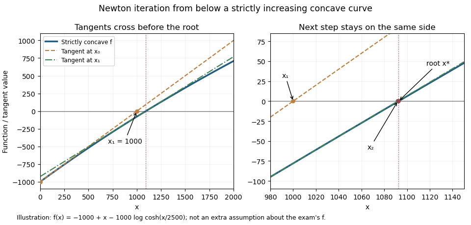

<h1 id="6/e/solution">Solution</h1>

↑ **Parent:** [E](../e.md)

First control the denominator. The [mean value theorem](../../../../../mean-value-theorem.md) applied to $f'$ yields, for $0<x\le2000$,

$$
f'(x)>1-\frac{x}{4000}\ge\frac12.
$$

Thus $f$ is strictly increasing on $[0,2000]$ and all proposed Newton steps within that interval are defined.

Assume $0\le x_n<x^*$. Then $f(x_n)<0$ and $f'(x_n)>0$, so $x_{n+1}>x_n$. Apply [Taylor's theorem](../../../../../taylor-s-theorem.md) instead at the root, expanding about $x_n$:

$$
0=f(x_n)+f'(x_n)(x^*-x_n)+\frac12f''(\xi_n)(x^*-x_n)^2.
$$

After rearranging and substituting the Newton step, the signed error satisfies

$$
\epsilon_{n+1}=\frac{f''(\xi_n)}{2f'(x_n)}\epsilon_n^2<0.
$$

Consequently $x_n<x_{n+1}<x^*$. Starting from $x_0=0$, [mathematical induction](../../../../../mathematical-induction.md) proves this for every finite $n$, establishing that **the signed errors are negative and strictly increasing**. Since $f''(\xi_n)>-1/4000$ and $2f'(x_n)>1$,

$$
\boxed{\epsilon_{n+1}\ge-\frac{\epsilon_n^2}{4000}.}
$$

Writing $E_n=-\epsilon_n$ gives $0<E_{n+1}\le E_n^2/4000$. Since $E_0=x^*<2000$, this also implies $E_n\le4000(E_0/4000)^{2^n}\to0$, proving [quadratic convergence](../../../../../quadratic-convergence.md). This is the [concave Newton iteration from below](../../../../../concave-newton-iteration-from-below.md).

**[Figure 1](#6/e/image-original-geometry-of-newton-iteration-below-a-concave-curve-the-illustrated-function-satisfies-the-bounds-but-is-not-supplied-by-the-examination). Original geometry of Newton iteration below a concave curve; the illustrated function satisfies the bounds but is not supplied by the examination**.

## ↑ Ancestors (12)

1. [E](../e.md)
2. [6](../../6.md)
3. [Discrete mathematics, probability and continuous mathematics](../../../discrete-mathematics-probability-and-continuous-mathematics-split.md)
4. [2023](../../../split.md)
5. [Past exam of the year 1 of the computer science course of the University of Oxford](../../../../split.md)
6. [Year 1 of the computer science course of the University of Oxford](../../../../../year-1-of-the-computer-science-course-of-the-university-of-oxford.md)
7. [Computer science course of the University of Oxford](../../../../../computer-science-course-of-the-university-of-oxford.md)
8. [Undergraduate course of the University of Oxford](../../../../../undergraduate-course-of-the-university-of-oxford.md)
9. [Course of the University of Oxford](../../../../../course-of-the-university-of-oxford.md)
10. [University of Oxford](../../../../../university-of-oxford-split.md)
11. [List of universities](../../../../../list-of-universities.md)
12. [Codex Wiki](../../../../../split.md)
