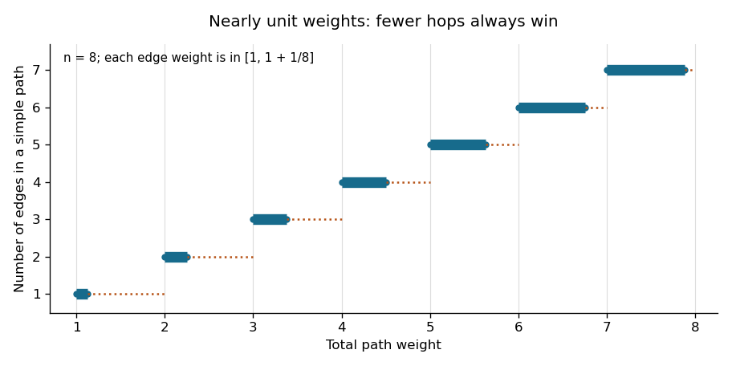

# Functional programming, design and analysis of algorithms

↑ **Parent:** [2023](../2023.md)

Trinity Term 2023, 13 June, 14:30–17:30. Three-hour [Year 1 of the computer science course of the University of Oxford](../../university-of-oxford.md#year-1-of-the-computer-science-course-of-the-university-of-oxford) paper.

[Public source archive](https://www.whatdotheyknow.com/request/ba_computer_science_past_papers/response/2577745/attach/2/202402%20183%20CS%20Papers.zip?cookie_passthrough=1). The paper is archive member `2022/T/a10097w1.pdf`; its cover identifies the sitting as 2023.

**Table of contents**

- [1](#1)
  - [a](#1/a)
    - [Solution](#1/a/solution)
  - [b](#1/b)
    - [Solution](#1/b/solution)
  - [c](#1/c)
    - [Solution](#1/c/solution)
  - [d](#1/d)
    - [Solution](#1/d/solution)
  - [e](#1/e)
    - [Solution](#1/e/solution)
  - [f](#1/f)
    - [Solution](#1/f/solution)
- [2](#2)
  - [a](#2/a)
    - [Solution](#2/a/solution)
  - [b](#2/b)
    - [Solution](#2/b/solution)
  - [c](#2/c)
    - [Solution](#2/c/solution)
  - [d](#2/d)
    - [Solution](#2/d/solution)
  - [e](#2/e)
    - [Solution](#2/e/solution)
  - [f](#2/f)
    - [Solution](#2/f/solution)
- [3](#3)
  - [a](#3/a)
    - [Solution](#3/a/solution)
  - [b](#3/b)
    - [Solution](#3/b/solution)
  - [c](#3/c)
    - [Solution](#3/c/solution)
  - [d](#3/d)
    - [Solution](#3/d/solution)
  - [e](#3/e)
    - [Solution](#3/e/solution)
- [4](#4)
  - [a](#4/a)
    - [Solution](#4/a/solution)
  - [b](#4/b)
    - [Solution](#4/b/solution)
  - [c](#4/c)
    - [Solution](#4/c/solution)
  - [d](#4/d)
    - [Solution](#4/d/solution)
  - [e](#4/e)
    - [Solution](#4/e/solution)
  - [f](#4/f)
    - [Solution](#4/f/solution)
  - [g](#4/g)
    - [Solution](#4/g/solution)
- [5](#5)
  - [a](#5/a)
    - [i](#5/a/i)
      - [Solution](#5/a/i/solution)
    - [ii](#5/a/ii)
      - [Solution](#5/a/ii/solution)
  - [b](#5/b)
    - [Solution](#5/b/solution)
  - [c](#5/c)
    - [Solution](#5/c/solution)
- [6](#6)
  - [a](#6/a)
    - [i](#6/a/i)
      - [Solution](#6/a/i/solution)
    - [ii](#6/a/ii)
      - [Solution](#6/a/ii/solution)
    - [iii](#6/a/iii)
      - [Solution](#6/a/iii/solution)
  - [b](#6/b)
    - [Solution](#6/b/solution)
  - [c](#6/c)
    - [Solution](#6/c/solution)
- [7](#7)
  - [a](#7/a)
    - [Solution](#7/a/solution)
  - [b](#7/b)
    - [Solution](#7/b/solution)
  - [c](#7/c)
    - [Solution](#7/c/solution)
  - [d](#7/d)
    - [Solution](#7/d/solution)
- [8](#8)
  - [a](#8/a)
    - [Solution](#8/a/solution)
  - [b](#8/b)
    - [Solution](#8/b/solution)
  - [c](#8/c)
    - [Solution](#8/c/solution)
  - [d](#8/d)
    - [Solution](#8/d/solution)

## 1

↑ **Parent:** [Functional programming, design and analysis of algorithms](functional-programming-design-and-analysis-of-algorithms.md)

<h3 id="1/a">a</h3>

↑ **Parent:** [1](#1)

<h4 id="1/a/solution">Solution</h4>

↑ **Parent:** [A](#1/a)

A [strict function](../../programming-language.md#strict-function) satisfies **$f(\bot)=\bot$**, where $\bot$ is the [bottom value](../../programming-language.md#bottom-value) representing an undefined or nonterminating computation. This is a semantic implication: obtaining a defined result requires enough definedness of the argument. It does not prescribe an evaluation order or say that every component of a structured argument is evaluated.[§3.1, Errors, and §6.2, Strict Evaluation](../../computer-science-bibliography.md#haskell-2010-language-report)

For example, in [Haskell](../../programming-language.md#haskell),
```
f :: a -> b
f _ = undefined
```
is strict, since every result is $\bot$, but never needs to inspect its argument. Moreover, [lazy evaluation](../../programming-language.md#lazy-evaluation) may leave an entire application unevaluated when its result is unused. Strictness is therefore different from the operational statement that an argument is evaluated on every call.

<h3 id="1/b">b</h3>

↑ **Parent:** [1](#1)

<h4 id="1/b/solution">Solution</h4>

↑ **Parent:** [B](#1/b)

The [list fold](../../programming-language.md#list-fold) criterion is: there must be a value `z` and a definable combining function `c` such that

$$
f(\bot)=\bot,\qquad f([])=z,\qquad f(x:xs)=c\ x\ (f\ xs).
$$

The last equality says that all information needed about the tail factors through `f xs`; the combining function receives no other access to `xs`. These conditions give **`f = foldr c z`**.

Necessity follows from the defining equations of `foldr`, including its case distinction on the input [list](../../data-structure.md#list-abstract-data-type). Sufficiency follows by [structural induction](../../foundations-of-mathematics.md#structural-induction) for finite lists and finite partial-list approximations. For infinite or partial [lazy lists](../../data-structure.md#lazy-list), the usual continuous semantics of these definable functions extends equality from the approximations to their limit. The strictness condition matters: agreement only on finite total lists does not establish agreement at $\bot$. This is the [fold factorisation criterion](../../programming-language.md#fold-factorisation-criterion).

<h3 id="1/c">c</h3>

↑ **Parent:** [1](#1)

<h4 id="1/c/solution">Solution</h4>

↑ **Parent:** [C](#1/c)

Use these [structural recursion](../../programming-language.md#structural-recursion) definitions in [Haskell](../../programming-language.md#haskell):
```
tails :: [a] -> [[a]]
tails xs = xs : ptails xs

ptails :: [a] -> [[a]]
ptails [] = []
ptails (_:xs) = tails xs

ntails :: [a] -> [[a]]
ntails [] = []
ntails xs@(_:rest) = xs : ntails rest
```
The first definition returns a known outer constructor even when `xs` is undefined, so `null (tails undefined)` is `False`, as required. The pattern in `ntails` must first determine whether the input is empty. Each [suffix of a list](../../data-structure.md#suffix-of-a-list) is shared with the original [list](../../data-structure.md#list-abstract-data-type); on a finite input of length $n$, constructing the outer lists takes $O(n)$ work and additional outer-list space. No suffix is copied or measured repeatedly.

<h3 id="1/d">d</h3>

↑ **Parent:** [1](#1)

<h4 id="1/d/solution">Solution</h4>

↑ **Parent:** [D](#1/d)

**`tails` is not a direct [list fold](../../programming-language.md#list-fold).** Every `foldr c z` is strict in its list argument, but `tails undefined = undefined : undefined` has a defined outer constructor. Applying `null` distinguishes this result from $\bot$.

**`ptails` is not a direct [list fold](../../programming-language.md#list-fold) either.** On a type with distinct values `u` and `v`,

$$
\operatorname{ptails}[u]=[[]]=\operatorname{ptails}[v].
$$

A fold step given the same new head `x` and these equal folded tails must return the same result. However,

$$
\operatorname{ptails}[x,u]=[[u],[]]\ne[[v],[]]=\operatorname{ptails}[x,v].
$$

Thus the tail information needed by the next step does not factor through `ptails`; this violates the [fold factorisation criterion](../../programming-language.md#fold-factorisation-criterion) even on finite total lists.

**`ntails` is a direct [list fold](../../programming-language.md#list-fold):**
```
ntailsFold :: [a] -> [[a]]
ntailsFold = foldr step []
  where
    step x yss = (x : original yss) : yss
    original [] = []
    original (ys:_) = ys
```
When the tail is nonempty, its first nonempty [suffix of a list](../../data-structure.md#suffix-of-a-list) is the tail itself; otherwise it is recovered as `[]`. Hence `original (ntailsFold xs) = xs`. The inner case distinction is delayed beneath constructors, so the definition also preserves the required behaviour on partial and infinite [lazy lists](../../data-structure.md#lazy-list). Building a suffix head does not first demand the whole folded tail.

<h3 id="1/e">e</h3>

↑ **Parent:** [1](#1)

<h4 id="1/e/solution">Solution</h4>

↑ **Parent:** [E](#1/e)

For [prefixes of a list](../../data-structure.md#prefix-of-a-list), the corresponding [Haskell](../../programming-language.md#haskell) definitions are
```
inits :: [a] -> [[a]]
inits xs = [] : ninits xs

pinits :: [a] -> [[a]]
pinits [] = []
pinits (x:xs) = [] : map (x:) (pinits xs)

ninits :: [a] -> [[a]]
ninits [] = []
ninits (x:xs) = map (x:) (inits xs)
```
The empty prefix is available without inspecting the input in `inits`. Every nonempty [prefix of a list](../../data-structure.md#prefix-of-a-list) begins with its input's head, explaining the last equation. For `pinits (x:xs)`, prepend `x` only to proper prefixes of `xs`, and include the empty prefix.

On finite inputs, `inits [] = [[]]`, whereas both other functions return `[]`. On an infinite input, all finite prefixes are proper and these definitions produce them incrementally. Fully constructing all elements of all prefixes takes $\Theta(n^2)$ work for an input of length $n$, matching the size of that output; there are no repeated end-append operations to add another factor.

<h3 id="1/f">f</h3>

↑ **Parent:** [1](#1)

<h4 id="1/f/solution">Solution</h4>

↑ **Parent:** [F](#1/f)

**`inits` is not a direct [list fold](../../programming-language.md#list-fold):** `inits undefined = [] : undefined` has a defined outer constructor, while `foldr c z undefined` is $\bot$.

**Both `pinits` and `ninits` are direct [list folds](../../programming-language.md#list-fold):**
```
pinitsFold :: [a] -> [[a]]
pinitsFold = foldr (\x yss -> [] : map (x:) yss) []

ninitsFold :: [a] -> [[a]]
ninitsFold = foldr (\x yss -> [x] : map (x:) yss) []
```
For `pinits`, the combining function is exactly the recursive step above. For `ninits`, expand `inits xs = [] : ninits xs` and use

$$
\operatorname{map}(x:)([]:yss)=[x]:\operatorname{map}(x:)yss.
$$

Neither step needs to inspect `yss` before producing its first outer constructor. Thus the definitions satisfy the [fold factorisation criterion](../../programming-language.md#fold-factorisation-criterion) on partial as well as total [lazy lists](../../data-structure.md#lazy-list).

## 2

↑ **Parent:** [Functional programming, design and analysis of algorithms](functional-programming-design-and-analysis-of-algorithms.md)

<h3 id="2/a">a</h3>

↑ **Parent:** [2](#2)

<h4 id="2/a/solution">Solution</h4>

↑ **Parent:** [A](#2/a)

Use arbitrary-precision [integers](../../integer.md) for positions, avoiding overflow on infinite sequences:
```
type Seq a = a -> [Integer]

rep :: Eq a => [a] -> Seq a
rep xs v = [i | (i,x) <- zip [0..] xs, x == v]
```
The [type synonym](../../programming-language.md#type-synonym) `Seq a` needs no equality constraint; the [equality test](../../algorithm.md#equality-test) is required specifically by `rep`. The [list comprehension](../../programming-language.md#list-comprehension) visits input positions in increasing order, so the output is an increasing [list](../../data-structure.md#list-abstract-data-type) of precisely the matching positions. For finite inputs this includes a terminating empty list when the value is absent. Infinite inputs require the additional [productivity](../../data-structure.md#stream-productivity) distinctions discussed below. This is an [occurrence-position representation of a sequence](../../data-structure.md#occurrence-position-representation-of-a-sequence).

<h3 id="2/b">b</h3>

↑ **Parent:** [2](#2)

<h4 id="2/b/solution">Solution</h4>

↑ **Parent:** [B](#2/b)

With nonpositive counts treated as in the standard [list](../../data-structure.md#list-abstract-data-type) operations:
```
takeSeq :: Integer -> Seq a -> Seq a
takeSeq n s
  | n <= 0 = const []
  | otherwise = \v -> takeWhile (< n) (s v)

dropSeq :: Integer -> Seq a -> Seq a
dropSeq n s
  | n <= 0 = s
  | otherwise = \v -> map (subtract n) (dropWhile (< n) (s v))
```
An occurrence survives `takeSeq n` exactly when its original index is less than $n$, and its index stays unchanged. It survives `dropSeq n` exactly when its original index is at least $n$, and its new index is the original one minus $n$. Sorted occurrence lists justify `takeWhile` and `dropWhile`. No equality constraint on the element type is needed because the operations only transform positions. The first guard also lets `takeSeq 0 s v` return `[]` without inspecting `s v`.

<h3 id="2/c">c</h3>

↑ **Parent:** [2](#2)

<h4 id="2/c/solution">Solution</h4>

↑ **Parent:** [C](#2/c)

The most informative [occurrence-position representation of a sequence](../../data-structure.md#occurrence-position-representation-of-a-sequence) of natural numbers is
```
naturals :: Seq Integer
naturals v
  | v < 0 = []
  | otherwise = [v]
```
Each nonnegative integer occurs once at its own index, and negative integers never occur.

**This is not equal to `rep [0..]` under [lazy evaluation](../../programming-language.md#lazy-evaluation).** For a nonnegative query `v`, `rep` eventually emits `v`, but then searches forever for another occurrence: its result has the shape `v : undefined`, rather than the terminating singleton `[v]`. For a negative query, even the outer constructor is never produced, whereas `naturals` immediately returns `[]`.

No general, correct `rep :: Eq a => [a] -> Seq a` can always certify those absences from an arbitrary infinite input. A terminating certification has inspected only finitely many elements, and the same prefix could be followed by the supposedly absent value, or by a further occurrence of it. Extra knowledge changes the problem: for a promised strictly increasing integer input, a search can stop with `[]` when it first exceeds the query and return `[i]` immediately upon equality. That specialised representation can produce `naturals`; a generic search cannot. This is the [absence-detection obstruction for infinite lists](../../data-structure.md#absence-detection-obstruction-for-infinite-lists).

<h3 id="2/d">d</h3>

↑ **Parent:** [2](#2)

<h4 id="2/d/solution">Solution</h4>

↑ **Parent:** [D](#2/d)

Even and odd original positions become consecutive new positions:
```
evens :: Seq a -> Seq a
evens s v = map (`div` 2) (filter even (s v))

odds :: Seq a -> Seq a
odds s v = map (`div` 2) (filter odd (s v))
```
An occurrence at $2j$ belongs to `evens` at position $j$; one at $2j+1$ belongs to `odds` at position $j$. Thus the formulas preserve increasing position order and produce the specified finite examples. For infinite occurrence lists, filtering can search forever when no further position of the chosen parity exists. Consequently these otherwise direct formulas need not preserve [productivity](../../data-structure.md#stream-productivity) for every query.

<h3 id="2/e">e</h3>

↑ **Parent:** [2](#2)

<h4 id="2/e/solution">Solution</h4>

↑ **Parent:** [E](#2/e)

Define the ordered [merge algorithm](../../algorithm.md#merge-algorithm) explicitly:
```
mergePos :: [Integer] -> [Integer] -> [Integer]
mergePos [] ys = ys
mergePos xs [] = xs
mergePos xs@(x:xt) ys@(y:yt)
  | x <= y = x : mergePos xt ys
  | otherwise = y : mergePos xs yt

ilv :: Seq a -> Seq a -> Seq a
ilv s t v = mergePos (map (2*) (s v))
                    (map (\j -> 2*j+1) (t v))
```
The first sequence occupies even positions and the second occupies odd positions. Within each transformed [list](../../data-structure.md#list-abstract-data-type), order is preserved; merging puts all positions for a queried token into increasing order. The two transformed lists have disjoint parities, so equality cannot occur between their heads on valid inputs. The length assumption ensures that these positions describe the intended interleaved sequence without a gap at its finite end.

<h3 id="2/f">f</h3>

↑ **Parent:** [2](#2)

<h4 id="2/f/solution">Solution</h4>

↑ **Parent:** [F](#2/f)

**For finite, fully defined representations, yes; for arbitrary infinite ones in [Haskell](../../programming-language.md#haskell), no.** At the level of mathematical occurrence sets, splitting by parity, dividing by two, and then applying the inverse index transformations recovers every original position exactly once. Thus the equality holds on finite total position lists.

For a proper infinite representation, take the alternating Boolean sequence, represented by
```
alternating :: Seq Bool
alternating False = [0,2..]
alternating True = [1,3..]
```
This is a total representation: both queries return productive infinite occurrence lists. But
```
odds alternating False
```
filters for odd indices in `[0,2..]`, so it produces no outer constructor and denotes $\bot$. The call
```
ilv (evens alternating) (odds alternating) False
```
uses `mergePos` to inspect both transformed lists before emitting its first result; it therefore also diverges. In contrast, `alternating False` starts with `0`. Applying `head` distinguishes the two. The [productivity](../../data-structure.md#stream-productivity) failure is real even though the mathematical position-set identity is correct; the hypothesis that the input properly represents an infinite sequence does not remove it.

## 3

↑ **Parent:** [Functional programming, design and analysis of algorithms](functional-programming-design-and-analysis-of-algorithms.md)

<h3 id="3/a">a</h3>

↑ **Parent:** [3](#3)

<h4 id="3/a/solution">Solution</h4>

↑ **Parent:** [A](#3/a)

First remove a single matching token, so duplicates cannot be reused:
```
pluck :: Eq a => a -> [a] -> Maybe [a]
pluck _ [] = Nothing
pluck x (y:ys)
  | x == y = Just ys
  | otherwise = case pluck x ys of
      Nothing -> Nothing
      Just zs -> Just (y:zs)

overlap :: Eq a => [a] -> [a] -> [a]
overlap [] _ = []
overlap (x:xs) ys = case pluck x ys of
  Nothing -> overlap xs ys
  Just zs -> x : overlap xs zs

scoreBC :: Eq a => [a] -> [a] -> (Int,Int)
scoreBC secret guess = (bulls, matches - bulls)
  where
    bulls = length [() | (s,g) <- zip secret guess, s == g]
    matches = length (overlap guess secret)
```
Equal game lengths are assumed. For each token, `overlap` retains exactly the smaller of its two multiplicities, so its length is the [multiset overlap](../../set.md#multiset-overlap). It never spends a secret occurrence twice. Positional matches account for `bulls`; after reserving them, each token's remaining possible matches decrease by exactly its bull count. Hence `matches - bulls` counts precisely the cows. The source example gives **`(1,1)`**. With equality as the only operation on tokens, these definitions take $O(L^2)$ time for length $L$.

<h3 id="3/b">b</h3>

↑ **Parent:** [3](#3)

<h4 id="3/b/solution">Solution</h4>

↑ **Parent:** [B](#3/b)

Use a distinct constructor for each mark, and reserve every bull before allocating any cow:
```
data Mark = Bull | Cow | Miss deriving (Eq,Show)

scoreWordle :: Eq a => [a] -> [a] -> [Mark]
scoreWordle secret guess = mark pairs pool
  where
    pairs = zip secret guess
    pool = [s | (s,g) <- pairs, s /= g]
    mark [] _ = []
    mark ((s,g):ps) available
      | s == g = Bull : mark ps available
      | otherwise = case pluck g available of
          Nothing -> Miss : mark ps available
          Just rest -> Cow : mark ps rest
```
The [multiset](../../set.md#multiset) `pool` contains exactly the unused secret tokens after all bulls have been set aside. The recursive [invariant](../../mathematics.md#invariant-mathematics) is that `available` contains those tokens not yet allocated to cows. A successful `pluck` consumes one, and failure leaves the pool unchanged. This proves both multiplicity correctness and the priority of bulls over cows. Among duplicate non-bull guess tokens, the leftmost eligible ones receive cows. For secret `"alpha"` and guess `"aaabb"`, the result is **`[Bull,Cow,Miss,Miss,Miss]`**. This implements [duplicate-aware positional scoring](../../algorithm.md#duplicate-aware-positional-scoring).

<h3 id="3/c">c</h3>

↑ **Parent:** [3](#3)

<h4 id="3/c/solution">Solution</h4>

↑ **Parent:** [C](#3/c)

A scorer applies the same scoring rule, with the fixed secret, independently to each guess:
```
mkScorer :: (secret -> guess -> score)
         -> secret -> [guess] -> [score]
mkScorer score secret = map (score secret)
```
The first score depends only on the first guess, and every later score only on the corresponding guess. Thus this player has no unguarded dependence on its own future output when connected to the guesser by a [lazy feedback stream](../../programming-language.md#lazy-feedback-stream). Neither the dictionary nor a strategy is needed by a truthful scorer once the secret and scoring rule are fixed.

<h3 id="3/d">d</h3>

↑ **Parent:** [3](#3)

<h4 id="3/d/solution">Solution</h4>

↑ **Parent:** [D](#3/d)

The score function takes a proposed secret first and a guess second:
```
mkGuesser :: Eq score
          => (guess -> guess -> score)
          -> ([guess] -> guess)
          -> [guess] -> [score] -> [guess]
mkGuesser score strategy dictionary = play dictionary
  where
    play candidates replies =
      let g = strategy candidates
      in g : case replies of
          [] -> []
          r:rs -> play [s | s <- candidates, score s g == r] rs
```
Assume that the initial dictionary contains the secret, that scores are truthful, and that `strategy` returns a candidate from its nonempty input. The candidate [invariant](../../mathematics.md#invariant-mathematics) is exactly the dictionary entries consistent with every score already received. Filtering by `score s g == r` establishes the same invariant after the next reply and retains the true secret.

Crucially, the next guess `g` is placed under the outer list constructor before `replies` is inspected. It depends on earlier replies only; the first guess depends on none. This guarded [lazy feedback stream](../../programming-language.md#lazy-feedback-stream) makes the mutually recursive `game` productive whenever the strategy and scoring operations terminate. Moving the `case replies` outside the constructor would create a circular demand before the first guess.

<h3 id="3/e">e</h3>

↑ **Parent:** [3](#3)

<h4 id="3/e/solution">Solution</h4>

↑ **Parent:** [E](#3/e)

Let $N$ be the number of distinct dictionary candidates. A wrong guess is itself a current candidate, but its actual score differs from its score against itself, which has all positions as bulls. Therefore each wrong reply removes at least that candidate while retaining the true secret. There can be at most $N-1$ wrong guesses. A correct guess leaves only the secret consistent with the all-bull reply. Hence every such infinite game's history eventually has the constant tail

$$
(\text{secret},\text{all-bull score}),\quad
(\text{secret},\text{all-bull score}),\quad\ldots.
$$

This is the [finite candidate elimination bound](../../algorithm.md#finite-candidate-elimination-bound); it assumes a nonempty finite dictionary of fixed-length secrets and a strategy that chooses from the remaining candidates.

The stated end condition is identification, so stop when just one candidate remains, even if it has not been guessed. Replace the worker above by
```
play [] _ = []
play [_] _ = []
play candidates replies =
  let g = strategy candidates
  in g : case replies of
      [] -> []
      r:rs -> play [s | s <- candidates, score s g == r] rs
```
The scorer can stay `map (score secret)`: once the guess list ends, its score list ends too. The unchanged `game` then returns a finite history, with at most $N-1$ rounds; a singleton initial dictionary needs no round. If the identified secret is also wanted as an explicit output, return that sole surviving candidate alongside the history.

## 4

↑ **Parent:** [Functional programming, design and analysis of algorithms](functional-programming-design-and-analysis-of-algorithms.md)

<h3 id="4/a">a</h3>

↑ **Parent:** [4](#4)

<h4 id="4/a/solution">Solution</h4>

↑ **Parent:** [A](#4/a)

Use the source's constructor order: left subtree, root value, right subtree.
```
data Tree a = Tree (Tree a) a (Tree a) | Empty

foldTree :: (b -> a -> b -> b) -> b -> Tree a -> b
foldTree node empty Empty = empty
foldTree node empty (Tree l x r) =
  node (foldTree node empty l) x (foldTree node empty r)

unfoldTree :: (s -> Maybe (s,a,s)) -> s -> Tree a
unfoldTree next seed = case next seed of
  Nothing -> Empty
  Just (ls,x,rs) ->
    Tree (unfoldTree next ls) x (unfoldTree next rs)
```
A [tree fold](../../programming-language.md#tree-fold) replaces the two constructors by an algebra on already folded children. A [tree unfold](../../programming-language.md#tree-unfold) expands a seed either into the empty tree or into a root value and two new seeds. The definitions themselves work on arbitrary binary trees; preserving the [binary search tree](../../data-structure.md#binary-search-tree) ordering requires the supplied algebra or seed expansion to respect its bounds.

<h3 id="4/b">b</h3>

↑ **Parent:** [4](#4)

<h4 id="4/b/solution">Solution</h4>

↑ **Parent:** [B](#4/b)

The direct [tree fold](../../programming-language.md#tree-fold) for an inorder traversal is
```
flattenFold :: Tree a -> [a]
flattenFold = foldTree (\ls x rs -> ls ++ (x:rs)) []
```
By [structural induction](../../foundations-of-mathematics.md#structural-induction), the child lists are ascending; the [binary search tree](../../data-structure.md#binary-search-tree) property places every left value below the root and every right value above it. The displayed [list concatenation](../../data-structure.md#list-concatenation) therefore gives an ascending list containing every stored value exactly once.

For a version with linear [time complexity](../../theoretical-computer-science.md#time-complexity) on every tree shape, use an accumulator:
```
flatten :: Tree a -> [a]
flatten t = onto t []
  where
    onto Empty zs = zs
    onto (Tree l x r) zs = onto l (x : onto r zs)
```
This also has a higher-order [tree fold](../../programming-language.md#tree-fold) expression using [difference lists](../../data-structure.md#difference-list):
```
flattenLinear :: Tree a -> [a]
flattenLinear t =
  foldTree (\l x r -> l . (x:) . r) id t []
```
Its folded value is a function that prepends the inorder traversal to a supplied tail. The accumulator invariant is `onto t zs = flattenFold t ++ zs`. Each node contributes one constructor, giving $\Theta(n)$ time to consume the output. By contrast, the direct list-valued fold can take $\Theta(n^2)$ on a left-skewed tree because `++` repeatedly copies left traversals.

<h3 id="4/c">c</h3>

↑ **Parent:** [4](#4)

<h4 id="4/c/solution">Solution</h4>

↑ **Parent:** [C](#4/c)

Choose the middle element as the root:
```
build :: [a] -> Tree a
build [] = Empty
build xs = Tree (build ls) x (build rs)
  where
    (ls,x:rs) = splitAt (length xs `div` 2) xs
```
The input is a finite, strictly ascending [list](../../data-structure.md#list-abstract-data-type), as required for distinct elements of a [set](../../set.md). The two child lengths differ by at most one. Applying the same argument recursively gives a [balanced binary tree](../../data-structure.md#balanced-binary-tree) of logarithmic height. All values on each side retain their original order, proving the [binary search tree](../../data-structure.md#binary-search-tree) property. With linked lists, the repeated splitting gives $O(n\log n)$ time; it does not repeatedly insert values into a skewed tree.

<h3 id="4/d">d</h3>

↑ **Parent:** [4](#4)

<h4 id="4/d/solution">Solution</h4>

↑ **Parent:** [D](#4/d)

Use the remaining ascending [list](../../data-structure.md#list-abstract-data-type) itself as the seed:
```
buildUnfold :: [a] -> Tree a
buildUnfold = unfoldTree split
  where
    split [] = Nothing
    split xs =
      let (ls,x:rs) = splitAt (length xs `div` 2) xs
      in Just (ls,x,rs)
```
The empty seed produces `Empty`. Every nonempty seed produces exactly the midpoint and two child seeds used by `build`. Thus the defining equations agree, and [structural induction](../../foundations-of-mathematics.md#structural-induction) on the finite input proves `buildUnfold xs = build xs`. The balance and ordering arguments carry over unchanged.

<h3 id="4/e">e</h3>

↑ **Parent:** [4](#4)

<h4 id="4/e/solution">Solution</h4>

↑ **Parent:** [E](#4/e)

Fold into a membership [predicate](../../analysis-of-boolean-functions.md#predicate):
```
find :: Ord a => Tree a -> a -> Bool
find = foldTree node (const False)
  where
    node left x right q = case compare q x of
      LT -> left q
      EQ -> True
      GT -> right q
```
At an empty tree the [predicate](../../analysis-of-boolean-functions.md#predicate) is always false. At a nonempty [binary search tree](../../data-structure.md#binary-search-tree), an unequal query can occur only in the indicated child, while equality finds the root. This proves correctness inductively. Under [lazy evaluation](../../programming-language.md#lazy-evaluation), the unused folded child is not demanded; lookup follows one root-to-leaf route and takes $O(h+1)$ comparisons in a tree of height $h$. Defining the [predicate](../../analysis-of-boolean-functions.md#predicate) by a fold does not require visiting both subtrees for each query.

<h3 id="4/f">f</h3>

↑ **Parent:** [4](#4)

<h4 id="4/f/solution">Solution</h4>

↑ **Parent:** [F](#4/f)

Insert down the unique search route, leaving equal elements unchanged:
```
insert :: Ord a => a -> Tree a -> Tree a
insert q Empty = Tree Empty q Empty
insert q t@(Tree l x r) = case compare q x of
  LT -> Tree (insert q l) x r
  EQ -> t
  GT -> Tree l x (insert q r)
```
The [binary search tree](../../data-structure.md#binary-search-tree) ordering determines the only child in which a missing query can belong. The recursive call preserves that child's ordering bounds, and the other child is shared. Thus the output represents the original [set](../../set.md) with `q` added, with duplicates suppressed. Its [time complexity](../../theoretical-computer-science.md#time-complexity) and newly allocated route length are $O(h+1)$; it makes no balancing guarantee.

<h3 id="4/g">g</h3>

↑ **Parent:** [4](#4)

<h4 id="4/g/solution">Solution</h4>

↑ **Parent:** [G](#4/g)

A [tree fold](../../programming-language.md#tree-fold) can compute insertion while retaining the unchanged children by carrying a pair. The following fold-derived implementation preserves the [lazy evaluation](../../programming-language.md#lazy-evaluation) behaviour of part (f):
```
insertViaFold :: Ord a => a -> Tree a -> Tree a
insertViaFold q t = snd (foldTree node base t)
  where
    base = (Empty, Tree Empty q Empty)
    node ~(l,li) x ~(r,ri) = (original,updated)
      where
        original = Tree l x r
        updated = case compare q x of
          LT -> Tree li x r
          EQ -> original
          GT -> Tree l x ri
```
The [invariant](../../mathematics.md#invariant-mathematics) of the folded pair is `(original subtree, subtree with q inserted)`. The empty case establishes it. At a node, the first components reconstruct the original tree, and the second components supply whichever child insertion is needed. The irrefutable pair patterns `~(l,li)` and `~(r,ri)` avoid demanding an unused child's fold. Induction on finite approximations therefore proves equivalence even for partial trees, and only the selected search route needs insertion work.

There is a distinction if “written as a fold” is required to mean a direct same-result-type expression `insert q = foldTree node base`, with no richer result and final projection. On finite fully defined [binary search trees](../../data-structure.md#binary-search-tree), such an expression is possible by [undoing insertion of a new extreme key](../../data-structure.md#undoing-insertion-of-a-new-extreme-key) in the child that should remain unchanged. For completeness, a literal direct fold on that finite, fully defined domain is:
```
eraseFresh :: Ord a => a -> Tree a -> Tree a
eraseFresh _ Empty = Empty
eraseFresh q (Tree l x r) = case compare q x of
  LT -> Tree (eraseFresh q l) x r
  EQ -> Empty
  GT -> Tree l x (eraseFresh q r)

insertDirectFold :: Ord a => a -> Tree a -> Tree a
insertDirectFold q = foldTree node (Tree Empty q Empty)
  where
    node left x right = case compare q x of
      LT -> Tree left x (eraseFresh q right)
      EQ -> Tree (eraseFresh q left) x (eraseFresh q right)
      GT -> Tree (eraseFresh q left) x right
```
Here `eraseFresh` is used only to undo a newly inserted extreme key, which is a leaf; it is not a general deletion operation. The [binary search tree](../../data-structure.md#binary-search-tree) bound at each root guarantees exactly that precondition on every child being restored.

On all partial [Haskell](../../programming-language.md#haskell) trees, however, a direct expression with result type `Tree a` cannot implement part (f).

For that obstruction, fix `q = 0`, and consider the two right subtrees
```
r1 = Tree Empty undefined Empty
r2 = Tree Empty undefined (Tree Empty 3 Empty)
```
Both can be completed to valid right subtrees of a root labelled `1`. Yet `insert 0 r1` and `insert 0 r2` are both bottom, because insertion must compare `0` with their undefined root label. A direct fold equal to insertion would therefore receive the same folded left value, root `1`, and bottom folded right value on both larger trees `Tree Empty 1 r1` and `Tree Empty 1 r2`. It must return the same result. Part (f) instead preserves `r1` or `r2`, which are distinguishable by inspecting their right-child constructors without inspecting the undefined labels. This proves the direct-fold obstruction. The pair-valued implementation avoids losing that information and states precisely which sense of fold implementation is being used.

## 5

↑ **Parent:** [Functional programming, design and analysis of algorithms](functional-programming-design-and-analysis-of-algorithms.md)

<h3 id="5/a">a</h3>

↑ **Parent:** [5](#5)

<h4 id="5/a/i">i</h4>

↑ **Parent:** [A](#5/a)

<h5 id="5/a/i/solution">Solution</h5>

↑ **Parent:** [I](#5/a/i)

Start with $(d[1],d[2],d[3],d[4])=(0,\infty,\infty,\infty)$. With in-place [edge relaxation](../../shortest-path-problem.md#edge-relaxation), the [Bellman-Ford algorithm](../../shortest-path-problem.md#bellman-ford-algorithm) makes the following changes during its first lexicographic pass:

$$
\begin{array}{c|c|c}
\text{edge}&\text{improved entry}&\text{new value}\\\hline
(1,2)&d[2]&6\\
(1,3)&d[3]&2\\
(3,2)&d[2]&5\\
(3,4)&d[4]&3\\
(4,2)&d[2]&4
\end{array}
$$

The next pass makes no change; any remaining fixed-count passes also make none. Thus the final vector is **$(0,4,2,3)$**. These are sequential updates within a pass, rather than the simultaneous values of the [Synchronous Bellman-Ford recurrence](../../shortest-path-problem.md#synchronous-bellman-ford-recurrence).

<h4 id="5/a/ii">ii</h4>

↑ **Parent:** [A](#5/a)

<h5 id="5/a/ii/solution">Solution</h5>

↑ **Parent:** [Ii](#5/a/ii)

Use source $1$, as in the preceding part. The [Dijkstra algorithm](../../shortest-path-problem.md#dijkstra-algorithm) extracts vertices in the order **$1,3,4,2$**. Distances after relaxing the outgoing [edges](../../graph-theory.md#edge-of-a-graph) of each extracted vertex are

$$
\begin{array}{c|rrrr}
\text{extracted vertex}&d[1]&d[2]&d[3]&d[4]\\\hline
\text{initial}&0&\infty&\infty&\infty\\
1&0&6&2&\infty\\
3&0&5&2&3\\
4&0&4&2&3\\
2&0&4&2&3
\end{array}
$$

The [shortest path](../../shortest-path-problem.md#shortest-path) to $2$ is $1\to3\to4\to2$, with weight $2+1+1=4$; the direct route to $2$ and the route via $3\to2$ are both heavier.

<h3 id="5/b">b</h3>

↑ **Parent:** [5](#5)

<h4 id="5/b/solution">Solution</h4>

↑ **Parent:** [B](#5/b)

Take the [directed graph](../../graph-theory.md#directed-graph) with source $1$ and weighted [edges](../../graph-theory.md#edge-of-a-graph)

$$
1\to2:2,\qquad1\to3:5,\qquad3\to2:-4,\qquad2\to4:1.
$$

It is a [Directed acyclic graph](../../combinatorics.md#directed-acyclic-graph), so has no negative-weight [graph cycle](../../graph-theory.md#cycle-in-a-graph). The true [shortest path](../../shortest-path-problem.md#shortest-path) to $4$ is $1\to3\to2\to4$, of weight $5-4+1=2$.

The standard [label-setting shortest-path algorithm](../../shortest-path-problem.md#label-setting-shortest-path-algorithm) version of the [Dijkstra algorithm](../../shortest-path-problem.md#dijkstra-algorithm) extracts $1$, then $2$ at distance $2$, then $4$ at distance $3$, and only then $3$ at distance $5$. Thus it finalises **$d[4]=3$ instead of $2$**. Even if an implementation subsequently changes the stored label of the already settled vertex $2$, it does not reprocess its outgoing edge to $4$, so the error at $4$ remains. Allowing repeated reprocessing would instead be a [label-correcting shortest-path algorithm](../../shortest-path-problem.md#label-correcting-shortest-path-algorithm), not the usual Dijkstra guarantee.

<h3 id="5/c">c</h3>

↑ **Parent:** [5](#5)

<h4 id="5/c/solution">Solution</h4>

↑ **Parent:** [C](#5/c)

First run [breadth-first search](../../tree-graph-theory.md#breadth-first-search), ignoring weights, to obtain the minimum number of [edges](../../graph-theory.md#edge-of-a-graph) $h(v)$ from the source to each reachable [vertex](../../graph.md#vertex-graph-theory). Then compute weighted distances only along [edges](../../graph-theory.md#edge-of-a-graph) that advance one breadth-first layer:
```
d[source] = 0; all other d[v] = infinity
for u in nondecreasing BFS-layer order:
    for each outgoing edge (u,v):
        if h[v] == h[u]+1:
            if d[u]+w(u,v) < d[v]:
                d[v] = d[u]+w(u,v)
                predecessor[v] = u
```
Unreachable vertices keep distance $\infty$. For an [undirected graph](../../graph-theory.md#undirected-graph), scan both orientations of each [edge](../../graph-theory.md#edge-of-a-graph).

To justify discarding other routes, a [shortest path](../../shortest-path-problem.md#shortest-path) can be taken simple because every weight is positive. A simple path of $r\leq n-1$ edges has weight in

$$
[r,r(1+1/n)]\subseteq[r,r+1).
$$

Every path with at least $r+1$ edges weighs at least $r+1$. Consequently every minimum-weight path must also have the minimum possible number of edges: this is [minimum-hop dominance for nearly unit weights](../../shortest-path-problem.md#minimum-hop-dominance-for-nearly-unit-weights).

A minimum-hop path to $v$ uses exactly $h(v)$ edges. Every prefix of such a path must itself have minimum hop count, since replacing a longer prefix by a shorter one would shorten the whole route. Hence it advances from layer $j$ to layer $j+1$ at every step. The retained edges form a [Directed acyclic graph](../../combinatorics.md#directed-acyclic-graph), ordered by $h$. The displayed [dynamic programming](../../mathematical-optimization.md#dynamic-programming) recurrence therefore finds the cheapest of all minimum-hop paths, which by the preceding bound is a true [shortest path](../../shortest-path-problem.md#shortest-path).

<a id="5/c/image-disjoint-weight-bands-for-simple-paths-with-different-hop-counts"></a>


**[Figure 1](#5/c/image-disjoint-weight-bands-for-simple-paths-with-different-hop-counts). Disjoint weight bands for simple paths with different hop counts**.

With an [adjacency list](../../data-structure.md#adjacency-list), both the [breadth-first search](../../tree-graph-theory.md#breadth-first-search) and the layer-ordered relaxations take **$O(n+m)$ time and $O(n+m)$ total storage**, where $m=|E|$. The queue order from breadth-first search already supplies the layer order; no sorting or priority queue is needed. This improves the usual $O((n+m)\log n)$ binary-heap Dijkstra bound and is linear in the input size.

## 6

↑ **Parent:** [Functional programming, design and analysis of algorithms](functional-programming-design-and-analysis-of-algorithms.md)

<h3 id="6/a">a</h3>

↑ **Parent:** [6](#6)

<h4 id="6/a/i">i</h4>

↑ **Parent:** [A](#6/a)

<h5 id="6/a/i/solution">Solution</h5>

↑ **Parent:** [I](#6/a/i)

Increment a single clock on each discovery and finish, starting with clock zero. Lexicographic [depth-first search](../../algorithm.md#depth-first-search) gives

$$
\begin{array}{c|rr}
\text{vertex}&d&f\\\hline
1&1&8\\
2&9&10\\
3&2&7\\
4&11&12\\
5&3&4\\
6&5&6
\end{array}
$$

The first search tree has discovery [edges](../../graph-theory.md#edge-of-a-graph) $1\to3$, $3\to5$, $3\to6$. The edge $5\to1$ returns to an active ancestor. Once that tree finishes, vertex $2$ is a new root whose neighbour $1$ is already finished, and vertex $4$ is the final root. This accounts for all twelve events in the [DFS discovery and finishing times](../../algorithm.md#dfs-discovery-and-finishing-times).

<h4 id="6/a/ii">ii</h4>

↑ **Parent:** [A](#6/a)

<h5 id="6/a/ii/solution">Solution</h5>

↑ **Parent:** [Ii](#6/a/ii)

**The only possibilities are $f[2]\in\{10,11\}$.** Vertex $2$ reaches all of $1,3,5,6$. In [depth-first search](../../algorithm.md#depth-first-search), all vertices reachable from an active vertex must have been discovered and finished before its own finishing event, except for active ancestors. None of these four can be an ancestor of $2$, because none can reach $2$. Thus all four are finished before $2$ finishes.

Vertex $4$ cannot already be finished at that point: its outgoing edge to $2$ would have caused $2$ to be visited before it could finish. It also cannot be a descendant of $2$, since $2$ cannot reach $4$. Therefore $4$ is either still undiscovered or an active ancestor. In the first case the only remaining events are discovery and finishing of $4$, giving $f[2]=10$. In the second case the only remaining event is finishing of $4$, giving $f[2]=11$.

Both occur. Starting the outer traversal with $2$ leaves $4$ undiscovered and gives time $10$. Starting with $4$ and taking its edge to $2$ first makes $4$ an ancestor and gives time $11$. The argument does not assume any particular order on the other edges.

<h4 id="6/a/iii">iii</h4>

↑ **Parent:** [A](#6/a)

<h5 id="6/a/iii/solution">Solution</h5>

↑ **Parent:** [Iii](#6/a/iii)

The [strongly connected components](../../graph-theory.md#strongly-connected-component) are

$$
\boxed{\{1,3,5\},\quad\{2\},\quad\{4\},\quad\{6\}.}
$$

The [directed cycle](../../graph-theory.md#directed-cycle) $1\to3\to5\to1$ makes its three vertices mutually reachable. Vertex $6$ has no outgoing edge. Vertex $2$ reaches that cycle but has no return path from it, and vertex $4$ reaches the other components but has no incoming path from them. These facts exclude every further merger.

<h3 id="6/b">b</h3>

↑ **Parent:** [6](#6)

<h4 id="6/b/solution">Solution</h4>

↑ **Parent:** [B](#6/b)

Sort the open [intervals](../../real-analysis.md#interval-mathematics) by increasing left endpoint. Scan them in that order, maintaining the largest right endpoint $R$ among previously seen intervals. For the next interval $(a,b)$, report an intersection if **$a<R$**; otherwise set $R=\max(R,b)$ and continue. Equality is allowed: $(a,R)$ and $(R,b)$ do not meet because the intervals are open. For zero or one interval, return that they are mutually non-intersecting.

If $a<R$, a previous interval with right endpoint $R$ has left endpoint at most $a$ and has positive length. Together with $b>a$, this guarantees an interior common point. Conversely, if $a\geq R$, every earlier interval ends at or before $a$, so none intersects the new one. This [loop invariant](../../algorithm.md#loop-invariant) proves correctness. A [comparison sort](../../algorithm.md#comparison-sort) costs $O(n\log n)$ time and the scan costs $O(n)$.

For the lower bound, transform an input of integers $z_1,\ldots,z_n$ for the [element distinctness problem](../../theoretical-computer-science.md#element-distinctness-problem) into

$$
r_i=(2z_i,2z_i+1).
$$

Equal integers produce identical, intersecting intervals. Unequal integers differ by at least one, so their intervals are disjoint. The answer therefore decides whether all the integers are distinct. Moreover, comparing any two constructed endpoints can be simulated by comparing their original integers and, only on equality, their fixed offsets $0$ or $1$. Thus the transformation preserves the [comparison model](../../theoretical-computer-science.md#comparison-model), rather than gaining extra information from arithmetic on arbitrary endpoints. The supplied distinctness lower bound gives **$\Omega(n\log n)$ comparisons**, matching the upper bound. This is the [comparison lower bound for interval disjointness](../../algorithm.md#comparison-lower-bound-for-interval-disjointness).

<h3 id="6/c">c</h3>

↑ **Parent:** [6](#6)

<h4 id="6/c/solution">Solution</h4>

↑ **Parent:** [C](#6/c)

Let $m=|s|$, $\ell_i=|w_i|$, and let $D(i,j)$ be the minimum number of words chosen from $w_1,\ldots,w_i$, in their given order, whose [concatenation](../../foundations-of-mathematics.md#concatenation) equals the length-$j$ [prefix of a list](../../data-structure.md#prefix-of-a-list) of $s$. Use $\infty$ for impossibility. The boundary values are

$$
D(0,0)=0,\qquad D(0,j)=\infty\quad(j>0).
$$

For $i\geq1$,

$$
D(i,j)=\min\left\{
D(i-1,j),\quad
1+D(i-1,j-\ell_i)\ \text{if }j\geq\ell_i\text{ and }s[j-\ell_i:j]=w_i
\right\}.
$$

Here $s[a:b]$ denotes indices $a,\ldots,b-1$. The first case omits $w_i$. In the second, the last selected word is $w_i$, so removing it leaves a solution using only earlier words for the shorter prefix. These are exhaustive alternatives. Conversely either alternative constructs a valid solution, proving the [dynamic programming](../../mathematical-optimization.md#dynamic-programming) recurrence. Even an empty word causes no cycle because both alternatives use row $i-1$.

Fill rows in increasing $i$ and store the chosen alternative for every finite entry. If $D(n,m)=\infty$, report no solution. Otherwise trace back from $(n,m)$: a skip moves to $(i-1,j)$; a take records index $i$ and moves to $(i-1,j-\ell_i)$. Reverse the recorded indices to obtain the required [subsequence](../../sequence-and-series.md#subsequence). Ties may choose either valid predecessor.

There are $(n+1)(m+1)$ states. A substring comparison costs $O(\ell_i)$, so under the given bounds $m=O(n)$ and $\ell_i=O(1)$ the running time is **$O(n^2)$**, with $O(n^2)$ storage including reconstruction choices. Two rows give $O(m)$ working storage if only the optimum count is needed. For the source example, the optimum is **three words, indices $(2,5,6)$**, whose concatenation is `010111`. This is [ordered word concatenation dynamic programming](../../mathematical-optimization.md#ordered-word-concatenation-dynamic-programming).

## 7

↑ **Parent:** [Functional programming, design and analysis of algorithms](functional-programming-design-and-analysis-of-algorithms.md)

<h3 id="7/a">a</h3>

↑ **Parent:** [7](#7)

<h4 id="7/a/solution">Solution</h4>

↑ **Parent:** [A](#7/a)

The [minimum spanning tree cut property](../../tree-graph-theory.md#minimum-spanning-tree-cut-property) says: if a [cut of a graph](../../graph-theory.md#cut-graph-theory) respects an edge set $A$ contained in some [minimum spanning tree](../../tree-graph-theory.md#minimum-spanning-tree), a minimum-weight edge across that cut is safe to add to $A$, meaning that some minimum spanning tree contains $A$ together with that edge. Respecting $A$ means no edge of $A$ crosses the cut. In particular, any lightest cut edge belongs to some minimum spanning tree; a uniquely lightest cut edge belongs to every minimum spanning tree.

For the [exchange argument](../../algorithm.md#exchange-argument), take a minimum spanning tree $T$ containing $A$. If it lacks the chosen edge $e$, add $e$ to create its [fundamental cycle](../../tree-graph-theory.md#fundamental-cycle). The remaining route between $e$'s endpoints crosses the cut at some edge $e'$, with $w(e')\geq w(e)$. Since the cut respects $A$, $e'\notin A$. Replacing $e'$ by $e$ preserves a spanning tree, retains $A$, and cannot increase weight. Hence it is also minimum. Strict inequality would contradict minimality, which gives the unique-lightest assertion.

For an illustration, take a triangle with weights $w(ab)=1$, $w(ac)=2$, $w(bc)=3$. Across the cut $\{a\}\mid\{b,c\}$, $ab$ is the unique lightest edge and must be in every minimum spanning tree. The minimum tree is $\{ab,ac\}$, of weight $3$. With tied light edges, the existence assertion need not mean that every minimum spanning tree contains the particular tied edge chosen.

<h3 id="7/b">b</h3>

↑ **Parent:** [7](#7)

<h4 id="7/b/solution">Solution</h4>

↑ **Parent:** [B](#7/b)

Write each undirected [edge](../../graph-theory.md#edge-of-a-graph) with its smaller endpoint first. [Kruskal's algorithm](../../tree-graph-theory.md#kruskal-s-algorithm) orders candidates first by weight and then lexicographically:

$$
\begin{array}{c|r|l}
\text{edge}&\text{weight}&\text{action}\\\hline
(4,6)&1&\text{add}\\
(1,3)&2&\text{add}\\
(3,4)&2&\text{add}\\
(1,4)&3&\text{reject: closes a cycle}\\
(4,5)&3&\text{add}\\
(5,6)&3&\text{reject: closes a cycle}\\
(1,2)&4&\text{add and finish}
\end{array}
$$

Thus the requested addition order is

$$
\boxed{(4,6),\ (1,3),\ (3,4),\ (4,5),\ (1,2),}
$$

and the [minimum spanning tree](../../tree-graph-theory.md#minimum-spanning-tree) has total weight **$12$**. Five accepted edges connect all six vertices, so the remaining weight-four edges need not be scanned.

<h3 id="7/c">c</h3>

↑ **Parent:** [7](#7)

<h4 id="7/c/solution">Solution</h4>

↑ **Parent:** [C](#7/c)

Take

$$
\boxed{S=(2,4,1,3).}
$$

Its longest [strictly increasing subsequences](../../combinatorics.md#strictly-increasing-subsequence) have length two. A subsequence starting with $2$ can continue with $4$ or with $3$, but cannot use both in increasing order; one starting at $1$ has only $3$ after it.

The specified [greedy algorithm](../../algorithm.md#greedy-algorithm) may choose the longest increasing subsequence $(2,3)$. The remaining sequence is $(4,1)$, which needs two singleton increasing subsequences. The algorithm then uses **three** subsequences in total.

However, $(2,4)$ and $(1,3)$ partition the original sequence into **two** increasing subsequences. One is impossible because the original sequence is not increasing. Hence two is optimal and the greedy choice is suboptimal. This establishes the [counterexample to removing a longest increasing subsequence](../../algorithm.md#counterexample-to-removing-a-longest-increasing-subsequence) without relying on a tie-breaking rule: the problem asks for a longest choice that can fail.

<h3 id="7/d">d</h3>

↑ **Parent:** [7](#7)

<h4 id="7/d/solution">Solution</h4>

↑ **Parent:** [D](#7/d)

Repeatedly remove vertices whose current degree is less than $k$. Implement the deletions with an [adjacency list](../../data-structure.md#adjacency-list), a queue and a degree counter for each active vertex:
```
active[v] = True for every v
count[v] = degree(v)
queue all v with count[v] < k
while the queue is nonempty:
    remove v from the queue
    if not active[v]: continue
    active[v] = False
    for each neighbour u of v:
        if active[u]:
            count[u] -= 1
            if count[u] == k-1: queue u
return the subgraph induced by the active vertices,
       or report failure if there is no active vertex
```
The requested subgraph is understood to be nonempty; otherwise an empty output would make the degree requirement vacuous or undefined. For $k\leq0$, any nonempty input graph already qualifies.

The correctness [invariant](../../mathematics.md#invariant-mathematics) is that every subgraph with minimum degree at least $k$ has all its vertices still active. Initially this is immediate. When $v$ is deleted, its degree in the whole active [induced subgraph](../../graph-theory.md#induced-subgraph) is less than $k$. Any candidate subgraph on active vertices has at most that many incident edges at $v$, so cannot contain it. Thus the invariant survives every deletion.

At termination, every active vertex has current degree at least $k$, since every counter initially below the threshold or subsequently crossing it was queued. A nonempty surviving induced subgraph is therefore a valid answer. If none survives, the invariant rules out every possible answer, including ones omitting additional edges. The result is the [k-core](../../graph-theory.md#k-core), with the [k-core peeling invariant](../../graph-theory.md#k-core-peeling-invariant) proving that deletion order cannot destroy a valid solution.

Each vertex is enqueued at most once when initially deficient or first crossing the threshold. Each adjacency list is scanned once when its vertex is deleted. The running time is **$O(|V|+|E|)$**, and storage is $O(|V|+|E|)$ including the input graph.

## 8

↑ **Parent:** [Functional programming, design and analysis of algorithms](functional-programming-design-and-analysis-of-algorithms.md)

<h3 id="8/a">a</h3>

↑ **Parent:** [8](#8)

<h4 id="8/a/solution">Solution</h4>

↑ **Parent:** [A](#8/a)

The three answers, in source order, are:
- **$T(n)=\Theta(n^2)$.** In the [Master theorem](../../sequence-and-series.md#master-theorem), $a=6$, $b=3$, and $n^2$ grows polynomially faster than $n^{\log_3 6}$. The regularity condition holds because $6(n/3)^2=(2/3)n^2$. For powers of three, expansion even gives $T(n)=3n^2-2n^{\log_3 6}$.
- **$T(n)=n^2$, and hence $\Theta(n^2)$.** The [telescoping sum](../../arithmetic.md#telescoping-sum) is $T(n)=1+\sum_{j=2}^n(2j-1)=\sum_{j=1}^n(2j-1)=n^2$.
- **$T(n)=\Theta(n^{\log_2 3})$.** Set $m=n-2$ and $U(m)=T(m+2)$. Then $U(m)=3U(m/2)+m+2$, with constant base cost for $m\leq2$. The [Master theorem](../../sequence-and-series.md#master-theorem) with $a=3$, $b=2$ applies because $m+2=\Theta(m)$ is polynomially smaller than $m^{\log_2 3}$. Finally $m=n-2=\Theta(n)$.

The change of variable in the third case handles the additive shift in the recursive argument exactly; it is not an unjustified deletion of the `+1`. These [Big theta notation](../../real-analysis.md#big-theta-notation) conclusions use the usual admissible input sizes, or bounded integer rounding of subproblem sizes.

<h3 id="8/b">b</h3>

↑ **Parent:** [8](#8)

<h4 id="8/b/solution">Solution</h4>

↑ **Parent:** [B](#8/b)

**$\Theta(n^{\log_2 7})$, approximately $\Theta(n^{2.8074})$, arithmetic operations.** [Strassen's algorithm](../../vector-space.md#strassen-s-algorithm) replaces an $n\times n$ [matrix multiplication](../../vector-space.md#matrix-multiplication) by seven products of half-size blocks and a constant number of block additions and subtractions. Consequently

$$
T(n)=7T(n/2)+\Theta(n^2),\qquad T(1)=\Theta(1).
$$

The [Master theorem](../../sequence-and-series.md#master-theorem) applies with $a=7$, $b=2$, since $2<\log_2 7$. Padding an arbitrary matrix dimension to the next power of two changes the dimension by less than a factor of two and preserves this asymptotic bound. The cost model counts scalar arithmetic as constant time; it is not a bit-complexity claim for arbitrarily large integer entries.

<h3 id="8/c">c</h3>

↑ **Parent:** [8](#8)

<h4 id="8/c/solution">Solution</h4>

↑ **Parent:** [C](#8/c)

Let $q=n/k$. After each linear-time [selection algorithm](../../algorithm.md#selection-algorithm) and partition, exactly $k$ elements are removed, so the successive input sizes are $n,n-k,\ldots,k$. Thus the standard efficient implementation takes

$$
\Theta\left(\sum_{j=1}^{q}jk\right)
=\Theta\left(k\frac{q(q+1)}2\right)
=\boxed{\Theta(n^2/k)}.
$$

Here selection can use [median of medians](../../algorithm.md#median-of-medians) for worst-case linear time; a suitable randomised linear-time selection routine gives the same bound in expectation. Merely sorting each remaining array would introduce an avoidable logarithmic factor.

<h3 id="8/d">d</h3>

↑ **Parent:** [8](#8)

<h4 id="8/d/solution">Solution</h4>

↑ **Parent:** [D](#8/d)

Recursively partition into equal halves by rank, keeping the selected median in the lower half:
```
quantiles(A,k):
    if length(A) == k:
        return [maximum(A)]
    p = select the (length(A)/2)-th smallest element of A
    L = all elements of A at most p
    R = all elements of A greater than p
    return quantiles(L,k) followed by quantiles(R,k)
```
All elements are distinct, so both halves have exactly $|A|/2$ elements. Since $|A|/k$ remains a power of two, every internal split occurs at a rank divisible by $k$.

For correctness, the desired ranks in the lower half are $k,2k,\ldots,|A|/2$. In the upper half they are the same local multiples of $k$, shifted by $|A|/2$. These are exactly all desired global ranks. At a leaf of size $k$, its maximum is its sole requested local rank. Induction therefore proves that the output contains every requested [order statistic](../../probability-theory.md#order-statistic), in increasing order, including the original maximum. There is no separate internal-node output of `p`, which would duplicate a rank already supplied by the lower subtree.

Use a worst-case linear-time [selection algorithm](../../algorithm.md#selection-algorithm) and linear partitioning. The [divide-and-conquer algorithm](../../algorithm.md#divide-and-conquer-algorithm) has

$$
T(n,k)=2T(n/2,k)+\Theta(n)\quad(n>k),\qquad T(k,k)=\Theta(k).
$$

There are $\log_2(n/k)$ internal levels, each with total work $\Theta(n)$, and $n/k$ leaves with total work $\Theta(n)$. Since the source assumes $n/k\geq2$, the running time is

$$
\boxed{\Theta\bigl(n\log(n/k)\bigr)}.
$$

This is [multiselection by balanced rank partitioning](../../algorithm.md#multiselection-by-balanced-rank-partitioning). In-place selection and partitioning can use the original array; the output has $n/k$ values. The multiselection recursion has depth $O(\log(n/k))$; the selection routine contributes its own auxiliary storage.

## ↑ Ancestors (9)

1. [2023](../2023.md)
2. [Past exam of the year 1 of the computer science course of the University of Oxford](../../past-exam-of-the-year-1-of-the-computer-science-course-of-the-university-of-oxford.md)
3. [Year 1 of the computer science course of the University of Oxford](../../university-of-oxford.md#year-1-of-the-computer-science-course-of-the-university-of-oxford)
4. [Computer science course of the University of Oxford](../../university-of-oxford.md#computer-science-course-of-the-university-of-oxford)
5. [Undergraduate course of the University of Oxford](../../university-of-oxford.md#undergraduate-course-of-the-university-of-oxford)
6. [Course of the University of Oxford](../../university-of-oxford.md#course-of-the-university-of-oxford)
7. [University of Oxford](../../university-of-oxford.md)
8. [List of universities](../../README.md#list-of-universities)
9. [Codex Wiki](../../README.md)
