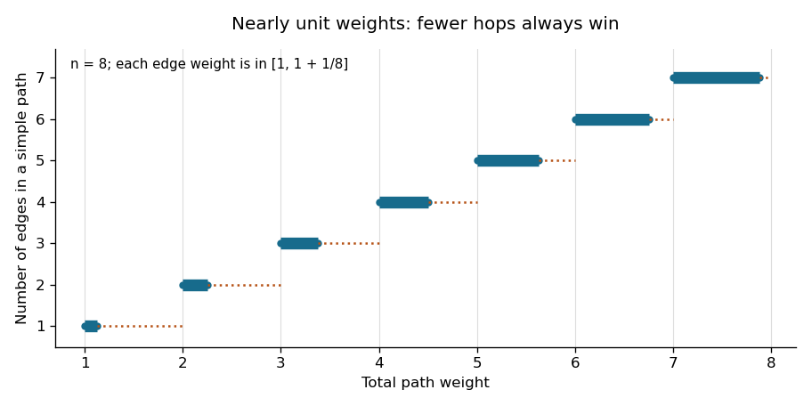

<h1 id="5/c/solution">Solution</h1>

↑ **Parent:** [C](../c.md)

First run [breadth-first search](../../../../../breadth-first-search.md), ignoring weights, to obtain the minimum number of [edges](../../../../../edge-of-a-graph.md) $h(v)$ from the source to each reachable [vertex](../../../../../vertex-graph-theory.md). Then compute weighted distances only along [edges](../../../../../edge-of-a-graph.md) that advance one breadth-first layer:
```
d[source] = 0; all other d[v] = infinity
for u in nondecreasing BFS-layer order:
    for each outgoing edge (u,v):
        if h[v] == h[u]+1:
            if d[u]+w(u,v) < d[v]:
                d[v] = d[u]+w(u,v)
                predecessor[v] = u
```
Unreachable vertices keep distance $\infty$. For an [undirected graph](../../../../../undirected-graph.md), scan both orientations of each [edge](../../../../../edge-of-a-graph.md).

To justify discarding other routes, a [shortest path](../../../../../shortest-path.md) can be taken simple because every weight is positive. A simple path of $r\leq n-1$ edges has weight in

$$
[r,r(1+1/n)]\subseteq[r,r+1).
$$

Every path with at least $r+1$ edges weighs at least $r+1$. Consequently every minimum-weight path must also have the minimum possible number of edges: this is [minimum-hop dominance for nearly unit weights](../../../../../minimum-hop-dominance-for-nearly-unit-weights.md).

A minimum-hop path to $v$ uses exactly $h(v)$ edges. Every prefix of such a path must itself have minimum hop count, since replacing a longer prefix by a shorter one would shorten the whole route. Hence it advances from layer $j$ to layer $j+1$ at every step. The retained edges form a [Directed acyclic graph](../../../../../directed-acyclic-graph.md), ordered by $h$. The displayed [dynamic programming](../../../../../dynamic-programming.md) recurrence therefore finds the cheapest of all minimum-hop paths, which by the preceding bound is a true [shortest path](../../../../../shortest-path.md).

<a id="5/c/image-disjoint-weight-bands-for-simple-paths-with-different-hop-counts"></a>


**[Figure 1](#5/c/image-disjoint-weight-bands-for-simple-paths-with-different-hop-counts). Disjoint weight bands for simple paths with different hop counts**.

With an [adjacency list](../../../../../adjacency-list.md), both the [breadth-first search](../../../../../breadth-first-search.md) and the layer-ordered relaxations take **$O(n+m)$ time and $O(n+m)$ total storage**, where $m=|E|$. The queue order from breadth-first search already supplies the layer order; no sorting or priority queue is needed. This improves the usual $O((n+m)\log n)$ binary-heap Dijkstra bound and is linear in the input size.

## ↑ Ancestors (12)

1. [C](../c.md)
2. [5](../../5.md)
3. [Functional programming, design and analysis of algorithms](../../../functional-programming-design-and-analysis-of-algorithms-split.md)
4. [2023](../../../split.md)
5. [Past exam of the year 1 of the computer science course of the University of Oxford](../../../../split.md)
6. [Year 1 of the computer science course of the University of Oxford](../../../../../year-1-of-the-computer-science-course-of-the-university-of-oxford.md)
7. [Computer science course of the University of Oxford](../../../../../computer-science-course-of-the-university-of-oxford.md)
8. [Undergraduate course of the University of Oxford](../../../../../undergraduate-course-of-the-university-of-oxford.md)
9. [Course of the University of Oxford](../../../../../course-of-the-university-of-oxford.md)
10. [University of Oxford](../../../../../university-of-oxford-split.md)
11. [List of universities](../../../../../list-of-universities.md)
12. [Codex Wiki](../../../../../split.md)
