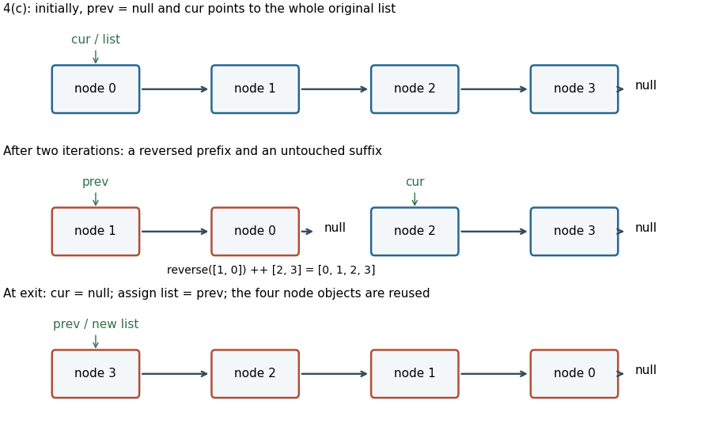

# Imperative programming

↑ **Parent:** [2023](../2023.md)

Worked solutions for the held Oxford preliminary examination of 14 June 2023. Source release: [released examination PDF](https://www.whatdotheyknow.com/request/ba_computer_science_past_papers/response/2577745/attach/2/202402%20183%20CS%20Papers.zip?cookie_passthrough=1). All eight questions and all 42 answerable leaves are addressed below, without reproducing question statements. The three printed sections are retained as context within the question hierarchy.

Code uses the [Scala](../../programming-language.md#scala) 2 syntax of the paper. Array inputs described as sorted are assumed nondecreasing and stable during an operation. Unless explicitly discussing machine behavior, mathematical proofs state their arithmetic assumptions. In particular, the printed routines in Question 2 have genuine fixed-width arithmetic limitations, which are analyzed rather than silently attributed exact-integer behavior. Implementations below handle empty structures and document their sentinels, capacity bounds and invalid-input behavior.

**Table of contents**

- [1](#1)
  - [a](#1/a)
    - [Solution](#1/a/solution)
  - [b](#1/b)
    - [Solution](#1/b/solution)
  - [c](#1/c)
    - [Solution](#1/c/solution)
  - [d](#1/d)
    - [Solution](#1/d/solution)
  - [e](#1/e)
    - [Solution](#1/e/solution)
- [2](#2)
  - [a](#2/a)
    - [Solution](#2/a/solution)
  - [b](#2/b)
    - [Solution](#2/b/solution)
  - [c](#2/c)
    - [Solution](#2/c/solution)
  - [d](#2/d)
    - [Solution](#2/d/solution)
  - [e](#2/e)
    - [Solution](#2/e/solution)
- [3](#3)
  - [a](#3/a)
    - [Solution](#3/a/solution)
  - [b](#3/b)
    - [Solution](#3/b/solution)
  - [c](#3/c)
    - [Solution](#3/c/solution)
  - [d](#3/d)
    - [Solution](#3/d/solution)
  - [e](#3/e)
    - [Solution](#3/e/solution)
  - [f](#3/f)
    - [Solution](#3/f/solution)
- [4](#4)
  - [a](#4/a)
    - [Solution](#4/a/solution)
  - [b](#4/b)
    - [Solution](#4/b/solution)
  - [c](#4/c)
    - [Solution](#4/c/solution)
  - [d](#4/d)
    - [Solution](#4/d/solution)
  - [e](#4/e)
    - [Solution](#4/e/solution)
  - [f](#4/f)
    - [Solution](#4/f/solution)
- [5](#5)
  - [a](#5/a)
    - [Solution](#5/a/solution)
  - [b](#5/b)
    - [Solution](#5/b/solution)
  - [c](#5/c)
    - [Solution](#5/c/solution)
  - [d](#5/d)
    - [Solution](#5/d/solution)
  - [e](#5/e)
    - [Solution](#5/e/solution)
- [6](#6)
  - [a](#6/a)
    - [Solution](#6/a/solution)
  - [b](#6/b)
    - [i](#6/b/i)
      - [Solution](#6/b/i/solution)
    - [ii](#6/b/ii)
      - [Solution](#6/b/ii/solution)
    - [iii](#6/b/iii)
      - [Solution](#6/b/iii/solution)
    - [iv](#6/b/iv)
      - [Solution](#6/b/iv/solution)
    - [v](#6/b/v)
      - [Solution](#6/b/v/solution)
    - [vi](#6/b/vi)
      - [Solution](#6/b/vi/solution)
  - [c](#6/c)
    - [Solution](#6/c/solution)
- [7](#7)
  - [a](#7/a)
    - [Solution](#7/a/solution)
  - [b](#7/b)
    - [Solution](#7/b/solution)
  - [c](#7/c)
    - [Solution](#7/c/solution)
- [8](#8)
  - [a](#8/a)
    - [Solution](#8/a/solution)
  - [b](#8/b)
    - [Solution](#8/b/solution)
  - [c](#8/c)
    - [Solution](#8/c/solution)
  - [d](#8/d)
    - [Solution](#8/d/solution)

## 1

↑ **Parent:** [Imperative programming](imperative-programming.md)

Imperative Programming Part 1.

<h3 id="1/a">a</h3>

↑ **Parent:** [1](#1)

<h4 id="1/a/solution">Solution</h4>

↑ **Parent:** [A](#1/a)

A [loop invariant](../../algorithm.md#loop-invariant) is a property of the [program state](../../programming-language.md#program-state) that holds whenever control reaches the loop's condition, including the final failed test. Its main purpose is proving [partial correctness](../../algorithm.md#partial-correctness): establish it initially, prove one guarded iteration preserves it, then combine it with the negated condition to obtain the [postcondition](../../algorithm.md#postcondition). A separate [loop variant](../../algorithm.md#loop-variant) or another progress argument proves [algorithm termination](../../algorithm.md#algorithm-termination) and hence [total correctness](../../algorithm.md#total-correctness).

<h3 id="1/b">b</h3>

↑ **Parent:** [1](#1)

<h4 id="1/b/solution">Solution</h4>

↑ **Parent:** [B](#1/b)

**The proposed condition is not a [loop invariant](../../algorithm.md#loop-invariant) at the loop head.** It holds initially and on entry to every executed body, but the iteration starting with `i == 10` finishes with `i == 11`. Control then returns to the condition with the proposed upper bound false. A suitable numerical [loop invariant](../../algorithm.md#loop-invariant) is **$1\leq i\leq11$**. If the number of printed lines matters, strengthen it to “exactly $i-1$ lines have been printed.” At exit, this and `i > 10` give exactly ten printed lines. The nonnegative [loop variant](../../algorithm.md#loop-variant) $11-i$ decreases by one on every iteration.

<h3 id="1/c">c</h3>

↑ **Parent:** [1](#1)

<h4 id="1/c/solution">Solution</h4>

↑ **Parent:** [C](#1/c)

This is [lower-bound search](../../algorithm.md#lower-bound-search): return the first position whose value is at least the target, allowing the result to equal the [array](../../data-structure.md#array-data-structure) length. The notation for an empty suffix is vacuously true, so this also covers a target larger than every entry and the empty [array](../../data-structure.md#array-data-structure). Assume a stable [sorted array](../../data-structure.md#sorted-array), ordered nondecreasingly.

```
def ternarySearch(a: Array[Int], x: Int): Int = {
  var lo = 0
  var hi = a.length
  while (lo < hi) {
    val third = (hi - lo) / 3
    val m1 = lo + third
    val m2 = hi - 1 - third
    if (a(m1) >= x) hi = m1
    else if (a(m2) < x) lo = m2 + 1
    else {
      lo = m1 + 1
      hi = m2
    }
  }
  lo
}
```

The [loop invariant](../../algorithm.md#loop-invariant) is

$$
0\leq lo\leq hi\leq N,\qquad (\forall k<lo)\ a(k)<x,\qquad (\forall k\geq hi,\ k<N)\ a(k)\geq x.
$$

Initially the excluded prefix and suffix are empty, so both quantified assertions hold. During an iteration, $lo\leq m_1\leq m_2<hi$. If $a(m_1)\geq x$, [sortedness](../../algorithm.md#sortedness) makes every later value at least $x$, so replacing `hi` by `m1` preserves the right assertion. If the first test failed and $a(m_2)<x$, every earlier value is below $x$, so replacing `lo` by `m2 + 1` preserves the left assertion. Otherwise $a(m_1)<x\leq a(m_2)$; both new exclusions are valid, and `lo = m1 + 1; hi = m2` retains exactly the unresolved middle. In that branch $m_1<m_2$, since a single value cannot satisfy both strict and nonstrict inequalities in opposite directions.

The nonnegative [loop variant](../../algorithm.md#loop-variant) `hi - lo` strictly decreases. In fact, with old length $d$ and $q=\lfloor d/3\rfloor$, the three possible new lengths are $q,q,d-2q-2$, with the middle branch feasible only when nonnegative; each is at most $\lfloor d/3\rfloor$. At exit `lo == hi`, and the [loop invariant](../../algorithm.md#loop-invariant) is exactly the desired partition. **The result is the unique lower-bound index, including the first equal entry when duplicates occur.** This [ternary lower-bound search](../../algorithm.md#ternary-lower-bound-search) uses $O(\log(N+1))$ comparisons and $O(1)$ [auxiliary space](../../algorithm.md#auxiliary-space), in the [Big O notation](../../real-analysis.md#big-o-notation) word-operation model. The index formulas also avoid computing an overflowing `2 * length`.

<h3 id="1/d">d</h3>

↑ **Parent:** [1](#1)

<h4 id="1/d/solution">Solution</h4>

↑ **Parent:** [D](#1/d)

For the given [sorted array](../../data-structure.md#sorted-array), the complete [lower-bound search](../../algorithm.md#lower-bound-search) behavior is $0$ for $x\leq1$, $1$ for $2\leq x\leq4$, $3$ for $5\leq x\leq10$, and $4$ for $x\geq11$. In particular, **index $2$ is never the correct answer** because the two equal entries share the same first insertion position.

These [unit tests](../../computer-science.md#unit-testing) cover every value boundary, equality case and missing-value interval:

- Below all entries, including the smallest machine [integer](../../integer.md): `ternarySearch(a, Int.MinValue) == 0` and `ternarySearch(a, 0) == 0`.
- Equality with the first entry: `ternarySearch(a, 1) == 0`.
- Values in the first gap: `ternarySearch(a, 2) == 1` and `ternarySearch(a, 3) == 1`.
- Repeated equality must return the first duplicate: `ternarySearch(a, 4) == 1`.
- Values in the second gap: `ternarySearch(a, 5) == 3` and `ternarySearch(a, 9) == 3`.
- Equality with the final entry: `ternarySearch(a, 10) == 3`.
- Beyond the final entry: `ternarySearch(a, 11) == 4` and `ternarySearch(a, Int.MaxValue) == 4`.

For every tested target, also assert that the [array](../../data-structure.md#array-data-structure) is unchanged, the result lies in $[0,4]$, every entry before it is strictly smaller, and every entry from it onward is at least the target. These [postconditions](../../algorithm.md#postcondition) check the intended partition directly rather than merely accepting any equal occurrence.

<h3 id="1/e">e</h3>

↑ **Parent:** [1](#1)

<h4 id="1/e/solution">Solution</h4>

↑ **Parent:** [E](#1/e)

Search only the suffix strictly after each candidate first index. This enforces distinct indices even when the target is twice an existing value. Compute the complement in `Long` to prevent [integer overflow](../../programming-language.md#integer-overflow): subtracting two `Int` values can require 33 signed bits.

```
def twoSum(a: Array[Int], target: Int): (Int, Int) = {
  def lowerBound(from: Int, wanted: Long): Int = {
    var lo = from
    var hi = a.length
    while (lo < hi) {
      val mid = lo + (hi - lo) / 2
      if (a(mid).toLong < wanted) lo = mid + 1
      else hi = mid
    }
    lo
  }
  var i = 0
  while (i < a.length - 1) {
    val wanted = target.toLong - a(i).toLong
    val j = lowerBound(i + 1, wanted)
    if (j < a.length && a(j).toLong == wanted) return (i, j)
    i += 1
  }
  (0, 0)
}
```

The outer [loop invariant](../../algorithm.md#loop-invariant) says that no solution has a smaller first index than `i`, when a pair is written in increasing index order. A failed suffix [binary search](../../algorithm.md#binary-search) proves there is no partner for the current `i`, extending the excluded prefix by one. A successful return has $j>i$ and $a(j)=t-a(i)$ in exact [integer arithmetic](../../arithmetic.md#integer-arithmetic). At exhaustion, every possible ordered pair has been excluded, so **the sentinel `(0,0)` means no solution**. The inner [loop invariant](../../algorithm.md#loop-invariant) is the standard lower-bound partition, restricted to the suffix starting at `i + 1`.

There are at most $N-1$ suffix searches, each taking $O(\log(N+1))$ [running time](../../algorithm.md#running-time), so the total is $O(N\log(N+1))$, customarily written $O(N\log N)$ for $N\geq2$. [Auxiliary space](../../algorithm.md#auxiliary-space) is $O(1)$. Empty and singleton [arrays](../../data-structure.md#array-data-structure) immediately return the sentinel. This is [distinct-index two-sum by suffix lower bounds](../../algorithm.md#distinct-index-two-sum-by-suffix-lower-bounds); a faster [two-pointer technique](../../algorithm.md#two-pointer-technique) is also possible on a [sorted array](../../data-structure.md#sorted-array), but the code here directly meets the requested search-based bound.

## 2

↑ **Parent:** [Imperative programming](imperative-programming.md)

<h3 id="2/a">a</h3>

↑ **Parent:** [2](#2)

<h4 id="2/a/solution">Solution</h4>

↑ **Parent:** [A](#2/a)

Repeated [integer division](../../arithmetic.md#integer-division) by two generates the [binary digits](../../integer.md#binary-digit) from least significant to most significant. Reverse the accumulated characters once, and treat zero separately.

```
def binaryCon(n: Int): String = {
  require(n >= 0, "n must be nonnegative")
  if (n == 0) return "0"
  var remaining = n
  val digits = new StringBuilder
  while (remaining > 0) {
    digits.append(if (remaining % 2 == 0) '0' else '1')
    remaining /= 2
  }
  digits.reverse.toString
}
```

**Zero produces `"0"`; positive inputs produce a [binary number](../../arithmetic.md#binary-number) without leading zeros.** No library routine performs the number-to-base conversion. Appending to the builder and reversing once gives linear work in the number of [binary digits](../../integer.md#binary-digit) and uses that much output storage.

<h3 id="2/b">b</h3>

↑ **Parent:** [2](#2)

<h4 id="2/b/solution">Solution</h4>

↑ **Parent:** [B](#2/b)

Validate the complete input before doing the addition. The [arrays](../../data-structure.md#array-data-structure) use most-significant-digit-first [positional notation](../../integer.md#positional-notation). The result has one extra leading position, which contains either zero or the final carry.

```
def binaryAddition(x: Array[Int], y: Array[Int]): Array[Int] = {
  require(x != null && y != null, "arrays must not be null")
  require(x.length == y.length, "lengths must match")
  val n = x.length
  var k = 0
  while (k < n) {
    require((x(k) == 0 || x(k) == 1) &&
            (y(k) == 0 || y(k) == 1), "digits must be 0 or 1")
    k += 1
  }
  val answer = new Array[Int](n + 1)
  var carry = 0
  var j = n - 1
  while (j >= 0) {
    val column = x(j) + y(j) + carry
    answer(j + 1) = column % 2
    carry = column / 2
    j -= 1
  }
  answer(0) = carry
  answer
}
```

A failed `require` throws `IllegalArgumentException`, covering mismatched lengths, invalid [binary digits](../../integer.md#binary-digit) and null [arrays](../../data-structure.md#array-data-structure). The largest column sum is three, so the carry always lies in $\{0,1\}$. The [binary-addition carry invariant](../../arithmetic.md#binary-addition-carry-invariant) says that the already processed input suffixes equal the written result suffix plus the carry shifted to the next column. After the final column, placing that carry at position zero proves the returned value is the sum. Neither input [array](../../data-structure.md#array-data-structure) is modified. Equal empty inputs are accepted as zero and return `Array(0)`; the specification imposes no positive-length restriction. [Running time](../../algorithm.md#running-time) and result storage are $O(N)$.

<h3 id="2/c">c</h3>

↑ **Parent:** [2](#2)

<h4 id="2/c/solution">Solution</h4>

↑ **Parent:** [C](#2/c)

Under exact [integer arithmetic](../../arithmetic.md#integer-arithmetic), the intended result is **$\lceil\log_2 x\rceil$**, using the [ceiling function](../../calculus.md#ceiling-function). A sufficient [loop invariant](../../algorithm.md#loop-invariant) is

$$
i\geq0,\qquad y=2^i,\qquad i=0\ \lor\ 2^{i-1}<x.
$$

Initially $i=0,y=1$, and the final disjunction is true. If the guard holds, the old value $y=2^i$ is below $x$. Incrementing `i` and doubling `y` therefore preserves $y=2^i$ and makes the new lower bound $2^{i-1}<x$ true. At exit $y\geq x$. If $i=0$, positivity of $x$ forces $x=1$; otherwise $2^{i-1}<x\leq2^i$. Both cases establish the claimed [postcondition](../../algorithm.md#postcondition). Doubling eventually reaches or exceeds any fixed positive $x$, proving [algorithm termination](../../algorithm.md#algorithm-termination) in this arithmetic model. This is the [doubling-loop ceiling logarithm](../../calculus.md#doubling-loop-ceiling-logarithm) argument.

**The printed Scala implementation is not correct for its entire stated `Int` domain.** Its `y` is an `Int`. For $x>2^{30}$, it reaches $y=2^{30}$, wraps to $-2^{31}$ on the next doubling, then becomes zero and stays zero. The guard remains true forever. The [loop invariant](../../algorithm.md#loop-invariant) above is valid for the printed code only when $1\leq x\leq2^{30}$. Scala documents `Int` as a signed 32-bit value equivalent to Java's primitive `int`.[Scala 2.13.16, class Int: signed 32-bit representation](../../computer-science-bibliography.md#scala-int-api-documentation)

A corrected implementation for every positive `Int` input widens the doubling variable before any multiplication:

```
def ceilingLog2(x: Int): Int = {
  require(x > 0)
  var i = 0
  var y = 1L
  while (y < x.toLong) {
    i += 1
    y *= 2L
  }
  i
}
```

Now at most 31 iterations are needed and $y\leq2^{31}$, safely within `Long`. The same [loop invariant](../../algorithm.md#loop-invariant) proves [total correctness](../../algorithm.md#total-correctness) without the overflow gap.

<h3 id="2/d">d</h3>

↑ **Parent:** [2](#2)

<h4 id="2/d/solution">Solution</h4>

↑ **Parent:** [D](#2/d)

The algorithmic intention is **[exponentiation by squaring](../../number-theory.md#exponentiation-by-squaring) to compute $x^n$ for $n\geq0$**. With exact arithmetic, its [loop invariant](../../algorithm.md#loop-invariant) is

$$
i\geq0,\qquad result\,y^i=x^n.
$$

Initially `result = 1`, `y = x`, and `i = n`. For an [even integer](../../integer.md#even-number) $i=2q$, squaring `y` and replacing `i` by $q$ preserves the product. For an [odd integer](../../integer.md#odd-integer) $i=2q+1$, first multiply `result` by `y`; then $(result\,y)(y^2)^q=result\,y^{2q+1}$. The nonnegative [loop variant](../../algorithm.md#loop-variant) `i` decreases by halving whenever positive. At exit $i=0$, so the [loop invariant](../../algorithm.md#loop-invariant) yields `result = x^n`. There are $O(\log(n+1))$ multiplication steps.

Two qualifications are essential for the actual source. There is no requirement that `n` be nonnegative: **for every `n <= 0` the printed function simply returns `1.0`**. Also, `var y = x` infers `Int`, so `y *= y` uses wrapping [integer arithmetic](../../arithmetic.md#integer-arithmetic), while the accumulator uses [floating-point arithmetic](../../floating-point-arithmetic.md). For example, **`anotherfunc(50000, 2L)` returns `-1794967296.0`, rather than `2500000000.0`**. An exact-power [loop invariant](../../algorithm.md#loop-invariant) cannot prove a false claim about that execution.

More precisely, for positive `n`, after $k$ iterations the remaining exponent is $\lfloor n/2^k\rfloor$, and the `Int` base is the signed 32-bit representative of $x^{2^k}$ modulo $2^{32}$. The accumulator multiplies those signed representatives for the set [bits](../../information-theory.md#bit) of `n`, in increasing bit order, with a floating-point rounding after each multiplication. This describes the actual code even when the intended power law fails. In an exact implementation, use a nonnegative-exponent [precondition](../../algorithm.md#precondition) and arbitrary-precision [integers](../../integer.md), for example:

```
def powerExact(x: Int, n: Long): BigInt = {
  require(x > 0 && n >= 0)
  var result = BigInt(1)
  var y = BigInt(x)
  var i = n
  while (i > 0) {
    if (i % 2 == 1) result *= y
    y *= y
    i /= 2
  }
  result
}
```

The displayed [loop invariant](../../algorithm.md#loop-invariant) applies exactly to this version. It performs logarithmically many arbitrary-precision multiplications; their bit cost grows with operand size, so that statement is not an $O(\log n)$ bit-complexity bound. Merely making the accumulator a `Double` does not widen the separate `Int` base variable.

<h3 id="2/e">e</h3>

↑ **Parent:** [2](#2)

<h4 id="2/e/solution">Solution</h4>

↑ **Parent:** [E](#2/e)

To preserve the actual printed function, including its handling of nonpositive exponents and wrapping `Int` bases, use a [tail-recursive](../../algorithm.md#tail-recursion) accumulator with the same multiplication order:

```
def anotherfuncRec(x: Int, n: Long): Double = {
  require(x > 0)
  @scala.annotation.tailrec
  def loop(y: Int, i: Long, result: Double): Double = {
    if (i <= 0) result
    else {
      val nextResult = if (i % 2 == 1) result * y else result
      loop(y * y, i / 2, nextResult)
    }
  }
  loop(x, n, 1.0)
}
```

Each [recursive call](../../algorithm.md#recursive-call) corresponds to one source iteration and carries exactly its next [program state](../../programming-language.md#program-state). Hence it reproduces the printed numerical behavior, rather than silently repairing it. For positive `n`, both routines use $\lfloor\log_2 n\rfloor+1$ steps; for nonpositive `n`, both take constant time. The recursive call is in tail position, so Scala's tail-call optimization avoids a growing [call stack](../../data-structure.md#call-stack); the annotation asks the [compiler](../../programming-language.md#compiler) to check that condition.

If the intended exact power is required instead, change the base and accumulator parameters of this same recurrence to `BigInt` and require `n >= 0`, as in part (d). Its mathematical [loop invariant](../../algorithm.md#loop-invariant) becomes a [recursion invariant](../../algorithm.md#recursion-invariant), with the same logarithmic number of multiplication steps.

## 3

↑ **Parent:** [Imperative programming](imperative-programming.md)

Imperative Programming Part 2.

<h3 id="3/a">a</h3>

↑ **Parent:** [3](#3)

<h4 id="3/a/solution">Solution</h4>

↑ **Parent:** [A](#3/a)

Use an [abstract data type](../../computer-science.md#abstract-data-type) with two total count [functions](../../function.md), $I,O:U\to\{0,\ldots,M\}$, where $U=\{1,\ldots,99999999\}$ and $M=2^{31}-1$. $I(u)$ counts incoming payments and $O(u)$ outgoing payments. Initially **$I(u)=O(u)=0$ for every valid user**. A user without a stored record is therefore observable as two zero counts; no separate registration operation is necessary.

The explicit bound $M$ matches the source's `Int` record fields. Increment operations require space in the relevant count, so no [integer overflow](../../programming-language.md#integer-overflow) is permitted. An unbounded mathematical counting [abstract data type](../../computer-science.md#abstract-data-type) would instead require an arbitrary-precision representation or an explicit overflow policy. The large user domain does not require allocating a record for every user: a [sparse map with a default value](../../data-structure.md#sparse-map-with-a-default-value) can realize these total [functions](../../function.md).

<h3 id="3/b">b</h3>

↑ **Parent:** [3](#3)

<h4 id="3/b/solution">Solution</h4>

↑ **Parent:** [B](#3/b)

Every operation requires $u\in U$. The queries have [postconditions](../../algorithm.md#postcondition) “return $I_0(u)$” and “return $O_0(u)$” respectively, leaving both [functions](../../function.md) unchanged. An incoming increment additionally requires $I_0(u)<M$ and has

$$
I'(v)=\begin{cases}I_0(u)+1&v=u,\\I_0(v)&v\ne u,\end{cases}\qquad O'=O_0.
$$

The outgoing increment analogously requires $O_0(u)<M$, increments only $O(u)$, and preserves $I$. These frame conditions prevent an implementation from accidentally changing another user's count. Here a subscript zero denotes the old [program state](../../programming-language.md#program-state).

```
trait Payments {
  // All methods require 1 <= user && user <= 99999999.
  // Queries leave the abstract state unchanged.
  def incoming(user: Int): Int
  def outgoing(user: Int): Int

  // Require the corresponding old count < Int.MaxValue.
  // Increment only that user's named count by one.
  def recordIncoming(user: Int): Unit
  def recordOutgoing(user: Int): Unit
}
```

The [preconditions](../../algorithm.md#precondition) and [postconditions](../../algorithm.md#postcondition) are part of the [formal specification](../../algorithm.md#formal-specification); the trait's [type signatures](../../programming-language.md#type-signature) alone cannot express all of them. The implementation below uses checked `require` calls for the relevant invalid operations.

<h3 id="3/c">c</h3>

↑ **Parent:** [3](#3)

<h4 id="3/c/solution">Solution</h4>

↑ **Parent:** [C](#3/c)

With a **directly indexed [array](../../data-structure.md#array-data-structure)**, use two parallel count [arrays](../../data-structure.md#array-data-structure), or one [array](../../data-structure.md#array-data-structure) of count records, at each user identity. Both queries and increments take $O(1)$ [running time](../../algorithm.md#running-time), with no [hash collision](../../computer-science.md#hash-collision). However, reserving $10^8$ positions for each of two four-byte counters uses about $800$ million bytes, roughly $763$ MiB before object overhead, even when only a few users have payments. Index zero is unused and all valid positions initially contain zero.

With a **[linked list](../../data-structure.md#linked-list)**, store one node `(user, countIn, countOut, next)` for each active user. A scan locates a record, returning zero counts if absent; an increment creates a missing record or updates its counter. Storage is $O(K)$ for $K$ stored users, but a query or update can require $O(K)$ [running time](../../algorithm.md#running-time). Nodes also carry pointer and allocation overhead and lack direct indexed access.

With a **[hash table](../../data-structure.md#hash-table) using [separate chaining](../../data-structure.md#separate-chaining)**, compute a [hash bucket](../../data-structure.md#hash-bucket) from the user identity and store its record in that bucket's [linked list](../../data-structure.md#linked-list). The same zero-default convention applies to a missing record. With $B$ buckets and a well-distributing [hash function](../../computer-science.md#hash-function), the expected operation cost is $O(1+K/B)$ in terms of the [load factor of a hash table](../../data-structure.md#load-factor-of-a-hash-table); worst-case cost remains $O(K)$ under severe collisions. Storage is $O(B+K)$, but a permanently fixed $B=100$ cannot maintain constant expected cost as $K$ grows without bound. A good distribution and, where permitted, [hash table resizing](../../data-structure.md#hash-table-resizing) address that trade-off.

<h3 id="3/d">d</h3>

↑ **Parent:** [3](#3)

<h4 id="3/d/solution">Solution</h4>

↑ **Parent:** [D](#3/d)

Inside the supplied `PaymentsHash` class, scan until a matching node or the end of the chain. **A null return means the user has no record in this bucket.**

```
private def find(user: Int, head: PaymentsHash.Node): PaymentsHash.Node = {
  var p = head
  while (p != null && p.user != user) p = p.next
  p
}
```

The [loop invariant](../../algorithm.md#loop-invariant) says that every node already passed has a different user identity and `p` heads the unexamined suffix. [Short-circuit evaluation](../../programming-language.md#short-circuit-evaluation) of `&&` prevents dereferencing null. The [representation invariant](../../computer-science.md#representation-invariant) supplies an acyclic finite chain, so each unsuccessful step shortens that suffix and proves [algorithm termination](../../algorithm.md#algorithm-termination). The code changes no node fields.

<h3 id="3/e">e</h3>

↑ **Parent:** [3](#3)

<h4 id="3/e/solution">Solution</h4>

↑ **Parent:** [E](#3/e)

The following method belongs inside the source class and uses the helper from part (d). It preserves the existing outgoing count, and a newly encountered user starts with exactly one incoming and zero outgoing payments.

```
def recordIncoming(user: Int): Unit = {
  require(1 <= user && user <= 99999999, "invalid user identity")
  val bucket = hash(user)
  val p = find(user, table(bucket))
  if (p == null) {
    table(bucket) = new PaymentsHash.Node(user, 1, 0, table(bucket))
  } else {
    require(p.countIn < Int.MaxValue, "incoming count is full")
    p.countIn += 1
  }
}
```

On a hit, exactly one field is incremented after the overflow check. On a miss, inserting at the bucket head preserves all existing records and gives precisely the required change from implicit zero to one. The given [hash function](../../computer-science.md#hash-function) must return an index in $[0,N)$ consistently for a given user. Its actual formula is not needed by this method. The nested private node class is accessible to its [companion class](../../programming-language.md#companion-class) in Scala, so retaining the source's `PaymentsHash.Node` visibility is valid.[Modifiers: private members are accessible to the enclosing template and its companion](../../computer-science-bibliography.md#scala-2-13-classes-and-objects-specification)

<h3 id="3/f">f</h3>

↑ **Parent:** [3](#3)

<h4 id="3/f/solution">Solution</h4>

↑ **Parent:** [F](#3/f)

For each table index $b$, let $C_b=L(table(b))$ be the [set](../../set.md) of non-null nodes reachable by following `next`. A sufficient [representation invariant](../../computer-science.md#representation-invariant) is:

- The [array](../../data-structure.md#array-data-structure) has exactly $N>0$ buckets, and every bucket heads a finite acyclic [linked list](../../data-structure.md#linked-list).
- The sets $C_b$ are pairwise disjoint, so one physical node cannot belong to two buckets.
- Every reachable node has a valid user identity, lies in bucket `hash(node.user)`, and has both counters between zero and `Int.MaxValue`.
- User identities are unique among all reachable nodes, not merely within a single chain.

The [abstraction function](../../computer-science.md#abstraction-function) maps these nodes to the total [functions](../../function.md) of part (a): if the unique node for $u$ exists, $I(u)$ and $O(u)$ are its fields; otherwise both are zero. A stored record with two zero counters is harmless and has the same observable meaning as an absent record. This intentionally permits multiple concrete representations of the same abstract [program state](../../programming-language.md#program-state).

Initially every bucket is null, so the [representation invariant](../../computer-science.md#representation-invariant) holds and the [abstraction function](../../computer-science.md#abstraction-function) yields all zeros. The successful-update branch preserves every structural condition; the insertion branch creates a fresh node with a previously absent identity in its correct bucket. Both branches realize exactly the incoming-increment [postcondition](../../algorithm.md#postcondition), demonstrating [correct operations through an abstraction function](../../computer-science.md#correct-operations-through-an-abstraction-function).

## 4

↑ **Parent:** [Imperative programming](imperative-programming.md)

<h3 id="4/a">a</h3>

↑ **Parent:** [4](#4)

<h4 id="4/a/solution">Solution</h4>

↑ **Parent:** [A](#4/a)

Let $L(list)$ denote the non-null nodes reachable from the head. The [representation invariant](../../computer-science.md#representation-invariant) requires a finite acyclic [null-terminated linked list](../../data-structure.md#null-terminated-linked-list) and pairwise distinct names among its reachable nodes. Names and numbers retain the interface's [string data type](../../programming-language.md#string-data-type) interpretation; no ordering of names is required.

The [abstraction function](../../computer-science.md#abstraction-function) is the finite [partial function](../../function.md#partial-function)

$$
book=\{\,p.name\mapsto p.number\mid p\in L(list)\,\}.
$$

Name uniqueness makes this a [function](../../function.md), rather than a relation assigning multiple numbers to one name. Initially `list == null`, so $L(list)=\varnothing$ and **the abstract book is empty**. Unreachable allocated nodes are outside this abstract state.

<h3 id="4/b">b</h3>

↑ **Parent:** [4](#4)

<h4 id="4/b/solution">Solution</h4>

↑ **Parent:** [B](#4/b)

Inside `LinkedListBook`, traverse without modifying the head or any node:

```
def printBook(): Unit = {
  var p = list
  while (p != null) {
    println(p.name + ":" + p.number)
    p = p.next
  }
}
```

The [loop invariant](../../algorithm.md#loop-invariant) is that precisely the prefix before `p` has been printed, once per node, in list order; `p` heads the remaining suffix. The [null-terminated linked list](../../data-structure.md#null-terminated-linked-list) invariant proves termination and prevents duplicate output through cycles. An empty list prints nothing. The [abstraction function](../../computer-science.md#abstraction-function) is unchanged, and the traversal takes $O(K)$ node visits for $K$ entries.

<h3 id="4/c">c</h3>

↑ **Parent:** [4](#4)

<h4 id="4/c/solution">Solution</h4>

↑ **Parent:** [C](#4/c)

Save the next pointer before redirecting it, then advance the two working heads. No node is allocated and the name/number fields are untouched.

```
def reverseBook(): Unit = {
  var prev: Node = null
  var cur = list
  while (cur != null) {
    val following = cur.next
    cur.next = prev
    prev = cur
    cur = following
  }
  list = prev
}
```

Let $S$ be the original [sequence](../../sequence-and-series.md#sequence) of node identities, not just their possibly equal field values. Write $P$ for the sequence currently headed by `prev` and $Q$ for that headed by `cur`. A suitable [loop invariant](../../algorithm.md#loop-invariant) for [in-place linked-list reversal](../../data-structure.md#in-place-linked-list-reversal) is

$$
\operatorname{reverse}(P)\mathbin{++}Q=S,
$$

with both working lists finite, acyclic, disjoint, together containing exactly the original nodes, and with every name and number unchanged. Here `++` means [concatenation](../../foundations-of-mathematics.md#concatenation). Initially $P=[]$ and $Q=S$. One iteration takes $q$ from the front of $Q=q:Q'$ and replaces $(P,Q)$ by $(q:P,Q')$. Since $\operatorname{reverse}(q:P)=\operatorname{reverse}(P)\mathbin{++}[q]$, the equation is preserved. Saving `following` before changing `cur.next` retains access to $Q'$.

The [loop variant](../../algorithm.md#loop-variant) is the length of $Q$, decreasing by one. At exit $Q=[]$, so $P=\operatorname{reverse}(S)$; assigning the head establishes reversal. The empty and singleton cases work without a special branch. The [abstraction function](../../computer-science.md#abstraction-function) of the phone book ignores order, so it still maps every original name to its original number. **All original node identities are reused**, with $O(K)$ [running time](../../algorithm.md#running-time) and $O(1)$ [auxiliary space](../../algorithm.md#auxiliary-space).

<a id="4/c/image-in-place-reversal-preserves-node-identities-while-moving-nodes-from-an-untouched-suffix-into-a-reversed-prefix"></a>


**[Figure 1](#4/c/image-in-place-reversal-preserves-node-identities-while-moving-nodes-from-an-untouched-suffix-into-a-reversed-prefix). In-place reversal preserves node identities while moving nodes from an untouched suffix into a reversed prefix**.

<h3 id="4/d">d</h3>

↑ **Parent:** [4](#4)

<h4 id="4/d/solution">Solution</h4>

↑ **Parent:** [D](#4/d)

Use a non-dummy [circular linked list](../../data-structure.md#circular-linked-list) with a pointer to its last node:

```
private var last: Node = null
```

**Null represents the empty book.** In a nonempty book, `last.next` is the first node, and following `next` makes one finite simple cycle containing `last`. Names are unique around that cycle. This representation makes appending a new entry constant-time once a failed name search has established absence. The [abstraction function](../../computer-science.md#abstraction-function) collects every name/number pair on one complete turn of the cycle, rather than following pointers until null.

<h3 id="4/e">e</h3>

↑ **Parent:** [4](#4)

<h4 id="4/e/solution">Solution</h4>

↑ **Parent:** [E](#4/e)

Starting at `last.next`, visit each node once and stop when the traversal would return to its start. This helper is private so that callers do not receive writable nodes from the representation.

```
private def find(name: String): Node = {
  if (last == null) return null
  val first = last.next
  var p = first
  do {
    if (p.name == name) return p
    p = p.next
  } while (p ne first)
  null
}
```

**Null means no entry has that name.** The test `p ne first` compares [object identity](../../computer-memory.md#object-identity), not the equality of name or number fields. At each iteration all previously visited nodes failed the name test. The finite simple cycle guarantees that either a match is found or the traversal returns to `first` after exactly one turn. A singleton cycle is inspected exactly once. Stopping at null instead would fail to terminate on this representation.

<h3 id="4/f">f</h3>

↑ **Parent:** [4](#4)

<h4 id="4/f/solution">Solution</h4>

↑ **Parent:** [F](#4/f)

Update an existing node, otherwise append one fresh node while preserving the cycle:

```
def store(name: String, number: String): Unit = {
  val p = find(name)
  if (p != null) p.number = number
  else {
    val fresh = new Node(name, number, null)
    if (last == null) {
      fresh.next = fresh
      last = fresh
    } else {
      fresh.next = last.next
      last.next = fresh
      last = fresh
    }
  }
}
```

For an existing name, changing only its number realizes replacement in the abstract [partial function](../../function.md#partial-function). On an empty book, the new node points to itself, establishing a singleton cycle. On a nonempty book, its successor becomes the old first node and the old last points to it; advancing `last` leaves the first node unchanged and closes the enlarged cycle. Since a full search established absence, name uniqueness is preserved. Thus the [postcondition](../../algorithm.md#postcondition) is exactly the old book with this name mapped to the supplied number, and all other entries unchanged. A store takes $O(K)$ [running time](../../algorithm.md#running-time) for the name search and $O(1)$ additional pointer work.

## 5

↑ **Parent:** [Imperative programming](imperative-programming.md)

<h3 id="5/a">a</h3>

↑ **Parent:** [5](#5)

<h4 id="5/a/solution">Solution</h4>

↑ **Parent:** [A](#5/a)

Choose a fixed positive capacity $C$ and represent the abstract state by a finite [partial function](../../function.md#partial-function) $rep:\mathbb Z\rightharpoonup\mathbb Z$. Its [domain of a partial function](../../function.md#domain-of-a-partial-function) $S$ has at most $C$ members; each $rep(x)$ belongs to $S$ and is a fixed point:

$$
rep(rep(x))=rep(x)\qquad(x\in S).
$$

The [blocks of a set partition](../../combinatorics.md#block-of-a-set-partition) are the nonempty fibres of `rep`, and their shared values are their [disjoint-set representatives](../../data-structure.md#disjoint-set-representative). Initially **$rep=\varnothing$**, so $S=\varnothing$. Representatives need not be the minimum members of their blocks.

```
trait DisjointSets {
  val capacity: Int
  // State: rep is a finite idempotent map, |dom rep| <= capacity.
  // Initially: rep is empty; capacity is fixed and positive.

  // Pre: x is absent and |dom rep| < capacity.
  // Post: add x -> x; leave every old mapping unchanged.
  def makeSet(x: Int): Unit

  // Pre: x belongs to dom rep.
  // Post: state unchanged; return rep(x).
  def find(x: Int): Int

  // Pre: x and y belong to dom rep.
  // Post: merge their blocks, retaining old rep(x).
  def union(x: Int, y: Int): Unit
}
```

Precisely, `makeSet(x)` extends the [domain of a partial function](../../function.md#domain-of-a-partial-function) by $x$ with $rep'(x)=x$. For `union(x,y)`, snapshot $r_x=rep_0(x)$ and $r_y=rep_0(y)$, keep $S$ unchanged, and set

$$
rep'(z)=\begin{cases}r_x&rep_0(z)=r_y,\\rep_0(z)&\text{otherwise}.\end{cases}
$$

This merges the two blocks and keeps the representative of the first argument's block. If $r_x=r_y$, it is an identity operation. This deterministic design choice satisfies [disjoint set union](../../data-structure.md#disjoint-set-data-structure) without imposing minimum-element representatives. The capacity bound is explicit in the [abstract data type](../../computer-science.md#abstract-data-type) so that the bounded implementation does not silently strengthen `makeSet`'s [precondition](../../algorithm.md#precondition).

<h3 id="5/b">b</h3>

↑ **Parent:** [5](#5)

<h4 id="5/b/solution">Solution</h4>

↑ **Parent:** [B](#5/b)

Use parallel [arrays](../../data-structure.md#array-data-structure) for keys and their representative values, with only a prefix active:

```
override val capacity: Int = 1000
private val elements = new Array[Int](capacity)
private val representatives = new Array[Int](capacity)
private var used = 0
```

The chosen bound is an explicit implementation parameter of the [abstract data type](../../computer-science.md#abstract-data-type); another a-priori positive bound works identically. **The initial map is empty because `used == 0`.** Zero-filled unused cells are not members of the map, so zero and negative keys remain valid [integers](../../integer.md). Use `DisjointSets` consistently as the trait name; the source's prose variation `DisjointSubsets` does not change the declared interface.

<h3 id="5/c">c</h3>

↑ **Parent:** [5](#5)

<h4 id="5/c/solution">Solution</h4>

↑ **Parent:** [C](#5/c)

A sufficient [representation invariant](../../computer-science.md#representation-invariant) is:

- Both [arrays](../../data-structure.md#array-data-structure) have length `capacity`, with $capacity>0$ and $0\leq used\leq capacity$.
- The active keys `elements(0 until used)` are pairwise distinct.
- For each active index $k$, `representatives(k)` equals some active key `elements(j)`.
- Every such representative is fixed: if `representatives(k) == elements(j)`, then `representatives(j) == elements(j)`.

The [abstraction function](../../computer-science.md#abstraction-function) is

$$
rep=\{\,elements(k)\mapsto representatives(k)\mid0\leq k<used\,\}.
$$

The last two conditions ensure each representative is a genuine member of its own block and that the abstract [function](../../function.md) is [idempotent function](../../function.md#idempotent-function). Cells beyond `used` are unconstrained and ignored. When `used == 0`, these conditions hold vacuously and the [abstraction function](../../computer-science.md#abstraction-function) yields the empty map. This is an explicit-key version of [quick-find](../../data-structure.md#quick-find), rather than a parent-pointer [disjoint-set forest](../../data-structure.md#disjoint-set-forest).

<h3 id="5/d">d</h3>

↑ **Parent:** [5](#5)

<h4 id="5/d/solution">Solution</h4>

↑ **Parent:** [D](#5/d)

Return the key's active [array index](../../data-structure.md#array-index), or **`-1` if absent**:

```
private def isInMap(x: Int): Int = {
  var i = 0
  while (i < used && elements(i) != x) i += 1
  if (i < used) i else -1
}
```

The [loop invariant](../../algorithm.md#loop-invariant) states that every index below `i` has a key different from `x`. The scan ignores all inactive cells, and [short-circuit evaluation](../../programming-language.md#short-circuit-evaluation) protects the array access at the end of the active prefix. Key uniqueness makes a successful index unambiguous. Its [running time](../../algorithm.md#running-time) is $O(used)$.

<h3 id="5/e">e</h3>

↑ **Parent:** [5](#5)

<h4 id="5/e/solution">Solution</h4>

↑ **Parent:** [E](#5/e)

Insert a singleton mapping, retrieve a stored representative, or relabel every occurrence of the second block's old representative:

```
def makeSet(x: Int): Unit = {
  require(isInMap(x) == -1, "element already present")
  require(used < capacity, "capacity exhausted")
  elements(used) = x
  representatives(used) = x
  used += 1
}

def find(x: Int): Int = {
  val i = isInMap(x)
  require(i >= 0, "unknown element")
  representatives(i)
}

def union(x: Int, y: Int): Unit = {
  val keep = find(x)
  val replace = find(y)
  if (keep != replace) {
    var i = 0
    while (i < used) {
      if (representatives(i) == replace) representatives(i) = keep
      i += 1
    }
  }
}
```

For `makeSet`, the new key is absent, its representative is itself, and old mappings are unchanged. `find` is a read-only [linear search](../../algorithm.md#linear-search). In `union`, **snapshot both representatives before changing any cell**: recomputing the representative of `y` during the scan could change the criterion halfway through. The [loop invariant](../../algorithm.md#loop-invariant) says that every processed index already has its specified final representative and every unprocessed index still has its old representative. The cached labels make this assertion stable.

At exit the abstract [postcondition](../../algorithm.md#postcondition) in part (a) holds. The surviving representative was already a fixed point and belongs to its old block; every member of the replaced block, including its old representative key, now maps to it. Thus idempotence and key uniqueness are preserved. Duplicate insertions, absent-element operations and capacity overflow fail before changing the map. Each operation is $O(used)$ in the worst case, except that a same-block union can skip the relabel scan after its lookups. Storage is $O(capacity)$. These bounds follow from the chosen parallel-array [quick-find](../../data-structure.md#quick-find) representation; no parent-pointer optimization is being assumed.

## 6

↑ **Parent:** [Imperative programming](imperative-programming.md)

Imperative Programming Part 3.

<h3 id="6/a">a</h3>

↑ **Parent:** [6](#6)

<h4 id="6/a/solution">Solution</h4>

↑ **Parent:** [A](#6/a)

**[Method overloading](../../programming-language.md#method-overloading)** gives one name several parameter signatures, such as `show(A)` and `show(B)`. The [compiler](../../programming-language.md#compiler) chooses an applicable signature using the receiver's [static type](../../programming-language.md#static-type) and the argument expressions' [static types](../../programming-language.md#static-type), preferring a uniquely more specific applicable alternative. An argument whose type is a [subtype](../../programming-language.md#subtyping) of the parameter type is acceptable; ambiguous or inapplicable alternatives cause a compile-time error. The [runtime type](../../programming-language.md#runtime-type) of an argument does not start a second overload search.

**[Method overriding](../../programming-language.md#method-overriding)** replaces an inherited implementation of the same method signature. After overload selection, ordinary instance calls use [dynamic dispatch](../../programming-language.md#dynamic-dispatch) on the receiver's [runtime type](../../programming-language.md#runtime-type) to select the most-derived implementation of that signature. A concrete inherited method requires the `override` keyword in Scala; a `super` call invokes the corresponding superclass implementation instead of redispatching to the overriding body. In a trait stack, `super` follows the class's linearization.[Overloading resolution: applicable alternatives and most-specific selection](../../computer-science-bibliography.md#scala-2-13-expressions-specification)[Member lookup, overriding and override modifier](../../computer-science-bibliography.md#scala-2-13-classes-and-objects-specification)

<h3 id="6/b">b</h3>

↑ **Parent:** [6](#6)

<h4 id="6/b/i">i</h4>

↑ **Parent:** [B](#6/b)

<h5 id="6/b/i/solution">Solution</h5>

↑ **Parent:** [I](#6/b/i)

**Permitted; returns `"AB"`.** The receiver's [static type](../../programming-language.md#static-type) is `A`, which offers `show(A)`. The argument also has [static type](../../programming-language.md#static-type) `A`, so that signature is selected. All three variables refer to the same object of [runtime type](../../programming-language.md#runtime-type) `C`; the most-derived implementation of `show(A)` is inherited from `B`. Its `super.show(o)` calls `A.show(A)`, producing `"A"`, and it appends `"B"`. `C` overrides `show(B)`, not this selected signature.

<h4 id="6/b/ii">ii</h4>

↑ **Parent:** [B](#6/b)

<h5 id="6/b/ii/solution">Solution</h5>

↑ **Parent:** [Ii](#6/b/ii)

**Permitted; returns `"AB"`.** Through a receiver of [static type](../../programming-language.md#static-type) `A`, only `show(A)` is visible. The argument's [static type](../../programming-language.md#static-type) `C` is a [subtype](../../programming-language.md#subtyping) of `A`, so it can be passed to that method. [Dynamic dispatch](../../programming-language.md#dynamic-dispatch) selects `B.show(A)` on the receiver object, exactly as in part (i). The argument's more specific type cannot expose overloads absent from the receiver's [static type](../../programming-language.md#static-type).

<h4 id="6/b/iii">iii</h4>

↑ **Parent:** [B](#6/b)

<h5 id="6/b/iii/solution">Solution</h5>

↑ **Parent:** [Iii](#6/b/iii)

**Permitted; returns `"AB"`.** A receiver of [static type](../../programming-language.md#static-type) `B` exposes `show(A)` and `show(B)`, but the argument's [static type](../../programming-language.md#static-type) `A` is not a [subtype](../../programming-language.md#subtyping) of `B`. Only `show(A)` is applicable. Its effective implementation on the `C` receiver is `B.show(A)`, which concatenates the superclass result `"A"` and `"B"`.

<h4 id="6/b/iv">iv</h4>

↑ **Parent:** [B](#6/b)

<h5 id="6/b/iv/solution">Solution</h5>

↑ **Parent:** [Iv](#6/b/iv)

**Permitted; returns `"BC"`.** Through [static type](../../programming-language.md#static-type) `B`, both `show(A)` and `show(B)` accept an argument of type `C`; [method overloading](../../programming-language.md#method-overloading) selects the more specific `show(B)`. The receiver's [runtime type](../../programming-language.md#runtime-type) is `C`, so [dynamic dispatch](../../programming-language.md#dynamic-dispatch) invokes `C.show(B)`. Its `super.show(o)` calls `B.show(B)`, returning `"B"`, and the override appends `"C"`. The `show(C)` overload is not visible through receiver type `B`.

<h4 id="6/b/v">v</h4>

↑ **Parent:** [B](#6/b)

<h5 id="6/b/v/solution">Solution</h5>

↑ **Parent:** [V](#6/b/v)

**Permitted; returns `"BC"`.** The receiver's [static type](../../programming-language.md#static-type) is `C`, but the argument's [static type](../../programming-language.md#static-type) is only `B`. Thus `show(C)` is inapplicable; among `show(A)` and `show(B)`, the latter is more specific. Its implementation is `C.show(B)`, whose superclass call returns `"B"` before `"C"` is appended. The argument happens to reference a `C` object, but [method overloading](../../programming-language.md#method-overloading) uses its static type.

<h4 id="6/b/vi">vi</h4>

↑ **Parent:** [B](#6/b)

<h5 id="6/b/vi/solution">Solution</h5>

↑ **Parent:** [Vi](#6/b/vi)

**Permitted; returns `"C"`.** Both receiver and argument have [static type](../../programming-language.md#static-type) `C`, so the most-specific applicable overload is `show(C)`. That method is defined in `C` and returns its own one-letter result without calling `super`. The six results, in source order, are therefore **`AB, AB, AB, BC, BC, C`**.

<h3 id="6/c">c</h3>

↑ **Parent:** [6](#6)

<h4 id="6/c/solution">Solution</h4>

↑ **Parent:** [C](#6/c)

A [mixin](../../programming-language.md#mixin) is reusable behavior supplied by a [trait](../../programming-language.md#trait) and composed into a [class in object-oriented programming](../../programming-language.md#class-programming). Scala allows only one direct superclass, so [mixins](../../programming-language.md#mixin) allow several independently reusable capabilities without multiple concrete-class inheritance. A [trait](../../programming-language.md#trait) can provide implemented methods and require abstract members from its host class.

```
trait Named {
  def name: String
}
trait Greeting extends Named {
  def greeting: String = "Welcome, " + name
}
class Account(val name: String)
class WelcomedAccount(name: String) extends Account(name) with Greeting

val example = new WelcomedAccount("reader")
assert(example.greeting == "Welcome, reader")
```

Here the single superclass supplies `name`, and the [mixin](../../programming-language.md#mixin) supplies the derived greeting. The same behavior can be mixed into another unrelated host that satisfies `Named`. [Mixin](../../programming-language.md#mixin) composition uses a defined linearization and requires incompatible concrete member conflicts to be resolved; it does not make arbitrary combinations of concrete superclasses legal.[A class has one superclass and can include several traits](../../computer-science-bibliography.md#class-composition-with-mixins-in-the-scala-documentation)

## 7

↑ **Parent:** [Imperative programming](imperative-programming.md)

<h3 id="7/a">a</h3>

↑ **Parent:** [7](#7)

<h4 id="7/a/solution">Solution</h4>

↑ **Parent:** [A](#7/a)

The **[Memento pattern](../../programming-language.md#memento-pattern)** supports saving and later restoring an object's state while preserving [encapsulation](../../computer-science.md#encapsulation-computer-programming). The originator creates a snapshot and knows how to restore it; the memento stores that snapshot; the caretaker retains mementos and decides when to request restoration, without depending on their representation. Undo history is a typical use.

Scala's nested [class in object-oriented programming](../../programming-language.md#class-programming) definitions, access qualifiers, immutable values and [path-dependent types](../../programming-language.md#path-dependent-type) help keep snapshots opaque and associated with their originator. For example:

```
final class Editor {
  private var text = ""
  final class Snapshot private[Editor] (
    private[Editor] val saved: String
  )
  def current: String = text
  def edit(next: String): Unit = { text = next }
  def save(): Snapshot = new Snapshot(text)
  def restore(s: Snapshot): Unit = { text = s.saved }
}

val editor = new Editor
editor.edit("first version")
val saved: editor.Snapshot = editor.save()
editor.edit("later version")
editor.restore(saved)
assert(editor.current == "first version")
```

The caretaker can retain `saved` but cannot inspect its private contents or construct an arbitrary snapshot. `editor.Snapshot` is a type tied to the stable `editor` value; a snapshot from a different `Editor` is not interchangeable without an explicit type escape. An immutable [string](../../foundations-of-mathematics.md#string) is safe to share in this example. If the originator held mutable [arrays](../../data-structure.md#array-data-structure) or mutable nodes, storing only references to them would not freeze their contents; the memento would need a [deep copy](../../computer-memory.md#deep-copy) or a persistent immutable representation.[Qualified private and constructor access](../../computer-science-bibliography.md#scala-2-13-classes-and-objects-specification)[Paths, stable identifiers and path-dependent types](../../computer-science-bibliography.md#scala-2-13-types-specification)

<h3 id="7/b">b</h3>

↑ **Parent:** [7](#7)

<h4 id="7/b/solution">Solution</h4>

↑ **Parent:** [B](#7/b)

The design creates a separate concrete [class in object-oriented programming](../../programming-language.md#class-programming) for each selected platform combination. With $P$ independently selectable platforms, there are up to **$2^P$ combinations**. Adding a platform can therefore multiply the number of classes, even though each platform's send operation and per-message charge are simple independent behaviors.

Sending code and charges are duplicated across many classes; a changed charge must be updated consistently in every affected combination. A forgotten update can make billing and sending disagree. A customer's preferences are also tied to a concrete class, making recombination cumbersome. The repeated implementation has low modularity: it encodes a whole subset where a composition of independent capabilities would suffice. The [Decorator pattern](../../programming-language.md#decorator-pattern) addresses exactly that structure.

<h3 id="7/c">c</h3>

↑ **Parent:** [7](#7)

<h4 id="7/c/solution">Solution</h4>

↑ **Parent:** [C](#7/c)

Use a customer object with no selected platforms as the base component, and wrap it once for each selected channel. Each [decorator object](../../programming-language.md#decorator-object) has the same interface, delegates existing work, adds one platform send, and adds that platform's per-message charge. The code below uses the `Customer` and `Comms` interfaces from the question; every decorator receives the communication implementation explicitly.

```
final class NoChannels(val name: String) extends Customer {
  def spread(msg: String): Unit = ()
  def cost: Double = 0.0
}

abstract class CustomerDecorator(protected val inner: Customer)
    extends Customer {
  final val name: String = inner.name
  def spread(msg: String): Unit = inner.spread(msg)
  def cost: Double = inner.cost
}

final class OnDiscord(c: Customer, out: Comms)
    extends CustomerDecorator(c) {
  override def spread(msg: String): Unit = {
    super.spread(msg)
    out.sendD(name, msg)
  }
  override def cost: Double = super.cost + 0.01
}

final class OnFacebook(c: Customer, out: Comms)
    extends CustomerDecorator(c) {
  override def spread(msg: String): Unit = {
    super.spread(msg)
    out.sendF(name, msg)
  }
  override def cost: Double = super.cost + 0.05
}

final class OnWhatsApp(c: Customer, out: Comms)
    extends CustomerDecorator(c) {
  override def spread(msg: String): Unit = {
    super.spread(msg)
    out.sendW(name, msg)
  }
  override def cost: Double = super.cost + 0.03
}

def customer(name: String, discord: Boolean, facebook: Boolean,
             whatsapp: Boolean, out: Comms): Customer = {
  var c: Customer = new NoChannels(name)
  if (discord) c = new OnDiscord(c, out)
  if (facebook) c = new OnFacebook(c, out)
  if (whatsapp) c = new OnWhatsApp(c, out)
  c
}
```

The factory admits each platform at most once, matching a subset of preferences. For example, `customer("reader", true, false, true, out)` sends once to Discord and once to WhatsApp and has **cost $0.04$ per message**, using the stipulated charges. The innermost wrapper executes first, giving deterministic Discord–Facebook–WhatsApp order for selected channels. The zero-platform case sends nothing and costs zero. Repeated messages reuse the same immutable choice of wrappers.

By [structural induction](../../foundations-of-mathematics.md#structural-induction) on the wrapper chain, the base sends to the empty subset with zero cost; one additional wrapper preserves all prior sends and adds exactly its channel and charge. Thus **the sends and charge are composed from the same selected components**. There are $P$ channel-specific classes instead of one class per subset, and a new channel needs one new wrapper. A direct manual construction containing the same wrapper twice would intentionally send and charge twice, so the factory prevents that configuration. `cost` computes a per-message amount rather than charging by itself; a later payment mechanism can use it. The interface uses `Double`, so numerical tests should allow ordinary [floating-point rounding](../../floating-point-arithmetic.md#floating-point-rounding).

## 8

↑ **Parent:** [Imperative programming](imperative-programming.md)

<h3 id="8/a">a</h3>

↑ **Parent:** [8](#8)

<h4 id="8/a/solution">Solution</h4>

↑ **Parent:** [A](#8/a)

The maximally variant safe declarations are:

```
trait Rel1[+X, +Y] { val pairs: List[(X, Y)] }
trait Rel2[-X, +Y] { def relatives(x: X): List[Y] }
trait Rel3[-X, -Y] { def related(x: X, y: Y): Boolean }
```

Leaving one or both parameters invariant is also legal but admits fewer [subtyping](../../programming-language.md#subtyping) conversions. These are [type variance](../../programming-language.md#type-variance) annotations.

For `Rel1`, both parameters occur only as outputs. Scala's immutable `List` and `Tuple2` are covariant, so a list of pairs of narrower types can safely be read as pairs of broader types. Thus both may be [covariant type parameters](../../programming-language.md#covariant-type-parameter). A contravariant declaration would permit, for example, treating a `Rel1[Any, Int]` containing `(7, 0)` as a `Rel1[String, Int]`, then reading its first component as a `String`. That would be unsound; the [compiler](../../programming-language.md#compiler) rejects the negative annotation at this output position.

For `Rel2`, `X` occurs as a method argument and therefore may be a [contravariant type parameter](../../programming-language.md#contravariant-type-parameter); `Y` is returned in an immutable list and may be a [covariant type parameter](../../programming-language.md#covariant-type-parameter). A function that accepts every `Any` is safe to use where only `String` queries are issued. The opposite direction would be unsafe: if `X` were covariant, the following hypothetical conversion could call a string-only implementation with an [integer](../../integer.md):

```
val strings: Rel2[String, Int] = new Rel2[String, Int] {
  def relatives(x: String): List[Int] = List(x.length)
}
// Unsafe if Rel2 were incorrectly covariant in X:
// val arbitrary: Rel2[Any, Int] = strings
// arbitrary.relatives(7)
```

Making `Y` contravariant would instead allow an integer-valued `Rel2[String, Any]` to be read as a string-valued `Rel2[String, String]`, recreating the output error.

For `Rel3`, both generic values are consumed and only a [Boolean function](../../analysis-of-boolean-functions.md#boolean-function) result is produced, so both may be [contravariant type parameters](../../programming-language.md#contravariant-type-parameter). A predicate accepting all values of broad types can answer queries restricted to narrower types. Covariance in either parameter would allow passing an unsupported value to a specialized implementation. For example, treating a string-only first-argument predicate as accepting `Any` would permit `related(7, y)` even though its body might call `x.length`. These are applications of the [variance-position rule](../../programming-language.md#variance-position-rule): method inputs reverse variance, whereas immutable outputs preserve it.[Variance annotations and the change of position in method parameter types](../../computer-science-bibliography.md#scala-2-13-variance-annotations-specification)

<h3 id="8/b">b</h3>

↑ **Parent:** [8](#8)

<h4 id="8/b/solution">Solution</h4>

↑ **Parent:** [B](#8/b)

Join on equal middle components, produce the outer pair, and eliminate duplicate outputs. Using the variant declarations from part (a):

```
def compose1[X, Y, Z](r: Rel1[X, Y], s: Rel1[Y, Z]): Rel1[X, Z] = {
  val joined = (for {
    (x, y) <- r.pairs
    (middle, z) <- s.pairs
    if y == middle
  } yield (x, z)).distinct
  new Rel1[X, Z] {
    val pairs: List[(X, Z)] = joined
  }
}
```

Every produced pair has a witness `y` with both required input pairs, proving soundness. Conversely, any witness for a composed pair occurs in the two input lists, so the nested traversal produces that pair; `.distinct` retains one occurrence, proving completeness. Thus **the result represents $S\circ R$**, with each pair listed once, even if either input lists duplicates or several witnesses yield the same outer pair. Equality of middle values is assumed to implement the relation's intended key equality. The nested join examines $|r.pairs|\,|s.pairs|$ candidate pairs before duplicate elimination.

<h3 id="8/c">c</h3>

↑ **Parent:** [8](#8)

<h4 id="8/c/solution">Solution</h4>

↑ **Parent:** [C](#8/c)

For each requested `x`, enumerate its middle relatives and then each middle value's relatives in the second relation:

```
def compose2[X, Y, Z](r: Rel2[X, Y], s: Rel2[Y, Z]): Rel2[X, Z] =
  new Rel2[X, Z] {
    def relatives(x: X): List[Z] =
      r.relatives(x).flatMap(y => s.relatives(y)).distinct
  }
```

A returned `z` is present exactly when some enumerated `y` witnesses the two relation memberships. Conversely, every such witness appears in `r.relatives(x)`, and its `z` appears in `s.relatives(y)`, so no composed relative is omitted. `.distinct` removes repeated endpoints, including repetitions produced through different witnesses. **This is the same [composition of relations](../../set-theory.md#composition-of-relations) as part (b), represented one queried row at a time.** Neither the entire first carrier nor the entire result must be enumerated in advance. The relation operations must remain consistent while the returned view is used; changing their underlying state would make this a live view rather than a snapshot.

<h3 id="8/d">d</h3>

↑ **Parent:** [8](#8)

<h4 id="8/d/solution">Solution</h4>

↑ **Parent:** [D](#8/d)

A `Rel3` provides only a membership test for a supplied pair. It gives no way to enumerate the finite middle carrier `Y`, enumerate one element's relatives, or even obtain a first value of type `Y`. Finiteness alone supplies no generic enumeration operation. To answer the existential query for the composed relation, **supply a complete finite enumeration of the middle carrier explicitly**:

```
def compose3[X, Y, Z](r: Rel3[X, Y], s: Rel3[Y, Z],
                      middleValues: List[Y]): Rel3[X, Z] = {
  val witnesses = middleValues.distinct
  new Rel3[X, Z] {
    def related(x: X, z: Z): Boolean =
      witnesses.exists(y => r.related(x, y) && s.related(y, z))
  }
}
```

The [precondition](../../algorithm.md#precondition) is that `middleValues` contains every admissible middle value, or at least every possible witness. Extra irrelevant values do not change the answer if the two membership tests are defined for them. The [postcondition](../../algorithm.md#postcondition) is precisely $\exists y\in Y:\ R(x,y)\land S(y,z)$. `.exists` and `&&` use [short-circuit evaluation](../../programming-language.md#short-circuit-evaluation); with an empty middle carrier, the answer is false. Each query uses at most $|Y|$ pairs of membership tests, apart from the one-time duplicate elimination.

An alternative interface can expose `def rightDomain: List[Y]` together with the first predicate, with an explicit completeness contract. Such an output position is incompatible with retaining a contravariant `Y` in that extended trait, so its variance must be reconsidered. Passing the enumeration separately leaves the safe base `Rel3[-X,-Y]` unchanged.

The information gap is substantive. A black-box algorithm making finitely many membership queries cannot rule out a witness at an unexamined middle value: two relations can agree on every inspected pair while differing only by a fresh witness that makes the composition true. A finite but unenumerated carrier can be enlarged to include that witness. A complete explicit enumeration, a known traversable carrier, or an equivalent relatives-enumeration interface removes this obstruction. This is [finite-domain composition from relation predicates](../../set-theory.md#finite-domain-composition-from-relation-predicates), rather than a problem solvable merely by nesting the two Boolean-valued methods.

## ↑ Ancestors (9)

1. [2023](../2023.md)
2. [Past exam of the year 1 of the computer science course of the University of Oxford](../../past-exam-of-the-year-1-of-the-computer-science-course-of-the-university-of-oxford.md)
3. [Year 1 of the computer science course of the University of Oxford](../../university-of-oxford.md#year-1-of-the-computer-science-course-of-the-university-of-oxford)
4. [Computer science course of the University of Oxford](../../university-of-oxford.md#computer-science-course-of-the-university-of-oxford)
5. [Undergraduate course of the University of Oxford](../../university-of-oxford.md#undergraduate-course-of-the-university-of-oxford)
6. [Course of the University of Oxford](../../university-of-oxford.md#course-of-the-university-of-oxford)
7. [University of Oxford](../../university-of-oxford.md)
8. [List of universities](../../README.md#list-of-universities)
9. [Codex Wiki](../../README.md)
