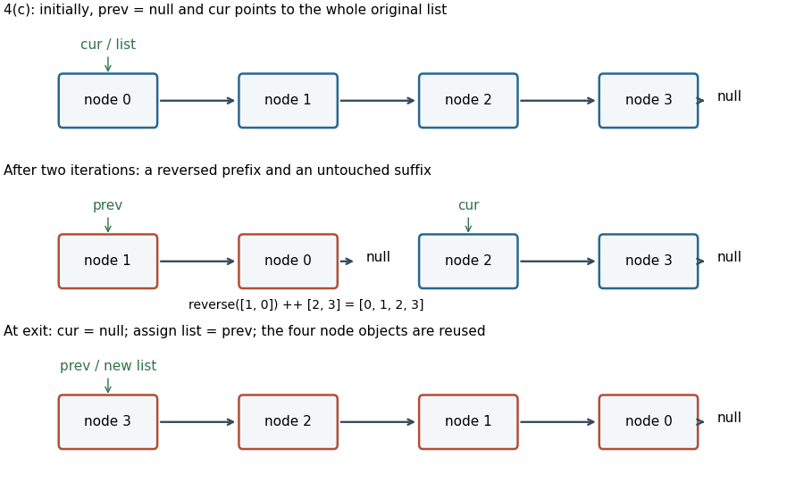

<h1 id="4/c/solution">Solution</h1>

↑ **Parent:** [C](../c.md)

Save the next pointer before redirecting it, then advance the two working heads. No node is allocated and the name/number fields are untouched.

```
def reverseBook(): Unit = {
  var prev: Node = null
  var cur = list
  while (cur != null) {
    val following = cur.next
    cur.next = prev
    prev = cur
    cur = following
  }
  list = prev
}
```

Let $S$ be the original [sequence](../../../../../sequence.md) of node identities, not just their possibly equal field values. Write $P$ for the sequence currently headed by `prev` and $Q$ for that headed by `cur`. A suitable [loop invariant](../../../../../loop-invariant.md) for [in-place linked-list reversal](../../../../../in-place-linked-list-reversal.md) is

$$
\operatorname{reverse}(P)\mathbin{++}Q=S,
$$

with both working lists finite, acyclic, disjoint, together containing exactly the original nodes, and with every name and number unchanged. Here `++` means [concatenation](../../../../../concatenation.md). Initially $P=[]$ and $Q=S$. One iteration takes $q$ from the front of $Q=q:Q'$ and replaces $(P,Q)$ by $(q:P,Q')$. Since $\operatorname{reverse}(q:P)=\operatorname{reverse}(P)\mathbin{++}[q]$, the equation is preserved. Saving `following` before changing `cur.next` retains access to $Q'$.

The [loop variant](../../../../../loop-variant.md) is the length of $Q$, decreasing by one. At exit $Q=[]$, so $P=\operatorname{reverse}(S)$; assigning the head establishes reversal. The empty and singleton cases work without a special branch. The [abstraction function](../../../../../abstraction-function.md) of the phone book ignores order, so it still maps every original name to its original number. **All original node identities are reused**, with $O(K)$ [running time](../../../../../running-time.md) and $O(1)$ [auxiliary space](../../../../../auxiliary-space.md).

<a id="4/c/image-in-place-reversal-preserves-node-identities-while-moving-nodes-from-an-untouched-suffix-into-a-reversed-prefix"></a>


**[Figure 1](#4/c/image-in-place-reversal-preserves-node-identities-while-moving-nodes-from-an-untouched-suffix-into-a-reversed-prefix). In-place reversal preserves node identities while moving nodes from an untouched suffix into a reversed prefix**.

## ↑ Ancestors (12)

1. [C](../c.md)
2. [4](../../4.md)
3. [Imperative programming](../../../imperative-programming-split.md)
4. [2023](../../../split.md)
5. [Past exam of the year 1 of the computer science course of the University of Oxford](../../../../split.md)
6. [Year 1 of the computer science course of the University of Oxford](../../../../../year-1-of-the-computer-science-course-of-the-university-of-oxford.md)
7. [Computer science course of the University of Oxford](../../../../../computer-science-course-of-the-university-of-oxford.md)
8. [Undergraduate course of the University of Oxford](../../../../../undergraduate-course-of-the-university-of-oxford.md)
9. [Course of the University of Oxford](../../../../../course-of-the-university-of-oxford.md)
10. [University of Oxford](../../../../../university-of-oxford-split.md)
11. [List of universities](../../../../../list-of-universities.md)
12. [Codex Wiki](../../../../../split.md)
