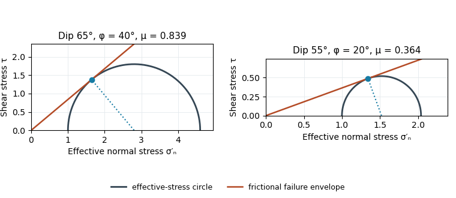

<h1 id="1/b/solution">Solution</h1>

↑ **Parent:** [B](../b.md)

A numerical answer needs an assumption about fault orientation. For a cohesionless fault optimally oriented for [Mohr-Coulomb failure criterion](../../../../../mohr-coulomb-failure-criterion.md), with vertical $\sigma_1$, write $\varphi$ for the [internal friction angle](../../../../../internal-friction-angle.md) and $\delta$ for the [fault dip](../../../../../fault-dip.md). The angle between the plane and $\sigma_1$ is $90^\circ-\delta$, so the [optimal normal-fault dip relation](../../../../../optimal-normal-fault-dip-relation.md) gives

$$
90^\circ-\delta=45^\circ-\frac\varphi2,\qquad
\varphi=2\delta-90^\circ=40^\circ.
$$

Hence **$\mu_f=\tan40^\circ=0.839\simeq0.84$** under that model.

For the [Mohr circle](../../../../../mohr-s-circle.md), plot effective compression $\sigma_n'$ horizontally and [shear stress](../../../../../shear-stress.md) $\tau$ vertically. Draw a circle with diameter $[\sigma_3',\sigma_1']$ tangent to $\tau=\mu_f\sigma_n'$. Its centre and radius obey $R/C=\sin\varphi$. One illustrative normalization is $\sigma_3'=1$, $\sigma_1'=4.59891$, with tangency at the resolved stresses on the $65^\circ$ plane. [Pore fluid pressure](../../../../../pore-fluid-pressure.md) shifts the total-stress circle horizontally; the friction law uses [effective stress](../../../../../effective-stress.md).

**[Figure 1](#1/b/image-original-normalized-mohr-circles-for-optimally-oriented-normal-faults-different-dips-imply-different-tangent-slopes-only-under-the-stated-failure-model). Original normalized Mohr circles for optimally oriented normal faults: different dips imply different tangent slopes only under the stated failure model**.

**The dip does not determine the actual sliding [coefficient of friction](../../../../../coefficient-of-friction.md) without the optimal-orientation assumption.** A reactivated inherited plane may be nonoptimal, [cohesion](../../../../../cohesion.md) may matter, and the stress ratio and [pore fluid pressure](../../../../../pore-fluid-pressure.md) are not measured. For an arbitrary compression-positive stress state,

$$
\mu_f=\frac{(\sigma_1'-\sigma_3')\sin\delta\cos\delta}
{\sigma_1'\cos^2\delta+\sigma_3'\sin^2\delta}
$$

at cohesionless sliding. Thus the requested single value is a conditional inference, not a friction measurement.

## ↑ Ancestors (12)

1. [B](../b.md)
2. [1](../../1.md)
3. [Paper 1](../../../paper-1-split.md)
4. [2022](../../../split.md)
5. [Past exam of the year 2 of the earth sciences (geology) course of the University of Oxford](../../../../split.md)
6. [Year 2 of the earth sciences (geology) course of the University of Oxford](../../../../../year-2-of-the-earth-sciences-geology-course-of-the-university-of-oxford.md)
7. [Earth sciences (geology) course of the University of Oxford](../../../../../earth-sciences-geology-course-of-the-university-of-oxford.md)
8. [Undergraduate course of the University of Oxford](../../../../../undergraduate-course-of-the-university-of-oxford.md)
9. [Course of the University of Oxford](../../../../../course-of-the-university-of-oxford.md)
10. [University of Oxford](../../../../../university-of-oxford-split.md)
11. [List of universities](../../../../../list-of-universities.md)
12. [Codex Wiki](../../../../../split.md)
