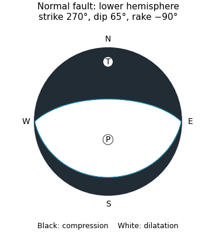

<h1 id="1/d/solution">Solution</h1>

↑ **Parent:** [D](../d.md)

Assuming pure [dip-slip faulting](../../../../../dip-slip-faulting.md), use an east–west striking, $65^\circ$ north-dipping [normal fault](../../../../../normal-fault.md), with the northern [hanging wall](../../../../../hanging-wall.md) moving down dip. In a right-hand-rule strike convention this is **strike $270^\circ$, dip $65^\circ$, rake $-90^\circ$**. The auxiliary [nodal plane](../../../../../nodal-plane-of-a-double-couple.md) strikes east–west and dips $25^\circ$ south. The [focal mechanism](../../../../../focal-mechanism.md) has a predominantly vertical P axis and a predominantly north–south horizontal T axis; the steep central direction is dilatational.

**[Figure 2](#1/d/image-original-lower-hemisphere-normal-fault-focal-mechanism-black-compression-white-dilatation-and-two-alternative-nodal-planes). Original lower-hemisphere normal-fault focal mechanism: black compression, white dilatation, and two alternative nodal planes**.

The sketch is a double-couple [seismic moment tensor](../../../../../seismic-moment-tensor.md) calculation, not a claim that first motions uniquely identify which [nodal plane](../../../../../nodal-plane-of-a-double-couple.md) slipped. The mapped north-dipping surface supplies that additional geological choice.

## ↑ Ancestors (12)

1. [D](../d.md)
2. [1](../../1.md)
3. [Paper 1](../../../paper-1-split.md)
4. [2022](../../../split.md)
5. [Past exam of the year 2 of the earth sciences (geology) course of the University of Oxford](../../../../split.md)
6. [Year 2 of the earth sciences (geology) course of the University of Oxford](../../../../../year-2-of-the-earth-sciences-geology-course-of-the-university-of-oxford.md)
7. [Earth sciences (geology) course of the University of Oxford](../../../../../earth-sciences-geology-course-of-the-university-of-oxford.md)
8. [Undergraduate course of the University of Oxford](../../../../../undergraduate-course-of-the-university-of-oxford.md)
9. [Course of the University of Oxford](../../../../../course-of-the-university-of-oxford.md)
10. [University of Oxford](../../../../../university-of-oxford-split.md)
11. [List of universities](../../../../../list-of-universities.md)
12. [Codex Wiki](../../../../../split.md)
