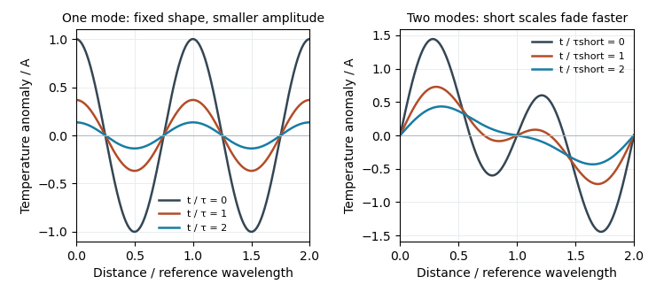

<h1 id="10/b/ii/solution">Solution</h1>

↑ **Parent:** [Ii](../ii.md)

Choose $t_1=1/(\kappa k^2)$ to make the sketch explicit. The three profiles are

$$
T(0,y)=A\cos ky,\qquad T(t_1,y)=Ae^{-1}\cos ky,\qquad
T(2t_1,y)=Ae^{-2}\cos ky.
$$

They have **the same [wavelength](../../../../../../wavelength.md), zero crossings and phase**, with [amplitudes](../../../../../../wave-amplitude.md) $A$, $0.3679A$ and $0.1353A$. [Diffusion](../../../../../../diffusion.md) reduces the [temperature gradient](../../../../../../temperature-gradient.md) and [amplitude](../../../../../../wave-amplitude.md); it does not advect or change this individual mode’s [wavelength](../../../../../../wavelength.md).

**[Figure 6](#10/b/ii/image-original-diffusion-solutions-one-fourier-mode-loses-amplitude-and-a-two-mode-profile-loses-its-short-wavelength-structure-faster). Original diffusion solutions: one Fourier mode loses amplitude, and a two-mode profile loses its short-wavelength structure faster**.

## ↑ Ancestors (13)

1. [Ii](../ii.md)
2. [B](../../b.md)
3. [10](../../../10.md)
4. [Paper 1](../../../../paper-1-split.md)
5. [2022](../../../../split.md)
6. [Past exam of the year 2 of the earth sciences (geology) course of the University of Oxford](../../../../../split.md)
7. [Year 2 of the earth sciences (geology) course of the University of Oxford](../../../../../../year-2-of-the-earth-sciences-geology-course-of-the-university-of-oxford.md)
8. [Earth sciences (geology) course of the University of Oxford](../../../../../../earth-sciences-geology-course-of-the-university-of-oxford.md)
9. [Undergraduate course of the University of Oxford](../../../../../../undergraduate-course-of-the-university-of-oxford.md)
10. [Course of the University of Oxford](../../../../../../course-of-the-university-of-oxford.md)
11. [University of Oxford](../../../../../../university-of-oxford-split.md)
12. [List of universities](../../../../../../list-of-universities.md)
13. [Codex Wiki](../../../../../../split.md)
