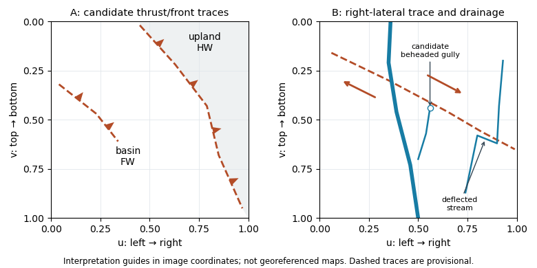

<h1 id="3/d/i/solution">Solution</h1>

↑ **Parent:** [I](../i.md)

Use normalized image coordinates $(u,v)$ within the **map rectangle**, with $(0,0)$ at its upper left and $(1,1)$ at its lower right. A principal candidate [thrust fault](../../../../../../thrust-fault.md) trace follows the sharp, approximately diagonal southwestern edge of the dissected high ground on the right: a practical tracing guide passes near

$$
(0.45,0.02),\ (0.63,0.22),\ (0.79,0.43),\ (0.85,0.68),\ (0.97,0.95).
$$

Mark the **upland, upper-right side as [hanging wall](../../../../../../hanging-wall.md)** and the smoother, lower-left basin side as [footwall](../../../../../../footwall.md) for a thrust dipping beneath the uplands. Use broken lines through the gaps, not one asserted continuous exposed rupture. A subsidiary candidate frontal segment follows the basin-facing edge of the isolated dissected ridge on the left, approximately $(0.04,0.32)$ through $(0.23,0.47)$ to $(0.34,0.61)$; place teeth toward its locally higher ridge side.

**[Figure 3](#3/d/i/image-original-interpretation-guides-for-both-attachments-provisional-traces-block-motion-and-drainage-markers-in-normalized-image-coordinates). Original interpretation guides for both attachments: provisional traces, block motion and drainage markers in normalized image coordinates**.

These are geomorphic interpretations of mountain fronts and scarps, not measured subsurface dip directions. On a conventional north-up reading the principal trend is broadly northwest–southeast, but the supplied map has no north arrow: the image-relative coordinates are the reproducible identification. Southwestern illumination means southwest-facing slopes are bright; brightness is a slope-orientation clue, not an elevation contour. Some aligned relief may be a [fold scarp](../../../../../../fold-scarp.md) or an eroded [lithological contact](../../../../../../lithological-contact.md), so field confirmation and topographic profiles would test the candidate traces.

## ↑ Ancestors (13)

1. [I](../i.md)
2. [D](../../d.md)
3. [3](../../../3.md)
4. [Paper 1](../../../../paper-1-split.md)
5. [2022](../../../../split.md)
6. [Past exam of the year 2 of the earth sciences (geology) course of the University of Oxford](../../../../../split.md)
7. [Year 2 of the earth sciences (geology) course of the University of Oxford](../../../../../../year-2-of-the-earth-sciences-geology-course-of-the-university-of-oxford.md)
8. [Earth sciences (geology) course of the University of Oxford](../../../../../../earth-sciences-geology-course-of-the-university-of-oxford.md)
9. [Undergraduate course of the University of Oxford](../../../../../../undergraduate-course-of-the-university-of-oxford.md)
10. [Course of the University of Oxford](../../../../../../course-of-the-university-of-oxford.md)
11. [University of Oxford](../../../../../../university-of-oxford-split.md)
12. [List of universities](../../../../../../list-of-universities.md)
13. [Codex Wiki](../../../../../../split.md)
