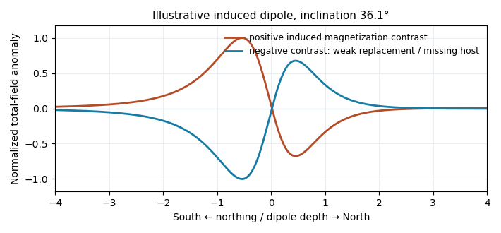

<h1 id="5/d/solution">Solution</h1>

↑ **Parent:** [D](../d.md)

At low northern latitude, a simple induced [total-field magnetic anomaly](../../../../../total-field-magnetic-anomaly.md) is generally **asymmetric and bipolar**, not a symmetric central positive peak. A compact body more magnetic than its surroundings, magnetized parallel to a northward, downward ambient field, gives its principal positive lobe on the southern side and a negative lobe toward the north. At exactly zero [magnetic inclination](../../../../../magnetic-inclination.md) its central anomaly reverses relative to the pole; latitude and survey orientation must therefore be included.[Line-profile examples 1–5: latitude, profile orientation and remanence effects](../../../../../magnetic-line-profiles-by-ubc-geophysical-inversion-facility.md)

For an original explicit sketch, put a dipole at depth $d$ and let $x$ increase northward. In a north–south vertical section with inducing inclination $I$, an [induced magnetization](../../../../../induced-magnetization.md) parallel to the ambient field gives

$$
\Delta B(x)\ \propto\ \Delta M\,
\frac{3(x\cos I-d\sin I)^2-(x^2+d^2)}{(x^2+d^2)^{5/2}}.
$$

A geocentric-dipole approximation at latitude $20^\circ$ gives $I\simeq\arctan(2\tan20^\circ)=36.1^\circ$, only an illustrative field direction, not a measured local value.

**[Figure 4](#5/d/image-original-induced-dipole-profiles-a-positive-magnetic-body-and-an-excavated-or-weakly-magnetized-replacement-give-opposite-signs-at-the-same-field-inclination). Original induced-dipole profiles: a positive magnetic body and an excavated or weakly magnetized replacement give opposite signs at the same field inclination**.

For the actual crater, breccia, water and [sediment](../../../../../sediment.md) may replace more magnetic [basalt](../../../../../basalt.md), giving **negative [magnetization contrast](../../../../../magnetization-contrast.md)**. In that case reverse the simple positive-body sketch: a dominant southern low and a northern high are possible even with purely induced contrasts. The magnetic sign cannot be inferred from density or from the word “crater” alone.

## ↑ Ancestors (12)

1. [D](../d.md)
2. [5](../../5.md)
3. [Paper 1](../../../paper-1-split.md)
4. [2022](../../../split.md)
5. [Past exam of the year 2 of the earth sciences (geology) course of the University of Oxford](../../../../split.md)
6. [Year 2 of the earth sciences (geology) course of the University of Oxford](../../../../../year-2-of-the-earth-sciences-geology-course-of-the-university-of-oxford.md)
7. [Earth sciences (geology) course of the University of Oxford](../../../../../earth-sciences-geology-course-of-the-university-of-oxford.md)
8. [Undergraduate course of the University of Oxford](../../../../../undergraduate-course-of-the-university-of-oxford.md)
9. [Course of the University of Oxford](../../../../../course-of-the-university-of-oxford.md)
10. [University of Oxford](../../../../../university-of-oxford-split.md)
11. [List of universities](../../../../../list-of-universities.md)
12. [Codex Wiki](../../../../../split.md)
