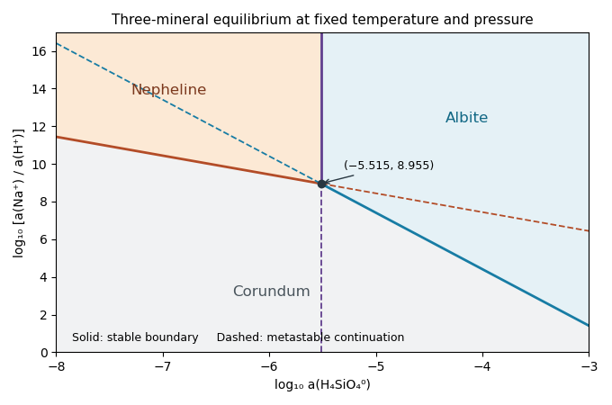

<h1 id="8/i/solution">Solution</h1>

↑ **Parent:** [I](../i.md)

Set $x=\log_{10}a_{\mathrm{H_4SiO_4^0}}$ and $y=\log_{10}(a_{\mathrm{Na^+}}/a_{\mathrm{H^+}})$, treating the supplied concentration notation as an ideal-dilute activity approximation. For pure solids and unit water activity, the first [chemical equilibrium](../../../../../chemical-equilibrium.md) relation gives $\log K_a=2y+2x$ and the second gives $\log K_b=2y+6x$. Thus plot

$$
\boxed{y=3.44-x\quad(\text{nepheline–corundum}),}
$$

$$
\boxed{y=-7.59-3x\quad(\text{albite–corundum}).}
$$

Their [slopes](../../../../../slope.md) are $-1$ and $-3$ respectively. They intersect at **$(x_*,y_*)=(-5.515,8.955)$**. Both the relevant silica activities and the intersection lie at negative $x$, as expected for a dilute aqueous silica species.

**[Figure 5](#8/i/image-original-activity-diagram-solid-stable-boundaries-dashed-metastable-continuations-and-three-mineral-stability-fields). Original activity diagram: solid stable boundaries, dashed metastable continuations, and three mineral stability fields**.

## ↑ Ancestors (12)

1. [I](../i.md)
2. [8](../../8.md)
3. [Paper 1](../../../paper-1-split.md)
4. [2022](../../../split.md)
5. [Past exam of the year 2 of the earth sciences (geology) course of the University of Oxford](../../../../split.md)
6. [Year 2 of the earth sciences (geology) course of the University of Oxford](../../../../../year-2-of-the-earth-sciences-geology-course-of-the-university-of-oxford.md)
7. [Earth sciences (geology) course of the University of Oxford](../../../../../earth-sciences-geology-course-of-the-university-of-oxford.md)
8. [Undergraduate course of the University of Oxford](../../../../../undergraduate-course-of-the-university-of-oxford.md)
9. [Course of the University of Oxford](../../../../../course-of-the-university-of-oxford.md)
10. [University of Oxford](../../../../../university-of-oxford-split.md)
11. [List of universities](../../../../../list-of-universities.md)
12. [Codex Wiki](../../../../../split.md)
