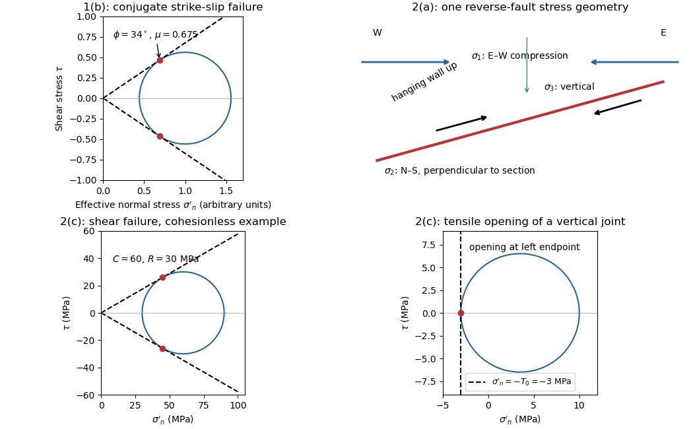
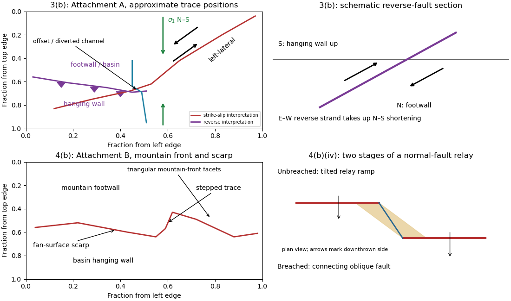
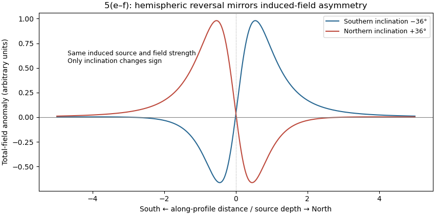
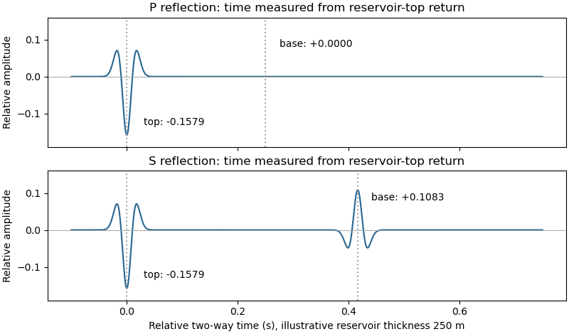
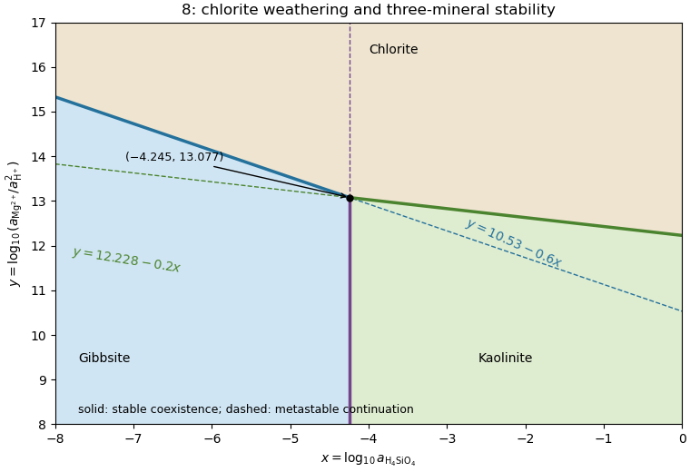
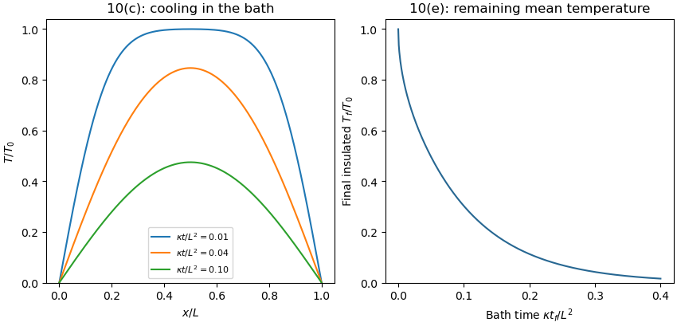

# Paper 1

↑ **Parent:** [2023](../2023.md)

Worked solutions for the held Oxford second-year Earth Sciences examination of 1 June 2023. Source release: [released question paper and Attachments A and B](https://www.whatdotheyknow.com/request/earth_science_past_papers_and_ex/response/3419815/attach/4/Papers.zip?cookie_passthrough=1). The examination asks candidates to choose one question from each of six sections; every available numbered alternative is addressed here. These are derived solutions, with no question statements reproduced.

**Source gap: Attachment C, referenced for Question 9, is absent from the held release.** The printed summary table permits numerical calculations, but parts 9(d–e) remain explicitly provisional until that attachment and any conventions it supplied are checked. Attachments A and B are available and are treated as supporting material for Questions 3 and 4. Image positions below use fractions of the map frame, excluding page margins. The repeated salt-velocity subscript in Question 6 and the circular reference in Question 10 are documented where they affect the solution.

**Table of contents**

- [1](#1)
  - [a](#1/a)
    - [Solution](#1/a/solution)
  - [b](#1/b)
    - [Solution](#1/b/solution)
  - [c](#1/c)
    - [Solution](#1/c/solution)
  - [d](#1/d)
    - [Solution](#1/d/solution)
  - [e](#1/e)
    - [Solution](#1/e/solution)
- [2](#2)
  - [a](#2/a)
    - [Solution](#2/a/solution)
  - [b](#2/b)
    - [Solution](#2/b/solution)
  - [c](#2/c)
    - [Solution](#2/c/solution)
  - [d](#2/d)
    - [Solution](#2/d/solution)
  - [e](#2/e)
    - [Solution](#2/e/solution)
- [3](#3)
  - [a](#3/a)
    - [Solution](#3/a/solution)
  - [b](#3/b)
    - [i](#3/b/i)
      - [Solution](#3/b/i/solution)
    - [ii](#3/b/ii)
      - [Solution](#3/b/ii/solution)
    - [iii](#3/b/iii)
      - [Solution](#3/b/iii/solution)
    - [iv](#3/b/iv)
      - [Solution](#3/b/iv/solution)
    - [v](#3/b/v)
      - [Solution](#3/b/v/solution)
- [4](#4)
  - [a](#4/a)
    - [Solution](#4/a/solution)
  - [b](#4/b)
    - [i](#4/b/i)
      - [Solution](#4/b/i/solution)
    - [ii](#4/b/ii)
      - [Solution](#4/b/ii/solution)
    - [iii](#4/b/iii)
      - [Solution](#4/b/iii/solution)
    - [iv](#4/b/iv)
      - [Solution](#4/b/iv/solution)
- [5](#5)
  - [a](#5/a)
    - [Solution](#5/a/solution)
  - [b](#5/b)
    - [Solution](#5/b/solution)
  - [c](#5/c)
    - [Solution](#5/c/solution)
  - [d](#5/d)
    - [Solution](#5/d/solution)
  - [e](#5/e)
    - [Solution](#5/e/solution)
  - [f](#5/f)
    - [Solution](#5/f/solution)
- [6](#6)
  - [a](#6/a)
    - [Solution](#6/a/solution)
  - [b](#6/b)
    - [Solution](#6/b/solution)
  - [c](#6/c)
    - [Solution](#6/c/solution)
  - [d](#6/d)
    - [Solution](#6/d/solution)
  - [e](#6/e)
    - [Solution](#6/e/solution)
  - [f](#6/f)
    - [Solution](#6/f/solution)
  - [g](#6/g)
    - [Solution](#6/g/solution)
  - [h](#6/h)
    - [Solution](#6/h/solution)
  - [i](#6/i)
    - [Solution](#6/i/solution)
  - [j](#6/j)
    - [Solution](#6/j/solution)
  - [k](#6/k)
    - [Solution](#6/k/solution)
  - [l](#6/l)
    - [Solution](#6/l/solution)
  - [m](#6/m)
    - [Solution](#6/m/solution)
  - [n](#6/n)
    - [Solution](#6/n/solution)
  - [o](#6/o)
    - [Solution](#6/o/solution)
  - [p](#6/p)
    - [Solution](#6/p/solution)
  - [q](#6/q)
    - [Solution](#6/q/solution)
- [7](#7)
  - [a](#7/a)
    - [Solution](#7/a/solution)
  - [b](#7/b)
    - [Solution](#7/b/solution)
  - [c](#7/c)
    - [Solution](#7/c/solution)
  - [d](#7/d)
    - [Solution](#7/d/solution)
- [8](#8)
  - [a](#8/a)
    - [i](#8/a/i)
      - [Solution](#8/a/i/solution)
    - [ii](#8/a/ii)
      - [Solution](#8/a/ii/solution)
  - [b](#8/b)
    - [Solution](#8/b/solution)
  - [c](#8/c)
    - [Solution](#8/c/solution)
- [9](#9)
  - [a](#9/a)
    - [Solution](#9/a/solution)
  - [b](#9/b)
    - [Solution](#9/b/solution)
  - [c](#9/c)
    - [Solution](#9/c/solution)
  - [d](#9/d)
    - [Solution](#9/d/solution)
  - [e](#9/e)
    - [Solution](#9/e/solution)
  - [f](#9/f)
    - [Solution](#9/f/solution)
- [10](#10)
  - [a](#10/a)
    - [i](#10/a/i)
      - [Solution](#10/a/i/solution)
    - [ii](#10/a/ii)
      - [Solution](#10/a/ii/solution)
  - [b](#10/b)
    - [i](#10/b/i)
      - [Solution](#10/b/i/solution)
    - [ii](#10/b/ii)
      - [Solution](#10/b/ii/solution)
  - [c](#10/c)
    - [Solution](#10/c/solution)
  - [d](#10/d)
    - [Solution](#10/d/solution)
  - [e](#10/e)
    - [Solution](#10/e/solution)
- [11](#11)
  - [a](#11/a)
    - [Solution](#11/a/solution)
  - [b](#11/b)
    - [Solution](#11/b/solution)
  - [c](#11/c)
    - [Solution](#11/c/solution)
- [12](#12)
  - [a](#12/a)
    - [Solution](#12/a/solution)
  - [b](#12/b)
    - [Solution](#12/b/solution)
  - [c](#12/c)
    - [Solution](#12/c/solution)
  - [d](#12/d)
    - [Solution](#12/d/solution)

## 1

↑ **Parent:** [Paper 1](paper-1.md)

Section A: Earthquakes and Faulting.

<h3 id="1/a">a</h3>

↑ **Parent:** [1](#1)

<h4 id="1/a/solution">Solution</h4>

↑ **Parent:** [A](#1/a)

**The [fault dips](../../geophysics.md#fault-dip) are approximately $90^\circ$.** The mapped senses of [fault slip](../../geophysics.md#fault-slip) are predominantly [strike-slip faulting](../../geophysics.md#strike-slip-faulting). In an [Andersonian faulting regime](../../geophysics.md#andersonian-faulting-regime), the intermediate [principal stress](../../continuum-mechanics.md#principal-stress) $\sigma_2$ is vertical and the maximum and minimum [principal stresses](../../continuum-mechanics.md#principal-stress) $\sigma_1,\sigma_3$ are horizontal, so the preferred [fault planes](../../geophysics.md#fault-plane) are vertical. Local bends can introduce [oblique-slip faulting](../../geophysics.md#oblique-slip-faulting) without changing this first-order interpretation.

<h3 id="1/b">b</h3>

↑ **Parent:** [1](#1)

<h4 id="1/b/solution">Solution</h4>

↑ **Parent:** [B](#1/b)

Treat the two strands as newly formed [conjugate faults](../../geophysics.md#conjugate-fault) obeying the same [Mohr-Coulomb failure criterion](../../continuum-mechanics.md#mohr-coulomb-failure-criterion), rather than merely inherited [faults](../../geophysics.md#geological-fault) reactivated in a later [stress](../../continuum-mechanics.md#stress) field. A [fault strike](../../geophysics.md#fault-strike) is an unoriented line, so $296^\circ$ is equivalent to $116^\circ$. The acute angle between the [fault strikes](../../geophysics.md#fault-strike) is therefore $116^\circ-60^\circ=56^\circ$. The formal compressive acute bisector puts $\sigma_1$ at azimuth $88^\circ$ and $\sigma_3$ at $178^\circ$. This orientation must also be checked against the mapped senses of [strike-slip faulting](../../geophysics.md#strike-slip-faulting), as discussed below.

Let $\beta=28^\circ$ be the angle between either [fault plane](../../geophysics.md#fault-plane) and $\sigma_1$. Tangency of [Mohr's circle](../../continuum-mechanics.md#mohr-s-circle) to $|\tau|=c+\mu\sigma'_n$, where $\sigma'_n$ is [effective stress](../../continuum-mechanics.md#effective-stress) normal to the plane and $c$ is [cohesion](../../continuum-mechanics.md#cohesion), gives $\beta=45^\circ-\phi/2$ and $\mu=\tan\phi$. Thus

$$
\phi=90^\circ-56^\circ=34^\circ,\qquad \boxed{\mu=\tan34^\circ\simeq0.675}.
$$

In the [Mohr circle](../../continuum-mechanics.md#mohr-s-circle), the [fault planes](../../geophysics.md#fault-plane) are $112^\circ$ apart around the circle, because a physical plane rotation is doubled. The figure uses $c=0$ to display both tangencies; a common nonzero [cohesion](../../continuum-mechanics.md#cohesion) changes the intercept, not the inferred [friction angle](../../force.md#friction-angle). The inference of $\mu$ requires optimally oriented [conjugate faults](../../geophysics.md#conjugate-fault) at formation: the two [fault strikes](../../geophysics.md#fault-strike) alone cannot measure a friction coefficient for arbitrarily reactivated [faults](../../geophysics.md#geological-fault).

**Consistency limitation:** the mapped westward motion of the Anatolian block corresponds to [left-lateral strike-slip faulting](../../geophysics.md#left-lateral-strike-slip-faulting) on the East Anatolian strand and [right-lateral strike-slip faulting](../../geophysics.md#right-lateral-strike-slip-faulting) on the North Anatolian strand. East–west maximum compression for the acute-bisector construction instead predicts the opposite pair. The stress orientation compatible with the mapped senses lies near the north–south, obtuse bisector; the planes are then about $62^\circ$ from $\sigma_1$, which would give $\phi=90^\circ-2(62^\circ)=-34^\circ$ in the optimal-formation formula. A negative friction angle is inadmissible for ordinary frictional strength. Thus **$0.675$ is the formal magnitude inferred from unoriented angles, while the full map does not support a self-consistent positive-friction, optimally formed conjugate pair**. The common-stress assumption can still describe inherited or anisotropically controlled [faults](../../geophysics.md#geological-fault), but then their orientations no longer determine a unique coefficient.

**[Figure 1](#1/b/image-conjugate-fault-friction-reverse-fault-stress-directions-and-shear-versus-tensile-failure). Conjugate-fault friction, reverse-fault stress directions, and shear versus tensile failure**.

<h3 id="1/c">c</h3>

↑ **Parent:** [1](#1)

<h4 id="1/c/solution">Solution</h4>

↑ **Parent:** [C](#1/c)

For a heterogeneous [fault slip](../../geophysics.md#fault-slip) distribution, [seismic moment](../../wave-equation.md#seismic-moment) is

$$
M_0=G\int_A D\,dA=GA\overline D,
$$

where $G=30\times10^9\ \mathrm{Pa}$ is the [shear modulus](../../elasticity-physics.md#shear-modulus), $A$ the [fault plane](../../geophysics.md#fault-plane) area, and $\overline D$ the area-averaged [fault slip](../../geophysics.md#fault-slip). The peak colour cannot be used as $\overline D$: most of the illustrated [fault plane](../../geophysics.md#fault-plane) has much smaller [fault slip](../../geophysics.md#fault-slip).

One reproducible graphical estimate divides the approximately $190\ \mathrm{km}$ long and $40\ \mathrm{km}$ down-dip panel into seven $25\ \mathrm{km}$ strips and a final $15\ \mathrm{km}$ strip. Reading area averages from the colour scale, from southwest to northeast, gives roughly $1.7,2.7,3.1,1.8,1.9,1.7,1.0,0.3\ \mathrm m$. This includes the pale, nearly unslipped lower part of each strip. Hence

$$
\int_A D\,dA\simeq40\{25(1.7+2.7+3.1+1.8+1.9+1.7+1.0)+15(0.3)\}\ \mathrm{km^2\,m}\simeq1.4\times10^{10}\ \mathrm{m^3},
$$

and **$M_0\simeq4.2\times10^{20}\ \mathrm{N\,m}$**. A reasonable graphical range is approximately $3$–$6\times10^{20}\ \mathrm{N\,m}$, dominated by colour averaging and the down-dip extent of small [fault slip](../../geophysics.md#fault-slip). The corresponding [moment magnitude](../../geophysics.md#moment-magnitude) is about $M_w=7.7$, using $M_w=\frac23(\log_{10}(M_0/\mathrm{N\,m})-9.1)$. This is an estimate from the supplied distribution, rather than a substitution of a catalogued [earthquake](../../geophysics.md#earthquake) magnitude.

<h3 id="1/d">d</h3>

↑ **Parent:** [1](#1)

<h4 id="1/d/solution">Solution</h4>

↑ **Parent:** [D](#1/d)

[Effective stress](../../continuum-mechanics.md#effective-stress) and frictional strength generally increase with depth through the shallow crust undergoing [brittle fracture](../../elasticity-physics.md#brittle-fracture). At $1\ \mathrm{km}$, small overburden and often weak, fractured near-surface materials limit the [shear stress](../../viscous-fluid-flow.md#shear-stress) and [elastic energy](../../elasticity-physics.md#elastic-energy) that can accumulate. Some shallow materials also undergo stable sliding rather than unstable [earthquake](../../geophysics.md#earthquake) nucleation. Near $15\ \mathrm{km}$, a locked [fault](../../geophysics.md#geological-fault) prone to [brittle fracture](../../elasticity-physics.md#brittle-fracture) can sustain a much larger [differential stress](../../continuum-mechanics.md#differential-stress) before frictional instability releases stored [elastic energy](../../elasticity-physics.md#elastic-energy).

This depth is plausibly near the lower, strong part of the seismogenic layer: below it, increasing [temperature](../../temperature.md) eventually promotes [material creep](../../engineering.md#creep-deformation) across the [brittle-ductile transition](../../engineering.md#brittle-ductile-transition). Once nucleated at depth, a dynamic [finite-source rupture](../../geophysics.md#finite-source-rupture) can propagate into shallow regions that could not independently nucleate the same event. Depth alone does not determine the nucleation point: local [pore pressure](../../porous-media-flow.md#pore-pressure), frictional stability and [stress](../../continuum-mechanics.md#stress) heterogeneity also matter.

<h3 id="1/e">e</h3>

↑ **Parent:** [1](#1)

<h4 id="1/e/solution">Solution</h4>

↑ **Parent:** [E](#1/e)

The star is near the southwestern end of the main [fault slip](../../geophysics.md#fault-slip) patch, so a much longer part of the [finite-source rupture](../../geophysics.md#finite-source-rupture) propagates northeastward. For comparable distances, ground conditions and buildings, **the northeastern site receives the stronger, shorter direct pulse; the southwestern site receives the weaker, longer direct shaking**. This is [rupture directivity](../../geophysics.md#rupture-directivity).[Explanation of focusing by successive rupture elements](../../physics-bibliography.md#what-is-directivity-by-united-states-geological-survey)

For a segment of length $\ell$, [rupture velocity](../../geophysics.md#rupture-velocity) $v_r$ and [seismic wave](../../geophysics.md#seismic-wave) speed $c>v_r$, successive arrival times span approximately

$$
\Delta t_{\rm forward}=\ell(1/v_r-1/c),\qquad \Delta t_{\rm backward}=\ell(1/v_r+1/c).
$$

Forward arrivals overlap and concentrate [energy](../../energy.md) into a shorter pulse. Backward arrivals spread out. The supplied [finite-source rupture](../../geophysics.md#finite-source-rupture) is not perfectly unilateral, so the prediction concerns the dominant contribution. [Seismic radiation patterns](../../wave-equation.md#seismic-radiation-pattern), [seismic attenuation](../../geophysics.md#seismic-attenuation), sediment amplification and building response can alter the ranking of actual damage or total coda duration.

## 2

↑ **Parent:** [Paper 1](paper-1.md)

<h3 id="2/a">a</h3>

↑ **Parent:** [2](#2)

<h4 id="2/a/solution">Solution</h4>

↑ **Parent:** [A](#2/a)

The offset layered sequence indicates **reverse slip on the west-dipping [fault](../../geophysics.md#geological-fault)**: its western [hanging wall](../../geophysics.md#hanging-wall) moved up relative to the eastern [footwall](../../geophysics.md#footwall). With the [fault strike](../../geophysics.md#fault-strike) perpendicular to the east–west image plane, an [Andersonian faulting regime](../../geophysics.md#andersonian-faulting-regime) has $\sigma_1$ horizontal east–west, $\sigma_2$ horizontal north–south, and $\sigma_3$ vertical. Draw opposing compression arrows east–west and a smaller opposing pair vertically; the intermediate pair points into and out of the page.

For example, in east, north, up coordinates, a compression-positive [effective stress](../../continuum-mechanics.md#effective-stress) tensor consistent with a $30^\circ$ [reverse fault](../../geophysics.md#reverse-fault) and zero [cohesion](../../continuum-mechanics.md#cohesion) is

$$
\boldsymbol\sigma'=\begin{pmatrix}90&0&0\\0&60&0\\0&0&30\end{pmatrix}\ \mathrm{MPa}.
$$

These magnitudes illustrate one possible [stress tensor](../../continuum-mechanics.md#cauchy-stress-tensor), rather than a measurement from the photograph. With $\mu=1/\sqrt3$, the $\sigma_1$–$\sigma_3$ [Mohr circle](../../continuum-mechanics.md#mohr-s-circle) is tangent to the [Mohr-Coulomb failure criterion](../../continuum-mechanics.md#mohr-coulomb-failure-criterion) at a plane $30^\circ$ from horizontal. The original failure-mechanics figure above sketches these [principal stress](../../continuum-mechanics.md#principal-stress) directions.

<h3 id="2/b">b</h3>

↑ **Parent:** [2](#2)

<h4 id="2/b/solution">Solution</h4>

↑ **Parent:** [B](#2/b)

Interpret the vertical, apparently unoffset fractures as opening [geological joints](../../planetary-science.md#geological-joint). Their normals are east–west, so the least [principal stress](../../continuum-mechanics.md#principal-stress) $\sigma_3$ must be east–west and sufficiently tensile in [effective stress](../../continuum-mechanics.md#effective-stress). The other two [principal stresses](../../continuum-mechanics.md#principal-stress) lie within the vertical north–south [geological joint](../../planetary-science.md#geological-joint) plane; their ordering cannot be recovered from this fracture orientation alone.

One example, with compression positive and coordinates east, north, up, is

$$
\boldsymbol\sigma'=\begin{pmatrix}-3&0&0\\0&5&0\\0&0&10\end{pmatrix}\ \mathrm{MPa}.
$$

Here $\sigma_1$ is vertical, $\sigma_2$ north–south, and $\sigma_3=-3\ \mathrm{MPa}$ east–west. The [geological joint](../../planetary-science.md#geological-joint) opens east–west when its [tensile strength](../../engineering.md#tensile-strength) is $3\ \mathrm{MPa}$. An isotropic [pore pressure](../../porous-media-flow.md#pore-pressure) can make the east–west [effective stress](../../continuum-mechanics.md#effective-stress) tensile even while the total [normal stress](../../continuum-mechanics.md#normal-stress) remains compressive. Draw opening arrows pointing away from the vertical fracture, rather than sliding arrows along it.

<h3 id="2/c">c</h3>

↑ **Parent:** [2](#2)

<h4 id="2/c/solution">Solution</h4>

↑ **Parent:** [C](#2/c)

Use compression-positive [effective stress](../../continuum-mechanics.md#effective-stress) normal to the plane $\sigma'_n$ on the horizontal axis and [shear stress](../../viscous-fluid-flow.md#shear-stress) $\tau$ on the vertical axis. For any chosen pair of [principal stresses](../../continuum-mechanics.md#principal-stress), [Mohr's circle](../../continuum-mechanics.md#mohr-s-circle) has centre $C=(\sigma'_1+\sigma'_3)/2$ and radius $R=(\sigma'_1-\sigma'_3)/2$.

For the [reverse fault](../../geophysics.md#reverse-fault) example, $C=60\ \mathrm{MPa}$ and $R=30\ \mathrm{MPa}$. Draw the two [Mohr-Coulomb failure criterion](../../continuum-mechanics.md#mohr-coulomb-failure-criterion) lines $\tau=\pm\sigma'_n/\sqrt3$. The tangencies are

$$
(\sigma'_n,\tau)=(45,\pm15\sqrt3)\ \mathrm{MPa}.
$$

These are [shear failure](../../elasticity-physics.md#shear-failure) points with nonzero [shear stress](../../viscous-fluid-flow.md#shear-stress). The two smaller three-dimensional [Mohr circles](../../continuum-mechanics.md#mohr-s-circle) use $(\sigma'_1,\sigma'_2)$ and $(\sigma'_2,\sigma'_3)$; they lie inside the outer circle and do not touch the envelope in this example.

For the opening [geological joints](../../planetary-science.md#geological-joint), use the [tensile failure criterion](../../elasticity-physics.md#tensile-failure-criterion) $\sigma'_n=-T_0$. The example gives $C=3.5\ \mathrm{MPa}$, $R=6.5\ \mathrm{MPa}$ and $T_0=3\ \mathrm{MPa}$. The circle first touches this vertical cutoff at **$(\sigma'_n,\tau)=(-3,0)\ \mathrm{MPa}$**. Thus the [geological joints](../../planetary-science.md#geological-joint) form on planes normal to $\sigma_3$ and have zero resolved [shear stress](../../viscous-fluid-flow.md#shear-stress). A complete brittle envelope can combine this tensile cutoff with compressive [Mohr-Coulomb failure criterion](../../continuum-mechanics.md#mohr-coulomb-failure-criterion), using sufficient [cohesion](../../continuum-mechanics.md#cohesion) that shear failure does not occur first. The failure-mechanics figure displays these two distinct constructions.

<h3 id="2/d">d</h3>

↑ **Parent:** [2](#2)

<h4 id="2/d/solution">Solution</h4>

↑ **Parent:** [D](#2/d)

The [reverse fault](../../geophysics.md#reverse-fault) requires strong east–west compression; the vertical opening [geological joints](../../planetary-science.md#geological-joint) require the least [principal stress](../../continuum-mechanics.md#principal-stress) in the [effective stress](../../continuum-mechanics.md#effective-stress) tensor east–west. **They need not have formed at the same time or under the same local [stress](../../continuum-mechanics.md#stress) field.** Compression can form the [reverse fault](../../geophysics.md#reverse-fault) during burial and [crustal shortening](../../geophysics.md#crustal-shortening); subsequent [tectonic exhumation](../../planetary-science.md#tectonic-exhumation), unloading, relaxation, cooling or another tectonic episode can rotate the [principal stress](../../continuum-mechanics.md#principal-stress) ordering and permit opening [geological joints](../../planetary-science.md#geological-joint).

Furthermore, local [stress](../../continuum-mechanics.md#stress) near [faults](../../geophysics.md#geological-fault), layer interfaces and topography can differ from the regional [stress](../../continuum-mechanics.md#stress). A high [pore pressure](../../porous-media-flow.md#pore-pressure) shifts every [Mohr circle](../../continuum-mechanics.md#mohr-s-circle) left by $p$, helping [tensile failure](../../elasticity-physics.md#tensile-failure-criterion), but isotropic [pore pressure](../../porous-media-flow.md#pore-pressure) alone cannot exchange the east–west and vertical [principal stress](../../continuum-mechanics.md#principal-stress) ordering. Determine relative timing using cross-cutting relations, offsets of [geological joints](../../planetary-science.md#geological-joint), and any generations of fracture-filling [minerals](../../planetary-science.md#mineral). Spatial coexistence is therefore evidence of a deformation history, rather than a requirement that the two failure diagrams describe one simultaneous homogeneous [stress](../../continuum-mechanics.md#stress) state.

<h3 id="2/e">e</h3>

↑ **Parent:** [2](#2)

<h4 id="2/e/solution">Solution</h4>

↑ **Parent:** [E](#2/e)

Within a shallow [fault zone](../../geophysics.md#fault-zone) undergoing [brittle fracture](../../elasticity-physics.md#brittle-fracture), repeated sliding crushes and grinds grains. Expect [fault gouge](../../geophysics.md#fault-gouge), potentially rich in fine [clay minerals](../../planetary-science.md#clay-mineral), and coarser angular [fault breccia](../../geophysics.md#fault-breccia); a cohesive, cemented crushed rock is a [cataclasite](../../geophysics.md#cataclasite). [Slickensides](../../geophysics.md#slickenside) or displaced grains can record the sliding direction.

An opening [geological joint](../../planetary-science.md#geological-joint) need not contain any [fault rock](../../geophysics.md#fault-rock): it may be an open crack. If fluids circulated, it can contain a [mineral vein](../../planetary-science.md#mineral-vein), for example [calcite](../../chemical-substance.md#calcite) or [quartz](../../chemical-substance.md#quartz), grown from the fracture walls. Thus **comminuted [fault rock](../../geophysics.md#fault-rock) supports shear, while open space or a crack-filling [mineral vein](../../planetary-science.md#mineral-vein) supports opening**. Mineral filling is conditional on fluid chemistry and timing; its precise composition cannot be inferred from the photograph.

## 3

↑ **Parent:** [Paper 1](paper-1.md)

Section B: Remote Sensing and Active Tectonics.

<h3 id="3/a">a</h3>

↑ **Parent:** [3](#3)

<h4 id="3/a/solution">Solution</h4>

↑ **Parent:** [A](#3/a)

Use calibrated [multispectral imaging](../../radiometry.md#multispectral-imaging) of reflected sunlight, with visible, near-infrared and short-wave-infrared bands. A satellite records [radiance](../../radiometry.md#radiance) in several passbands for each ground pixel. Perform geometric registration and [atmospheric correction](../../radiometry.md#atmospheric-correction) to estimate [spectral reflectance](../../radiometry.md#spectral-reflectance), then account for illumination differences on slopes and mask cloud, water and dense vegetation. A [false-colour composite](../../radiometry.md#false-colour-composite), diagnostic band ratios or a trained [statistical classification](../../artificial-intelligence.md#statistical-classification) can separate surface [lithologies](../../planetary-science.md#lithology); field observations and representative spectra validate any mapped contact.

Different [minerals](../../planetary-science.md#mineral) have different absorption features: iron-bearing materials affect visible/near-infrared [spectral reflectance](../../radiometry.md#spectral-reflectance), while hydroxyl-bearing [clay minerals](../../planetary-science.md#clay-mineral) and carbonate-bearing rocks can differ in short-wave-infrared bands. Adjacent patches with reproducibly different spectra and coherent geological boundaries are candidates for [lithological contacts](../../planetary-science.md#lithological-contact). This is particularly useful in dry, exposed terrain. Vegetation, soil cover, similar rock compositions, weathering and topographic shadow can hide or mimic a contact; a colour boundary alone is insufficient.

Choose [spatial resolution](../../optics.md#spatial-resolution) appreciably finer than the narrowest unit being mapped, with several pixels across that unit. Approximately $10$–$30\ \mathrm m$ is suitable for regional contacts separated by hundreds of metres; metre-scale units require finer imagery or field work. [Sentinel-2](../../radiometry.md#sentinel-2) provides $10$–$20\ \mathrm m$ bands useful for this purpose, while the reflected-light multispectral bands of [Landsat](../../radiometry.md#landsat) are typically $30\ \mathrm m$. Broad multispectral passbands distinguish many rock assemblages but cannot resolve every narrow [mineral](../../planetary-science.md#mineral) absorption feature; [hyperspectral imaging](../../radiometry.md#hyperspectral-imaging) is preferable when those features are essential.

<h3 id="3/b">b</h3>

↑ **Parent:** [3](#3)

<h4 id="3/b/i">i</h4>

↑ **Parent:** [B](#3/b)

<h5 id="3/b/i/solution">Solution</h5>

↑ **Parent:** [I](#3/b/i)

A [displaced drainage](../../planetary-science.md#displaced-drainage) forms when repeated horizontal [fault slip](../../geophysics.md#fault-slip) offsets a channel and its upstream and downstream reaches no longer line up. In plan view, draw two initially continuous channel reaches crossing the [fault](../../geophysics.md#geological-fault), translate one side parallel to the [fault strike](../../geophysics.md#fault-strike), and connect the reaches by a short fault-parallel reach. A [linear valley](../../planetary-science.md#linear-valley) develops where erosion follows damaged rock along a straight [fault zone](../../geophysics.md#fault-zone).

In Attachment A, use the **oblique, relatively straight valley running southwest–northeast through the lower centre towards the upper right**. For an identifiable example, follow the central approximately north–south drainage to its bend near the southern edge of the central basin, about $(u,v)=(0.46,0.67)$, where $u$ is fraction from the left image edge and $v$ fraction from the top. Mark its deflected reach and the adjacent straight valley. The positional precision is at the level of the supplied image; establishing a numerical [fault offset](../../geophysics.md#fault-offset) would require correlated piercing points and field checks.

**[Figure 2](#3/b/i/image-original-interpretive-sketches-for-attachments-a-and-b-with-normalized-image-positions-and-a-normal-fault-relay). Original interpretive sketches for Attachments A and B, with normalized image positions and a normal-fault relay**.

<h4 id="3/b/ii">ii</h4>

↑ **Parent:** [B](#3/b)

<h5 id="3/b/ii/solution">Solution</h5>

↑ **Parent:** [Ii](#3/b/ii)

A [reverse fault](../../geophysics.md#reverse-fault) can create a sharp [mountain front](../../planetary-science.md#mountain-front) by raising its [hanging wall](../../geophysics.md#hanging-wall) beside a lower [footwall](../../geophysics.md#footwall). Drainages entering the rising block may be deflected along the front or cut narrow gorges across it. In cross-section, draw a dipping [fault](../../geophysics.md#geological-fault) with the [hanging wall](../../geophysics.md#hanging-wall) displaced up-dip and a surface-height contrast above the trace.

In Attachment A, mark the **approximately east–west to west-northwest–east-southeast break between the southwestern mountain block and the central basin**. Its approximate image coordinates run from $(0.03,0.56)$ through $(0.18,0.61)$ and $(0.34,0.65)$ to $(0.45,0.69)$. The abrupt topographic change and diversion of drainage along this front support the [reverse faulting](../../geophysics.md#reverse-faulting) interpretation. It is the southern margin of the central basin, not the much straighter oblique valley farther northeast. The original interpretive figure gives a schematic section.

<h4 id="3/b/iii">iii</h4>

↑ **Parent:** [B](#3/b)

<h5 id="3/b/iii/solution">Solution</h5>

↑ **Parent:** [Iii](#3/b/iii)

Trace the [strike-slip fault](../../geophysics.md#strike-slip-fault) along the southwest–northeast valley, approximately through $(u,v)=(0.12,0.83),(0.28,0.75),(0.44,0.68),(0.53,0.62),(0.65,0.42),(0.83,0.20),(0.97,0.04)$. The long oblique strand is interpreted as **[left-lateral strike-slip faulting](../../geophysics.md#left-lateral-strike-slip-faulting)**: draw the southeastern side moving northeast and the northwestern side moving southwest, parallel to the trace.

This sense is consistent with horizontal north–south maximum compression: for an approximately northeast-striking [fault](../../geophysics.md#geological-fault), the resolved [shear stress](../../viscous-fluid-flow.md#shear-stress) moves the southeastern side northeastward relative to the northwestern side. The deflected central drainage supports that interpretation. The regional [stress](../../continuum-mechanics.md#stress) direction supplies a consistency check rather than a uniquely precise trace location; follow the geomorphic break rather than drawing a single straight line through every coordinate.

<h4 id="3/b/iv">iv</h4>

↑ **Parent:** [B](#3/b)

<h5 id="3/b/iv/solution">Solution</h5>

↑ **Parent:** [Iv](#3/b/iv)

Put the [reverse fault](../../geophysics.md#reverse-fault) along the mountain-front trace identified in part (ii), with **the mountainous southern/southwestern block as [hanging wall](../../geophysics.md#hanging-wall) and the central basin to its north/northeast as [footwall](../../geophysics.md#footwall)**. Draw teeth on the southern [hanging wall](../../geophysics.md#hanging-wall) side of the line. In the simplest cross-section the [fault](../../geophysics.md#geological-fault) dips south and the southern block moves northward and up over the basin edge. The image constrains the surface trace and relative uplift more securely than its subsurface [fault dip](../../geophysics.md#fault-dip); the precise dip cannot be measured from this map alone.

<h4 id="3/b/v">v</h4>

↑ **Parent:** [B](#3/b)

<h5 id="3/b/v/solution">Solution</h5>

↑ **Parent:** [V](#3/b/v)

The network partitions deformation into oblique horizontal displacement on the [strike-slip fault](../../geophysics.md#strike-slip-fault) and more directly north–south [crustal shortening](../../geophysics.md#crustal-shortening) on the approximately east–west [reverse fault](../../geophysics.md#reverse-fault). On the oblique strand, northeastward motion of the southeastern side relative to the northwestern side has a northward component, reducing separation in the direction of $\sigma_1$. On the [reverse fault](../../geophysics.md#reverse-fault), northward and upward motion of the southern [hanging wall](../../geophysics.md#hanging-wall) shortens and thickens the crust.

Sketch north–south opposing compression arrows around the plan view, left-lateral arrows along the oblique trace, and teeth on the southern side of the [reverse fault](../../geophysics.md#reverse-fault) trace. A section normal to the latter shows horizontal shortening converted into [tectonic uplift](../../planetary-science.md#tectonic-uplift). Where strands meet, [folding](../../planetary-science.md#folding), distributed [strain](../../continuum-mechanics.md#strain) or subsidiary [faulting](../../geophysics.md#faulting) can maintain displacement compatibility; a [strike-slip fault](../../geophysics.md#strike-slip-fault) terminating abruptly in undeforming rock would not. This is an interpretation involving [transpression](../../geophysics.md#transpression), and the map does not by itself give a unique partition of slip rates between the strands.

## 4

↑ **Parent:** [Paper 1](paper-1.md)

<h3 id="4/a">a</h3>

↑ **Parent:** [4](#4)

<h4 id="4/a/solution">Solution</h4>

↑ **Parent:** [A](#4/a)

Use repeat-pass [interferometric synthetic-aperture radar](../../radiometry.md#interferometric-synthetic-aperture-radar). An orbiting radar transmits coherent microwave pulses and records the amplitude and phase of the returning field. Form an [interferogram](../../physical-optics.md#interferogram) from registered complex images acquired before and after the [earthquake](../../geophysics.md#earthquake), remove the orbital contribution and the topographic phase predicted by a [digital elevation model](../../planetary-science.md#digital-elevation-model), and correct atmospheric and other long-wavelength phase delays. Where [interferometric coherence](../../radiometry.md#interferometric-coherence) is adequate, unwrap the residual phase to estimate [line-of-sight displacement](../../radiometry.md#line-of-sight-displacement):

$$
\Delta d_{\rm LOS}=-\frac{\lambda}{4\pi}\Delta\phi,
$$

with sign set by the instrument's displacement convention. Each $2\pi$ phase cycle represents $\lambda/2$ of range change.

This maps a distributed [earthquake](../../geophysics.md#earthquake) displacement field day or night and through cloud, including areas inaccessible on foot. Roughly $10$–$30\ \mathrm m$ ground sampling and a scene spanning many kilometres on both sides of the [fault](../../geophysics.md#geological-fault) can resolve regional deformation; a narrow surface break benefits from finer pixels or complementary sub-metre optical surveys. Sensitivity to displacement can be millimetres to centimetres in coherent areas, but that does not equal [spatial resolution](../../optics.md#spatial-resolution). A single viewing direction measures one component; ascending and descending tracks and [GNSS](../../geophysics.md#gnss) constrain more components. At the rupture itself, large gradients and changed ground cover can destroy [interferometric coherence](../../radiometry.md#interferometric-coherence); radar pixel-offset tracking or before/after optical correlation can then recover metre-scale [fault offsets](../../geophysics.md#fault-offset).

<h3 id="4/b">b</h3>

↑ **Parent:** [4](#4)

<h4 id="4/b/i">i</h4>

↑ **Parent:** [B](#4/b)

<h5 id="4/b/i/solution">Solution</h5>

↑ **Parent:** [I](#4/b/i)

Map the continuous break near the **base of the rugged mountain front, following the low scarp across the smoother fan surfaces**, rather than the ridgeline. With the same normalized image coordinates, an approximate trace follows $(0.04,0.56),(0.22,0.52),(0.43,0.60),(0.55,0.64)$, steps toward $(0.62,0.43)$, and continues via $(0.72,0.49),(0.88,0.64),(0.98,0.61)$. Some parts are much clearer than others and should be drawn as inferred or dashed where obscured.

**The mountainous upper side of the image is the uplifted [footwall](../../geophysics.md#footwall); the smoother basin/fan side below is the downthrown [hanging wall](../../geophysics.md#hanging-wall).** A section perpendicular to the front has a [normal fault](../../geophysics.md#normal-fault) dipping toward the basin. Attachment B has no printed north arrow, so these image-relative labels avoid assigning an unsupported compass direction. The original interpretive figure marks the trace and the central [fault step-over](../../geophysics.md#fault-step-over).

<h4 id="4/b/ii">ii</h4>

↑ **Parent:** [B](#4/b)

<h5 id="4/b/ii/solution">Solution</h5>

↑ **Parent:** [Ii](#4/b/ii)

Mark a **[fault scarp](../../geophysics.md#fault-scarp) cutting an [alluvial fan](../../planetary-science.md#alluvial-fan)** on the left-to-central smooth piedmont, approximately $(u,v)=(0.38,0.58)$. Its narrow, aligned height break continues across surfaces that are smoother than the mountains; repeated downthrow on the basin side produces the scarp. Sketch a once-continuous gently sloping fan surface cut by a basin-facing step.

Mark **[triangular facets](../../planetary-science.md#triangular-facet)** on the mountain front in the right-central part, near $(0.78,0.48)$. These are roughly triangular planar mountain faces bounded laterally by incised valleys and below by the [fault](../../geophysics.md#geological-fault) front. In a front view, draw repeated triangles separated by stream valleys. [Triangular facets](../../planetary-science.md#triangular-facet) result from the interaction of [normal faulting](../../geophysics.md#normal-faulting), uplift and erosion; neither they nor a sharp mountain front alone demonstrates a rupture in the particular historical event.

<h4 id="4/b/iii">iii</h4>

↑ **Parent:** [B](#4/b)

<h5 id="4/b/iii/solution">Solution</h5>

↑ **Parent:** [Iii](#4/b/iii)

**The rate of surface modification** controls how quickly a [fault scarp](../../geophysics.md#fault-scarp) is erased. Strong rainfall, runoff, slope failure and easily eroded [lithologies](../../planetary-science.md#lithology) can round or dissect a scarp; dry conditions and resistant rock often preserve it longer. [Alluvial fan](../../planetary-science.md#alluvial-fan) deposition and [aggradation](../../planetary-science.md#aggradation) can bury a scarp even if erosion is slow. A young marker surface can preserve an offset that an older, strongly modified surface no longer records.

**The balance between [fault slip rate](../../geophysics.md#fault-slip-rate), recurrence interval and marker age** controls whether renewed displacement outruns this modification. Rapid or repeated [normal faulting](../../geophysics.md#normal-faulting) can maintain a clear front, whereas a long interval after a small displacement permits smoothing. A very young fan deposited after the event may have no offset, while an older surface may retain cumulative rather than single-event [fault throw](../../geophysics.md#fault-throw). These two controls explain why absence of an obvious scarp is not proof of an inactive [fault](../../geophysics.md#geological-fault).

<h4 id="4/b/iv">iv</h4>

↑ **Parent:** [B](#4/b)

<h5 id="4/b/iv/solution">Solution</h5>

↑ **Parent:** [Iv](#4/b/iv)

An overlapping pair of basin-dipping [normal fault](../../geophysics.md#normal-fault) segments can first accommodate displacement through an **unbreached [relay ramp](../../geophysics.md#relay-ramp)**. [Fault throw](../../geophysics.md#fault-throw) tapers toward each tip and transfers between the strands; the intervening block tilts and bends while retaining a continuous ramp-like surface. Draw overlapping parallel traces in plan view and a tilted connecting surface between their different [fault throws](../../geophysics.md#fault-throw).

With continued extension, the ramp can be **breached by a linking [fault](../../geophysics.md#geological-fault)**. An oblique connector joins the segment tips and takes up a combination of dip-slip and strike-slip displacement; the system becomes a more continuous, zigzag [normal fault](../../geophysics.md#normal-fault). Draw this connector diagonally through the overlap, with downthrown arrows on the basin side. Distributed small [faults](../../geophysics.md#geological-fault) and [folding](../../planetary-science.md#folding) can accompany either arrangement. The central bend around $u\simeq0.6$ in Attachment B is the candidate transfer zone; the image alone does not uniquely establish the three-dimensional connection at depth.

## 5

↑ **Parent:** [Paper 1](paper-1.md)

Section C: Geophysical Methods.

<h3 id="5/a">a</h3>

↑ **Parent:** [5](#5)

<h4 id="5/a/solution">Solution</h4>

↑ **Parent:** [A](#5/a)

A [gravity anomaly](../../geophysics.md#gravity-anomaly) is measured [gravitational acceleration](../../newton-s-law-of-universal-gravitation.md#gravitational-acceleration), reduced to a stated reference surface and compared with a reference [gravity](../../physics.md#gravity) field. A local geological interpretation further removes or models the regional background. An absolute negative [Bouguer gravity anomaly](../../geophysics.md#bouguer-gravity-anomaly) is therefore not itself a local negative [geophysical density contrast](../../geophysics.md#geophysical-density-contrast).

Measure relative [gravity](../../physics.md#gravity) with a calibrated [gravimeter](../../geophysics.md#gravimeter) at stations across the profile, tie it to a base station, repeat base readings to estimate instrumental drift, and measure station coordinates and accurate elevations, for example by [GNSS](../../geophysics.md#gnss) and levelling. Record observation times for tide corrections. Subtract the latitude-dependent reference [gravity](../../physics.md#gravity), correct instrument drift and Earth tides, add the [free-air correction](../../geophysics.md#free-air-correction) for station height, and subtract the attraction of the reference-density [Bouguer slab](../../geophysics.md#bouguer-slab). A terrain correction accounts for relief missing from or exceeding that slab. Use a consistent [density](../../fluid-mechanics.md#density) such as $2670\ \mathrm{kg\,m^{-3}}$ for the topographic correction.[Gravity anomaly reduction: free-air, simple-Bouguer and complete-Bouguer corrections](../../physics-bibliography.md#geophysical-data-grids-for-the-conterminous-united-states-by-united-states-geological-survey)

The question's reference to the anomaly in panel b is a panel-label slip: the upper plot contains [gravity](../../physics.md#gravity), while the lower plot supplies geometry and elevations. A geological slab thickness is the vertical thickness of the anomalous body, not simply its height above sea level.

<h3 id="5/b">b</h3>

↑ **Parent:** [5](#5)

<h4 id="5/b/solution">Solution</h4>

↑ **Parent:** [B](#5/b)

For a laterally extensive [Bouguer slab](../../geophysics.md#bouguer-slab) of thickness $h$ and [geophysical density contrast](../../geophysics.md#geophysical-density-contrast) $\Delta\rho$,

$$
\Delta g=2\pi G\Delta\rho h,\qquad \rho_{\rm gs}=2670+\frac{\Delta g}{2\pi Gh}.
$$

The [greenstone belt](../../planetary-science.md#greenstone-belt) reaches from roughly $+1.0$ to $-0.5\ \mathrm{km}$ near its deepest central part, so use $h\simeq1500\ \mathrm m$. The [gravity](../../physics.md#gravity) maximum is approximately $-100\ \mathrm{mGal}$; the exposed host-rock background in the south is approximately $-115\ \mathrm{mGal}$. Taking this as a constant regional reference gives a local excess $\Delta g\simeq15\ \mathrm{mGal}=1.5\times10^{-4}\ \mathrm{m\,s^{-2}}$. Thus

$$
\boxed{\rho_{\rm gs}\simeq2670+\frac{1.5\times10^{-4}}{2\pi(6.6743\times10^{-11})(1500)}\simeq2.91\times10^3\ \mathrm{kg\,m^{-3}}}.
$$

This is an approximate [density](../../fluid-mechanics.md#density) under a constant-background, infinite-slab model. The finite width, variable thickness and neighboring [pluton](../../geophysics.md#pluton) require a fuller [gravity inversion](../../inverse-problem.md#gravity-inversion) for a precise value. In particular, the absolute value $-100\ \mathrm{mGal}$ must not be inserted as the local excess.

<h3 id="5/c">c</h3>

↑ **Parent:** [5](#5)

<h4 id="5/c/solution">Solution</h4>

↑ **Parent:** [C](#5/c)

Retain the same regional-background assumption as in part (b). The northern [pluton](../../geophysics.md#pluton) is about $2.0\ \mathrm{km}$ thick beneath the station near the northern trough, while its [gravity anomaly](../../geophysics.md#gravity-anomaly) is about $-114\ \mathrm{mGal}$. Its anomaly relative to the greenstone maximum is approximately $-14\ \mathrm{mGal}$. Therefore the contrast equation is

$$
-14\times10^{-5}=2\pi G\{(\rho_{\rm gr}-2670)(2000)-(\rho_{\rm gs}-2670)(1500)\}.
$$

Using the result of part (b), the second term contributes $15\ \mathrm{mGal}$, leaving a net pluton anomaly of about $+1\ \mathrm{mGal}$. Hence **$\rho_{\rm gr}\simeq2680\ \mathrm{kg\,m^{-3}}$, effectively close to the host-rock [density](../../fluid-mechanics.md#density) at the precision of this diagram**.

The apparent trough is strongly negative relative to the [greenstone belt](../../planetary-science.md#greenstone-belt), but hardly negative relative to the southern host-rock background. If a northward regional trend is intended instead, it must be stated: in general,

$$
\rho_{\rm gr}\simeq2670+\frac{[-114-g_{\rm bg,N}]\,10^{-5}}{2\pi G(2000)},
$$

with both [gravity](../../physics.md#gravity) values in [milligals](../../newton-s-law-of-universal-gravitation.md#milligal). For example, a northern background of $-109\ \mathrm{mGal}$ would give $\rho_{\rm gr}\simeq2610\ \mathrm{kg\,m^{-3}}$, but the same reference would also change part (b). No regional curve is explicitly identified in the supplied figure, so the numerical result must retain its reference-field assumption. This is the geological [nonuniqueness of geophysical inversion](../../inverse-problem.md#nonuniqueness-of-geophysical-inversion) of potential-field interpretation, rather than a reason to force a presumed textbook [granite](../../planetary-science.md#granite) density onto the plot.

<h3 id="5/d">d</h3>

↑ **Parent:** [5](#5)

<h4 id="5/d/solution">Solution</h4>

↑ **Parent:** [D](#5/d)

Measure total [magnetic field](../../magnetic-field.md) along the same south–north line with a calibrated [magnetometer](../../electromagnetism.md#magnetometer), recording position, time and sensor height. A simultaneous [base-station magnetometer](../../geophysics.md#base-station-magnetometer) measures temporal variation so that diurnal changes can be removed from the moving survey. Avoid disturbed periods and magnetic contamination from vehicles, fences, power lines and equipment. Choose station spacing much smaller than the expected anomaly width, for example tens to hundreds of metres for a kilometre-scale target.

Subtract the epoch-appropriate [International Geomagnetic Reference Field](../../electromagnetism.md#international-geomagnetic-reference-field) or another stated regional main-field model to obtain a [total-field magnetic anomaly](../../geophysics.md#total-field-magnetic-anomaly). Level overlapping traverses and remove offsets or drift where appropriate. Accurate terrain/sensor geometry is needed for comparison with a geological model, but there is no universal magnetic analogue of a constant-density [Bouguer slab](../../geophysics.md#bouguer-slab) correction: the effect depends on the distribution and direction of [magnetization](../../electromagnetism.md#magnetization). Measure [magnetic susceptibility](../../statistical-physics.md#magnetic-susceptibility) and [remanent magnetization](../../electromagnetism.md#remanent-magnetization) on representative [greenstones](../../planetary-science.md#greenstone), [granite](../../planetary-science.md#granite) and host rock to test the assumed magnetic sources.

<h3 id="5/e">e</h3>

↑ **Parent:** [5](#5)

<h4 id="5/e/solution">Solution</h4>

↑ **Parent:** [E](#5/e)

Assume the [greenstone belt](../../planetary-science.md#greenstone-belt) is more magnetically susceptible than the host rocks and [granite](../../planetary-science.md#granite), its [magnetization](../../electromagnetism.md#magnetization) is mainly [induced magnetization](../../statistical-physics.md#induced-magnetization), and the body is roughly east–west elongated so that the south–north line crosses it. At southern magnetic latitudes the main field has negative [magnetic inclination](../../electromagnetism.md#magnetic-inclination) in a north-and-down coordinate convention. The [total-field magnetic anomaly](../../geophysics.md#total-field-magnetic-anomaly) is then generally asymmetric: **the principal negative lobe is on the southern side and the positive lobe is displaced northward** for the simple induced source illustrated here. The exact lobe sizes and peak positions depend on body geometry and the actual [magnetic inclination](../../electromagnetism.md#magnetic-inclination).[Examples 1–2: the low lies north at northern inclination and south at southern inclination](../../physics-bibliography.md#magnetic-line-profiles-by-ubc-geophysical-inversion-facility)

An explicit sketching model is an induced [magnetic dipole](../../electromagnetism.md#magnetic-dipole) at depth $d$. With northward coordinate $x$, $\mathbf r=(x,-d)$ and unit field direction $\widehat{\mathbf F}=(\cos I,\sin I)$, its normalized [total-field magnetic anomaly](../../geophysics.md#total-field-magnetic-anomaly) is

$$
\Delta T(x)\propto\frac{3(\widehat{\mathbf F}\cdot\mathbf r)^2/(x^2+d^2)-1}{(x^2+d^2)^{3/2}}.
$$

The plot uses $I=-36^\circ$ only as an illustrative dipole-field inclination for a latitude near $20^\circ$ south, not a measured modern field at the site. A wide [greenstone belt](../../planetary-science.md#greenstone-belt) would broaden the response and can produce prominent edge anomalies. [Remanent magnetization](../../electromagnetism.md#remanent-magnetization) or a magnetic [granite](../../planetary-science.md#granite) could change the sketch substantially; [gravity](../../physics.md#gravity) alone cannot identify the magnetic source.

**[Figure 3](#5/e/image-induced-source-magnetic-anomalies-for-opposite-inclinations-on-a-south-north-profile). Induced-source magnetic anomalies for opposite inclinations on a south–north profile**.

<h3 id="5/f">f</h3>

↑ **Parent:** [5](#5)

<h4 id="5/f/solution">Solution</h4>

↑ **Parent:** [F](#5/f)

For the same geometry, field strength and [induced magnetization](../../statistical-physics.md#induced-magnetization) model at the opposite [magnetic inclination](../../electromagnetism.md#magnetic-inclination), replacing $I$ by $-I$ gives $\Delta T_{-I}(x)=\Delta T_I(-x)$. Thus **the north–south asymmetry reverses: the principal low moves to the northern side and the high to the southern side**. It is a horizontal reflection of the simple profile, rather than a necessary reversal of every anomaly's sign. At a magnetic pole the induced anomaly is symmetric; at the magnetic equator the symmetry is different again. If [remanent magnetization](../../electromagnetism.md#remanent-magnetization) dominates, a hemisphere change alone does not determine the new profile because that remanence direction also has to be specified.

## 6

↑ **Parent:** [Paper 1](paper-1.md)

<h3 id="6/a">a</h3>

↑ **Parent:** [6](#6)

<h4 id="6/a/solution">Solution</h4>

↑ **Parent:** [A](#6/a)

The [sandstone](../../planetary-science.md#sandstone) records deposition of transported sand, followed by burial and cementation. For the Bunter setting, river channels, floodplains with channel sands and arid continental dune systems are plausible environments; a [sandstone](../../planetary-science.md#sandstone) name alone does not uniquely distinguish them. Well-sorted or weakly cemented sand can retain the connected [porosity](../../porous-media-flow.md#porosity) and [porous permeability](../../porous-media-flow.md#permeability-of-a-porous-medium) needed for a [saline aquifer](../../porous-media-flow.md#saline-aquifer).

The Zechstein [evaporite](../../planetary-science.md#evaporite) suggests restricted marine basins or salinas in an arid climate, where evaporation concentrates seawater until dissolved salts precipitate. Repeated restriction and replenishment can build thick [evaporite](../../planetary-science.md#evaporite) sequences, including rock salt. The Triassic [limestone](../../planetary-science.md#limestone) indicates carbonate accumulation, plausibly in warm, shallow marine settings with limited siliciclastic supply, followed by cementation. Some [limestones](../../planetary-science.md#limestone) can also form in lakes; the marine interpretation here uses the stated regional sequence.

<h3 id="6/b">b</h3>

↑ **Parent:** [6](#6)

<h4 id="6/b/solution">Solution</h4>

↑ **Parent:** [B](#6/b)

Recommend a **three-dimensional multichannel [seismic reflection survey](../../geophysics.md#seismic-reflection-survey)**, with enough areal aperture, offsets and repeated coverage to image the reservoir top, base, structure and possible leakage [faults](../../geophysics.md#geological-fault). A two-dimensional reconnaissance line can be cheaper but cannot map a three-dimensional closure reliably and is vulnerable to out-of-plane reflections. Use [seismic migration](../../geophysics.md#seismic-migration) to position dipping reflectors and [faults](../../geophysics.md#geological-fault); repeatable acquisition is desirable if later [carbon capture and storage](../../engineering.md#carbon-capture-and-storage) monitoring is intended.

A tuned marine [marine air-gun array](../../geophysics.md#marine-air-gun-array) supplies broadband low-frequency [seismic wave](../../geophysics.md#seismic-wave) energy that can penetrate to $1.5\ \mathrm{km}$. Its trade-offs include bubble oscillations, [seismic source ghosts](../../geophysics.md#seismic-source-ghost), environmental constraints and limited high-frequency resolution. [Sparker seismic source](../../geophysics.md#sparker-seismic-source) and [boomer seismic source](../../geophysics.md#boomer-seismic-source) sources can provide higher-frequency, high-resolution shallow imaging, but commonly lack the energy and low frequencies needed to make them the first choice for this target. Source energy, bandwidth and repeatability must be balanced against penetration and [vertical seismic resolution](../../geophysics.md#vertical-seismic-resolution), approximately $V/(4f)$; at $V=2000\ \mathrm{m\,s^{-1}}$ and $f=50\ \mathrm{Hz}$ this is about $10\ \mathrm m$. Required resolution ultimately depends on the unknown reservoir thickness.

A towed [hydrophone](../../geophysics.md#hydrophone) streamer efficiently records pressure over many channels while a vessel moves. It primarily records P-wave pressure in the water, with flow noise, tow-depth ghosts, acquisition footprint and access restrictions as limitations. Seabed multicomponent nodes use [hydrophones](../../geophysics.md#hydrophone) and [geophones](../../geophysics.md#geophone): pressure plus three-component ground motion can separate wavefields and recover converted S-wave information, and nodes permit wide azimuths and repeat surveys. Their costs include deployment, retrieval, coupling and positioning. Direct S waves do not propagate through the water column. The roughly $50\ \mathrm m$ water depth also creates a strong short-period water-layer [seismic multiple](../../geophysics.md#seismic-multiple) that must be treated in processing.

<h3 id="6/c">c</h3>

↑ **Parent:** [6](#6)

<h4 id="6/c/solution">Solution</h4>

↑ **Parent:** [C](#6/c)

Potential leakage paths are permeable or reactivated [faults](../../geophysics.md#geological-fault) and connected fractures cutting the sealing sequence; lateral migration through connected reservoir layers into an unsealed outcrop or spill point; and natural or artificial penetrations such as poorly sealed abandoned wells or a compromised injection well. Injection raises [pore pressure](../../porous-media-flow.md#pore-pressure), potentially overcoming the [capillary entry pressure](../../surface-tension.md#capillary-entry-pressure) of a seal, hydraulically opening fractures, or causing [fault](../../geophysics.md#geological-fault) reactivation through reduced [effective stress](../../continuum-mechanics.md#effective-stress).

Seal continuity and [porous permeability](../../porous-media-flow.md#permeability-of-a-porous-medium) matter more than the rock name alone: a fractured or porous [limestone](../../planetary-science.md#limestone) need not be an effective [caprock](../../planetary-science.md#caprock). Dissolution, chemical alteration or well-cement degradation can change leakage pathways over time. The underlying salt may be an effective barrier beneath the reservoir, but it does not seal the roof. Conversely, dissolved or residually trapped [carbon dioxide](../../chemical-substance.md#carbon-dioxide) is less mobile than a connected buoyant free-fluid phase, so connected porosity and fluid state also affect leakage.

<h3 id="6/d">d</h3>

↑ **Parent:** [6](#6)

<h4 id="6/d/solution">Solution</h4>

↑ **Parent:** [D](#6/d)

For a horizontal interface, [Snell law for elastic waves](../../wave-equation.md#snell-law-for-elastic-waves) conserves horizontal [seismic ray parameter](../../geophysics.md#seismic-ray-parameter-in-horizontal-layering) $p=\sin i/V$. At the limestone–sandstone interface the incident P wave has $p=\sin20^\circ/2500$. The reflected S wave remains in the [limestone](../../planetary-science.md#limestone), so

$$
\sin r_S=1500p=0.6\sin20^\circ,\qquad \boxed{r_S=11.84^\circ}
$$

from vertical. All angles below use this normal-to-interface convention.

<h3 id="6/e">e</h3>

↑ **Parent:** [6](#6)

<h4 id="6/e/solution">Solution</h4>

↑ **Parent:** [E](#6/e)

The transmitted P wave travels in the [sandstone](../../planetary-science.md#sandstone). Conservation of the [seismic ray parameter](../../geophysics.md#seismic-ray-parameter-in-horizontal-layering) gives

$$
\sin t_P=\frac{2000}{2500}\sin20^\circ,\qquad \boxed{t_P=15.88^\circ}.
$$

It bends toward the vertical because its [seismic velocity](../../geophysics.md#seismic-velocity) is smaller.

<h3 id="6/f">f</h3>

↑ **Parent:** [6](#6)

<h4 id="6/f/solution">Solution</h4>

↑ **Parent:** [F](#6/f)

For the transmitted S wave in [sandstone](../../planetary-science.md#sandstone), [Snell law for elastic waves](../../wave-equation.md#snell-law-for-elastic-waves) gives

$$
\sin t_S=\frac{1200}{2500}\sin20^\circ,\qquad \boxed{t_S=9.45^\circ}.
$$

The different transmitted P- and S-wave angles result from their different [seismic velocities](../../geophysics.md#seismic-velocity), despite their common horizontal [seismic ray parameter](../../geophysics.md#seismic-ray-parameter-in-horizontal-layering).

<h3 id="6/g">g</h3>

↑ **Parent:** [6](#6)

<h4 id="6/g/solution">Solution</h4>

↑ **Parent:** [G](#6/g)

Now reset the incident medium to [sandstone](../../planetary-science.md#sandstone); the new incident P wave has $p=\sin20^\circ/2000$. Its reflected S wave has

$$
\sin r_S=\frac{1200}{2000}\sin20^\circ,\qquad \boxed{r_S=11.84^\circ}.
$$

The equal result to part (d) follows from the equal ratio $V_S/V_P=0.6$ in the two incident layers.

<h3 id="6/h">h</h3>

↑ **Parent:** [6](#6)

<h4 id="6/h/solution">Solution</h4>

↑ **Parent:** [H](#6/h)

For transmission into salt, $V_{P3}=4000\ \mathrm{m\,s^{-1}}$, so

$$
\sin t_P=\frac{4000}{2000}\sin20^\circ,\qquad \boxed{t_P=43.16^\circ}.
$$

The transmitted P wave bends away from vertical because it enters a faster medium. The incident angle remains below the $30^\circ$ P-wave [seismic critical angle](../../wave-equation.md#seismic-critical-angle) at this interface.

<h3 id="6/i">i</h3>

↑ **Parent:** [6](#6)

<h4 id="6/i/solution">Solution</h4>

↑ **Parent:** [I](#6/i)

**Source notation assumption:** the second printed $V_{p3}=3000\ \mathrm{m\,s^{-1}}$ is interpreted as $V_{s3}=3000\ \mathrm{m\,s^{-1}}$. Otherwise the S-wave velocity in salt is not supplied, and this part and the salt S-wave calculations below would have no numerical answer. Retain the printed [densities](../../fluid-mechanics.md#density), including the unusually low salt value, rather than silently replacing them with typical rock properties.

With that interpretation, [Snell law for elastic waves](../../wave-equation.md#snell-law-for-elastic-waves) gives

$$
\sin t_S=\frac{3000}{2000}\sin20^\circ,\qquad \boxed{t_S=30.87^\circ}.
$$

<h3 id="6/j">j</h3>

↑ **Parent:** [6](#6)

<h4 id="6/j/solution">Solution</h4>

↑ **Parent:** [J](#6/j)

A transmitted P-wave [seismic head wave](../../wave-equation.md#seismic-head-wave) occurs when its refraction angle reaches $90^\circ$, requiring $\sin i_c=V_{P,\rm incident}/V_{P,\rm transmitted}\leq1$. At the limestone–sandstone boundary the ratio is $2500/2000>1$: **there is no P-wave [seismic critical angle](../../wave-equation.md#seismic-critical-angle) for incidence from limestone**. A slower lower layer cannot carry that transmitted head wave.

At the sandstone–salt boundary,

$$
\sin i_c=\frac{2000}{4000}=\frac12,\qquad \boxed{i_c=30.00^\circ}.
$$

The head wave travels along the faster salt boundary and radiates energy back into the slower overlying medium. Reversing the direction of incidence would change which interfaces admit such a head wave.

<h3 id="6/k">k</h3>

↑ **Parent:** [6](#6)

<h4 id="6/k/solution">Solution</h4>

↑ **Parent:** [K](#6/k)

For a P-to-S converted [seismic head wave](../../wave-equation.md#seismic-head-wave), set the transmitted S-wave angle to $90^\circ$, giving $\sin i_c=V_{P,\rm incident}/V_{S,\rm transmitted}$. At the limestone–sandstone boundary, $2500/1200>1$, so **no transmitted S-wave head wave is possible** for incidence from limestone.

At the sandstone–salt boundary, using the stated interpretation $V_{S3}=3000\ \mathrm{m\,s^{-1}}$,

$$
\sin i_c=\frac{2000}{3000},\qquad \boxed{i_c=41.81^\circ}.
$$

The P-transmission [seismic critical angle](../../wave-equation.md#seismic-critical-angle) is lower, $30^\circ$, but this does not forbid the converted S branch: at $41.81^\circ$ the transmitted P field is evanescent while the S field reaches grazing incidence.

<h3 id="6/l">l</h3>

↑ **Parent:** [6](#6)

<h4 id="6/l/solution">Solution</h4>

↑ **Parent:** [L](#6/l)

P-wave [seismic impedance](../../wave-equation.md#seismic-impedance) is $Z_P=\rho V_P$. In layer order limestone, sandstone, salt,

$$
\boxed{(Z_{P1},Z_{P2},Z_{P3})=(5.50,4.00,4.00)\times10^6\ \mathrm{kg\,m^{-2}\,s^{-1}}}.
$$

The salt's larger P-wave [seismic velocity](../../geophysics.md#seismic-velocity) is exactly offset by its smaller printed [density](../../fluid-mechanics.md#density), so the second interface has no P-wave [seismic impedance](../../wave-equation.md#seismic-impedance) contrast in this stipulated model.

<h3 id="6/m">m</h3>

↑ **Parent:** [6](#6)

<h4 id="6/m/solution">Solution</h4>

↑ **Parent:** [M](#6/m)

S-wave [seismic impedance](../../wave-equation.md#seismic-impedance) is $Z_S=\rho V_S$. With $V_{S3}=3000\ \mathrm{m\,s^{-1}}$ as documented in part (i),

$$
\boxed{(Z_{S1},Z_{S2},Z_{S3})=(3.30,2.40,3.00)\times10^6\ \mathrm{kg\,m^{-2}\,s^{-1}}}.
$$

Unlike the P-wave case, the reservoir base has a nonzero S-wave [seismic impedance](../../wave-equation.md#seismic-impedance) contrast.

<h3 id="6/n">n</h3>

↑ **Parent:** [6](#6)

<h4 id="6/n/solution">Solution</h4>

↑ **Parent:** [N](#6/n)

Specify the amplitude convention. For incident stress/pressure amplitude one, the normal-incidence [seismic reflection coefficient](../../geophysics.md#seismic-reflection-coefficient) and stress [seismic transmission coefficient](../../wave-equation.md#seismic-transmission-coefficient) are

$$
R=\frac{Z_b-Z_a}{Z_b+Z_a},\qquad T_\sigma=1+R=\frac{2Z_b}{Z_a+Z_b}.
$$

At limestone–sandstone, **$R_P=-3/19=-0.1579$ and $T_{\sigma P}=16/19=0.8421$**. At sandstone–salt, **$R_P=0$ and $T_{\sigma P}=1$**. The first return reverses the chosen stress-pulse polarity; the second interface produces no normal-incidence P return.

For a particle-velocity amplitude convention, $R_v=-R$ and $T_v=1-R$, giving $(R_v,T_v)=(0.1579,1.1579)$ and $(0,1)$ respectively. These are amplitude coefficients, not fractions of [energy](../../energy.md). The lossless reflected and transmitted energy fractions are $\mathcal R=R^2$ and $\mathcal T=4Z_aZ_b/(Z_a+Z_b)^2=1-R^2$, which sum to one.

<h3 id="6/o">o</h3>

↑ **Parent:** [6](#6)

<h4 id="6/o/solution">Solution</h4>

↑ **Parent:** [O](#6/o)

Apply the same stress-amplitude convention to S-wave [seismic impedance](../../wave-equation.md#seismic-impedance). At limestone–sandstone,

$$
\boxed{R_S=\frac{2.4-3.3}{2.4+3.3}=-\frac3{19}=-0.1579,\qquad T_{\sigma S}=\frac{16}{19}=0.8421}.
$$

At sandstone–salt,

$$
\boxed{R_S=\frac{3.0-2.4}{3.0+2.4}=\frac19=0.1111,\qquad T_{\sigma S}=\frac{10}9=1.1111}.
$$

A stress-amplitude transmission greater than one does not violate [conservation of energy](../../mathematical-physics.md#conservation-of-energy): the transmitted energy fraction includes the [seismic impedance](../../wave-equation.md#seismic-impedance) ratio. For particle velocity, the corresponding $(R_v,T_v)$ pairs are $(3/19,22/19)$ and $(-1/9,8/9)$. At normal incidence in isotropic layers, pure P and pure S waves do not undergo [seismic mode conversion](../../wave-equation.md#seismic-mode-conversion).

<h3 id="6/p">p</h3>

↑ **Parent:** [6](#6)

<h4 id="6/p/solution">Solution</h4>

↑ **Parent:** [P](#6/p)

Let a positive incident stress wavelet be $w(t)$ and measure return times relative to a receiver just above the reservoir. The top interface gives a negative P return of amplitude $-3/19$ and no basal P return. For a separately generated and measured S wave, the top return is also negative, $-3/19$, while the basal return is positive, $1/9$ at the lower interface.

If $h$ is reservoir thickness, the basal return arrives $2h/V_{P2}$ or $2h/V_{S2}$ after the top return; no numerical $h$ is supplied. Including downward and upward transmission through the top boundary, but ignoring [seismic attenuation](../../geophysics.md#seismic-attenuation), spreading and [seismic multiples](../../geophysics.md#seismic-multiple), its observed S-wave amplitude is

$$
T_{12}R_{23}T_{21}=(1-R_{12}^2)R_{23}=\frac{352}{361}\frac19\simeq+0.10834.
$$

Thus **the synthetic S trace has an earlier negative wavelet and a later, smaller positive wavelet; the synthetic P trace has only the earlier negative wavelet**. The figure chooses $h=250\ \mathrm m$ solely to separate the pulses visually. Receiver electronics or a displacement convention can reverse the displayed trace polarity, so the convention must accompany the sketch.

A marine [hydrophone](../../geophysics.md#hydrophone) streamer with a purely normal-incidence P source does not directly record the hypothetical S trace. A seabed multicomponent receiver and suitable S excitation or oblique-incidence [seismic mode conversion](../../wave-equation.md#seismic-mode-conversion) are required. This distinguishes the calculated solid-layer response from what a particular acquisition system can measure.

**[Figure 4](#6/p/image-idealized-normal-incidence-p-and-s-reflection-wavelets-including-transmission-through-the-reservoir-top). Idealized normal-incidence P and S reflection wavelets, including transmission through the reservoir top**.

<h3 id="6/q">q</h3>

↑ **Parent:** [6](#6)

<h4 id="6/q/solution">Solution</h4>

↑ **Parent:** [Q](#6/q)

Quality is degraded by vessel and flow noise, poor receiver coupling or position uncertainty, insufficient acquisition aperture and fold, coarse sampling and [aliasing](../../fourier-analysis.md#aliasing), and inaccurate source timing. Finite source bandwidth limits [vertical seismic resolution](../../geophysics.md#vertical-seismic-resolution); shallow-water reverberations, bubble pulses, source/receiver ghosts and [seismic multiples](../../geophysics.md#seismic-multiple) overlap primary reflections. In $50\ \mathrm m$ of water with sound speed about $1500\ \mathrm{m\,s^{-1}}$, the water-layer round-trip time is only about $0.067\ \mathrm s$.

[Seismic attenuation](../../geophysics.md#seismic-attenuation) removes high-frequency energy, geometric spreading weakens distant returns, and heterogeneous [lithology](../../planetary-science.md#lithology), scattering and [seismic anisotropy](../../geophysics.md#seismic-anisotropy) complicate travel paths and amplitudes. Incorrect [seismic velocity](../../geophysics.md#seismic-velocity) models misplace reflectors during [seismic migration](../../geophysics.md#seismic-migration); dipping structure and out-of-plane arrivals particularly challenge two-dimensional processing. Thin layers can cause wavelet interference and tuning. Finally, even noiseless data cannot recover a normal-incidence P reflection from the stipulated zero-contrast sandstone–salt boundary: that is absent signal rather than poor recording.

## 7

↑ **Parent:** [Paper 1](paper-1.md)

Section D: Thermodynamics.

<h3 id="7/a">a</h3>

↑ **Parent:** [7](#7)

<h4 id="7/a/solution">Solution</h4>

↑ **Parent:** [A](#7/a)

For pure phases at the reference [pressure](../../pressure.md) $P_0=1\ \mathrm{bar}$, the [Gibbs energy of reaction](../../chemical-potential.md#gibbs-energy-of-reaction) is $\Delta_rG=\Delta H^\circ-T\Delta S^\circ$. [Chemical equilibrium](../../chemical-potential.md#chemical-equilibrium) requires $\Delta_rG=0$, so

$$
\boxed{T_{\rm eq}=\frac{98157}{164.0}=598.52\ \mathrm K=325.37\ ^\circ\mathrm C}.
$$

The reaction is [muscovite](../../planetary-science.md#muscovite) dehydration to [sanidine](../../planetary-science.md#sanidine), [corundum](../../chemical-substance.md#corundum) and water; its positive [standard entropy of reaction](../../chemical-potential.md#standard-entropy-of-reaction) makes the product assemblage favored at high [temperature](../../temperature.md) under this constant-property approximation.

<h3 id="7/b">b</h3>

↑ **Parent:** [7](#7)

<h4 id="7/b/solution">Solution</h4>

↑ **Parent:** [B](#7/b)

Use the [pressure correction to a mineral reaction](../../chemical-potential.md#pressure-correction-to-a-mineral-reaction) for the solids, and the gas [thermodynamic activity](../../chemical-potential.md#thermodynamic-activity) $f/P_0$ for water. These are separate contributions: do not also add a gas-volume pressure correction after including $RT\ln(f/P_0)$. For this reaction,

$$
\Delta_rG=\Delta H^\circ-T\Delta S^\circ+\Delta V_{\rm solids}(P-P_0)+RT\ln\left(\frac{a_{\rm san}a_{\rm cor}}{a_{\rm mus}}\frac f{P_0}\right).
$$

At $7000\ \mathrm{bar}$ with pure solids and an [ideal gas](../../ideal-gas.md), $f=P$ and the solid-activity ratio is one. Therefore

$$
0=98157-164T-0.61(7000-1)+8.3145T\ln7000,
$$

and

$$
\boxed{T_{\rm eq}=\frac{98157-0.61(6999)}{164-8.3145\ln7000}=1038.74\ \mathrm K=765.59\ ^\circ\mathrm C}.
$$

The pressure unit in the solid term is [bar](../../pressure.md#bar), matching the supplied $\mathrm{J\,bar^{-1}}$. The gas logarithm is dimensionless because $P/P_0=7000$. High water [chemical fugacity](../../chemical-potential.md#chemical-fugacity) opposes dehydration and raises the equilibrium [temperature](../../temperature.md) substantially.

<h3 id="7/c">c</h3>

↑ **Parent:** [7](#7)

<h4 id="7/c/solution">Solution</h4>

↑ **Parent:** [C](#7/c)

Under ideal independent [mixing on crystallographic sites](../../chemical-substance.md#mixing-on-crystallographic-sites), a [mineral endmember](../../planetary-science.md#mineral-endmember)'s [thermodynamic activity](../../chemical-potential.md#thermodynamic-activity) is the product of its required site fractions, one factor per mixed site. [Muscovite](../../planetary-science.md#muscovite) has one K and three Al per formula unit, [sanidine](../../planetary-science.md#sanidine) has one K and one Al, and [corundum](../../chemical-substance.md#corundum) has two Al. Interpreting the given Al fractions as the fractions on every relevant Al/Fe site gives

$$
a_{\rm mus}=0.95(0.9)^3=0.69255,\quad a_{\rm san}=0.75(0.9)=0.675,\quad a_{\rm cor}=(0.8)^2=0.64.
$$

Thus $A_s=a_{\rm san}a_{\rm cor}/a_{\rm mus}=0.6237816764$. The cubic power for [muscovite](../../planetary-science.md#muscovite) includes its tetrahedral Al site and two octahedral Al sites; if site-specific fractions differed, bulk Al/(Al+Fe) alone would not determine this activity. The calculation uses the uniform-site ideal-mixing interpretation intended by the given data.

At $P=5000\ \mathrm{bar}$ with ideal water, solve

$$
T=\frac{98157-0.61(5000-1)}{164-8.3145\ln(5000A_s)},
$$

giving **$T_{\rm eq}=979.40\ \mathrm K=706.25\ ^\circ\mathrm C$**. Using the bulk [mole fraction](../../mathematical-biology.md#mole-fraction) only once for a multisite [mineral endmember](../../planetary-science.md#mineral-endmember) would omit part of its ideal mixing [chemical potential](../../chemical-potential.md).

<h3 id="7/d">d</h3>

↑ **Parent:** [7](#7)

<h4 id="7/d/solution">Solution</h4>

↑ **Parent:** [D](#7/d)

The [fugacity coefficient](../../chemical-potential.md#fugacity-coefficient) $\phi=f/P=0.7$ gives $f=3500\ \mathrm{bar}$. Keep the same solid [thermodynamic activities](../../chemical-potential.md#thermodynamic-activity) and [pressure correction to a mineral reaction](../../chemical-potential.md#pressure-correction-to-a-mineral-reaction) as in part (c), changing only the water [chemical fugacity](../../chemical-potential.md#chemical-fugacity):

$$
\boxed{T_{\rm eq}=\frac{98157-0.61(4999)}{164-8.3145\ln(0.7\times5000\times0.6237816764)}=950.38\ \mathrm K=677.23\ ^\circ\mathrm C}.
$$

The lower water [chemical fugacity](../../chemical-potential.md#chemical-fugacity) makes the dehydrated assemblage more favorable, so the equilibrium [temperature](../../temperature.md) decreases by about $29.0\ \mathrm K$. This direction is a useful independent check on the logarithm's sign.

## 8

↑ **Parent:** [Paper 1](paper-1.md)

<h3 id="8/a">a</h3>

↑ **Parent:** [8](#8)

<h4 id="8/a/i">i</h4>

↑ **Parent:** [A](#8/a)

<h5 id="8/a/i/solution">Solution</h5>

↑ **Parent:** [I](#8/a/i)

Use decimal [logarithms](../../calculus.md#logarithm) and write $x=\log_{10}a_{\mathrm{H_4SiO_4}}$ and $y=\log_{10}(a_{\mathrm{Mg}^{2+}}/a_{\mathrm H^+}^2)$. The question's concentration notation is interpreted as dimensionless [thermodynamic activities](../../chemical-potential.md#thermodynamic-activity), or concentrations divided by a fixed [standard concentration](../../chemical-potential.md#standard-concentration) with [activity coefficients](../../chemical-potential.md#activity-coefficient) set to one.

For the [chlorite](../../planetary-science.md#chlorite)–[gibbsite](../../planetary-science.md#gibbsite) reaction, unit solid activities give

$$
K=\frac{a_{\mathrm{Mg}^{2+}}^5a_{\mathrm{H_4SiO_4}}^3}{a_{\mathrm H^+}^{10}},\qquad \log_{10}K=5y+3x=52.65.
$$

Hence **$y=10.53-0.60x$**. It is a descending straight [mineral activity diagram](../../thermodynamic-potential.md#mineral-activity-diagram) boundary, passing through $(0,10.53)$ and $(-5,13.53)$. Its continuation alone does not establish which portions are stable against [kaolinite](../../planetary-science.md#kaolinite).

<h4 id="8/a/ii">ii</h4>

↑ **Parent:** [A](#8/a)

<h5 id="8/a/ii/solution">Solution</h5>

↑ **Parent:** [Ii](#8/a/ii)

For the [chlorite](../../planetary-science.md#chlorite)–[kaolinite](../../planetary-science.md#kaolinite) reaction, take water and both solids to have unit [thermodynamic activity](../../chemical-potential.md#thermodynamic-activity). Its [reaction quotient](../../chemical-potential.md#reaction-quotient) is $Q=a_{\mathrm{Mg}^{2+}}^5a_{\mathrm{H_4SiO_4}}/a_{\mathrm H^+}^{10}$. Therefore

$$
5y+x=61.14,\qquad \boxed{y=12.228-0.20x}.
$$

This line has a shallower negative slope than the [chlorite](../../planetary-science.md#chlorite)–[gibbsite](../../planetary-science.md#gibbsite) line, with points $(0,12.228)$ and $(-5,13.228)$. Plot both against predominantly negative $x$, because the dissolved silica [thermodynamic activity](../../chemical-potential.md#thermodynamic-activity) is generally below one.

<h3 id="8/b">b</h3>

↑ **Parent:** [8](#8)

<h4 id="8/b/solution">Solution</h4>

↑ **Parent:** [B](#8/b)

Subtract the [chlorite](../../planetary-science.md#chlorite)–[gibbsite](../../planetary-science.md#gibbsite) reaction from the [chlorite](../../planetary-science.md#chlorite)–[kaolinite](../../planetary-science.md#kaolinite) reaction. The common [chlorite](../../planetary-science.md#chlorite), protons and magnesium cancel, leaving

$$
2\,\mathrm{Al(OH)_3}+2\,\mathrm{H_4SiO_4}=\mathrm{Al_2Si_2O_5(OH)_4}+5\,\mathrm{H_2O}.
$$

This converts [gibbsite](../../planetary-science.md#gibbsite) and dissolved silica into [kaolinite](../../planetary-science.md#kaolinite). [Gibbs energies of reaction](../../chemical-potential.md#gibbs-energy-of-reaction) add with reaction stoichiometry, so decimal [logarithms](../../calculus.md#logarithm) of [equilibrium constants](../../chemical-potential.md#equilibrium-constant) also subtract:

$$
\boxed{\log_{10}K=61.14-52.65=8.49}.
$$

With unit water and solid [thermodynamic activities](../../chemical-potential.md#thermodynamic-activity), $K=a_{\mathrm{H_4SiO_4}}^{-2}$; thus **$x=-8.49/2=-4.245$**, a vertical boundary. Reversing the reaction would give $\log_{10}K=-8.49$ and the same boundary. Its intersection with either sloping line is **$(x,y)=(-4.245,13.077)$**.

**[Figure 5](#8/b/image-stable-chlorite-gibbsite-and-kaolinite-fields-with-metastable-boundary-continuations). Stable chlorite, gibbsite and kaolinite fields with metastable boundary continuations**.

<h3 id="8/c">c</h3>

↑ **Parent:** [8](#8)

<h4 id="8/c/solution">Solution</h4>

↑ **Parent:** [C](#8/c)

Apply [upper-envelope stability for competing mineral dissolution reactions](../../thermodynamic-potential.md#upper-envelope-stability-for-competing-mineral-dissolution-reactions) with $\ell_G=10.53-0.6x$ and $\ell_K=12.228-0.2x$. For each [chlorite](../../planetary-science.md#chlorite) dissolution reaction,

$$
\frac{\Delta_rG_G}{RT\ln10}=5(y-\ell_G),\qquad \frac{\Delta_rG_K}{RT\ln10}=5(y-\ell_K).
$$

Therefore high $y$ suppresses dissolution and stabilizes [chlorite](../../planetary-science.md#chlorite). Low $y$ favors the alteration products. To compare those products, the [gibbsite](../../planetary-science.md#gibbsite)-to-[kaolinite](../../planetary-science.md#kaolinite) reaction has $\Delta_rG/(RT\ln10)=-2x-8.49$: [kaolinite](../../planetary-science.md#kaolinite) is favored at $x>-4.245$, and [gibbsite](../../planetary-science.md#gibbsite) at $x<-4.245$.

The stable fields are consequently **[chlorite](../../planetary-science.md#chlorite) above $y=\max(\ell_G,\ell_K)$; [gibbsite](../../planetary-science.md#gibbsite) below $\ell_G$ for $x<-4.245$; and [kaolinite](../../planetary-science.md#kaolinite) below $\ell_K$ for $x>-4.245$**. The stable [chlorite](../../planetary-science.md#chlorite)–[gibbsite](../../planetary-science.md#gibbsite) boundary is the left-hand part $x\leq-4.245$, and the stable [chlorite](../../planetary-science.md#chlorite)–[kaolinite](../../planetary-science.md#kaolinite) boundary is the right-hand part $x\geq-4.245$. Their opposite extensions are [metastable](../../critical-phenomenon.md#metastability) because the third [mineral](../../planetary-science.md#mineral) is more stable. The vertical [gibbsite](../../planetary-science.md#gibbsite)–[kaolinite](../../planetary-science.md#kaolinite) boundary is stable below $y=13.077$ and [metastable](../../critical-phenomenon.md#metastability) above it.

The figure displays the stable upper envelope. The sign is physically testable: increasing magnesium or decreasing proton [thermodynamic activity](../../chemical-potential.md#thermodynamic-activity) raises $y$, inhibits [chlorite](../../planetary-science.md#chlorite) dissolution, and expands the [chlorite](../../planetary-science.md#chlorite) field. This direct [Gibbs energy](../../thermodynamic-potential.md#gibbs-free-energy) comparison avoids inferring stability merely from where three algebraic lines meet.

## 9

↑ **Parent:** [Paper 1](paper-1.md)

Section E: Mathematical Tools.

**TODO: Attachment C is missing from the released inputs.** Parts (a–c) and (f) use only the printed table or general definitions. Parts (d–e) include conditional numerical work and retain explicit incomplete status until the attachment can be checked.

<h3 id="9/a">a</h3>

↑ **Parent:** [9](#9)

<h4 id="9/a/solution">Solution</h4>

↑ **Parent:** [A](#9/a)

The [arithmetic mean](../../arithmetic.md#arithmetic-mean) is $\bar x=n^{-1}\sum_{i=1}^n x_i$, the total measured concentration divided by the number of observations. The [median](../../probability-distribution.md#median) is the central value of the sorted observations, or an interpolation between the two central values under the chosen even-sample convention. It is the 50th [percentile](../../probability-distribution.md#percentile).

The table's “75th quartile” means the 75th [percentile](../../probability-distribution.md#percentile), or upper [quartile](../../probability-and-statistics.md#quartile) $Q_3$, with approximately three quarters of observations at or below it. Its “25th quartile” means the 25th [percentile](../../probability-distribution.md#percentile), or lower [quartile](../../probability-and-statistics.md#quartile) $Q_1$. There are four quarters of a distribution, rather than 75 different quartiles. [Quantile](../../probability-distribution.md#quantile-function) interpolation rules can differ for a finite sample; their intended population interpretation is unchanged.

<h3 id="9/b">b</h3>

↑ **Parent:** [9](#9)

<h4 id="9/b/solution">Solution</h4>

↑ **Parent:** [B](#9/b)

The population [variance](../../variance.md) is $\sigma^2=\operatorname E[(X-\operatorname EX)^2]$, and the population [standard deviation](../../variance.md#standard-deviation) is $\sigma=\sqrt{\sigma^2}$. For a sample, the usual unbiased estimate of population [variance](../../variance.md) is

$$
s^2=\frac1{n-1}\sum_{i=1}^n(x_i-\bar x)^2,\qquad s=\sqrt{s^2}.
$$

The sample [standard deviation](../../variance.md#standard-deviation) measures scatter in the original concentration units; [variance](../../variance.md) has squared units. Both are nonnegative, but the sample [standard deviation](../../variance.md#standard-deviation) itself is not generally an unbiased estimator of $\sigma$. The table's $\pm1\sigma$ entries are interpreted as sample [standard deviations](../../variance.md#standard-deviation) for the calculations below, rather than [standard errors](../../statistical-inference.md#standard-error) of the mean.

<h3 id="9/c">c</h3>

↑ **Parent:** [9](#9)

<h4 id="9/c/solution">Solution</h4>

↑ **Parent:** [C](#9/c)

Squaring each seasonal [standard deviation](../../variance.md#standard-deviation) gives the seasonal [variance](../../variance.md) in squared concentration units:

- Winter: **$3.29^2=10.8241$**.
- Spring: **$3.22^2=10.3684$**.
- Summer: **$2.06^2=4.2436$**.
- Fall: **$3.21^2=10.3041$**.

No unit is printed in the held table, so a numerical concentration unit should not be invented. The markedly smaller summer [variance](../../variance.md) is also a warning when assessing the common-variance assumption of ordinary [ANOVA](../../linear-regression.md#analysis-of-variance).

<h3 id="9/d">d</h3>

↑ **Parent:** [9](#9)

<h4 id="9/d/solution">Solution</h4>

↑ **Parent:** [D](#9/d)

**TODO: Attachment C is absent from the held release. Recover it to check any supplied critical-value table, significance convention or additional instructions. This leaf remains incomplete against that missing input.** The printed summary statistics nevertheless allow the following conditional numerical answer, using a two-sided $5\%$ [Student's t-test](../../statistical-hypothesis-test.md#student-s-t-test) and independent observations with common [variance](../../variance.md).

Test $H_0:\mu_W=\mu_S$ against $H_1:\mu_W\ne\mu_S$. The pooled [sample variance](../../statistical-inference.md#sample-variance) is

$$
s_p^2=\frac{(1430-1)(3.29)^2+(1569-1)(3.22)^2}{1430+1569-2}=10.5856824.
$$

The [test statistic](../../statistical-hypothesis-test.md#test-statistic) and [statistical degrees of freedom](../../statistical-inference.md#statistical-degrees-of-freedom) are

$$
t=\frac{5.72-5.36}{\sqrt{10.5856824(1/1430+1/1569)}}=3.02646,\qquad \nu=2997.
$$

Using the [Student t-distribution](../../continuous-probability-distribution.md#student-s-t-distribution) directly gives a two-sided [p-value](../../statistical-hypothesis-test.md#p-value) $p\simeq0.00250$ and a $5\%$ critical value $1.96076$. Thus **reject equal seasonal means at $5\%$ and $1\%$; the winter mean is higher by $0.36$ concentration units**. This does not establish a large physical effect or its cause.

The two [variances](../../variance.md) are similar, and [Welch's t-test](../../statistical-hypothesis-test.md#welch-s-t-test) gives essentially the same result: $t=3.02344$, $\nu\simeq2958.36$, $p\simeq0.00252$. Both calculations assume the counts represent independent observations. Serial dependence, repeated measurements and strong non-normality can invalidate nominal [p-values](../../statistical-hypothesis-test.md#p-value); the summary table alone cannot diagnose them. The unequal means are a conclusion under these statistical assumptions, pending recovery of Attachment C.

<h3 id="9/e">e</h3>

↑ **Parent:** [9](#9)

<h4 id="9/e/solution">Solution</h4>

↑ **Parent:** [E](#9/e)

**TODO: Attachment C is absent. Check its contents before treating this as a source-complete answer; the computation below uses the printed table, independent observations, a common within-season [variance](../../variance.md) model and an explicitly chosen $5\%$ significance level.**

For a one-factor [analysis of variance](../../linear-regression.md#analysis-of-variance), let $n_j,\bar x_j,s_j$ be the four seasonal sizes, means and [standard deviations](../../variance.md#standard-deviation). The weighted grand [arithmetic mean](../../arithmetic.md#arithmetic-mean) is

$$
N=1430+1569+1639+2248=6886,\qquad \bar x=\frac{\sum_jn_j\bar x_j}{N}=5.06861458.
$$

This agrees with the rounded annual mean $5.07$. The between-season and within-season sums of squares are

$$
SS_B=\sum_jn_j(\bar x_j-\bar x)^2=2670.154583,\qquad SS_W=\sum_j(n_j-1)s_j^2=61829.619600.
$$

There are $4-1=3$ between-season [statistical degrees of freedom](../../statistical-inference.md#statistical-degrees-of-freedom), because the four fitted seasonal means are compared subject to their weighted grand-mean constraint. There are $N-4=6882$ within-season [statistical degrees of freedom](../../statistical-inference.md#statistical-degrees-of-freedom), because one mean was estimated in each group. The total has $N-1=6885$, equal to their sum. Hence

$$
MS_B=890.051528,\quad MS_W=8.98425161,\qquad \boxed{F=99.06797}.
$$

Under $H_0:\mu_W=\mu_{Sp}=\mu_{Su}=\mu_F$, compare with the [F-distribution](../../continuous-probability-distribution.md#f-distribution) on $(3,6882)$ [statistical degrees of freedom](../../statistical-inference.md#statistical-degrees-of-freedom). The $5\%$ critical value is about $2.60620$, with [p-value](../../statistical-hypothesis-test.md#p-value) approximately $8.9\times10^{-63}$ from the rounded summaries. **Reject equality of all four means very strongly under the stated model.** The omnibus [hypothesis test](../../statistical-hypothesis-test.md) establishes that at least one mean differs; it does not identify every pairwise difference.

The summer [variance](../../variance.md) is substantially lower than the other three, so the exact common-variance [ANOVA](../../linear-regression.md#analysis-of-variance) assumptions deserve checking, as does temporal independence. Raw observations would permit diagnostics and a heteroscedastic or time-dependent analysis. As a cross-check on arithmetic, $SS_B+SS_W=64499.774183$ implies annual sample [standard deviation](../../variance.md#standard-deviation) $3.06074$, matching the table's $3.06$. The numerical significance must not be mistaken for verification of the unobserved Attachment C or of the sampling model.

<h3 id="9/f">f</h3>

↑ **Parent:** [9](#9)

<h4 id="9/f/solution">Solution</h4>

↑ **Parent:** [F](#9/f)

Four groups have $\binom42=6$ pairwise comparisons. Testing each at [test size](../../statistical-hypothesis-test.md#size-of-a-statistical-test) $\alpha=0.05$ without adjustment generally increases the [familywise error rate](../../statistical-hypothesis-test.md#familywise-error-rate), the chance of at least one [type I error](../../information-theory.md#type-i-and-type-ii-errors). If the six rejection events were independent, that chance would be $1-(1-0.05)^6\simeq0.265$; shared samples make the actual comparisons dependent, so this expression is illustrative rather than exact.

A single omnibus [ANOVA](../../linear-regression.md#analysis-of-variance) tests equality of all four means with one stated [test size](../../statistical-hypothesis-test.md#size-of-a-statistical-test), avoiding that six-test inflation for the global question. If the aim is to identify differing pairs, follow with suitably adjusted comparisons, such as [Bonferroni correction](../../statistical-hypothesis-test.md#bonferroni-correction) or a simultaneous pairwise method. A significant omnibus test does not automatically license six unadjusted claims. The benefit concerns control of [type I error](../../information-theory.md#type-i-and-type-ii-errors), rather than a guarantee that the model's independence and common-variance assumptions hold.

## 10

↑ **Parent:** [Paper 1](paper-1.md)

<h3 id="10/a">a</h3>

↑ **Parent:** [10](#10)

<h4 id="10/a/i">i</h4>

↑ **Parent:** [A](#10/a)

<h5 id="10/a/i/solution">Solution</h5>

↑ **Parent:** [I](#10/a/i)

For $t>0$, fixed zero endpoint [temperatures](../../temperature.md) are homogeneous [Dirichlet boundary conditions](../../differential-equation.md#dirichlet-boundary-condition):

$$
\boxed{T(0,t)=0,\qquad T(L,t)=0}.
$$

An [initial condition](../../differential-equation.md#initial-condition) is also needed to determine a particular solution of the [heat equation](../../diffusion-equation.md#heat-equation).

<h4 id="10/a/ii">ii</h4>

↑ **Parent:** [A](#10/a)

<h5 id="10/a/ii/solution">Solution</h5>

↑ **Parent:** [Ii](#10/a/ii)

By [Fourier's law](../../heat.md#fourier-s-law), $q_x=-kT_x$. With nonzero [thermal conductivity](../../heat.md#thermal-conductivity) $k$, zero outward [heat flux](../../heat.md#heat-flux-density) at both endpoints gives homogeneous [Neumann boundary conditions](../../differential-equation.md#neumann-boundary-condition):

$$
\boxed{T_x(0,t)=0,\qquad T_x(L,t)=0}.
$$

The outward normal has opposite signs at the two ends, but a zero-flux condition gives zero derivative at each.

<h3 id="10/b">b</h3>

↑ **Parent:** [10](#10)

<h4 id="10/b/i">i</h4>

↑ **Parent:** [B](#10/b)

<h5 id="10/b/i/solution">Solution</h5>

↑ **Parent:** [I](#10/b/i)

Put $k_n=n\pi/L$ and $\lambda_n=\kappa k_n^2$. Direct [differentiation](../../calculus.md#differentiation) of $T_n=A\sin(k_nx)e^{-\lambda_nt}$ gives

$$
\partial_tT_n=-\lambda_nT_n,\qquad \partial_x^2T_n=-k_n^2T_n,
$$

so $\partial_tT_n=\kappa\partial_x^2T_n$, the [heat equation](../../diffusion-equation.md#heat-equation). At $x=0$, the sine factor vanishes; at $x=L$, it is $\sin(n\pi)=0$ for integer $n$. Thus the homogeneous [Dirichlet boundary conditions](../../differential-equation.md#dirichlet-boundary-condition) hold. The nonzero, nonredundant spatial modes use $n=1,2,\ldots$; $n=0$ is the zero function and negative $n$ only change the amplitude sign.

<h4 id="10/b/ii">ii</h4>

↑ **Parent:** [B](#10/b)

<h5 id="10/b/ii/solution">Solution</h5>

↑ **Parent:** [Ii](#10/b/ii)

For $T_n=A\cos(k_nx)e^{-\kappa k_n^2t}$, direct [differentiation](../../calculus.md#differentiation) again gives $\partial_tT_n=-\kappa k_n^2T_n$ and $\partial_x^2T_n=-k_n^2T_n$. Thus it satisfies the [heat equation](../../diffusion-equation.md#heat-equation). Moreover,

$$
\partial_xT_n=-Ak_n\sin(k_nx)e^{-\kappa k_n^2t}
$$

vanishes at both endpoints for integer $n$, proving the homogeneous [Neumann boundary conditions](../../differential-equation.md#neumann-boundary-condition). Now $n=0$ gives the nonzero constant mode $T=A$, which does not decay. It represents conserved mean [temperature](../../temperature.md) in an insulated plate.

<h3 id="10/c">c</h3>

↑ **Parent:** [10](#10)

<h4 id="10/c/solution">Solution</h4>

↑ **Parent:** [C](#10/c)

The reference to part “(c)(i)” in the source is circular; the relevant modes are those verified in part (b)(i). [Linearity](../../vector-space.md#linearity) of the [heat equation](../../diffusion-equation.md#heat-equation) and its homogeneous [Dirichlet boundary conditions](../../differential-equation.md#dirichlet-boundary-condition) allows [superposition](../../vector-space.md#superposition-principle) of those modes:

$$
F_n(x)=\sin\frac{n\pi x}{L},\qquad \lambda_n=\kappa\frac{n^2\pi^2}{L^2},\qquad T(x,t)=\sum_{n=1}^{\infty}b_nF_n(x)e^{-\lambda_nt}.
$$

Match the initial uniform interior [temperature](../../temperature.md) $T_0$ using the [orthogonality](../../inner-product.md#orthogonal-vectors) of the [Fourier sine series](../../fourier-series.md#fourier-sine-series):

$$
b_n=\frac2L\int_0^LT_0\sin\frac{n\pi x}{L}\,dx=\frac{2T_0}{n\pi}\{1-(-1)^n\}.
$$

Thus **$b_n=0$ for [even integers](../../integer.md#even-number) $n$ and $b_n=4T_0/(n\pi)$ for [odd integers](../../integer.md#odd-integer) $n$**, giving

$$
T(x,t)=\frac{4T_0}{\pi}\sum_{j=0}^{\infty}\frac{\sin((2j+1)\pi x/L)}{2j+1}\exp\left[-\frac{(2j+1)^2\pi^2\kappa t}{L^2}\right].
$$

For every $t>0$, the exponential factor makes the series and the derivatives needed in the [heat equation](../../diffusion-equation.md#heat-equation) converge uniformly on later time intervals. At $t=0$, the [Fourier sine series](../../fourier-series.md#fourier-sine-series) equals $T_0$ at interior points but zero at the endpoints: the instantaneous cooling boundary condition is incompatible with the pre-immersion endpoint values. This corner mismatch is physically the idealization of an instantaneous bath contact and does not invalidate the solution for $t>0$.

**[Figure 6](#10/c/image-cooling-profiles-in-a-zero-temperature-bath-and-the-mean-temperature-retained-after-insulation). Cooling profiles in a zero-temperature bath and the mean temperature retained after insulation**.

<h3 id="10/d">d</h3>

↑ **Parent:** [10](#10)

<h4 id="10/d/solution">Solution</h4>

↑ **Parent:** [D](#10/d)

Write $U(x,\tau)=T(x,t_f+\tau)$ after removal, with $\tau\geq0$. Neglecting heat loss to air means thermal insulation, rather than an end to internal [thermal conduction](../../heat.md#thermal-conduction). The evolution and conditions are

$$
\boxed{U_\tau=\kappa U_{xx},\quad0<x<L,\quad U_x(0,\tau)=U_x(L,\tau)=0,\quad U(x,0)=T(x,t_f)}.
$$

Here $T(x,t_f)$ is the nonuniform bath-cooled profile derived in part (c). At the switching instant it need not have zero endpoint derivatives: the sudden replacement of [Dirichlet boundary conditions](../../differential-equation.md#dirichlet-boundary-condition) by [Neumann boundary conditions](../../differential-equation.md#neumann-boundary-condition) can produce another initial-boundary corner incompatibility. The insulated [heat equation](../../diffusion-equation.md#heat-equation) nevertheless recovers the given profile and satisfies its new boundary conditions for $\tau>0$.

<h3 id="10/e">e</h3>

↑ **Parent:** [10](#10)

<h4 id="10/e/solution">Solution</h4>

↑ **Parent:** [E](#10/e)

After [bath cooling followed by insulated equilibration](../../diffusion-equation.md#bath-cooling-followed-by-insulated-equilibration), the remaining mean [temperature](../../temperature.md) is conserved: integrating the insulated [heat equation](../../diffusion-equation.md#heat-equation) gives

$$
\frac{d}{d\tau}\int_0^L U(x,\tau)\,dx=\kappa[U_x(L,\tau)-U_x(0,\tau)]=0.
$$

For constant [density](../../fluid-mechanics.md#density), specific [heat capacity](../../heat.md#heat-capacity) and cross-section, this is [conservation of energy](../../mathematical-physics.md#conservation-of-energy). Its [Fourier cosine series](../../fourier-series.md#fourier-cosine-series) has a constant mode equal to the initial [integral average](../../measure-theory.md#integral-average); every nonconstant mode decays. Therefore the eventual uniform [temperature](../../temperature.md) is

$$
T_f=\frac1L\int_0^LT(x,t_f)\,dx.
$$

For each mode with an [odd integer](../../integer.md#odd-integer) index in part (c), $L^{-1}\int_0^L\sin((2j+1)\pi x/L)dx=2/[(2j+1)\pi]$. Integrating the bath-cooled series yields

$$
\boxed{T_f=\frac{8T_0}{\pi^2}\sum_{j=0}^{\infty}\frac{1}{(2j+1)^2}\exp\left[-\frac{(2j+1)^2\pi^2\kappa t_f}{L^2}\right]}.
$$

For $t_f>0$, [uniform convergence](../../sequence-and-series.md#uniform-convergence) justifies termwise [integration](../../integral.md); the $t_f=0$ result also follows by dominated convergence of the summable positive coefficients. As a check, $\sum_{j\geq0}(2j+1)^{-2}=\pi^2/8$ gives $T_f=T_0$ for zero bath time, and $T_f\to0$ as $t_f\to\infty$. More bath time strictly lowers the retained average [temperature](../../temperature.md) when $T_0>0$ and $\kappa>0$.

## 11

↑ **Parent:** [Paper 1](paper-1.md)

Section F: Evolution.

<h3 id="11/a">a</h3>

↑ **Parent:** [11](#11)

<h4 id="11/a/solution">Solution</h4>

↑ **Parent:** [A](#11/a)

[Gregor Mendel](../../biology-author.md#gregor-mendel)'s first law is **[Mendelian segregation](../../genetics.md#mendelian-segregation)**: the two [alleles](../../genetics.md#allele) at a [genetic locus](../../genetics.md#genetic-locus) in a [diploid](../../genetics.md#diploid) individual separate into different [gametes](../../reproduction.md#gamete), so each gamete receives one. In ordinary [meiosis](../../genetics.md#meiosis), separation of [homologous chromosomes](../../genetics.md#homologous-chromosome) at [meiosis I](../../genetics.md#meiosis-i) provides the chromosomal mechanism; their sister chromatids separate at [meiosis II](../../genetics.md#meiosis-ii).

The second law is **[independent assortment](../../genetics.md#independent-assortment)**: segregation at one [genetic locus](../../genetics.md#genetic-locus) is independent of segregation at another when the loci are unlinked. Random orientation of different pairs of [homologous chromosomes](../../genetics.md#homologous-chromosome) at [meiosis I](../../genetics.md#meiosis-i) supplies the mechanism for genes on different chromosomes. [Genetic linkage](../../genetics.md#genetic-linkage) is an essential qualification: nearby loci on one [chromosome](../../genetics.md#chromosome) do not generally assort independently, although sufficiently frequent [genetic recombination](../../genetics.md#genetic-recombination) can make their observed combinations approach independence. [Genetic dominance](../../genetics.md#dominance-genetics) concerns the [phenotype](../../genetics.md#phenotype) of a [heterozygote](../../genetics.md#heterozygote) and is not one of these two segregation laws.

<h3 id="11/b">b</h3>

↑ **Parent:** [11](#11)

<h4 id="11/b/solution">Solution</h4>

↑ **Parent:** [B](#11/b)

The **[biological species concept](../../biology.md#biological-species-concept)** groups natural populations that actually or potentially interbreed and are reproductively isolated from other such groups. Its central criterion is [reproductive isolation](../../evolution.md#reproductive-isolation) and [gene flow](../../evolution.md#gene-flow), rather than visible similarity. It is hard to apply directly to [fossils](../../paleontology.md#fossil), organisms reproducing strictly by [asexual reproduction](../../reproduction.md#asexual-reproduction), and geographically separated populations whose potential interbreeding cannot be tested.

The **[phenetic species concept](../../biology.md#phenetic-species-concept)** groups organisms by overall similarity in measured [phenotypic traits](../../genetics.md#phenotypic-trait). A practical [morphological species concept](../../biology.md#morphological-species-concept) uses anatomical form as its main evidence; strict phenetic classification can combine many kinds of measured traits. This makes such approaches usable for preserved specimens and much of the [fossil record](../../paleontology.md#fossil-record), but the decision depends on which traits are measured and how similarities are weighted.

At least four difficulties arise. [Cryptic species](../../biology.md#cryptic-species) may be reproductively isolated while looking nearly identical, so similarity can lump separate lineages. Conversely, [sexual dimorphism](../../genetics.md#sexual-dimorphism), juvenile/adult differences and [phenotypic plasticity](../../genetics.md#phenotypic-plasticity) can make one interbreeding [species](../../biology.md#species) look like several, causing over-splitting. [Convergent evolution](../../evolution.md#convergent-evolution) can make distantly related organisms resemble one another in ecologically selected traits. Finally, continuous geographic or temporal variation supplies no unique gap at which to place a boundary: character choice, sample size, preservation and similarity thresholds can alter the inferred [species delimitation](../../biology.md#species-delimitation). These are distinct from the biological concept's practical difficulty of testing actual interbreeding.

<h3 id="11/c">c</h3>

↑ **Parent:** [11](#11)

<h4 id="11/c/solution">Solution</h4>

↑ **Parent:** [C](#11/c)

**[Allopatric speciation](../../evolution.md#allopatric-speciation)** begins when a geographic barrier divides a population and reduces [gene flow](../../evolution.md#gene-flow). Independent [mutation](../../genetics.md#mutation), [genetic drift](../../population-genetics.md#genetic-drift) and divergent [natural selection](../../evolution.md#natural-selection) can then build [reproductive isolation](../../evolution.md#reproductive-isolation); if populations later meet, they remain distinct when isolation is sufficiently strong. Sister lineages of snapping shrimp in the genus [Alpheus](../../organism.md#alpheus) on opposite sides of the Isthmus of Panama illustrate the role of separated marine populations. Their divergences are not all synchronous with the final closure: genetic data indicate several separation histories, so one barrier date should not be assigned indiscriminately to every pair.[Abstract: comparisons of 15 trans-isthmian pairs and heterogeneous divergence](../../ecology-and-evolution-bibliography.md#new-dates-and-new-rates-for-divergence-across-the-isthmus-of-panama-by-nancy-knowlton-and-others)

**[Sympatric speciation](../../evolution.md#sympatric-speciation)** develops without a geographic barrier separating the initial population. Divergent ecological selection combined with [assortative mating](../../genetics.md#assortative-mating), habitat-associated mating, different reproductive times or a chromosomal change can reduce [gene flow](../../evolution.md#gene-flow) within a shared area. The palms [Howea forsteriana](../../organism.md#howea-forsteriana) and [Howea belmoreana](../../organism.md#howea-belmoreana) on Lord Howe Island provide a documented candidate: different soil associations and substantially different flowering times contribute to [reproductive isolation](../../evolution.md#reproductive-isolation), and their sister relationship and timing support divergence on the island.[Abstract and Figures 2–3: flowering-time and soil associations](../../ecology-and-evolution-bibliography.md#sympatric-speciation-in-palms-on-an-oceanic-island-by-vincent-savolainen-and-others)

The distinction concerns the geography of divergence, not whether present-day ranges overlap. Present coexistence alone cannot distinguish [sympatric speciation](../../evolution.md#sympatric-speciation) from earlier [allopatric speciation](../../evolution.md#allopatric-speciation) followed by range expansion. [Parapatric speciation](../../evolution.md#parapatric-speciation) describes divergence between adjacent populations with limited exchange and provides an intermediate geographical category; the two main modes requested are the allopatric and sympatric endpoints.

## 12

↑ **Parent:** [Paper 1](paper-1.md)

<h3 id="12/a">a</h3>

↑ **Parent:** [12](#12)

<h4 id="12/a/solution">Solution</h4>

↑ **Parent:** [A](#12/a)

A **[mass extinction](../../evolution.md#mass-extinction)** is a geologically brief, geographically widespread loss of a large fraction of [species](../../biology.md#species) across multiple major groups, substantially exceeding background [extinction](../../ecology.md#extinction) rates. Severity, global extent and rapidity distinguish it from the disappearance of a local population or the ordinary loss of individual lineages. A threshold near $75\%$ of species is often used operationally, but the qualitative definition does not depend on one universal numerical cutoff. The duration is short on geological timescales, and need not mean that every species disappeared simultaneously in a single day.

<h3 id="12/b">b</h3>

↑ **Parent:** [12](#12)

<h4 id="12/b/solution">Solution</h4>

↑ **Parent:** [B](#12/b)

A [mass extinction](../../evolution.md#mass-extinction) is driven by changes that overwhelm organisms' physiological tolerances or destroy their food and habitat systems. Distinguish the initiating forcing from the linked environmental mechanisms: one event can generate several contributors.

- **Large extraterrestrial impact.** At the [Cretaceous–Palaeogene boundary](../../planetary-science.md#cretaceous-palaeogene-boundary), the [Chicxulub impact](../../planetary-science.md#chicxulub-impact) injected dust, aerosols and soot that reduced incoming sunlight and [photosynthesis](../../metabolism.md#photosynthesis), disrupting [food webs](../../mathematical-biology.md#food-web); rapid heating, fires and subsequent cooling added stresses. The impact is the trigger, while darkness and loss of primary production are proximate mechanisms.
- **Large-scale [volcanism](../../geophysics.md#volcanism).** Eruption and intrusion of [large igneous provinces](../../geophysics.md#large-igneous-province), notably the [Siberian Traps](../../geophysics.md#siberian-traps) around the end-[Permian](../../planetary-science.md#permian) crisis, release or mobilize gases and can produce rapid [climate change](../../geophysics.md#climate-change). Carbon dioxide favors warming; sulfur-bearing emissions can cause shorter cooling and acid deposition. The outcome depends on rate, duration and interacting reservoirs, rather than eruption volume alone.
- **Ocean [anoxia](../../chemical-substance.md#anoxia) and [euxinia](../../planetary-science.md#euxinia).** Warming lowers oxygen solubility and can strengthen stratification; altered nutrient supply increases oxygen demand. Oxygen loss removes habitable marine volume, while sulfide in anoxic waters can be toxic. These processes contributed to the end-[Permian](../../planetary-science.md#permian) marine crisis and can reinforce warming-driven mortality.
- **Ocean [ocean acidification](../../planetary-science.md#ocean-acidification) and elevated carbon dioxide.** Rapid addition of carbon dioxide changes seawater carbonate chemistry and can impair [biomineralization](../../biology.md#biomineralization), while high carbon dioxide also challenges physiological acid–base regulation. Susceptibility varies with physiology; this is a linked mechanism rather than proof that every calcifying group responds identically.
- **Rapid cooling and [eustatic sea level change](../../geophysics.md#eustatic-sea-level-change).** Late [Ordovician](../../planetary-science.md#ordovician) glaciation and regression reduced shallow-marine habitat and changed temperatures and circulation; subsequent warming and oxygen loss introduced a different set of stresses. Habitat loss and climate change can therefore contribute in successive phases of one crisis.

These examples supply more than four drivers or contributors. The historical effects of [volcanism](../../geophysics.md#volcanism), warming, oxygen loss and elevated carbon dioxide can act together rather than compete as mutually exclusive explanations.[Abstract and introduction: linked physiological effects of warming, anoxia, sulfide and hypercapnia](../../ecology-and-evolution-bibliography.md#paleophysiology-and-end-permian-mass-extinction-by-andrew-h-knoll-and-others)

<h3 id="12/c">c</h3>

↑ **Parent:** [12](#12)

<h4 id="12/c/solution">Solution</h4>

↑ **Parent:** [C](#12/c)

**[Extinction selectivity](../../ecology.md#extinction-selectivity)** means that the probability of [extinction](../../ecology.md#extinction) depends systematically on biological or ecological traits, rather than being equal across all [species](../../biology.md#species). An empirical association needs a specified event, group and taxonomic level; a trait protective in ordinary background turnover may not protect during every [mass extinction](../../evolution.md#mass-extinction).

**Geographic range:** at the end-[Cretaceous](../../planetary-science.md#cretaceous) crisis, geographically widespread marine [bivalve](../../organism.md#bivalve) genera had lower extinction intensity than narrowly distributed genera. This makes range breadth a demonstrated selective trait for that dataset. The same analysis found no clear selectivity by body size, so that result should not be generalized to every trait or event.[Abstract: geographic-range selectivity and absence of body-size selectivity](../../ecology-and-evolution-bibliography.md#selectivity-of-end-cretaceous-marine-bivalve-extinctions-by-david-jablonski-and-others)

**[Body size](../../biology.md#body-size):** large-bodied [mammals](../../organism.md#mammal) suffered disproportionately during late-[Pleistocene](../../planetary-science.md#pleistocene) and later Quaternary losses, including the loss of many giant herbivores and carnivores. A global analysis over the last $125000$ years found strong size-selective losses across continents and trophic modes. Large size can correlate with slow reproduction, high resource demand and exposure to human hunting, but the observed size pattern and its possible mechanisms should be distinguished.[Abstract: size-selective extinction across continents, trophic modes and intervals](../../ecology-and-evolution-bibliography.md#body-size-downgrading-of-mammals-over-the-late-quaternary-by-felisa-smith-and-others)

**[Sexual dimorphism](../../genetics.md#sexual-dimorphism) and reproductive investment:** a study of fossil cytheroid [ostracods](../../organism.md#ostracod) found much higher estimated extinction rates in [species](../../biology.md#species) with stronger male–female carapace dimorphism, interpreted as greater male investment in reproduction. This supplies a third empirical trait association; the observed relationship is not a universal claim that [sexual selection](../../evolution.md#sexual-selection) is always harmful.[Abstract and main result: approximately tenfold rate contrast between high- and low-investment species](../../ecology-and-evolution-bibliography.md#high-male-sexual-investment-as-a-driver-of-extinction-in-fossil-ostracods-by-maria-joao-fernandes-martins-and-others)

The examples concern different time intervals and levels, including genera in the first example and species in the third. They demonstrate [extinction selectivity](../../ecology.md#extinction-selectivity) without assuming one set of trait effects is universal across all crises.

<h3 id="12/d">d</h3>

↑ **Parent:** [12](#12)

<h4 id="12/d/solution">Solution</h4>

↑ **Parent:** [D](#12/d)

**[Extinction debt](../../ecology.md#extinction-debt)** is future [extinction](../../ecology.md#extinction) committed by past environmental change but not yet realized because populations persist temporarily. After habitat loss or fragmentation, surviving adults and small isolated populations can remain visible even when successful recruitment and recolonization are too low for long-term persistence. Long generation times can delay the observed species loss.[Abstract: extinctions delayed for generations following habitat fragmentation](../../ecology-and-evolution-bibliography.md#habitat-destruction-and-the-extinction-debt-by-david-tilman-and-others)

Thus current [species richness](../../ecology.md#species-richness) can overstate the diversity sustainable under present habitat conditions. Restoration or renewed connectivity before the delayed losses occur may avert part of the debt; the concept is a lagged consequence of past change, rather than a prediction that every threatened population is irreversibly doomed.

## ↑ Ancestors (9)

1. [2023](../2023.md)
2. [Past exam of the year 2 of the earth sciences (geology) course of the University of Oxford](../../past-exam-of-the-year-2-of-the-earth-sciences-geology-course-of-the-university-of-oxford.md)
3. [Year 2 of the earth sciences (geology) course of the University of Oxford](../../university-of-oxford.md#year-2-of-the-earth-sciences-geology-course-of-the-university-of-oxford)
4. [Earth sciences (geology) course of the University of Oxford](../../university-of-oxford.md#earth-sciences-geology-course-of-the-university-of-oxford)
5. [Undergraduate course of the University of Oxford](../../university-of-oxford.md#undergraduate-course-of-the-university-of-oxford)
6. [Course of the University of Oxford](../../university-of-oxford.md#course-of-the-university-of-oxford)
7. [University of Oxford](../../university-of-oxford.md)
8. [List of universities](../../README.md#list-of-universities)
9. [Codex Wiki](../../README.md)
