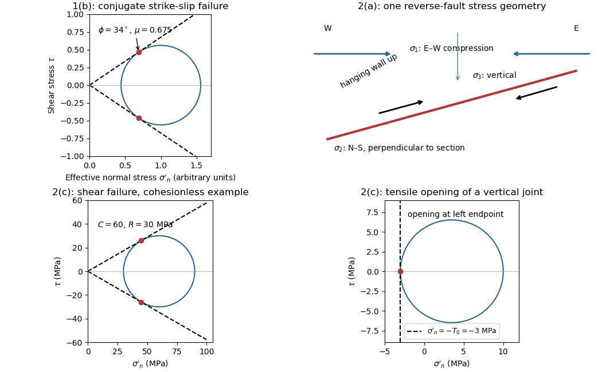

<h1 id="1/b/solution">Solution</h1>

↑ **Parent:** [B](../b.md)

Treat the two strands as newly formed [conjugate faults](../../../../../conjugate-fault.md) obeying the same [Mohr-Coulomb failure criterion](../../../../../mohr-coulomb-failure-criterion.md), rather than merely inherited [faults](../../../../../geological-fault.md) reactivated in a later [stress](../../../../../stress.md) field. A [fault strike](../../../../../fault-strike.md) is an unoriented line, so $296^\circ$ is equivalent to $116^\circ$. The acute angle between the [fault strikes](../../../../../fault-strike.md) is therefore $116^\circ-60^\circ=56^\circ$. The formal compressive acute bisector puts $\sigma_1$ at azimuth $88^\circ$ and $\sigma_3$ at $178^\circ$. This orientation must also be checked against the mapped senses of [strike-slip faulting](../../../../../strike-slip-faulting.md), as discussed below.

Let $\beta=28^\circ$ be the angle between either [fault plane](../../../../../fault-plane.md) and $\sigma_1$. Tangency of [Mohr's circle](../../../../../mohr-s-circle.md) to $|\tau|=c+\mu\sigma'_n$, where $\sigma'_n$ is [effective stress](../../../../../effective-stress.md) normal to the plane and $c$ is [cohesion](../../../../../cohesion.md), gives $\beta=45^\circ-\phi/2$ and $\mu=\tan\phi$. Thus

$$
\phi=90^\circ-56^\circ=34^\circ,\qquad \boxed{\mu=\tan34^\circ\simeq0.675}.
$$

In the [Mohr circle](../../../../../mohr-s-circle.md), the [fault planes](../../../../../fault-plane.md) are $112^\circ$ apart around the circle, because a physical plane rotation is doubled. The figure uses $c=0$ to display both tangencies; a common nonzero [cohesion](../../../../../cohesion.md) changes the intercept, not the inferred [friction angle](../../../../../friction-angle.md). The inference of $\mu$ requires optimally oriented [conjugate faults](../../../../../conjugate-fault.md) at formation: the two [fault strikes](../../../../../fault-strike.md) alone cannot measure a friction coefficient for arbitrarily reactivated [faults](../../../../../geological-fault.md).

**Consistency limitation:** the mapped westward motion of the Anatolian block corresponds to [left-lateral strike-slip faulting](../../../../../left-lateral-strike-slip-faulting.md) on the East Anatolian strand and [right-lateral strike-slip faulting](../../../../../right-lateral-strike-slip-faulting.md) on the North Anatolian strand. East–west maximum compression for the acute-bisector construction instead predicts the opposite pair. The stress orientation compatible with the mapped senses lies near the north–south, obtuse bisector; the planes are then about $62^\circ$ from $\sigma_1$, which would give $\phi=90^\circ-2(62^\circ)=-34^\circ$ in the optimal-formation formula. A negative friction angle is inadmissible for ordinary frictional strength. Thus **$0.675$ is the formal magnitude inferred from unoriented angles, while the full map does not support a self-consistent positive-friction, optimally formed conjugate pair**. The common-stress assumption can still describe inherited or anisotropically controlled [faults](../../../../../geological-fault.md), but then their orientations no longer determine a unique coefficient.

**[Figure 1](#1/b/image-conjugate-fault-friction-reverse-fault-stress-directions-and-shear-versus-tensile-failure). Conjugate-fault friction, reverse-fault stress directions, and shear versus tensile failure**.

## ↑ Ancestors (12)

1. [B](../b.md)
2. [1](../../1.md)
3. [Paper 1](../../../paper-1-split.md)
4. [2023](../../../split.md)
5. [Past exam of the year 2 of the earth sciences (geology) course of the University of Oxford](../../../../split.md)
6. [Year 2 of the earth sciences (geology) course of the University of Oxford](../../../../../year-2-of-the-earth-sciences-geology-course-of-the-university-of-oxford.md)
7. [Earth sciences (geology) course of the University of Oxford](../../../../../earth-sciences-geology-course-of-the-university-of-oxford.md)
8. [Undergraduate course of the University of Oxford](../../../../../undergraduate-course-of-the-university-of-oxford.md)
9. [Course of the University of Oxford](../../../../../course-of-the-university-of-oxford.md)
10. [University of Oxford](../../../../../university-of-oxford-split.md)
11. [List of universities](../../../../../list-of-universities.md)
12. [Codex Wiki](../../../../../split.md)
