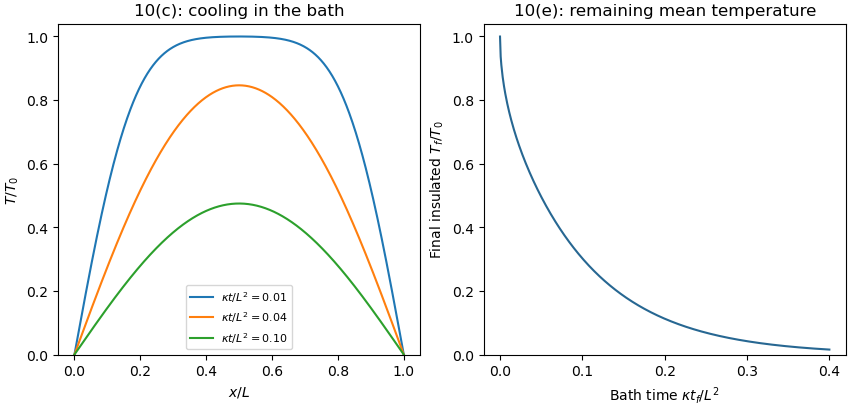

<h1 id="10/c/solution">Solution</h1>

↑ **Parent:** [C](../c.md)

The reference to part “(c)(i)” in the source is circular; the relevant modes are those verified in part (b)(i). [Linearity](../../../../../linearity.md) of the [heat equation](../../../../../heat-equation.md) and its homogeneous [Dirichlet boundary conditions](../../../../../dirichlet-boundary-condition.md) allows [superposition](../../../../../superposition-principle.md) of those modes:

$$
F_n(x)=\sin\frac{n\pi x}{L},\qquad \lambda_n=\kappa\frac{n^2\pi^2}{L^2},\qquad T(x,t)=\sum_{n=1}^{\infty}b_nF_n(x)e^{-\lambda_nt}.
$$

Match the initial uniform interior [temperature](../../../../../temperature-split.md) $T_0$ using the [orthogonality](../../../../../orthogonal-vectors.md) of the [Fourier sine series](../../../../../fourier-sine-series.md):

$$
b_n=\frac2L\int_0^LT_0\sin\frac{n\pi x}{L}\,dx=\frac{2T_0}{n\pi}\{1-(-1)^n\}.
$$

Thus **$b_n=0$ for [even integers](../../../../../even-number.md) $n$ and $b_n=4T_0/(n\pi)$ for [odd integers](../../../../../odd-integer.md) $n$**, giving

$$
T(x,t)=\frac{4T_0}{\pi}\sum_{j=0}^{\infty}\frac{\sin((2j+1)\pi x/L)}{2j+1}\exp\left[-\frac{(2j+1)^2\pi^2\kappa t}{L^2}\right].
$$

For every $t>0$, the exponential factor makes the series and the derivatives needed in the [heat equation](../../../../../heat-equation.md) converge uniformly on later time intervals. At $t=0$, the [Fourier sine series](../../../../../fourier-sine-series.md) equals $T_0$ at interior points but zero at the endpoints: the instantaneous cooling boundary condition is incompatible with the pre-immersion endpoint values. This corner mismatch is physically the idealization of an instantaneous bath contact and does not invalidate the solution for $t>0$.

**[Figure 6](#10/c/image-cooling-profiles-in-a-zero-temperature-bath-and-the-mean-temperature-retained-after-insulation). Cooling profiles in a zero-temperature bath and the mean temperature retained after insulation**.

## ↑ Ancestors (12)

1. [C](../c.md)
2. [10](../../10.md)
3. [Paper 1](../../../paper-1-split.md)
4. [2023](../../../split.md)
5. [Past exam of the year 2 of the earth sciences (geology) course of the University of Oxford](../../../../split.md)
6. [Year 2 of the earth sciences (geology) course of the University of Oxford](../../../../../year-2-of-the-earth-sciences-geology-course-of-the-university-of-oxford.md)
7. [Earth sciences (geology) course of the University of Oxford](../../../../../earth-sciences-geology-course-of-the-university-of-oxford.md)
8. [Undergraduate course of the University of Oxford](../../../../../undergraduate-course-of-the-university-of-oxford.md)
9. [Course of the University of Oxford](../../../../../course-of-the-university-of-oxford.md)
10. [University of Oxford](../../../../../university-of-oxford-split.md)
11. [List of universities](../../../../../list-of-universities.md)
12. [Codex Wiki](../../../../../split.md)
