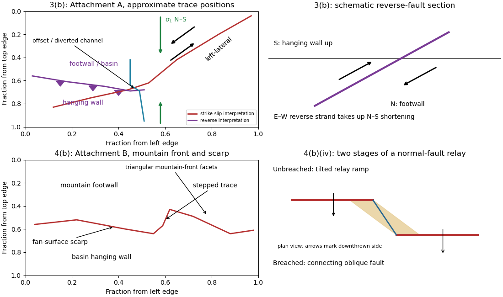

<h1 id="3/b/i/solution">Solution</h1>

↑ **Parent:** [I](../i.md)

A [displaced drainage](../../../../../../displaced-drainage.md) forms when repeated horizontal [fault slip](../../../../../../fault-slip.md) offsets a channel and its upstream and downstream reaches no longer line up. In plan view, draw two initially continuous channel reaches crossing the [fault](../../../../../../geological-fault.md), translate one side parallel to the [fault strike](../../../../../../fault-strike.md), and connect the reaches by a short fault-parallel reach. A [linear valley](../../../../../../linear-valley.md) develops where erosion follows damaged rock along a straight [fault zone](../../../../../../fault-zone.md).

In Attachment A, use the **oblique, relatively straight valley running southwest–northeast through the lower centre towards the upper right**. For an identifiable example, follow the central approximately north–south drainage to its bend near the southern edge of the central basin, about $(u,v)=(0.46,0.67)$, where $u$ is fraction from the left image edge and $v$ fraction from the top. Mark its deflected reach and the adjacent straight valley. The positional precision is at the level of the supplied image; establishing a numerical [fault offset](../../../../../../fault-offset.md) would require correlated piercing points and field checks.

**[Figure 2](#3/b/i/image-original-interpretive-sketches-for-attachments-a-and-b-with-normalized-image-positions-and-a-normal-fault-relay). Original interpretive sketches for Attachments A and B, with normalized image positions and a normal-fault relay**.

## ↑ Ancestors (13)

1. [I](../i.md)
2. [B](../../b.md)
3. [3](../../../3.md)
4. [Paper 1](../../../../paper-1-split.md)
5. [2023](../../../../split.md)
6. [Past exam of the year 2 of the earth sciences (geology) course of the University of Oxford](../../../../../split.md)
7. [Year 2 of the earth sciences (geology) course of the University of Oxford](../../../../../../year-2-of-the-earth-sciences-geology-course-of-the-university-of-oxford.md)
8. [Earth sciences (geology) course of the University of Oxford](../../../../../../earth-sciences-geology-course-of-the-university-of-oxford.md)
9. [Undergraduate course of the University of Oxford](../../../../../../undergraduate-course-of-the-university-of-oxford.md)
10. [Course of the University of Oxford](../../../../../../course-of-the-university-of-oxford.md)
11. [University of Oxford](../../../../../../university-of-oxford-split.md)
12. [List of universities](../../../../../../list-of-universities.md)
13. [Codex Wiki](../../../../../../split.md)
