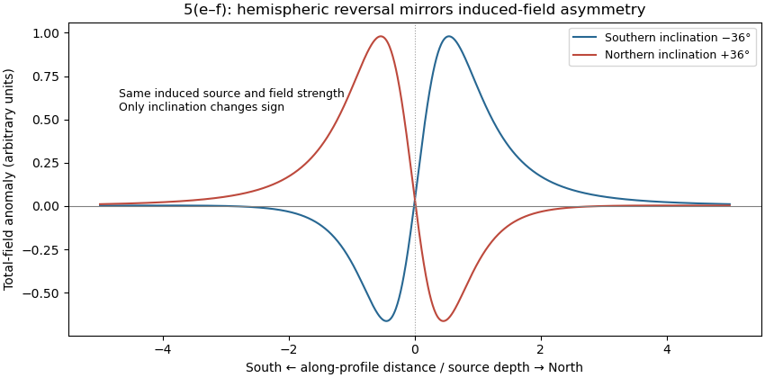

<h1 id="5/e/solution">Solution</h1>

↑ **Parent:** [E](../e.md)

Assume the [greenstone belt](../../../../../greenstone-belt.md) is more magnetically susceptible than the host rocks and [granite](../../../../../granite.md), its [magnetization](../../../../../magnetization.md) is mainly [induced magnetization](../../../../../induced-magnetization.md), and the body is roughly east–west elongated so that the south–north line crosses it. At southern magnetic latitudes the main field has negative [magnetic inclination](../../../../../magnetic-inclination.md) in a north-and-down coordinate convention. The [total-field magnetic anomaly](../../../../../total-field-magnetic-anomaly.md) is then generally asymmetric: **the principal negative lobe is on the southern side and the positive lobe is displaced northward** for the simple induced source illustrated here. The exact lobe sizes and peak positions depend on body geometry and the actual [magnetic inclination](../../../../../magnetic-inclination.md).[Examples 1–2: the low lies north at northern inclination and south at southern inclination](../../../../../magnetic-line-profiles-by-ubc-geophysical-inversion-facility.md)

An explicit sketching model is an induced [magnetic dipole](../../../../../magnetic-dipole.md) at depth $d$. With northward coordinate $x$, $\mathbf r=(x,-d)$ and unit field direction $\widehat{\mathbf F}=(\cos I,\sin I)$, its normalized [total-field magnetic anomaly](../../../../../total-field-magnetic-anomaly.md) is

$$
\Delta T(x)\propto\frac{3(\widehat{\mathbf F}\cdot\mathbf r)^2/(x^2+d^2)-1}{(x^2+d^2)^{3/2}}.
$$

The plot uses $I=-36^\circ$ only as an illustrative dipole-field inclination for a latitude near $20^\circ$ south, not a measured modern field at the site. A wide [greenstone belt](../../../../../greenstone-belt.md) would broaden the response and can produce prominent edge anomalies. [Remanent magnetization](../../../../../remanent-magnetization.md) or a magnetic [granite](../../../../../granite.md) could change the sketch substantially; [gravity](../../../../../gravity.md) alone cannot identify the magnetic source.

**[Figure 3](#5/e/image-induced-source-magnetic-anomalies-for-opposite-inclinations-on-a-south-north-profile). Induced-source magnetic anomalies for opposite inclinations on a south–north profile**.

## ↑ Ancestors (12)

1. [E](../e.md)
2. [5](../../5.md)
3. [Paper 1](../../../paper-1-split.md)
4. [2023](../../../split.md)
5. [Past exam of the year 2 of the earth sciences (geology) course of the University of Oxford](../../../../split.md)
6. [Year 2 of the earth sciences (geology) course of the University of Oxford](../../../../../year-2-of-the-earth-sciences-geology-course-of-the-university-of-oxford.md)
7. [Earth sciences (geology) course of the University of Oxford](../../../../../earth-sciences-geology-course-of-the-university-of-oxford.md)
8. [Undergraduate course of the University of Oxford](../../../../../undergraduate-course-of-the-university-of-oxford.md)
9. [Course of the University of Oxford](../../../../../course-of-the-university-of-oxford.md)
10. [University of Oxford](../../../../../university-of-oxford-split.md)
11. [List of universities](../../../../../list-of-universities.md)
12. [Codex Wiki](../../../../../split.md)
