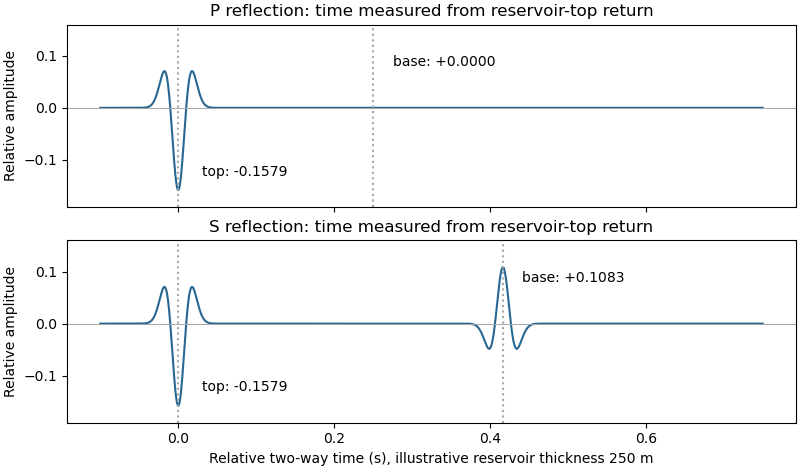

<h1 id="6/p/solution">Solution</h1>

↑ **Parent:** [P](../p.md)

Let a positive incident stress wavelet be $w(t)$ and measure return times relative to a receiver just above the reservoir. The top interface gives a negative P return of amplitude $-3/19$ and no basal P return. For a separately generated and measured S wave, the top return is also negative, $-3/19$, while the basal return is positive, $1/9$ at the lower interface.

If $h$ is reservoir thickness, the basal return arrives $2h/V_{P2}$ or $2h/V_{S2}$ after the top return; no numerical $h$ is supplied. Including downward and upward transmission through the top boundary, but ignoring [seismic attenuation](../../../../../seismic-attenuation.md), spreading and [seismic multiples](../../../../../seismic-multiple.md), its observed S-wave amplitude is

$$
T_{12}R_{23}T_{21}=(1-R_{12}^2)R_{23}=\frac{352}{361}\frac19\simeq+0.10834.
$$

Thus **the synthetic S trace has an earlier negative wavelet and a later, smaller positive wavelet; the synthetic P trace has only the earlier negative wavelet**. The figure chooses $h=250\ \mathrm m$ solely to separate the pulses visually. Receiver electronics or a displacement convention can reverse the displayed trace polarity, so the convention must accompany the sketch.

A marine [hydrophone](../../../../../hydrophone.md) streamer with a purely normal-incidence P source does not directly record the hypothetical S trace. A seabed multicomponent receiver and suitable S excitation or oblique-incidence [seismic mode conversion](../../../../../seismic-mode-conversion.md) are required. This distinguishes the calculated solid-layer response from what a particular acquisition system can measure.

**[Figure 4](#6/p/image-idealized-normal-incidence-p-and-s-reflection-wavelets-including-transmission-through-the-reservoir-top). Idealized normal-incidence P and S reflection wavelets, including transmission through the reservoir top**.

## ↑ Ancestors (12)

1. [P](../p.md)
2. [6](../../6.md)
3. [Paper 1](../../../paper-1-split.md)
4. [2023](../../../split.md)
5. [Past exam of the year 2 of the earth sciences (geology) course of the University of Oxford](../../../../split.md)
6. [Year 2 of the earth sciences (geology) course of the University of Oxford](../../../../../year-2-of-the-earth-sciences-geology-course-of-the-university-of-oxford.md)
7. [Earth sciences (geology) course of the University of Oxford](../../../../../earth-sciences-geology-course-of-the-university-of-oxford.md)
8. [Undergraduate course of the University of Oxford](../../../../../undergraduate-course-of-the-university-of-oxford.md)
9. [Course of the University of Oxford](../../../../../course-of-the-university-of-oxford.md)
10. [University of Oxford](../../../../../university-of-oxford-split.md)
11. [List of universities](../../../../../list-of-universities.md)
12. [Codex Wiki](../../../../../split.md)
