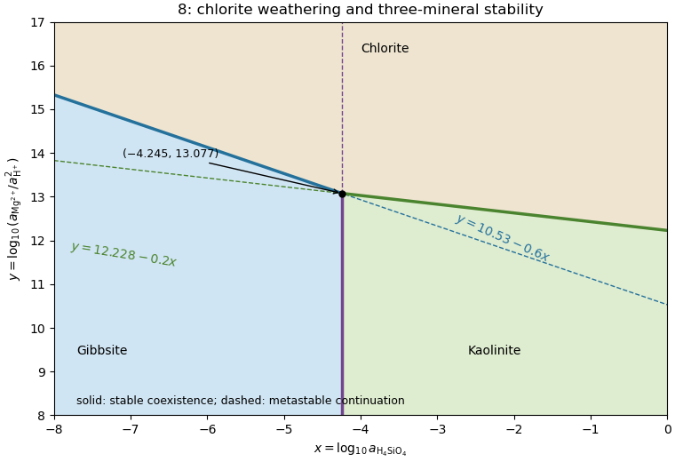

<h1 id="8/b/solution">Solution</h1>

↑ **Parent:** [B](../b.md)

Subtract the [chlorite](../../../../../chlorite.md)–[gibbsite](../../../../../gibbsite.md) reaction from the [chlorite](../../../../../chlorite.md)–[kaolinite](../../../../../kaolinite.md) reaction. The common [chlorite](../../../../../chlorite.md), protons and magnesium cancel, leaving

$$
2\,\mathrm{Al(OH)_3}+2\,\mathrm{H_4SiO_4}=\mathrm{Al_2Si_2O_5(OH)_4}+5\,\mathrm{H_2O}.
$$

This converts [gibbsite](../../../../../gibbsite.md) and dissolved silica into [kaolinite](../../../../../kaolinite.md). [Gibbs energies of reaction](../../../../../gibbs-energy-of-reaction.md) add with reaction stoichiometry, so decimal [logarithms](../../../../../logarithm.md) of [equilibrium constants](../../../../../equilibrium-constant.md) also subtract:

$$
\boxed{\log_{10}K=61.14-52.65=8.49}.
$$

With unit water and solid [thermodynamic activities](../../../../../thermodynamic-activity.md), $K=a_{\mathrm{H_4SiO_4}}^{-2}$; thus **$x=-8.49/2=-4.245$**, a vertical boundary. Reversing the reaction would give $\log_{10}K=-8.49$ and the same boundary. Its intersection with either sloping line is **$(x,y)=(-4.245,13.077)$**.

**[Figure 5](#8/b/image-stable-chlorite-gibbsite-and-kaolinite-fields-with-metastable-boundary-continuations). Stable chlorite, gibbsite and kaolinite fields with metastable boundary continuations**.

## ↑ Ancestors (12)

1. [B](../b.md)
2. [8](../../8.md)
3. [Paper 1](../../../paper-1-split.md)
4. [2023](../../../split.md)
5. [Past exam of the year 2 of the earth sciences (geology) course of the University of Oxford](../../../../split.md)
6. [Year 2 of the earth sciences (geology) course of the University of Oxford](../../../../../year-2-of-the-earth-sciences-geology-course-of-the-university-of-oxford.md)
7. [Earth sciences (geology) course of the University of Oxford](../../../../../earth-sciences-geology-course-of-the-university-of-oxford.md)
8. [Undergraduate course of the University of Oxford](../../../../../undergraduate-course-of-the-university-of-oxford.md)
9. [Course of the University of Oxford](../../../../../course-of-the-university-of-oxford.md)
10. [University of Oxford](../../../../../university-of-oxford-split.md)
11. [List of universities](../../../../../list-of-universities.md)
12. [Codex Wiki](../../../../../split.md)
